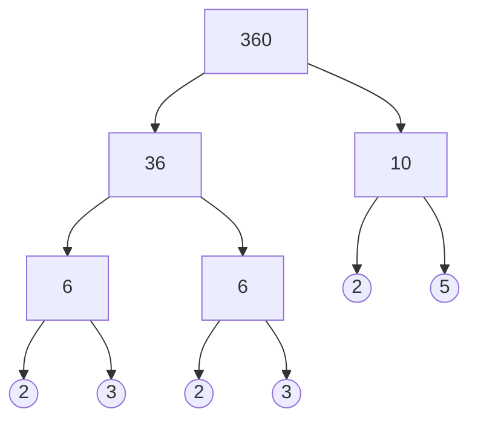

# Factors, multiples and primes

After this lesson you can list every factor of a number, tell primes from composite numbers, write a number as a product of primes, and find the greatest common factor and least common multiple of two numbers.

Before this: [multiplication and times tables](03-multiplication-and-times-tables.md), [division facts and remainders](06-division-facts-and-remainders.md) and [long division](07-long-division.md).

## Quick check

Try these first. If you get all three right, skip to [Practice](#practice).

1. List every factor of 48, and decide whether 91 is prime.
2. Write 1,260 as a product of primes, using exponents.
3. Find the greatest common factor and the least common multiple of 30 and 42.

<details class="solution" markdown>
<summary>Answers</summary>

1. The factors are 1, 2, 3, 4, 6, 8, 12, 16, 24 and 48, from the pairs $1 \times 48$, $2 \times 24$, $3 \times 16$, $4 \times 12$ and $6 \times 8$. The number 91 is not prime, because $91 = 7 \times 13$.
2. $1{,}260 = 2^2 \times 3^2 \times 5 \times 7$. Check: $4 \times 9 \times 5 \times 7 = 1{,}260$.
3. Since $30 = 2 \times 3 \times 5$ and $42 = 2 \times 3 \times 7$, the greatest common factor is $2 \times 3 = 6$ and the least common multiple is $2 \times 3 \times 5 \times 7 = 210$. Check: $6 \times 210 = 1{,}260 = 30 \times 42$.

</details>

## The idea

You are setting out 12 chairs in rows of equal length. Rows of 1, 2, 3, 4, 6 or 12 chairs all work, because 12 splits into rows of that size with none left over. These six numbers are the factors of 12.

Now try 13 chairs. Every row length except 1 and 13 leaves chairs over, so you get one long row or 13 rows of one chair, and nothing in between. A number like 13, which can't be set out as a real rectangle, is called prime. A number like 12, which can, is called composite.

Multiples go the other way. Counting by 4 gives 4, 8, 12, 16, and so on, the multiples of 4. So 12 is a multiple of 4, and 4 is a factor of 12: two ways of saying $12 = 3 \times 4$.

Every whole number above 1 breaks down into primes by multiplication, as in $12 = 2 \times 2 \times 3$, and always into the same primes. That fact makes the greatest common factor and least common multiple quick to find, and the next two lessons, on fractions, use both.

## Definitions

In this lesson every number is a whole number, and "factor" means a positive factor.

A whole number $a$ is a **factor** of a whole number $b$ when $b = ka$ for some whole number $k$. In the same situation, $b$ is a **multiple** of $a$. University courses also say that $a$ divides $b$, or that $a$ is a divisor of $b$, and write $a \mid b$ ([divisibility and modular arithmetic](../06-cs-math/02-number-theory/01-divisibility-and-modular-arithmetic.md)).

In plain words, a nonzero $a$ is a factor of $b$ when $b \div a$ leaves remainder 0. A few facts follow straight from the definition. The number 1 is a factor of every number, since $b = b \times 1$. Every number is a factor of itself and also a multiple of itself, since $b = 1 \times b$. And 0 is a multiple of every number, since $0 = 0 \times a$.

A **prime number** is a whole number greater than 1 whose only factors are 1 and itself. A **composite number** is a whole number greater than 1 that is not prime. The numbers 0 and 1 are neither prime nor composite.

Put simply, a prime has exactly two factors, and a composite number has at least three. A factor other than 1 and the number itself splits it into two smaller numbers, as in $12 = 3 \times 4$. The first primes are 2, 3, 5, 7, 11 and 13. The number 2 is the only even prime, because every other even number has 2 as a factor.

A **prime factorization** of a number writes it as a product of primes, such as $360 = 2 \times 2 \times 2 \times 3 \times 3 \times 5$. Repeated factors are grouped with exponents: $2^3$, read "2 cubed" or "2 to the power 3", means $2 \times 2 \times 2$, and $3^2$, read "3 squared", means $3 \times 3$. So

$$
360 = 2^3 \times 3^2 \times 5.
$$

The theorem behind this is the **fundamental theorem of arithmetic**: every whole number greater than 1 can be written as a product of primes in exactly one way, apart from the order of the factors. (A prime on its own counts as a product of one prime.) Its proof is in [primes and unique factorization](../06-cs-math/02-number-theory/03-primes-and-unique-factorization.md).

The theorem is the reason 1 is not called prime. If it were, then $2 \times 3$, $1 \times 2 \times 3$ and $1 \times 1 \times 2 \times 3$ would be three different prime factorizations of 6, and "exactly one way" would be false. Leaving 1 out keeps the theorem true as stated, and nothing is lost, because multiplying by 1 changes nothing.

A **common factor** of two numbers is a factor of both. The **greatest common factor** (GCF) of $a$ and $b$ is the largest of their common factors, written $\gcd(a, b)$. It is also called the greatest common divisor, or GCD, which is the name later lessons and Python use. Two numbers whose GCF is 1 are **relatively prime**, or coprime.

A **common multiple** of $a$ and $b$ is a multiple of both. The **least common multiple** (LCM) of two positive numbers is their smallest positive common multiple, written $\operatorname{lcm}(a, b)$. The word "positive" matters: 0 is a multiple of every number, so without it the LCM would always be 0.

For example, the factors of 12 are 1, 2, 3, 4, 6 and 12, and the factors of 18 are 1, 2, 3, 6, 9 and 18. The common factors are 1, 2, 3 and 6, so $\gcd(12, 18) = 6$. The multiples of 12 are 12, 24, 36, 48, and so on, and the multiples of 18 are 18, 36, 54, and so on; the first number in both lists is 36, so $\operatorname{lcm}(12, 18) = 36$. The numbers 8 and 15 are relatively prime even though neither is prime, because they share no factor except 1.

## How to do it

### Listing every factor

Factors come in pairs: when $a$ is a factor of $n$, so is $n \div a$, and the two multiply to $n$.

1. Write down the pair $1 \times n$.
2. Try 2, 3, 4 and so on, in order. Each time the trial number divides $n$ with remainder 0, write down the trial number and its partner, $n$ divided by the trial number.
3. Stop as soon as the trial number times itself is bigger than $n$. (That stopping point is the square root of $n$, written $\sqrt{n}$, which comes back in [roots, irrationals and types of numbers](../02-middle-school/04-powers-roots-and-real-numbers/03-roots-irrationals-and-types-of-numbers.md).)
4. Collect the factors: the trial numbers going up, then the partners going down. If some trial number $a$ has $a \times a = n$, write it only once.

Stopping at step 3 never misses a factor. If $n = a \times b$ with $a \le b$, then $a \times a \le a \times b = n$, so the smaller number of every pair is a trial number you reach before stopping, and the bigger one turns up as its partner.

For 36, the pairs are $1 \times 36$, $2 \times 18$, $3 \times 12$, $4 \times 9$ and $6 \times 6$, and the next trial number, 7, has $7 \times 7 = 49 > 36$. The nine factors are 1, 2, 3, 4, 6, 9, 12, 18 and 36; the count is odd because 6 pairs with itself.

### Testing whether a number is prime

To test a number $n$, divide it by each prime 2, 3, 5, 7, 11, and so on, and stop when the prime times itself is bigger than $n$. If none of them divides $n$, then $n$ is prime. Only primes need testing: if 4 or 6 divided $n$, then 2 would have divided it already.

For 97, the primes 2, 3, 5 and 7 all leave remainders, and $11 \times 11 = 121$ is bigger than 97, so 97 is prime. For 91, the primes 2, 3 and 5 leave remainders, but 7 doesn't: $91 = 7 \times 13$.

### The sieve of Eratosthenes

The **sieve of Eratosthenes** finds every prime up to a limit by crossing out multiples. For the primes under 100:

1. Write the numbers from 2 to 100. (Leave out 1, which is not prime.)
2. Circle the first number that is neither circled nor crossed out. It is prime.
3. Cross out every multiple of that prime, starting from the prime times itself.
4. Repeat steps 2 and 3. When the next number to circle, times itself, is bigger than 100, stop: every number still not crossed out is prime.

Running it, you circle 2, 3, 5 and 7 in turn and cross out their multiples; for 7 that means 49, 56, 63, 70, 77, 84, 91 and 98. The next number left is 11, and $11 \times 11 = 121$ is more than 100, so you are done.

Step 3 can start at the prime times itself because the smaller multiples are gone already: $3 \times 7 = 21$ was crossed out as a multiple of 3. Stopping at 7 is safe for the same reason as in the factor list: every composite number under 100 has a factor that is at most 9, and so a prime factor of 2, 3, 5 or 7.

These are the 25 primes under 100:

| Numbers | Primes |
|---|---|
| 1 to 10 | 2, 3, 5, 7 |
| 11 to 20 | 11, 13, 17, 19 |
| 21 to 30 | 23, 29 |
| 31 to 40 | 31, 37 |
| 41 to 50 | 41, 43, 47 |
| 51 to 60 | 53, 59 |
| 61 to 70 | 61, 67 |
| 71 to 80 | 71, 73, 79 |
| 81 to 90 | 83, 89 |
| 91 to 100 | 97 |

<div class="note" markdown>

The primes thin out as numbers grow (there are 25 under 100, but only 21 from 100 to 200), yet they never run out: there are infinitely many primes.

We want to show that no finite list contains every prime. Euclid's argument is a [proof by contradiction](../04-proofs-and-logic/03-core-proof-methods/06-proof-by-contradiction.md): it assumes the opposite and shows that this leads to something impossible. Suppose some finite list held every prime. Multiply all the primes on it together and add 1, and call the result $N$. Dividing $N$ by any prime on the list leaves remainder 1, so no prime on the list is a factor of $N$. But $N$ is bigger than 1, so it has a prime factorization, which needs a prime that is not on the list, and that contradicts the assumption.

Watch out: the argument doesn't say that $N$ is prime. For the list 2, 3, 5, 7, 11, 13 it gives $N = 30{,}031 = 59 \times 509$, and both of those are primes missing from the list.

Euclid's name is also on Euclid's algorithm<!-- link: ../06-cs-math/02-number-theory/02-gcd-and-euclids-algorithm.md -->, a fast way to find a GCF, previewed in [Tricks and shortcuts](#tricks-and-shortcuts).

</div>

### Prime factorization

A **factor tree** splits a number again and again until only primes are left.

1. Write the number at the top, and split it into any two factors, both bigger than 1.
2. Circle each branch that is prime: it is finished. Split each composite branch again, the same way.
3. Stop when every branch ends in a circled prime. Multiply the circled primes, grouping repeats with exponents and writing the smallest prime first.

The **ladder method** divides by primes in order, from the smallest up.

1. Divide the number by the smallest prime that goes into it, and write the quotient underneath.
2. Repeat with the quotient. Stay with the same prime while it still divides, then move up to the next prime.
3. Stop when the quotient is 1. The primes down the left side are the prime factorization.

Check either way by multiplying the primes back together.

### Finding the GCF and LCM

For small numbers, list. The GCF is the largest number in both factor lists. For the LCM, list the multiples of the larger number until you reach one that the smaller number divides.

For bigger numbers, use prime factorizations:

1. Write the prime factorization of each number, with exponents.
2. For the GCF, take each prime that appears in both factorizations, with the smaller of its two exponents, and multiply. If no prime is shared, the GCF is 1.
3. For the LCM, take each prime that appears in either factorization, with the larger of its exponents, and multiply.
4. Check: the GCF divides both numbers, both numbers divide the LCM, and the GCF times the LCM equals the product of the two numbers.

A common factor can use only primes that both numbers have, and no more copies of each than either has, hence the smaller exponent. A common multiple has to contain each number's whole factorization, hence the larger. The check in step 4 is a theorem.

*Theorem.* For positive whole numbers $a$ and $b$,

$$
\gcd(a, b) \times \operatorname{lcm}(a, b) = a \times b.
$$

We know how steps 2 and 3 choose exponents, and we want to show that both sides have the same prime factorization. The plan is to follow one prime at a time.

*Proof.* Take a prime $p$ that appears $m$ times in $a$ and $n$ times in $b$ (either count may be 0). The GCF uses the smaller of $m$ and $n$ copies of $p$, and the LCM uses the larger, so together they use $m + n$ copies. The product $a \times b$ also has $m + n$ copies of $p$. Every prime appears equally often on both sides, so the two sides are equal.

Look back: the proof pairs the smaller exponent with the larger one, and that pairing only exists for two numbers. For the three numbers 2, 3 and 4, the GCF is 1 and the LCM is 12, but $2 \times 3 \times 4 = 24$.

### Choosing GCF or LCM in a word problem

A problem needs the GCF when you split things into equal groups or pieces, as large as possible, with nothing left over ("largest", "split", "cut"). The answer is never bigger than the smallest number in the problem.

A problem needs the LCM when cycles of different lengths have to line up, or when items in different pack sizes have to come out equal ("next time together", "smallest number that"). The answer is never smaller than the largest number in the problem.

## Worked examples

<div class="example" markdown>

### Example 1: factoring 360 two ways

First with a factor tree. Step 1: split 360 into two factors you can see, say $360 = 36 \times 10$.

Step 2: neither branch is prime, so split both. Take $36 = 6 \times 6$ and $10 = 2 \times 5$, and circle the 2 and the 5. Each 6 is still composite, so split it as $6 = 2 \times 3$ and circle both primes:



Step 3: every branch now ends in a circled prime. The circled primes are three 2s, two 3s and one 5, so

$$
360 = 2^3 \times 3^2 \times 5.
$$

<div class="warning" markdown>

Watch out: a branch is finished only when it is prime. Stopping at $360 = 4 \times 9 \times 10$ gives a factorization, but not a prime factorization, because 4, 9 and 10 are composite. Before you write the answer, check each circled number against the table of primes.

</div>

Now the ladder. Step 1: the smallest prime that divides 360 is 2, and $360 \div 2 = 180$. Step 2: dividing by 2 twice more gives 90 and then 45, which is odd, so move up to 3. That gives 15 and then 5, and a final division by 5 reaches 1.

$$
\begin{array}{r|r}
2 & 360 \\
2 & 180 \\
2 & 90 \\
3 & 45 \\
3 & 15 \\
5 & 5 \\
 & 1
\end{array}
$$

Step 3: the left side reads 2, 2, 2, 3, 3, 5, the same primes as the tree.

Check: $8 \times 9 \times 5 = 72 \times 5 = 360$. A tree that starts with $360 = 2 \times 180$ ends with the same circled primes, as the fundamental theorem of arithmetic says it must.

</div>

<div class="example" markdown>

### Example 2: the GCF and LCM of 84 and 360

Listing would be slow here, since 360 has 24 factors. Use prime factorizations instead. Step 1: the ladder gives $84 = 2^2 \times 3 \times 7$ (from 84 to 42, 21, 7 and 1), and Example 1 gave $360 = 2^3 \times 3^2 \times 5$.

Steps 2 and 3 are easiest in a table. A prime that doesn't appear in a number gets exponent 0.

| Prime | Exponent in 84 | Exponent in 360 | GCF takes the smaller | LCM takes the larger |
|---|---|---|---|---|
| 2 | 2 | 3 | 2 | 3 |
| 3 | 1 | 2 | 1 | 2 |
| 5 | 0 | 1 | 0 | 1 |
| 7 | 1 | 0 | 0 | 1 |

So the GCF is $2^2 \times 3 = 12$, and the LCM is $2^3 \times 3^2 \times 5 \times 7 = 8 \times 9 \times 35 = 2{,}520$.

Step 4: the GCF 12 divides both numbers ($84 = 7 \times 12$ and $360 = 30 \times 12$), and both divide 2,520, which is $30 \times 84$ and $7 \times 360$. The product test holds as well: $12 \times 2{,}520 = 30{,}240 = 84 \times 360$.

</div>

<div class="example" markdown>

### Example 3: a GCF word problem

A course has 84 CS students and 60 economics students. The instructor wants as many project teams as possible, all with the same mix of students and nobody left out. How many teams, and who is on each?

The students are split into equal groups, so this is a GCF problem. Since $84 = 2^2 \times 3 \times 7$ and $60 = 2^2 \times 3 \times 5$, the GCF is $2^2 \times 3 = 12$. There are 12 teams, each with $84 \div 12 = 7$ CS students and $60 \div 12 = 5$ economics students.

Check: $12 \times 7 = 84$ and $12 \times 5 = 60$. The team sizes 7 and 5 share no factor but 1, so the teams can't be split again into more teams with the same mix.

</div>

<div class="example" markdown>

### Example 4: an LCM word problem

On a server, a backup job runs every 18 minutes and a report job every 24 minutes. Both run at 9:00. When do they next run at the same time?

The jobs repeat on cycles, so this is an LCM problem. The multiples of the larger number, 24, are 24, 48 and 72, and the first one that 18 divides is $72 = 4 \times 18$. The jobs line up every 72 minutes, so next at 10:12.

Check with primes: $18 = 2 \times 3^2$ and $24 = 2^3 \times 3$, so the LCM is $2^3 \times 3^2 = 72$. The product test agrees: the GCF is $2 \times 3 = 6$, and $6 \times 72 = 432 = 18 \times 24$.

</div>

## Edge cases and common mistakes

Forgetting to split a composite branch is flagged in Example 1, at the step where it happens. Here are the other cases.

<div class="warning" markdown>

Watch out: the number 1 is not prime, and 2 is, so a list of primes that starts "1, 3, 5, 7" has two mistakes. Odd is not the same as prime either: the numbers 51, 57, 87 and 91 look prime, but $51 = 3 \times 17$, $57 = 3 \times 19$, $87 = 3 \times 29$ and $91 = 7 \times 13$. The digit-sum test for 3 from the [divisibility rules](06-division-facts-and-remainders.md#divisibility-rules) catches the first three.

</div>

<div class="warning" markdown>

Watch out: the product of two numbers is always a common multiple, but not always the least one. For 12 and 18 the product is 216, while the LCM is 36. The product is the LCM exactly when the GCF is 1, as for 8 and 15, whose LCM is 120.

</div>

<div class="warning" markdown>

Watch out for swapping the GCF and the LCM. The GCF is at most the smaller number and the LCM is at least the larger one. If your "GCF" of 12 and 18 comes out as 36, you have found the LCM.

</div>

When one number divides the other, the GCF is the smaller number and the LCM is the larger. For 12 and 36, $\gcd(12, 36) = 12$ and $\operatorname{lcm}(12, 36) = 36$.

Zero is a special case. Every number is a factor of 0, since $0 = 0 \times a$, so 0 has no largest factor and isn't prime or composite. This lesson keeps the GCF and LCM to positive numbers; [divisibility and modular arithmetic](../06-cs-math/02-number-theory/01-divisibility-and-modular-arithmetic.md) handles 0 and negative numbers.

## Tricks and shortcuts

The [divisibility rules](06-division-facts-and-remainders.md#divisibility-rules) find small factors without dividing, and they speed up every factor list, prime test and ladder in this lesson.

The LCM follows from the GCF: $\operatorname{lcm}(a, b) = (a \div \gcd(a, b)) \times b$. For 18 and 24, the GCF is 6, so the LCM is $3 \times 24 = 72$. Dividing before multiplying keeps the numbers small.

Euclid's algorithm finds the GCF from remainders alone, with no factoring. Divide the larger number by the smaller, then divide the smaller number by the remainder, and keep going until the remainder is 0. The last nonzero remainder is the GCF. For 360 and 84:

$$
\begin{aligned}
360 &= 4 \times 84 + 24 \\
84 &= 3 \times 24 + 12 \\
24 &= 2 \times 12 + 0
\end{aligned}
$$

So $\gcd(360, 84) = 12$, as in Example 2. [GCD and Euclid's algorithm](../06-cs-math/02-number-theory/02-gcd-and-euclids-algorithm.md) proves that each step keeps the GCF the same, and shows why the method is fast even for numbers hundreds of digits long.

## In code

The sieve is the four steps above written out; `math.gcd` and `math.lcm` are Python's built-in GCF and LCM.

<details class="code" markdown>
<summary>In code</summary>

```python
import math

def primes_up_to(n):
    """Sieve of Eratosthenes: every prime from 2 to n."""
    is_prime = [True] * (n + 1)
    is_prime[0] = is_prime[1] = False        # 0 and 1 are not prime
    p = 2
    while p * p <= n:                        # stop once p times p passes n
        if is_prime[p]:
            for m in range(p * p, n + 1, p):  # start at p times p
                is_prime[m] = False
        p += 1
    return [k for k in range(2, n + 1) if is_prime[k]]

primes = primes_up_to(100)
print(len(primes), primes[-3:])              # 25 [83, 89, 97]
print(math.gcd(84, 360), math.lcm(84, 360))  # 12 2520
print(math.gcd(84, 360) * math.lcm(84, 360) == 84 * 360)  # True
print(math.lcm(2, 3, 4), math.gcd(8, 15))    # 12 1
```

</details>

## Practice

### Warm-up

1\. List every factor of 60. Which of them are prime?

<details class="solution" markdown>
<summary>Solution</summary>

Try 1, 2, 3, and so on, writing each factor with its partner: $1 \times 60$, $2 \times 30$, $3 \times 20$, $4 \times 15$, $5 \times 12$ and $6 \times 10$. The number 7 doesn't divide 60, and $8 \times 8 = 64$ is bigger than 60, so stop.

The factors are 1, 2, 3, 4, 5, 6, 10, 12, 15, 20, 30 and 60. The prime ones are 2, 3 and 5.

Check: six pairs give 12 factors, with none repeated, since 60 is not a number times itself. The primes also multiply back: $60 = 2^2 \times 3 \times 5$.

</details>

2\. Which of these numbers are prime: 51, 53, 57, 59, 87, 89?

<details class="solution" markdown>
<summary>Solution</summary>

Start with the digit-sum test for 3. The digit sums of 51, 57 and 87 are 6, 12 and 15, all multiples of 3, so $51 = 3 \times 17$, $57 = 3 \times 19$ and $87 = 3 \times 29$ are composite.

For 53, 59 and 89, the tests for 2, 3 and 5 all fail, and dividing by 7 leaves remainders: $53 = 7 \times 7 + 4$, $59 = 8 \times 7 + 3$ and $89 = 12 \times 7 + 5$. The next prime is 11, and $11 \times 11 = 121$ is bigger than all three, so 53, 59 and 89 are prime.

Check: all three appear in the table of primes under 100, and 51, 57 and 87 don't.

</details>

### Standard

3\. Write 504 and 540 as products of primes. Then find their GCF and LCM.

<details class="solution" markdown>
<summary>Solution</summary>

The ladder for 504 goes 504, 252, 126, 63, 21, 7, 1, dividing by 2, 2, 2, 3, 3, 7. So $504 = 2^3 \times 3^2 \times 7$. The ladder for 540 goes 540, 270, 135, 45, 15, 5, 1, dividing by 2, 2, 3, 3, 3, 5. So $540 = 2^2 \times 3^3 \times 5$.

For the GCF, the shared primes are 2 and 3, with smaller exponents 2 and 2: $2^2 \times 3^2 = 36$. For the LCM, take every prime with its larger exponent: $2^3 \times 3^3 \times 5 \times 7 = 8 \times 27 \times 35 = 7{,}560$.

Check: $504 \div 36 = 14$ and $540 \div 36 = 15$, and 14 and 15 share no factor but 1, so 36 is the greatest. Then $36 \times 7{,}560 = 272{,}160$ and $504 \times 540 = 272{,}160$.

</details>

4\. Decide whether each problem needs the GCF or the LCM, and solve it. (a) You have 84 pencils and 126 erasers to pack into identical kits, with nothing left over. What is the largest number of kits you can make, and what goes in each? (b) A store sells wieners in packs of 12 and buns in packs of 8. What is the smallest number of wieners you can buy to have exactly one bun for each?

<details class="solution" markdown>
<summary>Solution</summary>

(a) This splits items into equal groups, so it needs the GCF. Since $84 = 2^2 \times 3 \times 7$ and $126 = 2 \times 3^2 \times 7$, the GCF is $2 \times 3 \times 7 = 42$. You can make 42 kits, each with $84 \div 42 = 2$ pencils and $126 \div 42 = 3$ erasers.

(b) The amounts come in packs, and you want the first total that both pack sizes reach, so it needs the LCM. The multiples of 12 are 12 and 24, and 8 divides 24, so the LCM is 24. Buy 24 wieners and 24 buns: 2 packs of wieners and 3 packs of buns.

Check: (a) $42 \times 2 = 84$ and $42 \times 3 = 126$. (b) $2 \times 12 = 24 = 3 \times 8$, and 12, the only smaller multiple of 12, is not a multiple of 8.

</details>

### Challenge

5\. Two numbers have GCF 6 and LCM 180. One of them is 36. What is the other? Can two numbers have GCF 6 and LCM 100?

<details class="solution" markdown>
<summary>Solution</summary>

Use the theorem $\gcd(a, b) \times \operatorname{lcm}(a, b) = a \times b$. Here $6 \times 180 = 36 \times b$, so $1{,}080 = 36 \times b$ and $b = 1{,}080 \div 36 = 30$.

Check: $36 = 2^2 \times 3^2$ and $30 = 2 \times 3 \times 5$, so the GCF is $2 \times 3 = 6$ and the LCM is $2^2 \times 3^2 \times 5 = 180$.

For the second question, the answer is no. The GCF divides each number, and each number divides the LCM, so the GCF must divide the LCM. But 6 doesn't divide 100, since $100 = 16 \times 6 + 4$.

</details>

6\. This one reviews [long division](07-long-division.md). Decide whether 221 is prime. Which primes do you need to test, and why can you stop there?

<details class="solution" markdown>
<summary>Solution</summary>

Since $13 \times 13 = 169$ is at most 221 but $17 \times 17 = 289$ is bigger, you test the primes 2, 3, 5, 7, 11 and 13.

The number 221 is odd, its digit sum 5 is not a multiple of 3, and it doesn't end in 0 or 5. Long division by 7 gives quotient 31 and remainder 4, since $221 = 31 \times 7 + 4$. Long division by 11 gives quotient 20 and remainder 1. Long division by 13 gives quotient 17 and remainder 0, so $221 = 13 \times 17$, and 221 is composite.

Check: $13 \times 17 = 130 + 91 = 221$.

</details>

## Where this shows up

- The next two lessons use both tools: [fractions and equivalent fractions](09-fractions-and-equivalent-fractions.md) divides by the GCF to put a fraction in simplest form, and [adding and subtracting fractions](10-adding-and-subtracting-fractions.md) uses the LCM of the denominators.
- In CS math, [GCD and Euclid's algorithm](../06-cs-math/02-number-theory/02-gcd-and-euclids-algorithm.md) and [primes and unique factorization](../06-cs-math/02-number-theory/03-primes-and-unique-factorization.md) prove the facts used here. [RSA cryptography](../06-cs-math/02-number-theory/06-rsa-cryptography.md) rests on a gap: multiplying two large primes is fast, but no fast method is known for factoring the product.
- Scheduling uses the LCM: two loops or timers with periods 18 and 24 line up every 72 steps, as in Example 4.
