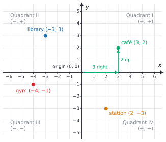
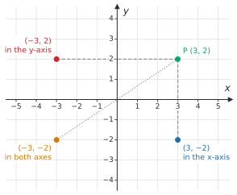
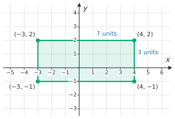
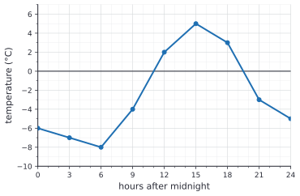
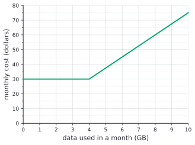

# The coordinate plane

After this lesson you can plot and read points in all four quadrants, find the horizontal and vertical distance between two points, reflect a point in an axis, and read values off a real graph.

Before this: [negative numbers and absolute value](../01-integers-and-rational-numbers/01-negative-numbers-and-absolute-value.md), and the first-quadrant grid in [geometry basics](../../01-elementary/16-geometry-basics-area-perimeter-volume.md#shapes-on-a-grid).

## Quick check

Try these first. If you get all three right, skip to [Practice](#practice).

1. Where is each point: $(-3, 5)$, $(4, -2)$ and $(0, -4)$?
2. How far apart are $(-2, 7)$ and $(-2, -5)$?
3. Reflect the point $(4, -1)$ in the $x$-axis, and then reflect the original point in the $y$-axis.

<details class="solution" markdown>
<summary>Answers</summary>

1. The point $(-3, 5)$ is in quadrant II (left and up), $(4, -2)$ is in quadrant IV (right and down), and $(0, -4)$ is on the $y$-axis, 4 units below the origin, so it is in no quadrant.
2. They have the same $x$-coordinate, so the distance is vertical: $\lvert 7 - (-5) \rvert = \lvert 12 \rvert = 12$ units.
3. In the $x$-axis the $y$-coordinate changes sign, giving $(4, 1)$. In the $y$-axis the $x$-coordinate changes sign, giving $(-4, -1)$.

</details>

## The idea

A number line places a number with one coordinate: a temperature of $-8$°C is 8 units to the left of 0. A map needs two numbers, because a place can be east or west and also north or south. Picture a town whose two main streets cross at right angles. Measure every place in blocks from that crossing, counting east and north as positive and west and south as negative. A café 3 blocks east and 2 blocks north is at $(3, 2)$. A gym 4 blocks west and 1 block south is at $(-4, -1)$.



The two streets are two number lines: one across, one up and down, crossing at their zeros. Every point on the page gets a pair of numbers, and every pair of numbers gets a point. The first number says how far to go across and the second how far to go up, so the order matters: 3 east and 2 north is a different place from 2 east and 3 north. The negative numbers from [negative numbers and absolute value](../01-integers-and-rational-numbers/01-negative-numbers-and-absolute-value.md) are what let the grid extend left of the crossing and below it.

Once points have coordinates, questions about the picture turn into arithmetic. How far is the café from a bus stop on the same street? Subtract coordinates. Where is the mirror image of the café across the east-west street? Change one sign. Turning pictures into numbers is what coordinates are for, and every graph in the rest of this book works this way.

## Definitions

The **coordinate plane** (also called the Cartesian plane) is a flat surface with two number lines drawn at right angles, crossing at their zeros. The horizontal line is the **$x$-axis**, with positive numbers to the right. The vertical line is the **$y$-axis**, with positive numbers upward. The point where they cross is the **origin**, written $(0, 0)$.

An **ordered pair** $(a, b)$ is a pair of numbers in which the order counts. Two ordered pairs are equal exactly when their first numbers are equal and their second numbers are equal: $(a, b) = (c, d)$ means $a = c$ and $b = d$.

In plain words, $(2, 5)$ and $(5, 2)$ are different ordered pairs, even though they use the same two numbers. A set such as $\{2, 5\}$ ignores order, and an ordered pair does not.

Each point $P$ in the plane matches exactly one ordered pair $(a, b)$, its **coordinates**. The first number $a$ is the **$x$-coordinate**: it says how far $P$ is to the right of the $y$-axis (to the left, if $a$ is negative). The second number $b$ is the **$y$-coordinate**: it says how far $P$ is above the $x$-axis (below, if $b$ is negative). We write $P(a, b)$ or $P = (a, b)$. For example, the station at $(2, -3)$ is 2 units right of the $y$-axis and 3 units below the $x$-axis.

The two axes cut the plane into four regions called **quadrants**, numbered I, II, III and IV, starting at the top right and going counterclockwise. A point on an axis belongs to no quadrant.

| Region | $x$-coordinate | $y$-coordinate | Example |
|---|---|---|---|
| quadrant I | positive | positive | $(3, 2)$ |
| quadrant II | negative | positive | $(-3, 3)$ |
| quadrant III | negative | negative | $(-4, -1)$ |
| quadrant IV | positive | negative | $(2, -3)$ |
| the $x$-axis | any | $0$ | $(-6, 0)$ |
| the $y$-axis | $0$ | any | $(0, 4.5)$ |

In plain words, the sign of $x$ tells you the side (left or right of the $y$-axis), and the sign of $y$ tells you the level (above or below the $x$-axis). The origin is on both axes.

The **reflection** of a point in a line is its mirror image: the point on the other side of the line, at the same distance from it, along a path that meets the line at a right angle. Reflecting the café $(3, 2)$ in the $x$-axis gives $(3, -2)$, the same distance below the axis as the café is above it.

## How to do it

### Plotting a point

1. Start at the origin.
2. Move along the $x$-axis by the $x$-coordinate: right if it is positive, left if it is negative, not at all if it is 0.
3. From there, move parallel to the $y$-axis by the $y$-coordinate: up if it is positive, down if it is negative.
4. Mark the point and label it with its coordinates.
5. Check: the signs of the coordinates should match the quadrant you landed in (see the table above).

### Reading the coordinates of a point

1. From the point, go straight up or down to the $x$-axis. The number you hit is the $x$-coordinate.
2. From the point, go straight across to the $y$-axis. The number you hit is the $y$-coordinate.
3. Write the pair with $x$ first: $(x, y)$.
4. Check the signs against the quadrant.

Watch out at Step 1: before you read a number, look at how far apart the grid lines are. On many real graphs one grid line is 2, 5 or 100 units, not 1.

### Horizontal and vertical distance

Two points with the same $y$-coordinate lie on one horizontal line, so the distance between them is a distance on a number line. Write the two points as $(x_1, y)$ and $(x_2, y)$, where $x_1$ (read "$x$ sub 1" or "$x$ one") is the $x$-coordinate of the first point and $x_2$ that of the second. Then

$$
\text{horizontal distance} = \lvert x_2 - x_1 \rvert.
$$

In the same way, two points $(x, y_1)$ and $(x, y_2)$ with the same $x$-coordinate lie on one vertical line, and

$$
\text{vertical distance} = \lvert y_2 - y_1 \rvert.
$$

These are the distance formula $\lvert a - b \rvert$ from [negative numbers and absolute value](../01-integers-and-rational-numbers/01-negative-numbers-and-absolute-value.md), applied to the coordinate that changes. The coordinate that stays the same plays no part.

1. Check that the two points share a coordinate. If they share $y$, the distance is horizontal; if they share $x$, it is vertical.
2. Subtract the other coordinates, in either order.
3. Take the absolute value. A distance is never negative.
4. Check by counting grid squares, or with "same side, subtract; opposite sides, add".

If the points share neither coordinate, the segment between them is slanted. Its length comes from [the Pythagorean theorem](../06-geometry/04-pythagorean-theorem.md), which uses the horizontal and vertical distances as the two short sides of a right triangle.

### Reflecting in an axis

Reflecting in the $x$-axis keeps a point the same distance from the axis but moves it to the other side, so only the $y$-coordinate changes, and it changes sign:

| Reflect $(a, b)$ in | Result | Example with $(3, 2)$ |
|---|---|---|
| the $x$-axis | $(a, -b)$ | $(3, -2)$ |
| the $y$-axis | $(-a, b)$ | $(-3, 2)$ |
| both axes, one after the other | $(-a, -b)$ | $(-3, -2)$ |



A memory aid: the axis you reflect in is the coordinate that survives. Reflecting in the $x$-axis keeps $x$ and flips the sign of $y$.

### Reading a real graph

1. Read the labels on both axes: what each one measures, and in what unit.
2. Work out the scale of each axis: how much one grid step is worth.
3. To find the output for a given input, find the input on the horizontal axis, go straight up (or down) to the graph, then straight across to the vertical axis and read the value.
4. To find the input for a given output, do Step 3 backwards: across from the vertical axis to the graph, then down to the horizontal axis. There may be more than one answer, or none.
5. Answer with units, and say "about" when you are reading between grid lines.

## Worked examples

<div class="example" markdown>

### Example 1: a rectangle on the grid

Three corners of a rectangle are $(-3, 2)$, $(4, 2)$ and $(4, -1)$. Find the fourth corner, the side lengths, the perimeter and the area. Which quadrant is each corner in?

Plot the three points. For $(-3, 2)$, Step 2 moves 3 left and Step 3 moves 2 up. For $(4, 2)$, move 4 right and 2 up. For $(4, -1)$, move 4 right and 1 down.



The sides of this rectangle run along grid lines. The top side goes from $(-3, 2)$ to $(4, 2)$, and the right side goes down from $(4, 2)$ to $(4, -1)$. The fourth corner is below $(-3, 2)$ and level with $(4, -1)$, so it takes its $x$-coordinate from the first and its $y$-coordinate from the second: $(-3, -1)$.

The top side is horizontal, since both ends have $y = 2$. Its length is the horizontal distance:

$$
\lvert 4 - (-3) \rvert = \lvert 7 \rvert = 7.
$$

The right side is vertical, since both ends have $x = 4$. Its length is the vertical distance:

$$
\lvert -1 - 2 \rvert = \lvert -3 \rvert = 3.
$$

<div class="warning" markdown>

Watch out at Step 2 of the distance method: $4 - 3 = 1$ is not the width. The left side is at $-3$, not 3, and subtracting a negative adds: $4 - (-3) = 4 + 3 = 7$. The two corners are on opposite sides of the $y$-axis, so their distances from it add.

</div>

The rectangle is 7 units by 3 units. Its perimeter is $2 \times 7 + 2 \times 3 = 20$ units, and its area is $7 \times 3 = 21$ square units.

For the quadrants, read the signs: $(4, 2)$ has both signs positive, so it is in quadrant I; $(-3, 2)$ is in quadrant II; $(-3, -1)$ is in quadrant III; and $(4, -1)$ is in quadrant IV. This rectangle surrounds the origin, so it has one corner in each quadrant.

Check by counting grid squares in the figure: 7 squares across the top and 3 down the side. The fourth corner also makes the opposite sides match: from $(-3, -1)$ to $(4, -1)$ is $\lvert 4 - (-3) \rvert = 7$, the same as the top.

</div>

<div class="example" markdown>

### Example 2: reflecting a triangle

A triangle has corners $A(1, 4)$, $B(5, 1)$ and $C(2, -2)$. Reflect it in the $y$-axis, and then reflect the original triangle in the $x$-axis.

In the $y$-axis, each $x$-coordinate changes sign and each $y$-coordinate stays: $A$ goes to $(-1, 4)$, $B$ to $(-5, 1)$ and $C$ to $(-2, -2)$.

In the $x$-axis, each $y$-coordinate changes sign: $A$ goes to $(1, -4)$, $B$ to $(5, -1)$ and $C$ to $(2, 2)$. A point below the axis moves above it, which is why $C$ ends up with a positive $y$-coordinate.

Check one point by distance. $C(2, -2)$ is 2 units below the $x$-axis, and its image $(2, 2)$ is 2 units above it, on the same vertical line. The distance between them is $\lvert 2 - (-2) \rvert = 4$, twice the distance to the axis, as a mirror image should be.

</div>

<div class="example" markdown>

### Example 3: a day of temperatures

The graph shows the temperature on a cold spring day, read every 3 hours from midnight to the next midnight and joined by straight lines. The horizontal axis is hours after midnight, and the vertical axis is the temperature in degrees Celsius.



(a) What was the temperature at 9:00? Steps 1 and 2: the horizontal axis is labelled every 3 hours, and the vertical axis every 2 degrees with a grid line every degree. Step 3: go up from 9 to the graph and across to the vertical axis. The reading is $-4$°C. The point is $(9, -4)$, in quadrant IV, because the time is positive and the temperature is negative.

(b) What were the lowest and highest readings, and how far apart are they? The lowest point is $(6, -8)$ and the highest is $(15, 5)$: $-8$°C at 6:00 and 5°C at 15:00. The gap between the two temperatures is a vertical distance, $\lvert 5 - (-8) \rvert = 13$ degrees.

(c) When was it 0°C? Step 4: the graph crosses the horizontal line at 0 twice. The first crossing is between 9:00 and 12:00, about two thirds of the way along, so about 11:00. The second is between 18:00 and 21:00, about halfway, so about 19:30. Both are readings between grid lines, so they are estimates. (Joining readings with straight lines is itself a guess about what happened between them.)

Check (b) by counting: from $-8$ up to 0 is 8 degrees and from 0 up to 5 is 5 more, so 13 degrees in all.

</div>

<div class="example" markdown>

### Example 4: plotting a table of values (finish it yourself)

Make a table of values for $y = 2x - 1$ with $x$ from $-2$ to 2, plot the points, and describe where they lie.

Substitute each value of $x$ ([variables and expressions](../03-expressions-equations-inequalities/01-variables-and-expressions.md)):

| $x$ | $y = 2x - 1$ | Point |
|---|---|---|
| $-2$ | $2(-2) - 1 = -5$ | $(-2, -5)$ |
| $-1$ | $2(-1) - 1 = -3$ | $(-1, -3)$ |
| $0$ | $2(0) - 1 = -1$ | $(0, -1)$ |
| $1$ | | |
| $2$ | | |

Fill in the last two rows, plot all five points, say which quadrant or axis each one is on, and describe the pattern.

<details class="solution" markdown>
<summary>Finish</summary>

For $x = 1$, $y = 2(1) - 1 = 1$, giving $(1, 1)$. For $x = 2$, $y = 2(2) - 1 = 3$, giving $(2, 3)$.

The points $(-2, -5)$ and $(-1, -3)$ are in quadrant III, $(0, -1)$ is on the $y$-axis, and $(1, 1)$ and $(2, 3)$ are in quadrant I. They lie on a straight line: each step of 1 to the right goes 2 up.

Check one point by substitution: at $(2, 3)$, the right side is $2 \times 2 - 1 = 3$, which matches $y = 3$. The steady "1 right, 2 up" is the slope of the line, which the next lesson measures.

</details>

</div>

## Edge cases and common mistakes

<div class="warning" markdown>

Watch out for the order. The point $(2, 5)$ is 2 right and 5 up; $(5, 2)$ is 5 right and 2 up. Swapping them plots a different point, and nothing on the grid warns you. Say the rule as you plot: across first, then up.

</div>

<div class="warning" markdown>

Watch out for points on an axis. The point $(0, 5)$ has $x = 0$, so it is on the $y$-axis, not the $x$-axis. A coordinate of 0 puts the point on the other axis: $x = 0$ means "no move across", which leaves you on the vertical line. Points on an axis are in no quadrant.

</div>

<div class="warning" markdown>

Watch out for the axis named in a reflection. Reflecting in the $x$-axis changes the sign of the $y$-coordinate, not the $x$-coordinate. Reflecting $(3, 2)$ in the $x$-axis gives $(3, -2)$; changing the sign of $x$ instead gives $(-3, 2)$, which is the reflection in the $y$-axis.

</div>

<div class="warning" markdown>

Watch out for distance across an axis. From $(-6, 1)$ to $(2, 1)$ is $\lvert 2 - (-6) \rvert = 8$, not $2 - 6$ or 4. Subtract the coordinates as signed numbers, then take the absolute value.

</div>

On a real graph, the vertical axis might not start at 0. A graph of a share price whose vertical axis runs from \$98 to \$102 makes a move from \$99 to \$101, a rise of about 2%, look like a cliff. Read the numbers on the axis, not the shape alone. Some graphs mark a cut-off axis with a small zigzag near the origin.

A point can have fractions or decimals as coordinates, such as $(-2.5, \frac{1}{3})$. It sits between grid lines, and that is fine: the grid is only a guide, and every point of the plane has coordinates.

## Tricks and shortcuts

The quadrants are numbered counterclockwise, starting from the top right, where both coordinates are positive. If you forget the order, rebuild it from the signs: quadrant I is $(+, +)$, and each quadrant after it flips one sign, giving $(-, +)$, $(-, -)$ and $(+, -)$. Counterclockwise is also the direction in which angles are measured in [radians and the unit circle](../../03-high-school/09-trigonometry/02-radians-and-the-unit-circle.md), so the numbering will not change on you later.

To find the point halfway between two points on a horizontal line, average the $x$-coordinates. Halfway between $(-3, 2)$ and $(4, 2)$ is $(\frac{-3 + 4}{2}, 2) = (0.5, 2)$, which is 3.5 units from each end. The same averaging works for both coordinates of every pair of points; the midpoint formula comes back in [coordinate geometry and circles](../../03-high-school/08-geometry-and-proof/04-coordinate-geometry-and-circles.md).

The distance from a point to an axis is the absolute value of the other coordinate. The point $(-7, 3)$ is 3 units from the $x$-axis and 7 units from the $y$-axis. This also gives a quick check on reflections: a point and its image in the $y$-axis are $2 \lvert x \rvert$ apart.

## In code

A point in Python is a tuple, and tuples compare in order, the same way ordered pairs do. The functions below do the sign tests from the quadrant table and the reflections.

<details class="code" markdown>
<summary>In code</summary>

```python
def quadrant(x, y):
    if x == 0 or y == 0:
        return "on an axis"
    if x > 0:
        return "I" if y > 0 else "IV"
    return "II" if y > 0 else "III"

def reflect_in_x_axis(point):
    x, y = point
    return (x, -y)

def reflect_in_y_axis(point):
    x, y = point
    return (-x, y)

cafe, gym = (3, 2), (-4, -1)
print(quadrant(*cafe), quadrant(*gym), quadrant(0, -4))  # I III on an axis
print(reflect_in_x_axis(cafe), reflect_in_y_axis(cafe))  # (3, -2) (-3, 2)
print((2, 5) == (5, 2), {2, 5} == {5, 2})                # False True
```

The star in `quadrant(*cafe)` unpacks the tuple into two arguments. The last line shows the difference between an ordered pair and a set: the tuples differ, but the sets are equal, because a set ignores order.

</details>

## FAQ

### Why does $x$ come first?

It is a convention, and every textbook, calculator and plotting library follows it, so $(3, 2)$ means the same point to everyone. Across and then up also matches how a graph is usually read: you pick an input on the horizontal axis and look up to find its output. The next lessons depend on this, since $(x, y)$ will be (input, output).

### Why do screens and arrays seem to do it differently?

They use their own conventions, and they trip up many programmers. On a computer screen, in HTML canvas and SVG for example, the origin is the top-left corner and $y$ increases downward, because the screen is drawn in rows from the top. A two-dimensional array is indexed `grid[row][column]`, which puts the vertical position first. When you move between math and code, check where the origin is, which way $y$ points, and which coordinate comes first.

### Is $(3, 4)$ a point or an interval?

The same notation means two things. In this chapter $(3, 4)$ is an ordered pair, a point. In interval notation, $(3, 4)$ means every number strictly between 3 and 4 on the number line ([compound inequalities and interval notation](../../03-high-school/01-algebra-foundations/03-compound-inequalities-and-interval-notation.md)). The context tells you which one is meant.

### How do I find the distance between two points that aren't lined up?

Draw the horizontal and vertical distances as the two short sides of a right triangle; the segment you want is the long side. For $(1, 1)$ and $(4, 5)$, the short sides are 3 and 4, and [the Pythagorean theorem](../06-geometry/04-pythagorean-theorem.md) gives a length of 5.

## Practice

### Warm-up

1\. Say which quadrant or axis each point is on: (a) $(-7, 2)$, (b) $(5, -5)$, (c) $(0, -3)$, (d) $(-1.5, -8)$, (e) $(6, 0)$.

<details class="solution" markdown>
<summary>Solution</summary>

- (a) $x$ negative, $y$ positive: quadrant II.
- (b) $x$ positive, $y$ negative: quadrant IV.
- (c) $x = 0$: on the $y$-axis, 3 units below the origin.
- (d) Both negative: quadrant III.
- (e) $y = 0$: on the $x$-axis, 6 units right of the origin.

Check with the table of signs: quadrant II is $(-, +)$, quadrant IV is $(+, -)$ and quadrant III is $(-, -)$.

</details>

2\. Write the coordinates of each point. (a) The point 4 units left of the $y$-axis and 7 units below the $x$-axis. (b) The point on the $x$-axis 3 units left of the origin. (c) The point on the $y$-axis 2.5 units above the origin.

<details class="solution" markdown>
<summary>Solution</summary>

- (a) Left is negative $x$ and below is negative $y$: $(-4, -7)$.
- (b) On the $x$-axis, so $y = 0$: $(-3, 0)$.
- (c) On the $y$-axis, so $x = 0$: $(0, 2.5)$.

Check (a) by plotting: from the origin go 4 left, then 7 down, and you are in quadrant III, which matches two negative coordinates.

</details>

3\. Find the distance between each pair of points: (a) $(-4, 3)$ and $(5, 3)$, (b) $(2, -6)$ and $(2, 1)$, (c) $(-8, -2)$ and $(-3, -2)$.

<details class="solution" markdown>
<summary>Solution</summary>

- (a) Same $y$, so the distance is horizontal: $\lvert 5 - (-4) \rvert = 9$.
- (b) Same $x$, so the distance is vertical: $\lvert 1 - (-6) \rvert = 7$.
- (c) Same $y$: $\lvert -3 - (-8) \rvert = \lvert 5 \rvert = 5$.

Check with "same side, subtract; opposite sides, add": in (a), $-4$ and 5 are on opposite sides of 0, so $4 + 5 = 9$. In (c), $-8$ and $-3$ are on the same side, so $8 - 3 = 5$.

</details>

### Standard

4\. Reflect $P(-5, 2)$ in the $x$-axis, in the $y$-axis, and in both axes. Give the quadrant of $P$ and of each image.

<details class="solution" markdown>
<summary>Solution</summary>

$P$ is in quadrant II.

- In the $x$-axis, $y$ changes sign: $(-5, -2)$, in quadrant III.
- In the $y$-axis, $x$ changes sign: $(5, 2)$, in quadrant I.
- In both axes, both signs change: $(5, -2)$, in quadrant IV.

Check: $P$ is 2 units above the $x$-axis and $(-5, -2)$ is 2 units below it, on the same vertical line. The four points are the corners of a rectangle centred on the origin, one in each quadrant.

</details>

5\. The graph shows the monthly cost of a phone plan against the data used.



(a) What does the plan cost if you use 3 GB? (b) What does it cost if you use 6 GB? (c) How much data can you use for \$60? (d) How much does each GB beyond 4 GB cost?

<details class="solution" markdown>
<summary>Solution</summary>

The horizontal axis is in GB, one grid line per GB. The vertical axis is in dollars, labelled every \$10 with a faint grid line every \$5.

- (a) Up from 3 to the graph, then across: \$30. The flat part means every month costs \$30 for the first 4 GB, even if you use none.
- (b) Up from 6, then across: the graph is halfway between \$40 and \$50, so \$45.
- (c) Across from 60 to the graph, then down: 8 GB.
- (d) From 4 GB to 8 GB the cost goes from \$30 to \$60, a rise of \$30 for 4 GB, which is $30 \div 4 = 7.50$ dollars per GB.

Check (b) with (d): 6 GB is 2 GB past the first 4, so the cost is $30 + 2 \times 7.50 = 45$ dollars. And at 10 GB, $30 + 6 \times 7.50 = 75$, which matches the end of the graph.

</details>

6\. One side of a square runs from $(-1, -2)$ to $(4, -2)$, and the rest of the square lies above that side. Find the other two corners, the perimeter and the area.

<details class="solution" markdown>
<summary>Solution</summary>

The given side is horizontal, with length $\lvert 4 - (-1) \rvert = 5$. A square has four equal sides, so the other corners are 5 units straight above the first two. Adding 5 to each $y$-coordinate gives $(-1, 3)$ and $(4, 3)$.

The perimeter is $4 \times 5 = 20$ units and the area is $5 \times 5 = 25$ square units.

Check: the left side runs from $(-1, -2)$ to $(-1, 3)$, a vertical distance of $\lvert 3 - (-2) \rvert = 5$, the same as the bottom.

</details>

### Challenge

7\. A point $P$ is in quadrant II, 3 units from the $x$-axis and 8 units from the $y$-axis. (a) Find $P$. (b) Reflect $P$ in the $y$-axis, and find the distance between $P$ and its image. (c) Explain why a point $(a, b)$ and its reflection in the $y$-axis are always $2 \lvert a \rvert$ apart.

<details class="solution" markdown>
<summary>Solution</summary>

(a) In quadrant II, $x$ is negative and $y$ is positive. The distance to the $y$-axis is the size of the $x$-coordinate, so $x = -8$; the distance to the $x$-axis is the size of the $y$-coordinate, so $y = 3$. The point is $P(-8, 3)$.

(b) The image is $(8, 3)$. The two points share $y = 3$, so the distance is $\lvert 8 - (-8) \rvert = 16$.

(c) The image of $(a, b)$ is $(-a, b)$. They share the $y$-coordinate, so the distance is $\lvert a - (-a) \rvert = \lvert 2a \rvert = 2 \lvert a \rvert$. In words: the point is $\lvert a \rvert$ from the mirror, and so is its image, on the other side.

Check (b) with (c): $2 \lvert -8 \rvert = 16$.

</details>

8\. (Reviews [negative numbers and absolute value](../01-integers-and-rational-numbers/01-negative-numbers-and-absolute-value.md).) The point $(k, 7)$ is 12 units from $(-5, 7)$. Find every possible value of $k$.

<details class="solution" markdown>
<summary>Solution</summary>

The points share $y = 7$, so the distance is horizontal, and we need $\lvert k - (-5) \rvert = 12$. That asks for the numbers at distance 12 from $-5$ on the number line. There are two: 12 steps right of $-5$ is 7, and 12 steps left is $-17$. So $k = 7$ or $k = -17$.

Check: $\lvert 7 - (-5) \rvert = \lvert 12 \rvert = 12$ and $\lvert -17 - (-5) \rvert = \lvert -12 \rvert = 12$. Two answers are expected, one on each side, as with $\lvert x \rvert = 5$.

</details>

## Where this shows up

- Every graph in the next lessons is a set of points $(x, y)$: lines in [slope and linear equations](02-slope-and-linear-equations.md), and graphs of functions in [introduction to functions](03-intro-to-functions.md). Reflections return as transformations in [transformations, congruence and similarity](../06-geometry/05-transformations-congruence-similarity.md), and [scatter plots](../07-statistics-and-probability/03-scatter-plots-and-two-way-tables.md) plot one point per data value.
- Economics graphs put two quantities on the axes, such as price and quantity in supply and demand equilibrium algebra<!-- link: ../../07-economics-math/02-markets/03-supply-and-demand-equilibrium-algebra.md -->. By tradition economists put price on the vertical axis, even though quantity is usually the output.
- In computing, pixel positions, game maps and GPS readings are all coordinate pairs, and the set of all ordered pairs of real numbers, written $\mathbb{R}^2$, is the starting point for [vectors in the plane](../../03-high-school/10-vectors-and-matrices/01-vectors-in-the-plane.md).
