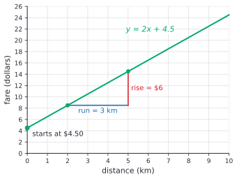
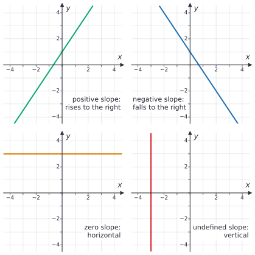
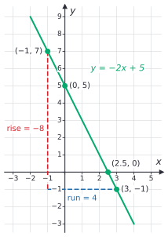
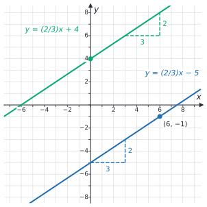

# Slope and linear equations

After this lesson you can find the slope of a line from a graph, two points or a table, read the slope as a rate of change with units, graph a line from $y = mx + b$, and write the equation of a line from two points.

Before this: [the coordinate plane](01-coordinate-plane.md), [proportional relationships](../02-ratios-rates-percents/02-proportional-relationships.md), and [one- and two-step equations](../03-expressions-equations-inequalities/03-one-and-two-step-equations.md).

## Quick check

Try these first. If you get all three right, skip to [Practice](#practice).

1. Find the slope of the line through $(-2, 5)$ and $(4, -7)$.
2. Write the equation of the line with slope 3 that passes through $(2, 1)$.
3. Find the $x$-intercept and the $y$-intercept of $y = 4x - 6$.

<details class="solution" markdown>
<summary>Answers</summary>

1. $m = \frac{-7 - 5}{4 - (-2)} = \frac{-12}{6} = -2$.
2. Put $(2, 1)$ into $y = 3x + b$: $1 = 6 + b$, so $b = -5$, and the line is $y = 3x - 5$.
3. The $y$-intercept is $(0, -6)$. For the $x$-intercept, set $y = 0$: $4x - 6 = 0$, so $x = 1.5$, and the point is $(1.5, 0)$.

</details>

## The idea

The taxi from [proportional relationships](../02-ratios-rates-percents/02-proportional-relationships.md) charges \$4.50 when you get in, plus \$2.00 per kilometre. With $x$ for the distance in kilometres and $y$ for the fare in dollars, the fare is $y = 2x + 4.5$. A table shows how it grows:

| Distance $x$ (km) | 0 | 1 | 2 | 3 | 4 | 5 |
|---|---|---|---|---|---|---|
| Fare $y$ (dollars) | 4.50 | 6.50 | 8.50 | 10.50 | 12.50 | 14.50 |

Every extra kilometre adds the same \$2.00, so the points lie on a straight line. Two numbers describe that line completely. One is where it starts: \$4.50 at 0 km, where the line meets the vertical axis. The other is how steeply it climbs: \$2.00 for every kilometre. Over any 3 km of the ride, the fare goes up \$6.00.



The steepness is the slope, and the starting value is the intercept. A proportional relationship such as the gas pump's $y = 1.5x$ has a slope too (1.5 dollars per litre) but starts at 0. This lesson measures slope, writes every non-vertical line as "slope times $x$, plus a starting value", and goes back and forth between lines, tables and equations.

## Definitions

Let $(x_1, y_1)$ and $(x_2, y_2)$ be two points on a line, with $x_1 \ne x_2$. The **slope** of the line is

$$
m = \frac{y_2 - y_1}{x_2 - x_1}.
$$

The change in $y$, $y_2 - y_1$, is the **rise**, and the change in $x$, $x_2 - x_1$, is the **run**. So slope is rise over run. The Greek capital letter $\Delta$ (delta) means "change in", so the formula is also written $m = \frac{\Delta y}{\Delta x}$.

In plain words, the slope is how much $y$ goes up for each step of 1 to the right. For the taxi, between $(2, 8.5)$ and $(5, 14.5)$ the rise is 6 and the run is 3, so $m = \frac{6}{3} = 2$. A negative slope means $y$ goes down as you move right. A vertical line has a run of 0, and division by zero is undefined, so a vertical line has no number as its slope: its slope is **undefined**.

When $x$ and $y$ are quantities with units, the slope is a **rate of change**, measured in units of $y$ per unit of $x$. The taxi's slope is 2 dollars per kilometre. The units of the rise go on top and the units of the run on the bottom, exactly as in a unit rate ([ratios and unit rates](../02-ratios-rates-percents/01-ratios-and-unit-rates.md)).

The **$y$-intercept** of a line is the point where it crosses the $y$-axis, $(0, b)$; the number $b$ is also called the $y$-intercept. The **$x$-intercept** is the point where the line crosses the $x$-axis, $(a, 0)$. For the taxi, the $y$-intercept is 4.5: the fare before you have gone anywhere.

A line with slope $m$ and $y$-intercept $b$ has the equation

$$
y = mx + b,
$$

which is called **slope-intercept form**. In plain words, $y$ is the starting value $b$ plus $m$ for each unit of $x$. The letters follow the book's convention: $m$ is the slope and $b$ the $y$-intercept ([letter table](../../reference/symbols-and-notation.md#one-letter-one-meaning-in-this-book)).

A **linear equation** in $x$ and $y$ is one whose graph is a straight line. Every non-vertical line has an equation $y = mx + b$, and every vertical line has an equation $x = a$, where $a$ is a fixed number. An equation such as $2x + 3y = 12$ is linear too: solving it for $y$ gives $y = -\frac{2}{3}x + 4$.

Two lines in the plane are **parallel** when they never meet. Two non-vertical lines are parallel exactly when they have the same slope and different $y$-intercepts; two vertical lines $x = a$ and $x = c$ with $a \ne c$ are also parallel.

## How to do it

### Why every pair of points gives the same slope

The definition picks two points, and a line has infinitely many. For the slope to make sense, every choice of two points has to give the same number.

We know the line has the equation $y = mx + b$. We want to show that the slope formula gives $m$ for every two points on it with different $x$-coordinates. The plan is to write both $y$-coordinates using the equation and subtract.

*Proof.* Take two points $(x_1, y_1)$ and $(x_2, y_2)$ on the line, with $x_1 \ne x_2$. They satisfy the equation, so $y_1 = mx_1 + b$ and $y_2 = mx_2 + b$. Subtract:

$$
y_2 - y_1 = (mx_2 + b) - (mx_1 + b) = mx_2 - mx_1 = m(x_2 - x_1).
$$

The run $x_2 - x_1$ is not 0, so dividing both sides by it gives $\frac{y_2 - y_1}{x_2 - x_1} = m$.

Look back: the $b$ cancelled. The starting value has no effect on the steepness, which is why the taxi and a fare with no base charge, $y = 2x$, rise at the same rate. The last step factored out $m$ with the distributive property, and it divided only by a number known not to be 0.

### Finding the slope from two points

1. Label the points $(x_1, y_1)$ and $(x_2, y_2)$. Either point can be first.
2. Find the rise: $y_2 - y_1$.
3. Find the run, subtracting in the same order: $x_2 - x_1$.
4. Divide the rise by the run and simplify. If the run is 0, the line is vertical and the slope is undefined.
5. Check: a line that goes up from left to right needs a positive slope and one that goes down needs a negative slope. Or start at the first point, move by the run across and the rise up, and you should land on the second point.



| Slope | Line | Equation |
|---|---|---|
| positive | rises from left to right | $y = mx + b$ with $m > 0$ |
| negative | falls from left to right | $y = mx + b$ with $m < 0$ |
| zero | horizontal | $y = b$ |
| undefined | vertical | $x = a$ |

The bigger the size of the slope, the steeper the line: $y = 5x$ is steeper than $y = \frac{1}{2}x$, and $y = -5x$ is steeper than $y = -\frac{1}{2}x$.

### Graphing a line from its equation

1. Write the equation as $y = mx + b$ if it isn't already.
2. Plot the $y$-intercept $(0, b)$.
3. Write the slope as a fraction $\frac{\text{rise}}{\text{run}}$. A whole number $m$ is $\frac{m}{1}$, and a negative slope puts the minus sign on the rise: $-\frac{2}{3} = \frac{-2}{3}$.
4. From $(0, b)$, move the run to the right and the rise up (down if the rise is negative). Plot that point. Repeat once more for a third point.
5. Draw the line through the points. Check one point by putting it into the equation.

### Finding the equation from two points or a table

1. Find the slope $m$ from the two points.
2. Put $m$ and the coordinates of one point into $y = mx + b$, and solve for $b$.
3. Write $y = mx + b$ with the numbers in place.
4. Check: the other point must satisfy the equation.

For a table, first check that it is linear: the slope between each pair of neighbouring rows must be the same. If the $x$-values go up in equal steps, the $y$-values must go up (or down) by equal amounts. If the table has a row with $x = 0$, its $y$-value is $b$ and Step 2 is already done.

### Finding the intercepts

1. For the $y$-intercept, set $x = 0$ and work out $y$. In $y = mx + b$ it is $b$.
2. For the $x$-intercept, set $y = 0$ and solve for $x$.
3. Write each as a point, $(0, b)$ and $(a, 0)$.

### Point-slope form

If you know a point $(x_1, y_1)$ on a line and its slope $m$, you can also write the line in **point-slope form**:

$$
y - y_1 = m(x - x_1).
$$

This is the slope formula with the second point left as a general point $(x, y)$ and the run multiplied across. Expanding and solving for $y$ turns it into slope-intercept form. With slope $-2$ through $(3, -1)$:

$$
y - (-1) = -2(x - 3), \quad \text{so} \quad y + 1 = -2x + 6, \quad \text{so} \quad y = -2x + 5.
$$

[Forms of linear equations](../../03-high-school/02-linear-functions-and-systems/01-forms-of-linear-equations.md) uses point-slope form more. In this lesson Step 2 of the method above does the same job.

### Proportional is the case $b = 0$

A proportional relationship $y = kx$ is the line $y = mx + b$ with $m = k$ and $b = 0$. Its constant of proportionality is its slope, and its $y$-intercept is the origin. That is why the graph test in [proportional relationships](../02-ratios-rates-percents/02-proportional-relationships.md#testing-whether-two-quantities-are-proportional) asks for a straight line through the origin: straight means a constant slope, and through the origin means $b = 0$.

## Worked examples

<div class="example" markdown>

### Example 1: the equation of a line through two points

Find the equation of the line through $(-1, 7)$ and $(3, -1)$, find its intercepts, and graph it.

Step 1 of finding the slope: let $(x_1, y_1) = (-1, 7)$ and $(x_2, y_2) = (3, -1)$.

Steps 2 to 4: the rise is $y_2 - y_1 = -1 - 7 = -8$, and the run is $x_2 - x_1 = 3 - (-1) = 4$. So

$$
m = \frac{-8}{4} = -2.
$$

Step 5: the line goes from $(-1, 7)$ down to $(3, -1)$ as you move right, so a negative slope makes sense.

<div class="warning" markdown>

Watch out at Step 3: the run must subtract in the same order as the rise. Writing $\frac{-1 - 7}{-1 - 3} = \frac{-8}{-4} = 2$ takes the first point's $y$ but the second point's $x$ first, and it gives the wrong sign. If you start the rise with the second point, start the run with the second point too.

</div>

Now the equation. Step 2 of finding the equation: put $m = -2$ and the point $(-1, 7)$ into $y = mx + b$, and solve for $b$:

$$
\begin{aligned}
7 &= -2(-1) + b \\
7 &= 2 + b \\
5 &= b && \text{subtract 2 from both sides.}
\end{aligned}
$$

Step 3: the line is $y = -2x + 5$.

Step 4: check the other point. At $x = 3$, $-2(3) + 5 = -6 + 5 = -1$, which is the $y$-coordinate of $(3, -1)$.

The $y$-intercept is $b = 5$, the point $(0, 5)$. For the $x$-intercept, set $y = 0$ and solve: $0 = -2x + 5$ gives $2x = 5$, so $x = 2.5$, the point $(2.5, 0)$.

To graph it, plot $(0, 5)$, then use the slope as $\frac{-2}{1}$: one step right and two down gives $(1, 3)$, then $(2, 1)$, and so on. The line passes through $(2.5, 0)$, halfway between $x = 2$ and $x = 3$.



</div>

<div class="example" markdown>

### Example 2: a draining phone battery

A phone's battery level is checked several times after a full charge:

| Hours since charging | 0 | 2 | 5 | 8 |
|---|---|---|---|---|
| Battery level (%) | 100 | 88 | 70 | 52 |

Do the points lie on a line? If so, find its equation, and say when the battery runs out.

The $x$-values are not equally spaced, so compare the slope between each pair of neighbouring rows:

$$
\frac{88 - 100}{2 - 0} = \frac{-12}{2} = -6, \qquad \frac{70 - 88}{5 - 2} = \frac{-18}{3} = -6, \qquad \frac{52 - 70}{8 - 5} = \frac{-18}{3} = -6.
$$

Each slope is $-6$, so the points lie on one line, with $m = -6$: the level drops 6 points per hour. The table has a row with $x = 0$, so $b = 100$, and the equation is $y = -6x + 100$.

The battery runs out at the $x$-intercept. Set $y = 0$: $-6x + 100 = 0$ gives $6x = 100$, so $x = \frac{50}{3} = 16.66\ldots$ hours, which is 16 hours 40 minutes. An untidy answer is fine; a third of an hour is 20 minutes.

Check: at $x = 8$, $-6(8) + 100 = 52$, as in the table. The model only makes sense from $x = 0$ to $x = \frac{50}{3}$; at $x = 20$ it gives $-20\%$, which no battery shows.

</div>

<div class="example" markdown>

### Example 3: horizontal and vertical lines

(a) Find the slope and equation of the line through $(-3, 4)$ and $(5, 4)$. (b) Do the same for $(2, -1)$ and $(2, 6)$.

(a) The rise is $4 - 4 = 0$ and the run is $5 - (-3) = 8$, so $m = \frac{0}{8} = 0$. With $m = 0$, the equation $y = 0x + b$ is $y = b$, and both points have $y = 4$, so the line is $y = 4$. It is horizontal, its $y$-intercept is $(0, 4)$, and it has no $x$-intercept, because it never reaches the $x$-axis.

(b) The rise is $6 - (-1) = 7$ and the run is $2 - 2 = 0$. The slope would be $\frac{7}{0}$, which is undefined. The line is vertical, and every point on it has $x = 2$, so its equation is $x = 2$. It can't be written as $y = mx + b$, because there is no number $m$ to use. Its $x$-intercept is $(2, 0)$ and it has no $y$-intercept.

Check: $(-3, 4)$ and $(5, 4)$ both satisfy $y = 4$, and $(2, -1)$ and $(2, 6)$ both satisfy $x = 2$.

</div>

<div class="example" markdown>

### Example 4: a parallel line (finish it yourself)

Find the equation of the line through $(6, -1)$ that is parallel to $y = \frac{2}{3}x + 4$, and find its $x$-intercept.

Parallel lines have the same slope, so $m = \frac{2}{3}$.

Step 2 of finding the equation: put $m$ and the point $(6, -1)$ into $y = mx + b$:

$$
-1 = \frac{2}{3}(6) + b, \quad \text{that is,} \quad -1 = 4 + b.
$$

Solve for $b$, write the equation, find the $x$-intercept and check.



<details class="solution" markdown>
<summary>Finish</summary>

Subtract 4 from both sides: $b = -5$. The line is $y = \frac{2}{3}x - 5$. Its intercept $-5$ differs from 4, so it really is a different line, parallel to the first.

For the $x$-intercept, set $y = 0$: $\frac{2}{3}x - 5 = 0$ gives $\frac{2}{3}x = 5$, so $x = 5 \times \frac{3}{2} = 7.5$, the point $(7.5, 0)$.

Check: at $x = 6$, $\frac{2}{3}(6) - 5 = 4 - 5 = -1$, so the line passes through $(6, -1)$. In the figure, both lines rise 2 for every 3 across.

</details>

</div>

## Edge cases and common mistakes

<div class="warning" markdown>

Watch out for run over rise. The slope is $\frac{\Delta y}{\Delta x}$, the change in $y$ on top. The line through $(0, 0)$ and $(2, 6)$ has slope $\frac{6}{2} = 3$, not $\frac{2}{6} = \frac{1}{3}$. A quick test: a line steeper than $45$ degrees, which rises more than it runs, must have a slope bigger than 1 in size.

</div>

<div class="warning" markdown>

Watch out for $b$ when the equation is not solved for $y$. In $2x + 3y = 12$, the $y$-intercept is not 12 and the slope is not 2. Solve for $y$ first: $3y = -2x + 12$, so $y = -\frac{2}{3}x + 4$. The slope is $-\frac{2}{3}$ and the $y$-intercept is 4. In the same way, $y = 6 - 3x$ has slope $-3$ and $y$-intercept 6; the order of the terms doesn't matter, but the number multiplying $x$ is the slope.

</div>

<div class="warning" markdown>

Watch out: zero slope and undefined slope are different. A horizontal line has slope 0: it has a run and no rise. A vertical line has an undefined slope: it has a rise and no run, and dividing by a run of 0 is not allowed. Avoid "no slope", since books disagree about which of the two it means.

</div>

<div class="warning" markdown>

Watch out for different scales on the two axes. On the taxi graph, one grid step across is 1 km and one step up is \$2, so the line looks less steep than a slope of 2 would look on square grid paper. Read the slope from two points and their coordinates, not from how steep the line looks.

</div>

Signs inside the formula cause most arithmetic slips. Write the brackets in: from $(-4, 3)$ to $(2, -5)$ the rise is $-5 - 3 = -8$ and the run is $2 - (-4) = 6$, so the slope is $\frac{-8}{6} = -\frac{4}{3}$. A slope can be a fraction or a negative fraction, and $-\frac{4}{3}$ is a finished answer; there is no need to turn it into $-1.333\ldots$

A rate of change keeps its units. The battery in Example 2 has slope $-6$ points per hour, and the taxi has slope 2 dollars per kilometre. A slope with no units in a word problem is half an answer.

## Tricks and shortcuts

For an equation like $2x + 3y = 12$, find both intercepts by covering one term at a time. Cover the $3y$ (that is, set $y = 0$): $2x = 12$, so the $x$-intercept is $(6, 0)$. Cover the $2x$: $3y = 12$, so the $y$-intercept is $(0, 4)$. Two points are enough to draw the line, and the slope is $\frac{0 - 4}{6 - 0} = -\frac{2}{3}$.

When a table's $x$-values go up by a steady step, the slope is the steady change in $y$ divided by that step. The car-share cost $5 + 0.40t$ at 10, 20, 30 and 40 minutes is 9, 13, 17 and 21 dollars ([variables and expressions](../03-expressions-equations-inequalities/01-variables-and-expressions.md)); the cost rises \$4 per 10 minutes, so the slope is $4 \div 10 = 0.40$ dollars per minute.

To check an equation you found from two points, put in the point you did not use to find $b$. If both points satisfy the equation, it is right, because exactly one line passes through two different points.

## In code

The method of Example 1 fits in a short function. Python's `Fraction` keeps a slope such as $\frac{1}{2}$ exact instead of turning it into a float.

<details class="code" markdown>
<summary>In code</summary>

```python
from fractions import Fraction

def line_through(p, q):
    """Return (m, b) for the line y = mx + b through p and q, or None if the line is vertical."""
    (x1, y1), (x2, y2) = p, q
    if x1 == x2:
        return None
    m = Fraction(y2 - y1, x2 - x1)
    b = y1 - m * x1
    return m, b

m, b = line_through((-1, 7), (3, -1))
print(m, b)                               # -2 5
m, b = line_through((-4, 1), (2, 4))
print(m, b)                               # 1/2 3
print(line_through((2, -1), (2, 6)))      # None
```

The `None` case is the vertical line, where the run would be 0. Returning `None` instead of dividing is the code version of "the slope is undefined".

</details>

## FAQ

### Does it matter which point I call the first one?

No, as long as you use the same order on the top and the bottom. Swapping the points changes the sign of both the rise and the run, and $\frac{-a}{-c} = \frac{a}{c}$. For $(-1, 7)$ and $(3, -1)$, one order gives $\frac{-8}{4}$ and the other gives $\frac{8}{-4}$, and both are $-2$.

### What about perpendicular lines?

Two lines that meet at a right angle, neither of them vertical, have slopes that multiply to $-1$. So if one slope is $m$, the other is $-\frac{1}{m}$, the negative reciprocal. The lines $y = 2x + 1$ and $y = -\frac{1}{2}x + 3$ are perpendicular, since $2 \times (-\frac{1}{2}) = -1$. A horizontal line and a vertical line are also perpendicular, which the rule can't express because the vertical slope is undefined. The proof uses the Pythagorean theorem, in [coordinate geometry and circles](../../03-high-school/08-geometry-and-proof/04-coordinate-geometry-and-circles.md).

### Is $y = 3$ a linear equation, even with no $x$ in it?

Yes. It is $y = 0x + 3$, a line with slope 0 and $y$-intercept 3: a horizontal line. Every point with $y$-coordinate 3 is on it, whatever its $x$-coordinate. In the same way, $x = 2$ is a linear equation whose graph is the vertical line through $(2, 0)$.

### Why is slope called a rate of change?

Because it says how fast $y$ changes as $x$ changes, in units of $y$ per unit of $x$, the same as a speed in kilometres per hour. A line changes at the same rate everywhere, so one number is enough. For a curve the rate changes from point to point, and calculus measures it at a single point as the slope of the tangent line ([the derivative definition](../../05-university-core/02-derivatives/01-the-derivative-definition.md)).

## Practice

### Warm-up

1\. Find the slope of the line through each pair of points: (a) $(1, 2)$ and $(4, 11)$, (b) $(-3, 4)$ and $(5, -2)$, (c) $(-2, -5)$ and $(-2, 3)$, (d) $(0, 7)$ and $(9, 7)$.

<details class="solution" markdown>
<summary>Solution</summary>

- (a) $\frac{11 - 2}{4 - 1} = \frac{9}{3} = 3$.
- (b) $\frac{-2 - 4}{5 - (-3)} = \frac{-6}{8} = -\frac{3}{4}$.
- (c) The run is $-2 - (-2) = 0$, so the slope is undefined. The line is vertical: $x = -2$.
- (d) $\frac{7 - 7}{9 - 0} = \frac{0}{9} = 0$. The line is horizontal: $y = 7$.

Check (b) by walking: from $(-3, 4)$, a run of 8 and a rise of $-6$ lands on $(5, -2)$.

</details>

2\. Give the slope and the $y$-intercept: (a) $y = 4x - 9$, (b) $y = -x + 2.5$, (c) $y = 6 - \frac{1}{2}x$, (d) $y = 3$, (e) $y = 7x$. Which of these is a proportional relationship?

<details class="solution" markdown>
<summary>Solution</summary>

- (a) $m = 4$, $b = -9$.
- (b) $-x$ is $-1 \cdot x$, so $m = -1$ and $b = 2.5$.
- (c) Reorder as $y = -\frac{1}{2}x + 6$: $m = -\frac{1}{2}$, $b = 6$.
- (d) $y = 0x + 3$: $m = 0$, $b = 3$.
- (e) $m = 7$, $b = 0$.

Only (e) is proportional, since it is the only one with $b = 0$ and $m \ne 0$. Check (c) at $x = 2$: $6 - \frac{1}{2}(2) = 5$ and $-\frac{1}{2}(2) + 6 = 5$, so the two forms agree.

</details>

3\. Graph $y = -\frac{3}{2}x + 3$: give the $y$-intercept and two more points you would plot, and find the $x$-intercept.

<details class="solution" markdown>
<summary>Solution</summary>

Plot the $y$-intercept $(0, 3)$. The slope is $\frac{-3}{2}$, so from there go 2 right and 3 down to $(2, 0)$, and again to $(4, -3)$. Draw the line through the three points.

The point $(2, 0)$ is on the $x$-axis, so it is the $x$-intercept. By algebra: $-\frac{3}{2}x + 3 = 0$ gives $\frac{3}{2}x = 3$, so $x = 2$.

Check $(4, -3)$: $-\frac{3}{2}(4) + 3 = -6 + 3 = -3$.

</details>

### Standard

4\. Find the equation of the line through $(-4, 1)$ and $(2, 4)$, and its $x$-intercept.

<details class="solution" markdown>
<summary>Solution</summary>

The slope is $m = \frac{4 - 1}{2 - (-4)} = \frac{3}{6} = \frac{1}{2}$. Put $(-4, 1)$ into $y = \frac{1}{2}x + b$: $1 = -2 + b$, so $b = 3$. The line is $y = \frac{1}{2}x + 3$.

For the $x$-intercept, $\frac{1}{2}x + 3 = 0$ gives $x = -6$, the point $(-6, 0)$.

Check with the other point: $\frac{1}{2}(2) + 3 = 4$. And the three points $(-6, 0)$, $(-4, 1)$ and $(2, 4)$ all have slope $\frac{1}{2}$ between neighbours: $\frac{1}{2}$ and $\frac{3}{6}$.

</details>

5\. Water freezes at 0°C, which is 32°F, and boils at 100°C, which is 212°F. Plotted as points (°C, °F), matching readings lie on a straight line. (a) Find the slope, with units. (b) Write the equation, with $x$ for °C and $y$ for °F. (c) Convert 20°C and $-40$°C to Fahrenheit, and a body temperature of 98.6°F to Celsius. (d) At what temperature do the two scales show the same number?

<details class="solution" markdown>
<summary>Solution</summary>

(a) The two points are $(0, 32)$ and $(100, 212)$, so $m = \frac{212 - 32}{100 - 0} = \frac{180}{100} = 1.8$ degrees Fahrenheit per degree Celsius.

(b) The point $(0, 32)$ gives $b = 32$, so $y = 1.8x + 32$.

(c) At 20°C, $y = 1.8(20) + 32 = 68$°F. At $-40$°C, $y = 1.8(-40) + 32 = -72 + 32 = -40$°F. For 98.6°F, solve $1.8x + 32 = 98.6$: $1.8x = 66.6$, so $x = 37$°C.

(d) The readings match when $y = x$: $x = 1.8x + 32$ gives $-0.8x = 32$, so $x = -40$. The scales agree at $-40$ degrees, which part (c) already showed.

Check (c): $1.8 \times 37 + 32 = 66.6 + 32 = 98.6$.

</details>

6\. A car rental company charges these amounts:

| Days | 1 | 3 | 4 | 7 |
|---|---|---|---|---|
| Cost (dollars) | 85 | 155 | 190 | 295 |

(a) Show that the points in the table lie on one line. (b) Find its equation and say what the slope and the intercept mean. (c) Is the cost proportional to the number of days?

<details class="solution" markdown>
<summary>Solution</summary>

(a) The days are not equally spaced, so find the slope between neighbouring rows: $\frac{155 - 85}{3 - 1} = \frac{70}{2} = 35$, $\frac{190 - 155}{4 - 3} = 35$ and $\frac{295 - 190}{7 - 4} = \frac{105}{3} = 35$. The slope is the same each time, so the points lie on one line.

(b) With $m = 35$, the row $(1, 85)$ gives $85 = 35 + b$, so $b = 50$, and the cost is $y = 35x + 50$. The slope is \$35 per day, and the intercept is a \$50 fee that you pay once, however long you keep the car.

(c) No. The intercept is not 0, so 2 days cost $35(2) + 50 = 120$ dollars, not twice the 1-day price, which would be \$170.

Check: at $x = 7$, $35(7) + 50 = 245 + 50 = 295$.

</details>

### Challenge

7\. (a) Show that the points $(-2, -7)$, $(1, 2)$ and $(4, 11)$ lie on one line, and find its equation. (b) Is $(100, 299)$ on the line? Is $(5, 15)$? (c) Find $k$ so that $(k, 20)$ is on the line.

<details class="solution" markdown>
<summary>Solution</summary>

(a) The slope from $(-2, -7)$ to $(1, 2)$ is $\frac{2 - (-7)}{1 - (-2)} = \frac{9}{3} = 3$, and from $(1, 2)$ to $(4, 11)$ it is $\frac{9}{3} = 3$. The two segments have the same slope and share the point $(1, 2)$. A point and a slope fix a line, as point-slope form shows, so all three points are on the same line. From $(1, 2)$: $2 = 3 + b$, so $b = -1$, and the line is $y = 3x - 1$.

(b) $3(100) - 1 = 299$, so $(100, 299)$ is on the line. $3(5) - 1 = 14$, which is not 15, so $(5, 15)$ is not; it sits 1 unit above the line.

(c) Solve $3k - 1 = 20$: $3k = 21$, so $k = 7$.

Check (a) with the outer points: $\frac{11 - (-7)}{4 - (-2)} = \frac{18}{6} = 3$.

</details>

8\. (Reviews [proportional relationships](../02-ratios-rates-percents/02-proportional-relationships.md).) A plumber charges a call-out fee plus an hourly rate. A 1.5-hour job costs \$172.50 and a 4-hour job costs \$360. (a) Find the hourly rate and the call-out fee. (b) A friend says, "1.5 hours costs \$172.50, so 3 hours costs twice that, \$345." What does a 3-hour job really cost, and what went wrong?

<details class="solution" markdown>
<summary>Solution</summary>

(a) The points are $(1.5, 172.5)$ and $(4, 360)$. The slope is $\frac{360 - 172.5}{4 - 1.5} = \frac{187.5}{2.5} = 75$, so the rate is \$75 per hour. From $172.5 = 75(1.5) + b = 112.5 + b$, the fee is $b = 60$ dollars. The cost of $x$ hours is $y = 75x + 60$.

(b) A 3-hour job costs $75(3) + 60 = 285$ dollars. Doubling \$172.50 doubles the \$60 fee as well, which you only pay once, so the friend's answer is \$60 too high. The cost is linear but not proportional, because $b \ne 0$.

Check (a) with the other job: $75(4) + 60 = 360$.

</details>

## Where this shows up

- The next lesson treats $y = mx + b$ as a linear function, $f(x) = mx + b$ ([introduction to functions](03-intro-to-functions.md)), and [systems of linear equations](04-systems-of-linear-equations.md) finds where two lines meet. [Forms of linear equations](../../03-high-school/02-linear-functions-and-systems/01-forms-of-linear-equations.md) adds standard form, such as $2x + 3y = 12$, and more on point-slope form.
- In calculus, the derivative is the slope of the line that touches a curve at one point ([the derivative definition](../../05-university-core/02-derivatives/01-the-derivative-definition.md)), and linear regression fits the line $y = mx + b$ that best matches a cloud of data points ([correlation and linear regression](../../05-university-core/08-statistics/04-correlation-and-linear-regression.md)).
- In economics, the slope of a total cost line is the cost of one more unit, called marginal cost, and the intercept is the fixed cost ([production and cost functions](../../07-economics-math/03-firms-and-consumers/02-production-and-cost-functions.md)). Supply and demand curves are often drawn as lines, and their slopes say how strongly quantity responds to price.
