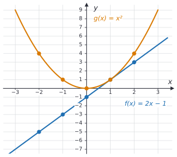
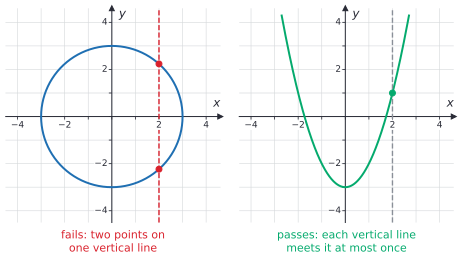
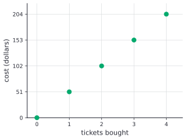

# Introduction to functions

After this lesson you can decide whether a table, a mapping diagram, a graph or an equation describes a function, evaluate a function written as $f(x)$, describe its domain and range, and tell linear functions from nonlinear ones.

Before this: [slope and linear equations](02-slope-and-linear-equations.md), and substitution from [variables and expressions](../03-expressions-equations-inequalities/01-variables-and-expressions.md).

## Quick check

Try these first. If you get all three right, skip to [Practice](#practice).

1. For $f(x) = x^2 - 4x + 1$, find $f(-2)$.
2. Is the set of pairs $(1, 4)$, $(2, 5)$, $(1, 6)$ a function, with the first number as the input?
3. What is the domain of $g(x) = \frac{12}{x - 3}$, and what is $g(7)$?

<details class="solution" markdown>
<summary>Answers</summary>

1. $f(-2) = (-2)^2 - 4(-2) + 1 = 4 + 8 + 1 = 13$.
2. No. The input 1 has two outputs, 4 and 6.
3. Every real number except 3, since $x = 3$ would divide by zero. And $g(7) = \frac{12}{7 - 3} = \frac{12}{4} = 3$.

</details>

## The idea

Go back to the temperature graph in [the coordinate plane](01-coordinate-plane.md#worked-examples). You could ask it "what was the temperature at 9:00?" and get one answer, $-4$°C. That works for every time of day, because at each moment the air had one temperature. The graph is a rule that turns a time into a temperature.

Now ask it the reverse question: "when was it 0°C?" There were two answers, about 11:00 and about 19:30. And "when was it 10°C?" has no answer at all. Going from a temperature back to a time is not a rule of the same kind, because one question can have two answers or none.

A rule that always gives exactly one answer is a function. The time-to-temperature rule is a function; the temperature-to-time rule is not. The same idea appears all over: each student number has one final mark, each item in a store has one price, and each input to $y = 2x + 4.5$ gives one taxi fare. Two different students can have the same mark, and that is fine. What a function can't do is give one input two different outputs.

## Definitions

A **function** is a rule that assigns to each input exactly one output. The set of allowed inputs is the **domain** of the function, and the set of outputs that actually occur is its **range**.

In plain words, a function is a machine: put in an allowed input and exactly one output comes out, the same one every time. The squaring function takes $3$ to $9$ and $-3$ to $9$. Its domain is every real number, and its range is every number that is 0 or more, since a square is never negative.

This is the working definition for now. The formal definition, which builds a function out of sets of ordered pairs and names a set the outputs are allowed to land in (the codomain), comes in [what is a function](../../03-high-school/03-functions/01-what-is-a-function.md) and in functions and well-definedness<!-- link: ../../04-proofs-and-logic/06-relations-and-functions/04-functions-and-well-definedness.md -->.

Functions are named with letters, usually $f$, $g$ and $h$. The notation $f(x)$, read "$f$ of $x$", means the output of the function $f$ at the input $x$. If $f(x) = 2x - 1$, then $f(3) = 2(3) - 1 = 5$: the output of $f$ at 3 is 5. The brackets in $f(x)$ hold the input; they do not mean multiplication.

When a function is written $y = f(x)$, the input variable $x$ is the **independent variable** and the output variable $y$ is the **dependent variable**, because its value depends on the choice of $x$.

A **relation** is any collection of (input, output) pairs, with no rule about how many outputs an input may have. Every function is a relation, and a relation is a function exactly when no input appears with two different outputs. In plain words, a relation is a list of pairings, and a function is a relation that never pairs one input with two outputs.

A **mapping diagram** shows a relation as two lists, the inputs and the outputs, with an arrow from each input to each of its outputs. The **graph** of a function $f$ is the set of all points $(x, f(x))$ for $x$ in the domain.

A **linear function** is a function of the form $f(x) = mx + b$, where $m$ and $b$ are fixed numbers; its graph is a non-vertical straight line with slope $m$. A function that is not linear is a **nonlinear function**, such as $g(x) = x^2$.

## How to do it

### Four views of one function

One function can be shown four ways. Here is the squaring function, $g(x) = x^2$, on the inputs $-2$, $-1$, 0, 1 and 2.

The equation is $g(x) = x^2$. The table lists inputs and outputs:

| $x$ | $-2$ | $-1$ | $0$ | $1$ | $2$ |
|---|---|---|---|---|---|
| $g(x)$ | $4$ | $1$ | $0$ | $1$ | $4$ |

The mapping diagram on the left below draws an arrow from each input to its output. Two arrows land on 4, because $g(-2) = g(2) = 4$, and that is allowed. Each input sends out exactly one arrow. The diagram on the right sends 4 to both 2 and $-2$ (its two square roots), so it is not a function.


The graph plots each pair $(x, g(x))$. With every real number as an input, the points fill in a U-shaped curve called a parabola, shown in orange below, next to the line of the linear function $f(x) = 2x - 1$ from [the coordinate plane](01-coordinate-plane.md#worked-examples).



Each view has its use. The equation gives exact values, the table is what you get from measurements or a spreadsheet, the mapping diagram is good for small finite sets, and the graph shows the overall shape at a glance.

### Deciding whether a relation is a function

1. From a list or table: look for an input that appears more than once. If some input appears with two different outputs, it is not a function. Repeated outputs are fine.
2. From a mapping diagram: check that each input sends out exactly one arrow.
3. From a graph: use the vertical line test below.
4. From an equation: try to solve for $y$. If some value of $x$ gives two values of $y$, it is not a function of $x$. From $y^2 = x$, the input $x = 4$ gives $y = 2$ and $y = -2$.
5. Also check that every input in the domain has an output. A rule that leaves some allowed input with no output is not a function on that domain.

### The vertical line test

*Vertical line test.* A graph in the coordinate plane is the graph of a function of $x$ exactly when every vertical line meets it at most once.

The reason is short. A vertical line is the set of points with one fixed $x$-coordinate, say $x = a$. Each point where it meets the graph is a pair $(a, y)$, an output for the input $a$. Two meeting points would mean two outputs for one input, which a function does not allow. A vertical line that misses the graph completely just means $a$ is not in the domain.



### Evaluating a function

1. Write the rule with an empty pair of brackets wherever $x$ appears: for $f(x) = 3x^2 - x$, write $f(\;) = 3(\;)^2 - (\;)$.
2. Put the input inside every pair of brackets, the whole input, sign and all.
3. Simplify with the [order of operations](../01-integers-and-rational-numbers/04-exponents-and-order-of-operations.md): powers before multiplication, multiplication before addition.
4. Check the size or the sign against a graph or a quick estimate.

The input can be an expression. With $f(x) = 2x - 1$, Step 2 gives $f(a + 3) = 2(a + 3) - 1 = 2a + 5$.

### Solving $f(x) = c$

Evaluating goes from an input to an output. The reverse question asks which inputs give a chosen output $c$. Write the equation $f(x) = c$ and solve it for $x$ as in [multi-step equations](../03-expressions-equations-inequalities/04-multi-step-equations.md). For $f(x) = 2x - 1$ and the output 9, solve $2x - 1 = 9$ to get $x = 5$. A linear function with $m \ne 0$ reaches each output exactly once; other functions may reach an output twice (as $x^2 = 4$ does, at $x = 2$ and $x = -2$) or never.

### Finding the domain and range

1. Start with every real number as a possible input.
2. Remove each input that breaks a rule of arithmetic: a value that makes a denominator 0, or a negative number under a square root ([roots, irrational numbers and types of numbers](../04-powers-roots-and-real-numbers/03-roots-irrationals-and-types-of-numbers.md)).
3. In a real situation, keep only the inputs that make sense: a number of tickets is a whole number from 0 up to the limit, and a time or a length is not negative.
4. For the range, ask which outputs the remaining inputs actually produce. A graph or a short table helps; the range doesn't have to be every number.

### Linear or nonlinear?

1. From an equation: the function is linear when it can be written $f(x) = mx + b$. Watch for $x^2$, $\frac{1}{x}$, $\sqrt{x}$ or $2^x$, which make it nonlinear.
2. From a table: compare the slopes between neighbouring rows, as in [slope and linear equations](02-slope-and-linear-equations.md#finding-the-equation-from-two-points-or-a-table). If the inputs go up in equal steps, the outputs of a linear function go up or down by equal amounts.
3. From a graph: the graph of a linear function is a non-vertical straight line.

In the table of $g(x) = x^2$, the inputs go up by 1 each time but the outputs change by $-3$, $-1$, $1$ and $3$, so $g$ is not linear. For $f(x) = 2x - 1$ the outputs $-5$, $-3$, $-1$, $1$, $3$ change by 2 every time.

## Worked examples

<div class="example" markdown>

### Example 1: evaluating a function

Let $g(x) = 2x^2 - 3x + 1$. Find $g(3)$, $g(-2)$, $g(0)$ and $g(\frac{1}{2})$.

Step 1: write the rule with empty brackets, $g(\;) = 2(\;)^2 - 3(\;) + 1$.

For $g(3)$, Step 2 puts 3 in every bracket, and Step 3 does the power first:

$$
g(3) = 2(3)^2 - 3(3) + 1 = 2(9) - 9 + 1 = 18 - 9 + 1 = 10.
$$

For $g(-2)$, the whole input $-2$ goes in each bracket, minus sign included:

$$
g(-2) = 2(-2)^2 - 3(-2) + 1 = 2(4) + 6 + 1 = 15.
$$

<div class="warning" markdown>

Watch out at Step 2: without brackets, $2 \cdot -2^2$ reads as $2 \cdot (-4) = -8$, because the power applies to 2 before the minus sign ([exponents and order of operations](../01-integers-and-rational-numbers/04-exponents-and-order-of-operations.md)). The input is $-2$, so its square is $(-2)^2 = 4$. Also, $-3(-2)$ is $+6$: a negative times a negative.

</div>

For $g(0)$, every term with $x$ becomes 0: $g(0) = 2(0)^2 - 3(0) + 1 = 1$.

For $g(\frac{1}{2})$:

$$
g\left(\tfrac{1}{2}\right) = 2\left(\tfrac{1}{2}\right)^2 - 3\left(\tfrac{1}{2}\right) + 1 = 2 \cdot \tfrac{1}{4} - \tfrac{3}{2} + 1 = \tfrac{1}{2} - \tfrac{3}{2} + 1 = 0.
$$

An output of 0 is a perfectly good output: the graph of $g$ crosses the $x$-axis at $x = \frac{1}{2}$.

Check $g(3)$ another way. Factored, $g(x) = (2x - 1)(x - 1)$, which you can confirm by expanding. At 3 this is $(5)(2) = 10$. At $\frac{1}{2}$ the first bracket is 0, which explains $g(\frac{1}{2}) = 0$.

</div>

<div class="example" markdown>

### Example 2: function or not?

Decide whether each relation is a function.

(a) A table of student numbers and final marks: A123 has 81, B456 has 74, C789 has 81. Each student number appears once, so each input has one output. The repeated mark 81 is two inputs sharing an output, which is allowed. This is a function.

(b) The pairs $(4, 2)$, $(4, -2)$, $(9, 3)$, $(9, -3)$, which pair each number with its square roots. The input 4 has two outputs, so this is not a function. It is the right-hand mapping diagram above.

(c) The circle of radius 3 centred at the origin. The vertical line $x = 2$ meets it at two points, $(2, \sqrt{5})$ and $(2, -\sqrt{5})$, so it fails the vertical line test. Not a function of $x$.

(d) The parabola $y = x^2 - 3$. Each $x$ gives one value of $x^2 - 3$, so each vertical line meets it once. This is a function, $h(x) = x^2 - 3$.

</div>

<div class="example" markdown>

### Example 3: domain and range

(a) Find the domain and range of $h(x) = \frac{12}{x - 3}$.

Step 2 of finding the domain: the denominator is 0 when $x = 3$, so 3 is removed. The domain is every real number except 3.

For the range, ask which outputs occur. A fraction is 0 only when its numerator is 0, and the numerator here is always 12, so the output 0 never occurs. Every other number $c$ does occur: solving $\frac{12}{x - 3} = c$ gives $x - 3 = \frac{12}{c}$, so $x = 3 + \frac{12}{c}$, which is a real number whenever $c \ne 0$. The range is every real number except 0.

(b) A concert ticket costs \$51 including fees, and each person may buy at most 4. The cost of $n$ tickets is $f(n) = 51n$. Find the domain and range.

The formula accepts every number, but Step 3 keeps only the inputs that make sense: you buy a whole number of tickets from 0 to 4. So the domain is $\{0, 1, 2, 3, 4\}$, and the range is the five outputs, $\{0, 51, 102, 153, 204\}$.



The graph is five separate points. Joining them with a line would claim that 2.5 tickets cost \$127.50, which is not a purchase anyone can make. The rule $51n$ has the form $mx + b$, but the function lives only on five inputs.

Check (a) with one value: the output $-4$ should come from $x = 3 + \frac{12}{-4} = 0$, and indeed $h(0) = \frac{12}{-3} = -4$.

</div>

<div class="example" markdown>

### Example 4: a linear function from two values (finish it yourself)

A linear function $f$ has $f(2) = 11$ and $f(6) = 23$. Find a formula for $f$, then find $f(10)$ and the input with $f(x) = 50$.

The statement $f(2) = 11$ says the graph passes through $(2, 11)$, and $f(6) = 23$ says it passes through $(6, 23)$. The slope is

$$
m = \frac{23 - 11}{6 - 2} = \frac{12}{4} = 3.
$$

From $11 = 3(2) + b$, we get $b = 5$, so $f(x) = 3x + 5$.

Now evaluate $f(10)$, solve $f(x) = 50$, and check both answers.

<details class="solution" markdown>
<summary>Finish</summary>

$f(10) = 3(10) + 5 = 35$.

For $f(x) = 50$, solve $3x + 5 = 50$: subtract 5 to get $3x = 45$, then divide by 3 to get $x = 15$.

Check: $f(15) = 45 + 5 = 50$. Also, the inputs 2, 6 and 10 go up by 4 each time, so the outputs should go up by $3 \times 4 = 12$ each time: 11, 23, 35. They do.

</details>

</div>

## Edge cases and common mistakes

<div class="warning" markdown>

Watch out: $f(x)$ is not $f$ times $x$. The letter $f$ names the function, and the brackets hold its input. So $f(3)$ is a single number, the output at 3, and you can't divide $f(x)$ by $x$ to get $f$.

</div>

<div class="warning" markdown>

Watch out: $f(x + 2)$ is not $f(x) + 2$. The first changes the input and the second changes the output. With $f(x) = x^2$ and $x = 1$, $f(1 + 2) = f(3) = 9$, but $f(1) + 2 = 1 + 2 = 3$. Put the whole expression $x + 2$ in the brackets: $f(x + 2) = (x + 2)^2$.

</div>

<div class="warning" markdown>

Watch out for the direction of the test. Many inputs may share one output (a horizontal line can meet the graph many times), but one input may not have many outputs (a vertical line can meet the graph at most once). The parabola $y = x^2 - 3$ passes the vertical line test even though the horizontal line $y = 1$ meets it twice.

</div>

<div class="warning" markdown>

Watch out for joining dots that shouldn't be joined. When the domain is a set of whole numbers, as with tickets, the graph is separate points. Drawing a line through them adds inputs that are not in the domain.

</div>

A function can have the same output for every input. The constant function $f(x) = 7$ sends every input to 7; its graph is the horizontal line $y = 7$, and its range is the single number 7. It passes the vertical line test. The vertical line $x = 7$, on the other hand, is not a function of $x$: the input 7 has every number as an output.

A function also needs an output for every input in its domain. If you declare the domain of $h(x) = \frac{12}{x - 3}$ to be every real number, the input 3 has no output, so the domain has to leave 3 out.

## Tricks and shortcuts

To test whether something is a function, ask the question "what is the output when the input is ...?" for a few inputs. If the honest answer is ever "it depends" or "there are two", it is not a function. "What is the price of this item?" has one answer. "Which item costs \$5?" might have several.

When you evaluate, write the empty brackets first, $f(\;)$, and then fill them. It feels slow, but it prevents almost every sign error with negative inputs.

For a quick linearity check on a table with equally spaced inputs, write the differences between neighbouring outputs underneath. Constant differences mean linear. For $x^2$ the differences are $1, 3, 5, 7, \dots$ and they change by 2 each time; that pattern comes back in [quadratic functions and graphs](../../03-high-school/05-quadratics-and-complex-numbers/01-quadratic-functions-and-graphs.md).

## In code

A Python function with `def` and `return` can compute a math function. But a program function can also change things outside itself, and then it is no longer a function in the math sense.

<details class="code" markdown>
<summary>In code</summary>

```python
def f(x):
    return 3 * x - 5

print(f(4), f(-2), f(0))    # 7 -11 -5

calls = 0
def g(x):
    global calls
    calls += 1
    return x + calls

print(g(10), g(10))         # 11 12

marks = {"A123": 81, "B456": 74, "C789": 81}
print(marks["B456"])        # 74
```

The function `f` depends only on its input, so `f(4)` is 7 every time. That makes it a math function: input in, one output out.

The function `g` keeps a count in the variable `calls`, which lives outside it. Changing something outside the function is called a side effect. Because of it, `g(10)` returns 11 the first time and 12 the second, so one input has given two outputs, and `g` is not a function of its input in the math sense. Functions that use `random`, read the clock or read user input behave the same way. Programmers call a function with no side effects whose output depends only on its inputs a pure function, and pure functions are easier to test and to cache.

The dictionary `marks` is a function given as a table: its keys are the domain, and each key has exactly one value. Two keys may share a value (81), but one key can't have two values.

</details>

## FAQ

### Why must a function give exactly one output?

So that $f(3)$ names one number. If the input 3 had outputs 2 and $-2$, then $f(3) = 2$ and $f(3) = -2$ would both be true, and since two things equal to the same thing are equal, we would get $2 = -2$. Writing $f(3)$ in a calculation is only safe when there is exactly one value it could mean. The square root symbol follows this rule: $\sqrt{4}$ means 2 only, so $\sqrt{x}$ is a function.

### What is the difference between an equation and a function?

An equation is a statement that two expressions are equal. Some equations in $x$ and $y$ define $y$ as a function of $x$, and some do not. The equation $y = 2x - 1$ gives one $y$ for each $x$, so it defines the function $f(x) = 2x - 1$. The equation $x^2 + y^2 = 9$ (a circle) gives two values of $y$ for $x = 2$, so it does not define a function of $x$.

### Why write $f(x)$ instead of $y$?

The notation names the function and its input together. With $y$ you can't easily say "the output at 3", but with $f$ you write $f(3)$. It also lets you work with several functions at once, such as a cost function and a revenue function, without mixing up whose $y$ is whose.

### Does a function have to have a formula?

No. A table, a graph, a rule in words or a computer program can define a function, as long as each input gets exactly one output. A postal rate chart, the tax owed on an income, and a lookup table are all functions without a single tidy formula. Some are given in pieces, one formula for each range of inputs, as in [piecewise, absolute value and step functions](../../03-high-school/03-functions/03-piecewise-absolute-value-and-step-functions.md).

## Practice

### Warm-up

1\. Let $f(x) = 4 - 3x$. Find $f(2)$, $f(-5)$, $f(0)$ and $f(\frac{1}{3})$.

<details class="solution" markdown>
<summary>Solution</summary>

- $f(2) = 4 - 3(2) = 4 - 6 = -2$.
- $f(-5) = 4 - 3(-5) = 4 + 15 = 19$.
- $f(0) = 4 - 0 = 4$.
- $f(\frac{1}{3}) = 4 - 3 \cdot \frac{1}{3} = 4 - 1 = 3$.

Check: $f$ is linear with slope $-3$, so a bigger input gives a smaller output. The inputs $-5 < 0 < \frac{1}{3} < 2$ give $19 > 4 > 3 > -2$, as they should.

</details>

2\. Which of these are functions, with the first item as the input? (a) The pairs $(1, 3)$, $(2, 3)$, $(3, 3)$. (b) The pairs $(4, 1)$, $(4, -1)$, $(9, 3)$. (c) Each person in your class, paired with their birthday. (d) Each date of the year, paired with the people in your class born on that date.

<details class="solution" markdown>
<summary>Solution</summary>

- (a) A function. Each input appears once; all three share the output 3, which is allowed.
- (b) Not a function. The input 4 has two outputs, 1 and $-1$.
- (c) A function. Each person has exactly one birthday.
- (d) Not a function. Two classmates can share a birthday, giving one date two outputs, and on most dates nobody in the class was born, which leaves those dates with no output.

Check (b) with a mapping diagram: the input 4 would send two arrows.

</details>

3\. Let $g(x) = x^2 + 2x$. Find $g(-3)$, $g(-1)$ and $g(\frac{1}{2})$.

<details class="solution" markdown>
<summary>Solution</summary>

- $g(-3) = (-3)^2 + 2(-3) = 9 - 6 = 3$.
- $g(-1) = (-1)^2 + 2(-1) = 1 - 2 = -1$.
- $g(\frac{1}{2}) = \frac{1}{4} + 1 = \frac{5}{4}$.

Check with the factored form $g(x) = x(x + 2)$: $(-3)(-1) = 3$, $(-1)(1) = -1$ and $\frac{1}{2} \cdot \frac{5}{2} = \frac{5}{4}$.

</details>

### Standard

4\. Find the domain of each function. (a) $f(x) = 7x - 2$. (b) $g(x) = \frac{5}{x + 4}$. (c) You have \$60 and buy pizzas at \$14 each. The cost of $n$ pizzas is $h(n) = 14n$. Give the domain and range.

<details class="solution" markdown>
<summary>Solution</summary>

- (a) Every real number: multiplying and subtracting work for every input.
- (b) The denominator is 0 when $x = -4$, so the domain is every real number except $-4$.
- (c) You buy a whole number of pizzas, and $14n \le 60$ means $n \le 4.28\ldots$, so $n$ is at most 4. The domain is $\{0, 1, 2, 3, 4\}$ and the range is $\{0, 14, 28, 42, 56\}$.

Check (c): 4 pizzas cost \$56, which fits in \$60, and 5 would cost \$70, which does not.

</details>

5\. Is each table linear? If it is, give the formula. (a) $x$: 0, 1, 2, 3 and $y$: 5, 8, 11, 14. (b) $x$: 0, 1, 2, 3 and $y$: 1, 2, 4, 8. (c) $x$: 1, 3, 4, 8 and $y$: 2, 6, 8, 16.

<details class="solution" markdown>
<summary>Solution</summary>

- (a) The inputs go up by 1 and the outputs by 3 each time, so it is linear with $m = 3$. The row $(0, 5)$ gives $b = 5$: $f(x) = 3x + 5$.
- (b) The differences are 1, 2 and 4, which are not constant, so it is not linear. Each output is double the one before, so the rule is $f(x) = 2^x$, an exponential function.
- (c) The inputs are unevenly spaced, so compare slopes: $\frac{6 - 2}{3 - 1} = 2$, $\frac{8 - 6}{4 - 3} = 2$ and $\frac{16 - 8}{8 - 4} = 2$. Linear with $m = 2$, and $2 = 2(1) + b$ gives $b = 0$: $f(x) = 2x$, which is also proportional.

Check (a) at $x = 3$: $3(3) + 5 = 14$.

</details>

6\. A parking garage charges \$4 per hour, up to a maximum of \$20 a day. Let $f(x)$ be the charge for parking $x$ whole hours, where $x$ runs from 0 to 24. (a) Find $f(3)$, $f(5)$ and $f(9)$. (b) Is $f$ a function? Is it linear? (c) Solve $f(x) = 20$, and give the range of $f$.

<details class="solution" markdown>
<summary>Solution</summary>

(a) Under the cap, the charge is $4x$: $f(3) = 12$ and $f(5) = 20$. At 9 hours, $4 \times 9 = 36$ is over the cap, so $f(9) = 20$.

(b) It is a function, because each number of hours has exactly one charge. It is not linear: the charge goes up \$4 per hour up to 5 hours and then by \$0 per hour, so the slope changes. The graph is a rising piece followed by a flat piece.

(c) Every $x$ from 5 to 24 gives \$20, so $f(x) = 20$ has the 20 solutions $x = 5, 6, \dots, 24$. Many inputs sharing one output is allowed. The range is $\{0, 4, 8, 12, 16, 20\}$.

Check: 6 hours costs $\min(24, 20) = 20$ dollars, where $\min$ means the smaller of the two numbers.

</details>

### Challenge

7\. Let $f(x) = 3x - 5$. (a) Find $f(x + h)$ and $f(x + h) - f(x)$, and say what the result means. (b) Show that $f(x_1 + x_2)$ is not equal to $f(x_1) + f(x_2)$. (c) For which linear functions $f(x) = mx + b$ is $f(x_1 + x_2) = f(x_1) + f(x_2)$ for every pair of inputs?

<details class="solution" markdown>
<summary>Solution</summary>

(a) Put $x + h$ in the brackets: $f(x + h) = 3(x + h) - 5 = 3x + 3h - 5$. Then

$$
f(x + h) - f(x) = (3x + 3h - 5) - (3x - 5) = 3h.
$$

Increasing the input by $h$ always increases the output by $3h$, the slope times the step, wherever you start.

(b) $f(x_1 + x_2) = 3x_1 + 3x_2 - 5$, while $f(x_1) + f(x_2) = (3x_1 - 5) + (3x_2 - 5) = 3x_1 + 3x_2 - 10$. They differ by 5 for every pair of inputs, so they are never equal. For example, $f(1 + 2) = f(3) = 4$, but $f(1) + f(2) = -2 + 1 = -1$.

(c) In general $f(x_1 + x_2) = mx_1 + mx_2 + b$ and $f(x_1) + f(x_2) = mx_1 + mx_2 + 2b$. These are equal exactly when $b = 2b$, that is, when $b = 0$. So only the proportional functions $f(x) = mx$ have this property. Linear algebra uses the word "linear" in this stricter sense (linear transformations, kernel and image<!-- link: ../../05-university-core/06-linear-algebra/05-linear-transformations-kernel-and-image.md -->).

Check (c) with $f(x) = 3x$: $f(1 + 2) = 9$ and $f(1) + f(2) = 3 + 6 = 9$.

</details>

8\. (Reviews [inequalities](../03-expressions-equations-inequalities/05-inequalities.md).) Let $f(x) = 3x - 6$ with domain $-2 \le x \le 4$. (a) Find the range. (b) For which inputs in the domain is $f(x) > 0$?

<details class="solution" markdown>
<summary>Solution</summary>

(a) Start from $-2 \le x \le 4$. Multiplying every part by 3, a positive number, keeps the direction: $-6 \le 3x \le 12$. Subtracting 6 from every part gives $-12 \le 3x - 6 \le 6$. So the range is every number from $-12$ to 6: $-12 \le f(x) \le 6$.

(b) Solve $3x - 6 > 0$: $3x > 6$, so $x > 2$. Inside the domain this means $2 < x \le 4$.

Check the ends: $f(-2) = -12$ and $f(4) = 6$, and $f(2) = 0$, which is not greater than 0, so 2 is left out of (b).

</details>

## Where this shows up

- [What is a function](../../03-high-school/03-functions/01-what-is-a-function.md) gives the formal definition with domain and codomain, and functions and well-definedness<!-- link: ../../04-proofs-and-logic/06-relations-and-functions/04-functions-and-well-definedness.md --> builds functions from sets of ordered pairs. The next lesson, [systems of linear equations](04-systems-of-linear-equations.md), asks when two linear functions have the same output.
- Calculus is the study of how functions change: the derivative $f'(x)$ is itself a function (the derivative definition<!-- link: ../../05-university-core/02-derivatives/01-the-derivative-definition.md -->).
- Economics writes models as functions: quantity demanded as a function of price, cost as a function of output (production and cost functions<!-- link: ../../07-economics-math/03-firms-and-consumers/02-production-and-cost-functions.md -->). In computing, a hash map is a function stored as a table, and functional programming builds programs out of pure functions.
