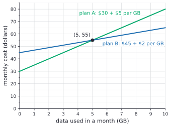
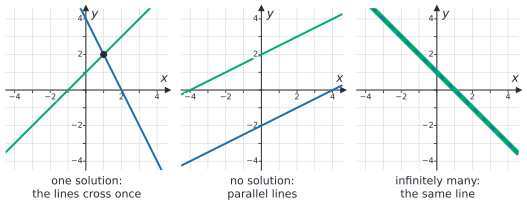
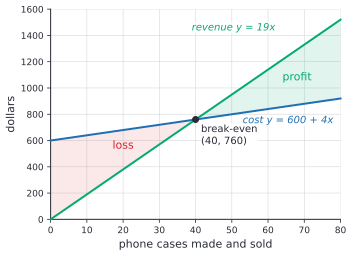

# Systems of linear equations

After this lesson you can solve two linear equations in two unknowns by graphing, substitution or elimination, check the answer in both equations, recognize a system with no solution or infinitely many, and set up a system from a word problem such as a break-even point or a choice between two plans.

Before this: [slope and linear equations](02-slope-and-linear-equations.md) and [multi-step equations](../03-expressions-equations-inequalities/04-multi-step-equations.md).

## Quick check

Try these first. If you get all three right, skip to [Practice](#practice).

1. Solve the system $y = 2x - 1$ and $y = -x + 8$.
2. Solve the system $3x + 2y = 16$ and $5x - 2y = 0$.
3. How many solutions does the system $y = 3x + 2$ and $6x - 2y = 4$ have?

<details class="solution" markdown>
<summary>Answers</summary>

1. $(3, 5)$. Set the two expressions for $y$ equal: $2x - 1 = -x + 8$, so $3x = 9$ and $x = 3$; then $y = 2(3) - 1 = 5$. Check: $-3 + 8 = 5$.
2. $(2, 5)$. Add the equations: $8x = 16$, so $x = 2$; then $6 + 2y = 16$ gives $y = 5$. Check: $5(2) - 2(5) = 0$.
3. None. The second equation is $y = 3x - 2$, a line with the same slope as the first and a different intercept, so the lines are parallel.

</details>

## The idea

You are choosing between two phone plans. Plan A costs \$30 a month plus \$5 per GB of data, and plan B costs \$45 a month plus \$2 per GB. With $x$ for the GB used in a month and $y$ for the monthly cost in dollars, plan A is $y = 30 + 5x$ and plan B is $y = 45 + 2x$.

| Data $x$ (GB) | 0 | 2 | 4 | 5 | 6 | 8 |
|---|---|---|---|---|---|---|
| Plan A (dollars) | 30 | 40 | 50 | 55 | 60 | 70 |
| Plan B (dollars) | 45 | 49 | 53 | 55 | 57 | 61 |

Plan A starts cheaper but climbs faster. At 5 GB the two plans cost the same, \$55, and after that plan B is cheaper. On a graph, each plan is a line, and the place where they cost the same is the point where the lines cross.



Finding that point means finding one pair $(x, y)$ that makes both equations true at once. Each equation alone has infinitely many solutions, one for each point on its line; together they pin down a single point. This lesson finds that point by drawing and by two kinds of algebra, and it explains the two other things that can happen: lines that never cross and lines that are the same line.

## Definitions

A **system of linear equations** is two or more linear equations in the same unknowns, to be solved together. This lesson uses two equations in two unknowns, $x$ and $y$, written one above the other:

$$
\begin{aligned}
2x + 3y &= 7 \\
x - 4y &= 9.
\end{aligned}
$$

A **solution of a system** is an assignment of values to the unknowns that makes every equation in the system true at the same time. With two unknowns it is an ordered pair $(x, y)$. The set of all solutions is the solution set, as for one equation.

In plain words, a solution is a point that lies on both lines. The pair $(5, -1)$ solves the system above, because $2(5) + 3(-1) = 7$ and $5 - 4(-1) = 9$ are both true. The pair $(2, 1)$ is not a solution: it satisfies the first equation, since $4 + 3 = 7$, but not the second, since $2 - 4 = -2$, which is not 9.

A system with no solution is called **inconsistent**, and a system with at least one solution is **consistent**.

## How to do it

### Solving by graphing

1. Write each equation in the form $y = mx + b$.
2. Graph both lines on the same axes ([slope and linear equations](02-slope-and-linear-equations.md#graphing-a-line-from-its-equation)).
3. Read the coordinates of the point where they cross.
4. Check the point in both original equations. A graph gives exact answers only when the crossing lands on grid points, so the check is not optional.

For the phone plans, the lines cross at $(5, 55)$. Check: plan A gives $30 + 5(5) = 55$, and plan B gives $45 + 2(5) = 55$. If the lines had crossed at, say, $x = 4.6$, the graph would only give an estimate, which is why the algebra methods below exist.

### Solving by substitution

1. Solve one of the equations for one unknown. Choose an unknown whose coefficient is 1 or $-1$, so that no fractions appear.
2. Substitute that expression into the other equation, in brackets. The result is one equation in one unknown.
3. Solve it, as in [multi-step equations](../03-expressions-equations-inequalities/04-multi-step-equations.md).
4. Substitute the value back into the expression from Step 1 to get the other unknown.
5. Check the pair in both original equations.

When both equations are already solved for $y$, as with the phone plans, Step 1 is done: set the two expressions equal. From $30 + 5x = 45 + 2x$, subtract $2x$ and 30 from both sides to get $3x = 15$, so $x = 5$, and then $y = 30 + 5(5) = 55$.

### Solving by elimination

1. Write both equations with the $x$-terms lined up, then the $y$-terms, then the constants on the right.
2. Multiply one or both equations by nonzero numbers so that one unknown has opposite coefficients in the two equations, such as $12y$ and $-12y$. Multiply every term, including the constant.
3. Add the two equations. The unknown with opposite coefficients cancels.
4. Solve the resulting one-unknown equation.
5. Substitute the value into either original equation to find the other unknown.
6. Check the pair in both original equations.

### Why adding two equations keeps the solutions

We know a pair $(x, y)$ solves the system $L_1 = R_1$ and $L_2 = R_2$, where $L_1$ and $R_1$ are the two sides of the first equation and $L_2$ and $R_2$ those of the second. We want to show that replacing the second equation by the sum $L_1 + L_2 = R_1 + R_2$ gives a system with exactly the same solutions. The plan is to go both ways, as in the both-sides theorem of [one- and two-step equations](../03-expressions-equations-inequalities/03-one-and-two-step-equations.md#why-the-same-operation-on-both-sides-keeps-the-solutions).

*Proof.* Suppose $(x, y)$ satisfies both original equations. At that pair, $L_1$ and $R_1$ are the same number, and so are $L_2$ and $R_2$, so adding gives the same number on both sides: $L_1 + L_2 = R_1 + R_2$ holds. Now go back. Suppose $(x, y)$ satisfies $L_1 = R_1$ and $L_1 + L_2 = R_1 + R_2$. Subtracting the first from the second, equal numbers from equal numbers, leaves $L_2 = R_2$. So the two systems have the same solutions.

Look back: Step 2 of elimination, multiplying an equation by a nonzero number, also keeps its solutions, by the same theorem. So every step of elimination turns the system into one with the same solutions, and the answer at the end is the answer to the original system.

### The three possible outcomes

Two lines in a plane can meet in exactly one point, never meet, or be the same line. So a system of two linear equations in two unknowns has exactly one solution, no solution or infinitely many solutions.



| Slopes and intercepts | Lines | Solutions | What the algebra does |
|---|---|---|---|
| different slopes | cross once | exactly one | gives one value for each unknown |
| same slope, different intercepts | parallel | none (inconsistent) | both unknowns cancel and leave a false statement, such as $0 = 1$ |
| same slope, same intercept | the same line | infinitely many | both unknowns cancel and leave a true statement, such as $0 = 0$ |

These are the three outcomes of a single linear equation from [multi-step equations](../03-expressions-equations-inequalities/04-multi-step-equations.md#the-three-possible-outcomes) again. Substitution or elimination turns the system into one equation $ax = c$ in one unknown, which has one solution, none or every number. A system of two linear equations never has exactly two solutions: two lines that share two points share every point, because two points fix a line.

### Setting up a word problem

1. Name the two unknowns with letters, and say what each stands for, with units.
2. Write one equation for each fact in the problem. Usually one equation counts things and the other counts their value or cost.
3. Solve the system by whichever method fits.
4. Answer the question in a sentence with units, and check it against the words of the problem as well as against your equations.

## Worked examples

<div class="example" markdown>

### Example 1: substitution

Solve the system

$$
\begin{aligned}
2x + 3y &= 7 \\
x - 4y &= 9.
\end{aligned}
$$

Step 1: the $x$ in the second equation has coefficient 1, so solve the second equation for $x$. Add $4y$ to both sides:

$$
x = 4y + 9.
$$

Step 2: substitute $4y + 9$ for $x$ in the first equation, keeping the brackets:

$$
2(4y + 9) + 3y = 7.
$$

Step 3: solve for $y$.

$$
\begin{aligned}
8y + 18 + 3y &= 7 && \text{distribute the 2} \\
11y + 18 &= 7 && \text{combine like terms} \\
11y &= -11 && \text{subtract 18 from both sides} \\
y &= -1 && \text{divide both sides by 11.}
\end{aligned}
$$

<div class="warning" markdown>

Watch out at Step 2: substitute into the other equation, the one you did not use in Step 1. Putting $x = 4y + 9$ back into $x - 4y = 9$ gives $4y + 9 - 4y = 9$, which is $9 = 9$. That is true but tells you nothing, because it only repeats the equation you started from.

</div>

Step 4: put $y = -1$ into $x = 4y + 9$: $x = 4(-1) + 9 = 5$. The solution is $(5, -1)$.

Step 5: check in both original equations. First: $2(5) + 3(-1) = 10 - 3 = 7$. Second: $5 - 4(-1) = 5 + 4 = 9$. Both are true, so $(5, -1)$ is the solution, and the lines cross at that one point.

</div>

<div class="example" markdown>

### Example 2: elimination with two multipliers

Solve the system

$$
\begin{aligned}
3x + 4y &= 10 \\
5x - 6y &= 23.
\end{aligned}
$$

No coefficient is 1, so elimination is less work than substitution. Step 2: the $y$-coefficients are 4 and $-6$, and both divide 12. Multiply the first equation by 3 and the second by 2:

$$
\begin{aligned}
9x + 12y &= 30 \\
10x - 12y &= 46.
\end{aligned}
$$

Step 3: add the equations. The $y$-terms cancel: $19x = 76$. Step 4: $x = 4$.

Step 5: put $x = 4$ into the first original equation: $12 + 4y = 10$, so $4y = -2$ and $y = -\frac{1}{2}$. The solution is $(4, -\frac{1}{2})$. A fraction in the answer is fine.

Step 6: $3(4) + 4(-\frac{1}{2}) = 12 - 2 = 10$, and $5(4) - 6(-\frac{1}{2}) = 20 + 3 = 23$.

</div>

<div class="example" markdown>

### Example 3: no solution, and infinitely many

(a) Solve $2x - y = 3$ and $4x - 2y = 5$.

Multiply the first equation by 2 to get $4x - 2y = 6$. Subtract the second equation from it: $(4x - 2y) - (4x - 2y) = 6 - 5$, which says $0 = 1$. Both unknowns cancelled and left a false statement, so no pair $(x, y)$ satisfies both equations. The system has no solution. In slope-intercept form the lines are $y = 2x - 3$ and $y = 2x - 2.5$: the same slope with different intercepts, so they are parallel.

(b) Solve $x + 3y = 6$ and $2x + 6y = 12$.

Multiply the first equation by 2 to get $2x + 6y = 12$, which is the second equation. Subtracting gives $0 = 0$, a true statement with no unknowns left. The two equations describe the same line, $y = -\frac{1}{3}x + 2$, and every point on it is a solution: $(0, 2)$, $(3, 1)$, $(6, 0)$, $(-3, 3)$ and infinitely many more.

Check (b) with one of them: $(3, 1)$ gives $3 + 3 = 6$ and $6 + 6 = 12$.

<div class="warning" markdown>

Watch out: $0 = 0$ does not mean $x = 0$ and $y = 0$, and it does not mean "no solution". It means the equations are the same line, so the solutions are all the points on that line. The answer is the line's equation, or a description such as "every pair with $x + 3y = 6$".

</div>

</div>

<div class="example" markdown>

### Example 4: a break-even point (finish it yourself)

You start a small business printing phone cases. The printer and the setup cost \$600, each case costs \$4 in materials, and you sell each case for \$19. How many cases must you sell to break even, that is, for revenue to equal cost?

Step 1: let $x$ be the number of cases made and sold, and $y$ an amount in dollars.

Step 2: the cost is a fixed \$600 plus \$4 per case, and the revenue is \$19 per case:

$$
\begin{aligned}
y &= 600 + 4x && \text{cost} \\
y &= 19x && \text{revenue.}
\end{aligned}
$$

Step 3: both equations are solved for $y$, so set them equal: $19x = 600 + 4x$. Subtract $4x$ from both sides: $15x = 600$, so $x = 40$.



Now find the dollar amount at the break-even point, check it in both equations, and work out the profit (revenue minus cost) if you sell 100 cases.

<details class="solution" markdown>
<summary>Finish</summary>

At $x = 40$, revenue is $19(40) = 760$ dollars, so the break-even point is $(40, 760)$: you need to sell 40 cases, at which point revenue and cost are both \$760.

Check in both equations: $19 \times 40 = 760$ and $600 + 4 \times 40 = 600 + 160 = 760$.

At 100 cases, revenue is $19(100) = 1900$ dollars and cost is $600 + 4(100) = 1000$ dollars, so the profit is \$900. Each case after the 40th adds $19 - 4 = 15$ dollars of profit, and $60 \times 15 = 900$, which agrees.

</details>

</div>

## Edge cases and common mistakes

<div class="warning" markdown>

Watch out: check the answer in both equations. A pair can satisfy one equation and miss the other, as $(2, 1)$ does in [Definitions](#definitions). If you check only the equation you used in the last step, an arithmetic slip earlier on will go unnoticed.

</div>

<div class="warning" markdown>

Watch out: when you multiply an equation, multiply every term, including the constant on the right. Multiplying $3x + 4y = 10$ by 3 gives $9x + 12y = 30$, not $9x + 12y = 10$.

</div>

<div class="warning" markdown>

Watch out when subtracting equations. Subtracting $5x - 6y = 23$ from $5x + 2y = 7$ gives $2y - (-6y) = 8y$ on the left and $7 - 23 = -16$ on the right, so $y = -2$. Writing $2y - 6y = -4y$ is the usual slip. Some people prefer to multiply one equation by $-1$ and always add.

</div>

<div class="warning" markdown>

Watch out: a solution is a pair. Finding $x = 5$ is half the answer. Find $y$ too, and write the point $(5, -1)$.

</div>

A solution can have fractions or negative numbers, as in Example 2. In a word problem, though, the answer must make sense: a negative number of kilograms or 2.5 tickets means the situation is impossible as stated, or a mistake was made. Practice problem 7 has an example.

If the lines are nearly parallel, a graph is a poor guide: the crossing point is hard to see and may be far off the page. Use algebra.

## Tricks and shortcuts

Pick the method from the shape of the equations. If one equation is already solved for a variable, or a variable has coefficient 1 or $-1$, substitute. If a variable has the same or opposite coefficients in both equations, eliminate right away. Otherwise, eliminate after multiplying.

Before you solve, write both equations as $y = mx + b$ and compare. Different slopes mean exactly one solution. The same slope means none or infinitely many, and comparing the intercepts tells you which. This takes a few seconds and tells you what kind of answer to expect.

For a quick check of an elimination answer, use the equation you did not substitute into in Step 5. In Example 2, Step 5 used the first equation, so the second one is the real test.

## In code

The SymPy library solves systems exactly and reports all three outcomes. Each equation is written with everything moved to one side, so `2*x + 3*y - 7` stands for $2x + 3y = 7$.

<details class="code" markdown>
<summary>In code</summary>

```python
from sympy import symbols, linsolve

x, y = symbols("x y")
print(linsolve([2*x + 3*y - 7, x - 4*y - 9], x, y))      # {(5, -1)}
print(linsolve([3*x + 4*y - 10, 5*x - 6*y - 23], x, y))  # {(4, -1/2)}
print(linsolve([2*x - y - 3, 4*x - 2*y - 5], x, y))      # EmptySet
print(linsolve([x + 3*y - 6, 2*x + 6*y - 12], x, y))     # {(6 - 3*y, y)}
```

The last answer describes the infinitely many solutions in terms of $y$: for every number $y$, the pair $(6 - 3y, y)$ is a solution. With $y = 1$ it gives $(3, 1)$, one of the points from Example 3. Solving large systems this way, with many equations and unknowns, is the subject of systems and Gaussian elimination<!-- link: ../../05-university-core/06-linear-algebra/02-systems-and-gaussian-elimination.md -->.

</details>

## FAQ

### Which method is best?

They all give the same answer, so use the one that is least work for the equations in front of you (see [Tricks and shortcuts](#tricks-and-shortcuts)). Graphing shows what is going on and gives a quick estimate. Substitution is natural when a variable is already alone. Elimination is usually fastest when no coefficient is 1, and it is the method that grows into Gaussian elimination for bigger systems.

### Can two linear equations have exactly two solutions?

No. Two different points fix a line, so if two lines share two points, they share every point and are the same line. That leaves one solution, none or infinitely many. Equations that are not linear can have two solutions: the line $y = x$ meets the parabola $y = x^2$ at $(0, 0)$ and $(1, 1)$.

### What about three equations, or three unknowns?

With three unknowns $x$, $y$ and $z$, each linear equation describes a flat plane in space, and you usually need three equations to pin down one point. Elimination still works: use two pairs of equations to eliminate the same unknown, which leaves two equations in two unknowns. Systems with many unknowns are solved with matrices in systems and Gaussian elimination<!-- link: ../../05-university-core/06-linear-algebra/02-systems-and-gaussian-elimination.md -->.

### Why is it called a "system"?

The word means the equations are taken together, as one problem, rather than one at a time. A solution has to satisfy all of them at once. Some books write a large brace to the left of the equations to show that they belong together.

## Practice

### Warm-up

1\. Is $(3, -2)$ a solution of the system $2x + y = 4$ and $x - y = 5$? Is $(2, 0)$?

<details class="solution" markdown>
<summary>Solution</summary>

For $(3, -2)$: $2(3) + (-2) = 4$, true, and $3 - (-2) = 5$, true. It is a solution.

For $(2, 0)$: $2(2) + 0 = 4$, true, but $2 - 0 = 2$, which is not 5. It satisfies only the first equation, so it is not a solution of the system.

Check: the lines $y = -2x + 4$ and $y = x - 5$ have different slopes, so there is exactly one solution, and $(3, -2)$ is it.

</details>

2\. Solve by substitution: $y = 3x - 4$ and $2x + y = 11$.

<details class="solution" markdown>
<summary>Solution</summary>

The first equation is already solved for $y$. Substitute it into the second: $2x + (3x - 4) = 11$, so $5x - 4 = 11$, $5x = 15$ and $x = 3$. Then $y = 3(3) - 4 = 5$. The solution is $(3, 5)$.

Check: $5 = 9 - 4$ and $2(3) + 5 = 11$.

</details>

3\. Solve by elimination: $x + y = 10$ and $x - y = 4$.

<details class="solution" markdown>
<summary>Solution</summary>

The $y$-coefficients are already opposites. Add the equations: $2x = 14$, so $x = 7$. Then $7 + y = 10$ gives $y = 3$. The solution is $(7, 3)$.

Check: $7 + 3 = 10$ and $7 - 3 = 4$. In words: two numbers that add to 10 and differ by 4 are 7 and 3.

</details>

### Standard

4\. Solve by elimination: $4x - 3y = 18$ and $3x + 2y = 5$.

<details class="solution" markdown>
<summary>Solution</summary>

Eliminate $y$: multiply the first equation by 2 and the second by 3.

$$
\begin{aligned}
8x - 6y &= 36 \\
9x + 6y &= 15.
\end{aligned}
$$

Add: $17x = 51$, so $x = 3$. Put it into the second original equation: $9 + 2y = 5$, so $2y = -4$ and $y = -2$. The solution is $(3, -2)$.

Check: $4(3) - 3(-2) = 12 + 6 = 18$ and $3(3) + 2(-2) = 9 - 4 = 5$.

</details>

5\. Without solving, say how many solutions each system has. Then solve the one that has exactly one. (a) $y = 2x + 1$ and $y = 2x - 3$. (b) $3x + y = 4$ and $6x + 2y = 8$. (c) $y = -x + 2$ and $y = x$.

<details class="solution" markdown>
<summary>Solution</summary>

- (a) Same slope 2, different intercepts: parallel lines, no solution.
- (b) The first equation is $y = -3x + 4$. Dividing the second by 2 gives $3x + y = 4$, the same equation, so it is the same line: infinitely many solutions.
- (c) Slopes $-1$ and 1 are different: exactly one solution. Set $-x + 2 = x$, so $2x = 2$ and $x = 1$, and $y = 1$. The solution is $(1, 1)$.

Check (c): $1 = -1 + 2$ and $1 = 1$.

</details>

6\. A school play sold 250 tickets. Adult tickets cost \$12 and student tickets \$7, and ticket sales came to \$2,400. How many of each kind were sold?

<details class="solution" markdown>
<summary>Solution</summary>

Let $x$ be the number of adult tickets and $y$ the number of student tickets. One equation counts tickets and the other counts dollars:

$$
\begin{aligned}
x + y &= 250 \\
12x + 7y &= 2400.
\end{aligned}
$$

Substitute $y = 250 - x$ into the second: $12x + 7(250 - x) = 2400$, so $12x + 1750 - 7x = 2400$, $5x = 650$ and $x = 130$. Then $y = 250 - 130 = 120$. The play sold 130 adult tickets and 120 student tickets.

Check with the words: $130 + 120 = 250$ tickets, and $130 \times 12 + 120 \times 7 = 1560 + 840 = 2400$ dollars.

</details>

### Challenge

7\. A café blends coffee beans that cost \$18/kg with beans that cost \$30/kg, to make 12 kg of a blend worth \$26/kg. (a) How much of each kind does it use? (b) Could it make 12 kg of a blend worth \$32/kg from the same two kinds? Explain what the algebra says.

<details class="solution" markdown>
<summary>Solution</summary>

(a) Let $x$ be the kilograms of \$18 beans and $y$ the kilograms of \$30 beans. The masses add to 12, and the values add to the value of the blend, $12 \times 26 = 312$ dollars:

$$
\begin{aligned}
x + y &= 12 \\
18x + 30y &= 312.
\end{aligned}
$$

Substitute $y = 12 - x$: $18x + 360 - 30x = 312$, so $-12x = -48$ and $x = 4$. Then $y = 8$. The café uses 4 kg of the \$18 beans and 8 kg of the \$30 beans.

(b) Now the value is $12 \times 32 = 384$, and the same steps give $18x + 360 - 30x = 384$, so $-12x = 24$ and $x = -2$, with $y = 14$. The algebra is fine, but $-2$ kg of beans is impossible, so no such blend exists. That makes sense: a blend can't be worth more per kilogram than the most expensive beans in it.

Check (a): $4 + 8 = 12$ and $18(4) + 30(8) = 72 + 240 = 312$. The blend price, \$26, is between \$18 and \$30 and closer to \$30, so more of the \$30 beans makes sense.

</details>

8\. (Reviews [percents](../02-ratios-rates-percents/03-percents.md).) You put \$5,000 into two savings accounts, part at 3% interest per year and the rest at 5% per year. After one year the two accounts have earned \$196 in interest in total. How much went into each account?

<details class="solution" markdown>
<summary>Solution</summary>

Let $x$ be the dollars at 3% and $y$ the dollars at 5%. Each year's interest is a percent of the amount in the account, so

$$
\begin{aligned}
x + y &= 5000 \\
0.03x + 0.05y &= 196.
\end{aligned}
$$

Substitute $y = 5000 - x$: $0.03x + 250 - 0.05x = 196$, so $-0.02x = -54$ and $x = 2700$. Then $y = 2300$. You put \$2,700 in the 3% account and \$2,300 in the 5% account.

Check: $0.03 \times 2700 = 81$ and $0.05 \times 2300 = 115$, and $81 + 115 = 196$. A rough check: \$196 is 3.92% of \$5,000, between 3% and 5% and a little closer to 3%, so a little more of the money should be at 3%, and it is.

</details>

## Where this shows up

- [Systems of linear equations](../../03-high-school/02-linear-functions-and-systems/02-systems-of-linear-equations.md) in high school adds larger systems and word problems, and [two-variable inequalities and feasible regions](../../03-high-school/02-linear-functions-and-systems/03-two-variable-inequalities-and-feasible-regions.md) replaces the equations with inequalities. In linear algebra, systems with many unknowns are solved by Gaussian elimination, and the three cases come back as the three outcomes of that method (systems and Gaussian elimination<!-- link: ../../05-university-core/06-linear-algebra/02-systems-and-gaussian-elimination.md -->).
- In economics, the market price is where the supply line and the demand line cross, found by solving a system (supply and demand equilibrium algebra<!-- link: ../../07-economics-math/02-markets/03-supply-and-demand-equilibrium-algebra.md -->), and a firm's break-even point is the crossing of its cost and revenue lines, as in Example 4.
- In computing, fitting a line to data by least squares ends in a small linear system (orthogonality, projections and least squares<!-- link: ../../05-university-core/06-linear-algebra/07-orthogonality-projections-and-least-squares.md -->), and graphics code solves a two-by-two system to find where two line segments cross.
