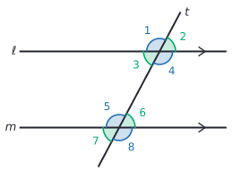
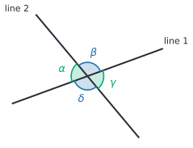
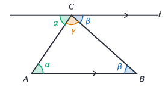
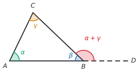
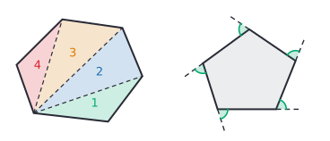

# Angles and triangles

After this lesson you can find unknown angles where lines cross, where a line crosses two parallel lines and inside a triangle, prove that the angles of a triangle add up to $180^\circ$, decide whether three lengths can form a triangle, and find the angle sums of any convex polygon.

Before this: [geometry basics](../../01-elementary/16-geometry-basics-area-perimeter-volume.md) (angle types, parallel lines, polygons) and [one- and two-step equations](../03-expressions-equations-inequalities/03-one-and-two-step-equations.md).

## Quick check

Try these first. If you get all three right, skip to [Practice](#practice).

1. Two lines cross, and one of the four angles they make is $64^\circ$. Find the other three.
2. The angles of a triangle are $x$, $2x$ and $x + 20^\circ$. Find $x$ and the three angles.
3. (a) Can sticks 4 cm, 7 cm and 12 cm long form a triangle? (b) What is each interior angle of a regular octagon?

<details class="solution" markdown>
<summary>Answers</summary>

1. The angle next to $64^\circ$ on the same line is $180^\circ - 64^\circ = 116^\circ$. The angle opposite is also $64^\circ$, and the last one is $116^\circ$.
2. The angles add to $180^\circ$, so $4x + 20^\circ = 180^\circ$, which gives $x = 40^\circ$. The angles are $40^\circ$, $80^\circ$ and $60^\circ$.
3. (a) No: $4 + 7 = 11$, which is less than 12, so the two short sticks can't reach across the long one. (b) An octagon's angles add to $(8 - 2) \times 180^\circ = 1080^\circ$, and $1080^\circ \div 8 = 135^\circ$.

</details>

## The idea

Cut a triangle of any shape out of paper and tear off its three corners. Put the three corners side by side with their points touching, and they always fill a straight line exactly: $180^\circ$. Try it with a long thin triangle and a fat one and the result is the same. That is a strong hint, but tearing paper is not a reason, and a few triangles are not every triangle.

The reason comes from parallel lines. Picture a straight road crossing a grid of parallel streets at a slant. At every intersection the road makes the same angles with the street, because the streets all point the same way. That one fact about parallel lines, plus the fact that a straight line is $180^\circ$, is enough to explain the paper trick for every triangle there is.

This lesson proves the angle facts in order, each from the ones before it: crossing lines, parallel lines, then triangles and polygons. The proofs are short, and they are the same kind of reasoning a university proof course asks for.

## Definitions

This book writes $\angle A = 40^\circ$ for "the angle at $A$ measures $40^\circ$". Proof-based books often write $m\angle A = 40^\circ$, where $m$ stands for "measure", to keep the angle (two rays) apart from its size (a number). Greek letters such as $\alpha$ (alpha), $\beta$ (beta), $\gamma$ (gamma) and $\theta$ (theta) name angle sizes.

### Pairs of angles

Two angles are **complementary** when their measures add to $90^\circ$, and **supplementary** when their measures add to $180^\circ$. So $30^\circ$ and $60^\circ$ are complementary, and $30^\circ$ and $150^\circ$ are supplementary. A memory aid: "c" comes before "s" in the alphabet, and 90 comes before 180.

Two angles are **adjacent** when they share a vertex and a side and don't overlap. When two adjacent angles have their outer sides along one straight line, they form a **linear pair**. A linear pair makes a straight angle, so the two angles are supplementary.

When two lines cross, they make four angles. Two angles across from each other at the crossing point, sharing only the vertex, are **vertical angles** (also called vertically opposite angles). "Vertical" here refers to the vertex, not to up and down.

### A line crossing two lines

A **transversal** is a line that crosses two other lines at two different points. The figure shows a transversal $t$ crossing the lines $\ell$ and $m$, making eight angles. The arrow marks on $\ell$ and $m$ are the usual sign that the lines are parallel.



The pairs have names, based on where the two angles sit:

| Pair | Where the angles are | In the figure |
|---|---|---|
| **corresponding angles** | in the same position at the two crossings | 1 and 5, 2 and 6, 3 and 7, 4 and 8 |
| **alternate interior angles** | between $\ell$ and $m$, on opposite sides of $t$ | 3 and 6, 4 and 5 |
| **co-interior angles** | between $\ell$ and $m$, on the same side of $t$ | 3 and 5, 4 and 6 |
| alternate exterior angles | outside $\ell$ and $m$, on opposite sides of $t$ | 1 and 8, 2 and 7 |

Co-interior angles are also called same-side interior angles or consecutive interior angles. Some textbooks remember the shapes the pairs make: corresponding angles sit in an F, alternate interior angles in a Z, and co-interior angles in a C or a U.

### Triangles

Triangles are named by their vertices: $\triangle ABC$ is the triangle with vertices $A$, $B$ and $C$. They are classified two ways.

| By sides | Meaning | By angles | Meaning |
|---|---|---|---|
| **equilateral triangle** | all three sides equal | **acute triangle** | all three angles acute |
| **isosceles triangle** | at least two sides equal | **right triangle** | one angle is $90^\circ$ |
| **scalene triangle** | no two sides equal | **obtuse triangle** | one angle is obtuse |

So a triangle with angles $90^\circ$, $45^\circ$ and $45^\circ$ is a right isosceles triangle. Under the "at least two" definition, every equilateral triangle is also isosceles. Drawings mark equal sides with matching tick marks.

Two facts about isosceles triangles get used constantly. The angles opposite the two equal sides, called the base angles, are equal, and if two angles of a triangle are equal, the sides opposite them are equal. More generally, the longest side of a triangle is opposite its largest angle. These are proved in [congruence and triangle proofs](../../03-high-school/08-geometry-and-proof/02-congruence-and-triangle-proofs.md); this lesson uses them as facts.

### Polygon angles

An **interior angle** of a polygon is the angle inside it at a vertex. An **exterior angle** is the angle between one side and the extension of the next side, outside the polygon. At each vertex the interior and exterior angles form a linear pair, so they add to $180^\circ$.

A polygon is **convex** when every interior angle is less than $180^\circ$; it has no dents. In plain words, a convex polygon is one where the segment between every two of its points stays inside it. Every triangle and every regular polygon is convex. In this lesson, "polygon" means a convex polygon.

## How to do it

### Finding unknown angles

1. Copy the figure and mark every angle you know. Don't trust how the drawing looks: an angle that looks like $90^\circ$ counts as a right angle only if it is marked with a square or stated.
2. Find a fact that links an unknown angle to known ones: a linear pair, vertical angles, a parallel-line pair, the triangle sum, the exterior angle theorem or a polygon sum. All of them are proved below.
3. Write an equation and solve it. With an expression such as $(3x + 10)^\circ$, solve for $x$ first, then put it back in.
4. Give the reason for each step in a few words ("vertical angles", "alternate interior angles").
5. Check: the angles along a line add to $180^\circ$, around a point to $360^\circ$, and in a triangle to $180^\circ$.

### Vertical angles are equal

*Theorem.* When two lines cross, the vertical angles are equal.



What we know: two straight lines cross, making the four angles $\alpha$, $\beta$, $\gamma$ and $\delta$ in the figure. A straight angle measures $180^\circ$.

What we want: $\alpha = \gamma$. (The same argument then gives $\beta = \delta$.)

The plan: $\alpha$ and $\gamma$ are not next to each other, so look for an angle that is next to both. The angle $\beta$ forms a linear pair with each of them, so each of them is "$180^\circ$ minus $\beta$".

The proof: the angles $\alpha$ and $\beta$ sit side by side, and their outer sides are the two halves of line 1. So they form a linear pair, which makes a straight angle:

$$
\alpha + \beta = 180^\circ.
$$

The angles $\beta$ and $\gamma$ also sit side by side, with outer sides along line 2, so

$$
\beta + \gamma = 180^\circ.
$$

Subtract $\beta$ from both sides of each equation: $\alpha = 180^\circ - \beta$ and $\gamma = 180^\circ - \beta$. Both equal the same number, so $\alpha = \gamma$. $\blacksquare$

Looking back: the proof never used a particular size for $\beta$, so it works for every pair of crossing lines. The step "two things equal to the same thing are equal to each other" is one you will use in proofs for the rest of the book. The black square marks the end of a proof.

### Parallel lines and a transversal

This part starts from one fact we accept without proof.

*Corresponding angles postulate.* If a transversal crosses two parallel lines, then the corresponding angles are equal. Conversely, if a transversal crosses two lines and makes a pair of equal corresponding angles, then the lines are parallel.

A postulate (or axiom) is a starting assumption. This one says the same thing as Euclid's parallel postulate: through a point not on a line, there is exactly one line parallel to it. You can't prove it from the other basic facts of flat geometry; [definitions, postulates and proof](../../03-high-school/08-geometry-and-proof/01-definitions-postulates-and-proof.md) explains why a theory needs starting points like this. The other parallel-line facts follow from it.

*Theorem.* If a transversal crosses two parallel lines, then (a) alternate interior angles are equal, and (b) co-interior angles are supplementary.

What we know: $\ell$ and $m$ are parallel, so corresponding angles are equal. Vertical angles are equal, and a linear pair adds to $180^\circ$. Use the numbering in the transversal figure.

What we want: (a) $\angle 3 = \angle 6$, and (b) $\angle 3 + \angle 5 = 180^\circ$. The other pairs work the same way.

The plan: get from angle 3 to the bottom crossing in two hops, one at the top crossing (vertical angles or a linear pair) and one down to the bottom (corresponding angles).

The proof of (a): angles 3 and 2 are vertical angles, so $\angle 3 = \angle 2$. Angles 2 and 6 are corresponding angles, so $\angle 2 = \angle 6$. Putting the two together, $\angle 3 = \angle 6$.

The proof of (b): angles 1 and 3 form a linear pair along $t$, so $\angle 1 + \angle 3 = 180^\circ$. Angles 1 and 5 are corresponding, so $\angle 1 = \angle 5$. Replace $\angle 1$ with $\angle 5$ in the first equation: $\angle 5 + \angle 3 = 180^\circ$. $\blacksquare$

Looking back: in the figure, all four acute angles are equal and all four obtuse angles are equal, and each acute angle plus each obtuse angle makes $180^\circ$. That gives a quick way to fill in all eight angles from one ([Tricks](#tricks-and-shortcuts)). The steps also run backwards: if alternate interior angles are equal, or co-interior angles are supplementary, then the lines are parallel. That is how you prove two lines are parallel.

### The angles of a triangle add to 180 degrees

*Theorem (triangle angle sum).* The interior angles of every triangle add to $180^\circ$.

What we know: $\triangle ABC$ is a triangle with angles $\alpha$ at $A$, $\beta$ at $B$ and $\gamma$ at $C$. Through a point not on a line there is exactly one parallel line, and alternate interior angles between parallel lines are equal.

What we want: $\alpha + \beta + \gamma = 180^\circ$.

The plan: the paper trick put the three corners side by side along a straight line. Do the same with a line: draw a line through $C$ parallel to $AB$, and find copies of $\alpha$ and $\beta$ at $C$ next to $\gamma$.



The proof: let $\ell$ be the line through $C$ parallel to $AB$. Side $CA$ is a transversal of the parallel lines $\ell$ and $AB$. The angle between $\ell$ and $CA$ on the left of $C$ and the angle $\alpha$ at $A$ are alternate interior angles, so the angle at $C$ on the left is $\alpha$. In the same way, side $CB$ is a transversal, and the angle between $\ell$ and $CB$ on the right of $C$ equals $\beta$.

The three angles at $C$ (the left copy of $\alpha$, then $\gamma$, then the right copy of $\beta$) sit side by side and fill the straight line $\ell$ on one side. A straight angle is $180^\circ$, so

$$
\alpha + \gamma + \beta = 180^\circ. \qquad \blacksquare
$$

Looking back: the drawn line did the work. Adding a line or point that isn't in the original figure is a standard move in geometry proofs, and it is fine as long as you can say why it exists: here, the parallel postulate. The proof can't do without parallel lines, and on a curved surface such as a globe, where there are none, the angle sum is not $180^\circ$ (see the [FAQ](#faq)).

Two consequences follow at once. A triangle has at most one right or obtuse angle, and the two acute angles of a right triangle are complementary, since they add to $180^\circ - 90^\circ = 90^\circ$.

### The exterior angle theorem

*Theorem.* An exterior angle of a triangle equals the sum of the two interior angles that are not next to it (the remote interior angles).



What we know: in $\triangle ABC$, side $AB$ is extended past $B$ to a point $D$, making the exterior angle $\angle CBD$. The interior angles are $\alpha$, $\beta$ and $\gamma$.

What we want: $\angle CBD = \alpha + \gamma$.

The plan: both $\angle CBD$ and $\alpha + \gamma$ are "$180^\circ$ minus $\beta$", the same trick as for vertical angles.

The proof: $\angle CBD$ and $\beta$ form a linear pair, so $\angle CBD = 180^\circ - \beta$. By the triangle angle sum, $\alpha + \beta + \gamma = 180^\circ$, so $\alpha + \gamma = 180^\circ - \beta$. Both equal $180^\circ - \beta$, so $\angle CBD = \alpha + \gamma$. $\blacksquare$

Looking back: the theorem saves a step. To find an exterior angle you don't need the interior angle next to it; add the two far ones.

### The triangle inequality

Three lengths don't always make a triangle. If one stick is longer than the other two put together, the two short ones can't meet over it. The rule is the **triangle inequality**: in every triangle, each side is shorter than the sum of the other two. For sides $a$, $b$ and $c$,

$$
a + b > c, \qquad a + c > b, \qquad b + c > a.
$$

In plain words, going straight from one vertex to another is shorter than going through the third vertex. Conversely, three positive lengths form a triangle exactly when all three inequalities hold. You only need to test one of them: the sum of the two shorter lengths must be greater than the longest. If it is, the other two inequalities hold automatically, since the longest side plus anything is bigger than either short side.

If the two short sides add up to exactly the longest, the "triangle" is flat: the third vertex lies on the long side. That is called a degenerate triangle, and it doesn't count.

### Angle sums of polygons

*Theorem.* The interior angles of a convex polygon with $n$ sides add to $(n - 2) \times 180^\circ$, and its exterior angles, one at each vertex, add to $360^\circ$.



What we know: the angles of a triangle add to $180^\circ$, and an interior and exterior angle at the same vertex add to $180^\circ$.

What we want: the two sums for every $n \ge 3$.

The plan: cut the polygon into triangles, as in the hexagon on the left of the figure, and count them.

The proof: pick one vertex and draw the diagonals from it to every vertex except itself and its two neighbours. That makes $n - 3$ diagonals, which cut the polygon into $n - 2$ triangles. (The hexagon gets 3 diagonals and 4 triangles.) Because the polygon is convex, the diagonals stay inside it. The angles of all the triangles together make up exactly the interior angles of the polygon, with nothing left over, so the interior angles add to $(n - 2) \times 180^\circ$.

For the exterior angles: at each of the $n$ vertices, interior plus exterior is $180^\circ$, so all the interior and exterior angles together add to $n \times 180^\circ$. Subtract the interior sum:

$$
n \times 180^\circ - (n - 2) \times 180^\circ = 2 \times 180^\circ = 360^\circ. \qquad \blacksquare
$$

Looking back: the exterior sum doesn't depend on $n$. There is a second way to see it. Walk around the pentagon on the right, turning at each corner by its exterior angle. When you get back to the start you face the same way as before, having turned through one full turn, $360^\circ$.

In a **regular polygon** every angle is the same, so each exterior angle is $360^\circ \div n$ and each interior angle is $180^\circ$ minus that:

| Polygon | $n$ | Interior sum | Each interior angle (regular) | Each exterior angle (regular) |
|---|---|---|---|---|
| triangle | 3 | $180^\circ$ | $60^\circ$ | $120^\circ$ |
| square | 4 | $360^\circ$ | $90^\circ$ | $90^\circ$ |
| pentagon | 5 | $540^\circ$ | $108^\circ$ | $72^\circ$ |
| hexagon | 6 | $720^\circ$ | $120^\circ$ | $60^\circ$ |
| octagon | 8 | $1080^\circ$ | $135^\circ$ | $45^\circ$ |
| decagon | 10 | $1440^\circ$ | $144^\circ$ | $36^\circ$ |
| dodecagon | 12 | $1800^\circ$ | $150^\circ$ | $30^\circ$ |

## Worked examples

<div class="example" markdown>

### Example 1: parallel lines with an unknown

In the transversal figure, $\ell$ and $m$ are parallel, $\angle 3 = (3x + 10)^\circ$ and $\angle 6 = (5x - 30)^\circ$. Find $x$ and all eight angles.

Step 1: mark what you know. The lines are parallel (the arrow marks say so), and angles 3 and 6 are given as expressions.

Step 2: find a fact that links them. Angles 3 and 6 are between the parallel lines, on opposite sides of $t$, so they are alternate interior angles, and those are equal.

Step 3: write the equation and solve it:

$$
\begin{aligned}
3x + 10 &= 5x - 30 \\
40 &= 2x \\
x &= 20.
\end{aligned}
$$

(Subtract $3x$ from both sides and add 30 to both sides, then divide by 2.) Put $x = 20$ back in: $\angle 3 = 3 \times 20 + 10 = 70^\circ$, and $\angle 6 = 5 \times 20 - 30 = 70^\circ$.

Step 4: fill in the rest, with reasons. Angle 2 is vertical to angle 3, and angle 7 is vertical to angle 6, so both are $70^\circ$. Angle 1 forms a linear pair with angle 3, so $\angle 1 = 180^\circ - 70^\circ = 110^\circ$. Angles 4, 5 and 8 are each vertical, corresponding or alternate interior to angle 1, so all of them are $110^\circ$. The four acute angles are $70^\circ$ and the four obtuse ones are $110^\circ$.

<div class="warning" markdown>

Watch out at Step 2: if the angles had been 3 and 5, a co-interior pair, the equation would be $(3x + 10) + (5x - 30) = 180$, not an equals sign between them. Setting co-interior angles equal is the most common slip with parallel lines. Ask whether the two angles look the same size (both acute or both obtuse) before you write $=$.

</div>

Step 5: check. Along line $\ell$, $\angle 1 + \angle 2 = 110^\circ + 70^\circ = 180^\circ$. Co-interior angles 3 and 5 give $70^\circ + 110^\circ = 180^\circ$, as they should.

</div>

<div class="example" markdown>

### Example 2: an exterior angle

An exterior angle of a triangle is $130^\circ$, and one of the two remote interior angles is $48^\circ$. Find the other remote interior angle and the interior angle next to the exterior angle.

By the exterior angle theorem, the two remote interior angles add to $130^\circ$, so the other one is $130^\circ - 48^\circ = 82^\circ$. The interior angle next to the exterior angle forms a linear pair with it: $180^\circ - 130^\circ = 50^\circ$.

Check: the three interior angles are $48^\circ$, $82^\circ$ and $50^\circ$, and $48 + 82 + 50 = 180$.

</div>

<div class="example" markdown>

### Example 3: when three lengths don't make a triangle

(a) Can lengths of 5, 8 and 13 form a triangle? (b) A triangle has sides of 5 and 8. What lengths are possible for the third side?

(a) Test the two shorter lengths against the longest: $5 + 8 = 13$, which is not greater than 13. The two short sides lie flat along the long one, so this is a degenerate triangle, not a real one.

(b) Call the third side $x$. If $x$ is the longest side, the triangle inequality needs $5 + 8 > x$, so $x < 13$. If 8 is the longest side, it needs $5 + x > 8$, so $x > 3$. Together, $3 < x < 13$. The third side can be any length strictly between 3 and 13, including untidy ones such as 3.01 or 12.9.

Check with the ends: at $x = 3$ the sides 3, 5, 8 are flat ($3 + 5 = 8$), and at $x = 13$ they are flat too. Any value between makes a real triangle, such as $x = 10$, where $5 + 8 = 13 > 10$.

</div>

<div class="example" markdown>

### Example 4: a polygon from its angle sum (finish it yourself)

The interior angles of a convex polygon add to $1440^\circ$. How many sides does it have? If it is regular, what are its interior and exterior angles?

Step 2: the polygon sum links the angles to the number of sides, $(n - 2) \times 180^\circ$.

Step 3: set it equal to the given sum:

$$
(n - 2) \times 180 = 1440.
$$

Now solve for $n$, find each interior angle of the regular polygon, find each exterior angle, and check.

<details class="solution" markdown>
<summary>Finish</summary>

Divide both sides by 180: $n - 2 = 8$, so $n = 10$. It is a decagon. Each interior angle of a regular decagon is $1440^\circ \div 10 = 144^\circ$, and each exterior angle is $180^\circ - 144^\circ = 36^\circ$.

Check: the exterior angles add to $10 \times 36^\circ = 360^\circ$, as they must for every polygon.

</details>

</div>

## Edge cases and common mistakes

<div class="warning" markdown>

Watch out: the parallel-line facts need parallel lines. If $\ell$ and $m$ are not parallel, angles 2 and 6 are still called corresponding angles, but they are not equal. Use the facts only when the lines are marked or stated to be parallel, or when you have just proved they are.

</div>

<div class="warning" markdown>

Watch out: co-interior angles are supplementary, not equal. Alternate interior and corresponding angles are equal. If one angle of a pair is acute and the other obtuse, they can't be equal, so they must add to $180^\circ$.

</div>

<div class="warning" markdown>

Watch out for the polygon formulas. The interior sum is $(n - 2) \times 180^\circ$, not $n \times 180^\circ$: a square's angles add to $360^\circ$, not $720^\circ$. The exterior sum is $360^\circ$ for every polygon, whatever $n$ is. And the formula $(n - 2) \times 180^\circ \div n$ gives each angle only for a regular polygon.

</div>

<div class="warning" markdown>

Watch out with the triangle inequality: test the two shortest sides against the longest. Lengths 2, 3 and 10 pass the test $2 + 10 > 3$, but fail $2 + 3 > 10$, so they don't form a triangle. Equality fails too: $5 + 8 = 13$ gives a flat triangle.

</div>

Figures in problems are often not drawn to scale. An angle that looks like $90^\circ$ may be $88^\circ$, and two lines that look parallel may not be. Use only what is marked or stated.

A right angle or an obtuse angle uses up at least $90^\circ$ of the $180^\circ$, so the other two angles of the triangle have to be acute. That is why a triangle can't have two right angles (Practice problem 7 proves it). Angles can be untidy: a triangle with angles $50.5^\circ$, $62.25^\circ$ and $67.25^\circ$ is fine.

A polygon with a dent (non-convex) has an interior angle bigger than $180^\circ$. Its interior angles still add to $(n - 2) \times 180^\circ$, but the proof needs a different cut into triangles.

## Tricks and shortcuts

A transversal of two parallel lines makes only two sizes of angle. All the acute ones are equal, all the obtuse ones are equal, and one of each adds to $180^\circ$. So once you know one angle, you know all eight: if one is $65^\circ$, the others are $65^\circ$ or $115^\circ$, and you can tell which by looking at whether each angle is acute or obtuse. (If the transversal is perpendicular, all eight are $90^\circ$.)

For a regular polygon, find the exterior angle first, $360^\circ \div n$, since that is easier to divide. Then the interior angle is $180^\circ$ minus it. For a regular 12-gon, the exterior angle is $30^\circ$ and the interior angle is $150^\circ$. It works backwards too: an interior angle of $156^\circ$ means an exterior angle of $24^\circ$, so $n = 360 \div 24 = 15$.

For a right triangle, the two acute angles add to $90^\circ$, so one gives you the other: a right triangle with a $35^\circ$ angle has a $55^\circ$ angle. In an isosceles triangle, one angle is enough to find the others: with a top angle of $40^\circ$, the two base angles share $140^\circ$ and are $70^\circ$ each.

## In code

The triangle inequality is a one-line test once the sides are sorted, and the polygon sum is a one-line formula. The last line shows a trap when the lengths are floats.

<details class="code" markdown>
<summary>In code</summary>

```python
def is_triangle(a, b, c):
    """True when a, b and c are the side lengths of a real (not flat) triangle."""
    a, b, c = sorted((a, b, c))     # now c is the longest side
    return a > 0 and a + b > c

def interior_angle_sum(n):
    return (n - 2) * 180

print(is_triangle(4, 7, 12))    # False: 4 + 7 = 11 is less than 12
print(is_triangle(5, 8, 13))    # False: 5 + 8 = 13, a flat triangle
print(is_triangle(7, 11, 17))   # True
print(interior_angle_sum(10))   # 1440
print([interior_angle_sum(n) / n for n in (3, 4, 5, 6, 8)])  # [60.0, 90.0, 108.0, 120.0, 135.0]

print(is_triangle(0.1 + 0.2, 0.3, 0.6))  # True, but 0.3 + 0.3 = 0.6 is flat
```

In floating point, `0.1 + 0.2` is `0.30000000000000004`, a little more than 0.3, so the flat triangle 0.3, 0.3, 0.6 passes the test. Geometry code usually compares with a small tolerance, such as `a + b > c + 1e-9`, for this reason. Floating point basics<!-- link: ../../06-cs-math/01-number-representation/04-floating-point-basics.md --> explains where the extra digits come from.

</details>

## FAQ

### Do the angles of a triangle add to 180 degrees on a globe?

No. Start at the North Pole, go straight down to the equator, turn $90^\circ$ and walk a quarter of the way around the equator, then turn $90^\circ$ and walk straight back to the pole. That triangle has three right angles, so its angles add to $270^\circ$. The proof above used a line parallel to $AB$, and on a sphere every two "straight lines" (great circles) cross, so there are no parallel lines. The $180^\circ$ fact is a fact about flat surfaces, and the proof shows exactly which assumption it needs.

### Why prove it, if every triangle I measure gives 180 degrees?

Measuring checks one triangle, and only to the accuracy of your protractor: a measured sum of $179^\circ$ or $181^\circ$ doesn't tell you which is the truth. A proof covers every triangle at once, exactly, including ones you will never draw. It also tells you why, which is what let us see that the fact fails on a globe. What is a proof<!-- link: ../../04-proofs-and-logic/01-language-and-notation/01-what-is-a-proof.md --> comes back to this.

### Why is a full turn 360 degrees?

It is a convention, kept because 360 divides evenly by 2, 3, 4, 5, 6, 8, 9, 10, 12 and more, so common fractions of a turn are whole numbers of degrees. Nothing in the proofs depends on it: in a unit where a full turn is 1, the triangle sum would be $\frac{1}{2}$. Calculus uses a different unit, the radian, in which a full turn is $2\pi$ ([radians and the unit circle](../../03-high-school/09-trigonometry/02-radians-and-the-unit-circle.md)).
## Practice

### Warm-up

1\. (a) Find the complement and the supplement of $37^\circ$. (b) An angle is equal to its own complement. How big is it?

<details class="solution" markdown>
<summary>Solution</summary>

(a) The complement is $90^\circ - 37^\circ = 53^\circ$, and the supplement is $180^\circ - 37^\circ = 143^\circ$.

(b) If the angle is $x$, then $x + x = 90^\circ$, so $x = 45^\circ$.

Check: $37 + 53 = 90$, $37 + 143 = 180$ and $45 + 45 = 90$.

</details>

2\. Two lines cross. One angle is $(2x + 16)^\circ$ and the angle vertical to it is $(4x - 20)^\circ$. Find $x$ and all four angles.

<details class="solution" markdown>
<summary>Solution</summary>

Vertical angles are equal, so $2x + 16 = 4x - 20$. Subtract $2x$ and add 20: $36 = 2x$, so $x = 18$. The angle is $2 \times 18 + 16 = 52^\circ$, and its vertical angle is $4 \times 18 - 20 = 52^\circ$. The other two angles form linear pairs with these, so each is $180^\circ - 52^\circ = 128^\circ$.

Check: the four angles add to $52 + 128 + 52 + 128 = 360$, a full turn around the crossing point.

</details>

3\. Find the third angle of each triangle and classify the triangle by its angles and by its sides: (a) angles $35^\circ$ and $55^\circ$ with sides all different; (b) angles $72^\circ$ and $36^\circ$; (c) all three sides 6 cm.

<details class="solution" markdown>
<summary>Solution</summary>

- (a) $180^\circ - 35^\circ - 55^\circ = 90^\circ$, so it is a right triangle, and scalene, since the sides are all different.
- (b) $180^\circ - 72^\circ - 36^\circ = 72^\circ$. All angles are acute, so it is acute. Two angles are equal, so the sides opposite them are equal, and it is isosceles.
- (c) Equilateral. Its three angles are equal, since equal sides are opposite equal angles, so each is $180^\circ \div 3 = 60^\circ$, and it is acute.

Check: each set of angles adds to 180: $35 + 55 + 90$, $72 + 72 + 36$ and $60 + 60 + 60$.

</details>

### Standard

4\. In the transversal figure, $\ell$ is parallel to $m$ and $\angle 1 = 115^\circ$. Find the other seven angles, with a reason for each.

<details class="solution" markdown>
<summary>Solution</summary>

- $\angle 2 = 180^\circ - 115^\circ = 65^\circ$ (linear pair with angle 1 along $\ell$).
- $\angle 3 = 65^\circ$ (linear pair with angle 1 along $t$).
- $\angle 4 = 115^\circ$ (vertical to angle 1).
- $\angle 5 = 115^\circ$ (corresponding to angle 1).
- $\angle 6 = 65^\circ$ (corresponding to angle 2).
- $\angle 7 = 65^\circ$ (corresponding to angle 3).
- $\angle 8 = 115^\circ$ (corresponding to angle 4).

Check: the acute angles 2, 3, 6 and 7 are all $65^\circ$, the obtuse ones are all $115^\circ$, and $65 + 115 = 180$. Co-interior angles 4 and 6 add to $115 + 65 = 180$.

</details>

5\. A triangle has sides of 7 cm and 11 cm, and the third side is a whole number of centimetres. How many triangles are possible?

<details class="solution" markdown>
<summary>Solution</summary>

Call the third side $x$. If $x$ is the longest side, we need $7 + 11 > x$, so $x < 18$. If 11 is the longest, we need $7 + x > 11$, so $x > 4$. So $4 < x < 18$, and the whole numbers in that range are 5, 6, ..., 17. There are $17 - 5 + 1 = 13$ of them, so 13 triangles.

Check the ends: $x = 4$ gives 4, 7, 11 with $4 + 7 = 11$, which is flat, and $x = 18$ gives $7 + 11 = 18$, also flat. Both are correctly left out.

</details>

6\. Each interior angle of a regular polygon is $156^\circ$. How many sides does it have?

<details class="solution" markdown>
<summary>Solution</summary>

Each exterior angle is $180^\circ - 156^\circ = 24^\circ$. The exterior angles add to $360^\circ$, so there are $360 \div 24 = 15$ of them. The polygon has 15 sides.

Check with the interior sum: $(15 - 2) \times 180^\circ = 2340^\circ$, and $2340^\circ \div 15 = 156^\circ$.

</details>

### Challenge

7\. Prove that a triangle can't have two angles that are each $90^\circ$ or more.

<details class="solution" markdown>
<summary>Solution</summary>

This proof uses contradiction: we assume the statement is false and show that the assumption leads to something impossible (proof by contradiction<!-- link: ../../04-proofs-and-logic/03-core-proof-methods/06-proof-by-contradiction.md --> covers the method).

What we know: the three angles of a triangle add to $180^\circ$, and each angle is greater than $0^\circ$.

What we want: it is impossible for two of the angles to be $90^\circ$ or more.

The plan: suppose two angles are that big, add them up, and see that nothing is left for the third angle.

The proof: suppose a triangle has angles $\alpha$, $\beta$ and $\gamma$ with $\alpha \ge 90^\circ$ and $\beta \ge 90^\circ$. Then $\alpha + \beta \ge 180^\circ$. Since the angles add to $180^\circ$,

$$
\gamma = 180^\circ - (\alpha + \beta) \le 180^\circ - 180^\circ = 0^\circ.
$$

But every angle of a triangle is greater than $0^\circ$, so this is impossible. The assumption was false, so no triangle has two angles of $90^\circ$ or more. $\blacksquare$

Looking back: the same argument shows that a triangle has at most one right angle and at most one obtuse angle, and never one of each. So every triangle has at least two acute angles.

</details>

8\. (Reviews [ratios and unit rates](../02-ratios-rates-percents/01-ratios-and-unit-rates.md).) The angles of a triangle are in the ratio $2:3:4$. Find the angles and classify the triangle.

<details class="solution" markdown>
<summary>Solution</summary>

The ratio has $2 + 3 + 4 = 9$ parts, and the angles add to $180^\circ$, so one part is $180^\circ \div 9 = 20^\circ$. The angles are $2 \times 20^\circ = 40^\circ$, $3 \times 20^\circ = 60^\circ$ and $4 \times 20^\circ = 80^\circ$.

All three are acute, so the triangle is acute. All three angles are different, so the sides opposite them are different too, and the triangle is scalene.

Check: $40 + 60 + 80 = 180$, and $40 : 60 : 80$ simplifies to $2 : 3 : 4$ by dividing by 20.

</details>

## Where this shows up

- The angle facts are the tools for the rest of this chapter: [area and circles](02-area-and-circles.md), the proof of [the Pythagorean theorem](04-pythagorean-theorem.md), and similar triangles in [transformations, congruence and similarity](05-transformations-congruence-similarity.md). High school geometry turns the proofs here into two-column proofs ([congruence and triangle proofs](../../03-high-school/08-geometry-and-proof/02-congruence-and-triangle-proofs.md)), and trigonometry starts from the fact that a right triangle's acute angles are complementary ([right triangle trigonometry](../../03-high-school/09-trigonometry/01-right-triangle-trigonometry.md)).
- Computer graphics draws every surface as triangles. A convex polygon with $n$ vertices splits into $n - 2$ triangles exactly as in the proof above, which is how a renderer fills it. The triangle inequality is also one of the rules that every distance function must obey, which matters for nearest-neighbour search and clustering.
- A robot or a turtle-graphics program that draws a regular $n$-gon turns $360^\circ \div n$ at each corner: the exterior angle sum, used as an algorithm.
