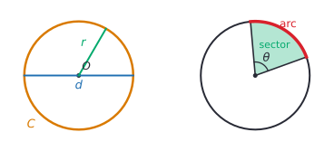
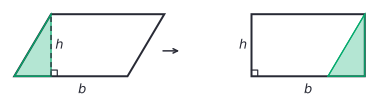
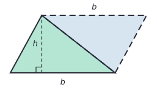
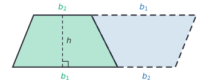
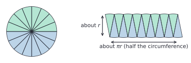

# Area and circles

After this lesson you can find the area of a triangle, parallelogram, trapezoid, circle or composite shape, explain where each formula comes from, find the length of an arc and the area of a sector, and give each answer exactly in terms of $\pi$ or as a rounded decimal.

Before this: [geometry basics](../../01-elementary/16-geometry-basics-area-perimeter-volume.md) (area of a rectangle, base and height), [exponents and order of operations](../01-integers-and-rational-numbers/04-exponents-and-order-of-operations.md), and [angles and triangles](01-angles-and-triangles.md).

## Quick check

Try these first. If you get all three right, skip to [Practice](#practice).

1. A trapezoid has parallel sides of 6 cm and 10 cm, 4 cm apart. Find its area.
2. A circle has a radius of 5 cm. Find its circumference and its area, exactly and to one decimal place.
3. A sector of a circle with radius 10 cm has a central angle of $72^\circ$. Find its area and the length of its arc, exactly.

<details class="solution" markdown>
<summary>Answers</summary>

1. $A = \frac{1}{2}(6 + 10) \times 4 = 32\ \text{cm}^2$.
2. $C = 2\pi \times 5 = 10\pi \approx 31.4$ cm, and $A = \pi \times 5^2 = 25\pi \approx 78.5\ \text{cm}^2$.
3. The sector is $\frac{72}{360} = \frac{1}{5}$ of the circle. Its area is $\frac{1}{5} \times 100\pi = 20\pi\ \text{cm}^2$, and its arc is $\frac{1}{5} \times 20\pi = 4\pi$ cm.

</details>

## The idea

A pizza place sells a 12-inch pizza and an 8-inch pizza, where the size is the diameter. Is one 12-inch pizza more food than two 8-inch ones? Two 8-inch pizzas have 16 inches of diameter between them, more than 12, so it looks like the pair wins. It doesn't, and by the end of Example 4 you will see by how much.

Every area formula in this lesson comes from one idea: if you cut a shape into pieces and rearrange them without overlapping, the area doesn't change. Cut a corner off a parallelogram and move it, and you have a rectangle. Put two copies of a triangle or a trapezoid together, and you have a parallelogram. Cut a circle into thin wedges and line them up, and you get something very close to a rectangle. The formulas are just the rectangle's length times width, after the right cutting.

Circles bring in a new number, $\pi$. Measure the distance around any round object (a can, a plate, a bike wheel) and divide by the distance across. You get a little more than 3 every time, whatever the size. That ratio is $\pi$.

## Definitions

### Trapezoids

A **trapezoid** is a quadrilateral with at least one pair of parallel sides. The two parallel sides are its **bases**, written $b_1$ and $b_2$ (read "b one" and "b two"; the small numbers are subscripts that tell the two apart). The **height** $h$ of a trapezoid is the perpendicular distance between the bases.

In plain words, a trapezoid is a four-sided shape with a top and bottom that are parallel but can have different lengths, like a slice of a triangle with the top cut off. Some books require exactly one pair of parallel sides. This book uses "at least one", so parallelograms, rectangles and squares count as trapezoids, and the trapezoid formula works for them too. British books call this shape a trapezium.

### Circles

A **circle** is the set of all points in a plane at a fixed distance from a fixed point, its **centre**. The fixed distance is the **radius** $r$, and a segment from the centre to the circle is also called a radius. A **diameter** is a segment through the centre with both ends on the circle; its length is $d = 2r$. The **circumference** $C$ is the length of the circle itself, the distance once around.



The ratio of a circle's circumference to its diameter is the same for every circle. That number is called **pi**, written $\pi$:

$$
\pi = \frac{C}{d} \approx 3.14159.
$$

In plain words, the distance around a circle is always a bit more than 3 times the distance across it. The number $\pi$ is irrational: its decimals never end and never repeat, so 3.14 and $\frac{22}{7}$ are approximations, not its value ([roots, irrationals and types of numbers](../04-powers-roots-and-real-numbers/03-roots-irrationals-and-types-of-numbers.md)).

### Arcs and sectors

A **central angle** is an angle with its vertex at the centre of the circle. Its two rays cut off an **arc**, the part of the circle between them, and a **sector**, the region between the two radii and the arc, shaped like a slice of pizza. The figure above shows a central angle $\theta$ with its arc in red and its sector shaded.

### Composite shapes

A **composite shape** is a shape made of simpler shapes joined together, or with simpler shapes cut out of it. An L-shaped room, a running track, and a washer (a disk with a hole in it) are composite shapes.

## How to do it

### The area formulas

| Shape | Area | Where the letters are |
|---|---|---|
| rectangle | $A = bh$ | base and height (length and width) |
| parallelogram | $A = bh$ | a side as base, and the perpendicular height to it |
| triangle | $A = \frac{1}{2}bh$ | a side as base, and the perpendicular height from the opposite vertex |
| trapezoid | $A = \frac{1}{2}(b_1 + b_2)h$ | the two parallel sides, and the distance between them |
| circle | $A = \pi r^2$, and $C = 2\pi r = \pi d$ | radius $r$, diameter $d$ |

In every formula the height is measured at a right angle to the base, never along a slanted side.

### Why the parallelogram formula works

Start with a parallelogram with base $b$ and height $h$. Cut straight down from one top corner to the base, at a right angle, as the dashed line in the figure shows. That cuts off a right triangle. Slide the triangle to the other end. Its slanted side fits exactly against the parallelogram's other slanted side, because opposite sides of a parallelogram are parallel and equal.



The result is a rectangle $b$ long and $h$ tall. No area was added or lost, so the parallelogram's area is $bh$.

### Why the triangle formula works

Take two copies of the triangle. Turn one copy half a turn ($180^\circ$) and fit it against the original along one side, as in the figure. The two copies make a parallelogram with the same base $b$ and height $h$.



The parallelogram has area $bh$, and it is made of two identical triangles, so one triangle has area $\frac{1}{2}bh$. This works for every triangle, including an obtuse one whose height falls outside it, since two copies of any triangle make a parallelogram.

### Why the trapezoid formula works

The same trick works for a trapezoid. Turn a copy half a turn and fit it against the slanted side of the original. The bottom of the new shape is $b_1$ from the original followed by $b_2$ from the copy, and the top is $b_2$ followed by $b_1$.



The two copies make a parallelogram with base $b_1 + b_2$ and height $h$, so its area is $(b_1 + b_2)h$, and one trapezoid is half of that:

$$
A = \frac{1}{2}(b_1 + b_2)h.
$$

Another way to read it: $\frac{1}{2}(b_1 + b_2)$ is the average of the two bases, so a trapezoid has the same area as a rectangle whose length is the average base. Practice problem 7 proves the formula a second way, by cutting along a diagonal.

### Why the circle formulas work

The circumference formula comes straight from the definition of $\pi$. Since $\pi = \frac{C}{d}$, multiplying both sides by $d$ gives $C = \pi d$, and since $d = 2r$, this is $C = 2\pi r$.

The area formula needs an argument.

What we know: a circle of radius $r$ has circumference $2\pi r$, and a parallelogram's area is base times height.

What we want: the circle's area is $\pi r^2$.

The plan: cut the circle into many thin sectors and rearrange them into a shape that is nearly a parallelogram, as in the figure.



The argument: cut the circle into 16 equal sectors. Lay the 8 sectors from the top half side by side, pointing down, and fit the 8 from the bottom half between them, pointing up. The new shape has the same area as the circle. Its height is about $r$, the length of each sector's straight side. Its top edge is made of the 8 arcs from one half of the circle, and its bottom edge of the other 8, so each edge is half the circumference long:

$$
\frac{1}{2} \times 2\pi r = \pi r.
$$

So the shape is nearly a parallelogram with base $\pi r$ and height $r$, and its area is nearly $\pi r \times r = \pi r^2$.

Looking back: with 16 sectors the edges are still bumpy and the sides still slant. With 100 or 1,000 thinner sectors, the bumps flatten, the height gets closer to $r$, and the shape gets closer to a rectangle $\pi r$ by $r$. The area of the circle never changes while this happens, and the only number the shapes approach is $\pi r^2$, so the circle's area is exactly $\pi r^2$. "Gets closer and closer to" is the idea of a limit, which calculus makes precise ([Riemann sums and the definite integral](../../05-university-core/04-integrals/01-riemann-sums-and-the-definite-integral.md)). For now, treat this as a convincing argument rather than a full proof.

### Arcs and sectors

A central angle of $\theta$ degrees is $\frac{\theta}{360}$ of a full turn, so its arc is that fraction of the circumference and its sector is that fraction of the area:

$$
\text{arc length} = \frac{\theta}{360} \times 2\pi r, \qquad \text{sector area} = \frac{\theta}{360} \times \pi r^2.
$$

A $90^\circ$ sector is a quarter circle, and a $180^\circ$ sector is a half circle (a semicircle). The perimeter of a sector is its arc plus the two radii.

### Exact answers and decimal answers

An answer such as $25\pi\ \text{cm}^2$ is exact: it is the true area, with nothing rounded. An answer such as $78.5\ \text{cm}^2$ is a decimal approximation, rounded to one decimal place. Both are correct when the question allows them. When a question says "exact" or "in terms of $\pi$", leave $\pi$ as a symbol; otherwise round at the end, as the question asks or to a sensible precision for the units.

Keep $\pi$ as a symbol through the working and use the calculator's $\pi$ key (or `math.pi`) at the last step. Using 3.14 in the middle loses accuracy: for a circle with $r = 50$ m, $3.14 \times 2500 = 7850\ \text{m}^2$, while $\pi \times 2500 = 7853.98\ldots\ \text{m}^2$, almost $4\ \text{m}^2$ more.

### Finding the area of a composite shape

1. Sketch the shape and split it into pieces whose areas you know, or find a simple shape around it and the pieces cut out of it.
2. Find every length each piece needs. For circles, decide whether you have the radius or the diameter, and halve the diameter if you need $r$.
3. Find each piece's area, keeping $\pi$ as a symbol.
4. Add the pieces, or subtract the cut-out pieces from the outer shape.
5. Write the answer with square units, exactly or rounded as asked.
6. Check by splitting a different way, or compare with a rectangle around the shape: the area has to be smaller.

## Worked examples

<div class="example" markdown>

### Example 1: a playing field with round ends

A playing field is a rectangle 100 m long and 60 m wide, with a semicircle on each 60 m end. Find its area and the length of the fence around it.

Step 1: split the field into the rectangle and two semicircles. The two semicircles together make one full circle.

Step 2: each semicircle sits on a 60 m end, so its diameter is 60 m and its radius is $r = 30$ m.

<div class="warning" markdown>

Watch out at Step 2: the 60 m is a diameter. Putting $r = 60$ into $\pi r^2$ gives an area 4 times too big for the circle, since doubling the radius quadruples the area.

</div>

Step 3: the rectangle's area is $100 \times 60 = 6000\ \text{m}^2$. The full circle's area is $\pi \times 30^2 = 900\pi\ \text{m}^2$.

Step 4: add them:

$$
A = 6000 + 900\pi \approx 6000 + 2827.43 = 8827.43\ \text{m}^2.
$$

Step 5: the exact area is $(6000 + 900\pi)\ \text{m}^2$, which is about $8827\ \text{m}^2$.

For the fence, walk around the outside. The two long straight sides are 100 m each, and the two curved ends together make one full circumference, $2\pi \times 30 = 60\pi$ m. The 60 m ends of the rectangle are inside the field, not on the fence, so they don't count:

$$
\text{fence} = 200 + 60\pi \approx 388.5\ \text{m}.
$$

Step 6: check against the rectangle around the field, which is $100 + 60 = 160$ m long and 60 m wide, with area $9600\ \text{m}^2$. The field is smaller, as it must be, and it misses only the four corners outside the curved ends. Each pair of corners is a 60 by 30 rectangle minus a semicircle, $1800 - 450\pi \approx 386.3\ \text{m}^2$, and $9600 - 2 \times 386.3 = 8827.4$, which matches.

</div>

<div class="example" markdown>

### Example 2: the height of a trapezoid from its area

A trapezoid-shaped garden bed has an area of $54\ \text{m}^2$ and parallel sides of 7 m and 11 m. How far apart are the parallel sides?

Put what you know into the formula and solve for $h$:

$$
\begin{aligned}
54 &= \frac{1}{2}(7 + 11)h \\
54 &= 9h \\
h &= 6.
\end{aligned}
$$

The sides are 6 m apart. Check: $\frac{1}{2} \times 18 \times 6 = 54$. As an estimate, the average base is 9 m, and a 9 m by 6 m rectangle has area 54.

</div>

<div class="example" markdown>

### Example 3: a sector bigger than half the circle

A logo is a circle of radius 4 cm with a $60^\circ$ slice removed, so the shape left is a $300^\circ$ sector. Find its area and its perimeter.

The sector is $\frac{300}{360} = \frac{5}{6}$ of the circle. Its area is

$$
\frac{5}{6} \times \pi \times 4^2 = \frac{5}{6} \times 16\pi = \frac{40\pi}{3} \approx 41.9\ \text{cm}^2.
$$

Its arc is $\frac{5}{6} \times 2\pi \times 4 = \frac{20\pi}{3} \approx 20.94$ cm. The perimeter also includes the two straight radii where the slice was cut, each 4 cm:

$$
\text{perimeter} = \frac{20\pi}{3} + 8 \approx 28.9\ \text{cm}.
$$

The answer $\frac{40\pi}{3}$ is an untidy exact value, and that is fine. Check: the full circle is $16\pi \approx 50.3\ \text{cm}^2$, and removing a sixth leaves $50.3 - 8.4 = 41.9$.

</div>

<div class="example" markdown>

### Example 4: the pizza question (finish it yourself)

Is one 12-inch pizza more food than two 8-inch pizzas? The sizes are diameters.

Step 2: the radii are 6 inches and 4 inches.

Step 3: the 12-inch pizza has area $\pi \times 6^2 = 36\pi\ \text{in}^2$. One 8-inch pizza has area $\pi \times 4^2 = 16\pi\ \text{in}^2$.

Now find the area of two 8-inch pizzas, compare, and say how much more the bigger option is, in square inches and as a percent.

<details class="solution" markdown>
<summary>Finish</summary>

Two 8-inch pizzas have $2 \times 16\pi = 32\pi \approx 100.5\ \text{in}^2$, while the 12-inch pizza has $36\pi \approx 113.1\ \text{in}^2$. The single 12-inch pizza is more food, by $4\pi \approx 12.6\ \text{in}^2$, which is $\frac{36\pi}{32\pi} = 1.125$ times as much, or 12.5% more.

Check: area grows with the square of the radius, so compare $6^2 = 36$ with $4^2 + 4^2 = 32$. The $\pi$ cancels, so the comparison never needed it.

</details>

</div>

## Edge cases and common mistakes

<div class="warning" markdown>

Watch out: $\pi r^2$ means $\pi \times (r^2)$, not $(\pi r)^2$. Exponents come before multiplication. For $r = 5$, the right answer is $25\pi \approx 78.5$, while $(5\pi)^2 \approx 246.7$ is more than three times too big.

</div>

<div class="warning" markdown>

Watch out for the radius and the diameter. Formulas use $r$; problems often give $d$, especially for real objects such as pipes, pizzas and wheels. Halve the diameter before squaring.

</div>

<div class="warning" markdown>

Watch out: circumference is a length and area is an area. A circle of radius 2 has $C = 4\pi$ cm and $A = 4\pi\ \text{cm}^2$: the same number in front of $\pi$, but different units, and they measure different things. At $r = 2$ the numbers match by coincidence; at $r = 3$ they are $6\pi$ and $9\pi$.

</div>

<div class="warning" markdown>

Watch out: the slanted side of a trapezoid is not its height, and the formula needs the $\frac{1}{2}$. A trapezoid with bases 7 and 11 and height 6 has area 54, not $18 \times 6 = 108$.

</div>

The perimeter of a sector includes the two radii, and the perimeter of a composite shape includes only the outside edges. In Example 1 the 60 m ends of the rectangle are inside the field, so the fence leaves them out.

A sector with $\theta = 360^\circ$ is the whole circle, and the formulas give $\pi r^2$ and $2\pi r$, as they should. A sector with $\theta = 0^\circ$ has no area. Sectors over $180^\circ$ are fine, as in Example 3.

Scaling a shape changes its area by the square of the scale factor, as in [proportional relationships](../02-ratios-rates-percents/02-proportional-relationships.md#edge-cases-and-common-mistakes). Doubling the radius of a circle doubles its circumference but multiplies its area by 4.

## Tricks and shortcuts

Estimate with $\pi \approx 3$. A circle's area is a little more than $3r^2$, and its circumference a little more than $3d$. For $r = 5$, $3 \times 25 = 75$, and the true area, about 78.5, is a bit more. That catches the $(\pi r)^2$ and diameter slips at once.

A circle fills about 79% of the square around it, since $\frac{\pi r^2}{(2r)^2} = \frac{\pi}{4} \approx 0.785$. So a round table 1 m across covers about $0.79\ \text{m}^2$.

Common sector angles are simple fractions: $180^\circ$ is $\frac{1}{2}$, $120^\circ$ is $\frac{1}{3}$, $90^\circ$ is $\frac{1}{4}$, $72^\circ$ is $\frac{1}{5}$, $60^\circ$ is $\frac{1}{6}$ and $45^\circ$ is $\frac{1}{8}$ of the circle.

For a triangle on a grid with no side along a grid line, use the box method: draw the smallest rectangle around it, then subtract the right triangles in the corners. The triangle with corners $(0, 0)$, $(4, 1)$ and $(1, 3)$ sits in a 4 by 3 box of area 12. The three corner triangles have areas $\frac{1}{2} \times 4 \times 1 = 2$, $\frac{1}{2} \times 3 \times 2 = 3$ and $\frac{1}{2} \times 1 \times 3 = 1.5$, so the triangle's area is $12 - 6.5 = 5.5$.

## In code

A sector's area is one line. The second part estimates $\pi$ from areas alone: random points in a square land inside the circle in it about $\frac{\pi}{4}$ of the time. This trick, called the Monte Carlo method, is how simulations estimate areas and probabilities that have no formula.

<details class="code" markdown>
<summary>In code</summary>

```python
import math
import random

def sector_area(r, theta):
    """Area of a sector with radius r and central angle theta in degrees."""
    return theta / 360 * math.pi * r ** 2

print(sector_area(10, 72))         # 62.83185307179586, which is 20 pi
print(sector_area(10, 72) / math.pi)  # 20.0

# Throw random points into the square from -1 to 1. The circle of radius 1
# covers pi/4 of the square, so about pi/4 of the points land inside it.
random.seed(1)
n = 1_000_000
inside = 0
for _ in range(n):
    x, y = random.uniform(-1, 1), random.uniform(-1, 1)
    if x * x + y * y <= 1:
        inside += 1
print(4 * inside / n)              # 3.140696
```

A point $(x, y)$ is inside the circle of radius 1 centred at the origin when $x^2 + y^2 \le 1$; the [Pythagorean theorem](04-pythagorean-theorem.md) explains why. A million points give $\pi$ to about two decimal places, which shows the method's weakness: each extra correct digit needs about 100 times as many points.

</details>

## FAQ

### Why is the ratio of circumference to diameter the same for every circle?

Every circle is a scaled copy of every other circle. Scaling by a factor $k$ multiplies every length by $k$, so both the circumference and the diameter get multiplied by $k$, and their ratio stays the same. [Transformations, congruence and similarity](05-transformations-congruence-similarity.md) makes "scaled copy" precise; it is called similarity.

### Is pi equal to 22/7 or 3.14?

Neither. Both are approximations: $\frac{22}{7} = 3.142857\ldots$ is about 0.0013 too big, and 3.14 is about 0.0016 too small. The number $\pi$ is irrational, so no fraction of integers equals it exactly. That is why exact answers keep the symbol $\pi$.

### Is the sector argument a proof?

Not quite, and it is fair to ask. The rearranged shape is never exactly a parallelogram, so the argument needs one more step: showing that the error shrinks to zero as the sectors get thinner. That step uses limits, which come with calculus. The argument is still the reason the formula is $\pi r^2$, and the calculus proof follows the same plan.

### Why does a square count as a trapezoid?

Because it has at least one pair of parallel sides. With the "at least one" definition, every fact about trapezoids also holds for parallelograms, rectangles and squares. The formula agrees: a square with side $s$ has $\frac{1}{2}(s + s) \times s = s^2$. Definitions in math are chosen so that theorems hold for as many shapes as possible, which is why the inclusive one is common.

## Practice

### Warm-up

1\. Find the area of (a) a triangle with base 9 cm and height 4 cm, (b) a parallelogram with base 7.5 m and height 4 m, and (c) a trapezoid with parallel sides 5 cm and 9 cm and height 6 cm.

<details class="solution" markdown>
<summary>Solution</summary>

- (a) $\frac{1}{2} \times 9 \times 4 = 18\ \text{cm}^2$.
- (b) $7.5 \times 4 = 30\ \text{m}^2$.
- (c) $\frac{1}{2}(5 + 9) \times 6 = 7 \times 6 = 42\ \text{cm}^2$.

Check (c) with the average base: the bases average 7 cm, and a 7 by 6 rectangle has area 42.

</details>

2\. A circular plate has a diameter of 14 cm. Find its circumference and area, exactly and to one decimal place.

<details class="solution" markdown>
<summary>Solution</summary>

The radius is $14 \div 2 = 7$ cm. The circumference is $\pi d = 14\pi \approx 44.0$ cm, and the area is $\pi \times 7^2 = 49\pi \approx 153.9\ \text{cm}^2$.

Check with $\pi \approx 3$: $3 \times 14 = 42$ and $3 \times 49 = 147$, both a little under the answers.

</details>

3\. A circle has radius 6 cm. Find the arc length and area of a sector with central angle $120^\circ$, exactly and to two decimal places.

<details class="solution" markdown>
<summary>Solution</summary>

The sector is $\frac{120}{360} = \frac{1}{3}$ of the circle. The arc is $\frac{1}{3} \times 2\pi \times 6 = 4\pi \approx 12.57$ cm, and the area is $\frac{1}{3} \times \pi \times 36 = 12\pi \approx 37.70\ \text{cm}^2$.

Check: three such sectors make the whole circle, with circumference $12\pi$ and area $36\pi$.

</details>

### Standard

4\. A window is a rectangle 80 cm wide and 120 cm tall, with a semicircle on top whose diameter is the 80 cm top edge. Find the area of glass and the length of trim around the outside.

<details class="solution" markdown>
<summary>Solution</summary>

The rectangle is $80 \times 120 = 9600\ \text{cm}^2$. The semicircle has radius 40 cm, so its area is $\frac{1}{2} \times \pi \times 40^2 = 800\pi\ \text{cm}^2$. The glass is $9600 + 800\pi \approx 12{,}113\ \text{cm}^2$, about $1.21\ \text{m}^2$.

The trim runs along the bottom (80 cm), the two sides (120 cm each) and the curved top, which is half a circumference, $\frac{1}{2} \times 2\pi \times 40 = 40\pi$ cm. The 80 cm line between the rectangle and the semicircle is inside the window. Total trim: $80 + 240 + 40\pi \approx 445.7$ cm.

Check: the window fits inside an 80 by 160 cm rectangle with area $12{,}800\ \text{cm}^2$, and the glass is a little less.

</details>

5\. A circle has a circumference of 50 cm. Find its radius and its area, to one decimal place.

<details class="solution" markdown>
<summary>Solution</summary>

From $C = 2\pi r$, divide both sides by $2\pi$: $r = \frac{50}{2\pi} = \frac{25}{\pi} \approx 7.96$ cm, about 8.0 cm. Then

$$
A = \pi r^2 = \pi \times \frac{625}{\pi^2} = \frac{625}{\pi} \approx 198.9\ \text{cm}^2.
$$

Keep $r$ unrounded (or exact) for the area. Using $r = 8.0$ gives $64\pi \approx 201.1$, off by more than $2\ \text{cm}^2$.

Check: $2\pi \times 7.9577 \approx 50.0$.

</details>

6\. A circular pond has a radius of 4 m. A gravel path 1 m wide goes all the way around it. Find the area of the path, and its cost at \$45 per square metre.

<details class="solution" markdown>
<summary>Solution</summary>

The path is the big circle (radius $4 + 1 = 5$ m) minus the pond (radius 4 m):

$$
\pi \times 5^2 - \pi \times 4^2 = 25\pi - 16\pi = 9\pi \approx 28.27\ \text{m}^2.
$$

The cost is $9\pi \times 45 = 405\pi \approx 1272.35$, so \$1,272.35.

Check: unrolled, the path is roughly a strip 1 m wide whose length is the circumference halfway across it, at radius 4.5 m: $2\pi \times 4.5 \times 1 = 9\pi$. That matches exactly.

</details>

### Challenge

7\. Prove the trapezoid formula a second way: cut the trapezoid along a diagonal into two triangles.

<details class="solution" markdown>
<summary>Solution</summary>

What we know: a trapezoid has parallel bases $b_1$ and $b_2$ a distance $h$ apart, and a triangle has area $\frac{1}{2}bh$.

What we want: the trapezoid's area is $\frac{1}{2}(b_1 + b_2)h$.

The plan: a diagonal splits the trapezoid into two triangles, one with base $b_1$ and one with base $b_2$. Find the height of each and add the areas.

The proof: draw a diagonal from an end of the bottom base $b_1$ to the far end of the top base $b_2$. The first triangle has base $b_1$, and its third vertex is on the top base. Its height is the distance from that vertex to the line of the bottom base, which is the distance between the parallel bases, $h$. The second triangle has base $b_2$ and its third vertex on the bottom base, so its height is also $h$. Adding the two areas:

$$
\frac{1}{2}b_1 h + \frac{1}{2}b_2 h = \frac{1}{2}(b_1 + b_2)h,
$$

by the distributive property. $\blacksquare$

Looking back: the parallel bases are what make both heights equal $h$. In a quadrilateral without parallel sides, the two triangles have different heights and there is no simple formula.

</details>

8\. (Reviews [percent change and applications](../02-ratios-rates-percents/04-percent-change-and-applications.md).) A 30 cm pizza costs \$14 and a 35 cm pizza costs \$18 (diameters). (a) By what percent is the bigger pizza's area larger? (b) By what percent is its price higher? (c) Which is the better value per square centimetre?

<details class="solution" markdown>
<summary>Solution</summary>

(a) The areas are $\pi \times 15^2 = 225\pi$ and $\pi \times 17.5^2 = 306.25\pi$. The percent change is $\frac{306.25\pi - 225\pi}{225\pi} = \frac{81.25}{225} \approx 0.361$, so about 36.1% larger. The $\pi$ cancels, so the shortcut $(35 \div 30)^2 \approx 1.361$ gives the same ratio.

(b) $\frac{18 - 14}{14} \approx 0.286$, so about 28.6% higher.

(c) The 30 cm pizza costs $14 \div (225\pi) \approx 0.0198$ dollars per $\text{cm}^2$, about 1.98 cents. The 35 cm pizza costs $18 \div (306.25\pi) \approx 0.0187$ dollars, about 1.87 cents. The bigger pizza is the better value, which also follows from (a) and (b): the area rises by more than the price.

Check: $225\pi \approx 706.9$ and $306.25\pi \approx 962.1$, and $962.1 \div 706.9 \approx 1.361$.

</details>

## Where this shows up

- [Volume and surface area](03-volume-and-surface-area.md) uses these areas as the base of prisms and cylinders, and the sector formula gives the curved surface of a cone. Arcs are measured in radians, not degrees, from [radians and the unit circle](../../03-high-school/09-trigonometry/02-radians-and-the-unit-circle.md) on, where the arc formula becomes $r\theta$.
- In calculus, the area under a curve is found the way the circle's was here: cut it into thin pieces, add them up, and let the pieces get thinner ([Riemann sums and the definite integral](../../05-university-core/04-integrals/01-riemann-sums-and-the-definite-integral.md)). The trapezoid rule for estimating such areas uses the trapezoid formula from this lesson.
- On a supply and demand graph, consumer surplus and the deadweight loss of a tax are triangle and trapezoid areas ([surplus and market interventions](../../07-economics-math/02-markets/04-surplus-and-market-interventions.md)).
