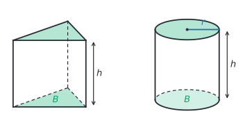
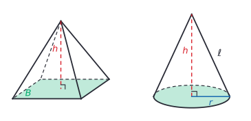
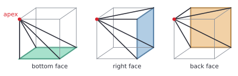
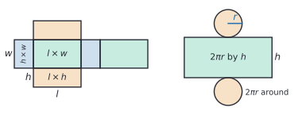
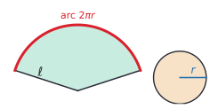

# Volume and surface area

After this lesson you can find the volume and surface area of prisms, cylinders, pyramids, cones and spheres, convert a volume to litres, and predict how area and volume change when every length of a solid is scaled.

Before this: [geometry basics](../../01-elementary/16-geometry-basics-area-perimeter-volume.md) (the volume of a box), [measurement and unit conversion](../../01-elementary/15-measurement-and-unit-conversion.md#area-and-volume-units), and [area and circles](02-area-and-circles.md).

## Quick check

Try these first. If you get all three right, skip to [Practice](#practice).

1. A cylinder has radius 3 cm and height 10 cm. Find its volume in cubic centimetres, exactly and rounded, and in litres.
2. A cone has the same radius and height as the cylinder in question 1. Find its volume.
3. A ball has radius 6 cm. Find its volume and its surface area, exactly and to one decimal place.

<details class="solution" markdown>
<summary>Answers</summary>

1. $V = \pi r^2 h = \pi \times 9 \times 10 = 90\pi \approx 282.7\ \text{cm}^3$, which is about 0.28 L, since $1\ \text{L} = 1000\ \text{cm}^3$.
2. A cone is a third of the cylinder: $\frac{1}{3} \times 90\pi = 30\pi \approx 94.2\ \text{cm}^3$.
3. $V = \frac{4}{3}\pi \times 6^3 = 288\pi \approx 904.8\ \text{cm}^3$, and $S = 4\pi \times 6^2 = 144\pi \approx 452.4\ \text{cm}^2$.

</details>

## The idea

Stack 20 loonies into a neat column. The stack is a cylinder, and its volume is the volume of one coin times 20: the area of a coin's face times the height of the stack. Now push the stack so it leans to one side. It looks different, but it is the same 20 coins, so the volume hasn't changed. Volume depends on the area of each slice and how high the slices go, not on whether the stack is straight.

That one idea gives the volume of every prism and cylinder: base area times height. Pyramids and cones, which come to a point, hold exactly a third of that. A sphere has its own formula, which this lesson explains without a full proof.

Surface area is a different question: how much material covers the outside. Unfold a cereal box along its edges and lay it flat, and you get a shape made of rectangles. Its area is the surface area of the box. Unfolding works for cylinders and cones too, and the pieces are shapes from [area and circles](02-area-and-circles.md).

## Definitions

A **prism** is a solid with two identical, parallel polygon faces, its **bases**, whose matching corners are joined by parallel edges. The faces between the bases are parallelograms, called the lateral faces. In a right prism the lateral faces are rectangles, standing straight up from the base. A prism is named by its base: a box is a rectangular prism, and a tent shape is a triangular prism.

A **cylinder** is the same idea with circles for bases: two identical, parallel circles joined by a curved surface. A can of soup is a cylinder.

A **pyramid** is a solid with one polygon base and triangular faces that meet at a single point, the **apex**. A **cone** has a circular base and a curved surface that narrows to an apex. A **sphere** is the set of all points in space at a fixed distance $r$, the radius, from a fixed point, the centre. In plain words, a sphere is the surface of a ball; "the volume of a sphere" means the volume of the ball inside it.

The **height** $h$ of each of these solids is the perpendicular distance between its bases, or from its apex to the plane of its base. The **slant height** $\ell$ of a cone is the distance from the apex to a point on the edge of the base, measured along the surface.





The flat surfaces of a solid are its faces, the segments where two faces meet are its edges, and the corners are its vertices.

The **surface area** $S$ of a solid is the total area of its outside surface. A **net** is a flat shape that folds up into the surface of a solid with no overlaps, so the area of the net is the surface area.

The **capacity** of a container is the volume it holds, usually given in litres and millilitres. The units are tied to cubic units by definition: $1\ \text{mL} = 1\ \text{cm}^3$, so $1\ \text{L} = 1000\ \text{cm}^3$ and $1\ \text{m}^3 = 1000\ \text{L}$.

In this lesson $B$ is the area of a base, a number in square units. Elsewhere in the book capital letters often name sets ([symbols and notation](../../reference/symbols-and-notation.md#one-letter-one-meaning-in-this-book)).

## How to do it

### The formulas

| Solid | Volume | Surface area |
|---|---|---|
| prism | $V = Bh$ | $2B$ plus the area of the lateral faces |
| box, $l$ by $w$ by $h$ | $V = lwh$ | $S = 2(lw + lh + wh)$ |
| cylinder | $V = \pi r^2 h$ | $S = 2\pi r^2 + 2\pi r h$ |
| pyramid | $V = \frac{1}{3}Bh$ | $B$ plus the area of the triangular faces |
| cone | $V = \frac{1}{3}\pi r^2 h$ | $S = \pi r^2 + \pi r \ell$ |
| sphere | $V = \frac{4}{3}\pi r^3$ | $S = 4\pi r^2$ |

### Steps

1. Name the solid. If it is made of several solids, split it and handle each one.
2. Find the area $B$ of the base, using the formulas from [area and circles](02-area-and-circles.md). Halve a diameter to get the radius.
3. Find the perpendicular height $h$, not a slanted length.
4. Use the formula, keeping $\pi$ as a symbol until the end.
5. Give the units: $\text{cm}^3$ or $\text{m}^3$ for volume, $\text{cm}^2$ or $\text{m}^2$ for surface area. Convert to litres if the question asks how much a container holds.
6. Check: compare with a box around the solid, which must hold more.

### Why prisms and cylinders are base times height

For a box, [geometry basics](../../01-elementary/16-geometry-basics-area-perimeter-volume.md#why-the-formulas-work) counted unit cubes: a bottom layer of $lw$ cubes, stacked $h$ layers high. The bottom layer's count is the base area $B = lw$, so the volume is $Bh$.

The same works for every prism and cylinder. Slice it into thin horizontal layers. Every layer is a copy of the base, with area $B$, and the layers stack up to the height $h$, so the volume is $Bh$. For a cylinder, $B = \pi r^2$ and $V = \pi r^2 h$.

The coin stack shows why a leaning prism or cylinder (called oblique) has the same formula. Pushing the stack sideways doesn't change any slice's area or the height, so it doesn't change the volume. This is **Cavalieri's principle**: if two solids have the same height, and their slices at every level have the same area, then they have the same volume. Note that the height in $Bh$ is still the straight-up height, not the length of the slanted side.

### Why pyramids and cones are one third

Take a cube with side $s$ and pick one corner as an apex. The three faces that don't touch that corner are the bases of three pyramids, each with its apex at the chosen corner, as the figure shows.



The three pyramids fill the cube without overlapping, and they are identical: you can turn the cube so that any one of them lands on another. Each has a base of area $B = s^2$ and a height of $s$, since the apex is one edge away from the face. So each pyramid is a third of the cube:

$$
V = \frac{1}{3}s^3 = \frac{1}{3} \times s^2 \times s = \frac{1}{3}Bh.
$$

That shows the one-third for one particular pyramid. Cavalieri's principle and stretching extend it to every pyramid: sliding the apex sideways doesn't change the slices, and stretching a solid in one direction multiplies both its volume and $Bh$ by the same factor. A cone is a pyramid whose base has so many sides that it is a circle, so its volume is $\frac{1}{3}\pi r^2 h$. You can also check it with water: three full cones pour exactly into the cylinder with the same base and height. Calculus proves the general case in [applications of integrals](../../05-university-core/04-integrals/06-applications-of-integrals.md).

### Surface area from nets

To find a surface area, unfold the solid into a net and add the areas of its pieces.



A box has three pairs of identical rectangles: $l \times w$ (top and bottom), $l \times h$ (front and back) and $w \times h$ (the two ends). So $S = 2lw + 2lh + 2wh = 2(lw + lh + wh)$.

A cylinder unrolls into two circles and a rectangle. The rectangle is the label of a can: its height is $h$, and its length is the distance around the can, the circumference $2\pi r$. So $S = 2\pi r^2 + 2\pi r h$.

A cone's curved surface unrolls into a sector of a circle whose radius is the slant height $\ell$. The arc of the sector wraps around the base, so its length is the base's circumference, $2\pi r$.



The full circle of radius $\ell$ would have circumference $2\pi\ell$, so the sector is the fraction $\frac{2\pi r}{2\pi\ell} = \frac{r}{\ell}$ of that circle, and its area is

$$
\frac{r}{\ell} \times \pi\ell^2 = \pi r \ell.
$$

Adding the circular base, a cone has $S = \pi r^2 + \pi r\ell$. If you are given the height instead of the slant height, the [Pythagorean theorem](04-pythagorean-theorem.md) gives $\ell = \sqrt{r^2 + h^2}$.

### The sphere formulas

A sphere of radius $r$ fits exactly inside a cylinder of radius $r$ and height $2r$, touching the top, the bottom and all the way around the middle. Archimedes showed two facts about that pair. The sphere's volume is $\frac{2}{3}$ of the cylinder's, and the sphere's surface area equals the area of the cylinder's curved side:

$$
V = \frac{2}{3} \times \pi r^2 \times 2r = \frac{4}{3}\pi r^3, \qquad S = 2\pi r \times 2r = 4\pi r^2.
$$

The proofs need calculus ([applications of integrals](../../05-university-core/04-integrals/06-applications-of-integrals.md)), so take these as facts for now. One way to remember $4\pi r^2$: it is exactly four times the area of a circle through the sphere's centre.

### Scaling a solid

If every length of a solid is multiplied by $k$, then every area is multiplied by $k^2$ and every volume by $k^3$. A cube with side 1 has surface area 6 and volume 1. Double the side to 2 and the surface area is $6 \times 4 = 24$ while the volume is $1 \times 8 = 8$. Each unit square of the surface becomes a 2 by 2 block of four squares, and each unit cube inside becomes a 2 by 2 by 2 block of eight cubes. This is the same squaring and cubing as map scales in [proportional relationships](../02-ratios-rates-percents/02-proportional-relationships.md#edge-cases-and-common-mistakes).

## Worked examples

<div class="example" markdown>

### Example 1: a rain barrel

A cylindrical rain barrel is 60 cm across and 90 cm tall. How many litres does it hold?

Step 1: the barrel is a cylinder.

Step 2: the base is a circle with diameter 60 cm, so $r = 30$ cm and $B = \pi \times 30^2 = 900\pi\ \text{cm}^2$.

<div class="warning" markdown>

Watch out at Step 2: using the 60 cm as the radius gives $3600\pi$ for the base, 4 times too big, and a barrel of about 1018 L. A barrel that size would be 1.2 m across.

</div>

Step 3: the height is 90 cm.

Step 4: multiply:

$$
V = Bh = 900\pi \times 90 = 81{,}000\pi \approx 254{,}469\ \text{cm}^3.
$$

Step 5: since $1\ \text{L} = 1000\ \text{cm}^3$, divide by 1000: about 254.5 L.

Step 6: check against the box around the barrel, 60 by 60 by 90 cm, which holds $324{,}000\ \text{cm}^3$, or 324 L. A circle fills $\frac{\pi}{4} \approx 78.5\%$ of the square around it, so the barrel should hold about $0.785 \times 324 \approx 254$ L, which it does.

</div>

<div class="example" markdown>

### Example 2: the label and the metal of a can

A can has radius 3.5 cm and height 11 cm. How much paper does its label need, and what is the can's total surface area?

The label is the curved side, which unrolls into a rectangle $2\pi r$ long and $h$ tall:

$$
2\pi \times 3.5 \times 11 = 77\pi \approx 241.9\ \text{cm}^2.
$$

The two circular ends add $2 \times \pi \times 3.5^2 = 24.5\pi \approx 77.0\ \text{cm}^2$, so the total is $77\pi + 24.5\pi = 101.5\pi \approx 318.9\ \text{cm}^2$.

Check: the label rectangle is about $22 \times 11 = 242\ \text{cm}^2$, since $2\pi \times 3.5 \approx 22$.

</div>

<div class="example" markdown>

### Example 3: a silo with a dome

A grain silo is a cylinder with radius 3 m and height 12 m, topped by a hemisphere (half a sphere) of the same radius. Find its volume.

Split it (Step 1). The cylinder holds $\pi \times 3^2 \times 12 = 108\pi\ \text{m}^3$. The hemisphere is half a sphere: $\frac{1}{2} \times \frac{4}{3}\pi \times 3^3 = 18\pi\ \text{m}^3$. Together:

$$
V = 108\pi + 18\pi = 126\pi \approx 395.8\ \text{m}^3.
$$

Since $1\ \text{m}^3 = 1000\ \text{L}$, that is almost 396,000 L. Check: the dome adds $18\pi$, a sixth of the cylinder's $108\pi$, which makes sense for a dome only 3 m tall on a 12 m cylinder.

</div>

<div class="example" markdown>

### Example 4: a tent (finish it yourself)

A tent is a pyramid with a square base 2.4 m on each side and a height of 1.8 m. How many cubic metres of air does it hold, and how many litres?

Step 1: the tent is a square pyramid.

Step 2: the base area is $B = 2.4 \times 2.4 = 5.76\ \text{m}^2$.

Step 3: the height is 1.8 m.

Now do Steps 4 and 5, and check against the box around the tent.

<details class="solution" markdown>
<summary>Finish</summary>

Step 4: $V = \frac{1}{3} \times 5.76 \times 1.8 = 3.456\ \text{m}^3$. Step 5: that is $3.456 \times 1000 = 3456$ L.

Check: the box around the tent is $5.76 \times 1.8 = 10.368\ \text{m}^3$, and a third of it is 3.456.

</details>

</div>

## Edge cases and common mistakes

<div class="warning" markdown>

Watch out: the height in $V = Bh$ and $V = \frac{1}{3}Bh$ is perpendicular to the base. For a cone, the slant height $\ell$ is longer than $h$. Using $\ell$ in the volume formula gives too much; using $h$ in the surface formula gives too little.

</div>

<div class="warning" markdown>

Watch out: volume and surface area scale differently. Doubling every length of a box multiplies the cardboard by 4 and the contents by 8. Doubling only one length (the height, say) doubles the volume.

</div>

<div class="warning" markdown>

Watch out for units. Volume is in cubic units and surface area in square units, and $1\ \text{m}^3$ is $1{,}000{,}000\ \text{cm}^3$, not $100\ \text{cm}^3$. Before multiplying, put every length in the same unit: a box 2 m by 50 cm by 30 cm is $2 \times 0.5 \times 0.3 = 0.3\ \text{m}^3$.

</div>

<div class="warning" markdown>

Watch out: a hemisphere's surface is half the sphere's curved surface, $2\pi r^2$, plus the flat circle that closes it, $\pi r^2$, if it is a solid half-ball. A dome on a silo has only the curved part. Read what the question is covering.

</div>

The one third applies only to solids that come to a point. A solid that narrows but is cut off flat, like a lampshade or a paper cup (a frustum), is a big cone minus a small cone, and you find it by subtracting.

A sphere with $r = 3$ has $V = 36\pi$ and $S = 36\pi$: the same number, different units. That is a coincidence of $r = 3$, since $\frac{4}{3}\pi r^3 = 4\pi r^2$ exactly when $r = 3$.

## Tricks and shortcuts

Check every volume against the box around the solid. A cylinder fills about 79% of its box ($\frac{\pi}{4}$), a pyramid or cone fills exactly a third of the prism or cylinder with the same base and height, and a sphere fills about 52% of the cube around it ($\frac{\pi}{6}$).

The cone, hemisphere and cylinder with the same radius $r$ and height $r$ have volumes in the ratio $1 : 2 : 3$. Practice problem 7 shows why, and it is an easy way to remember all three formulas at once.

For litres, work in centimetres and divide by 1000 at the end. For a quick estimate of a container in litres, measure in decimetres (10 cm), since $1\ \text{dm}^3 = 1$ L: a box 3 dm by 2 dm by 4 dm holds 24 L.

## In code

Writing the formulas as functions makes the scaling rule easy to test: scale every input length by $k = 2$ and the surface area grows 4 times while the volume grows 8 times, for every solid.

<details class="code" markdown>
<summary>In code</summary>

```python
import math

def cylinder(r, h):
    return math.pi * r**2 * h, 2 * math.pi * r**2 + 2 * math.pi * r * h

def sphere(r):
    return 4 / 3 * math.pi * r**3, 4 * math.pi * r**2

v, s = cylinder(30, 90)
print(round(v), round(v / 1000, 1))     # 254469 254.5  (cm^3, then litres)

# Scale every length by k = 2 and compare.
for name, solid, args in (("cylinder", cylinder, (3, 10)), ("sphere", sphere, (6,))):
    v1, s1 = solid(*args)
    v2, s2 = solid(*(2 * a for a in args))
    print(name, round(s2 / s1, 6), round(v2 / v1, 6))
# cylinder 4.0 8.0
# sphere 4.0 8.0
```

The rounding to six places hides floating-point noise in the last digit. Each function returns a pair, the volume and the surface area, which Python unpacks with `v, s = ...`.

</details>

## FAQ

### Why is a pyramid exactly a third, not some other fraction?

The cube argument shows it for one pyramid: three identical pyramids fill the cube. Because sliding and stretching change $V$ and $Bh$ by the same factor, the ratio $V : Bh$ is the same for every pyramid, so it is $\frac{1}{3}$ for all of them. Calculus gets the same third from adding thin slices, whose areas grow like $x^2$ from the apex down.

### Are litres a volume or a capacity?

Both words measure the same thing. "Capacity" is used for what a container holds, and "volume" for the space a solid takes up, but $1\ \text{L} = 1000\ \text{cm}^3$ either way. A 2 L bottle has a capacity of $2000\ \text{cm}^3$, and a $2000\ \text{cm}^3$ rock has a volume of 2 L.

### Why do big boxes cost less per litre to make?

The cardboard is surface area, which grows like $k^2$, while the contents are volume, which grow like $k^3$. A box twice as big in every direction needs 4 times the cardboard and holds 8 times as much, so the cardboard per litre halves. The same reasoning explains why large shipping containers and large water tanks are cheaper per unit of storage.

## Practice

### Warm-up

1\. A box is 12 cm long, 8 cm wide and 5 cm tall. Find its volume and surface area.

<details class="solution" markdown>
<summary>Solution</summary>

$V = 12 \times 8 \times 5 = 480\ \text{cm}^3$. The three pairs of faces are $12 \times 8 = 96$, $12 \times 5 = 60$ and $8 \times 5 = 40$, so $S = 2(96 + 60 + 40) = 392\ \text{cm}^2$.

Check: the net has two of each face, $192 + 120 + 80 = 392$.

</details>

2\. A cylinder has radius 5 cm and height 8 cm. Find its volume (in $\text{cm}^3$ and litres) and its surface area.

<details class="solution" markdown>
<summary>Solution</summary>

$V = \pi \times 25 \times 8 = 200\pi \approx 628.3\ \text{cm}^3$, about 0.63 L. The ends are $2 \times 25\pi = 50\pi$, and the side is $2\pi \times 5 \times 8 = 80\pi$, so $S = 130\pi \approx 408.4\ \text{cm}^2$.

Check: the box around it is $10 \times 10 \times 8 = 800\ \text{cm}^3$, and 78.5% of 800 is 628.

</details>

3\. Find (a) the volume of a cone with radius 6 cm and height 8 cm, and (b) the volume and surface area of a sphere with radius 5 cm.

<details class="solution" markdown>
<summary>Solution</summary>

(a) $V = \frac{1}{3}\pi \times 36 \times 8 = 96\pi \approx 301.6\ \text{cm}^3$.

(b) $V = \frac{4}{3}\pi \times 125 = \frac{500\pi}{3} \approx 523.6\ \text{cm}^3$, and $S = 4\pi \times 25 = 100\pi \approx 314.2\ \text{cm}^2$.

Check (b): the cube around the sphere is $10^3 = 1000\ \text{cm}^3$, and the sphere fills about 52% of it.

</details>

### Standard

4\. A chocolate bar is a triangular prism 20 cm long. Its triangular ends have sides 5 cm, 5 cm and 6 cm, and a height of 4 cm on the 6 cm side. Find its volume and surface area.

<details class="solution" markdown>
<summary>Solution</summary>

The base is the triangle: $B = \frac{1}{2} \times 6 \times 4 = 12\ \text{cm}^2$. The volume is $Bh = 12 \times 20 = 240\ \text{cm}^3$; here the prism's "height" is its 20 cm length, the distance between the two triangles.

The surface is the two triangles plus three rectangles, each 20 cm long and as wide as one side of the triangle:

$$
S = 2 \times 12 + 20 \times (5 + 5 + 6) = 24 + 320 = 344\ \text{cm}^2.
$$

Check: the lateral faces together make one long rectangle, 20 cm by the triangle's perimeter of 16 cm, which is $320\ \text{cm}^2$.

</details>

5\. A round above-ground pool is 4.5 m across and is filled to a depth of 1.2 m. How many litres of water is that?

<details class="solution" markdown>
<summary>Solution</summary>

The radius is 2.25 m, so $V = \pi \times 2.25^2 \times 1.2 = 6.075\pi \approx 19.085\ \text{m}^3$. Since $1\ \text{m}^3 = 1000$ L, that is about 19,085 L, or roughly 19,000 L.

Check: the box around the water is $4.5 \times 4.5 \times 1.2 = 24.3\ \text{m}^3$, and 78.5% of that is about 19.1.

</details>

6\. A wooden ball of radius 3 cm has a mass of 120 g. (a) What is the mass of a ball of the same wood with radius 4.5 cm? (b) How many times as much paint does the bigger ball need?

<details class="solution" markdown>
<summary>Solution</summary>

The scale factor is $k = 4.5 \div 3 = 1.5$.

(a) Mass is proportional to volume, which scales by $k^3 = 1.5^3 = 3.375$. The bigger ball has mass $120 \times 3.375 = 405$ g.

(b) Paint covers the surface, which scales by $k^2 = 2.25$, so it needs 2.25 times as much.

Check with the formulas: $\frac{4}{3}\pi \times 4.5^3 \div \left(\frac{4}{3}\pi \times 3^3\right) = \frac{91.125}{27} = 3.375$.

</details>

### Challenge

7\. A cone, a hemisphere and a cylinder all have radius $r$, and the cone and cylinder have height $r$ (so all three are $r$ tall). Show that their volumes are in the ratio $1 : 2 : 3$.

<details class="solution" markdown>
<summary>Solution</summary>

What we know: the cone has volume $\frac{1}{3}\pi r^2 h$, the cylinder $\pi r^2 h$, and a hemisphere half of $\frac{4}{3}\pi r^3$. Here $h = r$.

What we want: the three volumes are in the ratio $1 : 2 : 3$.

The plan: write each volume as a multiple of $\pi r^3$ and compare the multiples.

The work: the cone is $\frac{1}{3}\pi r^2 \times r = \frac{1}{3}\pi r^3$. The hemisphere is $\frac{1}{2} \times \frac{4}{3}\pi r^3 = \frac{2}{3}\pi r^3$. The cylinder is $\pi r^2 \times r = \pi r^3$. The multiples are $\frac{1}{3}$, $\frac{2}{3}$ and $1$, and multiplying each by 3 gives $1 : 2 : 3$. $\blacksquare$

Looking back: so the hemisphere fills exactly two thirds of its cylinder, which is Archimedes' fact from the lesson, and the cone plus the hemisphere exactly fill the cylinder.

</details>

8\. (Reviews [measurement and unit conversion](../../01-elementary/15-measurement-and-unit-conversion.md).) A pipe has an inside diameter of 2 cm. How many metres of pipe hold 1 L of water?

<details class="solution" markdown>
<summary>Solution</summary>

The water in the pipe is a cylinder with radius 1 cm and unknown length $h$ cm. One litre is $1000\ \text{cm}^3$, so

$$
\pi \times 1^2 \times h = 1000, \qquad h = \frac{1000}{\pi} \approx 318.3\ \text{cm}.
$$

Converting, $318.3$ cm is about 3.18 m.

Check: $\pi \times 318.3 \approx 999.97$, close to 1000. Each centimetre of pipe holds $\pi \approx 3.14$ mL, so 1000 mL needs a bit more than 300 cm.

</details>

## Where this shows up

- [The Pythagorean theorem](04-pythagorean-theorem.md) finds slant heights and the longest rod that fits in a box, and [transformations, congruence and similarity](05-transformations-congruence-similarity.md) proves the $k^2$ and $k^3$ scaling rules for similar shapes. [Applications of integrals](../../05-university-core/04-integrals/06-applications-of-integrals.md) proves the cone and sphere formulas by adding up slices.
- In economics, the FAQ's reasoning is one source of economies of scale: when the cost of a tank, pipe or warehouse follows its surface area and its capacity follows its volume, bigger ones cost less per unit stored (production and cost functions<!-- link: ../../07-economics-math/03-firms-and-consumers/02-production-and-cost-functions.md -->).
- 3D graphics, games and 3D printing all compute volumes and surface areas from triangle meshes, and physics engines use a solid's volume to get its mass.
