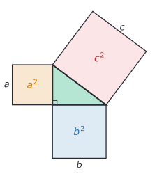
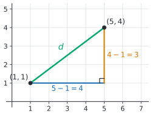
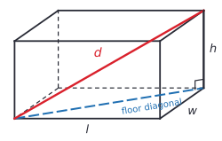
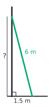

# The Pythagorean theorem

After this lesson you can find a missing side of a right triangle, explain a full proof of why $a^2 + b^2 = c^2$, test whether a triangle has a right angle, and find the distance between two points on a grid or across a box.

Before this: [angles and triangles](01-angles-and-triangles.md), [area and circles](02-area-and-circles.md), and square roots in [roots, irrational numbers and types of numbers](../04-powers-roots-and-real-numbers/03-roots-irrationals-and-types-of-numbers.md).

## Quick check

Try these first. If you get all three right, skip to [Practice](#practice).

1. A right triangle has legs 9 and 12. How long is the hypotenuse?
2. A right triangle has hypotenuse 10 and one leg 4. Find the other leg, exactly and to two decimal places.
3. Find the distance between the points $(-2, 1)$ and $(4, 9)$.

<details class="solution" markdown>
<summary>Answers</summary>

1. $c^2 = 81 + 144 = 225$, so $c = 15$.
2. $b^2 = 100 - 16 = 84$, so $b = \sqrt{84} \approx 9.17$.
3. The horizontal change is $4 - (-2) = 6$ and the vertical change is $9 - 1 = 8$, so $d = \sqrt{36 + 64} = \sqrt{100} = 10$.

</details>

## The idea

You are building a deck and want a perfectly square corner. Measure 3 m along one edge from the corner and 4 m along the other, and mark both points. If the distance between the marks is exactly 5 m, the corner is a right angle. Builders have used this check for thousands of years, because $3^2 + 4^2 = 9 + 16 = 25 = 5^2$.

That is the Pythagorean theorem: in a right triangle, the square on the longest side has the same area as the squares on the other two sides put together. The figure shows it literally. Squares are drawn on the three sides of a right triangle, and the big square's area equals the two small squares' areas added.



The theorem turns two lengths into a third. It finds the height a ladder reaches, the size of a screen from its diagonal, the length of a shortcut across a park, and the straight-line distance between two points on a map or a screen.

## Definitions

In a right triangle, the two sides that form the right angle are the **legs**, and the side opposite the right angle is the **hypotenuse**. The hypotenuse is always the longest side, because it is opposite the largest angle. This book writes $a$ and $b$ for the legs and $c$ for the hypotenuse.

In plain words, the legs are the two sides touching the little square in the corner, and the hypotenuse is the slanted side across from it.

The square root $\sqrt{x}$, for $x \ge 0$, is the non-negative number whose square is $x$: $\sqrt{25} = 5$ and $\sqrt{2} \approx 1.414$. Lengths are positive, so every length in this lesson uses the non-negative root.

A **Pythagorean triple** is a list of three positive integers $a$, $b$ and $c$ with $a^2 + b^2 = c^2$, such as 3, 4, 5. They are the right triangles whose sides are all whole numbers.

The **converse** of a statement "if P, then Q" is "if Q, then P". A converse can be false even when the statement is true, so it needs its own proof. Here it happens to be true.

## How to do it

### The theorem and its proof

*Theorem (Pythagoras).* In a right triangle with legs $a$ and $b$ and hypotenuse $c$,

$$
a^2 + b^2 = c^2.
$$

What we know: the triangle has a right angle between the legs $a$ and $b$. Call its acute angles $\alpha$ (opposite $a$) and $\beta$ (opposite $b$). The angles of a triangle add to $180^\circ$, so $\alpha + \beta = 90^\circ$ ([angles and triangles](01-angles-and-triangles.md#the-angles-of-a-triangle-add-to-180-degrees)). We also know the area of a square and of a triangle.

What we want: $a^2 + b^2 = c^2$. Read as areas: the square on $c$ has the same area as the squares on $a$ and $b$ together.

The plan: build one big square with side $a + b$ in two different ways, each using four copies of the triangle. In both, the part not covered by triangles has the same area: the big square minus four triangles. In the first way that part is the square on $c$, and in the second it is the squares on $a$ and $b$.


The proof, first arrangement (left): put one copy of the triangle in each corner of a square with side $a + b$, turned so that each side of the big square is split into a piece $a$ and a piece $b$. The four hypotenuses form a four-sided shape in the middle, and each of its sides has length $c$.

That middle shape is a square: we still need its corners to be right angles. Look at a point where two triangles meet on a side of the big square, such as the bottom side. Three angles sit side by side along that straight side: an acute angle of one triangle, a corner of the middle shape, and an acute angle of the next triangle. The two triangle angles are one $\alpha$ and one $\beta$ (the leg next to the point is $a$ in one triangle and $b$ in the other). So the corner of the middle shape is

$$
180^\circ - (\alpha + \beta) = 180^\circ - 90^\circ = 90^\circ.
$$

All four corners work the same way, so the middle shape is a square with side $c$, and the uncovered area is $c^2$.

The proof, second arrangement (right): start again with a square of side $a + b$, and split each side into $a$ and $b$ so that a square of side $a$ sits in one corner and a square of side $b$ in the opposite corner. What is left is two rectangles, each $a$ by $b$, and each rectangle cuts along a diagonal into two copies of the triangle. So this square also holds four copies of the triangle, and the uncovered area is $a^2 + b^2$.

Both big squares have the same area, $(a + b)^2$, and both hold the same four triangles. Taking the triangles away from each leaves equal areas:

$$
c^2 = a^2 + b^2. \qquad \blacksquare
$$

Looking back: the proof used two facts, that the acute angles of a right triangle add to $90^\circ$, and that moving pieces around doesn't change area. The careful step was showing the middle shape really is a square, because a picture can look square without being one. If you prefer algebra, the first arrangement alone is enough. Its area is the square $c^2$ plus four triangles of area $\frac{1}{2}ab$, and it is also $(a + b)^2 = a^2 + 2ab + b^2$ ([equivalent expressions](../03-expressions-equations-inequalities/02-equivalent-expressions.md)):

$$
a^2 + 2ab + b^2 = c^2 + 4 \times \tfrac{1}{2}ab = c^2 + 2ab.
$$

Subtracting $2ab$ from both sides gives $a^2 + b^2 = c^2$ again. The right-hand picture is $(a + b)^2 = a^2 + 2ab + b^2$ drawn as areas.

### Finding a missing side

1. Check that the triangle has a right angle. The theorem is only about right triangles.
2. Find the hypotenuse: the side opposite the right angle, which is the longest side. Call it $c$.
3. Write $a^2 + b^2 = c^2$ and put in the two lengths you know.
4. Solve. To find the hypotenuse, add the squares and take the square root: $c = \sqrt{a^2 + b^2}$. To find a leg, subtract: $b = \sqrt{c^2 - a^2}$.
5. Leave the answer as a square root if it is exact, or round at the end.
6. Check: the hypotenuse must be the longest side, but shorter than the two legs added together (the [triangle inequality](01-angles-and-triangles.md#the-triangle-inequality)). Squaring your answer and adding should give back $c^2$.

### The converse: testing for a right angle

*Theorem (converse of Pythagoras).* If a triangle has sides $a$, $b$ and $c$ with $a^2 + b^2 = c^2$, then the angle opposite $c$ is a right angle.

What we know: a triangle $T$ has sides $a$, $b$ and $c$ with $a^2 + b^2 = c^2$. We also use one fact about triangles: two triangles with the same three side lengths are congruent, meaning they have exactly the same shape and size, so their angles match too. This is called SSS (side-side-side), and [transformations, congruence and similarity](05-transformations-congruence-similarity.md#congruence-and-similarity) explains it.

What we want: the angle of $T$ opposite $c$ is $90^\circ$.

The plan: build a second triangle that we know is right, show it has the same sides as $T$, and conclude that $T$ has the same angles.

The proof: draw a right triangle $T'$ with legs $a$ and $b$. Call its hypotenuse $x$. By the Pythagorean theorem, $x^2 = a^2 + b^2$, and we were told that $a^2 + b^2 = c^2$, so $x^2 = c^2$. Both $x$ and $c$ are positive lengths, so $x = c$. Now $T$ and $T'$ both have sides $a$, $b$ and $c$, so by SSS they are congruent, and matching angles are equal. In $T'$ the angle opposite the side $c$ is the right angle, so in $T$ the angle opposite $c$ is $90^\circ$ too. $\blacksquare$

Looking back: the proof used the theorem itself on a triangle we built, which is a common move in proofs. In practice the converse gives a test. With $c$ the longest side:

| Compare | The angle opposite $c$ is | Example |
|---|---|---|
| $a^2 + b^2 = c^2$ | right | 7, 24, 25: $49 + 576 = 625$ |
| $a^2 + b^2 > c^2$ | acute (so the triangle is acute) | 6, 7, 9: $36 + 49 = 85 > 81$ |
| $a^2 + b^2 < c^2$ | obtuse | 6, 8, 11: $36 + 64 = 100 < 121$ |

The second and third rows are stated here without proof; the law of cosines proves them ([law of sines and law of cosines](../../03-high-school/09-trigonometry/05-law-of-sines-and-cosines.md)). They make sense: opening the angle between $a$ and $b$ wider than $90^\circ$ pushes their ends apart, so $c$ gets longer.

### The distance between two points

To find the straight-line distance between two points on the [coordinate plane](../05-linear-relationships-and-functions/01-coordinate-plane.md), draw the right triangle with a horizontal leg and a vertical leg, as in the figure.



For points $(x_1, y_1)$ and $(x_2, y_2)$, the horizontal leg has length $\lvert x_2 - x_1 \rvert$ and the vertical leg $\lvert y_2 - y_1 \rvert$. (The subscripts 1 and 2 just label the first and second point.) By the theorem, the distance $d$ satisfies $d^2 = (x_2 - x_1)^2 + (y_2 - y_1)^2$, and the absolute value bars can go, since squaring makes the result positive anyway:

$$
d = \sqrt{(x_2 - x_1)^2 + (y_2 - y_1)^2}.
$$

In the figure, $d = \sqrt{4^2 + 3^2} = \sqrt{25} = 5$.

### The space diagonal of a box

The longest straight line inside a box runs from one bottom corner to the opposite top corner. Use the theorem twice.



The floor diagonal $f$ is the hypotenuse of a right triangle with legs $l$ and $w$, so $f^2 = l^2 + w^2$. The space diagonal $d$ is the hypotenuse of a second right triangle, standing up, with legs $f$ and the height $h$. So $d^2 = f^2 + h^2 = l^2 + w^2 + h^2$, and

$$
d = \sqrt{l^2 + w^2 + h^2}.
$$

## Worked examples

<div class="example" markdown>

### Example 1: how high a ladder reaches

A 6 m ladder leans against a wall with its foot 1.5 m from the wall. How high up the wall does it reach?



Step 1: the wall is vertical and the ground is horizontal, so they meet at a right angle.

Step 2: the side opposite the right angle is the ladder, so $c = 6$. The legs are the ground distance, 1.5 m, and the unknown height, which we call $b$.

Step 3: write the theorem with what we know:

$$
1.5^2 + b^2 = 6^2.
$$

Step 4: the unknown is a leg, so subtract: $b^2 = 36 - 2.25 = 33.75$, and $b = \sqrt{33.75}$.

<div class="warning" markdown>

Watch out at Step 4: adding instead, $\sqrt{36 + 2.25} = \sqrt{38.25} \approx 6.18$, gives a height longer than the ladder, which is impossible. When the hypotenuse is known, subtract.

</div>

Step 5: $\sqrt{33.75} \approx 5.81$, so the ladder reaches about 5.81 m up the wall.

Step 6: check. The answer is less than the 6 m ladder, as a leg must be. Squaring back: $5.809^2 + 1.5^2 \approx 33.75 + 2.25 = 36 = 6^2$.

</div>

<div class="example" markdown>

### Example 2: the size of a TV screen

A TV is sold as 55 inches, which is the length of the screen's diagonal. The screen's shape is $16:9$ (width to height). How wide and how tall is the screen?

Write the width as $16k$ and the height as $9k$ for some number $k$ ([ratios and unit rates](../02-ratios-rates-percents/01-ratios-and-unit-rates.md)). The diagonal is the hypotenuse:

$$
(16k)^2 + (9k)^2 = 55^2, \qquad 337k^2 = 3025.
$$

So $k^2 = \frac{3025}{337}$ and $k = \frac{55}{\sqrt{337}} \approx 2.996$. The width is $16k \approx 47.9$ inches and the height is $9k \approx 27.0$ inches, about 122 cm by 68 cm.

Check: $47.94^2 + 26.96^2 \approx 2298 + 727 = 3025 = 55^2$, and $47.94 \div 26.96 \approx 1.778 \approx \frac{16}{9}$.

</div>

<div class="example" markdown>

### Example 3: will a rod fit in the box?

A box is 80 cm long, 60 cm wide and 70 cm tall. Will a 1.2 m rod fit inside it?

The rod is longer than every edge, so it can only fit along a diagonal. The floor diagonal is $\sqrt{80^2 + 60^2} = \sqrt{10{,}000} = 100$ cm, still too short. The space diagonal is

$$
d = \sqrt{80^2 + 60^2 + 70^2} = \sqrt{14{,}900} \approx 122.1\ \text{cm}.
$$

Since 1.2 m is 120 cm, the rod fits, from a bottom corner to the opposite top corner, with about 2 cm to spare (if the rod is thin). This is an edge case where the answer depends on looking at the box in three dimensions: no face of the box is long enough.

Check: the space diagonal must be longer than the floor diagonal (100 cm) and shorter than $100 + 70 = 170$ cm, and 122.1 cm is.

</div>

<div class="example" markdown>

### Example 4: the distance between two points (finish it yourself)

Find the distance between $(-3, 2)$ and $(5, -4)$.

The horizontal change is $x_2 - x_1 = 5 - (-3) = 8$. The vertical change is $y_2 - y_1 = -4 - 2 = -6$. So

$$
d = \sqrt{8^2 + (-6)^2}.
$$

Now finish the calculation and check it.

<details class="solution" markdown>
<summary>Finish</summary>

$d = \sqrt{64 + 36} = \sqrt{100} = 10$. The negative change is fine: $(-6)^2 = 36$, the same as $6^2$.

Check: the legs 8 and 6 are twice 4 and 3, so the hypotenuse is twice 5, which is 10. Going from $(5, -4)$ to $(-3, 2)$ instead gives changes of $-8$ and $6$, and the same distance.

</details>

</div>

## Edge cases and common mistakes

<div class="warning" markdown>

Watch out: the theorem is only for right triangles. A triangle with sides 6, 7 and 9 has $36 + 49 = 85$, not 81, because it has no right angle. Before using $a^2 + b^2 = c^2$, check that there is a right angle, marked or given.

</div>

<div class="warning" markdown>

Watch out: $c$ must be the hypotenuse. If the hypotenuse is 13 and one leg is 5, the other leg is $\sqrt{169 - 25} = 12$, not $\sqrt{169 + 25} \approx 13.9$. Adding the squares is only for finding the hypotenuse.

</div>

<div class="warning" markdown>

Watch out: $\sqrt{a^2 + b^2}$ is not $a + b$. For legs 3 and 4, $\sqrt{9 + 16} = 5$, while $3 + 4 = 7$. The square root doesn't split over a sum. The same goes for $\sqrt{a^2 - b^2}$, which is not $a - b$: $\sqrt{25 - 16} = 3$, while $5 - 4 = 1$.

</div>

<div class="warning" markdown>

Watch out: don't forget the last square root. After $c^2 = 225$, the hypotenuse is 15, not 225. A hypotenuse much longer than the two legs added together is the sign.

</div>

Untidy answers are normal. Most right triangles with whole-number legs have an irrational hypotenuse: legs 2 and 3 give $\sqrt{13}$. Keep the exact root until the end, and round once. Rounding a length before squaring it can shift the answer noticeably.

In the distance formula, the order of the points doesn't matter, and negative differences are fine, since squaring removes the sign. A distance of 0 means the two points are the same point.

## Tricks and shortcuts

Know the common triples and their multiples: 3, 4, 5; 5, 12, 13; 8, 15, 17; 7, 24, 25; and 20, 21, 29. A multiple of a triple is a triple, so legs 15 and 20 are $5 \times (3, 4)$, and the hypotenuse is $5 \times 5 = 25$ with no square roots needed. Divide out a common factor first when you see one.

You can make as many triples as you like. For integers $m > n > 0$, the numbers $m^2 - n^2$, $2mn$ and $m^2 + n^2$ always form a triple. With $m = 2$ and $n = 1$ you get 3, 4, 5; with $m = 3$ and $n = 2$, you get 5, 12, 13.

Estimate before you calculate. The hypotenuse is longer than the longer leg and shorter than the two legs added. For legs 5 and 12, it is between 12 and 17; the answer is 13. When one leg is much shorter than the other, the hypotenuse is only a little longer than the long leg.

The diagonal of a square with side $s$ is $s\sqrt{2} \approx 1.414s$, since $s^2 + s^2 = 2s^2$. A 10 m square lot has a diagonal of about 14.1 m.

## In code

Python has the theorem built in. `math.hypot` gives the hypotenuse from the legs, and `math.dist` gives the distance between two points in any number of dimensions. A short search lists the Pythagorean triples.

<details class="code" markdown>
<summary>In code</summary>

```python
import math

print(math.hypot(9, 12))              # 15.0, the hypotenuse with legs 9 and 12
print(math.dist((-3, 2), (5, -4)))    # 10.0, the distance between two points
print(math.dist((0, 0, 0), (80, 60, 70)))  # 122.06555615733703, a space diagonal

# Every triple (a, b, c) with a < b and c up to 30, by brute force.
triples = [(a, b, c)
           for c in range(1, 31)
           for b in range(1, c)
           for a in range(1, b)
           if a * a + b * b == c * c]
print(triples)
# [(3, 4, 5), (6, 8, 10), (5, 12, 13), (9, 12, 15), (8, 15, 17), (12, 16, 20),
#  (15, 20, 25), (7, 24, 25), (10, 24, 26), (20, 21, 29), (18, 24, 30)]
```

The search compares integers with `==`, which is exact. Testing `math.sqrt(a*a + b*b)` for being a whole number would work for small numbers but can go wrong for large ones, because floats round.

</details>

## FAQ

### Does it work for triangles that aren't right?

Not as $a^2 + b^2 = c^2$. For other triangles, the law of cosines adds a correction term that depends on the angle between $a$ and $b$, and the term is zero exactly when that angle is $90^\circ$. So the Pythagorean theorem is the special case of the law of cosines for a right angle ([law of sines and law of cosines](../../03-high-school/09-trigonometry/05-law-of-sines-and-cosines.md)).

### Why is the rearrangement a proof and not just a picture?

A picture can mislead: a shape can look square and not be one. What makes it a proof is that every claim the picture suggests was checked with a reason. The four triangles fit in the corners because each side of the big square was split into $a$ and $b$. The middle shape has four sides of length $c$ because they are hypotenuses. Its corners are right angles because $\alpha + \beta = 90^\circ$. With those checked, the picture is a record of the argument rather than the argument itself.

### Why does $c$ have to be the longest side?

In a right triangle, the right angle is the largest angle (the other two share the remaining $90^\circ$), and the longest side is opposite the largest angle. The formula also shows it: $c^2 = a^2 + b^2$ is bigger than $a^2$ and bigger than $b^2$, so $c$ is bigger than $a$ and $b$.

### Is the distance formula a new formula to memorize?

No, it is the Pythagorean theorem with the legs written as differences of coordinates. If you forget it, draw the right triangle between the two points and use the theorem.

## Practice

### Warm-up

1\. Find the hypotenuse of a right triangle with legs (a) 8 and 15, (b) 2 and 3.

<details class="solution" markdown>
<summary>Solution</summary>

- (a) $c = \sqrt{64 + 225} = \sqrt{289} = 17$.
- (b) $c = \sqrt{4 + 9} = \sqrt{13} \approx 3.61$.

Check (b): $3.61$ is between the longer leg, 3, and the sum of the legs, 5.

</details>

2\. Find the missing leg of a right triangle with (a) hypotenuse 25 and leg 7, (b) hypotenuse 10 and leg 6.

<details class="solution" markdown>
<summary>Solution</summary>

- (a) $b = \sqrt{625 - 49} = \sqrt{576} = 24$.
- (b) $b = \sqrt{100 - 36} = \sqrt{64} = 8$.

Check: $7^2 + 24^2 = 49 + 576 = 625 = 25^2$, and 6, 8, 10 is twice 3, 4, 5.

</details>

3\. Which of these are right triangles? (a) 9, 40, 41 (b) 6, 8, 11 (c) 1, 1, $\sqrt{2}$.

<details class="solution" markdown>
<summary>Solution</summary>

Compare the squares of the two shorter sides with the square of the longest.

- (a) $81 + 1600 = 1681 = 41^2$, so it is right.
- (b) $36 + 64 = 100$, but $11^2 = 121$. Since $100 < 121$, it is obtuse, not right.
- (c) $1 + 1 = 2 = (\sqrt{2})^2$, so it is right: half of a square with side 1, cut along its diagonal.

</details>

### Standard

4\. A rectangular park is 240 m long and 180 m wide. How much shorter is the walk straight across the diagonal than along two sides? At 1.4 m/s, about how much time does it save?

<details class="solution" markdown>
<summary>Solution</summary>

The diagonal is $\sqrt{240^2 + 180^2} = \sqrt{57{,}600 + 32{,}400} = \sqrt{90{,}000} = 300$ m. Along two sides it is $240 + 180 = 420$ m, so the shortcut saves $420 - 300 = 120$ m. At 1.4 m/s that is $120 \div 1.4 \approx 86$ seconds, about a minute and a half.

Check: 240, 180, 300 is $60 \times (4, 3, 5)$.

</details>

5\. The points $A(1, 1)$, $B(5, 4)$ and $C(-2, 5)$ form a triangle. Find its three side lengths, and show that it is a right isosceles triangle.

<details class="solution" markdown>
<summary>Solution</summary>

Use the distance formula on each side:

$$
\begin{aligned}
AB &= \sqrt{(5 - 1)^2 + (4 - 1)^2} = \sqrt{16 + 9} = 5, \\
AC &= \sqrt{(-2 - 1)^2 + (5 - 1)^2} = \sqrt{9 + 16} = 5, \\
BC &= \sqrt{(-2 - 5)^2 + (5 - 4)^2} = \sqrt{49 + 1} = \sqrt{50} \approx 7.07.
\end{aligned}
$$

Two sides are equal, so it is isosceles. The longest side is $BC$, and $AB^2 + AC^2 = 25 + 25 = 50 = BC^2$, so by the converse the angle opposite $BC$, at $A$, is a right angle.

Check: $BC = \sqrt{50} = 5\sqrt{2}$, the diagonal of a square with side 5, as it should be for a right isosceles triangle with legs 5.

</details>

6\. A room is 5 m long, 4 m wide and 3 m tall. Find the diagonal of the floor and the longest straight line from one corner of the room to the opposite corner.

<details class="solution" markdown>
<summary>Solution</summary>

The floor diagonal is $\sqrt{25 + 16} = \sqrt{41} \approx 6.40$ m. The space diagonal is $\sqrt{25 + 16 + 9} = \sqrt{50} \approx 7.07$ m.

Check: the space diagonal is also $\sqrt{(\sqrt{41})^2 + 3^2} = \sqrt{41 + 9} = \sqrt{50}$, the second right triangle standing on the floor diagonal.

</details>

### Challenge

7\. Prove that an equilateral triangle with side $s$ has height $\frac{\sqrt{3}}{2}s$ and area $\frac{\sqrt{3}}{4}s^2$.

<details class="solution" markdown>
<summary>Solution</summary>

What we know: all three sides are $s$. The height from the top vertex meets the base at a right angle. The area of a triangle is $\frac{1}{2}bh$.

What we want: $h = \frac{\sqrt{3}}{2}s$ and $A = \frac{\sqrt{3}}{4}s^2$.

The plan: the height splits the triangle into two right triangles. Find where the height meets the base, then use the Pythagorean theorem in one half.

The proof: the height cuts the base into two pieces. Each half is a right triangle with hypotenuse $s$ (a side of the triangle) and one leg $h$, so its other leg is $\sqrt{s^2 - h^2}$ in both halves. The two pieces of the base are therefore equal, each $\frac{s}{2}$. In one half, by the theorem:

$$
h^2 + \left(\frac{s}{2}\right)^2 = s^2, \qquad h^2 = s^2 - \frac{s^2}{4} = \frac{3s^2}{4}, \qquad h = \frac{\sqrt{3}}{2}s.
$$

Then the area is $\frac{1}{2} \times s \times \frac{\sqrt{3}}{2}s = \frac{\sqrt{3}}{4}s^2$. $\blacksquare$

Looking back: for $s = 2$, the height is $\sqrt{3} \approx 1.73$, a little less than the side, as it should be. The right triangles in the halves have angles $30^\circ$, $60^\circ$ and $90^\circ$ and sides in the ratio $1 : \sqrt{3} : 2$, which comes back in [right triangle trigonometry](../../03-high-school/09-trigonometry/01-right-triangle-trigonometry.md).

</details>

8\. (Reviews [ratios and unit rates](../02-ratios-rates-percents/01-ratios-and-unit-rates.md).) Two TVs both have a 50-inch diagonal. One has a $16:9$ screen and the other an old $4:3$ screen. Which has more screen area, and by what percent?

<details class="solution" markdown>
<summary>Solution</summary>

For the $4:3$ screen, write the sides as $4k$ and $3k$: $(4k)^2 + (3k)^2 = 25k^2 = 2500$, so $k = 10$, and the screen is 40 by 30 inches, with area $1200\ \text{in}^2$.

For the $16:9$ screen, $(16k)^2 + (9k)^2 = 337k^2 = 2500$, so $k^2 = \frac{2500}{337}$. The area is $16k \times 9k = 144k^2 = \frac{144 \times 2500}{337} \approx 1068.2\ \text{in}^2$.

The $4:3$ screen has more area, by $\frac{1200}{1068.2} \approx 1.123$, about 12.3% more. A wide screen with the same diagonal has less area, because the more stretched a rectangle is, the more of its diagonal goes into length instead of area.

Check: the $16:9$ screen is about $43.6 \times 24.5$ inches, and $43.6^2 + 24.5^2 \approx 1901 + 600 = 2501$, close to $50^2$.

</details>

## Where this shows up

- [Transformations, congruence and similarity](05-transformations-congruence-similarity.md) uses the distance formula to show that moving a shape doesn't change its lengths. [Coordinate geometry and circles](../../03-high-school/08-geometry-and-proof/04-coordinate-geometry-and-circles.md) turns the distance formula into the equation of a circle, and trigonometry is built on right triangles ([right triangle trigonometry](../../03-high-school/09-trigonometry/01-right-triangle-trigonometry.md)).
- The length of a vector, $\lVert \mathbf{v} \rVert = \sqrt{v_1^2 + \dots + v_n^2}$, is the distance formula in $n$ dimensions ([vectors, dot product and span](../../05-university-core/06-linear-algebra/01-vectors-dot-product-and-span.md)). Machine learning uses this Euclidean distance in nearest-neighbour search and clustering, and least squares regression minimizes a sum of squared distances.
- In statistics, the standard deviation of a sum of independent quantities adds like the sides of a right triangle: $\sigma^2 = \sigma_1^2 + \sigma_2^2$. That is why the risk of a mix of investments can be less than the risks added up (investing returns and risk<!-- link: ../../08-financial-math/06-investing-and-retirement/01-investing-returns-and-risk.md -->).
