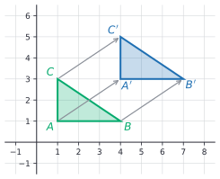
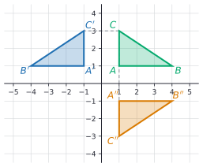
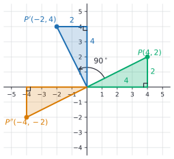
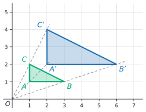
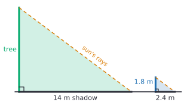
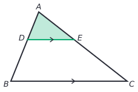

# Transformations, congruence and similarity

After this lesson you can move shapes on the coordinate plane by translations, reflections, rotations and dilations using coordinate rules, decide whether two shapes are congruent or similar, solve similar-triangle problems such as shadows and maps, and predict how area and volume change with a scale factor.

Before this: [the coordinate plane](../05-linear-relationships-and-functions/01-coordinate-plane.md), [proportional relationships](../02-ratios-rates-percents/02-proportional-relationships.md) (scale drawings), and [angles and triangles](01-angles-and-triangles.md).

## Quick check

Try these first. If you get all three right, skip to [Practice](#practice).

1. Rotate the point $(3, -2)$ by $90^\circ$ counterclockwise about the origin.
2. A triangle has sides 4, 6 and 7. A similar triangle has longest side 21. Find its other two sides.
3. A shape has area $12\ \text{cm}^2$. After a dilation with scale factor 2.5, what is its area?

<details class="solution" markdown>
<summary>Answers</summary>

1. The rule is $(x, y) \to (-y, x)$, so $(3, -2) \to (2, 3)$.
2. The scale factor is $21 \div 7 = 3$, so the other sides are $4 \times 3 = 12$ and $6 \times 3 = 18$.
3. Areas scale by $k^2 = 2.5^2 = 6.25$, so the new area is $12 \times 6.25 = 75\ \text{cm}^2$.

</details>

## The idea

On a phone, you can drag a photo across the screen, flip it into a mirror image, turn it a quarter turn, or pinch to zoom. The first three moves change where the photo is or which way it faces, but not its size or shape: every distance in the photo stays the same. The fourth move changes the size, but every part grows by the same factor, so the shape is kept. A face in the photo still looks like the same face.

Geometry names these four moves and gives each one a rule for coordinates, so a computer can carry them out. It then uses them to say precisely what "the same shape and size" (congruent) and "the same shape" (similar) mean. Two shapes are congruent when one of the first three moves, or several in a row, carries one exactly onto the other. They are similar when you may also zoom.

Similarity is what makes scale drawings, maps and shadows work. If two triangles have the same shape, their sides are in proportion, so one measured triangle tells you the sides of the other. That is how you can find the height of a tree from its shadow without climbing it.

## Definitions

A **transformation** of the plane is a rule that moves every point $P$ to a new point $P'$, read "P prime". The new point is the **image** of $P$, and the shape you start with is the pre-image. Images of images get two primes: $P''$, read "P double prime".

A **rigid motion** (also called an isometry) is a transformation that keeps every distance the same: for all points $P$ and $Q$, the distance from $P'$ to $Q'$ equals the distance from $P$ to $Q$. Rigid motions also keep angles the same. In plain words, a rigid motion picks the shape up and puts it down somewhere else without stretching it.

### The four transformations

A **translation** slides every point the same distance in the same direction. The translation by $(a, b)$ moves each point $a$ units right and $b$ units up (left or down if $a$ or $b$ is negative):

$$
(x, y) \to (x + a, y + b).
$$

A **reflection** in a line, the mirror line, sends each point to the point directly opposite it on the other side of the line, at the same distance from the line. The segment from $P$ to $P'$ crosses the mirror line at a right angle, and the line cuts it in half. Points on the mirror line stay put.

A **rotation** turns every point about a fixed point, the centre of rotation, through the same angle. Positive angles turn counterclockwise, the opposite way to a clock's hands. Each point stays the same distance from the centre.

A **dilation** with centre $O$ and **scale factor** $k > 0$ moves each point $P$ along the ray from $O$ through $P$, to the point $P'$ that is $k$ times as far from $O$. With the origin as centre:

$$
(x, y) \to (kx, ky).
$$

If $k > 1$ the shape grows, if $0 < k < 1$ it shrinks, and if $k = 1$ nothing moves. A dilation is not a rigid motion unless $k = 1$, since it multiplies every distance by $k$. It does keep every angle the same.

### Congruence and similarity

Two figures are **congruent** when there is a sequence of rigid motions that carries one exactly onto the other. We write $\triangle ABC \cong \triangle DEF$, read "triangle ABC is congruent to triangle DEF". In plain words, congruent figures have the same shape and the same size; one may be moved, turned or flipped.

Two figures are **similar** when there is a sequence of rigid motions and dilations that carries one exactly onto the other. We write $\triangle ABC \sim \triangle DEF$. In plain words, similar figures have the same shape, and one is a scaled copy of the other. Every pair of congruent figures is similar, with scale factor 1.

The parts that land on each other are **corresponding** parts. The order of the letters records the match: $\triangle ABC \sim \triangle DEF$ says that $A$ goes to $D$, $B$ to $E$ and $C$ to $F$, so side $AB$ corresponds to $DE$, and $\angle B$ to $\angle E$.

For triangles, a few measurements are enough to decide. These facts are proved in [congruence and triangle proofs](../../03-high-school/08-geometry-and-proof/02-congruence-and-triangle-proofs.md) and [similarity](../../03-high-school/08-geometry-and-proof/03-similarity.md); this lesson uses them.

| Test | Two triangles are | when |
|---|---|---|
| SSS | congruent | all three pairs of sides are equal |
| SAS | congruent | two pairs of sides are equal, and so are the angles between them |
| ASA | congruent | two pairs of angles are equal, and so are the sides between them |
| AA | similar | two pairs of angles are equal |
| SSS similarity | similar | all three pairs of sides are in the same ratio |

AA needs only two angles because the third follows from the [triangle angle sum](01-angles-and-triangles.md#the-angles-of-a-triangle-add-to-180-degrees): if two angles match, the third angles are both 180 degrees minus the same total.

## How to do it

### Coordinate rules

| Transformation | Rule |
|---|---|
| translation by $(a, b)$ | $(x, y) \to (x + a, y + b)$ |
| reflection in the $x$-axis | $(x, y) \to (x, -y)$ |
| reflection in the $y$-axis | $(x, y) \to (-x, y)$ |
| reflection in the line $y = x$ | $(x, y) \to (y, x)$ |
| rotation $90^\circ$ counterclockwise about the origin | $(x, y) \to (-y, x)$ |
| rotation $180^\circ$ about the origin | $(x, y) \to (-x, -y)$ |
| rotation $90^\circ$ clockwise (or $270^\circ$ counterclockwise) about the origin | $(x, y) \to (y, -x)$ |
| dilation with scale factor $k$, centre the origin | $(x, y) \to (kx, ky)$ |





To transform a polygon:

1. Write the rule for the transformation.
2. Apply it to each vertex.
3. Join the image vertices in the same order.
4. Check: for a rigid motion, one side length (or more) should be unchanged; for a dilation, each side should be $k$ times as long. For a reflection, the mirror line should sit exactly halfway between each point and its image.

### Why the 90 degree rule works

What we know: a rotation by $90^\circ$ about the origin $O$ turns every segment from $O$ by $90^\circ$ and keeps lengths and right angles. Turning a direction $90^\circ$ counterclockwise sends right to up, up to left, left to down and down to right.

What we want: the image of $P = (x, y)$ is $P' = (-y, x)$.

The plan: get from $O$ to $P$ in two legs, first along the $x$-axis and then straight up, and rotate each leg. The figure shows the case $P = (4, 2)$.



The proof (for $x$ and $y$ positive): to reach $P$ from $O$, go $x$ units right, then $y$ units up. Rotating the whole path by $90^\circ$ counterclockwise turns "right" into "up" and "up" into "left", and keeps both lengths. So the image path goes $x$ units up, then $y$ units left, and it ends at $P' = (-y, x)$. $\blacksquare$

Looking back: if $x$ or $y$ is negative, "right $x$" means "left $\lvert x \rvert$", and the same turning of directions gives the same rule. Doing the rule twice gives the half turn: $(x, y) \to (-y, x) \to (-x, -y)$, which is the $180^\circ$ rule. Doing it four times brings every point back, as a full turn should.

### Similar triangle problems

1. Show that the triangles are similar, usually by AA: look for right angles, shared angles, vertical angles, or angles made by parallel lines.
2. Match the vertices: equal angles correspond, and the sides opposite equal angles correspond.
3. Find the scale factor $k$ from one pair of corresponding sides you know, or set up a proportion with the same triangle on top on both sides.
4. Solve for the unknown side.
5. Check: the ratio of two sides within one triangle should equal the ratio of the matching sides in the other.

### Scaling areas and volumes



In the figure the small triangle has legs 2 and 1, so its area is 1. The image has legs 4 and 2 and area 4. Doubling every length multiplied the area by $2^2$. In general, if two figures are similar with scale factor $k$, then:

| Measure | is multiplied by |
|---|---|
| every length, including perimeter | $k$ |
| every angle | 1 (angles don't change) |
| every area, including surface area | $k^2$ |
| every volume | $k^3$ |

The reason is the one from [proportional relationships](../02-ratios-rates-percents/02-proportional-relationships.md#edge-cases-and-common-mistakes): a unit square becomes a $k$ by $k$ square, with area $k^2$, and a unit cube becomes a $k$ by $k$ by $k$ cube, with volume $k^3$. Every shape is made of small squares or cubes, so the whole area and volume scale the same way.

## Worked examples

<div class="example" markdown>

### Example 1: a tree's shadow

At the same moment on a sunny afternoon, a person 1.8 m tall casts a shadow 2.4 m long, and a tree casts a shadow 14 m long. How tall is the tree?



Step 1: show that the triangles are similar. The tree and the person both stand straight up, so each makes a right angle with the ground. The sun is so far away that its rays arrive parallel, so each ray makes the same angle with the ground (corresponding angles, [angles and triangles](01-angles-and-triangles.md#parallel-lines-and-a-transversal)). Two pairs of equal angles: by AA, the triangles are similar.

Step 2: match the parts. The height of the tree corresponds to the height of the person, since both are opposite the sun's angle, and the shadows correspond to each other.

Step 3: the scale factor from person to tree, from the shadows, is $k = 14 \div 2.4 = 5.833\ldots$ Or as a proportion, with heights on top and shadows on the bottom on both sides:

$$
\frac{h}{14} = \frac{1.8}{2.4}.
$$

<div class="warning" markdown>

Watch out at Step 3: mixing the positions, as in $\frac{h}{14} = \frac{2.4}{1.8}$, gives $h \approx 18.7$ m, which says the tree is taller relative to its shadow than the person is. Same kind of measurement in the same place on both sides.

</div>

Step 4: multiply both sides by 14: $h = 14 \times 0.75 = 10.5$. The tree is 10.5 m tall.

Step 5: check the ratios inside each triangle. For the person, height divided by shadow is $1.8 \div 2.4 = 0.75$. For the tree, $10.5 \div 14 = 0.75$. They match.

</div>

<div class="example" markdown>

### Example 2: two transformations in a row

Rotate the triangle with vertices $A(1, 1)$, $B(4, 1)$ and $C(1, 3)$ by $90^\circ$ counterclockwise about the origin, then reflect the result in the $x$-axis. Is the final triangle congruent to the first?

The rotation uses $(x, y) \to (-y, x)$: $A' = (-1, 1)$, $B' = (-1, 4)$, $C' = (-3, 1)$. The reflection uses $(x, y) \to (x, -y)$: $A'' = (-1, -1)$, $B'' = (-1, -4)$, $C'' = (-3, -1)$.

Both moves are rigid motions, so the final triangle is congruent to the first. Check one side: $AB = 4 - 1 = 3$, and $A''B''$ runs from $y = -1$ to $y = -4$, also 3. The slanted side $BC = \sqrt{3^2 + 2^2} = \sqrt{13}$, and $B''C'' = \sqrt{2^2 + 3^2} = \sqrt{13}$ ([the Pythagorean theorem](04-pythagorean-theorem.md#the-distance-between-two-points)).

</div>

<div class="example" markdown>

### Example 3: area on a map

A map has a scale of $1:25{,}000$. A rectangular park measures 3 cm by 2 cm on the map. Find the park's real dimensions and real area.

Real lengths are 25,000 times the map lengths: $3 \times 25{,}000 = 75{,}000$ cm, which is 750 m, and $2 \times 25{,}000 = 50{,}000$ cm, which is 500 m. The real area is $750 \times 500 = 375{,}000\ \text{m}^2$, or 37.5 hectares (a hectare is $10{,}000\ \text{m}^2$).

This is the edge case where multiplying the map area by the scale goes wrong. The map area is $6\ \text{cm}^2$, and the area scale factor is $25{,}000^2 = 625{,}000{,}000$, not 25,000. Check: $6 \times 625{,}000{,}000 = 3.75 \times 10^9\ \text{cm}^2$, and dividing by $10{,}000\ \text{cm}^2$ per $\text{m}^2$ gives $375{,}000\ \text{m}^2$, as before.

</div>

<div class="example" markdown>

### Example 4: a triangle inside a triangle (finish it yourself)

In $\triangle ABC$, the point $D$ is on $AB$ and $E$ is on $AC$, with $DE$ parallel to $BC$. You know $AD = 4$, $DB = 6$ and $DE = 5$. Find $BC$.



Step 1: the angle at $A$ is shared by $\triangle ADE$ and $\triangle ABC$. Since $DE \parallel BC$, the angles $\angle ADE$ and $\angle ABC$ are corresponding angles, so they are equal. By AA, $\triangle ADE \sim \triangle ABC$.

Step 2: $AD$ corresponds to $AB$, and $DE$ corresponds to $BC$. Careful: the side of the big triangle is $AB = AD + DB = 4 + 6 = 10$, not $DB = 6$.

Now do Steps 3 and 4: find the scale factor from the small triangle to the big one, then $BC$, and check.

<details class="solution" markdown>
<summary>Finish</summary>

Step 3: $k = AB \div AD = 10 \div 4 = 2.5$. Step 4: $BC = 2.5 \times DE = 2.5 \times 5 = 12.5$.

Check: within the small triangle, $DE \div AD = 5 \div 4 = 1.25$, and within the big one, $BC \div AB = 12.5 \div 10 = 1.25$. Using $DB = 6$ by mistake would give $k = 1.5$ and $BC = 7.5$, which fails this check, since $7.5 \div 10 = 0.75$.

</details>

</div>

## Edge cases and common mistakes

<div class="warning" markdown>

Watch out for the direction of a rotation. The rule $(x, y) \to (-y, x)$ is counterclockwise. Clockwise is $(x, y) \to (y, -x)$. Test the rule on $(1, 0)$: a counterclockwise quarter turn should take it up to $(0, 1)$, and $(-0, 1) = (0, 1)$, so the rule is right.

</div>

<div class="warning" markdown>

Watch out: reflecting in the $x$-axis changes the $y$-coordinate, not the $x$-coordinate. The point moves up or down across the horizontal axis, so its height flips sign: $(2, 5) \to (2, -5)$.

</div>

<div class="warning" markdown>

Watch out: a scale factor of $k$ multiplies areas by $k^2$ and volumes by $k^3$. A model at $1:10$ has $\frac{1}{100}$ of the real surface area and $\frac{1}{1000}$ of the real volume.

</div>

<div class="warning" markdown>

Watch out for the order of letters. $\triangle ABC \sim \triangle DEF$ and $\triangle ABC \sim \triangle EFD$ say different things. Match vertices by equal angles before you write the statement, and read corresponding sides from the letters.

</div>

The coordinate rule $(x, y) \to (kx, ky)$ is for a dilation centred at the origin. For another centre, the rule is different, and the easiest way is to measure each point's offset from the centre, multiply the offset by $k$, and add it back.

A reflection reverses orientation: if the vertices $A$, $B$, $C$ go around counterclockwise, the images $A'$, $B'$, $C'$ go around clockwise. Translations and rotations keep orientation. So a reflected shape is still congruent, but no slide or turn in the plane alone can produce it, the same way a left glove can't be turned into a right glove.

A scale factor between 0 and 1 is fine and means a smaller copy. Going back from the image to the original uses the scale factor $\frac{1}{k}$.

## Tricks and shortcuts

For a $90^\circ$ counterclockwise turn, swap the coordinates, then change the sign of the new first one: $(3, -2) \to (-2, 3) \to (2, 3)$. For a half turn, change both signs. For a reflection, change the sign of the coordinate that crosses the mirror: the $x$-axis is crossed by moving up or down, so $y$ changes sign.

If you know the ratio of areas, take its square root for the scale factor: two similar rooms with areas 16 and $36\ \text{m}^2$ have $k = \sqrt{36 \div 16} = 1.5$. For volumes, take the cube root.

A right triangle with a height drawn to its hypotenuse splits into two smaller triangles, and all three are similar (each shares an angle with the big one and has a right angle). Many textbook proofs of the Pythagorean theorem use this.

## In code

Each transformation is a short function on a point. Composing them is calling one inside another, which is how graphics programs move shapes on a screen.

<details class="code" markdown>
<summary>In code</summary>

```python
from math import dist

def translate(p, a, b):
    return (p[0] + a, p[1] + b)

def reflect_x(p):            # in the x-axis
    return (p[0], -p[1])

def rotate90(p):             # 90 degrees counterclockwise about the origin
    return (-p[1], p[0])

def dilate(p, k):            # scale factor k, centre the origin
    return (k * p[0], k * p[1])

tri = [(1, 1), (4, 1), (1, 3)]
image = [reflect_x(rotate90(p)) for p in tri]
print(image)                               # [(-1, -1), (-1, -4), (-3, -1)]
print(dist(tri[1], tri[2]), dist(image[1], image[2]))   # 3.605551275463989 3.605551275463989

p = (4, 2)
for _ in range(4):
    p = rotate90(p)
    print(p, end=" ")                      # (-2, 4) (-4, -2) (2, -4) (4, 2)
print()
print([dilate(q, 2) for q in [(1, 1), (3, 1), (1, 2)]])  # [(2, 2), (6, 2), (2, 4)]
```

The second line checks Example 2: the side $BC$ has length $\sqrt{13} \approx 3.606$ before and after. In linear algebra, rotations, reflections and dilations about the origin are written as matrices, and composing them becomes matrix multiplication ([matrix basics](../../03-high-school/10-vectors-and-matrices/02-matrix-basics.md)).

</details>

## FAQ

### Why does AA work, but there is no AA test for congruence?

Two equal angles fix the shape of a triangle, since the third angle is then fixed too, but not its size: a triangle with angles $30^\circ$, $60^\circ$ and $90^\circ$ can have a hypotenuse of 2 cm or 2 km. Congruence also needs a size, which is why every congruence test includes at least one side.

### Are all circles similar? All squares? All rectangles?

All circles are similar (a dilation by the ratio of the radii matches them), and so are all squares and all equilateral triangles. Rectangles are not all similar: a 1 by 1 square and a 1 by 3 rectangle have different shapes, because the ratio of length to width differs. This is also why $\pi$ is the same for every circle ([area and circles](02-area-and-circles.md#faq)).

### Is a map scale the same as a scale factor?

Almost. A map scale of $1:25{,}000$ is a dilation with $k = \frac{1}{25{,}000}$ from the ground to the map, or $k = 25{,}000$ from the map to the ground. Using the right direction matters most for areas, where the factor gets squared.

## Practice

### Warm-up

1\. For the point $(2, -3)$, find (a) its image after the translation by $(-5, 4)$, (b) its reflection in the $x$-axis, (c) its reflection in the $y$-axis.

<details class="solution" markdown>
<summary>Solution</summary>

- (a) $(2 - 5, -3 + 4) = (-3, 1)$.
- (b) $(2, 3)$.
- (c) $(-2, -3)$.

Check (b): the point $(2, -3)$ is 3 below the $x$-axis and $(2, 3)$ is 3 above it, directly opposite.

</details>

2\. Rotate $(-4, 1)$ about the origin by (a) $90^\circ$ counterclockwise, (b) $180^\circ$, (c) $90^\circ$ clockwise.

<details class="solution" markdown>
<summary>Solution</summary>

- (a) $(x, y) \to (-y, x)$ gives $(-1, -4)$.
- (b) $(x, y) \to (-x, -y)$ gives $(4, -1)$.
- (c) $(x, y) \to (y, -x)$ gives $(1, 4)$.

Check: a counterclockwise quarter turn applied to (a) should give (b): $(-1, -4) \to (4, -1)$. It does.

</details>

3\. Dilate the triangle with vertices $(1, 2)$, $(3, 2)$ and $(1, 5)$ by scale factor 3 from the origin. Compare the areas.

<details class="solution" markdown>
<summary>Solution</summary>

The image vertices are $(3, 6)$, $(9, 6)$ and $(3, 15)$. The original is a right triangle with legs $3 - 1 = 2$ and $5 - 2 = 3$, so its area is $\frac{1}{2} \times 2 \times 3 = 3$. The image has legs 6 and 9, so its area is $\frac{1}{2} \times 6 \times 9 = 27$.

Check: $27 = 3^2 \times 3$, the area times $k^2$.

</details>

### Standard

4\. A person 1.6 m tall casts a shadow 2 m long. At the same time a flagpole casts a shadow 9.5 m long. How tall is the flagpole?

<details class="solution" markdown>
<summary>Solution</summary>

The triangles are similar by AA (right angles, and equal angles of the sun's rays). With heights over shadows, $\frac{h}{9.5} = \frac{1.6}{2}$, so $h = 9.5 \times 0.8 = 7.6$ m.

Check: $7.6 \div 9.5 = 0.8 = 1.6 \div 2$.

</details>

5\. $\triangle ABC \sim \triangle DEF$, with $AB = 6$, $BC = 8$, $AC = 9$ and $DE = 4.5$. Find $EF$, $DF$ and the ratio of the perimeters.

<details class="solution" markdown>
<summary>Solution</summary>

From the letters, $AB$ corresponds to $DE$, so $k = 4.5 \div 6 = 0.75$. Then $EF = 0.75 \times 8 = 6$ and $DF = 0.75 \times 9 = 6.75$. The perimeters are $6 + 8 + 9 = 23$ and $4.5 + 6 + 6.75 = 17.25$, in the ratio $17.25 \div 23 = 0.75$, the scale factor.

Check: $EF \div DE = 6 \div 4.5 = 1.333\ldots$ and $BC \div AB = 8 \div 6 = 1.333\ldots$

</details>

6\. Two water bottles are similar. The small one is 20 cm tall and holds 500 mL; the big one is 30 cm tall. (a) How much does the big one hold? (b) The small one's label covers $150\ \text{cm}^2$. How big is the big one's label?

<details class="solution" markdown>
<summary>Solution</summary>

The scale factor is $k = 30 \div 20 = 1.5$.

(a) Volume scales by $k^3 = 3.375$: $500 \times 3.375 = 1687.5$ mL, about 1.7 L.

(b) Area scales by $k^2 = 2.25$: $150 \times 2.25 = 337.5\ \text{cm}^2$.

Check: the big bottle is only 1.5 times as tall but holds more than 3 times as much, because it is also 1.5 times as wide in two directions.

</details>

### Challenge

7\. (Reviews [the Pythagorean theorem](04-pythagorean-theorem.md).) Prove that a translation is a rigid motion: it keeps the distance between every two points.

<details class="solution" markdown>
<summary>Solution</summary>

What we know: the translation by $(a, b)$ sends $(x, y)$ to $(x + a, y + b)$. The distance between two points is $\sqrt{(x_2 - x_1)^2 + (y_2 - y_1)^2}$.

What we want: for every two points $P$ and $Q$, the distance from $P'$ to $Q'$ equals the distance from $P$ to $Q$.

The plan: the distance formula uses only the differences of coordinates, so show that a translation doesn't change the differences.

The proof: let $P = (x_1, y_1)$ and $Q = (x_2, y_2)$ be arbitrary points. Then $P' = (x_1 + a, y_1 + b)$ and $Q' = (x_2 + a, y_2 + b)$. The differences of their coordinates are

$$
(x_2 + a) - (x_1 + a) = x_2 - x_1, \qquad (y_2 + b) - (y_1 + b) = y_2 - y_1.
$$

These are the same differences as for $P$ and $Q$, so the distance formula gives the same number for $P'Q'$ as for $PQ$. $\blacksquare$

Looking back: the proof works because $a$ and $b$ cancel when you subtract. The same plan proves the rotation and reflection rules are rigid motions; for $(x, y) \to (-y, x)$ the differences become $-(y_2 - y_1)$ and $x_2 - x_1$, and squaring removes the sign.

</details>

8\. (Reviews [percent change and applications](../02-ratios-rates-percents/04-percent-change-and-applications.md).) A 10 cm by 15 cm photo is enlarged so that each side is 20% longer. By what percent does its area increase?

<details class="solution" markdown>
<summary>Solution</summary>

Each length is multiplied by $1.20$, so the area is multiplied by $1.2^2 = 1.44$, a 44% increase, not 20%.

Check with the numbers: the old area is $10 \times 15 = 150\ \text{cm}^2$, and the new photo is 12 cm by 18 cm, with area $216\ \text{cm}^2$. The change is $\frac{216 - 150}{150} = 0.44$.

</details>

## Where this shows up

- High school geometry proves the congruence and similarity tests ([congruence and triangle proofs](../../03-high-school/08-geometry-and-proof/02-congruence-and-triangle-proofs.md), [similarity](../../03-high-school/08-geometry-and-proof/03-similarity.md)), and trigonometry rests on similarity: every right triangle with a $30^\circ$ angle has the same side ratios ([right triangle trigonometry](../../03-high-school/09-trigonometry/01-right-triangle-trigonometry.md)). Shifting and stretching graphs uses the same moves ([transformations of functions](../../03-high-school/03-functions/04-transformations-of-functions.md)).
- In linear algebra, rotations, reflections and dilations about the origin are linear transformations, written as matrices ([linear transformations, kernel and image](../../05-university-core/06-linear-algebra/05-linear-transformations-kernel-and-image.md)). Every 2D and 3D graphics program, game engine and image editor applies them to millions of points.
- Scaling is behind unit pricing of packages and economies of scale ([volume and surface area](03-volume-and-surface-area.md#faq)), and behind reading maps and floor plans ([proportional relationships](../02-ratios-rates-percents/02-proportional-relationships.md)).
