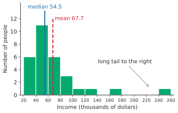
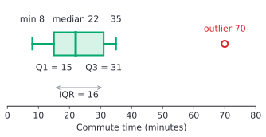
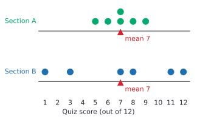

# Describing data

After this lesson you can summarize a list of numbers by its centre and its spread: find the mean, median, mode, range, quartiles, interquartile range and mean absolute deviation, draw and read a box plot, dot plot and histogram, spot outliers, and work out a weighted mean such as a course grade.

Before this: [fractions and equivalent fractions](../../01-elementary/09-fractions-and-equivalent-fractions.md), [negative numbers and absolute value](../01-integers-and-rational-numbers/01-negative-numbers-and-absolute-value.md) and [percents](../02-ratios-rates-percents/03-percents.md).

## Quick check

Try these first. If you get all three right, skip to [Practice](#practice).

1. Find the mean, median, mode and range of 4, 7, 7, 9, 13.
2. Find the quartiles and the interquartile range of 2, 5, 6, 8, 10, 12, 15, 21. Is 21 an outlier by the $1.5 \times \text{IQR}$ rule?
3. A course counts assignments for 20%, a midterm for 30% and a final exam for 50%. You score 85, 72 and 64. What is your course mark?

<details class="solution" markdown>
<summary>Answers</summary>

1. The sum is 40, so the mean is $40 \div 5 = 8$. The median is the middle value, 7, the mode is 7, and the range is $13 - 4 = 9$.
2. The median is $\frac{8 + 10}{2} = 9$. The lower half 2, 5, 6, 8 has median $Q_1 = 5.5$, and the upper half 10, 12, 15, 21 has median $Q_3 = 13.5$, so the IQR is 8. The upper fence is $13.5 + 1.5 \times 8 = 25.5$, and 21 is below it, so it is not an outlier.
3. Weight each mark: $0.2 \times 85 + 0.3 \times 72 + 0.5 \times 64 = 17 + 21.6 + 32 = 70.6$.

</details>

## The idea

Ten people work at a small company, and their yearly incomes, in thousands of dollars, are 38, 42, 45, 47, 51, 54, 58, 62, 70 and 83 (made-up numbers). What does a typical person there earn? You could share the total out equally: $550 \div 10 = 55$, so \$55,000. Or you could sort the incomes and take the middle one. With ten values there are two middle ones, 51 and 54, and halfway between them is \$52,500. The two answers are close.

Now the person earning \$83,000 leaves, and the owner, who pays herself \$1,000,000, joins the list. The total jumps to 1,467, and sharing it equally gives \$146,700, more than nine of the ten people earn. The middle value hasn't moved at all: the sorted list still has 51 and 54 in the middle, so it is still \$52,500.

So different one-number summaries answer different questions, and one extreme value can pull some of them a long way. Real incomes behave like this, which is why Statistics Canada's [Canadian Income Survey, 2024](https://www150.statcan.gc.ca/n1/daily-quotidien/260429/dq260429a-eng.htm) analyzes income using medians: it reports a median after-tax income of \$75,500 for Canadian families and unattached individuals in 2024.

The centre is only half the story. Two classes can have the same average quiz score while one has every student near the average and the other has scores all over the place. So this lesson also measures spread.

## Definitions

**Data** are values collected about a group of people or things. Each person or thing is an individual, and each property you record about them is a **variable**. A **data set** is the collection of values of one or more variables.

A **categorical** variable sorts individuals into groups, such as program of study, favourite programming language or postal code. A **numerical** variable is a measured or counted quantity, such as height, income or number of siblings, so arithmetic on it makes sense.

In plain words: ask whether averaging the values makes sense. A student number is made of digits, but it is categorical, because the average of two student numbers means nothing.

For a numerical data set $x_1, x_2, \dots, x_n$ with $n$ values, the **mean** (the average) is the sum divided by the count:

$$
\bar{x} = \frac{x_1 + x_2 + \dots + x_n}{n}.
$$

The symbol $\bar{x}$ is read "x bar". The subscripts number the values: $x_1$ is the first value and $x_n$ the last. In plain words, the mean is what each value would be if the total were shared out equally. The mean of 2, 4 and 9 is $\frac{15}{3} = 5$.

The **median** is the middle value of the data sorted from smallest to largest. When $n$ is even there are two middle values, and the median is their mean. In plain words, half the values are at or below the median and half are at or above it. The median of 2, 4 and 90 is 4, while the mean is 32.

The **mode** is the value that occurs most often. A data set can have two or more modes, and if every value occurs equally often it has no mode. The mode is the only one of the three that works for categorical data: "the most common program in the lecture is CS".

The mean, median and mode are measures of centre. The next definitions measure spread.

The **range** is the largest value minus the smallest value. For 4, 7, 7, 9, 13 it is $13 - 4 = 9$.

The **quartiles** split the sorted data into four parts with about the same number of values in each. The **first quartile** $Q_1$ is the median of the lower half, the second quartile is the median itself, and the **third quartile** $Q_3$ is the median of the upper half. In this book, when $n$ is odd the median belongs to neither half. The **interquartile range** is $\text{IQR} = Q_3 - Q_1$, the spread of the middle half of the data.

In plain words, about a quarter of the values lie below $Q_1$ and about a quarter lie above $Q_3$. The IQR is the width of the box that holds the middle 50%.

The **five-number summary** is the minimum, $Q_1$, the median, $Q_3$ and the maximum. A **box plot** draws it on a number line: a box from $Q_1$ to $Q_3$, a line across the box at the median, and lines called whiskers out to the smallest and largest values that are not outliers.

An **outlier** is a value far from the rest of the data. This book uses the standard $1.5 \times \text{IQR}$ rule, proposed by the statistician John Tukey: a value is an outlier when it is below $Q_1 - 1.5 \times \text{IQR}$ or above $Q_3 + 1.5 \times \text{IQR}$. These two cutoffs are called the lower and upper fences.

The **mean absolute deviation**, or MAD, is the average distance from each value to the mean:

$$
\text{MAD} = \frac{\lvert x_1 - \bar{x} \rvert + \lvert x_2 - \bar{x} \rvert + \dots + \lvert x_n - \bar{x} \rvert}{n}.
$$

The bars are absolute value, which turns each difference into a distance. For 2, 4 and 9, with mean 5, the distances are 3, 1 and 4, so the MAD is $\frac{8}{3} \approx 2.67$. In plain words, a typical value sits about 2.67 away from the mean.

A **weighted mean** gives each value $x_i$ a weight $w_i$ that says how much it counts:

$$
\text{weighted mean} = \frac{w_1 x_1 + w_2 x_2 + \dots + w_n x_n}{w_1 + w_2 + \dots + w_n}.
$$

When the weights are percents that add up to 100%, the denominator is 1 and the weighted mean is just the sum of the products. The ordinary mean is the case where every weight is 1.

A **dot plot** shows each value as a dot above a number line, with repeated values stacked. A **histogram** groups numerical data into bins of equal width and draws a bar for each bin, whose height is the number of values in the bin (its frequency). The bars touch, because the bins cover the number line without gaps. A distribution is **skewed right** when it has a long tail of large values, as incomes do, and **skewed left** when the long tail is on the small side.

## How to do it

### Mean, median and mode

1. Sort the data from smallest to largest, and count the values to get $n$.
2. For the mean, add the values and divide the sum by $n$.
3. For the median, find the middle position, $\frac{n + 1}{2}$. If $n$ is odd, the median is the value in that position. If $n$ is even, the position ends in .5, and the median is the mean of the two values on either side of it.
4. For the mode, find the value that appears most often. Say "no mode" if every value appears equally often.
5. Check that the mean and the median lie between the smallest and largest values. A mean far from the median signals skew or an outlier.

### Five-number summary, outliers and box plot

1. Sort the data and find the minimum, the maximum and the median.
2. Split the sorted data into a lower half and an upper half at the median. If $n$ is odd, leave the median out of both halves.
3. Find $Q_1$, the median of the lower half, and $Q_3$, the median of the upper half.
4. Compute $\text{IQR} = Q_3 - Q_1$ and the fences $Q_1 - 1.5 \times \text{IQR}$ and $Q_3 + 1.5 \times \text{IQR}$. Values outside the fences are outliers.
5. Draw the box plot: a number line, a box from $Q_1$ to $Q_3$, a line at the median, whiskers to the smallest and largest values inside the fences, and a separate dot for each outlier.

Step 2 is the method that most school courses and TI graphing calculators use. Software often uses another one. For the commute data in Example 1, NumPy's default and Excel's `QUARTILE.INC` interpolate between neighbouring values and give $Q_1 = 16.5$ and $Q_3 = 29.5$ instead of 15 and 31. The methods agree more closely as the data set grows. On an assignment, use your course's method.

### Mean absolute deviation and weighted mean

For the MAD, find the mean, find each value's distance from it, and take the mean of those distances. For a weighted mean:

1. List each value with its weight. Write percent weights as decimals.
2. Multiply each value by its weight, and add the products.
3. Divide by the sum of the weights. If the weights add to 1 (or 100%), this step changes nothing.
4. Check that the answer lies between the smallest and largest values, and closer to the values with the biggest weights.

### Histogram

1. Choose bins of equal width that cover the data, such as 20 to 40, 40 to 60 and so on. A value on a boundary goes in the bin that starts there, so 40 goes in the bin from 40 to 60.
2. Count the values in each bin.
3. Draw a bar over each bin as tall as its count, with no gaps between neighbouring bars.

Here is a histogram of 30 made-up incomes, in thousands of dollars, with bins 20 wide. Most people earn between \$20,000 and \$80,000, and a few large incomes stretch the picture to the right.



The long right tail pulls the mean (\$67,700) well above the median (\$54,500), and 20 of the 30 people earn less than the mean. In a right-skewed distribution the mean is usually bigger than the median, and in a left-skewed one it is usually smaller.

### Choosing a summary

| Measure | Use it when | Weak point |
|---|---|---|
| mean | the data is roughly symmetric with no outliers, or you need the total ($\text{total} = n \times \bar{x}$) | one extreme value pulls it a long way |
| median | the data is skewed or has outliers, such as incomes, house prices and response times | ignores how far out the extreme values are |
| mode | the data is categorical, or you want the most common value | may not exist, or there may be several |
| range | you want a quick sense of the full spread | depends only on the two most extreme values |
| IQR | you are using the median, or the data has outliers | ignores the outer half of the data |
| MAD | you are using the mean and want a typical distance from it | outliers pull it, as they pull the mean |

Pair a measure of centre with a matching measure of spread: the mean with the MAD, and the median with the IQR.

## Worked examples

<div class="example" markdown>

### Example 1: commute times and a box plot

Eleven students record their commute to campus, in minutes: 25, 8, 31, 18, 70, 22, 12, 35, 15, 28, 20. Find the mean and the five-number summary, check for outliers, and draw a box plot.

Step 1: sort the values and count them:

$$
8,\ 12,\ 15,\ 18,\ 20,\ 22,\ 25,\ 28,\ 31,\ 35,\ 70.
$$

There are $n = 11$ values. The minimum is 8 and the maximum is 70. The middle position is $\frac{11 + 1}{2} = 6$, and the sixth value is 22, so the median is 22 minutes.

The sum is 284, so the mean is $284 \div 11 = 25.818\ldots$, about 25.8 minutes.

Step 2: $n$ is odd, so leave the median, 22, out of both halves. The lower half is 8, 12, 15, 18, 20 and the upper half is 25, 28, 31, 35, 70.

<div class="warning" markdown>

Watch out at Step 2: if you split before sorting, the halves are meaningless. The quartiles come from the sorted list, every time.

</div>

Step 3: each half has 5 values, so its median is its third value: $Q_1 = 15$ and $Q_3 = 31$.

Step 4: the IQR is $31 - 15 = 16$, so $1.5 \times \text{IQR} = 24$. The fences are

$$
15 - 24 = -9 \qquad \text{and} \qquad 31 + 24 = 55.
$$

No value is below $-9$ (a negative fence is fine; it only means there can't be a low outlier here). The value 70 is above 55, so it is an outlier. Maybe that student lives in another city.

Step 5: draw the box from 15 to 31 with a line at 22. The upper whisker stops at 35, the largest value inside the fences, and 70 gets its own dot.



The outlier pulls the mean (25.8) above the median (22). Without the 70, the other ten values have mean $214 \div 10 = 21.4$ and median $\frac{20 + 22}{2} = 21$, almost the same. One value moved the mean by more than 4 minutes and the median by 1.

Check: the mean, 25.8, lies between 8 and 70, and it is above the median, as an outlier on the high side predicts. The halves each have 5 values, and $5 + 1 + 5 = 11$.

</div>

<div class="example" markdown>

### Example 2: a course grade as a weighted mean

A course outline gives these weights: assignments 25%, midterm 25%, final exam 40% and participation 10%. Your marks are 88, 71, 62 and 95. What is your course mark?

Steps 1 and 2: multiply each mark by its weight as a decimal, and add:

$$
0.25 \times 88 + 0.25 \times 71 + 0.40 \times 62 + 0.10 \times 95 = 22 + 17.75 + 24.8 + 9.5 = 74.05.
$$

Step 3: the weights add to $0.25 + 0.25 + 0.40 + 0.10 = 1$, so the mark is 74.05, about 74%.

The plain mean of the four marks is $\frac{88 + 71 + 62 + 95}{4} = 79$, which is 5 points too high. It treats participation as if it counted as much as the final, but the final carries four times the weight, and it is your lowest mark.

Check (Step 4): 74.05 lies between 62 and 95, and it is pulled toward 62, the mark with the biggest weight.

</div>

<div class="example" markdown>

### Example 3: same mean, different spread

Two tutorial sections write a quiz out of 12. Section A scores 5, 6, 7, 7, 8, 9 and section B scores 1, 3, 7, 8, 11, 12. Compare their centres and spreads.

Both sums are 42, so both means are $42 \div 6 = 7$. The medians are $\frac{7 + 7}{2} = 7$ and $\frac{7 + 8}{2} = 7.5$. Section A has mode 7. In section B every score appears once, so it has no mode.

The dot plots show what the means hide:



For the MAD, find each distance from the mean, 7. In section A the distances are 2, 1, 0, 0, 1, 2, which add to 6, so the MAD is $6 \div 6 = 1$. In section B they are 6, 4, 0, 1, 4, 5, which add to 20, so the MAD is

$$
\frac{20}{6} = \frac{10}{3} = 3.333\ldots
$$

That untidy answer is fine; about 3.33 is enough. A typical score in B sits more than three times as far from the mean as one in A, which matches the picture.

Check: the ranges agree, $9 - 5 = 4$ for A and $12 - 1 = 11$ for B.

</div>

<div class="example" markdown>

### Example 4: the mark you need on the final (finish it yourself)

Assignments count 30%, the midterm 30% and the final exam 40%. You have 82 on the assignments and 64 on the midterm. What mark on the final gives you exactly 70 in the course?

Call the final mark $x$. The course mark is a weighted mean, and you want it to equal 70:

$$
0.3 \times 82 + 0.3 \times 64 + 0.4x = 70.
$$

The first two products are $24.6 + 19.2 = 43.8$, so the equation is $43.8 + 0.4x = 70$. Now solve it, as in [one- and two-step equations](../03-expressions-equations-inequalities/03-one-and-two-step-equations.md), and check your answer.

<details class="solution" markdown>
<summary>Finish</summary>

Subtract 43.8 from both sides to get $0.4x = 26.2$, then divide by 0.4: $x = 26.2 \div 0.4 = 65.5$. You need 65.5 on the final.

Check: $0.3 \times 82 + 0.3 \times 64 + 0.4 \times 65.5 = 24.6 + 19.2 + 26.2 = 70$.

</details>

</div>

## Edge cases and common mistakes

<div class="warning" markdown>

Watch out: the median of an even-sized list is the mean of the two middle values, which may not be in the data. The median of 3, 8, 10, 12 is $\frac{8 + 10}{2} = 9$. Picking 8 or 10 is wrong, and so is forgetting to sort first: the median of 12, 3, 10, 8 is still 9, not $\frac{3 + 10}{2}$.

</div>

<div class="warning" markdown>

Watch out: averaging the marks without the weights. The plain mean of the components is right only when they all count the same. In Example 2 it gave 79 instead of 74.05. The same mistake happens with a GPA: a full-year course counts twice as much as a half-year course, so its grade gets weight 1.0 against 0.5 (Practice problem 5).

</div>

<div class="warning" markdown>

Watch out: the deviations from the mean always add up to 0, so averaging them without absolute values gives 0 for every data set. For 2, 4 and 9 with mean 5, the deviations are $-3$, $-1$ and $4$, and $-3 - 1 + 4 = 0$. That happens because the mean is the balance point: the total above it equals the total below it. The absolute values in the MAD are there to stop the cancelling.

</div>

<div class="warning" markdown>

Watch out: each of the four sections of a box plot holds about a quarter of the values, whatever its width. A long whisker means the values in that quarter are spread out, not that there are more of them.

</div>

A data set with one value has mean, median and mode all equal to that value, and range, IQR and MAD all 0. Spread 0 is fine: it says every value is the same. At the other extreme, a mean of 2.4 children per family is a correct summary even though no family has 2.4 children.

A histogram is not a bar chart. A bar chart shows categories, which can go in any order and have gaps between the bars. A histogram shows bins of a numerical variable, in number-line order, with no gaps. An empty bin is drawn as a gap of zero height, as the bin from 140 to 160 is in the income histogram.

Don't call a value an outlier just because it looks big. Run the fences: in the Quick check, 21 looked far from the rest, but it was inside the upper fence, 25.5.

## Tricks and shortcuts

To find a mean in your head, pick a round number near the middle, average the differences from it, and add back. For 97, 102, 99, 104, 98, use 100: the differences are $-3$, $2$, $-1$, $4$, $-2$, which add to 0, so the mean is exactly 100.

Adding the same number to every value shifts the mean, median, mode and quartiles by that number, and leaves the range, IQR and MAD alone, since every distance stays the same. Multiplying every value by the same positive number multiplies all of them, centre and spread, by that number. So a 4% raise for everyone multiplies the mean salary and the range by 1.04 (Practice problem 8).

The total is the mean times the count, $\text{total} = n \times \bar{x}$. This finds a missing value. If 5 quiz scores have mean 12, they add up to 60; if a sixth score makes the mean 14, the six add up to 84, so the sixth score is $84 - 60 = 24$.

A frequency table is a weighted mean in disguise, with the frequencies as the weights (Practice problem 6).

## In code

Python's `statistics` module has the measures of centre built in. The quartile function shows that software has more than one quartile method, and the last lines compute the MAD and a weighted mean.

<details class="code" markdown>
<summary>In code</summary>

```python
import statistics as st

times = [8, 12, 15, 18, 20, 22, 25, 28, 31, 35, 70]

print(round(st.mean(times), 2))   # 25.82
print(st.median(times))           # 22
print(st.multimode([5, 6, 7, 7, 8, 9]))  # [7]
print(st.multimode([1, 3, 7, 8]))        # [1, 3, 7, 8]: every value ties

def quartiles(data):
    xs = sorted(data)
    n = len(xs)
    lower = xs[: n // 2]          # leaves out the middle value when n is odd
    upper = xs[(n + 1) // 2 :]
    return st.median(lower), st.median(upper)

print(quartiles(times))                          # (15, 31)
print(st.quantiles(times, n=4))                  # [15.0, 22.0, 31.0]
print(st.quantiles(times, n=4, method="inclusive"))  # [16.5, 22.0, 29.5]

def mad(data):
    m = st.mean(data)
    return sum(abs(x - m) for x in data) / len(data)

print(mad([5, 6, 7, 7, 8, 9]), round(mad([1, 3, 7, 8, 11, 12]), 2))  # 1.0 3.33

marks = [88, 71, 62, 95]
weights = [0.25, 0.25, 0.40, 0.10]
print(round(sum(w * x for w, x in zip(weights, marks)) / sum(weights), 2))  # 74.05
```

The function `quartiles` follows the steps in [How to do it](#five-number-summary-outliers-and-box-plot). For these 11 values `st.quantiles` happens to agree with it, while the `"inclusive"` method gives the same answers as NumPy's default and Excel's `QUARTILE.INC`. `multimode` returns every value that ties for most common, so a list in which every value ties returns all of them.

</details>

## FAQ

### Why does my calculator give different quartiles?

There are several accepted ways to define quartiles, and they differ in how they handle the middle value and whether they interpolate between neighbours. The book's method leaves the median out of both halves when $n$ is odd. Other methods include it, or take a weighted average of two neighbouring values. For large data sets the differences are tiny; for a list of 11 values they can be a value or two, as Example 1 showed.

### Why use absolute values for spread, and not squares?

Both work, and both stop the deviations from cancelling. The MAD is easier to compute and to read. University statistics mostly uses the standard deviation, which squares the deviations, averages them, and takes a square root at the end, because squares behave better in the algebra that comes later. You meet it in [descriptive statistics and study design](../../05-university-core/08-statistics/01-descriptive-statistics-and-study-design.md).

### Should I just delete outliers?

Only if you know they are errors, such as a commute of 700 minutes typed instead of 70. Deleting a real outlier misreports what happened. Report the median and IQR, which outliers barely move, or give the results with and without the outlier, as Example 1 did.

## Practice

### Warm-up

1\. Say whether each variable is categorical or numerical: (a) postal code, (b) number of siblings, (c) favourite programming language, (d) height in centimetres, (e) student number.

<details class="solution" markdown>
<summary>Solution</summary>

- (a) Categorical. It names a place; averaging postal codes makes no sense.
- (b) Numerical. It counts something, so "an average of 1.4 siblings" is meaningful.
- (c) Categorical. The only summary that works is the mode, the most common language.
- (d) Numerical. It is a measurement.
- (e) Categorical, even though it is made of digits. It is a label, like a name.

Check with the test from [Definitions](#definitions): adding two heights or two sibling counts gives a meaningful number, while adding two student numbers or two postal codes doesn't.

</details>

2\. Find the mean, median, mode and range of 3, 8, 8, 10, 12, 14.

<details class="solution" markdown>
<summary>Solution</summary>

The list is already sorted, and $n = 6$. The sum is 55, so the mean is

$$
\frac{55}{6} = 9.1666\ldots,
$$

about 9.17. The middle position is $\frac{6 + 1}{2} = 3.5$, so the median is the mean of the 3rd and 4th values, $\frac{8 + 10}{2} = 9$. The mode is 8, and the range is $14 - 3 = 11$.

Check: $6 \times 9.1666\ldots = 55$, and both the mean and the median lie between 3 and 14.

</details>

3\. Find the mean absolute deviation of 2, 4, 6, 8, 10.

<details class="solution" markdown>
<summary>Solution</summary>

The mean is $30 \div 5 = 6$. The distances from 6 are 4, 2, 0, 2 and 4, which add to 12, so the MAD is $12 \div 5 = 2.4$.

Check: without absolute values, the deviations $-4, -2, 0, 2, 4$ add to 0, as they always do, so the absolute values were needed.

</details>

### Standard

4\. A web server logs these response times, in milliseconds: 110, 118, 120, 123, 125, 127, 130, 134, 138, 141, 150, 212. (a) Find the five-number summary and the IQR. (b) Is any value an outlier? (c) Find the mean, and say which summary of the centre you would report.

<details class="solution" markdown>
<summary>Solution</summary>

(a) The list is sorted, with $n = 12$. The minimum is 110 and the maximum is 212. The median is the mean of the 6th and 7th values, $\frac{127 + 130}{2} = 128.5$. Since $n$ is even, the halves are the first six and the last six values. The lower half 110, 118, 120, 123, 125, 127 has median $Q_1 = \frac{120 + 123}{2} = 121.5$, and the upper half 130, 134, 138, 141, 150, 212 has median $Q_3 = \frac{138 + 141}{2} = 139.5$. The IQR is $139.5 - 121.5 = 18$.

(b) Here $1.5 \times 18 = 27$, so the fences are $121.5 - 27 = 94.5$ and $139.5 + 27 = 166.5$. The value 212 is above 166.5, so it is an outlier. No value is below 94.5.

(c) The sum is 1,628, so the mean is $1628 \div 12 = 135.666\ldots$, about 135.7 ms. Report the median, 128.5 ms: the one slow response pulls the mean up by about 7 ms, while the median barely notices it.

Check: without 212, the other 11 values have mean $1416 \div 11 \approx 128.7$ and median 127, so the outlier moved the mean by about 7 and the median by 1.5.

</details>

5\. On a 4.0 scale, you earn 3.7 in Calculus (0.5 credit), 4.0 in Data Structures (0.5 credit), 2.7 in a full-year Economics course (1.0 credit) and 4.0 in a short Writing course (0.25 credit). Find your GPA weighted by credits, and compare it with the plain mean of the four grades.

<details class="solution" markdown>
<summary>Solution</summary>

Steps 1 and 2: multiply each grade by its credit weight and add:

$$
0.5 \times 3.7 + 0.5 \times 4.0 + 1.0 \times 2.7 + 0.25 \times 4.0 = 1.85 + 2.0 + 2.7 + 1.0 = 7.55.
$$

Step 3: the weights add to $0.5 + 0.5 + 1.0 + 0.25 = 2.25$, which is not 1, so divide: $7.55 \div 2.25 = 3.3555\ldots$, a GPA of about 3.36.

The plain mean is $\frac{3.7 + 4.0 + 2.7 + 4.0}{4} = 3.6$. It is too high because it gives the short Writing course as much say as the full-year Economics course, where the grade was lowest.

Check: 3.36 lies between 2.7 and 4.0, and it is pulled toward 2.7, the grade with the biggest weight.

</details>

6\. A survey asks 20 students how many courses they take this term. Two students take 3, five take 4, nine take 5 and four take 6. Find the mean, median and mode.

<details class="solution" markdown>
<summary>Solution</summary>

The mean is a weighted mean with the frequencies as weights. The total number of courses is $2 \times 3 + 5 \times 4 + 9 \times 5 + 4 \times 6 = 6 + 20 + 45 + 24 = 95$, and there are $2 + 5 + 9 + 4 = 20$ students, so the mean is $95 \div 20 = 4.75$.

For the median, $n = 20$, so it is the mean of the 10th and 11th values. Counting up the sorted list, positions 1 and 2 are 3s, positions 3 to 7 are 4s, and positions 8 to 16 are 5s. Both the 10th and the 11th values are 5, so the median is 5. The mode is 5, with nine students.

Check: the mean, 4.75, is a little below the median, 5, since the two students with 3 courses pull it down further than the four with 6 pull it up.

</details>

### Challenge

7\. A list of five whole numbers has mean 11, median 9, mode 7 and range 12. Find the list, and explain why it is the only one.

<details class="solution" markdown>
<summary>Solution</summary>

Write the sorted list as $a \le b \le c \le d \le e$. The median is the middle value, so $c = 9$. The mode is 7, so 7 appears at least twice; it is smaller than 9, so it can only be $a$ and $b$. That gives $a = b = 7$.

The range is 12, so $e = 7 + 12 = 19$. The mean is 11, so the five numbers add to $5 \times 11 = 55$:

$$
7 + 7 + 9 + d + 19 = 55,
$$

which gives $d = 55 - 42 = 13$. The list is 7, 7, 9, 13, 19. Every step was forced, so no other list works.

Check: the mean is $55 \div 5 = 11$, the median is 9, 7 is the only repeated value, and the range is $19 - 7 = 12$. Also $9 \le 13 \le 19$, so the list really is sorted.

</details>

8\. (Reviews [percent change and applications](../02-ratios-rates-percents/04-percent-change-and-applications.md).) Five employees earn \$48,000, \$52,000, \$55,000, \$61,000 and \$90,000. (a) Find the mean, median and range. (b) Everyone gets a 4% raise. Find the new mean, median and range without recomputing from the list. (c) After the raise, everyone also gets a \$2,000 bonus. Find the new mean, median and range.

<details class="solution" markdown>
<summary>Solution</summary>

(a) The sum is 306,000, so the mean is $306{,}000 \div 5 = 61{,}200$ dollars. The median is \$55,000, and the range is $90{,}000 - 48{,}000 = 42{,}000$ dollars.

(b) A 4% raise multiplies every salary by the multiplier 1.04, and multiplying every value multiplies the mean, the median and the range by the same number:

- the mean becomes $1.04 \times 61{,}200 = 63{,}648$ dollars,
- the median becomes $1.04 \times 55{,}000 = 57{,}200$ dollars,
- the range becomes $1.04 \times 42{,}000 = 43{,}680$ dollars.

(c) Adding \$2,000 to every salary shifts the mean and the median up by \$2,000, to \$65,648 and \$59,200. The range stays \$43,680, because the highest and lowest salaries both go up by the same amount.

Check: after both changes the lowest salary is $1.04 \times 48{,}000 + 2000 = 51{,}920$ and the highest is $1.04 \times 90{,}000 + 2000 = 95{,}600$, and $95{,}600 - 51{,}920 = 43{,}680$.

</details>

## Where this shows up

- [Descriptive statistics and study design](../../05-university-core/08-statistics/01-descriptive-statistics-and-study-design.md) adds the standard deviation, and [discrete random variables](../../05-university-core/07-probability/03-discrete-random-variables.md) defines the expected value, which is a weighted mean with probabilities as weights. Scatter plots, in [scatter plots and two-way tables](03-scatter-plots-and-two-way-tables.md), describe two variables at once.
- In CS, performance is reported with medians and percentiles: a "p50 latency" is the median response time and "p99" is the time that 99% of requests beat, because a few slow requests make the mean misleading. Comparing algorithms on many inputs uses the same summaries.
- Economics and finance are full of weighted means: the consumer price index weights prices by how much households spend on each item (index numbers<!-- link: ../../07-economics-math/01-measuring-the-economy/04-index-numbers.md -->), and a portfolio's return is the mean of its investments' returns weighted by the money in each (investing returns and risk<!-- link: ../../08-financial-math/06-investing-and-retirement/01-investing-returns-and-risk.md -->).
