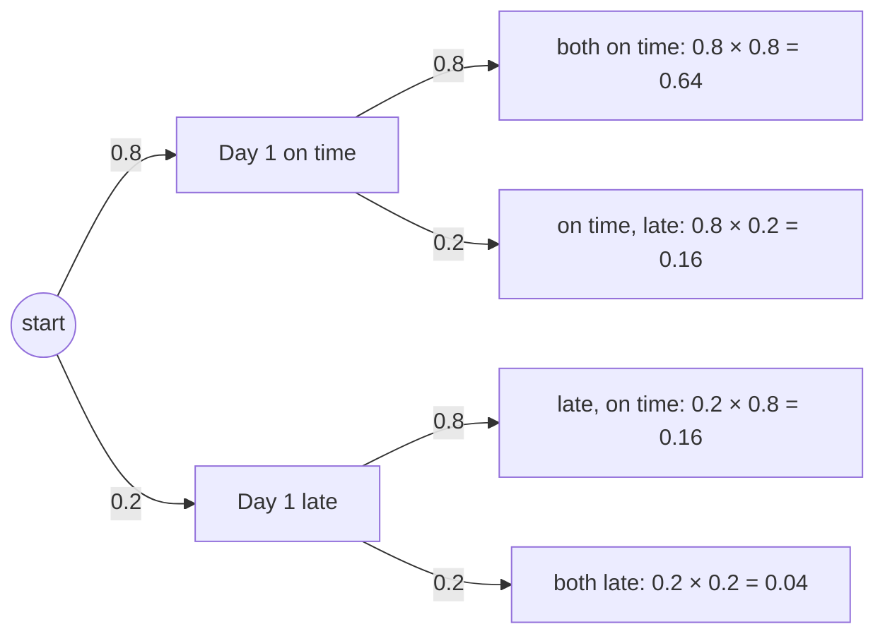
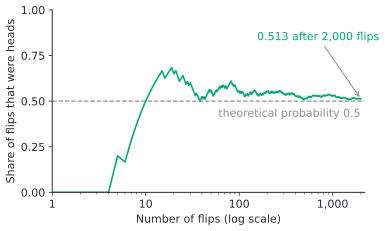
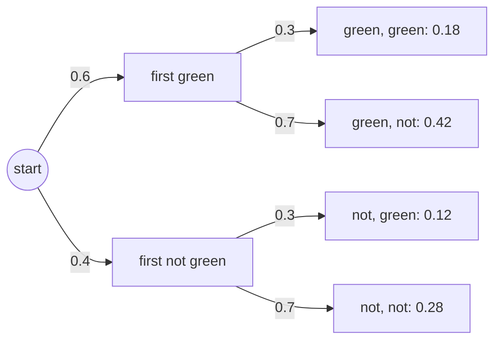

# Basic probability

After this lesson you can list the outcomes of a simple experiment, find the probability of an event by counting, use the complement rule, find probabilities of compound events with tables and tree diagrams, decide when to multiply and when to add, and check a probability with a simulation.

Before this: [fractions and equivalent fractions](../../01-elementary/09-fractions-and-equivalent-fractions.md), [multiplying and dividing fractions](../../01-elementary/11-multiplying-and-dividing-fractions.md) and [percents](../02-ratios-rates-percents/03-percents.md).

## Quick check

Try these first. If you get all three right, skip to [Practice](#practice).

1. A bag holds 3 red, 5 blue and 2 green marbles. You draw one without looking. What is the probability that it is not blue?
2. You roll two fair dice. What is the probability that the sum is 9?
3. You flip a fair coin 4 times. What is the probability of at least one head?

<details class="solution" markdown>
<summary>Answers</summary>

1. There are 10 marbles and 5 are not blue, so the probability is $\frac{5}{10} = \frac{1}{2}$.
2. Of the 36 equally likely pairs, four have sum 9: (3, 6), (4, 5), (5, 4) and (6, 3). The probability is $\frac{4}{36} = \frac{1}{9}$.
3. The only way to get no head is four tails, with probability $\left(\frac{1}{2}\right)^4 = \frac{1}{16}$. So the probability of at least one head is $1 - \frac{1}{16} = \frac{15}{16}$.

</details>

## The idea

Roll a fair die. Before it lands you can't say what it will show, but you can say something useful: each face is as likely as each other face, so a 6 comes up about one roll in six. Probability turns that "one in six" into a number, $\frac{1}{6}$, and gives rules for combining such numbers when more happens at once, such as two dice, a week of bus rides or a server farm.

The basic method is counting. List everything that can happen. If each possibility is equally likely, the probability of an event is the fraction of the possibilities in which it happens. For one die, "an even number" happens in 3 of the 6 outcomes, so its probability is $\frac{3}{6} = \frac{1}{2}$.

A probability also predicts what happens in the long run. If you roll the die 600 times, you expect about 100 sixes. Not exactly 100: you might get 93 or 108. But the share of sixes drifts toward $\frac{1}{6}$ as the number of rolls grows, and that is the link between the counting rule and real experiments, including the ones a computer simulates in [In code](#in-code).

## Definitions

An **experiment** is a process with an uncertain result that can, at least in principle, be repeated, such as rolling a die or drawing a card. Each possible result is an **outcome**.

The **sample space** $S$ is the set of all possible outcomes. For one die it is $S = \{1, 2, 3, 4, 5, 6\}$, and for a coin flip it is $\{\text{H}, \text{T}\}$. University books often write the sample space as $\Omega$ (capital omega).

An **event** is a set of outcomes, that is, a part of the sample space. "Rolling an even number" is the event $A = \{2, 4, 6\}$. An event happens when the outcome of the experiment is one of its outcomes.

In plain words: the sample space lists everything that can happen, and an event picks out the outcomes you care about.

The **probability** of an event $A$, written $P(A)$, is a number from 0 to 1 that measures how likely $A$ is. When all the outcomes in $S$ are equally likely,

$$
P(A) = \frac{\text{number of outcomes in } A}{\text{number of outcomes in } S}.
$$

For the even numbers on a die, $P(A) = \frac{3}{6} = \frac{1}{2}$. A probability can be written as a fraction, a decimal or a percent: $\frac{1}{2}$, 0.5 and 50% all say the same thing.

A probability of 0 means the event is impossible, such as rolling a 7 on one die. A probability of 1 means it is certain, such as rolling a number from 1 to 6. Every other event lies in between, and the closer to 1, the more likely.

The **complement** of an event $A$, written $A^c$ and read "not $A$", is the set of outcomes in $S$ that are not in $A$. On a die, the complement of $\{2, 4, 6\}$ is $\{1, 3, 5\}$. Some books write $\overline{A}$ or $A'$.

The **theoretical probability** of an event is the probability worked out from a model of the experiment, such as "the die is fair". The **experimental probability** (or relative frequency) is the share of trials in which the event actually happened:

$$
\text{experimental probability} = \frac{\text{number of trials in which } A \text{ happened}}{\text{number of trials}}.
$$

If you roll a die 60 times and get 13 sixes, the experimental probability of a six is $\frac{13}{60} \approx 0.217$, while the theoretical probability is $\frac{1}{6} \approx 0.167$.

A **compound event** combines two or more events, such as "the first die shows 6 and the second shows 6", or "the card is a heart or a spade". In probability, "or" means at least one of the two, possibly both.

Two events are **mutually exclusive** (or disjoint) when they can't both happen, so they have no outcomes in common. Drawing a heart and drawing a spade, on one draw, are mutually exclusive. Drawing a heart and drawing a king are not, since the king of hearts is both.

Two events are **independent** when knowing that one happened doesn't change the probability of the other. Formally, $A$ and $B$ are independent when

$$
P(A \text{ and } B) = P(A) \times P(B).
$$

Two separate coin flips are independent: the coin doesn't remember the first flip. Drawing two cards from a deck without putting the first one back is not: if the first card is a heart, fewer hearts are left for the second draw.

## How to do it

### One experiment, equally likely outcomes

1. Describe the experiment and list the sample space, or at least count its outcomes.
2. Check that the outcomes are equally likely. If they aren't, rebuild the sample space from outcomes that are, as [Example 1](#example-1-the-sum-of-two-dice) does for two dice.
3. Count the outcomes in the event.
4. Divide the count by the size of the sample space, and simplify.
5. If the event is hard to count but its complement is easy, use the complement rule instead.
6. Check that the answer is between 0 and 1, and that it is sensible: an event that covers a third of the outcomes should have probability about $\frac{1}{3}$.

The complement rule in Step 5 comes from the fact that every outcome is either in $A$ or in $A^c$, never both, so their probabilities add to 1:

$$
P(A^c) = 1 - P(A).
$$

For a die, $P(\text{not a } 6) = 1 - \frac{1}{6} = \frac{5}{6}$.

### Compound events: tables and trees

When an experiment has two stages, such as two dice, a table lists the sample space: one stage along the top, the other down the side, and one cell for each pair. When it has more stages, or the stages have different probabilities, a tree diagram works better.

1. Draw the stages. A table has one cell per outcome. A tree has one branch per outcome of each stage, and each branch is labelled with its probability.
2. For a table with equally likely cells, count the cells in the event and divide by the number of cells.
3. For a tree, multiply the probabilities along each path from the start to a leaf. This uses the multiplication rule for independent events, below.
4. Add the probabilities of all the leaves in the event.
5. Check that the probabilities of all the leaves add up to 1.

Two rules do most of the work. For independent events, "and" means multiply:

$$
P(A \text{ and } B) = P(A) \times P(B).
$$

For mutually exclusive events, "or" means add:

$$
P(A \text{ or } B) = P(A) + P(B).
$$

For example, a card drawn from a standard deck of 52 is a heart with probability $\frac{13}{52} = \frac{1}{4}$ and a spade with probability $\frac{1}{4}$. One card can't be both, so $P(\text{heart or spade}) = \frac{1}{4} + \frac{1}{4} = \frac{1}{2}$.

### "At least one"

1. Write the complement of "at least one": it is "none".
2. Find $P(\text{none})$, usually by multiplying the probability of "not it" for each independent trial.
3. Subtract from 1: $P(\text{at least one}) = 1 - P(\text{none})$.

## Worked examples

<div class="example" markdown>

### Example 1: the sum of two dice

You roll a red die and a blue die. Find the probability that the sum is 7, the probability that the sum is at least 9, and the probability that the sum is not 7.

Step 1: an outcome is a pair (red, blue). The red die has 6 results and the blue die has 6 for each of them, so there are $6 \times 6 = 36$ outcomes. This table shows the sum for each one:

| Red down, blue across | 1 | 2 | 3 | 4 | 5 | 6 |
|---|---|---|---|---|---|---|
| 1 | 2 | 3 | 4 | 5 | 6 | 7 |
| 2 | 3 | 4 | 5 | 6 | 7 | 8 |
| 3 | 4 | 5 | 6 | 7 | 8 | 9 |
| 4 | 5 | 6 | 7 | 8 | 9 | 10 |
| 5 | 6 | 7 | 8 | 9 | 10 | 11 |
| 6 | 7 | 8 | 9 | 10 | 11 | 12 |

Step 2: the dice are fair and separate, so each of the 36 cells is equally likely.

<div class="warning" markdown>

Watch out at Step 2: the sums 2 to 12 are not equally likely, so the sample space $\{2, 3, \dots, 12\}$ with 11 outcomes gives wrong answers. A sum of 2 happens in one cell and a sum of 7 in six. Count cells, not sums.

</div>

Steps 3 and 4: a sum of 7 fills the diagonal from the bottom left to the top right, which has 6 cells. So

$$
P(\text{sum is } 7) = \frac{6}{36} = \frac{1}{6}.
$$

A sum of at least 9 means 9, 10, 11 or 12, which fill 4, 3, 2 and 1 cells in the bottom right corner. That is 10 cells, so

$$
P(\text{sum is at least } 9) = \frac{10}{36} = \frac{5}{18}.
$$

Step 5: "the sum is not 7" is the complement of "the sum is 7", so its probability is $1 - \frac{1}{6} = \frac{5}{6}$, with no counting.

Step 6: all three answers are between 0 and 1. Counting directly also confirms the last one: $36 - 6 = 30$ cells have a sum other than 7, and $\frac{30}{36} = \frac{5}{6}$.

</div>

<div class="example" markdown>

### Example 2: two days of buses, with a tree

Your morning bus is on time with probability 0.8, and whether it is on time one day doesn't affect the next day. Over two days, find the probability that the bus is on time both days, exactly one day, and neither day.

Step 1: each day has two branches, on time (0.8) and late ($1 - 0.8 = 0.2$):



Step 3: multiply along each path. The days are independent, so the probability of "on time, then on time" is $0.8 \times 0.8 = 0.64$, and similarly for the other three leaves.

Step 4: "exactly one day on time" is two leaves, on time then late and late then on time. They are mutually exclusive, so add: $0.16 + 0.16 = 0.32$. The answers are 0.64 for both days, 0.32 for exactly one and 0.04 for neither.

Step 5: $0.64 + 0.16 + 0.16 + 0.04 = 1$.

</div>

<div class="example" markdown>

### Example 3: at least one six in four rolls

You roll a fair die 4 times. What is the probability of at least one six?

A tempting answer is to add $\frac{1}{6}$ four times and get $\frac{4}{6} = \frac{2}{3}$. That is wrong: the events "six on roll 1" and "six on roll 2" are not mutually exclusive, since both can happen, so adding counts the outcomes with two sixes twice. The same method would give $\frac{7}{6}$ for seven rolls, which is more than 1 and so can't be a probability.

Use the complement instead (Steps 1 to 3 for "at least one"). The complement of "at least one six" is "no sixes". Each roll misses the six with probability $\frac{5}{6}$, and the rolls are independent, so

$$
P(\text{no sixes}) = \left(\frac{5}{6}\right)^4 = \frac{625}{1296}.
$$

Then

$$
P(\text{at least one six}) = 1 - \frac{625}{1296} = \frac{671}{1296} \approx 0.518.
$$

The answer is an untidy fraction, and that is fine; about 51.8% is a good way to say it. It is a little better than even, and well below the wrong answer of $\frac{2}{3}$.

Check: the simulation in [In code](#in-code) rolls four dice 100,000 times and gets at least one six in 51.7% of them.

</div>

<div class="example" markdown>

### Example 4: three servers (finish it yourself)

A website runs on three servers. Each one is up at a given moment with probability 0.99, independently of the others. The site works only if all three are up. What is the probability that at least one server is down?

Step 1: the complement of "at least one is down" is "none is down", that is, all three are up.

Step 2: the servers are independent, so multiply:

$$
P(\text{all three up}) = 0.99 \times 0.99 \times 0.99 = 0.99^3.
$$

Now work out $0.99^3$ and do Step 3.

<details class="solution" markdown>
<summary>Finish</summary>

Here $0.99^3 = 0.970299$, so $P(\text{at least one down}) = 1 - 0.970299 = 0.029701$, about 3%. Each server alone is down only 1% of the time, but with three of them a failure somewhere is about three times as likely.

Check: adding $0.01$ three times gives $0.03$, slightly too high, because it counts the moments when two servers are down twice. The exact answer, 0.029701, is just under it, as it should be.

</details>

</div>

## Edge cases and common mistakes

The unequal sums of two dice are flagged in Example 1, and adding for "at least one" in Example 3. Here are the others.

<div class="warning" markdown>

Watch out: adding the probabilities of events that overlap. A card is a heart with probability $\frac{13}{52}$ and a king with probability $\frac{4}{52}$, but $P(\text{heart or king})$ is not $\frac{17}{52}$, because the king of hearts was counted twice. Counting the cards directly gives $13 + 4 - 1 = 16$, so the probability is $\frac{16}{52} = \frac{4}{13}$. Add only when the events can't happen together, or subtract the overlap.

</div>

<div class="warning" markdown>

Watch out: multiplying when the events are not independent. A bag holds 2 red and 3 blue marbles, and you draw two without putting the first back. The answer is not $\frac{2}{5} \times \frac{2}{5}$, because after a red is drawn only 1 red is left. Count instead: there are $5 \times 4 = 20$ equally likely ordered pairs of different marbles, and only 2 of them (red 1 then red 2, or red 2 then red 1) are both red, so the probability is $\frac{2}{20} = \frac{1}{10}$. The tool for draws that change the odds is conditional probability, in [conditional probability and Bayes' theorem](../../05-university-core/07-probability/02-conditional-probability-and-bayes.md).

</div>

<div class="warning" markdown>

Watch out for the gambler's fallacy. After five heads in a row, a fair coin is not "due" for tails: the next flip is still heads with probability $\frac{1}{2}$, because the flips are independent. The long-run share of heads moves toward $\frac{1}{2}$ because thousands of later flips swamp the early ones, not because the coin makes up for them.

</div>

<div class="warning" markdown>

Watch out: mutually exclusive and independent are different, and they almost never go together. If $A$ and $B$ are mutually exclusive and each has a positive probability, then knowing $A$ happened tells you $B$ did not, so they are dependent. "Heads on the first flip" and "heads on the second flip" are independent and not mutually exclusive. "Heads" and "tails" on one flip are mutually exclusive and not independent.

</div>

A probability is never negative and never more than 1. If you get $\frac{7}{6}$ or $-0.2$, there is a mistake upstream, usually an overlap counted twice or a subtraction the wrong way round.

An event with probability 0 is impossible in an experiment with finitely many outcomes, and the empty event, with no outcomes, has probability 0. The whole sample space is an event too, with probability 1.

## Tricks and shortcuts

Read "and" as multiply and "or" as add, then check the condition: multiply only for independent events, and add only for mutually exclusive ones.

For "at least one", reach for the complement first. One subtraction from 1 replaces adding up every case with one, two, three or more successes.

A probability tree has a built-in check: the leaves add up to 1. So do the probabilities of all the outcomes in a table, and each event and its complement.

Odds are a part-to-part ratio, and a probability is part-to-whole, as in [ratios and unit rates](../02-ratios-rates-percents/01-ratios-and-unit-rates.md). Odds of $3:5$ in favour mean 3 ways to win for every 5 ways to lose, so the probability of winning is $\frac{3}{3 + 5} = \frac{3}{8}$ (Practice problem 8).

For two dice, the number of ways to roll each sum goes up by one from 2 to 7 and back down from 7 to 12: 1, 2, 3, 4, 5, 6, 5, 4, 3, 2, 1. Seven is the most likely sum, with 6 ways.

## In code

A simulation checks a probability by running the experiment many times. Python's `random` module rolls the dice; `random.seed` fixes the starting point, so the program prints the same numbers every time.

<details class="code" markdown>
<summary>In code</summary>

```python
import random

random.seed(2026)

def roll():
    return random.randint(1, 6)   # each of 1 to 6 is equally likely

for trials in [100, 1_000, 10_000, 100_000]:
    sevens = sum(1 for _ in range(trials) if roll() + roll() == 7)
    print(trials, sevens / trials)
# 100 0.15
# 1000 0.174
# 10000 0.1638
# 100000 0.16626

trials = 100_000
hits = sum(1 for _ in range(trials) if any(roll() == 6 for _ in range(4)))
print(hits / trials, 1 - (5 / 6) ** 4)   # 0.51745 0.5177469135802468
```

The theoretical probability of a 7 is $\frac{1}{6} \approx 0.1667$. With 100 trials the estimate is off by about 0.017, and with 100,000 trials by about 0.0004. The last line checks Example 3: the simulated share of "at least one six in four rolls" is within 0.0003 of the exact answer.

</details>

The same pattern answers questions too messy to count by hand. If you can write code for one run of the experiment, you can estimate a probability by running it many times.

## FAQ

### I flipped a coin 10 times and got 7 heads. Is it unfair?

Probably not. A probability of $\frac{1}{2}$ predicts the long-run share, not the result of 10 flips, and 7 heads or more in 10 flips happens with probability about 0.17, so roughly once in six tries. The figure below shows one simulated run of 2,000 flips. The first four flips were all tails, so the share of heads started at 0; after 100 flips it was 0.55, and after 2,000 it was 0.513.



More trials help because the swings shrink as a share of the total. After 1,000 flips this run had 530 heads, 30 more than half, and after 2,000 it had 1,026, only 26 more than half. The gap stayed about the same size while the total doubled, so the share moved closer to 0.5. The precise statement is the law of large numbers, in [the law of large numbers and the CLT](../../05-university-core/07-probability/06-law-of-large-numbers-and-clt.md).

### Why are there four outcomes for two coins and not three?

Because "one head and one tail" can happen two ways: heads then tails, or tails then heads. Imagine the coins are a loonie and a quarter, so you can tell them apart. The sample space is HH, HT, TH, TT, each with probability $\frac{1}{4}$, and $P(\text{one of each}) = \frac{2}{4} = \frac{1}{2}$. Listing "two heads, two tails, one of each" as three equally likely outcomes would give $\frac{1}{3}$, and a few dozen real flips show that is wrong.

### What if the outcomes are not equally likely?

Then the counting formula doesn't apply directly. You either split the outcomes into smaller ones that are equally likely (as the 36 cells do for the sums of two dice), or you give each outcome its own probability and add the probabilities of the outcomes in the event, as the tree in Example 2 does. University probability starts from that second view, in [sample spaces, events and axioms](../../05-university-core/07-probability/01-sample-spaces-events-and-axioms.md).

## Practice

### Warm-up

1\. You draw one card from a standard 52-card deck. Find the probability that it is (a) a heart, (b) a face card (jack, queen or king), (c) not an ace.

<details class="solution" markdown>
<summary>Solution</summary>

There are 52 equally likely cards.

- (a) There are 13 hearts, so $P(\text{heart}) = \frac{13}{52} = \frac{1}{4}$.
- (b) Each of the 4 suits has 3 face cards, so there are 12, and $P(\text{face card}) = \frac{12}{52} = \frac{3}{13}$.
- (c) There are 4 aces, so $P(\text{ace}) = \frac{4}{52} = \frac{1}{13}$, and the complement rule gives $P(\text{not an ace}) = 1 - \frac{1}{13} = \frac{12}{13}$.

Check (c) by counting: 48 cards are not aces, and $\frac{48}{52} = \frac{12}{13}$.

</details>

2\. You toss a thumbtack 200 times, and it lands point up 124 times. (a) What is the experimental probability of point up? (b) About how many times would you expect point up in 500 tosses?

<details class="solution" markdown>
<summary>Solution</summary>

(a) Divide the count by the number of trials: $124 \div 200 = 0.62$. A thumbtack has no symmetry that makes the two ways of landing equally likely, so an experiment is the only way to estimate this probability.

(b) Multiply the probability by the number of trials: $0.62 \times 500 = 310$, so about 310 times.

Check: 500 tosses is 2.5 times 200 tosses, and $2.5 \times 124 = 310$.

</details>

3\. You flip a coin and roll a die. (a) List the sample space. (b) Find the probability of a head and an even number, by counting and by the multiplication rule.

<details class="solution" markdown>
<summary>Solution</summary>

(a) Each outcome pairs a coin result with a die result, so there are $2 \times 6 = 12$ outcomes: H1, H2, H3, H4, H5, H6, T1, T2, T3, T4, T5, T6.

(b) By counting, the outcomes H2, H4 and H6 are in the event, so the probability is $\frac{3}{12} = \frac{1}{4}$. By the multiplication rule, the coin and the die are independent, so the probability is $\frac{1}{2} \times \frac{3}{6} = \frac{1}{4}$.

Check: the two methods agree.

</details>

### Standard

4\. You roll two fair dice. Find the probability that (a) the sum is at most 4, (b) the product of the two numbers is even.

<details class="solution" markdown>
<summary>Solution</summary>

(a) From the table in Example 1, the sums 2, 3 and 4 fill 1, 2 and 3 cells, which is 6 cells: (1, 1), (1, 2), (2, 1), (1, 3), (2, 2), (3, 1). So the probability is $\frac{6}{36} = \frac{1}{6}$.

(b) Use the complement. A product is odd only when both numbers are odd, and each die is odd with probability $\frac{3}{6} = \frac{1}{2}$, so $P(\text{product odd}) = \frac{1}{2} \times \frac{1}{2} = \frac{1}{4}$. Then $P(\text{product even}) = 1 - \frac{1}{4} = \frac{3}{4}$.

Check (b) by counting: $3 \times 3 = 9$ cells have both numbers odd, so $36 - 9 = 27$ cells have an even product, and $\frac{27}{36} = \frac{3}{4}$.

</details>

5\. A quiz has 5 multiple-choice questions, each with 4 choices. You guess every answer at random. Find the probability that you get (a) all 5 right, (b) at least one right.

<details class="solution" markdown>
<summary>Solution</summary>

Each guess is right with probability $\frac{1}{4}$ and wrong with probability $\frac{3}{4}$, and the guesses are independent.

(a) Multiply: $\left(\frac{1}{4}\right)^5 = \frac{1}{1024}$, about 0.001.

(b) The complement is "all 5 wrong", with probability $\left(\frac{3}{4}\right)^5 = \frac{243}{1024}$. So

$$
P(\text{at least one right}) = 1 - \frac{243}{1024} = \frac{781}{1024} \approx 0.763.
$$

Check: adding $\frac{1}{4}$ five times would give $\frac{5}{4}$, more than 1, which shows why adding fails. The answer 0.763 is between 0 and 1 and well above $\frac{1}{4}$, as you would expect from five tries.

</details>

6\. On your way to campus you pass two traffic lights, which work independently. The first is green when you reach it with probability 0.6, and the second with probability 0.3. Draw a tree and find the probability of (a) two greens, (b) exactly one green, (c) no greens.

<details class="solution" markdown>
<summary>Solution</summary>

The first light is not green with probability 0.4, and the second with probability 0.7.



- (a) $0.6 \times 0.3 = 0.18$.
- (b) Two leaves: $0.6 \times 0.7 + 0.4 \times 0.3 = 0.42 + 0.12 = 0.54$.
- (c) $0.4 \times 0.7 = 0.28$.

Check: $0.18 + 0.54 + 0.28 = 1$.

</details>

### Challenge

7\. How many times must you roll a fair die for the probability of at least one six to be more than 0.9?

<details class="solution" markdown>
<summary>Solution</summary>

With $n$ rolls, $P(\text{at least one six}) = 1 - \left(\frac{5}{6}\right)^n$, so you need $\left(\frac{5}{6}\right)^n < 0.1$. Each extra roll multiplies $\left(\frac{5}{6}\right)^n$ by $\frac{5}{6}$, so try values of $n$:

| $n$ | $\left(\frac{5}{6}\right)^n$ | $P(\text{at least one six})$ |
|---|---|---|
| 11 | 0.1346 | 0.8654 |
| 12 | 0.1122 | 0.8878 |
| 13 | 0.0935 | 0.9065 |

So you need 13 rolls. Twelve rolls fall just short, at about 0.888.

Check: $0.1122 \times \frac{5}{6} = 0.0935$, which matches the next row. Logarithms solve $\left(\frac{5}{6}\right)^n < 0.1$ without trying values, in [logarithms](../../03-high-school/07-exponentials-and-logarithms/02-logarithms.md).

</details>

8\. (Reviews [ratios and unit rates](../02-ratios-rates-percents/01-ratios-and-unit-rates.md) and [percents](../02-ratios-rates-percents/03-percents.md).) Odds compare the ways an event can happen with the ways it can fail. (a) The odds in favour of a team winning are $3:5$. What is the probability that it wins, as a fraction and as a percent? (b) An event has probability 0.2. What are the odds in favour of it? (c) What are the odds in favour of rolling a 6 on one die?

<details class="solution" markdown>
<summary>Solution</summary>

Odds are a part-to-part ratio, wins to losses, and a probability is the part-to-whole ratio, wins to all.

(a) Out of every $3 + 5 = 8$ equally weighted chances, 3 are wins, so the probability is $\frac{3}{8} = 0.375$, which is 37.5%.

(b) A probability of $0.2 = \frac{1}{5}$ means 1 win for every 5 chances, so 1 win for every 4 losses. The odds are $1:4$.

(c) One face wins and five lose, so the odds are $1:5$, while the probability is $\frac{1}{6}$.

Check: going back from each ratio, $\frac{1}{1 + 4} = 0.2$ and $\frac{1}{1 + 5} = \frac{1}{6}$. Confusing odds of $1:5$ with a probability of $\frac{1}{5}$ is the part-to-part versus part-to-whole mistake from the ratios lesson.

</details>

## Where this shows up

- [Conditional probability and Bayes' theorem](../../05-university-core/07-probability/02-conditional-probability-and-bayes.md) handles events that are not independent, such as draws without replacement and medical tests. Counting large sample spaces uses [counting: permutations and combinations](../../03-high-school/11-sequences-series-and-counting/03-counting-permutations-combinations.md), and the averages from [describing data](01-describing-data.md) return as expected values in [discrete random variables](../../05-university-core/07-probability/03-discrete-random-variables.md).
- In CS, the "at least one" calculation measures system reliability, the chance of a hash collision and the success rate of a randomized algorithm repeated several times ([discrete probability](../../06-cs-math/03-counting-and-discrete-probability/05-discrete-probability.md)). Simulations like the one in [In code](#in-code) are how many such probabilities are estimated in practice.
- Insurance prices and lottery tickets are probability times money, in [insurance and expected value](../../08-financial-math/07-taxes-insurance-and-planning/02-insurance-and-expected-value.md).
