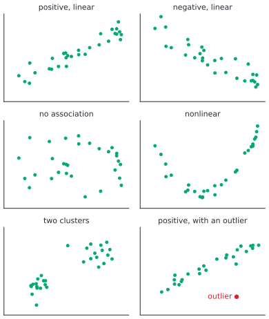
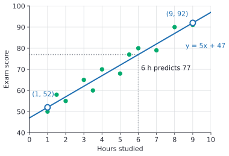
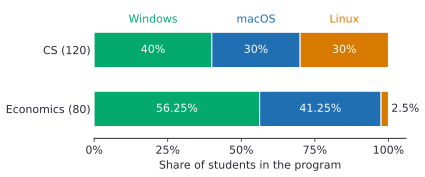
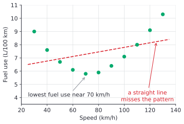

# Scatter plots and two-way tables

After this lesson you can draw and describe a scatter plot, fit a line by eye and use its slope and intercept to make predictions, tell interpolation from extrapolation, explain why an association doesn't prove cause, and read a two-way table with joint, marginal and relative frequencies to decide whether two categorical variables are associated.

Before this: [describing data](01-describing-data.md), [percents](../02-ratios-rates-percents/03-percents.md), [the coordinate plane](../05-linear-relationships-and-functions/01-coordinate-plane.md) and [slope and linear equations](../05-linear-relationships-and-functions/02-slope-and-linear-equations.md).

## Quick check

Try these first. If you get all three right, skip to [Practice](#practice).

1. A line of best fit for the price $y$ of a used car, in thousands of dollars, against its age $x$, in years, is $y = -2.5x + 30$. Predict the price of a 4-year-old car, and say what the slope means. Does the line make sense for a 15-year-old car?
2. Of 40 first-year students, 24 live in residence. Of 20 upper-year students, 4 do. Find the percent of each group that lives in residence. Are year and residence associated?
3. Cities with more public libraries have more car accidents. Does building libraries cause accidents? Name a variable that could explain the pattern.

<details class="solution" markdown>
<summary>Answers</summary>

1. Substitute $x = 4$: $y = -2.5 \times 4 + 30 = 20$, so about \$20,000. The slope says the price drops by about \$2,500 for each extra year of age. At 15 years the line gives $-2.5 \times 15 + 30 = -7.5$, a negative price, so the line doesn't apply that far out.
2. First-years: $24 \div 40 = 60\%$. Upper-years: $4 \div 20 = 20\%$. The percents differ a lot, so year and residence are associated.
3. No. Bigger cities have more people, so they have more libraries and more cars. Population is the confounding variable.

</details>

## The idea

Twelve students record how many hours they studied for an exam and the score they got. Each student gives a pair of numbers, such as 3 hours and 65 points. Plot each pair as a point, with hours across and score up, and the twelve points show at a glance what a table of numbers hides: the points drift upward to the right. More study tends to go with higher scores, though not perfectly. One student who studied 3.5 hours scored lower than one who studied 3.

When the points lie roughly along a line, a line drawn through them summarizes the pattern. Its slope says how many points a typical extra hour is worth, and the line can predict a score for a number of hours nobody in the group studied. That works inside the range of the data. Far outside it, the line can predict scores above 100, which is the line's problem, not the student's.

The same question, "do these two variables go together?", comes up for categories too. Do CS students and economics students choose different laptops? Here the data is counts, not points, and the tool is a two-way table, with one variable across the top and the other down the side. Comparing percents within each row answers the question, as long as each percent is taken of the right whole.

## Definitions

**Bivariate data** are pairs of values $(x, y)$ of two numerical variables measured on the same individuals, such as hours studied and exam score for each student.

A **scatter plot** draws each pair as a point on the coordinate plane. The **explanatory variable** goes on the horizontal axis, and the **response variable**, the one you expect to depend on it, goes on the vertical axis. When neither explains the other, either can go across.

Two variables have an **association** when knowing one tells you something about the other. The association is **positive** when larger values of one go with larger values of the other, so the points rise from left to right. It is **negative** when larger values of one go with smaller values of the other, so the points fall. When the points show no trend up or down, there is **no association**.

An association is **linear** when the points lie roughly along a straight line, and **nonlinear** when they follow a curve. It is strong when the points lie close to the line or curve, and weak when they are loosely scattered around it.

A **cluster** is a group of points that sit close together, apart from the rest. An **outlier** in a scatter plot is a point that lies far from the overall pattern. A point can be an outlier without having an unusual $x$ or $y$ on its own: a tall person with short arms is unusual only as a pair.



A **line of best fit** (or trend line) is a straight line that models a linear association, passing through the middle of the points. Drawn by eye, it should follow the trend with about as many points above it as below. Its equation $y = mx + b$ has slope $m$, the predicted change in $y$ for each increase of 1 in $x$, and intercept $b$, the predicted $y$ when $x = 0$.

Using the line inside the range of the $x$ values in the data is **interpolation**. Using it outside that range is **extrapolation**, which is much riskier, because nothing in the data says the pattern continues.

In plain words: interpolation fills a gap between points you have, and extrapolation guesses beyond the last point.

**Correlation** is a measure of how strong a linear association is; university statistics measures it with a number $r$ from $-1$ to 1. **Causation** means that changing one variable changes the other. An association, however strong, doesn't prove causation. A **confounding variable** (or lurking variable) is a third variable that affects both variables you are looking at and can create an association between them. Ice cream sales and sunburns rise and fall together, but neither causes the other; sunny, hot weather drives both.

A **two-way table** shows counts for two categorical variables, one along the rows and one along the columns. Each cell holds a **joint frequency**, the number of individuals with that row category and that column category. The row and column totals in the margins are the **marginal frequencies**.

Dividing a count by a total gives a **relative frequency**. A joint relative frequency divides a cell by the grand total, and a marginal relative frequency divides a margin by the grand total. A **row relative frequency** divides a cell by its row total, and a **column relative frequency** divides it by its column total.

In plain words: each relative frequency is a percent of some whole, and the four kinds differ only in the whole. Row relative frequencies answer "within this row, what share falls in each column?"

Two categorical variables are associated when the row relative frequencies differ from row to row (or, equivalently, the column relative frequencies differ from column to column). If every row splits the same way, there is no association.

## How to do it

### Reading a scatter plot

1. Check what each axis shows, with its units.
2. Describe the direction: positive, negative or no association.
3. Describe the form: linear, or a curve, and whether there are clusters.
4. Describe the strength: points tight around the pattern (strong) or loosely spread (weak).
5. Name any outliers, and say which individuals they are if you know.

### Fitting a line by eye and predicting

1. Draw a straight line through the middle of the points, following the trend. About half the points should lie above it and half below, spread along its length. Don't force it through the first and last points.
2. Pick two points on your line, far apart, where the coordinates are easy to read. They don't have to be data points.
3. Compute the slope from them: $m = \frac{y_2 - y_1}{x_2 - x_1}$.
4. Find the intercept by putting one of the points into $y = mx + b$ and solving for $b$.
5. Interpret the slope and the intercept in words, with units. If $x = 0$ is far outside the data, say that the intercept has no real meaning.
6. To predict, put an $x$ value into the equation. Say whether it is interpolation or extrapolation, and check the prediction against the plot.

### Reading a two-way table

1. Fill in any missing cells and totals by subtracting from the totals you know. Check that the row totals and the column totals both add up to the grand total.
2. Decide what you are comparing. Put the groups you are comparing in the rows, and use row relative frequencies, so each group is measured against its own size.
3. Divide each cell by its row total. Each row of percents should add up to 100%.
4. Compare the rows. If the percents in a column are about the same for every row, there is no association. If they differ a lot, the variables are associated; describe how.
5. Check that the conclusion uses percents, not raw counts.

## Worked examples

<div class="example" markdown>

### Example 1: a line of best fit for study time

Here are the hours studied and the exam scores of the twelve students from [The idea](#the-idea):

| Hours | 1 | 1.5 | 2 | 3 | 3.5 | 4 | 5 | 5.5 | 6 | 7 | 8 | 9 |
|---|---|---|---|---|---|---|---|---|---|---|---|---|
| Score | 50 | 58 | 55 | 65 | 60 | 70 | 68 | 77 | 80 | 79 | 90 | 91 |

Fit a line by eye, interpret it, and predict the scores for 6 hours and for 20 hours of study.

The scatter plot shows a strong, positive, linear association with no outliers. Step 1: draw a line through the middle of the points. The one in the figure has 6 points above it and 6 below, spread along its length.



Step 2: the line passes through $(1, 52)$ and $(9, 92)$. Neither is a data point, and that is fine; they are points on the line, chosen far apart.

Step 3: the slope is

$$
m = \frac{92 - 52}{9 - 1} = \frac{40}{8} = 5.
$$

Step 4: put $(1, 52)$ into $y = 5x + b$: $52 = 5 \times 1 + b$, so $b = 47$. The line is $y = 5x + 47$.

<div class="warning" markdown>

Watch out at Step 2: the slope from two data points that happen to sit off the line, such as $(1, 50)$ and $(3.5, 60)$, gives $\frac{10}{2.5} = 4$, a line too shallow for the rest of the data. Read the two points off your drawn line, not off the dots.

</div>

Step 5: the slope means each extra hour of study goes with about 5 more points on the exam, for these students. The intercept says a student who studied 0 hours would score about 47. Nobody in the data studied less than 1 hour, so that is a mild extrapolation; treat it as a rough guess.

Step 6: for 6 hours, $y = 5 \times 6 + 47 = 77$. That is interpolation, since 6 is between 1 and 9, and it matches the plot: the students who studied 5.5 and 6 hours scored 77 and 80. For 20 hours, $y = 5 \times 20 + 47 = 147$, on an exam out of 100. That is extrapolation, far past the largest $x$ in the data, and it fails: the trend has to level off before 100.

Check: put the other point back in, $5 \times 9 + 47 = 92$. A computer's least-squares line for these data, from [In code](#in-code), is about $y = 5.05x + 46.9$, very close to ours.

</div>

<div class="example" markdown>

### Example 2: laptops in two programs

A survey asks 200 students their program and their laptop's operating system:

| | Windows | macOS | Linux | Total |
|---|---|---|---|---|
| CS | 48 | 36 | 36 | 120 |
| Economics | 45 | 33 | 2 | 80 |
| Total | 93 | 69 | 38 | 200 |

Are program and operating system associated?

The raw counts mislead. Windows has 48 CS users and 45 economics users, which looks like a tie, but there are 120 CS students and only 80 in economics. Steps 2 and 3: divide each cell by its row total.

| | Windows | macOS | Linux | Total |
|---|---|---|---|---|
| CS | 40% | 30% | 30% | 100% |
| Economics | 56.25% | 41.25% | 2.5% | 100% |

Step 4: the rows split very differently. Linux is 30% of CS students and 2.5% of economics students, and Windows and macOS are each more common in economics. So the variables are associated. The bar chart shows the two rows on the same 100% scale:



Other relative frequencies answer other questions. The joint relative frequency of "CS and Linux" is $36 \div 200 = 18\%$ of all students. The marginal relative frequency of CS is $120 \div 200 = 60\%$. The column relative frequency $36 \div 38 \approx 94.7\%$ says that almost all Linux users here are in CS.

Check: each row of percents adds to 100%, and the column totals add to $93 + 69 + 38 = 200$.

</div>

<div class="example" markdown>

### Example 3: a strong pattern that isn't a line

A driver measures her car's fuel use at steady speeds:

| Speed (km/h) | 30 | 40 | 50 | 60 | 70 | 80 | 90 | 100 | 110 | 120 | 130 |
|---|---|---|---|---|---|---|---|---|---|---|---|
| Fuel use (L/100 km) | 9.0 | 7.6 | 6.7 | 6.1 | 5.8 | 5.9 | 6.4 | 7.1 | 8.0 | 9.1 | 10.3 |

Describe the association.

The points fall and then rise, forming a U. That is a strong nonlinear association: the car uses the least fuel near 70 km/h and more at lower and higher speeds.



A straight line is the wrong model here. The dashed least-squares line rises gently, which would suggest that fuel use slowly increases with speed and would predict badly at both ends. "Weak linear association" would be a wrong summary too: knowing the speed tells you the fuel use quite precisely, just not through a line.

Check: the data agree with the description. From 30 to 70 km/h each value is smaller than the last, and from 80 km/h on each is bigger.

</div>

<div class="example" markdown>

### Example 4: coffee and handedness (finish it yourself)

A survey of 200 people finds 20 left-handed people, 12 of whom drink coffee daily, and 120 daily coffee drinkers in all. Is handedness associated with drinking coffee?

Step 1: fill in the table by subtracting. There are $200 - 20 = 180$ right-handed people and $120 - 12 = 108$ right-handed coffee drinkers. The rest follow the same way:

| | Coffee | No coffee | Total |
|---|---|---|---|
| Left-handed | 12 | 8 | 20 |
| Right-handed | 108 | 72 | 180 |
| Total | 120 | 80 | 200 |

Now do Steps 3 and 4: find the percent of each row that drinks coffee, and decide.

<details class="solution" markdown>
<summary>Finish</summary>

Left-handed: $12 \div 20 = 60\%$. Right-handed: $108 \div 180 = 60\%$. The two rows split the same way, so in this survey handedness and coffee drinking are not associated. The overall rate is also $120 \div 200 = 60\%$, as it must be when every row matches.

Check: the raw counts, 12 and 108, look very different, but only because there are nine times as many right-handed people. Step 5 is why you compare percents.

</details>

</div>

## Edge cases and common mistakes

Reading two points off the dots instead of the line is flagged in Example 1, and mistaking a curve for a weak line in Example 3. Here are the others.

<div class="warning" markdown>

Watch out: association is not causation. Across cities, the number of libraries and the number of car accidents tend to rise together, because both grow with population. Before you say "$x$ causes $y$", ask what third variable could drive both. To compare cities fairly, divide by population first: accidents per 100,000 people, libraries per 100,000 people. A cause is shown by an experiment that changes $x$ on purpose and holds everything else fixed, not by a scatter plot.

</div>

<div class="warning" markdown>

Watch out: extrapolation. The study line predicts 147 out of 100 for 20 hours, and the car-price line in the Quick check predicts a negative price at 15 years. A line of best fit describes the data you have; outside the range of $x$ it is a guess, and often a bad one.

</div>

<div class="warning" markdown>

Watch out: comparing counts instead of percents in a two-way table. When the rows have different totals, the counts say more about the group sizes than about the association. Example 2's Windows counts, 48 and 45, look equal, while the percents, 40% and 56.25%, are not.

</div>

<div class="warning" markdown>

Watch out: row and column percents answer different questions. In Example 2, "what percent of CS students use Linux?" is $36 \div 120 = 30\%$, and "what percent of Linux users are in CS?" is $36 \div 38 \approx 94.7\%$. Both are correct answers to their own question. Say the whole in words before you divide, the same habit as in [percents](../02-ratios-rates-percents/03-percents.md).

</div>

"No association" means no trend, not no relationship. The fuel data in Example 3 have a weak linear trend but a strong curved relationship. Always look at the plot before summing up an association with a word or a number.

An outlier can tilt a line of best fit, especially if it sits at the far left or right. If one point is far off the pattern, draw the line through the rest, and mention the outlier separately.

With very few points, a pattern can appear by chance. Three points almost always look like some kind of trend. Twelve points, as in Example 1, are more convincing, and university statistics measures how convincing in correlation and linear regression<!-- link: ../../05-university-core/08-statistics/04-correlation-and-linear-regression.md -->.

## Tricks and shortcuts

Choose the two points for the slope where the line crosses grid lines, so both coordinates are round numbers, and as far apart as the plot allows. Small reading errors matter less over a long run.

The units of the slope are "units of $y$ per unit of $x$": points per hour, dollars per year, litres per kilometre. Saying the slope with its units is the quickest way to interpret it.

A line of best fit drawn by eye should split the points roughly in half, with the points above and below spread along the line, not all the "above" ones at one end. If all the points at the left sit above the line and all those at the right sit below, rotate it.

In a two-way table, one missing cell in a row or column can always be found by subtracting from the total. Fill in the totals first, then the cells.

For a quick association check, compare one column's row percents. If 60% of left-handers and 60% of right-handers drink coffee, there is no association; if the shares were 60% and 30%, there would be.

## In code

NumPy's `polyfit` finds the least-squares line, the standard "best" line that later lessons derive. The second part computes row relative frequencies for Example 2.

<details class="code" markdown>
<summary>In code</summary>

```python
import numpy as np

hours = [1, 1.5, 2, 3, 3.5, 4, 5, 5.5, 6, 7, 8, 9]
scores = [50, 58, 55, 65, 60, 70, 68, 77, 80, 79, 90, 91]

slope, intercept = np.polyfit(hours, scores, 1)   # least-squares line
print(round(slope, 2), round(intercept, 2))       # 5.05 46.92

by_eye = [5 * x + 47 for x in hours]
above = sum(1 for y, fit in zip(scores, by_eye) if y > fit)
print(above, len(hours) - above)                  # 6 6

table = {"CS": [48, 36, 36], "Economics": [45, 33, 2]}   # Windows, macOS, Linux
for program, counts in table.items():
    total = sum(counts)
    print(program, [round(100 * c / total, 1) for c in counts])
# CS [40.0, 30.0, 30.0]
# Economics [56.2, 41.2, 2.5]
```

The least-squares line, $y \approx 5.05x + 46.92$, is close to the line by eye, $y = 5x + 47$. In the last line Python prints 56.2 and 41.2 for 56.25 and 41.25: when a value is exactly halfway, `round` picks the neighbour whose last digit is even. The [percents](../02-ratios-rates-percents/03-percents.md#in-code) lesson shows other surprises with `round`.

</details>

## FAQ

### How do I know if my line by eye is right?

There is no single right line by eye; two people will draw slightly different ones, and both are fine if they follow the trend and split the points. The standard choice is the least-squares line, which makes the total of the squared vertical distances from the points to the line as small as possible. You compute it in correlation and linear regression<!-- link: ../../05-university-core/08-statistics/04-correlation-and-linear-regression.md -->, and a spreadsheet's "trendline" option draws it.

### What is the correlation coefficient?

It is a number $r$ from $-1$ to 1 that measures the direction and strength of a linear association. Values near 1 mean a strong positive linear association, values near $-1$ a strong negative one, and values near 0 no linear association. For Example 1, $r \approx 0.97$. For the U-shaped fuel data, $r \approx 0.38$, a low value that hides a strong curved pattern, which is why you look at the plot first.

### If association doesn't prove causation, how does anyone show a cause?

With a randomized experiment: assign the explanatory variable at random, so that confounders such as motivation or population even out between the groups. If the groups then differ in the response, the explanatory variable is the likely cause. When an experiment is impossible or unethical, as with smoking, researchers combine many studies and control for known confounders. Study design is in descriptive statistics and study design<!-- link: ../../05-university-core/08-statistics/01-descriptive-statistics-and-study-design.md -->.

### Should the groups go in the rows or the columns?

Either works, as long as you divide by the totals of the groups you are comparing. This lesson puts the groups in the rows and uses row percents, so each row adds to 100%. If a table puts them in the columns, use column percents instead.

## Practice

### Warm-up

1\. Describe the association you would expect between (a) the age of a car and its resale price, (b) shoe size and final exam mark, (c) height and arm span, (d) the day of the year and the hours of daylight in Toronto, over a whole year.

<details class="solution" markdown>
<summary>Solution</summary>

- (a) Negative: older cars sell for less.
- (b) No association: foot size tells you nothing about an exam mark.
- (c) Positive and linear, and strong: taller people have longer arm spans, roughly in proportion.
- (d) Nonlinear: daylight rises from January to a peak in late June, then falls to December. The pattern is strong but not a line.

Check: each answer names a direction or says there is none, and (d) names the form, because direction alone doesn't describe a curve.

</details>

2\. A line of best fit predicting a final exam mark $y$ from a midterm mark $x$ is $y = 0.8x + 12$, from data with midterm marks between 40 and 95. (a) Predict the final mark for a midterm mark of 70. (b) What does the slope mean? (c) Does the intercept mean anything here?

<details class="solution" markdown>
<summary>Solution</summary>

(a) $y = 0.8 \times 70 + 12 = 68$. This is interpolation, since 70 is between 40 and 95.

(b) Each extra point on the midterm goes with about 0.8 of a point more on the final.

(c) The intercept, 12, is the prediction for a midterm mark of 0. No midterm mark in the data is below 40, so that is extrapolation, and the intercept has no real meaning here.

Check: $68 - 12 = 56$ and $56 \div 0.8 = 70$, which gives back the midterm mark.

</details>

3\. A survey of 80 students records year and whether they ate breakfast that day:

| | Breakfast | No breakfast | Total |
|---|---|---|---|
| First year | 18 | 22 | 40 |
| Upper year | 26 | 14 | 40 |
| Total | 44 | 36 | 80 |

Find (a) the joint frequency of upper-years who skipped breakfast, (b) the marginal relative frequency of breakfast eaters, (c) the joint relative frequency of first-years who ate breakfast.

<details class="solution" markdown>
<summary>Solution</summary>

- (a) Read the cell: 14 upper-years skipped breakfast.
- (b) A margin divided by the grand total: $44 \div 80 = 0.55$, which is 55%.
- (c) A cell divided by the grand total: $18 \div 80 = 0.225$, which is 22.5%.

Check: the margins add up, since $44 + 36 = 80$ and $40 + 40 = 80$.

</details>

### Standard

4\. A café records daily hot chocolate sales against the outdoor temperature, on days from $-15$ °C to 25 °C. A line of best fit passes through $(-10, 180)$ and $(20, 30)$. (a) Find its equation. (b) Interpret the slope. (c) Predict sales at 5 °C and at 35 °C, and comment on each.

<details class="solution" markdown>
<summary>Solution</summary>

(a) The slope is

$$
m = \frac{30 - 180}{20 - (-10)} = \frac{-150}{30} = -5.
$$

Put $(20, 30)$ into $y = -5x + b$: $30 = -100 + b$, so $b = 130$. The line is $y = -5x + 130$.

(b) Each degree warmer goes with about 5 fewer hot chocolates sold per day.

(c) At 5 °C, $y = -5 \times 5 + 130 = 105$ hot chocolates, an interpolation inside the data's range. At 35 °C, $y = -5 \times 35 + 130 = -45$, which is impossible. That is extrapolation beyond the warmest day in the data, 25 °C, and the line no longer applies.

Check: the other point fits too, since $-5 \times (-10) + 130 = 180$.

</details>

5\. A survey of 250 students asks whether they live more than 5 km from campus and whether they buy a transit pass:

| | Pass | No pass | Total |
|---|---|---|---|
| More than 5 km | 72 | 18 | 90 |
| 5 km or less | 48 | 112 | 160 |
| Total | 120 | 130 | 250 |

(a) What percent of students living more than 5 km away buy a pass? (b) What percent of those living 5 km or less buy one? (c) What percent of pass buyers live more than 5 km away? (d) Are distance and buying a pass associated?

<details class="solution" markdown>
<summary>Solution</summary>

- (a) A row percent, with the far row as the whole: $72 \div 90 = 0.8$, which is 80%.
- (b) The near row is the whole: $48 \div 160 = 0.3$, which is 30%.
- (c) A column percent, with the pass buyers as the whole: $72 \div 120 = 0.6$, which is 60%.
- (d) Yes. Students who live far away buy passes at 80%, compared with 30% for those nearby.

Parts (a) and (c) use the same cell, 72, but different wholes, so they answer different questions.

Check: the rows add up, $72 + 18 = 90$ and $48 + 112 = 160$, and $90 + 160 = 250$.

</details>

6\. For each claim, name a likely confounding variable and suggest a fairer comparison. (a) Towns with more doctors have more deaths each year. (b) Students who own more textbooks get higher marks. (c) Days with high ice cream sales have more drownings.

<details class="solution" markdown>
<summary>Solution</summary>

- (a) Population: bigger towns have more doctors and more deaths. Compare death rates per 1,000 people instead of totals, ideally also adjusted for age.
- (b) Program and motivation, among others: students in demanding programs and students who work harder may both buy more books and earn higher marks. Compare students in the same course, or run an experiment that gives books at random.
- (c) Hot weather: on hot days more people buy ice cream and more people swim. Compare days with the same temperature.

Check: in each case, the confounder affects both variables in the claim, which is what makes it a confounder rather than just another variable.

</details>

### Challenge

7\. At a university, 400 first-year and upper-year students are surveyed. 45% are in first year. Of the first-years, 60% live in residence; of the others, 10% do. (a) Build the two-way table. (b) What percent of residence students are first-years? (c) What percent of all the students live in residence?

<details class="solution" markdown>
<summary>Solution</summary>

(a) There are $0.45 \times 400 = 180$ first-years and $400 - 180 = 220$ others. In residence: $0.6 \times 180 = 108$ first-years and $0.1 \times 220 = 22$ others. The rest of each row lives off campus.

| | Residence | Off campus | Total |
|---|---|---|---|
| First year | 108 | 72 | 180 |
| Upper year | 22 | 198 | 220 |
| Total | 130 | 270 | 400 |

(b) A column percent, with the residence students as the whole: $108 \div 130 = 0.8307\ldots$, about 83.1%.

(c) A marginal relative frequency: $130 \div 400 = 0.325$, which is 32.5%.

The 60% in the question and the 83.1% in (b) use the same 108 students but different wholes: 60% of first-years live in residence, while 83.1% of residence students are first-years.

Check: $108 + 72 = 180$, $22 + 198 = 220$, and $130 + 270 = 400$.

</details>

8\. (Reviews [proportional relationships](../02-ratios-rates-percents/02-proportional-relationships.md).) A line of best fit for monthly phone bills $y$, in dollars, against data used $x$, in GB, passes through $(2, 45)$ and $(10, 85)$. (a) Find its equation. (b) What do the slope and the intercept mean? (c) Is the bill proportional to the data used? (d) Predict the bill for 6 GB.

<details class="solution" markdown>
<summary>Solution</summary>

(a) The slope is $\frac{85 - 45}{10 - 2} = \frac{40}{8} = 5$. From $45 = 5 \times 2 + b$, the intercept is $b = 35$, so $y = 5x + 35$.

(b) The slope says each extra GB adds about \$5 to the bill. The intercept, \$35, is like a base fee, the bill for 0 GB.

(c) No. A proportional relationship has the form $y = kx$, a line through the origin, and this line crosses the $y$-axis at 35. Doubling the data from 2 GB to 4 GB raises the bill from \$45 to \$55, not to \$90.

(d) $y = 5 \times 6 + 35 = 65$, so about \$65. It is interpolation, between 2 and 10 GB.

Check: the second point fits, since $5 \times 10 + 35 = 85$.

</details>

## Where this shows up

- Correlation and linear regression<!-- link: ../../05-university-core/08-statistics/04-correlation-and-linear-regression.md --> computes the correlation coefficient and the least-squares line, and orthogonality, projections and least squares<!-- link: ../../05-university-core/06-linear-algebra/07-orthogonality-projections-and-least-squares.md --> shows why that line is the best. Two-way tables lead to conditional probability and Bayes' theorem<!-- link: ../../05-university-core/07-probability/02-conditional-probability-and-bayes.md -->, where a row percent becomes a probability "given" the row.
- In CS, a fitted line is the simplest machine-learning model, and A/B tests compare two versions of a page with a two-way table of version against outcome (clicked or not).
- Economics estimates relationships such as demand against price, and spends much of its effort on confounders, in regression and econometrics intuition<!-- link: ../../07-economics-math/04-more-tools/03-regression-and-econometrics-intuition.md -->.
