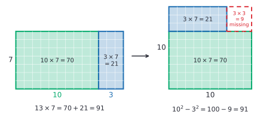

# Mental multiplication and division

After this lesson you can multiply two-digit numbers in your head by splitting them, multiply by 5, 25, 9 and 11 with shortcuts, multiply and square numbers near a round number, and divide by 5, 25 and by factors in steps.

Before this: [multiplication and times tables](../../01-elementary/03-multiplication-and-times-tables.md), [properties of operations](../../01-elementary/04-properties-of-operations.md), [multi-digit multiplication](../../01-elementary/05-multi-digit-multiplication.md), [division facts and remainders](../../01-elementary/06-division-facts-and-remainders.md), [equivalent expressions](../03-expressions-equations-inequalities/02-equivalent-expressions.md) and [Mental addition and subtraction](01-mental-addition-and-subtraction.md).

## Quick check

Try these first. If you get all three right, skip to [Practice](#practice).

1. Work out $46 \times 25$ and $87 \times 11$.
2. Work out $47 \times 53$ and $96^2$.
3. Work out $1{,}344 \div 12$ and $2{,}350 \div 25$.

<details class="solution" markdown>
<summary>Answers</summary>

1. $46 \times 25 = 4{,}600 \div 4 = 1{,}150$, since 25 is 100 divided by 4. And $87 \times 11 = 870 + 87 = 957$.
2. $47 \times 53 = 50^2 - 3^2 = 2{,}500 - 9 = 2{,}491$, because the two numbers are 3 below and 3 above 50. And $96^2 = 100 \times 92 + 4^2 = 9{,}200 + 16 = 9{,}216$.
3. Divide by 4 and then by 3: $1{,}344 \div 4 = 336$ and $336 \div 3 = 112$. For the second, multiply by 4 and divide by 100: $9{,}400 \div 100 = 94$.

</details>

## The idea

How many tiles cover a floor 47 tiles wide and 68 tiles long? On paper you write four partial products and carry. In your head you split one number and keep a running total: $68 \times 47 = 68 \times 40 + 68 \times 7 = 2{,}720 + 476 = 3{,}196$. The four pieces of the paper method are still there, because splitting 68 as well gives a grid of four products:

| | 60 | 8 |
|---|---|---|
| 40 | 2,400 | 320 |
| 7 | 420 | 56 |

The grid adds to $2{,}400 + 320 + 420 + 56 = 3{,}196$. The difference is that you never write the grid. You add each piece to the running total from [mental addition and subtraction](01-mental-addition-and-subtraction.md) as soon as you have it.

The second idea is that a few numbers are friends of the powers of ten: $5 = 10 \div 2$, $25 = 100 \div 4$, $9 = 10 - 1$ and $11 = 10 + 1$. Multiplying by a friend takes a shift of the decimal point and one small step. The third idea is symmetry: two numbers the same distance below and above a round number multiply to the round number's square minus a small square, so $47 \times 53$ is $50^2 - 3^2$.

All three come from the distributive property, so each method below ends with one line saying why it works.

## Definitions

The distributive property from [properties of operations](../../01-elementary/04-properties-of-operations.md#distributive-property) does the work in this lesson. For all numbers $a$, $b$ and $c$,

$$
a(b + c) = ab + ac \qquad \text{and} \qquad a(b - c) = ab - ac.
$$

In plain words, a product can be split along a sum or a difference in either factor.

A **partial product** is the product of one piece of one factor and one piece of the other, such as $40 \times 8$ in $47 \times 68$. The product is the sum of the partial products: $(a + b)(c + d) = ac + ad + bc + bd$, with four partial products. In plain words, every piece of the first number meets every piece of the second.

A **friendly factor** is a factor whose product with a number $n$ comes quickly from $n$ times a power of ten. The numbers 5, 25 and 125 divide a power of ten, and 9, 11 and 99 are one away from 10 or 100. In plain words, multiplying by it takes a shift of the decimal point and one small step.

To **halve and double** is to replace a product $ab$ by $\frac{a}{2} \times 2b$, which has the same value. In plain words, if you halve one factor and double the other, the product doesn't change.

The **difference of squares** is the identity

$$
(m - d)(m + d) = m^2 - d^2,
$$

true for all numbers $m$ and $d$. In plain words, two numbers the same distance $d$ below and above $m$ multiply to $m^2$ minus $d^2$. It is proved below, and [factoring polynomials](../../03-high-school/04-radicals-and-polynomials/03-factoring-polynomials.md#the-factoring-identities) reads it backwards.

## How to do it

### Splitting a product

1. Choose the factor to split: usually the smaller one, or one that is a little off a round number, such as $98 = 100 - 2$.
2. Split it by place value, or as a round number plus or minus a small amount.
3. Multiply the other factor by each piece, largest piece first.
4. Add the partial products to a running total, left to right. A piece that was subtracted is subtracted.
5. Check the answer (the same three checks as in the last lesson work for products).

Why it works: $a(b + c) = ab + ac$. For $6 \times 47$, split 47 into $40 + 7$ and add $6 \times 40 = 240$ and $6 \times 7 = 42$ to get 282. For $47 \times 98$, split 98 as $100 - 2$: $4{,}700 - 94 = 4{,}606$.

A two-digit number times a two-digit number takes two of these: split one factor into tens and ones, so the job becomes two products of a two-digit number with a single digit, and each of those can be split again. In $68 \times 40$, first find $68 \times 4 = 240 + 32 = 272$ and then attach the zero.

### Friendly factors

| Multiply by | Do this | Why it works | Example |
|---|---|---|---|
| $4$ | double twice | $4 = 2 \times 2$ | $37 \times 4$: 74, then 148 |
| $8$ | double three times | $8 = 2 \times 2 \times 2$ | $37 \times 8$: 74, 148, 296 |
| $5$ | multiply by 10, then halve | $5 = 10 \div 2$ | $68 \times 5$: 680, then 340 |
| $25$ | multiply by 100, then halve twice | $25 = 100 \div 4$ | $36 \times 25$: 3,600, 1,800, then 900 |
| $125$ | multiply by 1,000, then halve three times | $125 = 1{,}000 \div 8$ | $48 \times 125$: 48,000, 24,000, 12,000, then 6,000 |
| $9$ | multiply by 10, then subtract the number | $9 = 10 - 1$ | $47 \times 9 = 470 - 47 = 423$ |
| $99$ | multiply by 100, then subtract the number | $99 = 100 - 1$ | $47 \times 99 = 4{,}700 - 47 = 4{,}653$ |
| $11$ | multiply by 10, then add the number | $11 = 10 + 1$ | $68 \times 11 = 680 + 68 = 748$ |
| $15$ | multiply by 10, then add half of that | $15n = 10n + 5n$, and $5n$ is half of $10n$ | $46 \times 15 = 460 + 230 = 690$ |
| $75$ | multiply by 100, then take away a quarter of that | $75n = 100n - 25n$ | $84 \times 75 = 8{,}400 - 2{,}100 = 6{,}300$ |

Halve after multiplying by 10 or 100, not before. The product $10n$ is always even, so the half is a whole number even when $n$ is odd: $37 \times 5$ is half of 370, which is 185.

The two-digit case of $\times 11$ has a quicker form. For a number with tens digit $a$ and ones digit $b$, we have $11 \times (10a + b) = 100a + 10(a + b) + b$. So write $a$, then $a + b$, then $b$, and carry when $a + b$ is 10 or more. The [times tables lesson](../../01-elementary/03-multiplication-and-times-tables.md#tricks-and-shortcuts) covers the case $a + b \le 9$, such as $43 \times 11 = 473$. For $68 \times 11$ the digits are 6, then $6 + 8 = 14$, then 8. The 14 puts a 4 in the tens place and carries 1 into the hundreds, so $6 + 1 = 7$ and the answer is 748.

### Halving and doubling

1. Pick the even factor and halve it.
2. Double the other factor.
3. Repeat until one factor is a number you can multiply easily, such as 10, 100 or a single digit.

Why it works: $\frac{a}{2} \times 2b = a \times b$, by the associative property, as the [properties lesson](../../01-elementary/04-properties-of-operations.md#tricks-and-shortcuts) shows for $16 \times 25$. For $35 \times 18$, halve 18 and double 35: $70 \times 9 = 630$. For $45 \times 16$, halve 16 three times while doubling 45: $90 \times 8 = 180 \times 4 = 360 \times 2 = 720$. If neither factor is even, split off one copy first: $35 \times 17 = 35 \times 16 + 35 = 560 + 35 = 595$.

### Numbers the same distance from a round number

The picture shows $13 \times 7$, where 13 and 7 are 3 above and 3 below 10. The rectangle is cut so that a strip 3 wide, from its right end, is moved on top of the rest. The pieces make a $10 \times 10$ square with a $3 \times 3$ corner missing.



*Theorem (difference of squares).* For all numbers $m$ and $d$, $(m - d)(m + d) = m^2 - d^2$.

What we know: the distributive property. What we want: the product of two numbers the same distance below and above $m$. The plan is to treat $m - d$ as one number, distribute it over $m + d$, and then distribute again.

Proof.

$$
\begin{aligned}
(m - d)(m + d) &= (m - d)m + (m - d)d \\
&= m^2 - dm + md - d^2 \\
&= m^2 - d^2.
\end{aligned}
$$

The two middle terms cancel because $dm = md$. $\blacksquare$

Look back. In the picture with $m = 10$ and $d = 3$, the green block is $m(m - d) = 70$ and the strip is $d(m - d) = 21$, and the missing corner is $d \times d = 9$, so $70 + 21 + 9 = 100 = m^2$. The picture needs $m > d > 0$, and the algebra works for every number.

To use it:

1. Add the two numbers and halve the sum to find $m$. For 47 and 53 the sum is 100, so $m = 50$.
2. Find $d$, the distance from $m$ to either number: $50 - 47 = 3$.
3. Work out $m^2 - d^2$. A round $m$ makes $m^2$ easy, and $d^2$ is small: $2{,}500 - 9 = 2{,}491$.
4. Check the answer: the last digits give $7 \times 3 = 21$, so it ends in 1, and the size is near $50 \times 50 = 2{,}500$.

### Squaring a number

Rearranging the identity gives a rule for any square: $n^2 = (n - d)(n + d) + d^2$. Choose $d$ so that $n - d$ or $n + d$ is round. For $67^2$, take $d = 7$: $67^2 = 60 \times 74 + 49 = 4{,}440 + 49 = 4{,}489$. For $35^2$, take $d = 5$: $30 \times 40 + 25 = 1{,}225$, which is the squares-ending-in-5 trick from [exponents and order of operations](../01-integers-and-rational-numbers/04-exponents-and-order-of-operations.md).

Two patterns are worth knowing. Near 50, $(50 + d)^2 = 100(25 + d) + d^2$, and near 100, $(100 + d)^2 = 100(100 + 2d) + d^2$. Both hold for a negative $d$ too, which covers numbers below the round one. In words: add $d$ to 25 (or $2d$ to 100), and put $d^2$ after it as two digits.

Why they work: by the distributive property, $(m + d)^2 = (m + d)m + (m + d)d = m^2 + 2md + d^2$. Putting $m = 50$ gives $2{,}500 + 100d + d^2$, and putting $m = 100$ gives $10{,}000 + 200d + d^2$. Some cases: $53^2$ has $d = 3$ and gives $100 \times 28 + 9 = 2{,}809$. For $47^2$, $d = -3$ gives $100 \times 22 + 9 = 2{,}209$. For $96^2$, $d = -4$ gives $100 \times 92 + 16 = 9{,}216$. For $103^2$, $d = 3$ gives $100 \times 106 + 9 = 10{,}609$.

### Dividing

| Divide by | Do this | Why it works | Example |
|---|---|---|---|
| $2$, $4$, $8$ | halve once, twice, three times | $4 = 2 \times 2$ and $8 = 2 \times 2 \times 2$ | $184 \div 8$: 92, 46, 23 |
| $5$ | double, then divide by 10 | $\frac{n}{5} = \frac{2n}{10}$ | $135 \div 5$: 270, then 27 |
| $25$ | multiply by 4, then divide by 100 | $\frac{n}{25} = \frac{4n}{100}$ | $2{,}350 \div 25$: 9,400, then 94 |
| $125$ | multiply by 8, then divide by 1,000 | $\frac{n}{125} = \frac{8n}{1000}$ | $3{,}000 \div 125$: 24,000, then 24 |
| a product, such as $12$ or $18$ | divide by each factor in turn | $n \div (ab) = (n \div a) \div b$ | $1{,}344 \div 12$: 336, then 112 |

To divide a number that isn't one of these, split the dividend:

1. Split the dividend into pieces that the divisor goes into easily, such as multiples of the divisor or of 10 times it.
2. Divide each piece.
3. Add the quotients.
4. Check by multiplying the answer by the divisor.

Why it works: dividing by $c$ is multiplying by $\frac{1}{c}$, so $(a + b) \div c = a \div c + b \div c$. For $672 \div 6$, split $672 = 600 + 72$ and add $100 + 12 = 112$. For $952 \div 7$, split $952 = 700 + 252$ and add $100 + 36 = 136$. The split only works for the dividend. Dividing by a sum doesn't split, as [the common mistakes page](../../reference/common-mistakes.md#dividing-by-a-sum-term-by-term) shows.

## Worked examples

<div class="example" markdown>

### Example 1: a two-digit product by splitting

Work out $47 \times 68$ in your head.

Step 1: split 47, the factor with the smaller digits, so each piece multiplies 68 easily.

Step 2: $47 = 40 + 7$.

Step 3: multiply 68 by each piece. For $68 \times 40$, find $68 \times 4 = 240 + 32 = 272$ and attach a zero: 2,720. For $68 \times 7$, find $7 \times 60 = 420$ and $7 \times 8 = 56$, which makes 476.

Step 4: add to a running total, left to right: $2{,}720 + 400 = 3{,}120$, then $3{,}120 + 70 = 3{,}190$, then $3{,}190 + 6 = 3{,}196$.

Step 5: check three ways. The size is near $70 \times 45 = 3{,}150$. The last digits give $8 \times 7 = 56$, so the product ends in 6. For casting out nines, 47 gives $4 + 7 = 11$ and then 2, and 68 gives $6 + 8 = 14$ and then 5, and $2 \times 5 = 10$ gives 1. The product 3,196 gives $3 + 1 + 9 + 6 = 19$, then 10, then 1. The answer passes all three.

</div>

<div class="example" markdown>

### Example 2: four friendly factors

Work out $36 \times 25$, $68 \times 11$, $47 \times 99$ and $46 \times 15$.

For $36 \times 25$: multiply by 100 to get 3,600 and halve twice, 1,800 and then 900. Check: 36 quarters is 9 dollars, which is 900 cents.

For $68 \times 11$: the digits give 6, then $6 + 8 = 14$, then 8. Carry the 1 from the 14, so $6 + 1 = 7$ and the answer is 748. Check: $680 + 68 = 748$.

For $47 \times 99$: $4{,}700 - 47 = 4{,}653$, found as $4{,}700 - 50 + 3$. Check by casting out nines: 99 reduces to 0, so the product must reduce to 0, and $4 + 6 + 5 + 3 = 18$ and then 9, which counts as 0.

For $46 \times 15$: $460 + 230 = 690$. Check: 46 is 4 below 50, so the product is $50 \times 15 - 4 \times 15 = 750 - 60 = 690$.

</div>

<div class="example" markdown>

### Example 3: squares, and a near miss

Work out $53^2$, $96^2$ and $47 \times 54$.

For $53^2$, use the pattern near 50 with $d = 3$: $100 \times (25 + 3) + 3^2 = 2{,}800 + 9 = 2{,}809$. Write $d^2$ as two digits, 09, so that it fills the last two places.

For $96^2$, use the pattern near 100 with $d = -4$: $100 \times (100 - 8) + 16 = 9{,}200 + 16 = 9{,}216$.

For $47 \times 54$, the numbers are 3 below and 4 above 50, so they are not the same distance from it and the difference of squares doesn't apply directly. Use the nearby pair 47 and 53, which does: $47 \times 53 = 2{,}491$. Then 54 is one more than 53, so add one more 47: $2{,}491 + 47 = 2{,}538$.

Check: $47 \times 54 = 47 \times 50 + 47 \times 4 = 2{,}350 + 188 = 2{,}538$. And $53^2$ ends in 9 and $96^2$ in 6, as $3 \times 3$ and $6 \times 6$ require.

</div>

<div class="example" markdown>

### Example 4: dividing in steps, with a remainder

Work out $1{,}344 \div 12$, $2{,}350 \div 25$ and $1{,}003 \div 12$.

For $1{,}344 \div 12$, divide by 4 and then by 3, since $12 = 4 \times 3$: $1{,}344 \div 4 = 336$ and $336 \div 3 = 112$. Check: $112 \times 12 = 1{,}344$, since $112 \times 10 = 1{,}120$ and $112 \times 2 = 224$.

For $2{,}350 \div 25$, multiply by 4 and divide by 100: $9{,}400 \div 100 = 94$. Check: $94 \times 25 = 2{,}350$, because 94 quarters is \$23.50.

For $1{,}003 \div 12$, divide by 4 first: $1{,}003 = 4 \times 250 + 3$, a remainder of 3. Then divide the quotient: $250 = 3 \times 83 + 1$, a remainder of 1. The quotient is 83. The remainder of 1 in the second step counts groups of 4, so the true remainder is $1 \times 4 + 3 = 7$.

Check: $12 \times 83 + 7 = 996 + 7 = 1{,}003$. In symbols, $1{,}003 = 4(3 \times 83 + 1) + 3 = 12 \times 83 + 4 + 3$.

</div>

<div class="example" markdown>

### Example 5: numbers the same distance from 50 (finish it yourself)

Work out $38 \times 62$.

Step 1: add the two numbers, $38 + 62 = 100$, and halve the sum, so $m = 50$.

Step 2: the distance from $m$ to each number is $d = 50 - 38 = 12$, and $62 - 50 = 12$ too.

Steps 3 and 4 are left for you. Work out $m^2 - d^2$, using the fact that $12^2 = 144$, and check the answer another way.

<details class="solution" markdown>
<summary>Finish</summary>

Step 3: $50^2 - 12^2 = 2{,}500 - 144 = 2{,}356$.

Check: $38 \times 62 = 38 \times 60 + 38 \times 2 = 2{,}280 + 76 = 2{,}356$. The last digits agree, since $8 \times 2 = 16$ ends in 6.

</details>

</div>

## Edge cases and common mistakes

<div class="warning" markdown>

Watch out for missing partial products. A two-digit times a two-digit number has four of them. Writing $47 \times 68 = 40 \times 60 + 7 \times 8 = 2{,}456$ keeps only two and drops $40 \times 8 = 320$ and $7 \times 60 = 420$. The size check catches it: $2{,}456$ is far below $70 \times 45 = 3{,}150$. The right total is $2{,}400 + 320 + 420 + 56 = 3{,}196$.

</div>

<div class="warning" markdown>

Watch out for the carry in $\times 11$. For $68 \times 11$, writing the digits 6, 14, 8 side by side gives 6148, which is nearly ten times too big. The 14 is two digits, so its 1 must be added to the 6: the answer is 748. Check: $68 \times 11$ is about $70 \times 10 = 700$.

</div>

<div class="warning" markdown>

Watch out when using the difference of squares. The numbers must be the same distance from $m$, one below and one above: 47 and 54 are not. Also $m^2 - d^2$ is not $(m - d)^2$. Here $50^2 - 3^2 = 2{,}491$, while $47^2 = 2{,}209$.

</div>

<div class="warning" markdown>

Watch out for dividing by a sum term by term. For $240 \div 12$, splitting the divisor as $12 = 10 + 2$ gives $240 \div 10 + 240 \div 2 = 24 + 120 = 144$, which is wrong. The right answer is 20, from $240 \div 4 = 60$ and $60 \div 3 = 20$. Split the dividend, not the divisor, or divide by the factors of the divisor in turn.

</div>

<div class="warning" markdown>

Watch out for the missing zero in a square near 50 or 100. For $53^2$, the pattern gives $100 \times 28 + 9$, and writing 28 next to 9 gives 289. The 9 belongs in the last two places as 09, so the answer is 2,809. Check: $53^2$ is a little over $50^2 = 2{,}500$.

</div>

## Tricks and shortcuts

Know the squares from 11 to 25. They give the $d^2$ in the difference of squares when $d$ is bigger than 9, as in $38 \times 62$, and each one is a check for a nearby product.

| $n$ | 11 | 12 | 13 | 14 | 15 | 16 | 17 | 18 | 19 | 20 | 21 | 22 | 23 | 24 | 25 |
|---|---|---|---|---|---|---|---|---|---|---|---|---|---|---|---|
| $n^2$ | 121 | 144 | 169 | 196 | 225 | 256 | 289 | 324 | 361 | 400 | 441 | 484 | 529 | 576 | 625 |

When two numbers have the same tens digit and their ones digits add to 10, multiply the tens digit by one more than itself, and put the product of the ones digits after it as two digits. For $43 \times 47$, that is $4 \times 5 = 20$ and $3 \times 7 = 21$, so 2,021. For $68 \times 62$, it is $6 \times 7 = 42$ and $8 \times 2 = 16$, so 4,216. This is the difference of squares in disguise: $43 \times 47 = 45^2 - 2^2 = 2{,}025 - 4$. Practice problem 7 proves it.

## In code

The generator below picks one of five tricks for each problem, and the checker names the trick when an answer is wrong. It uses `random.Random(12)`, so the six problems are the same on every run. To practise with your own typing, call `quiz(problems)` with no `replies`.

<details class="code" markdown>
<summary>In code</summary>

```python
import random

def make_problems(seed, n=6):
    rng = random.Random(seed)
    factors = {"x5": 5, "x25": 25, "x9": 9, "x11": 11}
    problems = []
    for _ in range(n):
        kind = rng.choice([*factors, "near"])
        d = rng.randint(1, 9)
        a, b = (50 - d, 50 + d) if kind == "near" else (rng.randint(12, 98), factors[kind])
        problems.append((f"{a} x {b}", a * b, kind))
    return problems

def quiz(problems, replies=None):
    score = 0
    for i, (text, answer, kind) in enumerate(problems):
        reply = replies[i] if replies else input(f"{text} = ")
        right = reply.strip().replace(",", "") == str(answer)
        score += right
        print(f"{text} = {reply}", "right" if right else f"wrong, it is {answer} (trick: {kind})")
    print(f"score: {score} out of {len(problems)}")

problems = make_problems(seed=12)
quiz(problems, replies=["1,056", "2,464", "325", "433", "903", "340"])
```

The run prints this. The two wrong replies are off by 10, a typical slip in a shift-and-subtract or a carry.

```text
96 x 11 = 1,056 right
44 x 56 = 2,464 right
13 x 25 = 325 right
47 x 9 = 433 wrong, it is 423 (trick: x9)
83 x 11 = 903 wrong, it is 913 (trick: x11)
68 x 5 = 340 right
score: 4 out of 6
```

</details>

## FAQ

### How do I choose a method?

Look in this order. First, is a factor a friendly factor, such as 5, 25, 9, 11 or 99? Second, are the two numbers the same distance from a round number? Third, is one factor even, so that halving and doubling gives a round number? If none of these fit, split the product. For a square, pick $d$ so that $n - d$ or $n + d$ is round.

### What if the middle number is not a whole number?

The identity still works. For $47 \times 54$ the middle is 50.5 and $d = 3.5$, so the product is $50.5^2 - 3.5^2 = 2{,}550.25 - 12.25 = 2{,}538$. But squaring 50.5 is no easier than the original problem. It is quicker to use a nearby symmetric pair and add one more copy, as in Example 3.

### Why doesn't halving and doubling change the product?

The halving cancels the doubling: $\frac{a}{2} \times 2b = a \times \left(\frac{1}{2} \times 2\right) \times b = ab$. The same cancelling works for any nonzero number. Dividing one factor by 3 and multiplying the other by 3 leaves the product alone, so $15 \times 24 = 45 \times 8 = 360$.

## Practice

### Warm-up

1\. Split and add left to right: (a) $6 \times 47$, (b) $23 \times 34$, (c) $8 \times 76$.

<details class="solution" markdown>
<summary>Solution</summary>

(a) $6 \times 40 = 240$ and $6 \times 7 = 42$, so $240 + 42 = 282$.

(b) Split 34 as $30 + 4$: $23 \times 30 = 690$ and $23 \times 4 = 92$, so $690 + 92 = 782$.

(c) Split 76 as $70 + 6$: $8 \times 70 = 560$ and $8 \times 6 = 48$, so $560 + 48 = 608$. Or split 76 as $80 - 4$: $640 - 32 = 608$.

Check: 282 is near $6 \times 50 = 300$, and 782 is near $20 \times 35 = 700$. The last digits agree: $6 \times 7 = 42$ ends in 2, $3 \times 4 = 12$ ends in 2, and $8 \times 6 = 48$ ends in 8.

</details>

2\. Use friendly factors: (a) $64 \times 5$, (b) $44 \times 25$, (c) $53 \times 9$, (d) $73 \times 11$.

<details class="solution" markdown>
<summary>Solution</summary>

(a) Multiply by 10 and halve: $640 \div 2 = 320$.

(b) Multiply by 100 and halve twice: $4{,}400$, then 2,200, then 1,100.

(c) Multiply by 10 and subtract the number: $530 - 53 = 477$.

(d) Digits 7, then $7 + 3 = 10$, then 3. The 10 carries a 1 into the 7, so the answer is 803. Or $730 + 73 = 803$.

Check: 44 quarters is 11 dollars, which is 1,100 cents. For (c), casting out nines gives 9 as 0 and so the product reduces to 0, and $4 + 7 + 7 = 18$ reduces to 0. For (d), $73 \times 11$ is near $70 \times 10 = 700$ and 803 is a little over it.

</details>

3\. Divide: (a) $3{,}450 \div 5$, (b) $1{,}700 \div 25$, (c) $840 \div 6$.

<details class="solution" markdown>
<summary>Solution</summary>

(a) Double and divide by 10: $6{,}900 \div 10 = 690$.

(b) Multiply by 4 and divide by 100: $6{,}800 \div 100 = 68$.

(c) Split $840 = 600 + 240$: $100 + 40 = 140$. Or divide by 2 and then by 3: $420 \div 3 = 140$.

Check by multiplying back: $690 \times 5 = 3{,}450$, $68 \times 25 = 1{,}700$ (68 quarters is \$17) and $140 \times 6 = 840$.

</details>

### Standard

4\. Use the difference of squares: (a) $28 \times 32$, (b) $45 \times 55$, (c) $61 \times 59$, (d) $97 \times 103$.

<details class="solution" markdown>
<summary>Solution</summary>

(a) The middle is 30 and $d = 2$: $900 - 4 = 896$.

(b) The middle is 50 and $d = 5$: $2{,}500 - 25 = 2{,}475$.

(c) The middle is 60 and $d = 1$: $3{,}600 - 1 = 3{,}599$.

(d) The middle is 100 and $d = 3$: $10{,}000 - 9 = 9{,}991$.

Check the last digits: $8 \times 2 = 16$ ends in 6, $5 \times 5 = 25$ ends in 5, $1 \times 9 = 9$ and $7 \times 3 = 21$ ends in 1, and each answer ends that way.

</details>

5\. Find (a) $52^2$, (b) $98^2$, (c) $107^2$, (d) $65^2$.

<details class="solution" markdown>
<summary>Solution</summary>

(a) Near 50 with $d = 2$: $100 \times 27 + 4 = 2{,}704$.

(b) Near 100 with $d = -2$: $100 \times 96 + 4 = 9{,}604$.

(c) Near 100 with $d = 7$: $100 \times 114 + 49 = 11{,}449$.

(d) Ends in 5: $6 \times 7 = 42$, then 25, so 4,225.

Check: $52^2$ is a little over $50^2 = 2{,}500$, and $98^2$ a little under $100^2 = 10{,}000$. The last digits are $2 \times 2 = 4$, $8 \times 8 = 64$, $7 \times 7 = 49$ and $5 \times 5 = 25$, which match 2,704, 9,604, 11,449 and 4,225.

</details>

6\. (a) Find $2{,}184 \div 12$ in steps. (b) Find the quotient and the remainder of $1{,}000 \div 12$ by dividing by 4 and then by 3.

<details class="solution" markdown>
<summary>Solution</summary>

(a) Divide by 4, then by 3: $2{,}184 \div 4 = 546$ and $546 \div 3 = 182$.

(b) $1{,}000 \div 4 = 250$ with remainder 0. Then $250 = 3 \times 83 + 1$, so the quotient is 83, with a remainder of 1 in the second step. That remainder counts groups of 4, so the true remainder is $1 \times 4 + 0 = 4$.

Check: $182 \times 12 = 1{,}820 + 364 = 2{,}184$, and $12 \times 83 + 4 = 996 + 4 = 1{,}000$.

</details>

### Challenge

7\. Prove the same-tens trick. Two numbers have the same tens digit $a$, and their ones digits are $b$ and $10 - b$. Show that their product is $100a(a + 1) + b(10 - b)$. Then use it for $68 \times 62$ and $43 \times 47$.

<details class="solution" markdown>
<summary>Solution</summary>

What we know: the numbers are $10a + b$ and $10a + 10 - b$. What we want: their product. The plan is to multiply out with the distributive property and collect terms.

$$
\begin{aligned}
(10a + b)(10a + 10 - b) &= 100a^2 + 10a(10 - b) + 10ab + b(10 - b) \\
&= 100a^2 + 100a - 10ab + 10ab + b(10 - b) \\
&= 100a(a + 1) + b(10 - b).
\end{aligned}
$$

The terms $-10ab$ and $+10ab$ cancel. For $68 \times 62$, $a = 6$ and $b = 8$: $100 \times 42 + 8 \times 2 = 4{,}216$. For $43 \times 47$, $a = 4$ and $b = 3$: $100 \times 20 + 3 \times 7 = 2{,}021$.

Look back: with $b = 5$ the two numbers are equal and the formula is the rule for squares ending in 5.

Check: $68 \times 62 = 68 \times 60 + 68 \times 2 = 4{,}080 + 136 = 4{,}216$, and $43 \times 47 = 45^2 - 2^2 = 2{,}025 - 4 = 2{,}021$.

</details>

8\. (Reviews [division facts and remainders](../../01-elementary/06-division-facts-and-remainders.md#divisibility-rules).) Since $36 = 4 \times 9$, a number is divisible by 36 when it is divisible by both 4 and 9. (a) Use the divisibility rules for 4 and 9 to show that 2,520 is divisible by 36, then divide in steps. (b) Find $1{,}512 \div 36$. (c) A number divisible by 4 and by 6 is not always divisible by 24. Give an example.

<details class="solution" markdown>
<summary>Solution</summary>

(a) The last two digits, 20, are divisible by 4, and the digit sum $2 + 5 + 2 + 0 = 9$ is divisible by 9. The numbers 4 and 9 have no common factor, so 36 divides 2,520. Then $2{,}520 \div 4 = 630$ and $630 \div 9 = 70$.

(b) The last two digits 12 are divisible by 4, and $1 + 5 + 1 + 2 = 9$. Then $1{,}512 \div 4 = 378$ and $378 \div 9 = 42$.

(c) The number 12 is divisible by 4 and by 6 but not by 24. The test "divisible by each factor" needs factors with no common factor, and 4 and 6 share the factor 2.

Check: $36 \times 70 = 2{,}520$ and $36 \times 42 = 1{,}512$ (since $36 \times 40 = 1{,}440$ and $36 \times 2 = 72$).

</details>

### Drill

Do these in your head. Open the answers afterwards and compare your method with the fastest one.

1. $6 \times 47$
2. $34 \times 5$
3. $48 \times 25$
4. $36 \times 9$
5. $52 \times 11$
6. $87 \times 11$
7. $23 \times 99$
8. $18 \times 35$
9. $16 \times 125$
10. $7 \times 78$
11. $29 \times 31$
12. $44 \times 56$
13. $72 \times 68$
14. $51^2$
15. $49^2$
16. $102^2$
17. $85^2$
18. $840 \div 5$
19. $3{,}300 \div 25$
20. $1{,}512 \div 12$

<details class="solution" markdown>
<summary>Answers and fastest tricks</summary>

1. 282. Split: $240 + 42$.
2. 170. Multiply by 10 and halve: $340 \div 2$.
3. 1,200. Multiply by 100 and halve twice: $4{,}800$, 2,400, 1,200.
4. 324. Multiply by 10 and subtract: $360 - 36$.
5. 572. Digits 5, $5 + 2 = 7$, 2.
6. 957. Digits 8, $8 + 7 = 15$, 7, with the carry: 957.
7. 2,277. Multiply by 100 and subtract the number: $2{,}300 - 23$.
8. 630. Halve and double: $9 \times 70$.
9. 2,000. Multiply by 1,000 and halve three times: 16,000, 8,000, 4,000, 2,000.
10. 546. Split 78 as $80 - 2$: $560 - 14$.
11. 899. Difference of squares: $30^2 - 1^2 = 900 - 1$.
12. 2,464. Difference of squares: $50^2 - 6^2 = 2{,}500 - 36$.
13. 4,896. Difference of squares: $70^2 - 2^2 = 4{,}900 - 4$.
14. 2,601. Near 50: $100 \times 26 + 1$.
15. 2,401. Near 50: $100 \times 24 + 1$.
16. 10,404. Near 100: $100 \times 104 + 4$.
17. 7,225. Ends in 5: $8 \times 9 = 72$, then 25.
18. 168. Double, then divide by 10: $1{,}680 \div 10$.
19. 132. Multiply by 4 and divide by 100: $13{,}200 \div 100$.
20. 126. Divide by 4 and then by 3: $378$, then 126.

</details>

## Where this shows up

- The next lesson, [Percents, fractions and money in your head](03-percents-fractions-and-money-in-your-head.md), uses the same ideas for percents: 25% of a number is a quarter of it, and a rise of $r$ followed by a fall of $r$ multiplies by $(1 + r)(1 - r) = 1 - r^2$, the difference of squares. In high school, [factoring polynomials](../../03-high-school/04-radicals-and-polynomials/03-factoring-polynomials.md) reads the identity from right to left.
- In binary, multiplying by a friendly factor becomes a shift and an add: `9 * x` is `(x << 3) + x` because $9 = 8 + 1$, and `5 * x` is `(x << 2) + x` because $5 = 4 + 1$. See [bitwise operations and masks](../../06-cs-math/01-number-representation/05-bitwise-operations-and-masks.md). Dividing in steps with remainders is the quotient-and-remainder identity of [divisibility and modular arithmetic](../../06-cs-math/02-number-theory/01-divisibility-and-modular-arithmetic.md).
- Mental estimates of products, such as $50 \times 50$ for $47 \times 53$, are the sanity checks of [estimation and sanity checks](../04-powers-roots-and-real-numbers/04-estimation-and-sanity-checks.md).
