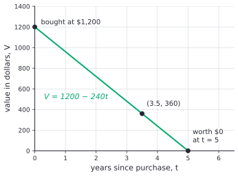
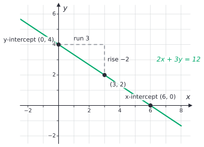
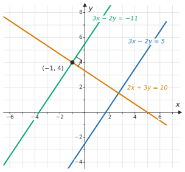

# Forms of linear equations

After this lesson you can write one line in slope-intercept, point-slope and standard form, convert between them, choose the form that fits the facts you are given, write a line parallel or perpendicular to a given line, and build a linear model with units from a table or a story.

Before this: [slope and linear equations](../../02-middle-school/05-linear-relationships-and-functions/02-slope-and-linear-equations.md) and [linear and literal equations](../01-algebra-foundations/02-linear-and-literal-equations.md).

## Quick check

Try these first. If you get all three right, skip to [Practice](#practice).

1. Write the line with slope $-3$ through $(2, 5)$ in point-slope form, then in slope-intercept form.
2. Write $4x - 6y = 24$ in slope-intercept form and find both intercepts.
3. Find the equation of the line through $(3, 1)$ that is perpendicular to $2x + 4y = 8$.

<details class="solution" markdown>
<summary>Answers</summary>

1. Point-slope form is $y - 5 = -3(x - 2)$. Distributing and adding 5 gives $y = -3x + 11$.
2. Subtract $4x$ and divide by $-6$: $y = \frac{2}{3}x - 4$. The $y$-intercept is $(0, -4)$. Setting $y = 0$ gives $4x = 24$, so the $x$-intercept is $(6, 0)$.
3. Solving $2x + 4y = 8$ for $y$ gives $y = -\frac{1}{2}x + 2$, with slope $-\frac{1}{2}$. A perpendicular line has slope 2, so $y - 1 = 2(x - 3)$, which is $y = 2x - 5$.

</details>

## The idea

A new laptop costs \$1,200. Suppose it loses the same \$240 of value every year. With $t$ for its age in years and $V$ for its value in dollars, the value is $V = 1200 - 240t$.

| Age $t$ (years) | 0 | 1 | 2 | 3 | 4 | 5 |
|---|---|---|---|---|---|---|
| Value $V$ (dollars) | 1200 | 960 | 720 | 480 | 240 | 0 |



This equation is in slope-intercept form, and it answers two questions at a glance: the intercept 1200 is the price when new, and the slope $-240$ is the dollars lost per year. The same line can be told in other ways, and each way suits a different question.

Suppose all you know is that the laptop was worth \$720 at age 2 and loses \$240 a year. Then the natural equation uses exactly those two facts: $V - 720 = -240(t - 2)$. Or suppose you care about this: what the laptop has lost plus what it is still worth always adds up to the price you paid. That is $240t + V = 1200$, two quantities each multiplied by a number, with a fixed total. All three equations describe the same line, and any pair $(t, V)$ that satisfies one satisfies the others.

This lesson names the three forms, shows how to convert between them, and says which to reach for. It also finishes two jobs the middle-school lessons left open: one form that covers every line, vertical ones included, and the rule for perpendicular lines, with its proof.

## Definitions

A line with slope $m$ and $y$-intercept $b$ has the equation $y = mx + b$, called slope-intercept form. A line through the point $(x_1, y_1)$ with slope $m$ has the equation

$$
y - y_1 = m(x - x_1),
$$

called point-slope form. Both are defined in [slope and linear equations](../../02-middle-school/05-linear-relationships-and-functions/02-slope-and-linear-equations.md#point-slope-form), and the second one comes straight from the slope formula: for any other point $(x, y)$ on the line, $\frac{y - y_1}{x - x_1} = m$, and multiplying by $x - x_1$ gives the equation. The point $(x_1, y_1)$ itself makes both sides 0, so it satisfies the equation too.

A line can also be written in **standard form**:

$$
Ax + By = C,
$$

where $A$, $B$ and $C$ are fixed numbers and $A$ and $B$ are not both 0. (In this form the capital letters are coefficients, not sets or matrices.) By convention, $A$, $B$ and $C$ are integers with no common factor bigger than 1, and $A \ge 0$, with $B > 0$ if $A = 0$. In plain words, the $x$-term and the $y$-term are on the left and the constant is on the right.

The convention gives each line one standard-form equation (for lines whose equations can be written with whole-number coefficients, which covers every line in this lesson). The equation $2x + 3y = 12$ is in standard form. The equations $4x + 6y = 24$ (common factor 2), $-2x - 3y = -12$ (negative $A$) and $y = -\frac{2}{3}x + 4$ (not of the form $Ax + By = C$) describe the same line without being in standard form.

Standard form covers every line, and every such equation is a line. There are three cases for $Ax + By = C$:

- If $B \ne 0$, solve for $y$: $By = -Ax + C$, so $y = -\frac{A}{B}x + \frac{C}{B}$. The slope is $-\frac{A}{B}$ and the $y$-intercept is $\frac{C}{B}$.
- If $B = 0$, the equation is $Ax = C$ with $A \ne 0$, so $x = \frac{C}{A}$, a vertical line.
- If $A = 0$, the equation is $By = C$ with $B \ne 0$, so $y = \frac{C}{B}$, a horizontal line.

Going the other way, $y = mx + b$ is $-mx + y = b$, and the vertical line $x = a$ is $1x + 0y = a$. Slope-intercept form can't write a vertical line, because it has no slope. Standard form can.

Two lines are **perpendicular** when they meet at a right angle, an angle of $90^\circ$. Two lines are parallel when they never meet ([slope and linear equations](../../02-middle-school/05-linear-relationships-and-functions/02-slope-and-linear-equations.md#definitions)).

A **linear model** is a linear equation that describes how two measured quantities are related, with a unit on each variable. A common one is **straight-line depreciation**, where an asset loses the same amount of value every year, as the laptop does. The slope of a linear model is a rate with units, such as dollars per year, and its $y$-intercept is the value of $y$ when $x$ is 0.

## How to do it

### Choosing a form

Each form shows different facts straight away, so the right choice depends on what you are given and what you want to read off.

| Form | Equation | Shows at a glance | Handiest when |
|---|---|---|---|
| slope-intercept | $y = mx + b$ | slope $m$, $y$-intercept $b$ | you know the rate and the starting value, or want to graph from $(0, b)$, or want $y$ for a given $x$ |
| point-slope | $y - y_1 = m(x - x_1)$ | slope $m$, one point $(x_1, y_1)$ | you know a point and the slope, or two points (find $m$ first) |
| standard | $Ax + By = C$ | both intercepts, $\frac{C}{A}$ and $\frac{C}{B}$ | two quantities add up to a fixed total, you want whole-number coefficients, or the line may be vertical |

### Converting between forms

1. To go from point-slope to slope-intercept, distribute $m$ and add $y_1$ to both sides: $y = mx + (y_1 - mx_1)$.
2. To go from slope-intercept (or point-slope) to standard form, multiply every term by the common denominator to clear fractions, then move the $x$-term to the left side. Multiply the whole equation by $-1$ if $A$ is negative, and divide out any common factor.
3. To go from standard form to slope-intercept, subtract $Ax$ from both sides and divide every term by $B$.
4. To go from standard form to point-slope, find the slope $-\frac{A}{B}$ and any point on the line (an intercept is often easiest), and write $y - y_1 = m(x - x_1)$.
5. Check by putting one point of the line into both forms, or by comparing the slope and an intercept read from each.

### Intercepts from standard form

For $Ax + By = C$, set $y = 0$ to get the $x$-intercept $\left(\frac{C}{A}, 0\right)$, and set $x = 0$ to get the $y$-intercept $\left(0, \frac{C}{B}\right)$. Plot both and draw the line through them. The line $2x + 3y = 12$ has intercepts $(6, 0)$ and $(0, 4)$, and a slope of $-\frac{2}{3}$ (the run from $(0, 4)$ to $(3, 2)$ is 3 and the rise is $-2$):



If $C = 0$, both intercepts are the origin, and you need a second point to draw the line. If $A = 0$ or $B = 0$ the line has only one intercept, because it is parallel to an axis.

### Horizontal and vertical lines

| Line | Equation | Slope | Standard form | Intercepts |
|---|---|---|---|---|
| horizontal through $(0, k)$ | $y = k$ | 0 | $0x + 1y = k$ | only a $y$-intercept (unless $k = 0$) |
| vertical through $(h, 0)$ | $x = h$ | undefined | $1x + 0y = h$ | only an $x$-intercept (unless $h = 0$) |

Every horizontal line is perpendicular to every vertical line. The slope rule below can't say so, because a vertical line has no slope.

### Parallel and perpendicular lines

Two non-vertical lines are parallel exactly when their slopes are equal and their intercepts are not. In standard form, $A_1x + B_1y = C_1$ and $A_2x + B_2y = C_2$ have the same slope when $\frac{A_1}{B_1} = \frac{A_2}{B_2}$, which means $(A_1, B_1)$ is a multiple of $(A_2, B_2)$.

*Theorem.* Let $L_1$ and $L_2$ be non-vertical lines with slopes $m_1$ and $m_2$. Then $L_1$ and $L_2$ are perpendicular exactly when $m_1 m_2 = -1$.

Equivalently, $m_2 = -\frac{1}{m_1}$: the slope of a perpendicular line is the negative reciprocal. If $L_1$ is horizontal, a perpendicular line is vertical, so that pair is not covered by the theorem.

What we know: a quarter turn about the origin, $90^\circ$ counterclockwise, sends the point $(x, y)$ to $(-y, x)$ (the rule from [transformations, congruence and similarity](../../02-middle-school/06-geometry/05-transformations-congruence-similarity.md#why-the-90-degree-rule-works)). It turns each line through the origin into the line through the origin that is perpendicular to it.

What we want: for lines $L_1$ and $L_2$ that cross, $L_2$ is perpendicular to $L_1$ exactly when $m_1 m_2 = -1$.

The plan: slide both lines so that they cross at the origin, which changes no slope and no angle. Then rotate $L_1$ a quarter turn and compute the slope of the image.

*Proof.* If $m_1 m_2 = -1$ then $m_1 \ne m_2$, since no real number squared is $-1$, so the lines are not parallel and they cross. If the lines are perpendicular they also cross. So in both directions we may slide the lines, without turning them, until they cross at the origin. Sliding keeps each slope and the angle between the lines.

Now $L_1$ is the line $y = m_1 x$, which passes through $P = (1, m_1)$. The quarter turn sends $P$ to $P' = (-m_1, 1)$, so it sends $L_1$ to the line through the origin and $P'$. That image line is perpendicular to $L_1$, and it is the only line through the origin that is. Its run from the origin to $P'$ is $-m_1$, which is not 0, and its rise is 1, so its slope is $\frac{1}{-m_1} = -\frac{1}{m_1}$.

A line through the origin is determined by its slope. So $L_2$ is perpendicular to $L_1$ exactly when it is that image line, which happens exactly when $m_2 = -\frac{1}{m_1}$, that is, when $m_1 m_2 = -1$. $\blacksquare$

Look back: the figure shows $L_1$ with slope $\frac{2}{3}$. It uses $(3, 2)$ in place of $(1, \frac{2}{3})$, which is the same line, three times as far out. The quarter turn sends $(3, 2)$ to $(-2, 3)$, and the slope is $\frac{3}{-2} = -\frac{3}{2}$. The turn swapped the rise and the run and changed one sign, so the slope was flipped and negated. If $m_1 = 0$ the image point is $(0, 1)$ on the $y$-axis, a vertical line, which is why the theorem has to leave out horizontal and vertical lines.


To write a parallel or perpendicular line through a given point:

1. Find the slope of the given line. For standard form, it is $-\frac{A}{B}$.
2. For a parallel line, use the same slope. For a perpendicular line, flip the slope and change its sign.
3. If the given line is horizontal or vertical, skip the slope: a parallel line is the same kind, and a perpendicular line is the other kind.
4. Write point-slope form with the new slope and the given point, then convert to the form you were asked for.
5. Check that the new line passes through the point, and that the slopes are equal (parallel) or multiply to $-1$ (perpendicular).

### Building a linear model

1. Name the two quantities, with a unit for each, and choose which one is $x$.
2. Find the slope, the rate of change, in units of $y$ per unit of $x$. From two points it is $\frac{y_2 - y_1}{x_2 - x_1}$.
3. Find the starting value, the $y$-value at $x = 0$. If the data has no row with $x = 0$, use a point and the slope, with point-slope form.
4. Write the equation, then convert to the form you need.
5. Say what the slope and each intercept mean, in a sentence with units, and state the values of $x$ for which the model makes sense. A value can't go below \$0, and an age can't be negative.
6. Check with a data point that you did not use.

A linear model is an assumption. Real depreciation is rarely a straight line: a car loses more of its value in the first year than in later ones. Canadian tax rules for depreciating business assets (capital cost allowance) mostly take a percentage of the remaining value each year, which is not linear. Straight-line depreciation is still common in accounting because it is simple.

## Worked examples

<div class="example" markdown>

### Example 1: one line in three forms

Find the equation of the line through $(-2, 5)$ and $(4, 1)$ in point-slope, slope-intercept and standard form, and find its intercepts.

The slope comes first. The rise is $1 - 5 = -4$ and the run is $4 - (-2) = 6$, so $m = \frac{-4}{6} = -\frac{2}{3}$. Use the point $(-2, 5)$ in point-slope form:

$$
y - 5 = -\frac{2}{3}(x + 2).
$$

Step 1: convert to slope-intercept form. Distribute $-\frac{2}{3}$ and add 5 to both sides:

$$
\begin{aligned}
y - 5 &= -\frac{2}{3}x - \frac{4}{3} \\
y &= -\frac{2}{3}x - \frac{4}{3} + \frac{15}{3} \\
y &= -\frac{2}{3}x + \frac{11}{3}.
\end{aligned}
$$

Step 2: convert to standard form. Multiply every term by 3 to clear the fractions, then add $2x$ to both sides:

$$
\begin{aligned}
3y &= -2x + 11 \\
2x + 3y &= 11.
\end{aligned}
$$

Here $A = 2$ is positive, and 2, 3 and 11 have no common factor, so this is the standard form.

The intercepts: setting $y = 0$ gives $2x = 11$, so the $x$-intercept is $\left(\frac{11}{2}, 0\right)$. Setting $x = 0$ gives $3y = 11$, so the $y$-intercept is $\left(0, \frac{11}{3}\right)$. Both are untidy, and that is fine. The $y$-intercept matches the constant in the slope-intercept form.

<div class="warning" markdown>

Watch out at the multiplication in Step 2: multiply every term, including the constant on the right. Writing $3y = -2x + \frac{11}{3}$ multiplies only the $y$ and the $x$ side and leaves a fraction behind.

</div>

Step 5: check. Both points satisfy $2x + 3y = 11$, since $2(-2) + 3(5) = -4 + 15 = 11$ and $2(4) + 3(1) = 8 + 3 = 11$. The slope from the standard form is $-\frac{A}{B} = -\frac{2}{3}$, as found. If you had used $(4, 1)$ instead, the point-slope form would look different, $y - 1 = -\frac{2}{3}(x - 4)$, but it gives the same slope-intercept form: $y = -\frac{2}{3}x + \frac{8}{3} + 1 = -\frac{2}{3}x + \frac{11}{3}$.

</div>

<div class="example" markdown>

### Example 2: depreciation of a van

A delivery van costs \$38,000 new and is worth \$23,000 after 3 years. Assume straight-line depreciation. Write a model, say what it means, and find when the van is worth \$10,000.

Step 1: let $t$ be the age in years and $V$ the value in dollars. The two data points are $(0, 38000)$ and $(3, 23000)$.

Step 2: the slope is $\frac{23000 - 38000}{3 - 0} = \frac{-15000}{3} = -5000$ dollars per year.

Step 3: the point with $t = 0$ gives the starting value, \$38,000. Step 4: the model is $V = 38000 - 5000t$, or $5000t + V = 38000$ in standard form.

Step 5: the van loses \$5,000 each year, and the intercept 38,000 is its price new. Setting $V = 0$ gives $t = 7.6$, so the model reaches \$0 at 7.6 years and applies only for $0 \le t \le 7.6$. After that the formula would give a negative value, which is not possible.

For the value of \$10,000, solve $38000 - 5000t = 10000$. Subtract 38,000: $-5000t = -28000$, so $t = 5.6$ years.

Step 6: check. $38000 - 5000(5.6) = 38000 - 28000 = 10000$, and the model gives $V(3) = 23000$ as it should.

</div>

<div class="example" markdown>

### Example 3: parallel and perpendicular through a point

(a) Find the lines through $(-1, 4)$ that are parallel and perpendicular to $3x - 2y = 5$, in standard form. (b) Find the line through $(5, -2)$ that is perpendicular to $4x = 12$.

(a) Step 1: the slope of the given line is $-\frac{A}{B} = -\frac{3}{-2} = \frac{3}{2}$. Step 2: a parallel line has slope $\frac{3}{2}$, and a perpendicular line has slope $-\frac{2}{3}$.

Step 4, parallel: $y - 4 = \frac{3}{2}(x + 1)$. Multiply by 2: $2y - 8 = 3x + 3$. Move terms: $-3x + 2y = 11$, and multiplying by $-1$ makes $A$ positive: $3x - 2y = -11$.

Step 4, perpendicular: $y - 4 = -\frac{2}{3}(x + 1)$. Multiply by 3: $3y - 12 = -2x - 2$, so $2x + 3y = 10$.



Step 5: both lines pass through $(-1, 4)$, since $3(-1) - 2(4) = -11$ and $2(-1) + 3(4) = 10$. The slopes are $\frac{3}{2}$ and $-\frac{2}{3}$, and the product is $\frac{3}{2} \cdot \left(-\frac{2}{3}\right) = -1$.

(b) The equation $4x = 12$ is $x = 3$, a vertical line, so the slope rule doesn't apply (Step 3). A line perpendicular to a vertical line is horizontal, and the horizontal line through $(5, -2)$ is $y = -2$. The vertical line through the same point is $x = 5$. Check: $y = -2$ meets $x = 3$ at $(3, -2)$, a right angle on the grid.

</div>

<div class="example" markdown>

### Example 4: a budget line (finish it yourself)

You have \$60 for movie tickets at \$12 each and snacks at \$4 each. With $x$ tickets and $y$ snacks, spending all \$60 means $12x + 4y = 60$. The numbers have a common factor of 4, so the standard form is

$$
3x + y = 15.
$$

Find both intercepts, write the line in slope-intercept form, and say in words what the slope means. Then check the answer for 3 tickets.

<details class="solution" markdown>
<summary>Finish</summary>

Setting $y = 0$ gives $x = 5$: the $x$-intercept is $(5, 0)$, five tickets and no snacks. Setting $x = 0$ gives $y = 15$: the $y$-intercept is $(0, 15)$, fifteen snacks and no tickets.

Solving for $y$ gives $y = -3x + 15$. The slope $-3$ means that each extra ticket costs 3 snacks, because a ticket costs \$12 and a snack \$4, and $12 \div 4 = 3$.

Check: 3 tickets cost \$36, which leaves \$24, enough for 6 snacks. The equation agrees: $y = -3(3) + 15 = 6$. Only whole numbers of tickets and snacks make sense, so the real choices are the points of the line with whole coordinates, such as $(2, 9)$ and $(4, 3)$.

</details>

</div>

## Edge cases and common mistakes

<div class="warning" markdown>

Watch out for the sign and the position of the letters in the slope of $Ax + By = C$. It is $-\frac{A}{B}$: not $\frac{A}{B}$, and not $-\frac{B}{A}$. For $2x + 3y = 12$ the slope is $-\frac{2}{3}$. A quick check uses the intercepts: they are $(6, 0)$ and $(0, 4)$, and going from the $y$-intercept to the $x$-intercept the line falls 4 and runs 6, so the slope is $\frac{-4}{6}$.

</div>

<div class="warning" markdown>

Watch out for the signs inside point-slope form. The point $(-2, 5)$ gives $y - 5 = m(x + 2)$, because $x - (-2) = x + 2$. Writing $m(x - 2)$ builds a line through $(2, 5)$ instead.

</div>

<div class="warning" markdown>

Watch out for the perpendicular slope. The slope perpendicular to $\frac{3}{4}$ is $-\frac{4}{3}$. Flipping alone gives $\frac{4}{3}$, which is not perpendicular, and negating alone gives $-\frac{3}{4}$, which is not either. Multiply the two slopes: the product must be $-1$.

</div>

<div class="warning" markdown>

Watch out when comparing lines: equations that look different can be the same line. The equations $2x + 3y = 12$ and $4x + 6y = 24$ are the same line, since the second is the first multiplied by 2. To compare two equations, reduce both to standard form or to slope-intercept form first.

</div>

<div class="warning" markdown>

Watch out for vertical lines. The line $x = 3$ has no slope and no slope-intercept form, so a method that begins "find the slope" fails. If two points have the same $x$-coordinate, write $x = h$ directly.

</div>

A line through the origin has $C = 0$ in standard form, as in $3x - 2y = 0$, and a proportional relationship $y = kx$ is the case $kx - y = 0$ ([proportional relationships](../../02-middle-school/02-ratios-rates-percents/02-proportional-relationships.md)). Its two intercepts are the same point, so one more point is needed to draw it.

## Tricks and shortcuts

For a standard-form equation, cover one term at a time to find an intercept. In $5x - 4y = 20$, cover the $-4y$: $5x = 20$, so the $x$-intercept is $(4, 0)$. Cover the $5x$: $-4y = 20$, so the $y$-intercept is $(0, -5)$.

Two points to standard form can skip the slope. For $(x_1, y_1)$ and $(x_2, y_2)$, take $A = y_2 - y_1$, $B = x_1 - x_2$ and $C = Ax_1 + By_1$. For $(-2, 5)$ and $(4, 1)$ this gives $A = -4$, $B = -6$ and $C = (-4)(-2) + (-6)(5) = -22$. The equation $-4x - 6y = -22$ divides by $-2$ to give $2x + 3y = 11$, as in Example 1. The formula is the slope condition $(y - y_1)(x_2 - x_1) = (y_2 - y_1)(x - x_1)$ with the brackets multiplied out and the terms moved around, so $A$ is the rise and $B$ is the negative of the run.

Parallel and perpendicular lines in standard form need no fractions. The line through $(x_0, y_0)$ parallel to $Ax + By = C$ keeps the same $A$ and $B$ and only changes the constant: $Ax + By = Ax_0 + By_0$. A perpendicular line swaps $A$ and $B$ and changes one sign: $Bx - Ay = Bx_0 - Ay_0$. In Example 3, $3x - 2y = 5$ and $(-1, 4)$ give the parallel line $3x - 2y = 3(-1) - 2(4) = -11$ and the perpendicular line $-2x - 3y = -2(-1) - 3(4) = -10$, which is $2x + 3y = 10$ after multiplying by $-1$.

## In code

The two-point shortcut and the perpendicular rule fit in a few lines. Python's `gcd` accepts negative numbers, so it works on $A$, $B$ and $C$ directly.

<details class="code" markdown>
<summary>In code</summary>

```python
from math import gcd

def tidy(A, B, C):
    """Standard form with integers, no common factor, and A >= 0 (B > 0 if A == 0)."""
    g = gcd(gcd(A, B), C)
    A, B, C = A // g, B // g, C // g
    if A < 0 or (A == 0 and B < 0):
        A, B, C = -A, -B, -C
    return A, B, C

def through(p, q):
    """The line through two different points, in standard form."""
    (x1, y1), (x2, y2) = p, q
    A, B = y2 - y1, x1 - x2
    return tidy(A, B, A * x1 + B * y1)

def perpendicular(A, B, C, point):
    """The line through point perpendicular to Ax + By = C, in standard form."""
    x0, y0 = point
    return tidy(B, -A, B * x0 - A * y0)

print(through((-2, 5), (4, 1)))          # (2, 3, 11)
print(through((2, -1), (2, 6)))          # (1, 0, 2), the vertical line x = 2
print(through((-3, 4), (5, 4)))          # (0, 1, 4), the horizontal line y = 4
print(perpendicular(3, -2, 5, (-1, 4)))  # (2, 3, 10)
```

The vertical and horizontal lines come out without any special case, because standard form has room for them. A slope-intercept version of `through` would need an `if` for the vertical line, as in the code of [slope and linear equations](../../02-middle-school/05-linear-relationships-and-functions/02-slope-and-linear-equations.md#in-code).

</details>

## FAQ

### Why have three forms for one line?

Each form makes a different question cheap. Slope-intercept form gives $y$ for any $x$ in one step. Point-slope form needs no solving when you are handed a point and a slope. Standard form shows the intercepts, handles vertical lines, and fits any situation where two weighted quantities add to a fixed total. You can always convert, so you pick the one that saves work.

### Why does standard form insist on integers and $A \ge 0$?

It is a convention, so that two people who write the same line get the same equation. Mathematically $4x + 6y = 24$ and $2x + 3y = 12$ are the same line, and nothing breaks if you use the first. The convention also makes answers easy to mark and compare.

### Why do $A$ and $B$ point at right angles to the line?

Take $Ax + By = C$ with $A$ and $B$ both nonzero. The line has slope $-\frac{A}{B}$. The arrow from the origin to the point $(A, B)$ has slope $\frac{B}{A}$, and $-\frac{A}{B} \cdot \frac{B}{A} = -1$. By the theorem above, the arrow is perpendicular to the line. An arrow like this is called a normal vector, and it returns in [the dot product](../../05-university-core/06-linear-algebra/01-vectors-dot-product-and-span.md) in linear algebra.

### Can I always use $y = mx + b$?

For every line except a vertical one. If a problem might involve a vertical line, such as two points with the same $x$-coordinate, standard form is the safe choice. [Functions](../03-functions/01-what-is-a-function.md) can't have vertical lines as graphs, which is one reason slope-intercept form is the usual way to write a linear function.

## Practice

### Warm-up

1\. Convert: (a) $y = -3x + 7$ to standard form, (b) $5x - 2y = 10$ to slope-intercept form, (c) $y - 3 = 2(x + 4)$ to slope-intercept form and to standard form.

<details class="solution" markdown>
<summary>Solution</summary>

- (a) Add $3x$ to both sides: $3x + y = 7$.
- (b) Subtract $5x$: $-2y = -5x + 10$. Divide every term by $-2$: $y = \frac{5}{2}x - 5$.
- (c) Distribute: $y - 3 = 2x + 8$, so $y = 2x + 11$. For standard form subtract $2x$: $-2x + y = 11$, and multiplying by $-1$ gives $2x - y = -11$.

Check (b) at $x = 2$: $5(2) - 2y = 10$ gives $y = 0$, and $\frac{5}{2}(2) - 5 = 0$. Check (c) at $x = 0$: $y = 11$ in both forms.

</details>

2\. Find the slope and both intercepts of $3x - 2y = 12$, and say how you would draw it.

<details class="solution" markdown>
<summary>Solution</summary>

The slope is $-\frac{A}{B} = -\frac{3}{-2} = \frac{3}{2}$. Setting $y = 0$ gives $3x = 12$, so the $x$-intercept is $(4, 0)$. Setting $x = 0$ gives $-2y = 12$, so the $y$-intercept is $(0, -6)$. Plot those two points and draw the line through them.

Check: from $(0, -6)$ to $(4, 0)$ the rise is 6 and the run is 4, and $\frac{6}{4} = \frac{3}{2}$.

</details>

3\. Write each line in standard form: (a) the line through $(0, -2)$ with slope 4, (b) the horizontal line through $(3, 5)$, (c) the vertical line through $(3, 5)$.

<details class="solution" markdown>
<summary>Solution</summary>

- (a) $y = 4x - 2$. Subtract $4x$ and multiply by $-1$: $4x - y = 2$.
- (b) $y = 5$, which is $0x + y = 5$.
- (c) $x = 3$, which is $x + 0y = 3$.

Check (a) with $(0, -2)$: $4(0) - (-2) = 2$. Both (b) and (c) pass through $(3, 5)$, and they are perpendicular, as a horizontal line and a vertical line always are.

</details>

### Standard

4\. Write the line through $(-3, -1)$ and $(5, 3)$ in point-slope, slope-intercept and standard form.

<details class="solution" markdown>
<summary>Solution</summary>

The slope is $\frac{3 - (-1)}{5 - (-3)} = \frac{4}{8} = \frac{1}{2}$. Point-slope form with $(-3, -1)$ is $y + 1 = \frac{1}{2}(x + 3)$.

Distribute: $y + 1 = \frac{1}{2}x + \frac{3}{2}$, so $y = \frac{1}{2}x + \frac{1}{2}$. Multiply by 2: $2y = x + 1$, so $x - 2y = -1$.

Check: $(-3, -1)$ gives $-3 + 2 = -1$, and $(5, 3)$ gives $5 - 6 = -1$.

</details>

5\. Let $L$ be the line $5x + 2y = 10$. Find, in standard form, (a) the line through $(4, -3)$ parallel to $L$ and (b) the line through $(4, -3)$ perpendicular to $L$.

<details class="solution" markdown>
<summary>Solution</summary>

The slope of $L$ is $-\frac{5}{2}$.

(a) A parallel line has slope $-\frac{5}{2}$. Then $y + 3 = -\frac{5}{2}(x - 4)$. Multiply by 2: $2y + 6 = -5x + 20$, so $5x + 2y = 14$.

(b) A perpendicular line has slope $\frac{2}{5}$. Then $y + 3 = \frac{2}{5}(x - 4)$. Multiply by 5: $5y + 15 = 2x - 8$, so $2x - 5y = 23$.

Check: $(4, -3)$ gives $5(4) + 2(-3) = 14$ and $2(4) - 5(-3) = 8 + 15 = 23$. The slopes multiply to $-\frac{5}{2} \cdot \frac{2}{5} = -1$.

</details>

6\. A rental e-scooter charges an unlock fee plus a fee per minute. A 10-minute ride costs \$4.15 and a 25-minute ride costs \$8.65. (These prices are made up.) (a) Find the rate and the unlock fee. (b) What does an 18-minute ride cost? (c) How long a ride can you take for \$10? (d) The model's $t$-intercept is negative. What does that say?

<details class="solution" markdown>
<summary>Solution</summary>

Let $t$ be the ride length in minutes and $C$ the cost in dollars.

(a) The slope is $\frac{8.65 - 4.15}{25 - 10} = \frac{4.50}{15} = 0.30$ dollars per minute. Putting $(10, 4.15)$ into $C = 0.30t + b$ gives $4.15 = 3.00 + b$, so the unlock fee is $b = 1.15$ dollars. The model is $C = 0.30t + 1.15$.

(b) $0.30(18) + 1.15 = 5.40 + 1.15 = 6.55$, so \$6.55.

(c) Solve $0.30t + 1.15 = 10$: $0.30t = 8.85$, so $t = 29.5$ minutes.

(d) Setting $C = 0$ gives $t = -\frac{1.15}{0.30} \approx -3.83$ minutes. A negative time has no meaning, so the model applies only for $t \ge 0$. The intercept just says that the cost line, extended backwards, would cross zero before the ride began.

Check: $0.30(25) + 1.15 = 8.65$, and $0.30(29.5) + 1.15 = 8.85 + 1.15 = 10$.

</details>

### Challenge

7\. A line has nonzero intercepts $a$ (on the $x$-axis) and $b$ (on the $y$-axis). (a) Show that its equation is $\frac{x}{a} + \frac{y}{b} = 1$. (b) Find its slope in terms of $a$ and $b$. (c) Use this to write the line with $x$-intercept 4 and $y$-intercept $-6$ in standard form. (d) Which lines can't be written this way?

<details class="solution" markdown>
<summary>Solution</summary>

(a) The two points $(a, 0)$ and $(0, b)$ are on the line. Both satisfy $\frac{x}{a} + \frac{y}{b} = 1$: the first gives $1 + 0 = 1$ and the second gives $0 + 1 = 1$. The equation is linear, with $x$ and $y$ not both multiplied by 0, so its graph is a line, and exactly one line passes through two different points. So it is the line.

(b) The rise from $(a, 0)$ to $(0, b)$ is $b$ and the run is $-a$, so the slope is $-\frac{b}{a}$.

(c) With $a = 4$ and $b = -6$: $\frac{x}{4} - \frac{y}{6} = 1$. Multiply by 12: $3x - 2y = 12$. This is the line from practice problem 2, with slope $-\frac{b}{a} = \frac{6}{4} = \frac{3}{2}$.

(d) A line through the origin has $a = b = 0$, and a horizontal or vertical line has only one intercept. Dividing by $a$ or $b$ needs both to be nonzero, so none of these lines can be written in this form.

Check (c): $(4, 0)$ gives $12 - 0 = 12$ and $(0, -6)$ gives $0 + 12 = 12$.

</details>

8\. (Reviews [proportional relationships](../../02-middle-school/02-ratios-rates-percents/02-proportional-relationships.md).) Taxi A charges \$2.10 per kilometre with no starting fee. Taxi B charges \$4.50 to start plus \$1.60 per kilometre. (These prices are made up.) (a) Write each cost as an equation, and put each in standard form. (b) Which one is a proportional relationship, and how can you see it in standard form? (c) At what distance do the two cost the same?

<details class="solution" markdown>
<summary>Solution</summary>

Let $x$ be the distance in kilometres and $y$ the cost in dollars.

(a) Taxi A is $y = 2.10x$, which is $2.10x - y = 0$. Multiplying by 10 gives whole numbers: $21x - 10y = 0$. Taxi B is $y = 1.60x + 4.50$, which is $-1.60x + y = 4.50$. Multiplying by $-10$ makes $A$ positive and the coefficients whole: $16x - 10y = -45$. The numbers 16, 10 and 45 have no common factor, so this is the standard form.

(b) Taxi A is proportional: its constant is $C = 0$, so the line passes through the origin, and zero kilometres cost nothing. Taxi B has $C \ne 0$, so its line misses the origin: the \$4.50 is charged before the first kilometre.

(c) Set the costs equal: $2.10x = 1.60x + 4.50$. Then $0.50x = 4.50$, so $x = 9$ kilometres, where both cost $2.10 \times 9 = 18.90$ dollars.

Check: $1.60(9) + 4.50 = 14.40 + 4.50 = 18.90$. For a 5 km trip taxi A costs \$10.50 and taxi B \$12.50, so taxi A is cheaper below 9 km, as its lack of a starting fee suggests, and taxi B is cheaper beyond it.

</details>

## Where this shows up

- The next lesson, [systems of linear equations](02-systems-of-linear-equations.md), finds where two lines in these forms meet, and [two-variable inequalities and feasible regions](03-two-variable-inequalities-and-feasible-regions.md) shades the side of a standard-form line. In the functions chapter, a linear function is $f(x) = mx + b$ ([what is a function](../03-functions/01-what-is-a-function.md)), and the slope and intercept become the shift and stretch of [transformations of functions](../03-functions/04-transformations-of-functions.md).
- In computing, graphics and geometry code stores a line as $Ax + By = C$ because it handles vertical lines, and the sign of $Ax + By - C$ tells which side of the line a point is on. A linear classifier in machine learning is such a line, or its higher-dimensional version, with the weights playing the role of $A$ and $B$.
- In economics, the budget constraint $p_x x + p_y y = I$ is a standard-form line ([production and cost functions](../../07-economics-math/03-firms-and-consumers/02-production-and-cost-functions.md) uses linear cost lines too), and in finance straight-line depreciation is the simplest of the methods used to spread an asset's cost over its life.
