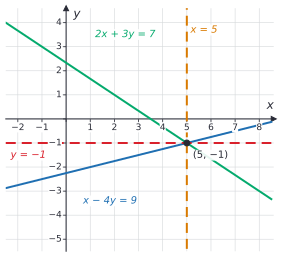
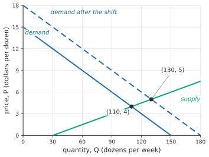

# Systems of linear equations

After this lesson you can explain why elimination gives the right answer, tell from the coefficients whether a system has one solution, none or infinitely many, solve three equations in three unknowns by elimination, write a system as an augmented matrix, and set up supply and demand, mixture and budget problems as systems.

Before this: [systems of linear equations in middle school](../../02-middle-school/05-linear-relationships-and-functions/04-systems-of-linear-equations.md), which covers graphing, substitution and elimination for two unknowns, and [forms of linear equations](01-forms-of-linear-equations.md).

## Quick check

Try these first. If you get all three right, skip to [Practice](#practice).

1. Without solving, say whether $2x - 3y = 5$ and $6x - 9y = 10$ have one solution, none or infinitely many.
2. Solve $x + y + z = 6$, $x - y + z = 2$ and $2x + y - z = 1$.
3. The demand for a good is $Q_d = 100 - 2P$ and the supply is $Q_s = 10 + 3P$, where $P$ is the price and $Q$ is the quantity. Find the price where $Q_d = Q_s$ and the quantity traded there.

<details class="solution" markdown>
<summary>Answers</summary>

1. None. Multiplying the first equation by 3 gives $6x - 9y = 15$, which contradicts the second equation's $6x - 9y = 10$. The lines have the same slope, $\frac{2}{3}$, and different intercepts.
2. $(1, 2, 3)$. Adding the first two equations gives $2x + 2z = 8$, and subtracting the second from the first gives $2y = 4$, so $y = 2$. Then $x + z = 4$ and $2x - z = -1$ give $3x = 3$, so $x = 1$ and $z = 3$. Check the third: $2 + 2 - 3 = 1$.
3. Set $100 - 2P = 10 + 3P$, so $90 = 5P$ and $P = 18$. Then $Q = 100 - 2(18) = 64$. Check: $10 + 3(18) = 64$.

</details>

## The idea

Three receipts from a café. On Monday you paid \$25 for 2 coffees, 3 muffins and 1 sandwich. On Tuesday you paid \$25 for 1 coffee, 2 muffins and 2 sandwiches. Let $c$, $m$ and $s$ be the prices in dollars:

$$
\begin{aligned}
2c + 3m + s &= 25 \\
c + 2m + 2s &= 25.
\end{aligned}
$$

Two equations, three unknowns. The prices \$3, \$4 and \$7 fit both receipts, but so do \$7, \$1 and \$8: $14 + 3 + 8 = 25$ and $7 + 2 + 16 = 25$. Each receipt rules out some prices, and two receipts don't rule out enough.

Wednesday's receipt can settle it: 3 coffees, 1 muffin and 3 sandwiches cost \$34. The prices \$7, \$1 and \$8 would make that $21 + 1 + 24 = 46$, so they are out, and only \$3, \$4 and \$7 are left. A third receipt helps only if it says something new. If Wednesday's order were 3 coffees, 5 muffins and 3 sandwiches for \$50, it would just be Monday and Tuesday added together, and it would add nothing.

The middle-school lesson solved two equations in two unknowns by graphing, substitution and elimination. Here we ask four more questions. Why are the steps of elimination allowed? How can you tell from the coefficients whether a system has one solution, none or infinitely many? How does elimination extend to three unknowns, as in the café? And what is the neat way to write the steps down, which leads to matrices?

## Definitions

A **linear equation** in the unknowns $x_1, x_2, \dots, x_n$ is an equation $a_1x_1 + a_2x_2 + \dots + a_nx_n = b$, where $a_1, \dots, a_n$ and $b$ are fixed numbers and the coefficients $a_1, \dots, a_n$ are not all 0. With two or three unknowns we write $x$, $y$ and $z$ instead. A system of linear equations and its solutions are as in [the middle-school lesson](../../02-middle-school/05-linear-relationships-and-functions/04-systems-of-linear-equations.md#definitions), with any number of unknowns: a solution is a list of values, one per unknown, that makes every equation true at once.

Two systems are **equivalent** when they have exactly the same solutions. In plain words, equivalent systems have the same answer even if they look different. For example, $x + y = 3$ with $x - y = 1$ is equivalent to $x = 2$ with $y = 1$, and the second system is the one you want, because it reads off the answer.

The three **elementary operations** on a system are:

1. swap two equations,
2. multiply both sides of one equation by a nonzero number,
3. add a multiple of one equation to a different equation.

Elimination uses only these. The theorem below says that none of them changes the solutions.

For a system of $m$ equations in $n$ unknowns, the **coefficient matrix** is the rectangular array of the coefficients, with one row for each equation and one column for each unknown. The **augmented matrix** is the coefficient matrix with one more column on the right holding the constants, usually set off by a vertical bar. In plain words, a matrix is just the numbers of the system, written in a grid.

## How to do it

### Why elimination is valid

The middle-school lesson proved that adding two equations keeps the solutions. Elimination does more than that: it multiplies equations, and it adds multiples. The theorem covers every move.

*Theorem.* Each of the three elementary operations turns a system of linear equations into an equivalent system.

What we know: a solution is a list of values that makes every equation true. Write the equations as $L_1 = R_1$, $L_2 = R_2$ and so on, where each $L_i$ and $R_i$ is an expression in the unknowns. Equal numbers stay equal when you multiply them by the same number or add them to equal numbers.

What we want: after one operation, every solution of the old system solves the new system, and every solution of the new system solves the old one.

The plan: show the first half directly for each operation, and then show that each operation can be undone by another operation of the same kind. Undoing gives the second half.

*Proof.* Suppose some values solve the old system, so every equation $L_i = R_i$ is true at those values.

Swapping two equations leaves the same list of equations, so the new system is satisfied. For operation 2, the equation $L_i = R_i$ is true, so $cL_i = cR_i$ is true. For operation 3, the equations $L_1 = R_1$ and $L_2 = R_2$ are true, so adding $c$ times the first to the second gives the true statement $L_2 + cL_1 = R_2 + cR_1$. The other equations are unchanged. In each case the values solve the new system.

Now go back. Swapping again undoes a swap. Multiplying by $\frac{1}{c}$ undoes multiplying by $c$, and this is allowed because $c \ne 0$. Adding $-c$ times the first equation undoes adding $c$ times it. Each undoing step is an elementary operation, so by the first half applied to the new system, every solution of the new system solves the old one. $\blacksquare$

Look back: the condition $c \ne 0$ in operation 2 is what makes the undoing step possible. Multiplying an equation by 0 turns it into $0 = 0$ and throws away what it said. In operation 3 the equation you add to must be a different one: replacing an equation by itself plus $-1$ times itself leaves $0 = 0$ and also loses information. Since a chain of operations is a chain of equivalent systems, every step of elimination keeps the answer.

There is a picture of this in two unknowns. The system $2x + 3y = 7$ and $x - 4y = 9$ crosses at $(5, -1)$. Computing $4 \times (\text{first}) + 3 \times (\text{second})$ gives $11x = 55$, which is the vertical line $x = 5$. Computing $(\text{first}) - 2 \times (\text{second})$ gives $11y = -11$, the horizontal line $y = -1$. Elimination tilts the two lines about their crossing point until one is vertical and one is horizontal, and then the crossing point can be read off.



### Detecting the three cases from the coefficients

Take two equations in $x$ and $y$,

$$
\begin{aligned}
a_1x + b_1y &= c_1 \\
a_2x + b_2y &= c_2,
\end{aligned}
$$

where each equation has at least one nonzero coefficient on the left. Let $D = a_1b_2 - a_2b_1$. This number is the determinant of the coefficient matrix. Its general form is in determinants<!-- link: ../../05-university-core/06-linear-algebra/06-determinants.md -->.

*Theorem.* (i) If $D \ne 0$, the system has exactly one solution,

$$
x = \frac{c_1b_2 - c_2b_1}{D}, \qquad y = \frac{a_1c_2 - a_2c_1}{D}.
$$

(ii) If $D = 0$, the system has no solution or infinitely many. Then the left sides are multiples, $(a_1, b_1) = k(a_2, b_2)$ for some number $k \ne 0$, and the system has infinitely many solutions exactly when $c_1 = kc_2$.

What we know: the elementary operations keep the solutions. What we want: a test on the coefficients alone for how many solutions there are. The plan is to eliminate $y$ and then $x$, and see what the leftover coefficient is.

*Proof.* Multiply the first equation by $b_2$ and the second by $b_1$, then subtract. The $y$-terms cancel and the $x$-terms leave $(a_1b_2 - a_2b_1)x = c_1b_2 - c_2b_1$, that is, $Dx = c_1b_2 - c_2b_1$. Multiply the first equation by $a_2$ and the second by $a_1$, then subtract the first from the second: $Dy = a_1c_2 - a_2c_1$.

(i) If $D \ne 0$, divide by $D$ to get the two formulas. They are the only possible solution, and they do solve the system: $a_1x + b_1y = \frac{a_1c_1b_2 - a_1c_2b_1 + a_1b_1c_2 - a_2b_1c_1}{D} = \frac{c_1(a_1b_2 - a_2b_1)}{D} = c_1$, and the second equation works the same way.

(ii) If $D = 0$, then $a_1b_2 = a_2b_1$, so the slopes $-\frac{a_1}{b_1}$ and $-\frac{a_2}{b_2}$ are equal when both are defined, and the left sides are multiples: $(a_1, b_1) = k(a_2, b_2)$. Subtract $k$ times the second equation from the first. Both unknowns cancel and leave $0 = c_1 - kc_2$. If $c_1 = kc_2$ this is true, the two equations say the same thing, and every point of the line is a solution. If not, it is false, so no pair satisfies both. $\blacksquare$

Look back: $D = 0$ is the algebra version of "the slopes are equal". When $D \ne 0$ the lines cross once, as in the table below, and the formulas give the crossing point directly. They are a shortcut for elimination, not a different method. When $D = 0$ you can't divide, and the leftover $0 = c_1 - kc_2$ tells the two remaining cases apart.

| What you find | Meaning | Solutions |
|---|---|---|
| $D \ne 0$ | different slopes | exactly one |
| $D = 0$, and elimination leaves $0 = c$ with $c \ne 0$ | parallel lines | none |
| $D = 0$, and elimination leaves $0 = 0$ | the same line | infinitely many |

With three or more unknowns there is no single formula this short, but the same signs appear at the end of elimination. A false statement such as $0 = 1$ means no solution. A true statement $0 = 0$ means one equation was redundant. If no false statement turns up as well, the system then has infinitely many solutions.

### Three equations in three unknowns

Each equation in $x$, $y$ and $z$ describes a flat plane in space, and a solution is a point on all three planes. Usually three planes meet at one point, but they can also meet along a line, or have no common point.

1. Write the equations with the unknowns in the same order in each, and the constants on the right. Number the equations.
2. Choose one unknown to eliminate, ideally one with a coefficient of 1. Use the same unknown in both of the next two moves. Combine equation 1 with equation 2 to remove it, and combine equation 1 with equation 3 to remove it. You now have two equations in the two remaining unknowns.
3. Solve those two equations with any method from the middle-school lesson.
4. Substitute back into one of the original equations to find the third unknown.
5. Check the solution in all three original equations.
6. If a step ever leaves $0 = c$ with $c \ne 0$, stop: no solution. If it leaves $0 = 0$, one equation was redundant, and some unknown can take any value. Solve for the others in terms of it.

### The augmented matrix

Elimination only ever touches the numbers. The letters and the plus signs stay where they are, so we can write the numbers alone. For the café system, with the columns for $c$, $m$, $s$ and the constants:

$$
\left[\begin{array}{ccc|c}
2 & 3 & 1 & 25 \\
1 & 2 & 2 & 25 \\
3 & 1 & 3 & 34
\end{array}\right]
$$

The three columns left of the bar are the coefficient matrix. Each elementary operation is an operation on rows. Eliminate $c$ from rows 2 and 3 by replacing row 2 with $2 \times (\text{row } 2) - (\text{row } 1)$ and row 3 with $2 \times (\text{row } 3) - 3 \times (\text{row } 1)$. Then replace row 3 with $(\text{row } 3) + 7 \times (\text{row } 2)$:

$$
\left[\begin{array}{ccc|c}
2 & 3 & 1 & 25 \\
0 & 1 & 3 & 25 \\
0 & -7 & 3 & -7
\end{array}\right]
\quad \longrightarrow \quad
\left[\begin{array}{ccc|c}
2 & 3 & 1 & 25 \\
0 & 1 & 3 & 25 \\
0 & 0 & 24 & 168
\end{array}\right].
$$

The last row says $24s = 168$, so $s = 7$. The staircase of zeros is the goal, and substituting back up the stairs finishes the job: row 2 gives $m + 21 = 25$, so $m = 4$, and row 1 gives $2c + 12 + 7 = 25$, so $c = 3$. Doing this for any number of equations is Gaussian elimination. [Matrix basics](../10-vectors-and-matrices/02-matrix-basics.md) introduces matrices properly, and systems and Gaussian elimination<!-- link: ../../05-university-core/06-linear-algebra/02-systems-and-gaussian-elimination.md --> reads the three cases off the staircase.

### Applications

Supply and demand. Economics uses $P$ for a price and $Q$ for a quantity. The demand line says how much of a good buyers want at each price: $Q_d = d_0 - d_1P$, with $d_1 > 0$ because a higher price means fewer buyers. The supply line says how much sellers offer: $Q_s = s_0 + s_1P$, with $s_1 > 0$ because a higher price means more supply. The market clears at the **equilibrium**, the price at which $Q_d = Q_s$. That is a system of two linear equations, and substituting one into the other solves it. Economists draw price on the vertical axis, so a graph shows $P = \frac{d_0 - Q}{d_1}$ and $P = \frac{Q - s_0}{s_1}$. The supply and demand equilibrium algebra<!-- link: ../../07-economics-math/02-markets/03-supply-and-demand-equilibrium-algebra.md --> lesson in the economics chapter builds on this.

Mixtures. When two ingredients are blended, two things are conserved: the total amount, and the amount of the active ingredient (fat, salt, copper, money). That gives one equation of each kind. If $x$ and $y$ are the amounts of the two ingredients, $x + y$ is the amount of the mixture, and $(\text{fraction in } x) \cdot x + (\text{fraction in } y) \cdot y$ is the amount of the active ingredient in it.

Budgets and other facts that pin down several amounts. Write one equation per fact, as in [setting up a word problem](../../02-middle-school/05-linear-relationships-and-functions/04-systems-of-linear-equations.md#setting-up-a-word-problem), and make sure the number of independent facts is at least the number of unknowns.

## Worked examples

<div class="example" markdown>

### Example 1: three unknowns, the café receipts

Solve

$$
\begin{aligned}
2c + 3m + s &= 25 \quad (1) \\
c + 2m + 2s &= 25 \quad (2) \\
3c + m + 3s &= 34 \quad (3).
\end{aligned}
$$

Step 1: the unknowns are in the same order and the constants are on the right.

Step 2: eliminate $c$. Combine (1) and (2): multiply (2) by 2 to get $2c + 4m + 4s = 50$, and subtract (1):

$$
m + 3s = 25 \quad (4).
$$

Now combine (1) and (3). Multiply (1) by 3 to get $6c + 9m + 3s = 75$, and (3) by 2 to get $6c + 2m + 6s = 68$. Subtract the first from the second:

$$
-7m + 3s = -7 \quad (5).
$$

<div class="warning" markdown>

Watch out at Step 2: remove the same unknown in both moves. If you removed $c$ from (1) and (2) but $m$ from (1) and (3), you would get one equation in $m$ and $s$ and one in $c$ and $s$, and they would not make a system you can solve.

</div>

Step 3: solve (4) and (5). Subtract (5) from (4): $8m = 32$, so $m = 4$. Then (4) gives $3s = 25 - 4 = 21$, so $s = 7$.

Step 4: put $m = 4$ and $s = 7$ into (1): $2c + 12 + 7 = 25$, so $2c = 6$ and $c = 3$.

Step 5: check in all three original equations. (1): $6 + 12 + 7 = 25$. (2): $3 + 8 + 14 = 25$. (3): $9 + 4 + 21 = 34$. A coffee costs \$3, a muffin \$4 and a sandwich \$7. The other prices that fit Monday and Tuesday, \$7, \$1 and \$8, fail (3), as the receipts predicted.

</div>

<div class="example" markdown>

### Example 2: reading the case from the coefficients

(a) Decide the case for $2x - 3y = 5$ and $6x - 9y = 10$, and for $2x - 3y = 5$ and $6x - 9y = 15$. (b) Do the same for the three equations $x + y + z = 6$, $x - y + 2z = 5$ and $2x + 3z = c$, with $c = 11$ and with $c = 12$. (c) Solve $3x + 2y = 8$ and $5x - y = 3$.

(a) The determinant is $D = 2(-9) - 6(-3) = -18 + 18 = 0$, so the answer is none or infinitely many. The left side of the second equation is 3 times the first, so subtract 3 times the first equation from the second. The left side vanishes and the right side is $10 - 15 = -5$ in the first system, giving $0 = -5$: no solution. In the second system it is $15 - 15 = 0$, giving $0 = 0$: infinitely many solutions, every point of the line $2x - 3y = 5$.

(b) Add the first two equations: $2x + 3z = 11$. The third equation has the same left side. With $c = 11$ it is exactly this sum, so the third equation adds nothing, and subtracting gives $0 = 0$. Let $z = t$, which can be any number. Adding the first two equations gives $x = \frac{11 - 3t}{2}$, and the first equation then gives $y = 6 - x - t = \frac{1 + t}{2}$. So there are infinitely many solutions, such as $(4, 1, 1)$ for $t = 1$ and $(1, 2, 3)$ for $t = 3$. With $c = 12$, the third equation minus the sum of the first two is $0 = 1$: no solution. The three planes cross each other two at a time but have no point in common.

(c) $D = 3(-1) - 5(2) = -13 \ne 0$, so there is one solution. The formulas give $x = \frac{8(-1) - 3(2)}{-13} = \frac{14}{13}$ and $y = \frac{3 \cdot 3 - 5 \cdot 8}{-13} = \frac{31}{13}$. The fractions are fine. Check: $3 \cdot \frac{14}{13} + 2 \cdot \frac{31}{13} = \frac{104}{13} = 8$ and $5 \cdot \frac{14}{13} - \frac{31}{13} = \frac{39}{13} = 3$.

Check (b) with $(1, 2, 3)$: $1 + 2 + 3 = 6$, $1 - 2 + 6 = 5$ and $2 + 9 = 11$.

</div>

<div class="example" markdown>

### Example 3: market equilibrium

At a farmers' market, the weekly demand for eggs is $Q_d = 150 - 10P$ and the supply is $Q_s = 30 + 20P$, where $P$ is the price in dollars per dozen and $Q$ is the number of dozens. (These numbers are made up.) Find the equilibrium, then see what happens if news about eggs raises demand by 30 dozen at every price.

Set the two quantities equal: $150 - 10P = 30 + 20P$. Add $10P$ and subtract 30: $120 = 30P$, so $P = 4$. Then $Q = 150 - 10(4) = 110$. The equilibrium is \$4 per dozen and 110 dozen a week.

Check: $Q_s = 30 + 20(4) = 110$. The numbers also make sense away from equilibrium. At \$3, buyers want $150 - 30 = 120$ dozen and sellers offer $30 + 60 = 90$, a shortage of 30. At \$5, buyers want 100 and sellers offer 130, a surplus of 30.

The shift gives a new demand, $Q_d = 180 - 10P$. Set $180 - 10P = 30 + 20P$: $150 = 30P$, so $P = 5$ and $Q = 130$. The price rises \$1 and the quantity rises by 20 dozen. Check: $180 - 50 = 130$ and $30 + 100 = 130$.



</div>

<div class="example" markdown>

### Example 4: a milk mixture

A dairy blends 3.25% milk (the fat percentage of homogenized milk) with 1% milk to make 9 L of 2% milk. How much of each does it use?

Let $x$ be the litres of 3.25% milk and $y$ the litres of 1% milk. The volumes add to 9 L, and the fat adds to 2% of 9 L, which is 0.18 L:

$$
\begin{aligned}
x + y &= 9 \\
0.0325x + 0.01y &= 0.18.
\end{aligned}
$$

Multiply the second equation by 400 to clear the decimals: $13x + 4y = 72$. Multiply the first by 4: $4x + 4y = 36$. Subtract: $9x = 36$, so $x = 4$ and $y = 5$. The dairy uses 4 L of 3.25% milk and 5 L of 1% milk.

Check: $0.0325(4) + 0.01(5) = 0.13 + 0.05 = 0.18$. The answer also has the right shape: 2% is between 1% and 3.25% and closer to 1%, so more of the 1% milk.

</div>

<div class="example" markdown>

### Example 5: a three-unknown budget (finish it yourself)

A student has \$2,400 a month to spend on rent $r$, food $f$ and transport $t$, in dollars. The three amounts add to \$2,400. Rent is \$200 more than twice the food budget, and transport is \$300 less than twice the food budget. How much goes to each?

The facts give

$$
\begin{aligned}
r + f + t &= 2400 \quad (1) \\
r - 2f &= 200 \quad (2) \\
2f - t &= 300 \quad (3).
\end{aligned}
$$

Subtract (2) from (1) to remove $r$:

$$
3f + t = 2200 \quad (4).
$$

Equation (3) has no $r$ already. Now add (3) and (4), then finish: find $f$, then $r$ and $t$, and check all three equations.

<details class="solution" markdown>
<summary>Finish</summary>

Adding (3) and (4) removes $t$: $5f = 2500$, so $f = 500$. From (2), $r = 200 + 2(500) = 1200$. From (3), $t = 2(500) - 300 = 700$. Rent is \$1,200, food \$500 and transport \$700.

Check: $1200 + 500 + 700 = 2400$; $1200 - 2(500) = 200$; $2(500) - 700 = 300$.

</details>

</div>

## Edge cases and common mistakes

<div class="warning" markdown>

Watch out: $0 = 0$ does not mean there is no solution, and it does not mean all unknowns are 0. It means one equation repeated what the others said, so there is a free unknown. Only a false statement such as $0 = 1$ means no solution.

</div>

<div class="warning" markdown>

Watch out: don't use an operation that can't be undone. Multiplying an equation by 0, or replacing an equation by itself minus itself, gives $0 = 0$ and throws away what the equation said. When you add a multiple of one equation to another, the two must be different equations.

</div>

<div class="warning" markdown>

Watch out when you subtract whole equations. Subtracting $-7m + 3s = -7$ from $m + 3s = 25$ gives $m - (-7m) = 8m$ on the left and $25 - (-7) = 32$ on the right. A sign slip here is the most common reason a three-unknown check fails. Check in the original equations, not in the ones you made along the way.

</div>

<div class="warning" markdown>

Watch out for the units and the percents in mixtures. Write 3.25% as 0.0325, not 3.25, and keep every amount in the same unit. In a supply and demand problem, set the two quantities equal ($Q_d = Q_s$), not the two prices.

</div>

The number of equations matters. Fewer equations than unknowns can never give exactly one solution: the case is infinitely many or none. A system with more equations than unknowns usually has no solution, as when you fit a line to many data points; sometimes the extra equations are redundant and the system still has an answer.

## Tricks and shortcuts

Look for the cheap unknown first. If one equation has a coefficient of 1 on an unknown, use that equation to eliminate it from the others. Rearranging the order of the equations is allowed (operation 1), so put the easiest one at the top.

If the coefficients are symmetric, add all the equations. For $x + y = 5$, $y + z = 7$ and $x + z = 6$, adding gives $2(x + y + z) = 18$, so $x + y + z = 9$, and each unknown is 9 minus the sum of the other two: $z = 9 - 5 = 4$, $x = 9 - 7 = 2$ and $y = 9 - 6 = 3$.

For two equations, compute $D = a_1b_2 - a_2b_1$ before solving. It takes a few seconds and tells you the kind of answer to expect, and when $D \ne 0$ the formulas give $x$ and $y$ without any elimination.

## In code

SymPy solves a system exactly and reports all three cases. NumPy solves a system with floating-point numbers and raises an error when there is no single answer.

<details class="code" markdown>
<summary>In code</summary>

```python
import numpy as np
from sympy import symbols, linsolve

c, m, s = symbols("c m s")
x, y, z = symbols("x y z")

A = np.array([[2, 3, 1], [1, 2, 2], [3, 1, 3]])
b = np.array([25, 25, 34])
print(np.linalg.solve(A, b))   # [3. 4. 7.]
print(round(np.linalg.det(A))) # 12, which is not 0: one solution
print(linsolve([2*c + 3*m + s - 25, c + 2*m + 2*s - 25, 3*c + m + 3*s - 34], c, m, s))  # {(3, 4, 7)}

# The same left sides as Example 2(b): the third row is the sum of the first two
print(linsolve([x + y + z - 6, x - y + 2*z - 5, 2*x + 3*z - 11], x, y, z))  # {(11/2 - 3*z/2, z/2 + 1/2, z)}
print(linsolve([x + y + z - 6, x - y + 2*z - 5, 2*x + 3*z - 12], x, y, z))  # EmptySet

B = np.array([[1, 1, 1], [1, -1, 2], [2, 0, 3]])
try:
    np.linalg.solve(B, np.array([6, 5, 11]))
except np.linalg.LinAlgError as error:
    print(error)               # Singular matrix
```

For the $c = 11$ system, the answer lists $x$ and $y$ in terms of $z$, the free unknown, so $z$ can be any number. NumPy refuses to solve $B$ because its determinant is 0, which is the same signal as $D = 0$ for two unknowns. SymPy can then tell the two bad cases apart, and NumPy can't.

</details>

## FAQ

### The sum of two equations is a new equation. Doesn't that change the lines?

It gives a new line, but through the same crossing point. At the crossing point both original equations are true, so any combination of them is true there too. In the figure, the vertical line $x = 5$ and the horizontal line $y = -1$ are both combinations of the original two equations, and both pass through $(5, -1)$. What elimination changes is the direction of the line, and it picks the combinations whose directions make the point easy to read.

### How many equations do I need for three unknowns?

At least three, and they must not be redundant. Three equations that each say something new usually give one solution. Fewer than three never give exactly one, and a third equation that is the sum of the first two (as on Wednesday's imaginary receipt) is redundant. Whether three given equations are all needed is what elimination finds out, since a redundant equation turns into $0 = 0$.

### Why not substitute, as for two unknowns?

You can. It works for three unknowns, but the expressions grow fast, and with four or five unknowns it gets messy. Elimination turns every step into the same small operation on rows, which is why it is the method a computer uses and why it extends to systems of any size.

### Can a system of linear equations have exactly two solutions?

No, for any number of unknowns. If a system has two different solutions, then every point on the line through them is also a solution, so there are infinitely many. The middle-school lesson showed this for two unknowns; the same argument works in three, where the solutions of a system form a point, a line, a plane or nothing.

## Practice

### Warm-up

1\. Is $(1, 2, 3)$ a solution of $x + y + z = 6$, $2x - y + z = 3$ and $x + 2y - z = 2$? Is $(2, 1, 3)$?

<details class="solution" markdown>
<summary>Solution</summary>

For $(1, 2, 3)$: $1 + 2 + 3 = 6$, $2 - 2 + 3 = 3$ and $1 + 4 - 3 = 2$. All three are true, so it is a solution.

For $(2, 1, 3)$: $2 + 1 + 3 = 6$ is true, but $2(2) - 1 + 3 = 6$ is not 3. It fails the second equation, so it is not a solution.

Check: a solution must satisfy every equation, and one false equation is enough to rule a point out.

</details>

2\. For each system, compute $D$ and say how many solutions there are. If there is exactly one, find it. (a) $4x + 2y = 6$ and $2x + y = 5$. (b) $3x - y = 4$ and $x + 2y = 6$. (c) $x - 2y = 3$ and $-3x + 6y = -9$.

<details class="solution" markdown>
<summary>Solution</summary>

(a) $D = 4(1) - 2(2) = 0$. The left side of the first equation is twice the second's, and subtracting twice the second from the first gives $0 = 6 - 10 = -4$. No solution.

(b) $D = 3(2) - (-1)(1) = 7 \ne 0$, so there is one solution: $x = \frac{4 \cdot 2 - 6 \cdot (-1)}{7} = 2$ and $y = \frac{3 \cdot 6 - 1 \cdot 4}{7} = 2$. The solution is $(2, 2)$.

(c) $D = 1(6) - (-3)(-2) = 0$. The second equation is $-3$ times the first, and the right side agrees: $-3 \cdot 3 = -9$. So subtracting leaves $0 = 0$, and there are infinitely many solutions, all points of the line $x - 2y = 3$.

Check (b): $3(2) - 2 = 4$ and $2 + 2(2) = 6$.

</details>

3\. Solve $x + y = 5$, $y + z = 7$ and $x + z = 6$.

<details class="solution" markdown>
<summary>Solution</summary>

Add all three equations: $2x + 2y + 2z = 18$, so $x + y + z = 9$. Subtract each equation in turn: $z = 9 - 5 = 4$, $x = 9 - 7 = 2$ and $y = 9 - 6 = 3$. The solution is $(2, 3, 4)$.

Check: $2 + 3 = 5$, $3 + 4 = 7$ and $2 + 4 = 6$.

</details>

### Standard

4\. Solve $x + 2y - z = -3$, $2x - y + z = 8$ and $3x + y - 2z = -1$.

<details class="solution" markdown>
<summary>Solution</summary>

Number them (1), (2) and (3). Adding (1) and (2) removes $z$: $3x + y = 5$ (4). To remove $z$ from (2) and (3), double (2) and add (3): $4x - 2y + 2z + 3x + y - 2z = 16 - 1$, so $7x - y = 15$ (5).

Add (4) and (5): $10x = 20$, so $x = 2$. Then (4) gives $y = 5 - 6 = -1$. Put them into (1): $2 - 2 - z = -3$, so $z = 3$. The solution is $(2, -1, 3)$.

Check: $2 + 2(-1) - 3 = -3$, $2(2) - (-1) + 3 = 8$ and $3(2) + (-1) - 2(3) = -1$.

</details>

5\. A pharmacy mixes a 20% saline solution with a 50% saline solution to make 12 L of 30% saline. How much of each does it use?

<details class="solution" markdown>
<summary>Solution</summary>

Let $x$ be the litres of the 20% solution and $y$ the litres of the 50% solution. The volumes add to 12 L, and the salt adds to 30% of 12 L, which is 3.6 L:

$$
\begin{aligned}
x + y &= 12 \\
0.20x + 0.50y &= 3.6.
\end{aligned}
$$

Substitute $x = 12 - y$: $0.20(12 - y) + 0.50y = 3.6$, so $2.4 + 0.30y = 3.6$ and $y = 4$. Then $x = 8$. The pharmacy uses 8 L of the 20% solution and 4 L of the 50% solution.

Check: $0.20(8) + 0.50(4) = 1.6 + 2.0 = 3.6$. The blend is closer to 20% than to 50%, so more of the 20% solution makes sense.

</details>

6\. The demand for a good is $Q_d = 200 - 5P$ and the supply is $Q_s = 20 + 4P$. (a) Find the equilibrium price and quantity. (b) A price ceiling holds the price at \$15. How big is the shortage? (c) A subsidy lets sellers offer 18 more units at every price, so the supply is $Q_s = 38 + 4P$. Find the new equilibrium.

<details class="solution" markdown>
<summary>Solution</summary>

(a) Set $200 - 5P = 20 + 4P$: $180 = 9P$, so $P = 20$ and $Q = 200 - 5(20) = 100$.

(b) At $P = 15$, buyers want $200 - 75 = 125$ units and sellers offer $20 + 60 = 80$. The shortage is $125 - 80 = 45$ units.

(c) Set $200 - 5P = 38 + 4P$: $162 = 9P$, so $P = 18$ and $Q = 200 - 90 = 110$. The price falls by \$2 and the quantity rises by 10.

Check: (a) $20 + 4(20) = 100$. (c) $38 + 4(18) = 110$. In both cases the quantities agree.

</details>

### Challenge

7\. Consider $x + 2y = 3$ and $3x + ky = c$. For which values of $k$ and $c$ does the system have (a) exactly one solution, (b) no solution, (c) infinitely many solutions?

<details class="solution" markdown>
<summary>Solution</summary>

The determinant is $D = 1 \cdot k - 3 \cdot 2 = k - 6$.

(a) If $k \ne 6$, then $D \ne 0$ and there is exactly one solution, whatever $c$ is.

If $k = 6$, the second equation's left side is $3x + 6y = 3(x + 2y)$, so subtract 3 times the first equation from the second: $0 = c - 9$.

(b) If $k = 6$ and $c \ne 9$, this is false: no solution. (c) If $k = 6$ and $c = 9$, it is $0 = 0$: infinitely many solutions.

Check with $k = 6$, $c = 9$: the second equation is $3x + 6y = 9$, which is the first equation multiplied by 3.

</details>

8\. (Reviews [percents](../../02-middle-school/02-ratios-rates-percents/03-percents.md).) You have \$10,000 to put into three accounts that pay 2%, 3% and 5% interest per year. (These rates are made up.) You put three times as much in the 3% account as in the 2% account, and after one year the interest is \$320. How much is in each account?

<details class="solution" markdown>
<summary>Solution</summary>

Let $x$, $y$ and $z$ be the dollars in the 2%, 3% and 5% accounts. The facts give

$$
\begin{aligned}
x + y + z &= 10000 \\
0.02x + 0.03y + 0.05z &= 320 \\
y &= 3x.
\end{aligned}
$$

Substitute $y = 3x$. The first equation becomes $4x + z = 10000$, and the second becomes $0.02x + 0.09x + 0.05z = 320$, which is $11x + 5z = 32000$ after multiplying by 100. From the first, $z = 10000 - 4x$. Then $11x + 50000 - 20x = 32000$, so $-9x = -18000$ and $x = 2000$. So $y = 6000$ and $z = 10000 - 8000 = 2000$.

The accounts hold \$2,000 at 2%, \$6,000 at 3% and \$2,000 at 5%.

Check: $2000 + 6000 + 2000 = 10000$, and the interest is $0.02(2000) + 0.03(6000) + 0.05(2000) = 40 + 180 + 100 = 320$. The average rate is $\frac{320}{10000} = 3.2\%$, between 2% and 5%, which fits.

</details>

## Where this shows up

- The next lesson, [two-variable inequalities and feasible regions](03-two-variable-inequalities-and-feasible-regions.md), replaces each equation by an inequality, and finds the corners of the feasible region by solving systems like these. In linear algebra, the augmented matrix and the row operations become Gaussian elimination<!-- link: ../../05-university-core/06-linear-algebra/02-systems-and-gaussian-elimination.md -->, and the determinant test for $D$ generalizes to square matrices of any size (determinants<!-- link: ../../05-university-core/06-linear-algebra/06-determinants.md -->).
- In computing, solving $A\mathbf{x} = \mathbf{b}$ is one of the most common numerical jobs: circuit analysis, balancing network flow, intersecting lines and planes in graphics, and the normal equations of least squares (orthogonality, projections and least squares<!-- link: ../../05-university-core/06-linear-algebra/07-orthogonality-projections-and-least-squares.md -->) all end up as a linear system.
- In economics, market equilibrium is the solution of a two-equation system (supply and demand equilibrium algebra<!-- link: ../../07-economics-math/02-markets/03-supply-and-demand-equilibrium-algebra.md -->), and models with several markets or sectors are larger systems solved the same way.
