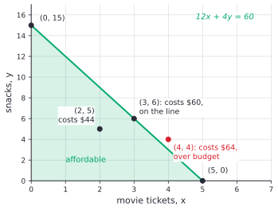
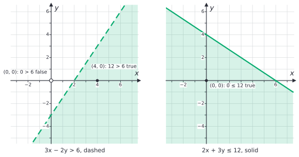
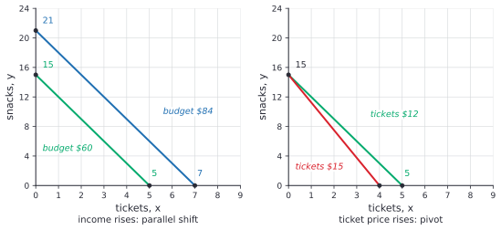
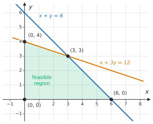
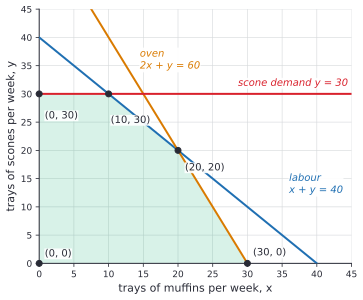
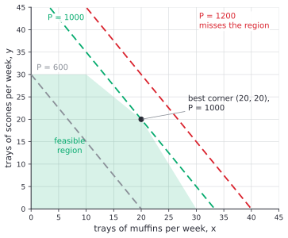

# Two-variable inequalities and feasible regions

After this lesson you can graph a linear inequality in two variables, graph a system of them and find the corner points of the region, solve a small linear program by checking the corners, and describe a budget constraint.

Before this: [forms of linear equations](01-forms-of-linear-equations.md), [systems of linear equations](02-systems-of-linear-equations.md), and [inequalities](../../02-middle-school/03-expressions-equations-inequalities/05-inequalities.md).

## Quick check

Try these first. If you get all three right, skip to [Practice](#practice).

1. Which of $(0, 0)$, $(3, 3)$ and $(1, 2)$ satisfy $2x + y \le 5$?
2. For $3x - 2y > 6$, is the boundary line dashed or solid, and is $(0, 0)$ in the solution region?
3. The region $x \ge 0$, $y \ge 0$, $x + y \le 4$ has three corners. Find the largest value of $P = 3x + 2y$ over the region.

<details class="solution" markdown>
<summary>Answers</summary>

1. $(0, 0)$: $0 \le 5$ is true. $(3, 3)$: $9 \le 5$ is false. $(1, 2)$: $4 \le 5$ is true. So $(0, 0)$ and $(1, 2)$.
2. The inequality is strict, so the line is dashed. At $(0, 0)$ the statement is $0 > 6$, which is false, so the origin is not in the region.
3. The corners are $(0, 0)$, $(4, 0)$ and $(0, 4)$, with $P = 0$, $12$ and $8$. The largest value is 12, at $(4, 0)$.

</details>

## The idea

You have \$60 for movie tickets at \$12 each and snacks at \$4 each. With $x$ tickets and $y$ snacks, spending exactly \$60 gives the line $12x + 4y = 60$ from [forms of linear equations](01-forms-of-linear-equations.md). But you don't have to spend all of it. Any choice that costs at most \$60 is affordable, and that is the inequality $12x + 4y \le 60$. Its solutions are the points on the line and all the points below it.



One inequality gives a region instead of a line. Real problems have several limits at once: a budget, a number of hours, a supply of ingredients. Each limit is an inequality, and the choices that respect all of them together form a region. If each choice also earns a profit, the question becomes which point of the region earns the most. This lesson draws the regions, finds their corners, and shows that the best point is always at a corner.

## Definitions

A **linear inequality in two variables** is an inequality that can be written $Ax + By < C$, with $<$ replaced by $\le$, $>$ or $\ge$ in the other versions, where $A$, $B$ and $C$ are fixed numbers and $A$ and $B$ are not both 0. A solution is an ordered pair $(x, y)$ that makes it true, and the solution set is the set of all solutions.

The line $Ax + By = C$ divides the plane into two **half-planes**, and it is the **boundary** of each. In plain words, a half-plane is everything on one side of a line. A half-plane is open if it leaves out the boundary line, which goes with $<$ and $>$, and closed if it includes the line, which goes with $\le$ and $\ge$.

A **system of linear inequalities** is two or more inequalities in the same variables, and a solution satisfies all of them at once. The set of all solutions is the overlap of the half-planes. In an optimization problem, each inequality is a **constraint**, and the solution set is the **feasible region**: the points that respect every constraint. A problem with $x \ge 0$ and $y \ge 0$ among its constraints means the amounts can't be negative.

A **corner point** of a feasible region is a point of the region where two boundary lines cross. A region is **bounded** if it fits inside some circle, and unbounded if it goes on forever in some direction. If no point satisfies all the constraints, the region is empty, and the problem is **infeasible**.

An **objective function** is the quantity to be made as large or as small as possible, such as profit $P = ax + by$ or cost. A **linear program** is the problem of maximizing or minimizing a linear objective over a region given by linear constraints.

*Theorem.* Take $Ax + By \le C$. If $B > 0$ the solution set is the points on or below the line $y = -\frac{A}{B}x + \frac{C}{B}$. If $B < 0$ it is the points on or above that line. If $B = 0$ and $A \ne 0$ it is the points on or to the left of the vertical line $x = \frac{C}{A}$ when $A > 0$, and on or to the right when $A < 0$. The same holds with $<$, $>$ and $\ge$, with the line left out for strict inequalities and the sides swapped for $>$ and $\ge$.

*Proof.* Suppose $B > 0$. Subtract $Ax$ and divide by $B$, which is positive, so the symbol stays: $y \le -\frac{A}{B}x + \frac{C}{B}$. For a fixed $x$, the line has the height $-\frac{A}{B}x + \frac{C}{B}$, and the inequality says that $y$ is at most that height, which is a point on or below the line. If $B < 0$, dividing by $B$ reverses the symbol (the [rules for inequalities](../../02-middle-school/03-expressions-equations-inequalities/05-inequalities.md#the-rules-for-inequalities)), giving $y \ge \dots$, on or above the line. If $B = 0$, the inequality is $Ax \le C$, and dividing by $A$ gives $x \le \frac{C}{A}$ if $A > 0$ and $x \ge \frac{C}{A}$ if $A < 0$. $\blacksquare$

The theorem is the reason a **test point** works: the whole solution set is one side of the line, so one point not on the line shows which side.

## How to do it

### Graphing one inequality

1. Replace the inequality symbol by $=$ and graph the boundary line, for example by its intercepts. Draw it dashed if the inequality is strict ($<$ or $>$) and solid if it is not ($\le$ or $\ge$).
2. Pick a test point that is not on the line. The origin is the easiest, unless the line passes through it.
3. Substitute the test point into the original inequality. If the statement is true, shade the side that contains the test point. If it is false, shade the other side.
4. Check one point from the shaded side, and a point on the line: the line should satisfy the inequality only if it is solid.



When $y$ stands alone, you can skip the test: $y > mx + b$ is the region above the line and $y < mx + b$ is the region below it. Dividing by a negative number reverses the symbol, so $3x - 2y > 6$ becomes $y < 1.5x - 3$.

### Graphing a system and finding corners

1. Graph each inequality, with its boundary line and its shading. The feasible region is where all the shadings overlap.
2. Mark each corner: a point where two boundary lines cross and that lies in the region. Read off which two lines make it.
3. Find the exact coordinates by solving the system of those two boundary equations ([systems of linear equations](02-systems-of-linear-equations.md)).
4. Check each corner in all the other inequalities. A crossing of two lines that fails another inequality is not a corner of the region.

### Solving a linear program

1. Name the variables, with units, and say what each stands for.
2. Write each limit as an inequality. Add $x \ge 0$ and $y \ge 0$ if the amounts can't be negative.
3. Write the objective function.
4. Graph the feasible region and find its corners (steps above).
5. Compute the objective at each corner.
6. Pick the largest value (or the smallest, for a cost), and answer in a sentence with units.
7. Check that the winning corner satisfies every constraint, and compare it with one point inside the region. If the amounts must be whole numbers and the corner isn't, test the whole-number points near it.

### Why the best point is a corner

*Theorem.* Let the feasible region be a bounded polygon, and let $P = ax + by$ be the objective. Then the maximum value of $P$ over the region is reached at a corner point, and so is the minimum.

What we know: every constraint is a half-plane, and a half-plane contains the whole segment between any two of its points. Indeed, if $Ax_1 + By_1 \le C$ and $Ax_2 + By_2 \le C$, then for $0 \le t \le 1$ the point $t(x_1, y_1) + (1 - t)(x_2, y_2)$ gives $t(Ax_1 + By_1) + (1 - t)(Ax_2 + By_2) \le tC + (1 - t)C = C$. So the region contains the segment between any two of its points. The objective is linear, so $P$ at the point $tQ_1 + (1 - t)Q_2$ equals $tP(Q_1) + (1 - t)P(Q_2)$, a weighted average of the two values.

What we want: a corner $K$ with $P(K) \ge P(Q)$ for every point $Q$ of the region.

The plan: start from any point $Q$, slide to the boundary and then along an edge to a corner, without ever lowering $P$.

*Proof.* A weighted average of two numbers is at most the larger one, so for $Q$ on a segment from $Q_1$ to $Q_2$, $P(Q) \le \max(P(Q_1), P(Q_2))$.

Take any line through $Q$. Because the region is bounded, the line leaves the region in both directions, at two boundary points $E_1$ and $E_2$, and $Q$ is on the segment between them. By the remark above, one of $E_1$ and $E_2$, call it $E$, has $P(E) \ge P(Q)$. The point $E$ is on an edge of the polygon, a segment between two corners $K_1$ and $K_2$. By the same remark, $P(E) \le \max(P(K_1), P(K_2))$. So one of the corners, $K$, has $P(K) \ge P(E) \ge P(Q)$. A polygon has finitely many corners, so the corner with the largest $P$ beats every point. For the minimum, reverse the inequalities. $\blacksquare$

Look back: the picture is of lines of equal profit. The set where $P = k$ is a line, and increasing $k$ slides it across the plane. The last place it touches the region is a corner, or a whole edge when the line is parallel to that edge, in which case the two corners of the edge tie. The proof needs the region to be bounded. For an unbounded region there may be no maximum at all, and Example 4 shows what to do. It also needs non-strict inequalities: the region $x < 3$ has no largest $x$, because the corner $x = 3$ is not in it.

### A budget constraint

In economics, a consumer with income $I$ buys $x$ units of one good at price $p_x$ and $y$ units of another at price $p_y$. The **budget constraint** is

$$
p_xx + p_yy \le I, \qquad x \ge 0, \quad y \ge 0.
$$

The **budget line** $p_xx + p_yy = I$ has intercepts $\frac{I}{p_x}$ and $\frac{I}{p_y}$, the most of each good you could buy alone. Its slope is $-\frac{p_x}{p_y}$, which is the **opportunity cost** of one more unit of $x$, measured in units of $y$ that you give up. In the ticket example the slope is $-\frac{12}{4} = -3$: each extra ticket costs 3 snacks.

A change in income or in a price changes the line in a predictable way. If income rises from \$60 to \$84 the intercepts become $\frac{84}{12} = 7$ and $\frac{84}{4} = 21$, and the line shifts out and stays parallel, because the prices, and so the slope, have not changed. If the ticket price rises from \$12 to \$15, the $y$-intercept stays at $\frac{60}{4} = 15$ and the $x$-intercept falls to $\frac{60}{15} = 4$. The line pivots around the $y$-intercept, and its slope steepens to $-\frac{15}{4} = -3.75$.



## Worked examples

<div class="example" markdown>

### Example 1: a strict inequality

Graph $3x - 2y > 6$.

Step 1: replace $>$ by $=$: the line $3x - 2y = 6$ has intercepts $(2, 0)$ and $(0, -3)$. The inequality is strict, so draw the line dashed.

Step 2: the origin is not on the line, so use it as the test point.

Step 3: at $(0, 0)$ the statement is $0 > 6$, which is false. So shade the side that does not contain the origin, which is the side below and to the right of the line.

Step 4: check. The point $(4, 0)$ is in the shaded part, and $3(4) - 0 = 12 > 6$ is true. The point $(2, 0)$ is on the line, and $6 > 6$ is false, so the line is not part of the solution, which agrees with the dashed line. Solving for $y$ gives $y < 1.5x - 3$, below the line, in agreement with the shading. This is the left panel of the figure above.

<div class="warning" markdown>

Watch out at Step 3: shade by what the test point says, not by what the symbol looks like. The symbol is $>$, but the region is below the line, because dividing by $-2$ turns it into $y <$. A test point is the safe way, since it doesn't depend on which way the symbol flips.

</div>

</div>

<div class="example" markdown>

### Example 2: a system and its corners

Find the corners of the region $x \ge 0$, $y \ge 0$, $x + y \le 6$ and $x + 3y \le 12$.

Graph the four boundary lines and shade the overlap. The result is a four-sided region.



Step 2: read off the pairs. The axes cross at $(0, 0)$. The line $x + y = 6$ meets the $x$-axis at $(6, 0)$, and the line $x + 3y = 12$ meets the $y$-axis at $(0, 4)$. The two slanted lines meet somewhere in the middle.

Step 3: for that last corner, solve $x + y = 6$ and $x + 3y = 12$. Subtract the first from the second: $2y = 6$, so $y = 3$ and $x = 3$. The corner is $(3, 3)$.

Step 4: check each corner in the other inequalities. For $(6, 0)$: $6 + 0 = 6 \le 12$, fine. For $(0, 4)$: $0 + 4 = 4 \le 6$, fine. For $(3, 3)$: $6 \le 6$ and $12 \le 12$, both true with equality. The other two crossings, $x + y = 6$ with the $y$-axis at $(0, 6)$ and $x + 3y = 12$ with the $x$-axis at $(12, 0)$, fail the other line ($0 + 18 > 12$ and $12 + 0 > 6$), so they are not corners.

The corners are $(0, 0)$, $(6, 0)$, $(3, 3)$ and $(0, 4)$.

</div>

<div class="example" markdown>

### Example 3: a bakery's profit

A bakery makes $x$ trays of muffins and $y$ trays of scones a week. Each tray takes 1 hour of labour, and there are 40 hours of labour available. A muffin tray uses 2 hours of oven time and a scone tray uses 1 hour, and the oven has 60 hours. At most 30 trays of scones can be sold. A tray of muffins earns \$30 profit and a tray of scones \$20. (The numbers are made up.) How many trays of each maximize the profit?

Step 1: $x$ and $y$ are trays per week. Step 2: the constraints are

$$
\begin{aligned}
x + y &\le 40 && \text{labour} \\
2x + y &\le 60 && \text{oven} \\
y &\le 30 && \text{scone demand} \\
x &\ge 0, \ y \ge 0.
\end{aligned}
$$

Step 3: the profit is $P = 30x + 20y$ dollars.

Step 4: graph the region and find the corners.



The corner $(30, 0)$ is where $2x + y = 60$ meets $y = 0$. The corner $(20, 20)$ is where $x + y = 40$ meets $2x + y = 60$: subtracting gives $x = 20$ and then $y = 20$. The corner $(10, 30)$ is where $x + y = 40$ meets $y = 30$. Together with $(0, 30)$ and $(0, 0)$ that is five corners, and each one satisfies all the constraints. For example, $(10, 30)$ uses $40$ labour hours and $2(10) + 30 = 50$ oven hours.

Step 5: compute the profit at each corner.

| Corner $(x, y)$ | $(0, 0)$ | $(30, 0)$ | $(20, 20)$ | $(10, 30)$ | $(0, 30)$ |
|---|---|---|---|---|---|
| $P = 30x + 20y$ | 0 | 900 | 1000 | 900 | 600 |

Step 6: the largest is \$1,000, at $(20, 20)$. The bakery should bake 20 trays of muffins and 20 trays of scones a week, for a profit of \$1,000.

Step 7: check. At $(20, 20)$, labour is $40$ of 40 hours and oven time is $60$ of 60 hours, so both are used up, while scones are $20 \le 30$. An inside point such as $(15, 15)$ gives $450 + 300 = 750$, less than 1,000, as the theorem says it should be.



The picture of equal-profit lines shows why. The line $P = 600$ cuts through the region and passes through the corner $(0, 30)$, and lines of higher profit lie farther up and right. The line $P = 1000$ just touches the region at $(20, 20)$, and $P = 1200$ misses it. Here the profit lines have slope $-\frac{30}{20} = -1.5$, which lies between the slopes of the labour line ($-1$) and the oven line ($-2$), and that is why the best corner is where those two lines meet.

</div>

<div class="example" markdown>

### Example 4: no region, and a region that goes on forever

(a) Graph $x + y \le 2$ and $x + y \ge 5$. (b) Find the smallest and largest values of $x + y$ over $x \ge 0$, $y \ge 0$, $x + y \ge 4$.

(a) A point would need $x + y$ to be at most 2 and at least 5 at once, which is impossible. The two shaded half-planes are on opposite sides of parallel lines and don't overlap. The system is infeasible: the region is empty. In a real problem this means the requirements conflict, such as needing at least 5 items while a budget allows at most 2.

(b) The region is the part of the first quadrant on or above the line $x + y = 4$. It is unbounded. There is no largest value of $x + y$, since moving farther out makes it as big as you like. For the smallest value, the corners are $(4, 0)$ and $(0, 4)$, and $x + y = 4$ at both. Every point on the segment between them also gives 4, so the minimum is 4 and it is reached at every point of that edge. Any point of the region with $x + y > 4$ is worse, so 4 is the minimum.

Check: $(2, 2)$ is on the edge and gives 4. $(3, 3)$ is inside the region and gives 6, larger than 4.

</div>

<div class="example" markdown>

### Example 5: new prices (finish it yourself)

The bakery of Example 3 changes its prices: a tray of muffins now earns \$50 and a tray of scones \$10, so $P = 50x + 10y$. The region and its corners are the same. Here are the first two values.

| Corner | $(0, 0)$ | $(30, 0)$ | $(20, 20)$ | $(10, 30)$ | $(0, 30)$ |
|---|---|---|---|---|---|
| $P = 50x + 10y$ | 0 | 1500 | ? | ? | ? |

Compute the other three, choose the best corner, and say why it changed.

<details class="solution" markdown>
<summary>Finish</summary>

At $(20, 20)$: $1000 + 200 = 1200$. At $(10, 30)$: $500 + 300 = 800$. At $(0, 30)$: $300$. The largest is \$1,500 at $(30, 0)$: bake 30 trays of muffins and no scones.

The slope of the profit lines is now $-5$, steeper than the oven line's slope of $-2$, so the profit lines hit the corner on the $x$-axis last. Muffins pay so much more that the scones' labour is better spent on more muffins.

Check: $(30, 0)$ is feasible, with 30 labour hours and 60 oven hours. The inside point $(20, 10)$ gives $1000 + 100 = 1100 < 1500$.

</details>

</div>

## Edge cases and common mistakes

<div class="warning" markdown>

Watch out for the origin as a test point when the boundary passes through it. For $x - 2y \ge 0$ the line is $y = \frac{1}{2}x$, which contains $(0, 0)$, and $0 \ge 0$ is true on the line itself, so it says nothing about a side. Use another point such as $(1, 0)$: $1 \ge 0$ is true, so shade the side containing $(1, 0)$, which is below the line.

</div>

<div class="warning" markdown>

Watch out for dashed and solid lines. A solid line means points on it count, so use it for $\le$ and $\ge$. A dashed line means they don't. In a real constraint such as a budget, "at most" is $\le$, and the line is solid.

</div>

<div class="warning" markdown>

Watch out when you list corners: a pair of boundary lines always crosses somewhere (unless parallel), but the crossing is a corner only if it satisfies every other constraint. In Example 2, the crossings $(0, 6)$ and $(12, 0)$ are not corners.

</div>

<div class="warning" markdown>

Watch out for the optimum at a corner that is not a whole number. If you can't make 2.5 trays, the best whole-number point is near the corner but not always at the nearest whole point, so test the whole-number points around it against the constraints.

</div>

Horizontal and vertical boundaries work the same way: $y \le 30$ shades below the horizontal line, and $x > -2$ shades to the right of the vertical line $x = -2$. When two constraints have parallel boundaries, such as $x + y \le 2$ and $x + y \ge 5$, the region may be a strip or may be empty.

## Tricks and shortcuts

To list the corners without a drawing, solve every pair of boundary equations, then keep the solutions that satisfy all the other constraints. With $n$ constraints there are at most $\frac{n(n-1)}{2}$ pairs, so it is only practical for small problems, but it is a good check on a graph.

Compare the slope of the objective's lines with the slopes of the constraint lines. For $P = ax + by$ the equal-value lines have slope $-\frac{a}{b}$. The best corner is where the equal-value line, sliding in the direction of higher $P$, last touches the region, and that depends only on how this slope compares with the slopes of the boundary lines next to the corner. In Example 3 the slope $-1.5$ fell between $-1$ and $-2$, so the corner between those two lines won.

Linear programs have the pattern "stay within limits, get the most": think of resources used and a payoff per unit. Writing a table of resource use per unit makes the constraints easy to read off.

## In code

The corners of a region are the feasible crossings of pairs of boundary lines, and the formulas for $x$ and $y$ from [systems of linear equations](02-systems-of-linear-equations.md#detecting-the-three-cases-from-the-coefficients) find each crossing. This code does that for the bakery and checks the best corner against a search of every whole-number point.

<details class="code" markdown>
<summary>In code</summary>

```python
from fractions import Fraction
from itertools import combinations

# Each constraint (a, b, c) means a*x + b*y <= c. The last two are x >= 0 and y >= 0.
constraints = [(1, 1, 40), (2, 1, 60), (0, 1, 30), (-1, 0, 0), (0, -1, 0)]

def feasible(x, y):
    return all(a * x + b * y <= c for a, b, c in constraints)

corners = set()
for (a1, b1, c1), (a2, b2, c2) in combinations(constraints, 2):
    D = a1 * b2 - a2 * b1
    if D != 0:  # the two boundary lines cross in exactly one point
        x = Fraction(c1 * b2 - c2 * b1, D)
        y = Fraction(a1 * c2 - a2 * c1, D)
        if feasible(x, y):
            corners.add((x, y))

profit = lambda p: 30 * p[0] + 20 * p[1]
print(sorted((int(x), int(y)) for x, y in corners))
# [(0, 0), (0, 30), (10, 30), (20, 20), (30, 0)]
best = max(corners, key=profit)
print(int(best[0]), int(best[1]), int(profit(best)))  # 20 20 1000

grid = max((profit((x, y)), x, y) for x in range(41) for y in range(41) if feasible(x, y))
print(grid)  # (1000, 20, 20)
```

Both searches agree. The loop tries every pair of lines and keeps the crossings that satisfy all the constraints, which is the "list the corners" trick above. Real solvers do not try every pair. They move from corner to corner, using the theorem above, and ask for the best neighbour.

</details>

## FAQ

### Why does one test point decide the whole side?

Because the solution set is one whole side of the line (the theorem in [Definitions](#definitions)). Writing the inequality as $y$ above or below the line shows that every point on one side behaves the same way, so one test point speaks for all of them.

### Why is the optimum at a corner and not in the middle?

The objective is a flat tilted surface over the plane, with no hills inside the region, so it keeps improving in one direction until the boundary stops it. In the proof, from any inside point you can slide in a direction where the value doesn't go down, and keep sliding until you reach the boundary and then a corner.

### What if two corners give the same best value?

Then every point on the edge between them gives that value too, as in Example 4(b). The problem has many best answers, and a corner is still one of them. In practice you pick whichever suits other needs.

### What if the problem needs whole numbers?

The corner may not be a whole-number point. Then the answer is the best whole-number point that satisfies the constraints, found by testing points near the corner. This is called integer programming, and it is harder than ordinary linear programming.

## Practice

### Warm-up

1\. Which of the points $(0, 0)$, $(2, 1)$, $(3, 2)$ and $(-1, -6)$ satisfy $y \ge 2x - 3$?

<details class="solution" markdown>
<summary>Solution</summary>

Substitute each point.

- $(0, 0)$: $0 \ge -3$ is true.
- $(2, 1)$: $1 \ge 1$ is true. The point is on the line, which counts because the inequality is non-strict.
- $(3, 2)$: $2 \ge 3$ is false.
- $(-1, -6)$: $-6 \ge -5$ is false.

Check: the line $y = 2x - 3$ passes through $(2, 1)$. The point $(3, 2)$ is below it, since the line is at height 3 when $x = 3$.

</details>

2\. For each inequality say whether the boundary is dashed or solid, and which side to shade: (a) $y < -x + 4$, (b) $2x - y \le 5$, (c) $x > -2$.

<details class="solution" markdown>
<summary>Solution</summary>

- (a) Strict, so dashed. With $y$ alone and a $<$, shade below the line.
- (b) Non-strict, so solid. The test point $(0, 0)$ gives $0 \le 5$, true, so shade the side containing the origin. Solving for $y$ gives $y \ge 2x - 5$, above the line, and the origin is above the line $y = 2x - 5$, which agrees.
- (c) Strict, so a dashed vertical line at $x = -2$, with the region to its right.

Check (c) with $(0, 0)$: $0 > -2$ is true, and the origin is to the right of $x = -2$.

</details>

3\. (Reviews [inequalities](../../02-middle-school/03-expressions-equations-inequalities/05-inequalities.md).) For $3x - 2y > 6$, set $x = 4$ and solve for $y$, then do the same for $x = 0$. What do the answers say about the graph in Example 1?

<details class="solution" markdown>
<summary>Solution</summary>

For $x = 4$: $12 - 2y > 6$, so $-2y > -6$, and dividing by $-2$ reverses the symbol: $y < 3$. For $x = 0$: $-2y > 6$, so $y < -3$.

On the vertical line $x = 4$ the solutions are the points below $y = 3$, and on $x = 0$ the points below $y = -3$. These heights are on the dashed line $y = 1.5x - 3$: at $x = 4$ it is $3$ and at $x = 0$ it is $-3$. So the region is below the line, as found.

Check: $(4, 2)$ gives $12 - 4 = 8 > 6$, true, and $2 < 3$.

</details>

### Standard

4\. Find the corners of the region $x \ge 0$, $y \ge 0$, $2x + y \le 10$ and $x + 3y \le 15$. Then find the maximum of $P = 4x + 3y$ over it, and the minimum.

<details class="solution" markdown>
<summary>Solution</summary>

The axes cross at $(0, 0)$. The line $2x + y = 10$ meets the $x$-axis at $(5, 0)$, and $x + 3y = 15$ meets the $y$-axis at $(0, 5)$. For the crossing of the two lines, put $y = 10 - 2x$ into $x + 3y = 15$: $x + 30 - 6x = 15$, so $x = 3$ and $y = 4$.

Check the corners: $(5, 0)$ gives $5 \le 15$, $(0, 5)$ gives $5 \le 10$, and $(3, 4)$ gives $6 + 4 = 10$ and $3 + 12 = 15$. All are in the region.

$P$ at the corners: $(0, 0)$: 0. $(5, 0)$: 20. $(3, 4)$: $12 + 12 = 24$. $(0, 5)$: 15. The maximum is 24 at $(3, 4)$ and the minimum is 0 at $(0, 0)$.

</details>

5\. You have \$90 to spend on books at \$15 each and notebooks at \$3 each. (a) Write the budget constraint, find the intercepts of the budget line and say what its slope means. (b) Is $(4, 10)$ affordable? (c) The price of a book rises to \$18. Where do the intercepts go?

<details class="solution" markdown>
<summary>Solution</summary>

(a) With $x$ books and $y$ notebooks, $15x + 3y \le 90$, which is $5x + y \le 30$ after dividing by 3. The intercepts are $(6, 0)$ and $(0, 30)$. The slope is $-5$: each book costs 5 notebooks.

(b) $15(4) + 3(10) = 60 + 30 = 90 \le 90$ is true, so it is affordable, and exactly on the budget line.

(c) With the new price, $18x + 3y \le 90$, so $6x + y \le 30$. The $y$-intercept stays at $(0, 30)$ and the $x$-intercept moves from 6 to $\frac{90}{18} = 5$. The line pivots around $(0, 30)$ and becomes steeper, with slope $-6$.

Check: $(6, 0)$ costs $15 \cdot 6 = 90$ and $(0, 30)$ costs $3 \cdot 30 = 90$.

</details>

6\. A server has 100 CPU-minutes and 80 GB-hours of memory each night. A job of type A needs 2 CPU-minutes and 1 GB-hour and earns \$3. A job of type B needs 1 CPU-minute and 2 GB-hours and earns \$4. (The numbers are made up.) How many of each should it run to earn the most?

<details class="solution" markdown>
<summary>Solution</summary>

Let $x$ and $y$ be the numbers of jobs of types A and B. The constraints are $2x + y \le 100$ (CPU), $x + 2y \le 80$ (memory), $x \ge 0$ and $y \ge 0$. The objective is $P = 3x + 4y$.

The corners are $(0, 0)$, $(50, 0)$ where the CPU line meets the $x$-axis, and $(0, 40)$ where the memory line meets the $y$-axis. The two lines cross where $y = 100 - 2x$ gives $x + 200 - 4x = 80$, so $x = 40$ and $y = 20$.

Values of $P$: $0$, $150$, $160$ and $3(40) + 4(20) = 200$. The best is 200 at $(40, 20)$: run 40 jobs of type A and 20 of type B for \$200.

Check: $2(40) + 20 = 100$ and $40 + 2(20) = 80$, so both resources are used up. The point $(0, 40)$ is feasible and earns only 160.

</details>

### Challenge

7\. Minimize $C = 2x + 3y$ subject to $x + y \ge 10$, $x + 3y \ge 18$, $x \ge 0$ and $y \ge 0$. The region is unbounded, so the corner theorem does not apply directly. Show that the minimum is still at a corner.

<details class="solution" markdown>
<summary>Solution</summary>

The corners are $(0, 10)$, where $x + y = 10$ meets the $y$-axis (and $0 + 30 \ge 18$ holds); $(18, 0)$, where $x + 3y = 18$ meets the $x$-axis (and $18 \ge 10$ holds); and the crossing of the two lines, where subtracting gives $2y = 8$, so $y = 4$ and $x = 6$. The crossings $(10, 0)$ and $(0, 6)$ fail the other inequality, so they are not corners. The values are $C(0, 10) = 30$, $C(6, 4) = 24$ and $C(18, 0) = 36$.

To make the region bounded, cut it off with $x \le 40$ and $y \le 40$. The new corners are $(40, 0)$, $(40, 40)$ and $(0, 40)$, with $C = 80$, $200$ and $120$. All are bigger than 24. A point of the original region outside the cut has $x > 40$ or $y > 40$, so $C > 80$. So the minimum over the whole region is also the minimum over the bounded polygon, which the theorem puts at a corner. The smallest corner value is 24, so the minimum cost is 24, at $(6, 4)$.

There is no maximum, since $C$ grows without bound as $x$ or $y$ grows.

Check: $(6, 4)$ gives $6 + 4 = 10$ and $6 + 12 = 18$, both on the boundary, and $2(6) + 3(4) = 24$. The feasible point $(10, 10)$ costs 50.

</details>

8\. In Example 3, the profit on a tray of scones changes to $s$ dollars, so $P = 30x + sy$. For which values of $s$ is $(20, 20)$ still a best corner?

<details class="solution" markdown>
<summary>Solution</summary>

The corner $(20, 20)$ is best when its profit is at least that of its two neighbours, $(30, 0)$ and $(10, 30)$ (the corner $(0, 30)$ gives $30s$, which is at most 900 when $s \le 30$ and so is no better, and $(0, 0)$ gives 0). At $(20, 20)$ the profit is $600 + 20s$. At $(30, 0)$ it is $900$, and at $(10, 30)$ it is $300 + 30s$.

First, $600 + 20s \ge 900$ gives $s \ge 15$. Second, $600 + 20s \ge 300 + 30s$ gives $300 \ge 10s$, so $s \le 30$. So $(20, 20)$ is best for $15 \le s \le 30$.

At $s = 15$ it ties with $(30, 0)$, and at $s = 30$ with $(10, 30)$. In slope terms, the profit lines have slope $-\frac{30}{s}$, which lies between $-2$ and $-1$ exactly when $15 \le s \le 30$.

Check with $s = 20$: the table gives 1,000 at $(20, 20)$, more than 900 at both neighbours. With $s = 10$: $(20, 20)$ gives 800 but $(30, 0)$ gives 900, so $s = 10$ is out, as expected.

</details>

## Where this shows up

- [Polynomial and rational inequalities](../06-rational-expressions-and-equations/04-polynomial-and-rational-inequalities.md) uses the same idea of testing one point in each region. Optimization<!-- link: ../../05-university-core/03-applications-of-derivatives/05-optimization.md --> in calculus finds best points of curved functions, and Lagrange multipliers<!-- link: ../../05-university-core/09-multivariable-calculus-light/03-multivariable-optimization-and-lagrange-multipliers.md --> handles a curved objective under a constraint.
- In computing, linear programming schedules jobs, allocates resources, and solves network flow and shortest-path problems as special cases. The simplex method moves from corner to corner, and integer programming (whole-number answers) is a standard hard problem, as in P, NP and NP-completeness<!-- link: ../../06-cs-math/06-theory-of-computation/07-p-np-and-np-completeness.md -->.
- In economics, the budget constraint is the starting point of consumer choice: opportunity cost and the PPC<!-- link: ../../07-economics-math/02-markets/01-opportunity-cost-and-the-ppc.md --> uses the same slope idea, and utility and indifference curves<!-- link: ../../07-economics-math/03-firms-and-consumers/04-utility-and-indifference-curves.md --> adds curves that show what the consumer prefers on the budget line.
