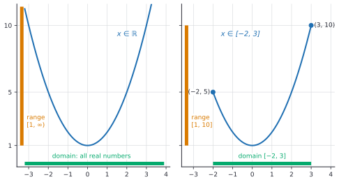

# What is a function

After this lesson you can state the precise definition of a function $f \colon A \to B$, name its domain, codomain and range, write a function as a set of ordered pairs, find the natural domain of a formula, decide whether two functions are equal, and read a type signature in code as a domain and a codomain.

Before this: [introduction to functions](../../02-middle-school/05-linear-relationships-and-functions/03-intro-to-functions.md), [real numbers, axioms and set notation](../01-algebra-foundations/01-real-numbers-axioms-and-set-notation.md), and [compound inequalities and interval notation](../01-algebra-foundations/03-compound-inequalities-and-interval-notation.md).

## Quick check

Try these first. If you get all three right, skip to [Practice](#practice).

1. Find the natural domain of $g(x) = \sqrt{6 - 2x}$, in interval notation.
2. For $f \colon \mathbb{R} \to \mathbb{R}$ with $f(x) = x^2 + 1$, give the domain, the codomain and the range.
3. Are $f(x) = \frac{x^2 - 4}{x - 2}$ and $g(x) = x + 2$ equal functions, each on its natural domain?

<details class="solution" markdown>
<summary>Answers</summary>

1. The square root needs $6 - 2x \ge 0$, so $x \le 3$. The natural domain is $(-\infty, 3]$.
2. The domain and the codomain are both $\mathbb{R}$. A square is never negative, so $x^2 + 1 \ge 1$, and every number $y \ge 1$ occurs (take $x = \sqrt{y - 1}$). The range is $[1, \infty)$.
3. No. The domain of $f$ leaves out 2, because the denominator is 0 there, and the domain of $g$ is every real number. The two agree at every input except 2, where $g(2) = 4$ and $f(2)$ doesn't exist.

</details>

## The idea

A programmer reads this line: `def length(s: str) -> int`. It says three things. The function takes a string, it returns an integer, and the body of the function says which integer. The first two parts are as much a part of the function as the rule is. They also promise something, and the promise has a gap. Every string has a length, so every allowed input gets an output. But `int` includes $-5$, and no string has length $-5$. The set of outputs the signature allows is bigger than the set of outputs that ever occur.

The [introduction to functions](../../02-middle-school/05-linear-relationships-and-functions/03-intro-to-functions.md) named two of these sets: the domain, the allowed inputs, and the range, the outputs that occur. It left out the middle one, the set the outputs are allowed to come from, called the codomain. Naming all three, the domain, the codomain and the rule, is what turns "a rule" into a precise object. Later lessons depend on that precision. Whether a function has an inverse depends on its codomain, and two functions can be composed only when the outputs of one are allowed inputs of the other.

A second reason is that one formula can define different functions. The rule "square the input" on all real numbers sends both $2$ and $-2$ to 4, so the output 4 can't be traced back to one input. The same rule on the inputs $0$ and up has no such problem. A formula is only half the story; the sets matter too.

## Definitions

Let $A$ and $B$ be sets. A **function** $f$ from $A$ to $B$, written $f \colon A \to B$, assigns to each element $a$ of $A$ exactly one element of $B$, written $f(a)$. The set $A$ is the **domain** of $f$, and the set $B$ is the **codomain** of $f$.

In plain words, a function is a rule together with two sets: where the inputs come from, and where the outputs are allowed to land. "Exactly one" means two things at once. Every input has an output, and no input has two. The notation $f \colon A \to B$ is read "$f$ is a function from $A$ to $B$". The colon here is part of the arrow notation; it is not a division sign.

The rule can be given by a formula, a table, a graph or a sentence. When the rule is a formula, the **maps-to** arrow shows what happens to one element: $x \mapsto x^2$ is read "$x$ maps to $x^2$". A complete description combines both arrows:

$$
f \colon \mathbb{R} \to \mathbb{R}, \qquad x \mapsto x^2.
$$

This is the same function as "$f(x) = x^2$ with domain $\mathbb{R}$ and codomain $\mathbb{R}$", written in a form that can't leave a set out. Notice that the two arrows are different: $\to$ goes between sets, and $\mapsto$ goes between elements.

For a subset $S$ of the domain, the **image** of $S$ under $f$ is the set of outputs produced by the elements of $S$:

$$
f(S) = \{ f(a) : a \in S \}.
$$

The image of the whole domain, $f(A)$, is the **range** of $f$. It is always a subset of the codomain, and it can be smaller. For $f \colon \mathbb{R} \to \mathbb{R}$ with $f(x) = x^2$, the codomain is $\mathbb{R}$, but the range is $[0, \infty)$. In plain words, the codomain is where outputs are allowed to be, and the range is where they actually are. Some books use "range" for the codomain, so check the author's definition. This book always means the image.


A function can also be written as a set of pairs. The **Cartesian product** $A \times B$ is the set of all ordered pairs $(a, b)$ with $a \in A$ and $b \in B$; it is covered in sets and set operations<!-- link: ../../04-proofs-and-logic/02-logic-and-sets/06-sets-and-set-operations.md -->. The **graph** of $f \colon A \to B$ is the set of pairs

$$
\{ (a, f(a)) : a \in A \} \subseteq A \times B.
$$

A subset $G$ of $A \times B$ is the graph of a function from $A$ to $B$ exactly when each $a$ in $A$ appears as the first entry of exactly one pair in $G$. That sentence is the definition in disguise: "at least one pair" says every input has an output, and "at most one" says no input has two. This is also what the vertical line test checks on a drawn graph. For example, with $A = \{1, 2, 3\}$ and $B = \{4, 5, 6\}$, the set $\{(1, 4), (2, 5), (3, 4)\}$ is the graph of a function. Two inputs may share an output, and 6 is in the codomain without being an output.

Two functions $f \colon A \to B$ and $g \colon C \to D$ are **equal**, written $f = g$, when they have the same domain ($A = C$), the same codomain ($B = D$), and $f(a) = g(a)$ for every $a$ in $A$. In plain words, equal functions do the same thing to the same inputs, and they are declared on the same sets. Two formulas that look different, such as $2(x + 1)$ and $2x + 2$, give equal functions when the sets match, because the formulas agree for every input. Some books leave the codomain out of the test, since the graph doesn't show it. This book keeps it in, because the codomain decides later questions about inverses.

Finally, a formula given with no domain at all gets its **natural domain** (also called the implied domain): the set of all real numbers for which the formula gives a real number. The natural domain of $\frac{1}{x - 2}$ is every real number except 2, and the natural domain of $\sqrt{x}$ is $[0, \infty)$. Interval notation, as in [compound inequalities and interval notation](../01-algebra-foundations/03-compound-inequalities-and-interval-notation.md), writes these sets compactly: a square bracket includes the endpoint, a round bracket leaves it out, and $\cup$ joins pieces.

## How to do it

### Finding the natural domain

1. Start with every real number as a possible input.
2. Remove every input that makes a denominator 0. Solve "denominator $= 0$" and list the solutions.
3. Remove every input that puts a negative number under a square root, or any even root. Solve "radicand $\ge 0$". If the root is also in a denominator, the radicand must be strictly positive, since a root equal to 0 would put a 0 in the denominator.
4. Keep only the inputs that survive every condition at once: intersect the conditions.
5. Write the answer in interval notation and join the pieces with $\cup$.
6. Check the boundary values by substituting them. Each excluded endpoint should break the formula, and each included endpoint should give a real number.

Step 4 is the one that is easy to skip. A formula such as $\frac{\sqrt{x + 1}}{x - 3}$ has two conditions, $x \ge -1$ and $x \ne 3$, and both apply. A real situation can add conditions that the formula doesn't know about: the number of pizzas is a whole number, and a length can't be negative.

### Finding the range

1. Write $y = f(x)$ and ask which values of $y$ have a solution $x$ in the domain.
2. Solve for $x$ in terms of $y$ if the algebra allows it. A value of $y$ is in the range exactly when the solution exists, and lies in the domain.
3. If solving is hard, use the shape: complete the square, find the smallest or largest value, or read the graph. A graph can show the range, but the algebra proves it.
4. Check by choosing a value of $y$ you claim is in the range and finding its input, and a value you claim is outside and seeing that the equation fails.

The range depends on the domain. The same rule on a smaller domain usually has a smaller range, as the figure below shows for $x^2 + 1$.



Because the two graphs have different domains, they belong to two different functions, even though both come from the formula $x^2 + 1$.

### Deciding whether a set of pairs is a function

1. State the domain you are testing against. The pairs alone don't say which inputs are required.
2. For each element of the domain, count the pairs that start with it. Each count must be exactly 1.
3. If some input has count 0, the pairs are not a function on that domain. They may still be a function on a smaller domain.
4. If some input has count 2 or more, with different outputs, the pairs are not a function on any domain that contains that input.
5. Check that every output is in the codomain you were given.

### Deciding whether two functions are equal

1. Compare the domains and the codomains. If either differs, the functions are not equal, and you are done.
2. Compare the rules. Simplify both formulas, or subtract them and check that the difference is 0 for every input in the domain.
3. To show that two functions are not equal, find one input where they differ. One input is enough, and it must be in the common domain.

## Worked examples

<div class="example" markdown>

### Example 1: the natural domain of a quotient with a root

Find the natural domain of $h(x) = \dfrac{\sqrt{x + 1}}{x - 3}$.

Step 1: start with every real number.

Step 2: the denominator is 0 when $x - 3 = 0$, that is, at $x = 3$. Remove 3.

Step 3: the radicand must satisfy $x + 1 \ge 0$, so $x \ge -1$. The root is in the numerator, so 0 is allowed under it: $h(-1) = \frac{0}{-4} = 0$ is a fine output.

Step 4: both conditions apply. The inputs with $x \ge -1$ form the interval $[-1, \infty)$, and removing 3 from it leaves two pieces.

Step 5: the natural domain is

$$
[-1, 3) \cup (3, \infty).
$$

Step 6: check the edges. At $x = -1$ the formula gives $0$, so $-1$ stays, with a square bracket. At $x = 3$ it would divide by zero, so 3 is excluded with round brackets on both sides. At $x = -2$, a value outside, $\sqrt{-1}$ is not real. The graph below shows the same thing: it starts at $x = -1$ and breaks at the dashed line $x = 3$.


</div>

<div class="example" markdown>

### Example 2: one rule, two domains

Let $f(x) = x^2 + 1$. Find the range when the domain is $\mathbb{R}$, and when the domain is $[-2, 3]$.

For the domain $\mathbb{R}$, follow the steps for the range. Solving $y = x^2 + 1$ gives $x^2 = y - 1$, which has a real solution $x = \pm\sqrt{y - 1}$ exactly when $y \ge 1$. The range is $[1, \infty)$.

For the domain $[-2, 3]$, the smallest value of $x^2$ is 0, at $x = 0$, which is inside the domain, so the smallest output is $f(0) = 1$. The largest value of $x^2$ comes from the input farthest from 0, which is 3 (the other end, $-2$, is only 2 away), so the largest output is $f(3) = 10$. Every number between 1 and 10 is reached, because the graph is a continuous curve with no gaps. The range is $[1, 10]$.

These are two different functions. The outputs $f(-2) = 5$ and $f(3) = 10$ are the same under both, but the first function also has outputs such as $f(5) = 26$, which the second function has no input for.

Check: for the second function, pick $y = 7$, which is in $[1, 10]$. Then $x = \sqrt{6} \approx 2.45$ lies in $[-2, 3]$, so 7 is reached. For $y = 12$, outside, $x = \pm\sqrt{11}$, and $\sqrt{11} \approx 3.32 > 3$ while $-\sqrt{11} < -2$, so neither input is allowed.

</div>

<div class="example" markdown>

### Example 3: equal or not?

(a) Are $f(x) = \dfrac{x^2 - 4}{x - 2}$ and $g(x) = x + 2$ equal, each on its natural domain?

The domains differ: $f$ excludes 2, and $g$ doesn't. So the functions are not equal, by Step 1 of the equality test. Away from 2 the formulas agree, since $x^2 - 4 = (x - 2)(x + 2)$ and the factor $x - 2$ cancels when $x \ne 2$. The functions are equal if you give $g$ the domain $\mathbb{R} \setminus \{2\}$ as well. The common slip is to cancel the factor and say "so they are the same"; the cancellation is only valid for $x \ne 2$, and the domain remembers that.

(b) Are $k(x) = \sqrt{x^2}$ and $j(x) = x$ equal, each on its natural domain?

Both have domain $\mathbb{R}$. Try $x = -3$: $k(-3) = \sqrt{9} = 3$, but $j(-3) = -3$. They differ at one input, so they are not equal. In fact $\sqrt{x^2} = \lvert x \rvert$ for every real $x$, as in [roots, irrational numbers and types of numbers](../../02-middle-school/04-powers-roots-and-real-numbers/03-roots-irrationals-and-types-of-numbers.md), so $k$ equals the absolute value function. It agrees with $j$ only when $x \ge 0$.

(c) Are $u(x) = 2(x + 1)$ and $v(x) = 2x + 2$ equal, both from $\mathbb{R}$ to $\mathbb{R}$?

The domains and the codomains match. Expanding, $2(x + 1) = 2x + 2$ for every $x$, by the distributive property. So $u = v$.

Check (a): $f(3) = \frac{5}{1} = 5 = g(3)$, so the formulas agree away from 2, and $f(2)$ is undefined, which is the only disagreement.

</div>

<div class="example" markdown>

### Example 4: a function with a finite domain (finish it yourself)

Let $f \colon \{1, 2, 3, 4, 5\} \to \mathbb{Z}$ be given by $f(n) = n^2 - 6n$. Write $f$ as a set of ordered pairs and find its range.

The first two pairs are $(1, -5)$, because $1 - 6 = -5$, and $(2, -8)$, because $4 - 12 = -8$. Find the other three pairs, list the range, and say whether the range equals the codomain.

<details class="solution" markdown>
<summary>Finish</summary>

$f(3) = 9 - 18 = -9$, $f(4) = 16 - 24 = -8$ and $f(5) = 25 - 30 = -5$. So

$$
f = \{(1, -5), (2, -8), (3, -9), (4, -8), (5, -5)\}.
$$

The range is the set of distinct outputs, $\{-9, -8, -5\}$. It has three elements, although the domain has five, because $f(1) = f(5)$ and $f(2) = f(4)$. That is allowed. The codomain is $\mathbb{Z}$, which is far bigger than the range, so the range does not equal the codomain.

Check: each of the five inputs appears in exactly one pair, so the set is a function on this domain. The values are symmetric around $n = 3$, since $n^2 - 6n = (n - 3)^2 - 9$, which explains the repeats.

</details>

</div>

## Edge cases and common mistakes

<div class="warning" markdown>

Watch out: the domain is part of the function. The pairs $\{(1, 4), (2, 5)\}$ are a function from $\{1, 2\}$ to $\{4, 5\}$, and they are not a function from $\{1, 2, 3\}$, because the input 3 has no output. Before you decide, name the domain.

</div>

<div class="warning" markdown>

Watch out: range and codomain are different sets. For $f \colon \mathbb{R} \to \mathbb{R}$ with $f(x) = x^2$, the number $-1$ is in the codomain and not in the range. Writing "the range is $\mathbb{R}$" because the signature says $\to \mathbb{R}$ confuses the two.

</div>

<div class="warning" markdown>

Watch out: cancelling can change the domain. The formula $\frac{x^2 - 4}{x - 2}$ simplifies to $x + 2$, but the function keeps the exclusion $x \ne 2$. Find the natural domain from the original formula, before simplifying.

</div>

<div class="warning" markdown>

Watch out when a root sits in a denominator. For $\frac{1}{\sqrt{x - 2}}$ the radicand must be positive, not just non-negative, so the domain is $(2, \infty)$. At $x = 2$ the root is 0 and the formula divides by 0.

</div>

A few special cases are worth knowing. The empty set has exactly one function to any set $B$, the empty function, with no inputs and no pairs. A function from a one-element set $\{a\}$ to $B$ is just a choice of one element of $B$. A constant function sends every input to one output, so its range has a single element, although its codomain can be as large as you like.

Natural domains sometimes come out as a single point or as the empty set. The formula $\sqrt{x} + \sqrt{-x}$ needs $x \ge 0$ and $x \le 0$ at once, so its natural domain is $\{0\}$. The formula $\sqrt{-x^2 - 1}$ needs $x^2 \le -1$, which no real number satisfies, so its natural domain is empty and it defines no function worth using.

## Tricks and shortcuts

When you meet a new formula, scan for the three trouble spots in order: a fraction bar, an even root, and (in later lessons) a logarithm. Each trouble spot gives one condition on $x$, and the domain is everything that satisfies all of them. A formula with none of them, a polynomial for example, has domain $\mathbb{R}$.

To find the range of a quadratic, complete the square. For $f(x) = x^2 - 4x + 1 = (x - 2)^2 - 3$, a square is at least 0, so $f(x) \ge -3$, with equality at $x = 2$. The range on $\mathbb{R}$ is $[-3, \infty)$.

To count the functions between finite sets, count independent choices: each input picks an output on its own. A function from a set with $m$ elements to a set with $n$ elements has $n$ choices for each of $m$ inputs, so there are $n^m$ of them. Practice problem 7 uses this.

## In code

Type hints are domains and codomains written in the source. The code shows a signature, a pure function, a function that is only partial, and a way to make it total by enlarging the codomain.

<details class="code" markdown>
<summary>In code</summary>

```python
from math import sqrt

def length(s: str) -> int:
    return len(s)

print(length("function"), length(""))             # 8 0

words = ["map", "set", "list", "tuple", "dict"]
image = sorted({length(w) for w in words})
print(image)                                      # [3, 4, 5]

def root(x: float) -> float:
    return sqrt(x)

try:
    print(root(-1.0))
except ValueError as err:
    print("no output:", type(err).__name__)       # no output: ValueError

def safe_root(x: float) -> float | None:
    return sqrt(x) if x >= 0 else None

print(safe_root(9.0), safe_root(-9.0))            # 3.0 None

mark = {"A123": 81, "B456": 74, "C789": 81}
print(sorted(set(mark.values())))                 # [74, 81]

f = lambda x: 2 * (x + 1)
g = lambda x: 2 * x + 2
print(all(f(n) == g(n) for n in range(-5, 6)))    # True
```

The signature `length(s: str) -> int` gives the domain `str` and the codomain `int`. The set `image` is the image of the five words: three values out of all the integers, so the range is much smaller than the codomain. A function with no side effects, whose output depends only on its input, is a pure function, and it is a function in the mathematical sense.

The function `root` is declared on all floats, but `sqrt` raises an error for negative input. That is a partial function: some inputs in the declared domain have no output. A mathematical function is total, so to match the definition you either shrink the declared domain to $x \ge 0$, or enlarge the codomain, as `safe_root` does with `None`. The dictionary `mark` is a function given as a table; its keys are the domain, and two keys may share a value.

The last line tests that $f$ and $g$ agree at 11 inputs. That is evidence, not proof: equal functions agree at every input, and a test can only check some. The proof is the algebra from Example 3.

</details>

## FAQ

### If the range is what actually occurs, why bother with a codomain?

Because the codomain is a choice, and the choice changes what you can say. The function $x \mapsto x^2$ from $\mathbb{R}$ to $[0, \infty)$ has every element of its codomain as an output, and the same rule into $\mathbb{R}$ doesn't. That difference is exactly what separates "onto" from "not onto" in injective, surjective and bijective<!-- link: ../../04-proofs-and-logic/06-relations-and-functions/05-injective-surjective-bijective.md -->. In code, the codomain is the return type, which is declared before anyone computes the range.

### Is $f(x)$ the function, or a number?

The symbol $f$ is the function, and $f(x)$ is its output at the input $x$, a single element of the codomain. Everyone writes "the function $f(x) = x^2$", and that is fine as shorthand, as long as you remember what is being named. Writing $f$ alone, as in "$f \colon A \to B$", names the whole rule with its sets.

### Can the inputs and outputs be things other than numbers?

Yes. A function can take a string and return its length, take a graph and return its number of edges, or take a person and return a birthday. The definition only asks for two sets and a rule. Later lessons use functions between sets of numbers, and the proofs folder uses functions between arbitrary sets, as in functions and well-definedness<!-- link: ../../04-proofs-and-logic/06-relations-and-functions/04-functions-and-well-definedness.md -->.

### The number 4 has two square roots. Does that break the idea of a function?

It would, if "square root" meant both of them at once. The symbol $\sqrt{4}$ names only the principal root, 2, so $x \mapsto \sqrt{x}$ is a function from $[0, \infty)$ to $[0, \infty)$. The rule "send $x$ to a number whose square is $x$" is a relation, a set of pairs in which 4 appears twice. A function is a relation in which each input appears once. The related check, called well-definedness, asks whether a rule that involves a choice gives the same output however you choose, as in "send the fraction $\frac{a}{b}$ to $a$", which fails because $\frac{1}{2}$ and $\frac{2}{4}$ are the same fraction.

## Practice

### Warm-up

1\. Let $A = \{1, 2, 3, 4\}$ and $B = \{a, b, c\}$. Which of these are functions from $A$ to $B$? For each one that is, give the range. (a) $\{(1, a), (2, b), (3, a), (4, c)\}$. (b) $\{(1, a), (2, b), (3, c)\}$. (c) $\{(1, a), (1, b), (2, c), (3, c), (4, c)\}$. (d) The rule $n \mapsto a$ if $n$ is even and $n \mapsto b$ if $n$ is odd.

<details class="solution" markdown>
<summary>Solution</summary>

- (a) A function. Each of 1, 2, 3 and 4 starts exactly one pair. The range is $\{a, b, c\}$.
- (b) Not a function from $A$: the input 4 starts no pair.
- (c) Not a function: the input 1 starts two pairs, $(1, a)$ and $(1, b)$.
- (d) A function. Each number is even or odd, and not both. The outputs are $f(1) = b$, $f(2) = a$, $f(3) = b$, $f(4) = a$, so the range is $\{a, b\}$, and $c$ is in the codomain without being an output.

Check (a): the four pairs use the four inputs once each.

</details>

2\. (a) Let $g \colon \mathbb{Z} \to \mathbb{Z}$ be $g(n) = 2n + 1$. Give its domain, codomain and range. (b) A program has `def is_even(n: int) -> bool: return n % 2 == 0`. Give the domain, codomain and range.

<details class="solution" markdown>
<summary>Solution</summary>

(a) The domain and the codomain are both $\mathbb{Z}$. The outputs $2n + 1$ are exactly the odd integers, so the range is the set of odd integers. For example, 4 is not an output, since $2n + 1 = 4$ has no integer solution.

(b) The domain is the set of integers (`int`), and the codomain is $\{\text{True}, \text{False}\}$ (`bool`). Both outputs occur, since 4 gives True and 5 gives False, so the range equals the codomain.

Check (a): $g(-2) = -3$, $g(0) = 1$, $g(3) = 7$, all odd.

</details>

3\. Find the natural domain of each function. (a) $f(x) = \sqrt{2x - 8}$. (b) $g(x) = \dfrac{x}{x^2 - 9}$. (c) $h(x) = \dfrac{1}{\sqrt{x - 2}}$.

<details class="solution" markdown>
<summary>Solution</summary>

- (a) Need $2x - 8 \ge 0$, so $x \ge 4$. The domain is $[4, \infty)$.
- (b) The denominator is 0 when $x^2 = 9$, that is, $x = 3$ or $x = -3$. The domain is every real number except $\pm 3$: $(-\infty, -3) \cup (-3, 3) \cup (3, \infty)$.
- (c) The radicand must be positive, because the root is in a denominator: $x - 2 > 0$, so $x > 2$. The domain is $(2, \infty)$.

Check (c): $x = 2$ gives $\frac{1}{0}$, and $x = 3$ gives $\frac{1}{1} = 1$, a fine output.

</details>

### Standard

4\. Find the natural domain of $f(x) = \dfrac{\sqrt{x + 5}}{x^2 - x - 6}$.

<details class="solution" markdown>
<summary>Solution</summary>

The root needs $x + 5 \ge 0$, so $x \ge -5$. The denominator factors as $x^2 - x - 6 = (x - 3)(x + 2)$, which is 0 at $x = 3$ and $x = -2$. Remove both from $[-5, \infty)$:

$$
[-5, -2) \cup (-2, 3) \cup (3, \infty).
$$

Check: $f(-5) = \frac{0}{24} = 0$ is defined. At $x = -2$ and $x = 3$ the denominator is $4 + 2 - 6 = 0$ and $9 - 3 - 6 = 0$, so both really are excluded.

</details>

5\. Let $f(x) = x^2 - 4x + 1$. Find the range of $f$ when the domain is (a) $\mathbb{R}$, and (b) $[0, 3]$.

<details class="solution" markdown>
<summary>Solution</summary>

Complete the square: $f(x) = (x - 2)^2 - 3$.

(a) A square is at least 0, so $f(x) \ge -3$, with equality at $x = 2$. Every $y \ge -3$ occurs, since $x = 2 + \sqrt{y + 3}$ works. The range is $[-3, \infty)$.

(b) The vertex $x = 2$ is in $[0, 3]$, so the smallest output is $f(2) = -3$. At the ends, $f(0) = 1$ and $f(3) = 9 - 12 + 1 = -2$. The input 0 is 2 away from the vertex and the input 3 is only 1 away, so 0 gives the larger output. The range is $[-3, 1]$.

Check: $f(1) = 1 - 4 + 1 = -2$ and $f(2.5) = 6.25 - 10 + 1 = -2.75$, both in $[-3, 1]$.

</details>

6\. Decide whether $f = g$ in each case. (a) $f(x) = \dfrac{x^2 - 1}{x - 1}$ and $g(x) = x + 1$, each on its natural domain. (b) $f(x) = \sqrt{x^2}$ and $g(x) = \lvert x \rvert$, both on $\mathbb{R}$. (c) $f \colon \mathbb{R} \to \mathbb{R}$ and $g \colon \mathbb{R} \to [0, \infty)$, both given by $x \mapsto x^2$.

<details class="solution" markdown>
<summary>Solution</summary>

- (a) Not equal. The domain of $f$ excludes 1, and the domain of $g$ is $\mathbb{R}$. They agree for $x \ne 1$, but $g(1) = 2$ and $f(1)$ is undefined.
- (b) Equal. The domains match, and $\sqrt{x^2} = \lvert x \rvert$ for every real $x$ (for example $\sqrt{(-4)^2} = 4 = \lvert -4 \rvert$).
- (c) Not equal in this book. The domains and the rules match, but the codomains differ. They have the same graph. The second is onto its codomain and the first is not, which is the reason the codomain counts.

Check (b) at $x = -7$: $\sqrt{49} = 7$ and $\lvert -7 \rvert = 7$.

</details>

### Challenge

7\. (a) How many functions are there from $\{1, 2, 3\}$ to $\{a, b\}$? (b) How many from $\{a, b\}$ to $\{1, 2, 3\}$? (c) How many of the functions in (a) have a range with only one element?

<details class="solution" markdown>
<summary>Solution</summary>

(a) Each of the three inputs chooses one of the two outputs, independently of the others, so there are $2 \times 2 \times 2 = 2^3 = 8$ functions.

(b) Each of the two inputs chooses one of the three outputs, so there are $3 \times 3 = 3^2 = 9$ functions.

(c) A range with one element means all three inputs go to the same output. There are two such functions, the constant function $a$ and the constant function $b$.

Check by listing (a): writing a function as the triple $(f(1), f(2), f(3))$, the eight triples are $aaa, aab, aba, abb, baa, bab, bba, bbb$. Exactly two of them, $aaa$ and $bbb$, are constant. In general there are $n^m$ functions from an $m$-element set to an $n$-element set.

</details>

8\. (Reviews [slope and linear equations](../../02-middle-school/05-linear-relationships-and-functions/02-slope-and-linear-equations.md).) A linear function $f$ has $f(2) = 7$ and $f(5) = -2$. (a) Find a formula for $f$. (b) Give the range of $f$ when its domain is $[0, 10]$. (c) Give the natural domain and the range of $f$ on $\mathbb{R}$, and say which input gives the output 0.

<details class="solution" markdown>
<summary>Solution</summary>

(a) The slope is $\frac{-2 - 7}{5 - 2} = \frac{-9}{3} = -3$. From $7 = -3(2) + b$ we get $b = 13$, so $f(x) = -3x + 13$.

(b) The slope is negative, so the function falls from left to right. The largest output is at the left end, $f(0) = 13$, and the smallest is at the right end, $f(10) = -17$. The range is $[-17, 13]$.

(c) A line is defined for every $x$, so the natural domain is $\mathbb{R}$, and the range is $\mathbb{R}$, since $y = -3x + 13$ has the solution $x = \frac{13 - y}{3}$ for every $y$. The output 0 comes from $-3x + 13 = 0$, which gives $x = \frac{13}{3}$.

Check: $f(2) = -6 + 13 = 7$, $f(5) = -15 + 13 = -2$, and $f(\frac{13}{3}) = -13 + 13 = 0$.

</details>

## Where this shows up

- The next lesson, [reading function graphs](02-reading-function-graphs.md), reads the domain, the range and more off a drawn graph. [Composition and inverse functions](05-composition-and-inverse-functions.md) needs the codomain: an inverse exists only when every codomain element is reached exactly once.
- The proofs folder rebuilds this lesson on sets: functions and well-definedness<!-- link: ../../04-proofs-and-logic/06-relations-and-functions/04-functions-and-well-definedness.md --> treats a function as a set of ordered pairs, and injective, surjective and bijective<!-- link: ../../04-proofs-and-logic/06-relations-and-functions/05-injective-surjective-bijective.md --> classifies functions by how their range sits in the codomain.
- In programming, a type signature is a domain and a codomain, a pure function is a function, and a partial function is the reason for exceptions and `None` values. In economics, a demand function takes a price in a stated domain and returns a quantity, and the domain matters: negative prices and quantities usually make no sense.
