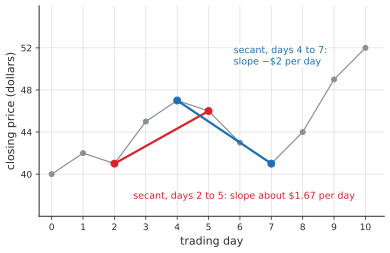
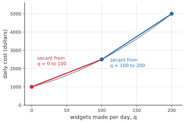

# Reading function graphs

After this lesson you can read values, the domain and the range off a graph, find zeros and intercepts, say where a function increases and decreases, name its maximums and minimums, compute an average rate of change as the slope of a secant line, test a function for even or odd symmetry, and interpret a graph from a real situation.

Before this: [what is a function](01-what-is-a-function.md), [slope and linear equations](../../02-middle-school/05-linear-relationships-and-functions/02-slope-and-linear-equations.md), and [the coordinate plane](../../02-middle-school/05-linear-relationships-and-functions/01-coordinate-plane.md).

## Quick check

Try these first. If you get all three right, skip to [Practice](#practice).

1. For $f(x) = x^2 - 4x$, find the zeros, the $y$-intercept, and the average rate of change from $x = 1$ to $x = 4$.
2. Is $g(x) = x^3 - x$ even, odd or neither?
3. A graph starts at $(0, 2)$, rises to a peak at $(3, 8)$, falls to a low point at $(6, 1)$, then rises to its right end at $(9, 5)$. Give the intervals where it is increasing and decreasing, and name the local maximum and the local minimum.

<details class="solution" markdown>
<summary>Answers</summary>

1. Factor: $x^2 - 4x = x(x - 4)$, so the zeros are 0 and 4. The $y$-intercept is $(0, f(0)) = (0, 0)$. Since $f(1) = -3$ and $f(4) = 0$, the average rate of change is $\frac{0 - (-3)}{4 - 1} = 1$.
2. Replace $x$ by $-x$: $g(-x) = (-x)^3 - (-x) = -x^3 + x = -(x^3 - x) = -g(x)$. So $g$ is odd.
3. Increasing on $[0, 3]$ and on $[6, 9]$, decreasing on $[3, 6]$. The local maximum is at $x = 3$, with value 8, and the local minimum is at $x = 6$, with value 1.

</details>

## The idea

The graph below shows the temperature on a winter day, drawn from a made-up formula so the numbers are tidy. Time of day runs along the bottom and temperature up the side. You can ask it a lot of questions without any algebra. What was the temperature at 9:00? It was $-4$ °C. When was it above freezing? Between about 11:45 and 18:15. When was it warmest? At 15:00, at 2 °C. Was it getting warmer or colder at 6:00? Warmer: the curve is rising there.


Each question has a plain meaning on the graph. "What was it at 9:00?" is a height at one $x$. "When was it above freezing?" asks where the curve is above the $x$-axis. "Warmest" is the highest point, and "getting warmer" is a stretch where the curve climbs as you move right. Another natural question is "how fast did it warm up?" Between 3:00 and 9:00 the temperature rose from $-10$ to $-4$, which is 6 degrees in 6 hours, or 1 degree per hour on average. That last idea, change in the output divided by change in the input, is the slope of a line, and it connects this lesson to the last one on slopes.

The aim here is to give each of these questions a definition, so that the answer reads the same from a graph, from a table and from a formula. The last section of the lesson uses the same words on a stock price and on a cost curve.

## Definitions

Recall that the **graph** of a function $f$ is the set of points $(x, f(x))$ for $x$ in the domain. Everything below is a statement about that set of points.

A **zero** of $f$ is a number $c$ in the domain with $f(c) = 0$. The point $(c, 0)$ is an **$x$-intercept** of the graph, where the graph meets the $x$-axis. The **$y$-intercept** is the point $(0, f(0))$, where the graph meets the $y$-axis. It exists only when 0 is in the domain, and there is at most one, because 0 has at most one output.

In plain words, a zero is an input that produces 0, and an intercept is the point of the graph that sits on an axis.

Let $I$ be an interval inside the domain of $f$. The function is **increasing** on $I$ when $f(x_1) < f(x_2)$ for all $x_1 < x_2$ in $I$. It is **decreasing** on $I$ when $f(x_1) > f(x_2)$ for all $x_1 < x_2$ in $I$. It is **constant** on $I$ when $f(x_1) = f(x_2)$ for all $x_1$ and $x_2$ in $I$. In plain words, a function is increasing on an interval when the graph climbs as you move to the right, and decreasing when it falls. These words describe intervals of $x$-values, not single points, and not heights.

The function $f$ has a **local maximum** at $c$ when there is an open interval around $c$, inside the domain, such that $f(c) \ge f(x)$ for every $x$ in that interval. It has a **local minimum** at $c$ when $f(c) \le f(x)$ for every $x$ in such an interval. The number $f(c)$ is the local maximum value or local minimum value. In plain words, a local maximum is the top of a hill: higher than every point near it, though perhaps not higher than points farther away. An endpoint of the domain has no open interval around it inside the domain, so by this definition it is not a local extremum. Some books count endpoints; this book doesn't. When the inputs are a list of separate values, such as whole days, compare each input with the neighbouring ones instead, and say a function is rising from one input to the next when its output goes up.

The function $f$ has an **absolute maximum** at $c$ when $f(c) \ge f(x)$ for every $x$ in the domain, and an **absolute minimum** at $c$ when $f(c) \le f(x)$ for every $x$ in the domain. The number $f(c)$ is then the maximum value or minimum value. A function can have an absolute maximum at more than one input, and an absolute maximum can occur at an endpoint. Maximums and minimums together are called **extrema**.

For two different inputs $a$ and $b$ in the domain, the **average rate of change** of $f$ from $a$ to $b$ is

$$
\frac{f(b) - f(a)}{b - a}.
$$

The line through the two graph points $(a, f(a))$ and $(b, f(b))$ is the **secant line**, and the average rate of change is its slope. In plain words, it is the rise over the run between two points of the graph, in units of output per unit of input: dollars per day, degrees per hour. It tells you the constant rate that would give the same overall change.

A function $f$ is **even** when, for every $x$ in the domain, $-x$ is also in the domain and $f(-x) = f(x)$. It is **odd** when, for every $x$ in the domain, $-x$ is in the domain and $f(-x) = -f(x)$. In plain words, the graph of an even function is a mirror image of itself across the $y$-axis, and the graph of an odd function lands on itself when turned half a turn about the origin. The names come from powers: $x^2$, $x^4$ and every even power are even functions, and $x$, $x^3$ and every odd power are odd functions.

## How to do it

### Reading a graph

1. Read the axes first: what each one measures, the units, and the scale.
2. Find the domain: the $x$-values the graph covers, as if you shone a light straight down onto the $x$-axis. A solid dot at an end means the endpoint is included, and an open circle means it is left out. An arrow means the graph continues.
3. Find the range: the $y$-values the graph covers, by projecting onto the $y$-axis in the same way.
4. To find $f(a)$, start at $a$ on the $x$-axis, go straight up or down to the curve, then straight across to the $y$-axis. To solve $f(x) = c$, start at $c$ on the $y$-axis, go across to every point where the curve meets that height, and read the $x$-values straight above or below.
5. Find the zeros and the intercepts: where the graph meets the $x$-axis and the $y$-axis.
6. Find where the function increases and decreases by moving left to right: uphill is increasing, downhill is decreasing. Write each stretch as an interval of $x$-values.
7. Mark the peaks and valleys. Those are the local maximums and minimums. Then compare all the heights, including the ends of the graph, to find the absolute maximum and minimum.
8. Check one claim against a definition: pick two inputs in an interval and compare the outputs.

### Computing an average rate of change

1. Name the two inputs, $a$ and $b$, and find $f(a)$ and $f(b)$.
2. Subtract in the same order on top and on the bottom: $\frac{f(b) - f(a)}{b - a}$. If you reverse one subtraction, the sign flips.
3. Attach units: units of $f$ per unit of $x$.
4. Interpret the sign. A positive value means the output rose overall from $a$ to $b$, and the secant line slopes up. A negative value means it fell.
5. Check by sketching the secant. Then check that $f(a) + \text{rate} \times (b - a)$ gives back $f(b)$.

### Testing for even or odd

1. Check that the domain is symmetric: whenever $x$ is in it, $-x$ is too. If not, the function is neither even nor odd.
2. Write $f(-x)$ by putting $-x$ in every bracket, and simplify. Keep the signs inside brackets: $(-x)^2 = x^2$ but $(-x)^3 = -x^3$.
3. Compare with $f(x)$. If $f(-x) = f(x)$ for all $x$, the function is even.
4. Compare with $-f(x)$. If $f(-x) = -f(x)$ for all $x$, the function is odd.
5. If neither comparison holds, the function is neither. To prove that, give one specific $x$ where both fail.

Odd functions have a quick consequence, which is a short theorem.

*Theorem.* If $f$ is odd and 0 is in its domain, then $f(0) = 0$.

We know that $f(-x) = -f(x)$ for every $x$ in the domain, and that 0 is in the domain. We want to show that $f(0) = 0$. The plan is to use the rule at $x = 0$, where $-x$ and $x$ are the same number.

*Proof.* Put $x = 0$ in $f(-x) = -f(x)$. Since $-0 = 0$, this says $f(0) = -f(0)$. Adding $f(0)$ to both sides gives $2f(0) = 0$, so $f(0) = 0$. $\blacksquare$

Looking back: the test is one-directional. A function with $f(0) = 0$ need not be odd, since $x^2$ has $f(0) = 0$ and is even. But a function with $f(0) \ne 0$ can't be odd, which rules out $x^3 + 1$ at once. The function $\frac{1}{x}$ is odd, and the theorem doesn't apply to it because 0 is not in its domain.

### Interpreting a graph from a real situation

1. Say what the input and the output are, with units: "the price in dollars on trading day $x$".
2. Decide which inputs make sense in the situation. A count of days is a whole number, so the graph is separate points, and the lines between them are only a guide.
3. Translate each feature into the situation: a zero is when the quantity hits 0, a peak is a best or worst moment, rising is growing and falling is shrinking.
4. Give rates with units. "Rose \$5 over 3 days" becomes "rose about \$1.67 per day on average".
5. Check the axis scale. A graph whose vertical axis starts well above 0 makes changes look larger than they are.

## Worked examples

<div class="example" markdown>

### Example 1: reading a cubic

The graph below is $f(x) = x^3 - 3x$, drawn only for $-2 \le x \le 2$. Find its domain, range, zeros, intercepts, intervals of increase and decrease, and extrema.


Step 1: there are no units; $x$ is the input and $y = f(x)$ the output.

Step 2: the graph has solid dots at $x = -2$ and $x = 2$ and no gaps between, so the domain is $[-2, 2]$.

Step 3: the lowest height is $-2$ and the highest is 2, and the curve is unbroken, so the range is $[-2, 2]$.

Step 4: $f(0) = 0$, and $f(1.5) = 3.375 - 4.5 = -1.125$. To solve $f(x) = 2$, go across at height 2: the line meets the graph at the peak, $x = -1$, and at the right end, $x = 2$. Check by substituting: $f(-1) = -1 + 3 = 2$ and $f(2) = 8 - 6 = 2$.

Step 5: the zeros come from $x^3 - 3x = x(x^2 - 3) = 0$: $x = 0$ and $x = \pm\sqrt{3}$, about $\pm 1.73$. The $y$-intercept is $(0, 0)$.

Step 6: moving left to right, the graph climbs from $x = -2$ to $x = -1$, falls from $x = -1$ to $x = 1$, then climbs from $x = 1$ to $x = 2$. So $f$ is increasing on $[-2, -1]$ and $[1, 2]$, and decreasing on $[-1, 1]$.

Step 7: there is a local maximum at $x = -1$, with value 2, and a local minimum at $x = 1$, with value $-2$. The endpoints are not local extrema, by the definition. For absolute extrema, compare all the heights: the largest is 2, reached at both $x = -1$ and $x = 2$, and the smallest is $-2$, reached at both $x = -2$ and $x = 1$. So an absolute maximum occurs at $x = -1$ and at $x = 2$.

Step 8: check with two inputs on the first stretch: $f(-2) = -2 < f(-1.5) = -3.375 + 4.5 = 1.125$. The output grew, as an increasing function's should.

The graph is also unchanged by a half turn about the origin: $f(-x) = -x^3 + 3x = -f(x)$, so $f$ is odd, and $f(0) = 0$ as the theorem predicts.

</div>

<div class="example" markdown>

### Example 2: average rates for a stock price

Here are the closing prices of a made-up stock over ten trading days:

| Day | 0 | 1 | 2 | 3 | 4 | 5 | 6 | 7 | 8 | 9 | 10 |
|---|---|---|---|---|---|---|---|---|---|---|---|
| Price (\$) | 40 | 42 | 41 | 45 | 47 | 46 | 43 | 41 | 44 | 49 | 52 |

Find the average rate of change from day 2 to day 5, from day 4 to day 7, and over the whole period, and describe the turning points.

Step 1 (of the average rate steps): for days 2 to 5, $f(2) = 41$ and $f(5) = 46$. Step 2: $\frac{46 - 41}{5 - 2} = \frac{5}{3} \approx 1.67$. Step 3: the units are dollars per day. The price rose by about \$1.67 per day on average, although it went up by \$4, then \$2, then fell by \$1.

For days 4 to 7, $f(4) = 47$ and $f(7) = 41$, so the rate is $\frac{41 - 47}{3} = -2$, which is $-\$2$ per day. The price fell on average, and the secant slopes down.

Over days 0 to 10, $\frac{52 - 40}{10 - 0} = 1.2$, so the price rose \$1.20 per day on average.



The domain is the eleven whole days, so the graph is eleven separate points, and the gray segments are only a guide. The price turns at days 1, 2, 4 and 7. It has local maximums at days 1 and 4 (values 42 and 47), and local minimums at days 2 and 7 (both 41). The absolute minimum, 40, and the absolute maximum, 52, are at the two ends, days 0 and 10.

Check: for days 2 to 5, $41 + \frac{5}{3} \times 3 = 46$, which is $f(5)$. Also notice that the vertical axis in the figure starts at 36, not 0, which makes the price swings look bigger than they are relative to a \$40 stock.

</div>

<div class="example" markdown>

### Example 3: even, odd or neither

Test each function. (a) $f(x) = x^4 - 3x^2 + 1$. (b) $g(x) = x^5 + 2x$. (c) $h(x) = x^2 + x$. (d) $k(x) = \dfrac{x}{x^2 + 1}$. (e) $m(x) = x^2$ with domain $[-1, 3]$.

For (a), the domain is $\mathbb{R}$, which is symmetric (Step 1). Then $f(-x) = (-x)^4 - 3(-x)^2 + 1 = x^4 - 3x^2 + 1 = f(x)$ (Steps 2 and 3). So $f$ is even.

For (b), $g(-x) = (-x)^5 + 2(-x) = -x^5 - 2x = -(x^5 + 2x) = -g(x)$ (Step 4). So $g$ is odd.

For (c), $h(-x) = x^2 - x$. This is not $h(x) = x^2 + x$, and it is not $-h(x) = -x^2 - x$. To prove "neither", give one input where both fail (Step 5): $h(-1) = 0$, $h(1) = 2$ and $-h(1) = -2$, and 0 equals neither 2 nor $-2$.

For (d), the denominator is never 0, so the domain is $\mathbb{R}$. Then $k(-x) = \frac{-x}{(-x)^2 + 1} = -\frac{x}{x^2 + 1} = -k(x)$. So $k$ is odd.

For (e), the domain fails Step 1: the number 3 is in $[-1, 3]$, but $-3$ is not. So $m$ is neither even nor odd, although the rule $x^2$ is even on a symmetric domain. The graph shows the same thing: it has no mirror image across the $y$-axis, because the left half stops at $x = -1$.


Check (a) with numbers: $f(2) = 16 - 12 + 1 = 5$ and $f(-2) = 5$. Check (b) with $x = 1$: $g(1) = 3$ and $g(-1) = -1 - 2 = -3$.

</div>

<div class="example" markdown>

### Example 4: a cost curve (finish it yourself)

A workshop's daily cost, in dollars, to make $q$ widgets is $C(q) = 1000 + 10q + 0.05q^2$, for $0 \le q \le 200$. The figure shows the graph and two secant lines.



We have $C(0) = 1000$, which is the cost with no widgets made, a fixed cost. Also $C(100) = 1000 + 1000 + 500 = 2500$. Next find $C(200)$, then the average rate of change over $[0, 100]$ and over $[100, 200]$, and say what the two numbers show about making more widgets.

<details class="solution" markdown>
<summary>Finish</summary>

$C(200) = 1000 + 2000 + 2000 = 5000$.

From 0 to 100: $\frac{2500 - 1000}{100} = 15$, so the cost rose \$15 per extra widget on average. From 100 to 200: $\frac{5000 - 2500}{100} = 25$, so it rose \$25 per extra widget. The second rate is bigger: the later widgets cost more to make than the earlier ones. That is why the graph bends upward, and the blue secant is steeper than the red one.

Check: $1000 + 15 \times 100 = 2500$ and $2500 + 25 \times 100 = 5000$, which match $C(100)$ and $C(200)$.

</details>

</div>

## Edge cases and common mistakes

<div class="warning" markdown>

Watch out: intervals of increase and decrease are intervals of $x$-values. In Example 1 the function decreases on $[-1, 1]$, not "from 2 to $-2$". Heights belong in the range, and the intervals belong in the domain.

</div>

<div class="warning" markdown>

Watch out: a local maximum need not be the highest point. In Example 1 the local maximum at $x = -1$, with value 2, is also an absolute maximum, but only because the domain was cut off at $[-2, 2]$. On all of $\mathbb{R}$ the same formula has the same local maximum and no absolute maximum, because $x^3 - 3x$ grows without bound for large $x$. Always say whether you mean local or absolute.

</div>

<div class="warning" markdown>

Watch out: an average rate of change of 0 doesn't mean nothing happened. For $f(x) = x^2$ from $-1$ to 1, $\frac{1 - 1}{2} = 0$, yet the graph goes down and then up. A thrown ball that returns to your hand has an average velocity of 0. The average rate hides what happens between the two inputs.

</div>

<div class="warning" markdown>

Watch out: average rate of change and average cost are different. In Example 4 the average rate from $q = 0$ to $q = 100$ is \$15 per widget, but the cost per widget at $q = 100$ is $\frac{2500}{100} = 25$ dollars, because that includes the fixed cost of \$1,000. The rate compares changes: $\frac{C(100) - C(0)}{100}$. The average cost divides a total.

</div>

<div class="warning" markdown>

Watch out: $f(-x)$ is not $-f(x)$. For $f(x) = x^2$, $f(-x) = (-x)^2 = x^2$, but $-f(x) = -x^2$. The first changes the input and the second changes the output. Even means they match the first one, and odd means they match the second.

</div>

A function with a symmetric domain can be both even and odd only if it is 0 everywhere. If $f(-x) = f(x)$ and $f(-x) = -f(x)$, then $f(x) = -f(x)$, so $2f(x) = 0$ and $f(x) = 0$ for every $x$. Every other function is even, odd or neither, never two of them.

Most functions are neither. Adding an even and an odd function usually gives a function that is neither, as $x^2 + x$ does in Example 3. Practice problem 7 shows that every function with a symmetric domain is the sum of an even part and an odd part.

A constant function, such as $f(x) = 5$, is even, since $f(-x) = 5 = f(x)$. It is constant on every interval, and every point of it is both a local maximum and a local minimum, by the definition above, because $f(c) \ge f(x)$ and $f(c) \le f(x)$ both hold with equality.

## Tricks and shortcuts

For a polynomial, look at the exponents. If every power of $x$ is even (counting the constant term as $x^0$), the function is even. If every power is odd, the function is odd. A mix of both, like $x^2 + x$, is neither. This works because $(-x)^n$ is $x^n$ for even $n$ and $-x^n$ for odd $n$.

Products follow a sign rule, like multiplying signs. Even times even is even, odd times odd is even, and even times odd is odd. So $x^2 \cdot x^3 = x^5$ is odd, and $x \cdot x^3 = x^4$ is even. Practice problem 6 proves it.

A quick necessary test for odd: if 0 is in the domain, then $f(0)$ must be 0. A single check of $f(0)$ can rule out oddness fast.

The sign of the average rate of change gives the overall direction, and a secant line with a steeper slope means faster change. To compare the pace of two stretches of a graph, compare the slopes of their secants.

## In code

The average rate of change is a one-line function. For a table of values, the days where the direction changes are the local extremes, found by comparing neighbouring differences. A numerical test can show that a function is not even or odd, but it can't prove it is.

<details class="code" markdown>
<summary>In code</summary>

```python
prices = [40, 42, 41, 45, 47, 46, 43, 41, 44, 49, 52]
price = lambda day: prices[day]

def avg_rate(f, a, b):
    return (f(b) - f(a)) / (b - a)

print(round(avg_rate(price, 2, 5), 3))      # 1.667
print(avg_rate(price, 4, 7))                # -2.0
print(avg_rate(price, 0, 10))               # 1.2

turns = [d for d in range(1, 10)
         if (prices[d] - prices[d - 1]) * (prices[d + 1] - prices[d]) < 0]
print(turns)                                # [1, 2, 4, 7]

def parity(f, points):
    if all(abs(f(-x) - f(x)) < 1e-9 for x in points):
        return "even"
    if all(abs(f(-x) + f(x)) < 1e-9 for x in points):
        return "odd"
    return "neither"

pts = [0.5, 1, 2, 3.7]
print(parity(lambda x: x**4 - 3 * x**2 + 1, pts))   # even
print(parity(lambda x: x**3 - 3 * x, pts))          # odd
print(parity(lambda x: x**2 + x, pts))              # neither
```

The list `turns` holds the days where the change in price switches sign, which are the local extremes: the price went up then down on day 1, down then up on day 2, up then down on day 4, and down then up on day 7. The `parity` function says "even" or "odd" when the test passes at the four sample points. That is evidence, and a different function could pass at those four points and still fail somewhere else. A result of "neither" is a proof, because one failing input is a counterexample.

</details>

## FAQ

### Why is the average rate of change the slope of the secant?

Because slope is rise over run, and the rise from $(a, f(a))$ to $(b, f(b))$ is $f(b) - f(a)$ while the run is $b - a$. The word secant just names the line through two points of a curve. If you let the second point slide toward the first, the secant tilts toward the line that touches the curve at one point, called the tangent line. Its slope is the instantaneous rate of change, the subject of the derivative definition<!-- link: ../../05-university-core/02-derivatives/01-the-derivative-definition.md -->.

### Can a function be increasing at a single point?

Not with this definition. "Increasing" compares outputs at two different inputs, so it needs an interval. Calculus gives a meaning to "increasing at a point" using the slope of the tangent there, but the graph-reading definition used here is about intervals.

### Is a flat stretch increasing?

No, under this book's definition, which is strict: increasing needs the output to go up between any two inputs. A flat stretch is constant. Some books say "increasing" for non-decreasing, which allows flat stretches, so check the definition in the book you are reading.

### Why does the domain have to be symmetric for even and odd?

The test compares $f(x)$ with $f(-x)$. If $x$ is in the domain but $-x$ is not, then $f(-x)$ doesn't exist and the comparison can't be made. The function $x^2$ on $[-1, 3]$ follows an even rule on its domain, but a mirror image across the $y$-axis would need a graph from $-3$ to $-1$ that isn't there.

## Practice

### Warm-up

1\. For $f(x) = x^2 - 2x - 3$, find the zeros and the $y$-intercept, and check them with the graph shape: a parabola that opens upward.

<details class="solution" markdown>
<summary>Solution</summary>

Factor: $x^2 - 2x - 3 = (x - 3)(x + 1)$, so the zeros are $x = 3$ and $x = -1$. The $y$-intercept is $(0, f(0)) = (0, -3)$.

Check: $f(3) = 9 - 6 - 3 = 0$ and $f(-1) = 1 + 2 - 3 = 0$. An upward parabola crosses the $x$-axis at $-1$ and 3 and dips between them, so it must be below the axis at $x = 0$, which agrees with $f(0) = -3$.

</details>

2\. Decide whether each function is even, odd or neither: (a) $f(x) = x^6 + x^2$. (b) $g(x) = x^3 - 5x$. (c) $h(x) = x^2 - x$. (d) $k(x) = \dfrac{1}{x}$ for $x \ne 0$. (e) $m(x) = x + 1$.

<details class="solution" markdown>
<summary>Solution</summary>

- (a) Even: both powers are even, and $f(-x) = x^6 + x^2 = f(x)$.
- (b) Odd: both powers are odd, and $g(-x) = -x^3 + 5x = -g(x)$.
- (c) Neither: $h(-x) = x^2 + x$, which is neither $h(x)$ nor $-h(x)$. For instance $h(-1) = 2$, $h(1) = 0$ and $-h(1) = 0$, and 2 equals neither.
- (d) Odd: the domain is symmetric, and $k(-x) = \frac{1}{-x} = -\frac{1}{x} = -k(x)$.
- (e) Neither: $m(0) = 1 \ne 0$ rules out odd, and $m(-2) = -1$ but $m(2) = 3$ rules out even.

Check (a) with $x = 1$: $f(1) = 2$ and $f(-1) = 2$.

</details>

3\. Find the average rate of change of $f(x) = x^2$ from (a) $x = 1$ to $x = 4$, (b) $x = -2$ to $x = 2$. Explain the second answer.

<details class="solution" markdown>
<summary>Solution</summary>

(a) $\frac{f(4) - f(1)}{4 - 1} = \frac{16 - 1}{3} = 5$.

(b) $\frac{f(2) - f(-2)}{2 - (-2)} = \frac{4 - 4}{4} = 0$. The parabola falls from $x = -2$ to $x = 0$ and rises back to the same height at $x = 2$, so the net change is 0. The secant line is horizontal, even though the function is not constant.

Check (a): $1 + 5 \times 3 = 16 = f(4)$.

</details>

### Standard

4\. A piecewise linear graph passes through $(0, 3)$, $(2, 7)$, $(5, 1)$, $(8, 4)$ and $(10, 2)$, going straight between each pair of neighbouring points. Give (a) the intervals of increase and decrease, (b) the local maximums and minimums, (c) the absolute maximum and minimum, (d) the average rate of change from $x = 0$ to $x = 10$ and from $x = 2$ to $x = 5$.

<details class="solution" markdown>
<summary>Solution</summary>

(a) Between neighbouring points the graph goes $3 \to 7$ (up), $7 \to 1$ (down), $1 \to 4$ (up) and $4 \to 2$ (down). So $f$ is increasing on $[0, 2]$ and $[5, 8]$, and decreasing on $[2, 5]$ and $[8, 10]$.

(b) The turning points inside the domain are $x = 2$, $x = 5$ and $x = 8$. There are local maximums at $x = 2$ (value 7) and $x = 8$ (value 4), and a local minimum at $x = 5$ (value 1).

(c) The highest point is $(2, 7)$ and the lowest is $(5, 1)$, so the absolute maximum is 7, at $x = 2$, and the absolute minimum is 1, at $x = 5$. The ends have heights 3 and 2, which are in between.

(d) From 0 to 10, $\frac{2 - 3}{10 - 0} = -0.1$. From 2 to 5, $\frac{1 - 7}{5 - 2} = -2$.

Check: the segment slopes are $\frac{4}{2} = 2$, $\frac{-6}{3} = -2$, $\frac{3}{3} = 1$ and $\frac{-2}{2} = -1$. Their signs match the up and down pattern in (a).

</details>

5\. A ball is thrown straight up, and its height in metres after $t$ seconds is $h(t) = 20t - 5t^2$, for $0 \le t \le 4$. (a) Find the average rate of change of $h$ over $[0, 1]$, $[1, 2]$ and $[0, 4]$, with units. (b) Find the zeros of $h$ and say what they mean. (c) Why is the average rate over $[0, 4]$ equal to 0?

<details class="solution" markdown>
<summary>Solution</summary>

(a) Compute $h(0) = 0$, $h(1) = 15$, $h(2) = 20$ and $h(4) = 80 - 80 = 0$. Over $[0, 1]$ the rate is $\frac{15 - 0}{1} = 15$ m/s. Over $[1, 2]$ it is $\frac{20 - 15}{1} = 5$ m/s. Over $[0, 4]$ it is $\frac{0 - 0}{4} = 0$ m/s.

(b) Solve $20t - 5t^2 = 5t(4 - t) = 0$: $t = 0$ and $t = 4$. The ball is at height 0 when it is thrown and when it lands, 4 seconds later.

(c) The ball returns to its starting height, so the net change is 0. It rises 20 m in the first 2 seconds and falls 20 m in the next 2.

Check: the rate over $[0, 1]$ is bigger than over $[1, 2]$, which fits a ball that slows down as it rises.

</details>

6\. Suppose $f$ and $g$ are defined for every real number, with $f$ even and $g$ odd. Prove that $f \cdot g$ is odd, and decide what the functions $g \cdot g$ and $f + f$ are.

<details class="solution" markdown>
<summary>Solution</summary>

For $f \cdot g$, write $(f \cdot g)(x) = f(x)\,g(x)$. Then

$$
(f \cdot g)(-x) = f(-x)\,g(-x) = f(x) \cdot \bigl(-g(x)\bigr) = -f(x)\,g(x) = -(f \cdot g)(x).
$$

The second step uses that $f$ is even and $g$ is odd. So $f \cdot g$ is odd.

For $g \cdot g$: $(g \cdot g)(-x) = g(-x)\,g(-x) = \bigl(-g(x)\bigr)\bigl(-g(x)\bigr) = g(x)^2 = (g \cdot g)(x)$, so $g \cdot g$ is even.

For $f + f$: $(f + f)(-x) = f(-x) + f(-x) = f(x) + f(x) = (f + f)(x)$, so $f + f$ is even.

Check with $f(x) = x^2$ and $g(x) = x^3$: $f \cdot g = x^5$ is odd, $g \cdot g = x^6$ is even, and $f + f = 2x^2$ is even.

</details>

### Challenge

7\. (a) Show that every function $f$ with a symmetric domain is the sum of an even function and an odd function, by checking that $f_e(x) = \frac{f(x) + f(-x)}{2}$ is even, $f_o(x) = \frac{f(x) - f(-x)}{2}$ is odd, and $f_e + f_o = f$. (b) Find $f_e$ and $f_o$ for $f(x) = 2x^3 - x^2 + 5x + 1$.

<details class="solution" markdown>
<summary>Solution</summary>

(a) First, $f_e(-x) = \frac{f(-x) + f(x)}{2}$, which is the same as $f_e(x)$, so $f_e$ is even. Next, $f_o(-x) = \frac{f(-x) - f(x)}{2} = -\frac{f(x) - f(-x)}{2} = -f_o(x)$, so $f_o$ is odd. Finally,

$$
f_e(x) + f_o(x) = \frac{f(x) + f(-x) + f(x) - f(-x)}{2} = \frac{2f(x)}{2} = f(x).
$$

(b) Here $f(-x) = -2x^3 - x^2 - 5x + 1$. Adding, $f(x) + f(-x) = -2x^2 + 2$, so $f_e(x) = 1 - x^2$. Subtracting, $f(x) - f(-x) = 4x^3 + 10x$, so $f_o(x) = 2x^3 + 5x$. The even part collects the even powers and the odd part collects the odd powers.

Check: $f_e + f_o = 1 - x^2 + 2x^3 + 5x = f(x)$. Also $f_e(-x) = 1 - x^2 = f_e(x)$ and $f_o(-x) = -2x^3 - 5x = -f_o(x)$.

</details>

8\. (Reviews [percent change and applications](../../02-middle-school/02-ratios-rates-percents/04-percent-change-and-applications.md).) In Example 2 the stock goes from \$40 on day 0 to \$52 on day 10. (a) Find the percent change over the ten days. (b) Find the average rate of change in dollars per day, and the same number as a percent of the starting price per day. (c) If the price grew by the same percent every day, what would that daily percent be, to one decimal place? Why is it different from (b)?

<details class="solution" markdown>
<summary>Solution</summary>

(a) $\frac{52 - 40}{40} \times 100\% = 30\%$.

(b) The average rate is $\frac{52 - 40}{10} = 1.2$ dollars per day. As a percent of the starting price, $\frac{1.2}{40} = 0.03$, which is 3% of \$40 per day. That is 30% divided evenly over 10 days.

(c) A constant daily growth factor $r$ must satisfy $r^{10} = \frac{52}{40} = 1.3$, so $r = 1.3^{1/10} \approx 1.0266$, a daily rise of about 2.7%. This is less than the 3% in (b) because each day's growth applies to a bigger price than the day before. Equal dollar gains (the average rate) and equal percent gains (the factor) are different models.

Check: $1.0266^{10} \approx 1.30$, and $40 \times 1.3 = 52$.

</details>

## Where this shows up

- Calculus replaces "average" with "instantaneous": the derivative is the limit of the average rate of change as the two inputs get close, and its sign says where a function is increasing or decreasing (rates of change and marginal analysis<!-- link: ../../05-university-core/03-applications-of-derivatives/01-rates-of-change-and-marginal-analysis.md -->). Finding local and absolute extrema is the optimization problem of that course. The next lesson, [piecewise, absolute value and step functions](03-piecewise-absolute-value-and-step-functions.md), builds functions whose graphs have corners and jumps.
- Even and odd symmetry saves work in integrals and in series: the integral of an odd function over $[-a, a]$ is 0. In CS, a function that always increases is what makes binary search work on a monotone yes-or-no test, such as finding the first version of a program that breaks.
- Economics reads graphs all the time: a cost curve that bends up has a rising marginal cost, a price chart's secant slope is a return per period, and supply and demand are read for where they cross (supply and demand equilibrium algebra<!-- link: ../../07-economics-math/02-markets/03-supply-and-demand-equilibrium-algebra.md -->).
