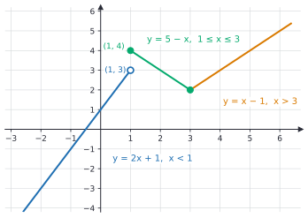
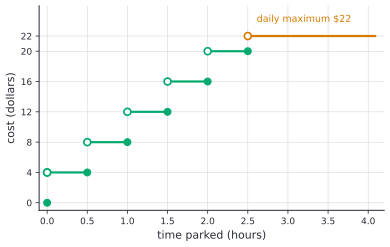

# Piecewise, absolute value and step functions

After this lesson you can evaluate and graph a function defined by cases, write an absolute value as a piecewise function, use the floor and ceiling functions (including for integer division and pagination), build a step function from a rate table or a parking tariff, and compute a progressive tax as a piecewise function.

Before this: [what is a function](01-what-is-a-function.md), [reading function graphs](02-reading-function-graphs.md), and [absolute value equations and inequalities](../01-algebra-foundations/04-absolute-value-equations-and-inequalities.md).

## Quick check

Try these first. If you get all three right, skip to [Practice](#practice).

1. Let $f(x) = x^2$ for $x < 2$ and $f(x) = 7 - x$ for $x \ge 2$. Find $f(-1)$, $f(2)$ and $f(5)$.
2. Find $\lfloor -2.3 \rfloor$, $\lceil -2.3 \rceil$, $\lfloor 4 \rfloor$, $\lceil 4 \rceil$ and $\lceil \frac{17}{5} \rceil$.
3. Write $\lvert 2x - 6 \rvert$ as a piecewise function.

<details class="solution" markdown>
<summary>Answers</summary>

1. The input $-1$ is less than 2, so $f(-1) = (-1)^2 = 1$. The input 2 uses the second formula, since $2 \ge 2$: $f(2) = 7 - 2 = 5$. And $f(5) = 7 - 5 = 2$.
2. $\lfloor -2.3 \rfloor = -3$, since $-3 \le -2.3 < -2$. $\lceil -2.3 \rceil = -2$. An integer is its own floor and ceiling, so $\lfloor 4 \rfloor = \lceil 4 \rceil = 4$. And $\frac{17}{5} = 3.4$, so its ceiling is 4.
3. The expression $2x - 6$ is $0$ at $x = 3$, non-negative for $x \ge 3$ and negative for $x < 3$. So $\lvert 2x - 6 \rvert = 2x - 6$ for $x \ge 3$, and $6 - 2x$ for $x < 3$.

</details>

## The idea

A parking lot charges \$4 for each half hour or part of one. Park for 29 minutes and you pay \$4. Park for 31 minutes and you pay \$8. Two minutes more cost an extra \$4, so the graph of cost against time can't be drawn without lifting the pencil, and no single formula $mx + b$ describes it. The rule is better stated as a list: "for stays up to half an hour, \$4; over half an hour and up to an hour, \$8", and so on.

Income tax is another rule given in cases. The tax owed is not one fixed percent of income. The first slice of income is taxed at a low rate, the next slice at a higher one, and each slice has its own formula. Unlike the parking charge, the tax has no jumps: earning one more dollar never changes the tax by more than the top rate on that dollar. Both rules are functions, and both are written as a different formula on each stretch of the input.

Even the absolute value works this way. The number $\lvert x \rvert$ is the distance from $x$ to 0, which is $-x$ when $x$ is to the left of 0 and $x$ when it is to the right. Two formulas, glued at 0, give the familiar V.

This lesson names these functions, shows how to evaluate and graph them, and adds the two rounding functions, floor and ceiling, that programmers use all the time. A piecewise function is also how an `if` statement reads as mathematics: the condition picks the formula.

## Definitions

A **piecewise function** is a function whose rule is given by different formulas on different parts of its domain. With two pieces it is written

$$
f(x) =
\begin{cases}
f_1(x) & \text{if } x \in D_1, \\
f_2(x) & \text{if } x \in D_2.
\end{cases}
$$

The sets $D_1$ and $D_2$ are the pieces. Together they must cover the domain, and they must not overlap, so that each input falls in exactly one piece and gets exactly one output. If two pieces do share an input, the two formulas must give the same value there, or the rule would give one input two outputs and wouldn't be a function. A number where one piece ends and the next begins is a **break point**.

In plain words, a piecewise function says "if the input is here, use this formula; if it is there, use that one". The conditions are written with $<$, $\le$, $>$ and $\ge$, and each break point belongs to exactly one piece. A graph with a **jump** has a break point where the two pieces don't meet. Where they do meet, the graph can be drawn without lifting the pencil. A function whose graph has no jumps, gaps or holes on an interval is continuous there, a word that [continuity, asymptotes and the IVT](../../05-university-core/01-limits-and-continuity/03-continuity-asymptotes-and-ivt.md) makes precise.

The **absolute value function** is

$$
\lvert x \rvert =
\begin{cases}
x & \text{if } x \ge 0, \\
-x & \text{if } x < 0.
\end{cases}
$$

In plain words, it removes a minus sign if there is one, and it measures the distance from $x$ to 0. More generally, $\lvert x - a \rvert$ is the distance from $x$ to $a$. The number $\lvert x \rvert$ is never negative, since $-x$ is positive when $x < 0$. It satisfies $\lvert x \rvert = \sqrt{x^2}$, as in the roots lesson.

The **floor** of a real number $x$, written $\lfloor x \rfloor$, is the greatest integer less than or equal to $x$. The **ceiling**, written $\lceil x \rceil$, is the least integer greater than or equal to $x$. Equivalently, for an integer $n$, $\lfloor x \rfloor = n$ exactly when $n \le x < n + 1$, and $\lceil x \rceil = n$ exactly when $n - 1 < x \le n$. In plain words, floor rounds down and ceiling rounds up, always along the number line, so $\lfloor -3.7 \rfloor = -4$ and $\lceil -3.7 \rceil = -3$. An integer is unchanged by both.


A **step function** is a function whose graph is made of horizontal segments, so it is constant on each of its pieces and jumps between them. The floor and ceiling functions are step functions, and so is any price list that charges by band.

A **progressive tax** divides income into brackets, ranges of income with a rate each. Each bracket's rate applies only to the part of income inside that bracket. The **marginal rate** at an income is the rate of the bracket that the next dollar falls in. The **average rate** is the total tax divided by the income. In plain words, moving into a higher bracket raises the rate on the new dollars, and the dollars already earned keep their old rate.

## How to do it

### Evaluating a piecewise function

1. Look at the input and find the piece whose condition it satisfies. Check the boundary conditions carefully, since $<$ and $\le$ decide which piece owns a break point.
2. Substitute the input into that piece's formula only. The other formulas are not used.
3. Simplify. Check by testing that the input doesn't satisfy any other condition.

To solve $f(x) = c$, solve the equation separately in each piece, and keep only the solutions that satisfy that piece's condition.

### Graphing a piecewise function

1. Draw each piece on its own interval, as a graph of its own formula, stopping at the break points.
2. At each break point, decide the end dots. A solid dot means the value is included, which happens for $\le$ and $\ge$. An open circle means it is left out, which happens for $<$ and $>$.
3. At a jump, put the solid dot on the piece that owns the break point and an open circle on the other. Each input has one output, so never put solid dots at both heights.
4. Where two pieces meet at the same height, a single solid dot is enough.
5. Check that every input has a point above it and that no vertical line meets the graph twice.

### Writing an absolute value as a piecewise function

1. Find where the expression inside the bars equals 0. That is the break point.
2. On the side where the expression is $\ge 0$, the bars do nothing: use the expression. On the side where it is negative, the bars flip the sign: use the opposite of the expression.
3. Simplify each piece.
4. For a sum such as $\lvert x - 3 \rvert + \lvert x + 1 \rvert$, list all the break points in order, and use the sign pattern on each stretch between them.

### Floor and ceiling

To evaluate $\lfloor x \rfloor$, find the integer $n$ with $n \le x < n + 1$. For a ceiling, find the integer $n$ with $n - 1 < x \le n$. Look at the sign first: for negative numbers the result goes the other way from what truncating does.

| $x$ | $3.7$ | $-3.7$ | $5$ | $-5$ | $0.2$ | $-0.2$ |
|---|---|---|---|---|---|---|
| $\lfloor x \rfloor$ | $3$ | $-4$ | $5$ | $-5$ | $0$ | $-1$ |
| $\lceil x \rceil$ | $4$ | $-3$ | $5$ | $-5$ | $1$ | $0$ |

The two are linked by $\lceil x \rceil = -\lfloor -x \rfloor$, since rounding up is rounding down in a mirror.

Floor division gives integer division with a remainder. For integers $a$ and $d > 0$, the quotient is $q = \lfloor a/d \rfloor$ and the remainder is $r = a - dq$, which lies in $[0, d)$, even for negative $a$. In Python, `a // d` is $\lfloor a/d \rfloor$ and `a % d` is that $r$.

A common use of the ceiling is the number of pages: $n$ items with $k$ per page need $\lceil n/k \rceil$ pages. With integers, a division can be avoided.

*Theorem.* For integers $n \ge 0$ and $k \ge 1$,

$$
\left\lceil \frac{n}{k} \right\rceil = \left\lfloor \frac{n + k - 1}{k} \right\rfloor.
$$

We know that $n$ divides by $k$ with a quotient and a remainder: $n = qk + r$ with $q \ge 0$ and $0 \le r < k$. We want to show that the ceiling of $\frac{n}{k}$ and the floor of $\frac{n + k - 1}{k}$ are the same integer. The plan is to split into the two cases, $r = 0$ and $r \ge 1$, and compute both sides in each.

*Proof.* Case 1, $r = 0$. Then $\frac{n}{k} = q$ is an integer, so its ceiling is $q$. Also $\frac{n + k - 1}{k} = q + \frac{k - 1}{k}$, and $0 \le \frac{k - 1}{k} < 1$, so the floor is $q$. The two sides agree.

Case 2, $1 \le r \le k - 1$. Then $\frac{n}{k} = q + \frac{r}{k}$ with $0 < \frac{r}{k} < 1$, so the ceiling is $q + 1$. Also $\frac{n + k - 1}{k} = q + \frac{r + k - 1}{k}$, and $k \le r + k - 1 \le 2k - 2 < 2k$, so $1 \le \frac{r + k - 1}{k} < 2$ and the floor is $q + 1$. The two sides agree. $\blacksquare$

Looking back: adding $k - 1$ before dividing pushes every non-multiple of $k$ past the next multiple and leaves multiples where they are. That makes the floor of the new quotient equal the ceiling of the old one. It lets a program count pages with integer arithmetic only, as `(n + k - 1) // k`, with no floating-point division.

### Building a step function from a rate table

1. List the bands of the input, and the output for each.
2. Decide which end of each band belongs to it. "Up to and including 30 g" is closed on the right: $0 < w \le 30$.
3. Write the function as cases, or as one formula with a ceiling when the bands are equal in width, as in $\lceil 2t \rceil$ for half-hour units.
4. Add any cap with a minimum: $\min(\text{charge}, \text{cap})$.
5. Check each band's boundaries, one value just inside and one just outside.

A postal service might price a letter by weight band. This table is made up for practice and is not any carrier's real rate card:

| Weight $w$ (grams) | Price (\$) |
|---|---|
| $0 < w \le 30$ | 1.00 |
| $30 < w \le 50$ | 1.50 |
| $50 < w \le 100$ | 2.40 |
| $100 < w \le 200$ | 3.80 |
| $200 < w \le 500$ | 6.50 |

A letter of exactly 30 g costs \$1.00, and one of 30.1 g costs \$1.50. The price depends only on the band, so the function is a step function, closed at the right end of each step.

### A progressive tax as a piecewise function

1. Write the brackets as a table: the lower and upper limits and the rate.
2. Find the tax at the start of each bracket by adding up the earlier slices.
3. For income inside a bracket, the tax is the tax at the start plus the bracket's rate times the part of the income above the start.
4. State the formula for each bracket, with conditions, and note that the slopes are the rates.

Here is an example. The brackets are hypothetical, chosen to make the arithmetic clean; they are not the real federal or Ontario brackets, which are in [income tax brackets: marginal vs effective](../../08-financial-math/07-taxes-insurance-and-planning/01-income-tax-brackets-marginal-vs-effective.md).

| Income | Rate |
|---|---|
| first \$20,000 | 10% |
| from \$20,000 to \$60,000 | 20% |
| above \$60,000 | 30% |

The tax at \$20,000 is $0.10 \times 20{,}000 = 2{,}000$, and the tax at \$60,000 is $2{,}000 + 0.20 \times 40{,}000 = 10{,}000$. So the tax on an income $x$ is

$$
T(x) =
\begin{cases}
0.10x & \text{if } 0 \le x \le 20{,}000, \\
2000 + 0.20(x - 20000) & \text{if } 20{,}000 < x \le 60{,}000, \\
10000 + 0.30(x - 60000) & \text{if } x > 60{,}000.
\end{cases}
$$

The three formulas agree at the break points (2,000 and 10,000), so the graph has no jumps; its slope changes from 0.10 to 0.20 to 0.30 at the corners. The graph on the left shows $T$, and the graph on the right compares the rates.


## Worked examples

<div class="example" markdown>

### Example 1: evaluating, graphing and solving

Let

$$
f(x) =
\begin{cases}
2x + 1 & \text{if } x < 1, \\
5 - x & \text{if } 1 \le x \le 3, \\
x - 1 & \text{if } x > 3.
\end{cases}
$$

Find $f(-2)$, $f(1)$, $f(3)$ and $f(5)$, graph $f$, and solve $f(x) = 3$.

Evaluating, Step 1: $-2 < 1$, so the first piece applies, and Step 2 gives $f(-2) = 2(-2) + 1 = -3$. The input 1 is not less than 1, but it satisfies $1 \le x \le 3$, so $f(1) = 5 - 1 = 4$. The input 3 also belongs to the middle piece, because that piece has $\le 3$: $f(3) = 5 - 3 = 2$. Finally $5 > 3$ gives $f(5) = 5 - 1 = 4$.

Graphing, Step 1: draw the line $y = 2x + 1$ for $x < 1$, the line $y = 5 - x$ from $x = 1$ to $x = 3$, and the line $y = x - 1$ for $x > 3$. Step 2: at $x = 1$, the first piece heads toward height $2(1) + 1 = 3$ but doesn't include $x = 1$, so there is an open circle at $(1, 3)$. The middle piece includes $x = 1$ with height 4, so there is a solid dot at $(1, 4)$. That is a jump of 1. At $x = 3$, the middle piece ends at height 2, and the third piece starts from height $3 - 1 = 2$, so the pieces meet and one solid dot at $(3, 2)$ is enough.



Solving $f(x) = 3$ piece by piece. First piece: $2x + 1 = 3$ gives $x = 1$, but the piece needs $x < 1$, so this is rejected. Middle piece: $5 - x = 3$ gives $x = 2$, and $1 \le 2 \le 3$, so it is kept. Third piece: $x - 1 = 3$ gives $x = 4$, and $4 > 3$, so it is kept. The solutions are $x = 2$ and $x = 4$.

The rejected value matters: $f(1) = 4$, not 3, because of the jump. The horizontal line $y = 3$ meets the open circle at $(1, 3)$, which isn't a point of the graph.

Check: $f(2) = 5 - 2 = 3$ and $f(4) = 4 - 1 = 3$. Also, every vertical line meets the graph exactly once, so $f$ is a function.

</div>

<div class="example" markdown>

### Example 2: a sum of absolute values

Write $g(x) = \lvert x - 3 \rvert + \lvert x + 1 \rvert$ as a piecewise function, and find its range.

By Step 1 the break points are $x = 3$ and $x = -1$, where the two expressions inside the bars equal 0. That gives three stretches.

For $x < -1$, both $x - 3$ and $x + 1$ are negative, so both bars flip the sign: $g(x) = -(x - 3) - (x + 1) = -2x + 2$.

For $-1 \le x \le 3$, $x + 1 \ge 0$ and $x - 3 \le 0$: $g(x) = -(x - 3) + (x + 1) = 4$.

For $x > 3$, both are positive: $g(x) = (x - 3) + (x + 1) = 2x - 2$.


The graph falls to height 4 at $x = -1$, stays flat until $x = 3$, then rises. The smallest output is 4 and the outputs grow without bound on both sides, so the range is $[4, \infty)$. This also has a meaning: $g(x)$ is the sum of the distances from $x$ to 3 and to $-1$, and for any $x$ between those two points the total is the distance between them, 4.

Check at $x = 0$: $\lvert -3 \rvert + \lvert 1 \rvert = 4$, which matches the middle formula. At $x = -2$: $5 + 1 = 6$, and $-2(-2) + 2 = 6$. At $x = 5$: $2 + 6 = 8$, and $2(5) - 2 = 8$.

</div>

<div class="example" markdown>

### Example 3: a parking tariff with a cap

A garage charges \$4 for each half hour or part of a half hour, with a daily maximum of \$22. These rates are made up for the example. Find the cost of 50 minutes, 2 hours 20 minutes and 3 hours, write the cost $C(t)$ for a stay of $t$ hours with $t > 0$, and say what happens at 2.5 hours.

The number of half-hour units for a stay of $t$ hours is $\lceil 2t \rceil$, because any part of a unit counts as a whole one. Without a cap the charge is $4\lceil 2t \rceil$, and the cap turns it into

$$
C(t) = \min\bigl(4\lceil 2t \rceil,\ 22\bigr).
$$

For 50 minutes, $2t = \frac{100}{60} \approx 1.67$, the ceiling is 2, and the cost is \$8. For 2 hours 20 minutes, $t = \frac{7}{3}$, $2t = \frac{14}{3} \approx 4.67$, the ceiling is 5, and the cost is \$20. For 3 hours, $\lceil 6 \rceil = 6$ gives $4 \times 6 = 24$, which is over the cap, so the cost is \$22.

At exactly 2.5 hours, $\lceil 5 \rceil = 5$, so the cost is \$20, and a stay of 2.51 hours has $\lceil 5.02 \rceil = 6$, which gives $24$ capped to \$22. So the cost jumps from \$20 to \$22 just after 2.5 hours, and every longer stay costs \$22. The closed dot is at the right end of each step, because "up to and including" a half hour belongs to that unit.



Check: 30 minutes costs exactly \$4 ($\lceil 1 \rceil = 1$), and 31 minutes costs \$8, matching the story in [The idea](#the-idea).

</div>

<div class="example" markdown>

### Example 4: tax on a salary (finish it yourself)

Use the hypothetical tax from [A progressive tax as a piecewise function](#a-progressive-tax-as-a-piecewise-function). Find the tax on \$45,000, which falls in the middle bracket: $T(45000) = 2000 + 0.20(45000 - 20000) = 2000 + 5000 = 7000$, an average rate of about 15.6%. Now find the tax on \$75,000, its average rate, and the extra tax on the \$60,001st dollar.

<details class="solution" markdown>
<summary>Finish</summary>

\$75,000 is above \$60,000, so use the third formula: $T(75000) = 10000 + 0.30(75000 - 60000) = 10000 + 4500 = 14500$. The average rate is $\frac{14500}{75000} \approx 0.1933$, about 19.3%, well below the marginal rate of 30%.

The extra tax on one more dollar above \$60,000 is $T(60001) - T(60000) = 0.30$, that is, 30 cents. Earning more never lowers your take-home pay, because the dollar that crosses into a higher bracket is taxed at the higher rate and keeps 70 cents.

Check by slices: $0.10 \times 20{,}000 = 2{,}000$, $0.20 \times 40{,}000 = 8{,}000$ and $0.30 \times 15{,}000 = 4{,}500$, and $2000 + 8000 + 4500 = 14500$.

</details>

</div>

## Edge cases and common mistakes

<div class="warning" markdown>

Watch out for the break point. For the function in Example 1, $f(1) = 4$, from the middle formula, not 3 from the first. Check which condition has the equals sign. In Example 3, exactly 30 minutes costs \$4, but one minute more costs \$8.

</div>

<div class="warning" markdown>

Watch out: the floor of a negative number is not "drop the decimals". $\lfloor -3.7 \rfloor = -4$, because $-4 \le -3.7 < -3$. Dropping the decimals gives $-3$, which is the ceiling. In Python, `int(-3.7)` is $-3$ and `math.floor(-3.7)` is $-4$.

</div>

<div class="warning" markdown>

Watch out: ceiling is not "add 1". $\lceil 5 \rceil = 5$, not 6. A stay of exactly 2.5 hours costs \$20 in Example 3, not \$22. "Round up" in everyday talk sometimes means "go to the next whole number", which differs from the ceiling for integers.

</div>

<div class="warning" markdown>

Watch out: earning a dollar more can't push you below where you were. People sometimes believe that moving into a higher bracket makes all of their income taxed at the higher rate, so that a raise could cut their take-home pay. Under bracket pricing only the dollars above the limit get the new rate. For the hypothetical tax, an income of \$60,001 pays 30 cents more than an income of \$60,000. Taking the top rate over the whole income, as in $0.30 \times 75000 = 22500$ instead of 14,500, is the mistake.

</div>

<div class="warning" markdown>

Watch out: $\lvert a + b \rvert$ is not $\lvert a \rvert + \lvert b \rvert$ in general, and $\lvert x + 3 \rvert$ is not $\lvert x \rvert + 3$. With $x = -5$, $\lvert -5 + 3 \rvert = 2$, while $\lvert -5 \rvert + 3 = 8$. To handle bars, split into cases.

</div>

When a piecewise rule has a condition that no input meets, such as "$x < 2$" and "$x > 5$" with nothing for $2 \le x \le 5$, the formula doesn't define an output there, and the domain must leave those inputs out. In the other direction, two conditions that overlap, such as "$x \le 2$" and "$x \ge 2$", are allowed only if the formulas agree at $x = 2$.

A step function can have only finitely many steps, as in the parking tariff, or infinitely many, as with the floor function. The cap in Example 3 stops the steps at 22.

## Tricks and shortcuts

A cap or a minimum charge needs no cases. Write $\min(\text{charge}, \text{cap})$ for a cap and $\max(\text{charge}, \text{minimum})$ for a floor on the price. And $\lvert x \rvert = \max(x, -x)$, which shows at once that it is never negative.

To round down to a multiple of 25, use $25\lfloor x/25 \rfloor$: for $x = 137$ this gives $25 \times 5 = 125$. To round up, use $25\lceil x/25 \rceil = 150$.

For integer pagination, $\lceil n/k \rceil$ is `(n + k - 1) // k` in Python, and also `-(-n // k)`. Both avoid floating-point division, which can misround for large numbers.

To spot where a tax formula changes, find the brackets' limits, then compute the tax at each limit once. Every later income is the tax at the last limit plus the rate times what is above it.

When writing a piecewise function from a story, test a value just inside and just outside every break point. Most mistakes in step functions are on the wrong side of a break point.

## In code

An `if` chain is a piecewise function, and Python's `//` is the floor. The code compares truncation with the floor, counts pages, prices parking in whole minutes (to avoid float rounding at the boundaries), and computes the hypothetical tax by slices.

<details class="code" markdown>
<summary>In code</summary>

```python
import math

print(-7 // 2, -7 % 2, int(-7 / 2))              # -4 1 -3
print(math.floor(-3.7), math.ceil(-3.7))         # -4 -3

def pages(n_items, per_page):
    return (n_items + per_page - 1) // per_page

print(pages(237, 25), math.ceil(237 / 25))       # 10 10
print(all(pages(n, k) == math.ceil(n / k)
          for n in range(0, 500) for k in range(1, 40)))   # True

def parking(minutes):
    if minutes <= 0:
        return 0
    return min(4 * -(-minutes // 30), 22)

print(parking(30), parking(31), parking(140), parking(150), parking(151))   # 4 8 20 20 22

BRACKETS = [(20_000, 0.10), (60_000, 0.20), (float("inf"), 0.30)]   # hypothetical

def tax(income):
    owed, lower = 0.0, 0
    for upper, rate in BRACKETS:
        if income > lower:
            owed += (min(income, upper) - lower) * rate
        lower = upper
    return owed

print(round(tax(45_000), 2), round(tax(75_000), 2))      # 7000.0 14500.0
print(round(tax(60_001) - tax(60_000), 2))               # 0.3
```

The first two lines show that `//` rounds down, so $-7 \div 2$ gives $-4$ with remainder 1, while `int(-7 / 2)` truncates to $-3$. The test over 19,500 pairs $(n, k)$ is evidence that the pagination formula matches the ceiling, and the theorem above is the proof. The `parking` function counts half hours as `-(-minutes // 30)`, which is a ceiling written with integers, so a stay of exactly 30 minutes is one unit. The loop in `tax` adds one slice per bracket: each slice is the part of the income inside the bracket times its rate.

</details>

## FAQ

### Why do the dots at a jump matter?

Because each input has exactly one output. At a jump there are two nearby heights, and the function takes one of them. The solid dot says which one, and the open circle says "the graph gets close to this height but doesn't reach it". Drawing solid dots at both heights would give one input two outputs and break the vertical line test.

### Is the floor the same as rounding down or truncating?

The floor is rounding down, toward smaller numbers, so $\lfloor -3.7 \rfloor = -4$. Truncating drops the decimal part and goes toward 0, so it gives $-3$. They agree for positive numbers and differ for negative ones. Many languages (C, Java) truncate when you divide integers, so $-7 / 2$ is $-3$ there, while Python's `//` floors and gives $-4$. A language usually also offers a floor division function: `Math.floorDiv` in Java.

### Does a higher bracket tax all of my income at the higher rate?

No. Only the part of income above the bracket's lower limit is taxed at that bracket's rate, as in Example 4. Your overall rate, the average rate, is always below your marginal rate when the lower brackets have lower rates, and it creeps up toward the top rate as income grows. Some benefits do phase out as income rises, and they work differently, but the tax brackets themselves can't make you worse off after tax by earning more.

### Why does $\lvert x \rvert$ need two formulas?

Because no single polynomial or fraction has a graph with a sharp corner like the V. The two formulas $x$ and $-x$ each have straight graphs, and the absolute value picks the one that gives a non-negative result. Writing $\lvert x \rvert = \sqrt{x^2}$ is a single formula, but it hides the same choice inside the root.

## Practice

### Warm-up

1\. Let $f(x) = x + 4$ for $x \le -1$, $f(x) = x^2$ for $-1 < x < 2$, and $f(x) = 6 - x$ for $x \ge 2$. Find $f(-3)$, $f(-1)$, $f(0)$, $f(1.5)$, $f(2)$ and $f(5)$, and say where the graph has a jump.

<details class="solution" markdown>
<summary>Solution</summary>

- $f(-3) = -3 + 4 = 1$ (first piece, $-3 \le -1$).
- $f(-1) = -1 + 4 = 3$ (the first piece owns $x = -1$).
- $f(0) = 0^2 = 0$ (middle piece).
- $f(1.5) = 1.5^2 = 2.25$ (middle piece).
- $f(2) = 6 - 2 = 4$ (the third piece owns $x = 2$).
- $f(5) = 6 - 5 = 1$.

At $x = -1$ the first piece gives 3, but the middle piece heads toward $(-1)^2 = 1$ from the right, so there is a jump from 3 to 1. The graph has a solid dot at $(-1, 3)$ and an open circle at $(-1, 1)$. At $x = 2$ the middle piece heads toward $2^2 = 4$ and the third piece starts at $6 - 2 = 4$, so the pieces meet and there is no jump.

Check: $x = -1$ is not in the middle piece, since that piece needs $-1 < x$, so the function has one output there.

</details>

2\. Evaluate $\lfloor 6.9 \rfloor$, $\lceil 6.1 \rceil$, $\lfloor -0.5 \rfloor$, $\lceil -0.5 \rceil$, $\lfloor -4 \rfloor$ and $\lceil \frac{10}{3} \rceil$.

<details class="solution" markdown>
<summary>Solution</summary>

- $\lfloor 6.9 \rfloor = 6$, since $6 \le 6.9 < 7$.
- $\lceil 6.1 \rceil = 7$, since $6 < 6.1 \le 7$.
- $\lfloor -0.5 \rfloor = -1$, since $-1 \le -0.5 < 0$.
- $\lceil -0.5 \rceil = 0$, since $-1 < -0.5 \le 0$.
- $\lfloor -4 \rfloor = -4$, because an integer is its own floor.
- $\frac{10}{3} = 3.33\ldots$, so $\lceil \frac{10}{3} \rceil = 4$.

Check with $\lceil x \rceil = -\lfloor -x \rfloor$: $-\lfloor -6.1 \rfloor = -(-7) = 7$, and $-\lfloor -\frac{10}{3} \rfloor = -(-4) = 4$.

</details>

3\. Write $\lvert 3x + 9 \rvert$ and $\lvert 5 - x \rvert$ as piecewise functions.

<details class="solution" markdown>
<summary>Solution</summary>

For $\lvert 3x + 9 \rvert$, the expression is 0 at $x = -3$ and non-negative for $x \ge -3$:

$$
\lvert 3x + 9 \rvert =
\begin{cases}
3x + 9 & \text{if } x \ge -3, \\
-3x - 9 & \text{if } x < -3.
\end{cases}
$$

For $\lvert 5 - x \rvert$, the expression is 0 at $x = 5$ and non-negative for $x \le 5$:

$$
\lvert 5 - x \rvert =
\begin{cases}
5 - x & \text{if } x \le 5, \\
x - 5 & \text{if } x > 5.
\end{cases}
$$

Check: at $x = -4$, $\lvert -3 \rvert = 3$ and $-3(-4) - 9 = 3$. At $x = 8$, $\lvert -3 \rvert = 3$ and $8 - 5 = 3$.

</details>

### Standard

4\. Use the made-up rate table from [Building a step function from a rate table](#building-a-step-function-from-a-rate-table). Find the price of letters weighing 30 g, 30.5 g, 75 g, 200 g and 350 g, and say which weights cost exactly \$2.40.

<details class="solution" markdown>
<summary>Solution</summary>

Each band includes its upper limit. A letter of 30 g is in $0 < w \le 30$, so it costs \$1.00. A weight of 30.5 g is in $30 < w \le 50$, so \$1.50. A weight of 75 g is in $50 < w \le 100$, so \$2.40. A weight of 200 g is in $100 < w \le 200$, so \$3.80. A weight of 350 g is in $200 < w \le 500$, so \$6.50. The weights that cost exactly \$2.40 are those in the band $50 < w \le 100$.

Check the boundaries: 100 g costs \$2.40 and 100.1 g costs \$3.80, so the price goes up just after 100 g, as the closed right end of the band requires.

</details>

5\. Write $g(x) = \lvert x + 2 \rvert - \lvert x - 1 \rvert$ as a piecewise function, find its range, and solve $g(x) = 0$.

<details class="solution" markdown>
<summary>Solution</summary>

The break points are $x = -2$ and $x = 1$.

For $x \le -2$, both $x + 2$ and $x - 1$ are negative or zero, so $\lvert x + 2 \rvert = -(x + 2)$ and $\lvert x - 1 \rvert = -(x - 1)$, so $g(x) = -(x + 2) + (x - 1) = -3$.

For $-2 < x < 1$, $\lvert x + 2 \rvert = x + 2$ and $\lvert x - 1 \rvert = -(x - 1)$, so $g(x) = (x + 2) + (x - 1) = 2x + 1$.

For $x \ge 1$, both are $\ge 0$: $g(x) = (x + 2) - (x - 1) = 3$.

So

$$
g(x) =
\begin{cases}
-3 & \text{if } x \le -2, \\
2x + 1 & \text{if } -2 < x < 1, \\
3 & \text{if } x \ge 1.
\end{cases}
$$

The middle piece rises from $-3$ to 3, and the outer pieces are flat at $-3$ and 3, so the range is $[-3, 3]$. For $g(x) = 0$, the outer pieces never give 0, and $2x + 1 = 0$ gives $x = -\frac{1}{2}$, which lies in $(-2, 1)$.

Check: $g(-\frac{1}{2}) = \lvert 1.5 \rvert - \lvert -1.5 \rvert = 0$. Also $g(-5) = 3 - 6 = -3$ and $g(3) = 5 - 2 = 3$.

</details>

6\. A website lists 1,000 results, 30 per page. (a) How many pages are there, and how many results are on the last page? (b) On which page is result number 457? (c) Compute (a) and (b) with integer arithmetic only.

<details class="solution" markdown>
<summary>Solution</summary>

(a) $\frac{1000}{30} = 33.33\ldots$, so there are $\lceil 33.33\ldots \rceil = 34$ pages. The first 33 pages hold $33 \times 30 = 990$ results, so the last page has $1000 - 990 = 10$.

(b) Result 457 is on page $\lceil \frac{457}{30} \rceil = \lceil 15.23\ldots \rceil = 16$. Page 15 ends at result $15 \times 30 = 450$, so page 16 holds results 451 to 480.

(c) With the theorem: $\frac{1000 + 29}{30}$ has floor $\lfloor 34.3 \rfloor = 34$, computed as `1029 // 30 = 34`. And `(457 + 29) // 30 = 486 // 30 = 16`.

Check: 34 pages of 30 would hold 1,020 results, which is at least 1,000, and 33 pages hold only 990, which is not enough.

</details>

### Challenge

7\. A hypothetical tax has two brackets: 15% on the first \$40,000 of income and 25% on everything above. (a) Write $T(x)$ as a piecewise function. (b) Find the tax on \$30,000 and on \$55,000, and the average rate on \$55,000. (c) What income pays \$9,000 in tax? (d) A friend says "at \$55,000 I pay 25% of my income, that is \$13,750". What is wrong? (e) Show that after-tax income, $x - T(x)$, increases as $x$ increases.

<details class="solution" markdown>
<summary>Solution</summary>

(a) The tax at \$40,000 is $0.15 \times 40000 = 6000$, so

$$
T(x) =
\begin{cases}
0.15x & \text{if } 0 \le x \le 40000, \\
6000 + 0.25(x - 40000) & \text{if } x > 40000.
\end{cases}
$$

(b) $T(30000) = 0.15 \times 30000 = 4500$. $T(55000) = 6000 + 0.25 \times 15000 = 6000 + 3750 = 9750$. The average rate on \$55,000 is $\frac{9750}{55000} \approx 0.1773$, about 17.7%.

(c) A tax of \$9,000 is more than \$6,000, so the income is in the second bracket: $6000 + 0.25(x - 40000) = 9000$ gives $0.25(x - 40000) = 3000$, so $x - 40000 = 12000$ and $x = 52000$.

(d) The 25% rate applies only to the \$15,000 above \$40,000, not to all \$55,000. Taking 25% of everything gives \$13,750, which is \$4,000 too much; the real tax is \$9,750.

(e) After-tax income is $x - 0.15x = 0.85x$ for $x \le 40000$, and $x - 6000 - 0.25(x - 40000) = 0.75x + 4000$ for $x > 40000$. Both pieces have a positive slope (0.85 and 0.75), and they meet at $x = 40000$, where $0.85 \times 40000 = 34000$ and $0.75 \times 40000 + 4000 = 34000$. So after-tax income always rises with income.

Check: $T(52000) = 6000 + 0.25 \times 12000 = 9000$. And the two pieces of $T$ agree at $x = 40000$: 6,000 each.

</details>

8\. (Reviews [inequalities](../../02-middle-school/03-expressions-equations-inequalities/05-inequalities.md).) A made-up phone plan costs \$30 for up to 5 GB, and then \$8 for each extra GB or part of a GB. (a) Write the cost $C(g)$ for $g$ GB of data. (b) Find $C(7.2)$. (c) How much data can you use for a bill of exactly \$62?

<details class="solution" markdown>
<summary>Solution</summary>

(a) For $g \le 5$ the cost is \$30. For $g > 5$ the extra data is $g - 5$, charged by the started GB, so the number of charged units is $\lceil g - 5 \rceil$:

$$
C(g) =
\begin{cases}
30 & \text{if } 0 \le g \le 5, \\
30 + 8\lceil g - 5 \rceil & \text{if } g > 5.
\end{cases}
$$

(b) $g - 5 = 2.2$, and $\lceil 2.2 \rceil = 3$, so $C(7.2) = 30 + 8 \times 3 = 54$ dollars.

(c) Solve $30 + 8\lceil g - 5 \rceil = 62$: $8\lceil g - 5 \rceil = 32$, so $\lceil g - 5 \rceil = 4$. That means $3 < g - 5 \le 4$, and adding 5 gives $8 < g \le 9$. A bill of \$62 covers any usage from just over 8 GB up to 9 GB.

Check: $C(9) = 30 + 8 \times 4 = 62$, and $C(8.01) = 30 + 8 \times \lceil 3.01 \rceil = 62$, but $C(8) = 30 + 8 \times 3 = 54$, so 8 GB exactly does not cost \$62.

</details>

## Where this shows up

- The next lesson, [transformations of functions](04-transformations-of-functions.md), moves and stretches the graphs of $\lvert x \rvert$ and other functions. In calculus, piecewise functions are the standard source of examples for continuity and differentiability: $\lvert x \rvert$ is continuous at 0 but has a corner there, and step functions have jumps ([continuity, asymptotes and the IVT](../../05-university-core/01-limits-and-continuity/03-continuity-asymptotes-and-ivt.md)).
- In CS, floor division and remainders power hashing, array indexing, pagination and binary search (the midpoint of $[lo, hi]$ is $\lfloor (lo + hi)/2 \rfloor$), and the ceiling shows up when counting blocks, pages or machines. [Divisibility and modular arithmetic](../../06-cs-math/02-number-theory/01-divisibility-and-modular-arithmetic.md) builds on the quotient and remainder pair.
- Taxes, tariffs and tiered prices are piecewise: the real Canadian and Ontario brackets are worked out in [income tax brackets: marginal vs effective](../../08-financial-math/07-taxes-insurance-and-planning/01-income-tax-brackets-marginal-vs-effective.md). In economics, a kinked budget line or a price with a quantity discount is a piecewise function, and its kinks are where the interesting decisions happen.
