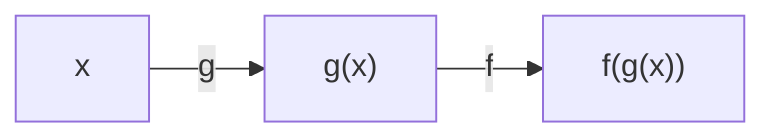
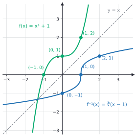

# Composition and inverse functions

After this lesson you can compose two functions and find the domain of the result, break a function into simpler pieces, decide whether a function has an inverse, find the inverse algebraically, draw it as a reflection in the line $y = x$, and restrict a domain so that an inverse exists.

Before this: [what is a function](01-what-is-a-function.md), [reading function graphs](02-reading-function-graphs.md), [transformations of functions](04-transformations-of-functions.md), and [roots, irrational numbers and types of numbers](../../02-middle-school/04-powers-roots-and-real-numbers/03-roots-irrationals-and-types-of-numbers.md).

## Quick check

Try these first. If you get all three right, skip to [Practice](#practice).

1. For $f(x) = x^2$ and $g(x) = x + 3$, find $(f \circ g)(2)$ and $(g \circ f)(2)$.
2. Find the inverse of $f(x) = 4x - 8$, and check it.
3. Does $h(x) = x^2 - 6x$ have an inverse on all of $\mathbb{R}$? If not, name a domain on which it does.

<details class="solution" markdown>
<summary>Answers</summary>

1. $(f \circ g)(2) = f(g(2)) = f(5) = 25$, and $(g \circ f)(2) = g(f(2)) = g(4) = 7$. The order matters.
2. Write $y = 4x - 8$ and solve for $x$: $x = \frac{y + 8}{4}$. So $f^{-1}(x) = \frac{x + 8}{4}$. Check: $f(f^{-1}(x)) = 4 \cdot \frac{x + 8}{4} - 8 = x$.
3. No. The outputs repeat: $h(0) = 0 = h(6)$, so the horizontal line $y = 0$ meets the graph twice. The parabola has its vertex at $x = 3$, so on $[3, \infty)$ (or on $(-\infty, 3]$) each output occurs once and an inverse exists.

</details>

## The idea

You buy an \$80 item with a \$10 coupon, and 13% HST applies. If the coupon comes off first, you pay tax on \$70: $70 \times 1.13 = 79.10$. If the tax is added first and the coupon comes off afterwards, you pay $80 \times 1.13 - 10 = 80.40$. Two steps in a different order give different totals. Each step is a function: $c(p) = p - 10$ takes off the coupon and $t(p) = 1.13p$ adds the tax. Doing one after the other is composition, and the order is part of the answer.

Now suppose you see only the receipt, \$79.10, and want the sticker price. You must undo the steps, and in the opposite order: divide by 1.13 first (undoing the tax, the last step), then add 10 back (undoing the coupon, the first step). That gives $\frac{79.10}{1.13} + 10 = 80$. Undoing a function is an inverse, and a chain of steps is undone in reverse, the way you take off shoes before socks if you put socks on before shoes.

Not every step can be undone. If a machine only reports the length of a word, you can't recover the word, since "cat" and "dog" both give 3. A function can be undone exactly when it never sends two different inputs to the same output, and this lesson makes that precise.

## Definitions

Let $g \colon A \to B$ and $f \colon C \to D$ be functions. The **composition** of $f$ and $g$, written $f \circ g$ and read "$f$ of $g$" or "$f$ composed with $g$", is the function

$$
(f \circ g)(x) = f\bigl(g(x)\bigr).
$$

The function $g$ is applied first, then $f$. The input $x$ must be in the domain of $g$, and the output $g(x)$ must be in the domain of $f$, so the domain of $f \circ g$ is $\{x \in A : g(x) \in C\}$. In plain words, composition feeds the output of one machine into the input of the next. The function $g$ is the inner function and $f$ is the outer function.



The **identity function** on a set $A$ sends every $x$ in $A$ to itself: $\text{id}(x) = x$. Composing with it changes nothing.

A function $f \colon A \to B$ has an **inverse** when there is a function $g \colon B \to A$ with

$$
g\bigl(f(x)\bigr) = x \text{ for every } x \text{ in } A, \qquad f\bigl(g(y)\bigr) = y \text{ for every } y \text{ in } B.
$$

The function $g$ is written $f^{-1}$. In plain words, an inverse undoes $f$, and $f$ undoes it. The $-1$ is a label and not an exponent: $f^{-1}(x)$ is not $\frac{1}{f(x)}$. For $f(x) = 2x$, the inverse is $f^{-1}(x) = \frac{x}{2}$, while $\frac{1}{f(x)} = \frac{1}{2x}$.

A function $f$ is **one-to-one** (or injective) when different inputs always give different outputs: if $f(x_1) = f(x_2)$, then $x_1 = x_2$. On a graph, this is the **horizontal line test**: every horizontal line meets the graph at most once. In plain words, no output is shared by two inputs. A function with an inverse must be one-to-one, as the theorem below shows. The word for a function that is both one-to-one and onto its codomain is bijective, covered in [injective, surjective and bijective](../../04-proofs-and-logic/06-relations-and-functions/05-injective-surjective-bijective.md).

For a one-to-one function, the domain of $f^{-1}$ is the range of $f$, and the range of $f^{-1}$ is the domain of $f$: the inverse swaps the two sets.

## How to do it

### Composing functions and finding the domain

1. Decide which function goes inside. In $(f \circ g)(x)$, the inner function is $g$.
2. Substitute the whole formula of $g$ for $x$ in the formula of $f$, using brackets.
3. Find the domain from the original pieces: $x$ must be in the domain of $g$, and $g(x)$ must be in the domain of $f$.
4. Simplify the formula, but keep the domain from Step 3. Simplifying can hide a restriction.
5. Check with a number: compute $g(x)$, then $f$ of that, and compare with the formula.

Composition is not commutative: in general $f \circ g \ne g \circ f$. It is associative: $(f \circ g) \circ h = f \circ (g \circ h)$, because both send $x$ to $f(g(h(x)))$. So a chain of three or more functions needs no brackets.

### Breaking a function into pieces

1. Imagine evaluating the formula at a number. List the operations in the order you would do them.
2. The first operation is the innermost function, and the last operation is the outermost.
3. Write each operation as a function and compose them.
4. Check by composing and comparing with the original.

There is usually more than one correct decomposition. The aim is pieces that are simple, such as "add 2", "take the square root" or "take the reciprocal".

### Does a function have an inverse?

1. Draw or imagine the graph and apply the horizontal line test, or ask whether $f(x_1) = f(x_2)$ forces $x_1 = x_2$.
2. If the test fails, the function has no inverse as it stands. A counterexample is two inputs with the same output.
3. If the function is one-to-one, it has an inverse from its range back to its domain.
4. If the test fails but a piece of the graph passes it, restrict the domain to that piece.

*Theorem.* If $f \colon A \to B$ has an inverse $f^{-1}$, then $f$ is one-to-one.

We know that $f^{-1}(f(x)) = x$ for every $x$ in $A$. We want to show that $f(x_1) = f(x_2)$ implies $x_1 = x_2$. The plan is to start from $f(x_1) = f(x_2)$, apply $f^{-1}$ to both sides, and use the undoing property.

*Proof.* Suppose $f(x_1) = f(x_2)$. Applying $f^{-1}$ to both sides gives $f^{-1}(f(x_1)) = f^{-1}(f(x_2))$. By the undoing property, the left side is $x_1$ and the right side is $x_2$. So $x_1 = x_2$. $\blacksquare$

Looking back: the proof says that undoing would be impossible if two inputs collided, since $f^{-1}$ would have to send one output back to two places. The converse is also true. If $f$ is one-to-one, define $g(y)$ as the one input $x$ with $f(x) = y$, for each $y$ in the range. That is a function, because the input is unique, and it undoes $f$. This is why "one-to-one" is the test. An inverse is also unique: if $g$ and $h$ both undo $f$, then $g = g \circ (f \circ h) = (g \circ f) \circ h = h$.

### Finding an inverse

1. Check that the function is one-to-one, restricting the domain if needed.
2. Write $y = f(x)$.
3. Solve the equation for $x$ in terms of $y$.
4. Rename the variables: write $f^{-1}(x)$ in terms of the new input $x$. Equivalently, swap $x$ and $y$ first and then solve for $y$.
5. State the domain and range: the domain of $f^{-1}$ is the range of $f$, and its range is the domain of $f$.
6. Check both ways: $f(f^{-1}(x)) = x$ and $f^{-1}(f(x)) = x$.

For a function in which $x$ appears only once, there is a shortcut: list the operations applied to $x$ and undo them in reverse order. The Tricks section shows an example.

### The graph of an inverse

If $(a, b)$ is on the graph of $f$, then $f(a) = b$, so $f^{-1}(b) = a$, and $(b, a)$ is on the graph of $f^{-1}$. Swapping the coordinates is the reflection in the line $y = x$, from [transformations, congruence and similarity](../../02-middle-school/06-geometry/05-transformations-congruence-similarity.md). So the graph of $f^{-1}$ is the mirror image of the graph of $f$ in the line $y = x$, and the domain and the range trade places.



### Restricting a domain

The squaring function fails the horizontal line test, since $2$ and $-2$ both give 4. Restricting the domain to $x \ge 0$ keeps one of each pair, and the restricted function is one-to-one. Its inverse is the square root, because $\sqrt{x^2} = x$ for $x \ge 0$ and $(\sqrt{x})^2 = x$ for $x \ge 0$. Restricting to $x \le 0$ also works, and gives the inverse $-\sqrt{x}$. The restriction is a choice, and a different restriction gives a different inverse.


## Worked examples

<div class="example" markdown>

### Example 1: composing with a square root

Let $f(x) = \sqrt{x}$ and $g(x) = x^2 - 9$. Find $f \circ g$ and $g \circ f$ with their domains, and evaluate $(f \circ g)(5)$ and $(g \circ f)(16)$.

For $f \circ g$, Step 1: the inner function is $g$. Step 2: substitute, $(f \circ g)(x) = f(x^2 - 9) = \sqrt{x^2 - 9}$. Step 3: $g$ is defined everywhere, but $f$ needs a non-negative input, so $x^2 - 9 \ge 0$, which gives $x^2 \ge 9$, that is, $\lvert x \rvert \ge 3$. The domain is $(-\infty, -3] \cup [3, \infty)$. There is nothing to simplify.

For $g \circ f$, the inner function is $f$: $(g \circ f)(x) = g(\sqrt{x}) = (\sqrt{x})^2 - 9$. Step 3: $x$ must be in the domain of $f$, so $x \ge 0$. Step 4: simplify the formula, using $(\sqrt{x})^2 = x$ for $x \ge 0$, to get $x - 9$. The domain stays $[0, \infty)$. The formula $x - 9$ alone would accept negative numbers, but $g \circ f$ does not.

Values: $(f \circ g)(5) = \sqrt{25 - 9} = \sqrt{16} = 4$, and $(g \circ f)(16) = (\sqrt{16})^2 - 9 = 16 - 9 = 7$.

Step 5, check: $g(5) = 25 - 9 = 16$ and $f(16) = 4$. Also $f(16) = 4$ and $g(4) = 16 - 9 = 7$. The input $x = 2$ is outside the domain of $f \circ g$: $g(2) = -5$ and $\sqrt{-5}$ is not real.

</div>

<div class="example" markdown>

### Example 2: breaking a function into pieces

Write $h(x) = \dfrac{1}{\sqrt{x} - 2}$ as a composition of simple functions, and find its domain.

Step 1: evaluate at $x = 9$ in your head: take the square root (3), subtract 2 (1), take the reciprocal (1). The order is: root, subtract 2, reciprocal. Step 2 and 3: let $r(x) = \sqrt{x}$, $s(x) = x - 2$ and $q(x) = \frac{1}{x}$. Then $h = q \circ s \circ r$, since $q(s(r(x))) = \frac{1}{\sqrt{x} - 2}$.

The domain: $r$ needs $x \ge 0$, and the reciprocal needs $\sqrt{x} - 2 \ne 0$, that is, $x \ne 4$. So the domain is $[0, 4) \cup (4, \infty)$.

Check: $h(9) = \frac{1}{3 - 2} = 1$, and $h(0) = \frac{1}{0 - 2} = -\frac{1}{2}$.

</div>

<div class="example" markdown>

### Example 3: the inverse of a fraction

Find the inverse of $f(x) = \dfrac{2x + 1}{x - 3}$, with its domain and range.

Step 1: the function is one-to-one. If $\frac{2x_1 + 1}{x_1 - 3} = \frac{2x_2 + 1}{x_2 - 3}$, cross-multiplying gives $(2x_1 + 1)(x_2 - 3) = (2x_2 + 1)(x_1 - 3)$. Expanding, $2x_1x_2 - 6x_1 + x_2 - 3 = 2x_1x_2 - 6x_2 + x_1 - 3$, which simplifies to $7x_2 = 7x_1$, so $x_1 = x_2$.

Step 2: $y = \frac{2x + 1}{x - 3}$. Step 3: multiply by $x - 3$, then collect the terms with $x$:

$$
y(x - 3) = 2x + 1 \quad\Longrightarrow\quad yx - 3y = 2x + 1 \quad\Longrightarrow\quad x(y - 2) = 3y + 1 \quad\Longrightarrow\quad x = \frac{3y + 1}{y - 2}.
$$

Step 4: renaming, $f^{-1}(x) = \dfrac{3x + 1}{x - 2}$.

Step 5: the domain of $f$ is every real number except 3, so the range of $f^{-1}$ is every real number except 3. The domain of $f^{-1}$ must be the range of $f$, and the formula for $f^{-1}$ breaks at $x = 2$, so the range of $f$ is every real number except 2. (A fraction $\frac{2x + 1}{x - 3}$ never reaches 2, because $2x + 1 = 2x - 6$ has no solution.)

Step 6, check both ways: $f(4) = \frac{9}{1} = 9$, and $f^{-1}(9) = \frac{28}{7} = 4$. In general, $f^{-1}(f(x)) = \frac{3 \cdot \frac{2x + 1}{x - 3} + 1}{\frac{2x + 1}{x - 3} - 2}$, and multiplying top and bottom by $x - 3$ gives $\frac{6x + 3 + x - 3}{2x + 1 - 2x + 6} = \frac{7x}{7} = x$.

</div>

<div class="example" markdown>

### Example 4: a restricted domain (finish it yourself)

Let $f(x) = x^2 - 4x + 7$ with the domain restricted to $x \ge 2$. Complete the square: $f(x) = (x - 2)^2 + 3$. The vertex is at $x = 2$, and for $x \ge 2$ the function rises, so it is one-to-one, with range $[3, \infty)$.

Find $f^{-1}$, state its domain and range, and check your answer with $f(5)$.

<details class="solution" markdown>
<summary>Finish</summary>

Write $y = (x - 2)^2 + 3$. Then $(x - 2)^2 = y - 3$, so $x - 2 = \pm\sqrt{y - 3}$. Since $x \ge 2$, we need the non-negative root: $x = 2 + \sqrt{y - 3}$. So $f^{-1}(x) = 2 + \sqrt{x - 3}$. Its domain is the range of $f$, $[3, \infty)$, and its range is the domain of $f$, $[2, \infty)$.

Check: $f(5) = 25 - 20 + 7 = 12$, and $f^{-1}(12) = 2 + \sqrt{9} = 5$. The other root, $2 - \sqrt{y - 3}$, would give $-1$, outside the restricted domain.

</details>

</div>

## Edge cases and common mistakes

<div class="warning" markdown>

Watch out: $f^{-1}(x)$ is not $\frac{1}{f(x)}$. The first undoes $f$ and the second is its reciprocal. For $f(x) = x + 1$, $f^{-1}(x) = x - 1$, but $\frac{1}{f(x)} = \frac{1}{x + 1}$.

</div>

<div class="warning" markdown>

Watch out: $f(g(x))$ is not $f(x)\,g(x)$, and $f \circ g$ is not $g \circ f$. With $f(x) = 2x$ and $g(x) = x + 3$, $(f \circ g)(x) = 2x + 6$ and $(g \circ f)(x) = 2x + 3$. In the idea at the start, the coupon and the tax gave \$79.10 or \$80.40 depending on the order.

</div>

<div class="warning" markdown>

Watch out: don't lose the domain when you simplify. In Example 1, $(g \circ f)(x) = x - 9$ only for $x \ge 0$. The formula $x - 9$ on its own has the domain $\mathbb{R}$, which is a different function.

</div>

<div class="warning" markdown>

Watch out: the inverse of $x^2$ on all of $\mathbb{R}$ doesn't exist, and $\sqrt{x}$ is not it. The test $\sqrt{(-3)^2} = 3 \ne -3$ shows that $\sqrt{\ }$ doesn't undo squaring for negative inputs. It is the inverse of $x^2$ restricted to $x \ge 0$.

</div>

<div class="warning" markdown>

Watch out when undoing a chain: undo the last step first. The receipt in [The idea](#the-idea) came from "coupon, then tax", so you divide by 1.13 before adding 10 back. Adding 10 and then dividing gives $\frac{79.10 + 10}{1.13} \approx 78.85$, which is wrong.

</div>

Some functions are their own inverses. Any function whose graph is symmetric about the line $y = x$ undoes itself: $f(x) = \frac{1}{x}$ for $x \ne 0$ and $f(x) = c - x$ for a constant $c$. Applying the function twice gives back the input.

A constant function has no inverse, and neither does any function with a flat stretch, because many inputs share one output. A function that only increases, or only decreases, always passes the horizontal line test.

Composition can also fail to exist. If the outputs of $g$ never land in the domain of $f$, then $f \circ g$ has an empty domain. For $f(x) = \sqrt{x}$ and $g(x) = -x^2 - 1$, every output of $g$ is at most $-1$, so $f \circ g$ is not defined for any real number.

## Tricks and shortcuts

For a linear function $f(x) = mx + b$ with $m \ne 0$, the inverse is $f^{-1}(x) = \frac{x - b}{m}$, and its slope is $\frac{1}{m}$. The slopes of a function and its inverse are reciprocals, because reflecting in $y = x$ swaps the rise and the run.

To undo a function built from separate steps, write the steps in order and reverse them, undoing each. For $f(x) = 3(x - 2)^3 + 1$ with steps "subtract 2, cube, times 3, add 1", the reversed steps are "subtract 1, divide by 3, cube root, add 2", so $f^{-1}(x) = \sqrt[3]{\frac{x - 1}{3}} + 2$. The cube root is one-to-one on all of $\mathbb{R}$, so no restriction is needed.

A quick check of any inverse: pick a number, apply $f$, then $f^{-1}$, and see whether you get the number back. One number can't prove it, but it catches nearly every algebra slip.

Reflecting in $y = x$ is a good way to estimate an inverse's graph by eye. Sketch the line $y = x$, then mirror a few points of the graph across it.

## In code

Composition is a function that takes two functions. The code composes the coupon and the tax in both orders, undoes the receipt in reverse order, shows that composing the squaring function with a restricted root works only on non-negative inputs, and uses a Caesar shift, which is encoding as a function with an inverse.

<details class="code" markdown>
<summary>In code</summary>

```python
from math import sqrt

def compose(f, g):
    return lambda x: f(g(x))

coupon = lambda p: p - 10
tax = lambda p: 1.13 * p

print(round(compose(tax, coupon)(80), 2), round(compose(coupon, tax)(80), 2))   # 79.1 80.4

undo = compose(lambda y: y + 10, lambda y: y / 1.13)    # undo the tax first, then the coupon
print(round(undo(79.1), 2))                             # 80.0

print(sqrt((-3) ** 2), sqrt(3 ** 2))                    # 3.0 3.0

def encode(text, shift=3):
    return "".join(chr((ord(c) - 65 + shift) % 26 + 65) for c in text)

def decode(text, shift=3):
    return encode(text, -shift)

print(encode("HELLO"), decode(encode("HELLO")))         # KHOOR HELLO
print(all(decode(encode(w)) == w for w in ["ABC", "XYZ", "ZEBRA"]))   # True
print(len("cat") == len("dog"))                         # True
```

The first lines match the receipt arithmetic. The `sqrt` line shows that the square root returns 3 for both $-3$ and $3$ squared, so it recovers $3$ and not $-3$: it undoes squaring only on non-negative inputs. The Caesar shift moves each letter 3 places forward, wrapping around after Z with the remainder operator `%`. Decoding is the shift by $-3$, so `decode` is the inverse of `encode` on strings of capital letters, and the test is evidence for this. The last line is a function that has no inverse: `len` sends "cat" and "dog" to the same number, so the word can't be recovered from the length. Divisibility and modular arithmetic<!-- link: ../../06-cs-math/02-number-theory/01-divisibility-and-modular-arithmetic.md --> explains why the wrap-around works.

</details>

## FAQ

### Why does the inverse swap $x$ and $y$?

Because the inverse takes the old output as its input. If $y = f(x)$, then $x = f^{-1}(y)$. Writing the inverse as a function of $x$, as we usually do, means renaming the letter, so $y$ becomes $x$ and $x$ becomes $y$. Geometrically, each point $(a, b)$ of the graph turns into $(b, a)$.

### Can a function have two different inverses?

No. If $g$ and $h$ both undo $f$, then $g = g \circ (f \circ h) = (g \circ f) \circ h = h$, as noted above. When $f$ is not one-to-one, there is no inverse, but you can still ask for all the inputs that give a chosen output: the set $\{x : f(x) = c\}$, called a preimage, covered in [functions and well-definedness](../../04-proofs-and-logic/06-relations-and-functions/04-functions-and-well-definedness.md). For $x^2$ and the output 4, it is $\{-2, 2\}$.

### How do I know which half of a parabola to keep?

Either half works, and the choice is up to you or the problem. The usual choice is the right half, $x \ge 0$, because it gives the principal square root. A problem about a physical quantity may require the half that makes sense, such as positive times.

### Is the horizontal line test the same as the vertical line test turned sideways?

They test different things. The vertical line test asks whether a graph is a function, one output per input. The horizontal line test asks whether a function has an inverse, one input per output. A graph that passes the second test, reflected in $y = x$, becomes a graph that passes the first.

## Practice

### Warm-up

1\. Let $f(x) = 3x + 1$ and $g(x) = x^2$. Find $(f \circ g)(2)$, $(g \circ f)(2)$, and the formulas for $f \circ g$ and $g \circ f$.

<details class="solution" markdown>
<summary>Solution</summary>

$(f \circ g)(x) = f(x^2) = 3x^2 + 1$, so $(f \circ g)(2) = 3(4) + 1 = 13$. And $(g \circ f)(x) = g(3x + 1) = (3x + 1)^2 = 9x^2 + 6x + 1$, so $(g \circ f)(2) = 49$.

Check: $g(2) = 4$ and $f(4) = 13$. Also $f(2) = 7$ and $g(7) = 49$. The two orders differ.

</details>

2\. Find the inverse of (a) $f(x) = 5x - 7$, (b) $g(x) = \frac{x}{3} + 2$, (c) $h(x) = \sqrt[3]{x} - 4$.

<details class="solution" markdown>
<summary>Solution</summary>

- (a) Solve $y = 5x - 7$: $x = \frac{y + 7}{5}$. So $f^{-1}(x) = \frac{x + 7}{5}$.
- (b) Solve $y = \frac{x}{3} + 2$: $x = 3(y - 2)$. So $g^{-1}(x) = 3x - 6$.
- (c) Solve $y = \sqrt[3]{x} - 4$: $\sqrt[3]{x} = y + 4$, so $x = (y + 4)^3$. So $h^{-1}(x) = (x + 4)^3$.

Check (a): $f(f^{-1}(x)) = 5 \cdot \frac{x + 7}{5} - 7 = x$. Check (c) with $x = 8$: $h(8) = 2 - 4 = -2$, and $h^{-1}(-2) = 2^3 = 8$.

</details>

3\. Write each function as a composition of simpler functions: (a) $h(x) = \sqrt{x^2 + 5}$, (b) $k(x) = (x - 3)^4 + 1$, (c) $m(x) = \dfrac{1}{(x + 2)^2}$.

<details class="solution" markdown>
<summary>Solution</summary>

- (a) The order is square, add 5, take the square root. With $u(x) = x^2$, $v(x) = x + 5$ and $w(x) = \sqrt{x}$, $h = w \circ v \circ u$.
- (b) Subtract 3, raise to the fourth power, add 1. With $u(x) = x - 3$, $v(x) = x^4$ and $w(x) = x + 1$, $k = w \circ v \circ u$.
- (c) Add 2, square, take the reciprocal. With $u(x) = x + 2$, $v(x) = x^2$ and $w(x) = \frac{1}{x}$, $m = w \circ v \circ u$.

Check (b) at $x = 5$: $5 - 3 = 2$, $2^4 = 16$ and $16 + 1 = 17$, and $k(5) = 2^4 + 1 = 17$.

</details>

### Standard

4\. Let $f(x) = \dfrac{1}{x - 1}$ and $g(x) = \sqrt{x}$. Find $f \circ g$ and $g \circ f$ with their domains.

<details class="solution" markdown>
<summary>Solution</summary>

$(f \circ g)(x) = \frac{1}{\sqrt{x} - 1}$. The inner root needs $x \ge 0$, and the denominator must not be 0, so $\sqrt{x} \ne 1$, that is $x \ne 1$. The domain is $[0, 1) \cup (1, \infty)$.

$(g \circ f)(x) = \sqrt{\frac{1}{x - 1}}$. The inner function needs $x \ne 1$, and the root needs $\frac{1}{x - 1} \ge 0$. A fraction with numerator 1 is positive exactly when the denominator is positive, so $x - 1 > 0$. The domain is $(1, \infty)$.

Check: $(f \circ g)(4) = \frac{1}{2 - 1} = 1$, and $(g \circ f)(2) = \sqrt{1} = 1$. Also $(f \circ g)(1)$ would divide by 0, and $(g \circ f)(0) = \sqrt{-1}$ is not real.

</details>

5\. Which of these have an inverse on all of $\mathbb{R}$ (or on the domain given)? For each one that fails, restrict the domain and find the inverse. (a) $x^3$, (b) $\lvert x \rvert$, (c) $\frac{1}{x}$ for $x \ne 0$, (d) $x^2 - 4x$.

<details class="solution" markdown>
<summary>Solution</summary>

- (a) $x^3$ is always rising, so it passes the horizontal line test. The inverse is $\sqrt[3]{x}$.
- (b) $\lvert x \rvert$ fails: $\lvert -2 \rvert = \lvert 2 \rvert$. On $x \ge 0$ it is $x$, with inverse $x$.
- (c) $\frac{1}{x}$ passes: $\frac{1}{x_1} = \frac{1}{x_2}$ gives $x_1 = x_2$. It is its own inverse, since $y = \frac{1}{x}$ gives $x = \frac{1}{y}$.
- (d) $x^2 - 4x = (x - 2)^2 - 4$ fails, since $x = 0$ and $x = 4$ both give 0. Restrict to $x \ge 2$: solving $y = (x - 2)^2 - 4$ gives $x = 2 + \sqrt{y + 4}$, so the inverse is $2 + \sqrt{x + 4}$ on $[-4, \infty)$.

Check (d): $f(5) = 25 - 20 = 5$, and $2 + \sqrt{5 + 4} = 5$.

</details>

6\. The conversion from Celsius to Fahrenheit is $F = 1.8C + 32$. (a) Find the inverse and use it to convert 98.6 °F. (b) At what temperature are the two scales equal?

<details class="solution" markdown>
<summary>Solution</summary>

(a) Solve $F = 1.8C + 32$ for $C$: $C = \frac{F - 32}{1.8}$. For 98.6 °F, $C = \frac{66.6}{1.8} = 37$, so 37 °C.

(b) Set $C = F$: $1.8C + 32 = C$, so $0.8C = -32$ and $C = -40$. The scales agree at $-40$ degrees. This is the point where the graph of the conversion meets the line $y = x$.

Check: $1.8(-40) + 32 = -72 + 32 = -40$, and $1.8(37) + 32 = 98.6$.

</details>

### Challenge

7\. (a) Show that $(f \circ g)^{-1} = g^{-1} \circ f^{-1}$ when $f$ and $g$ both have inverses. (b) Check it for $f(x) = 2x$ and $g(x) = x + 3$.

<details class="solution" markdown>
<summary>Solution</summary>

(a) We want to show that $g^{-1} \circ f^{-1}$ undoes $f \circ g$ on both sides. Compute

$$
(g^{-1} \circ f^{-1}) \circ (f \circ g) = g^{-1} \circ (f^{-1} \circ f) \circ g = g^{-1} \circ g = \text{id},
$$

using associativity and $f^{-1} \circ f = \text{id}$. Similarly,

$$
(f \circ g) \circ (g^{-1} \circ f^{-1}) = f \circ (g \circ g^{-1}) \circ f^{-1} = f \circ f^{-1} = \text{id}.
$$

Since an inverse is unique, $g^{-1} \circ f^{-1}$ is the inverse of $f \circ g$. This is the shoes and socks rule: undo the last step first.

(b) $(f \circ g)(x) = 2(x + 3) = 2x + 6$, whose inverse is $\frac{x - 6}{2}$. Also $f^{-1}(x) = \frac{x}{2}$ and $g^{-1}(x) = x - 3$, so $(g^{-1} \circ f^{-1})(x) = \frac{x}{2} - 3 = \frac{x - 6}{2}$. They match. The wrong order, $f^{-1} \circ g^{-1}$, gives $\frac{x - 3}{2}$, which differs.

Check at $x = 10$: $(f \circ g)(10) = 26$, and $\frac{26 - 6}{2} = 10$.

</details>

8\. (Reviews [percents](../../02-middle-school/02-ratios-rates-percents/03-percents.md).) A store takes 20% off and then 13% HST is added. (a) Write the discount $d(p) = 0.8p$ and the tax $t(p) = 1.13p$, and find $t \circ d$ and $d \circ t$. (b) A receipt total is \$45.20. What was the sticker price? (c) Why does the order not matter here, unlike the \$10 coupon in The idea?

<details class="solution" markdown>
<summary>Solution</summary>

(a) $(t \circ d)(p) = 1.13 \times 0.8p = 0.904p$, and $(d \circ t)(p) = 0.8 \times 1.13p = 0.904p$. The two are the same function.

(b) Undo by dividing by the total multiplier: $\frac{45.20}{0.904} = 50$, so the sticker price was \$50.00.

(c) Each step multiplies by a constant, and multiplication is commutative, so the order doesn't change the product. The coupon subtracted a fixed amount, which doesn't commute with a multiplication: $1.13(p - 10) \ne 1.13p - 10$.

Check: $50 \times 0.8 = 40$ and $40 \times 1.13 = 45.20$.

</details>

## Where this shows up

- Calculus uses composition constantly: the chain rule differentiates $f(g(x))$ (chain rule, implicit and inverse derivatives<!-- link: ../../05-university-core/02-derivatives/03-chain-rule-implicit-and-inverse-derivatives.md -->), and inverse functions are how logarithms are defined as the undoing of exponentials ([logarithms](../07-exponentials-and-logarithms/02-logarithms.md)), and how inverse trigonometric functions are built.
- In CS, composition is how pipelines work: each stage's output feeds the next, as in `compose` above, and in functional programming, shell pipes and data-processing steps. Encoding and decoding, compression and encryption are pairs of functions where one is the inverse of the other, which is why a lossy step such as rounding or hashing has no inverse. Linear algebra has the same idea for matrices in matrix algebra and inverses<!-- link: ../../05-university-core/06-linear-algebra/03-matrix-algebra-and-inverses.md -->.
- In economics, an inverse demand function turns "quantity demanded at a price" into "the price at which that quantity sells", and in finance, undoing a percentage change is an inverse, as with removing HST from a receipt.
