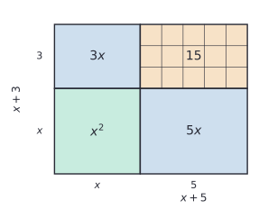
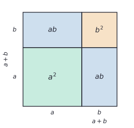

# Polynomial arithmetic

After this lesson you can name the parts of a polynomial, add, subtract and multiply polynomials, expand the special products $(a + b)^2$, $(a - b)^2$ and $(a + b)(a - b)$, state the degree of a sum and a product, and evaluate a polynomial with Horner's method.

Before this: [equivalent expressions](../../02-middle-school/03-expressions-equations-inequalities/02-equivalent-expressions.md), [exponent rules](../../02-middle-school/04-powers-roots-and-real-numbers/01-exponent-rules.md) and [radicals and rational exponents](01-radicals-and-rational-exponents.md).

## Quick check

Try these first. If you get all three right, skip to [Practice](#practice).

1. Write $5x - 3x^3 + 2 + x^4$ in standard form, and give its degree and leading coefficient.
2. Expand $(2x - 3)(x^2 + 4x - 1)$.
3. Expand $(3x - 4)^2$.

<details class="solution" markdown>
<summary>Answers</summary>

1. $x^4 - 3x^3 + 5x + 2$, with degree 4 and leading coefficient 1. There is no $x^2$ term, so its coefficient is 0.
2. $2x^3 + 5x^2 - 14x + 3$. The six products are $2x^3 + 8x^2 - 2x - 3x^2 - 12x + 3$, and $8x^2 - 3x^2 = 5x^2$ and $-2x - 12x = -14x$.
3. $9x^2 - 24x + 16$. The middle term is $2 \cdot 3x \cdot (-4) = -24x$, and the square of the first and last terms give $9x^2$ and $16$.

</details>

## The idea

A rectangular garden is $x + 5$ metres long and $x + 3$ metres wide. To find its area, cut it into four rectangles along the lines at distance $x$ from the corner. The pieces are an $x$ by $x$ square, a strip $5$ by $x$, a strip $3$ by $x$, and a small $5$ by $3$ rectangle:



The whole area is the sum of the pieces, $x^2 + 5x + 3x + 15$, which is $x^2 + 8x + 15$ after combining the two strips. Writing the area as a product and as a sum gives $(x + 5)(x + 3) = x^2 + 8x + 15$. The picture is the distributive property drawn as a rectangle.

You have met this picture before. The area model in [multi-digit multiplication](../../01-elementary/05-multi-digit-multiplication.md#the-area-model) splits $23 \times 14$ into $20 \cdot 10 + 20 \cdot 4 + 3 \cdot 10 + 3 \cdot 4$. That is the same product as $(2x + 3)(x + 4)$ at $x = 10$, which expands to $2x^2 + 11x + 12$, and $2 \cdot 100 + 11 \cdot 10 + 12 = 322 = 23 \times 14$. Polynomials are what long multiplication looks like when the base is a letter instead of ten, and the only difference is that nothing carries.

This lesson sets up the vocabulary and the three operations. The next lessons run them backwards ([factoring](03-factoring-polynomials.md)) and divide ([polynomial division](04-polynomial-division-and-remainder-theorem.md)).

## Definitions

A **monomial** in $x$ is an expression of the form $ax^k$, where $a$ is a real number and the exponent $k$ is a natural number ($0, 1, 2, \ldots$). The number $a$ is the **coefficient** of the monomial. A nonzero monomial has **degree** $k$, and a nonzero constant such as $7 = 7x^0$ has degree 0.

In plain words, a monomial is a number times a whole-number power of the variable, such as $5x^3$, $-x$ or $8$.

A **polynomial** in $x$ is a sum of monomials. Each monomial in the sum is a **term**. Terms with the same power of $x$ are **like terms**, and a polynomial is in **standard form** when its like terms are combined and its terms are written in decreasing order of degree:

$$
a_nx^n + a_{n-1}x^{n-1} + \cdots + a_1x + a_0, \qquad a_n \ne 0.
$$

Here $n$ is the **degree** of the polynomial (written $\deg p$ for a polynomial $p$), $a_nx^n$ is its **leading term**, $a_n$ is its **leading coefficient**, and $a_0$ is its **constant term**. The numbers $a_0, a_1, \ldots, a_n$ are the coefficients. The degree is the largest exponent that has a nonzero coefficient. The polynomial with every coefficient equal to 0, the **zero polynomial**, has no degree.

In plain words, standard form puts the biggest power first, and the leading term is the one that matters when $x$ is large. In $4x^3 - x^2 + 7$ the degree is 3, the leading coefficient is 4 and the constant term is 7. The coefficient of $x$ is 0, because that term is missing.

Polynomials have names by degree and by number of terms. Degree 0 is a constant, degree 1 is linear, degree 2 is quadratic, degree 3 is cubic and degree 4 is quartic. A polynomial with one term is a monomial, with two terms a **binomial**, and with three terms a **trinomial**. With two or more variables, the degree of a term is the sum of its exponents, so $3x^2y$ has degree 3.

Not every expression with an $x$ is a polynomial. The expressions $x^{-1}$, $\sqrt{x} = x^{1/2}$, $\frac{1}{x + 1}$ and $2^x$ are not, because their exponents aren't whole numbers, or the variable sits in the exponent or in a denominator. Two polynomials in standard form are equal when they have the same coefficients, so $2x^2 + 3 = 2x^2 + 0x + 3$.

Two facts about degrees will be used in every later lesson of this chapter. For nonzero polynomials $p$ and $q$ with degrees $n$ and $m$, and leading coefficients $a_n$ and $b_m$:

- The degree of a product is the sum of the degrees: $\deg(pq) = n + m$, and the leading coefficient of $pq$ is $a_nb_m$.
- The degree of a sum is at most the larger degree: $\deg(p + q) \le \max(n, m)$, with equality when $n \ne m$. It can be smaller when the leading terms cancel, as in $(x^2 + x) + (-x^2 + 3) = x + 3$.

*Proof of the first fact.* We know how to multiply two polynomials term by term. We want the highest power in the product. The plan is to find which pairs of terms can produce it.

Each term of $pq$ is a product $a_ix^i \cdot b_jx^j = a_ib_jx^{i+j}$ with $i \le n$ and $j \le m$. So $i + j \le n + m$, and $i + j = n + m$ only when $i = n$ and $j = m$. The product has one term of degree $n + m$, namely $a_nb_mx^{n+m}$, and nothing is left to cancel it. Its coefficient $a_nb_m$ is not 0, because a product of two nonzero numbers is nonzero ([the zero-product property](03-factoring-polynomials.md#zero-product-property) proves this). So the degree of $pq$ is $n + m$. $\blacksquare$

Look back: the proof used only the leading terms, which is why the answer doesn't depend on the other coefficients. The degree of a sum is easier: no term of $p + q$ has an exponent above $\max(n, m)$, and when $n > m$ the term $a_nx^n$ has nothing to combine with.

The **special products** are three expansions worth knowing by heart. For all numbers or expressions $a$ and $b$:

| Name | Identity | Example |
|---|---|---|
| square of a sum | $(a + b)^2 = a^2 + 2ab + b^2$ | $(x + 3)^2 = x^2 + 6x + 9$ |
| square of a difference | $(a - b)^2 = a^2 - 2ab + b^2$ | $(x - 3)^2 = x^2 - 6x + 9$ |
| difference of squares | $(a + b)(a - b) = a^2 - b^2$ | $(x + 3)(x - 3) = x^2 - 9$ |

In plain words, squaring a binomial gives the square of each term plus twice their product, and multiplying a sum by the matching difference leaves just the difference of the squares. The proof of the first is the distributive property: $(a + b)(a + b) = a^2 + ab + ba + b^2 = a^2 + 2ab + b^2$. Replacing $b$ by $-b$ gives the second, and in the third the two middle terms $-ab + ba$ cancel.

The first identity also has a picture proof. A square of side $a + b$ has area $(a + b)^2$. Cut it along one line at distance $a$ from each edge, and it falls into an $a$ by $a$ square, a $b$ by $b$ square, and two $a$ by $b$ rectangles:



The four areas are $a^2 + ab + ab + b^2$, which is $a^2 + 2ab + b^2$. The picture shows what the algebra hides: the middle term $2ab$ is there because there are two rectangles, and a missing middle term, the common error $(a + b)^2 = a^2 + b^2$, leaves two of the four pieces out. It works for positive $a$ and $b$; the algebra proof works for all numbers.

Cubing a binomial follows from the square: $(a + b)^3 = (a^2 + 2ab + b^2)(a + b) = a^3 + 3a^2b + 3ab^2 + b^3$. The coefficients $1, 3, 3, 1$ continue in a pattern that [the binomial theorem](../11-sequences-series-and-counting/04-binomial-theorem.md) explains for every power.

## How to do it

### Adding and subtracting polynomials

1. Write each polynomial in standard form. If you add in columns, leave a gap (a coefficient of 0) for each missing power.
2. For a subtraction, change the sign of every term of the second polynomial. A minus sign in front of brackets is a factor of $-1$, as in [equivalent expressions](../../02-middle-school/03-expressions-equations-inequalities/02-equivalent-expressions.md#definitions).
3. Add the coefficients of like terms. Terms with different exponents never combine.
4. Write the result in standard form and check by putting in a number such as $x = 2$ (not 0 or 1, which hide mistakes in exponents): the value of the answer must equal the sum or difference of the two values.

### Multiplying polynomials

1. Multiply every term of the first polynomial by every term of the second. A product of a polynomial with $s$ terms and one with $t$ terms has $st$ products before combining, so count them.
2. To multiply two terms, multiply the coefficients and add the exponents: $(3x^2)(-5x^4) = -15x^6$.
3. Combine like terms and write the result in standard form.
4. Check three things. The degree must be the sum of the degrees. The sum of the coefficients, which is the value at $x = 1$, must equal the product of the two sums of coefficients. And the value at $x = 2$ must equal the product of the two values.

The **box method** organizes Step 1: write one polynomial's terms across the top of a grid and the other's down the side, and fill each box with the product of its row and column. Like terms sit along the diagonals that run from bottom-left to top-right, so you can add them without hunting. The box method is the distributive property in a table, like the area model in the garden picture. A rule such as FOIL (first, outer, inner, last) is the same idea for two binomials only; distributing every term works for polynomials of any length.

### Evaluating a polynomial with Horner's method

To evaluate $2x^3 - 6x^2 + 2x - 1$ at $x = 3$, the direct way computes $3^3 = 27$ and $3^2 = 9$, multiplies by the coefficients, and adds. For a polynomial of degree $n$, computing every power from scratch takes $\frac{n(n+1)}{2}$ multiplications, and reusing each power to get the next takes $2n - 1$.

Horner's method does it in $n$ multiplications by factoring out $x$ again and again:

$$
2x^3 - 6x^2 + 2x - 1 = \bigl((2x - 6)x + 2\bigr)x - 1.
$$

At $x = 3$ the pieces are $2 \cdot 3 - 6 = 0$, then $0 \cdot 3 + 2 = 2$, then $2 \cdot 3 - 1 = 5$. In general, for $a_nx^n + \cdots + a_1x + a_0$ you start with $a_n$, and for each next coefficient you multiply the running value by $x$ and add the coefficient:

$$
b_n = a_n, \qquad b_{k} = b_{k+1}x + a_{k} \ \text{ for } k = n - 1, \ldots, 0, \qquad p(x) = b_0.
$$

The nested form is just the distributive property used backwards, so it gives the same value as the standard form: $\bigl((2x - 6)x + 2\bigr)x - 1$ expands to $2x^3 - 6x^2 + 2x - 1$. The next lesson shows that the running values are also the coefficients of a quotient, which is how Horner's method connects to polynomial division.

## Worked examples

<div class="example" markdown>

### Example 1: multiplying a trinomial by a binomial

Expand $(2x^2 - 3x + 4)(x - 5)$.

Step 1: there are $3 \times 2 = 6$ products. Put the terms of the trinomial across the top and those of the binomial down the side:

| | $2x^2$ | $-3x$ | $+4$ |
|---|---|---|---|
| $x$ | $2x^3$ | $-3x^2$ | $4x$ |
| $-5$ | $-10x^2$ | $15x$ | $-20$ |

Step 2: each box is the product of its row and column, with coefficients multiplied and exponents added. For example, $(-5)(-3x) = 15x$, and the sign of that box is positive because two negatives multiply to a positive.

<div class="warning" markdown>

Watch out at Step 2: exponents add when you multiply terms. The product $x \cdot 2x^2$ is $2x^3$, not $2x^2$, and $(-3x)(x)$ is $-3x^2$, not $-3x$, because $x \cdot x = x^2$.

</div>

Step 3: combine like terms. The $x^2$ terms are $-3x^2$ and $-10x^2$, and the $x$ terms are $4x$ and $15x$:

$$
(2x^2 - 3x + 4)(x - 5) = 2x^3 - 13x^2 + 19x - 20.
$$

Step 4: check. The degree is $2 + 1 = 3$, as it should be. At $x = 1$ the sums of coefficients are $2 - 3 + 4 = 3$ and $1 - 5 = -4$, and $3 \cdot (-4) = -12$, while the answer gives $2 - 13 + 19 - 20 = -12$. At $x = 2$ the factors are $8 - 6 + 4 = 6$ and $2 - 5 = -3$, so the product is $-18$, and the answer gives $16 - 52 + 38 - 20 = -18$.

</div>

<div class="example" markdown>

### Example 2: subtracting, with a missing term

Subtract: $(5x^3 - 2x + 7) - (3x^3 + x^2 - 4x - 1)$.

The first polynomial has no $x^2$ term, so write it as $5x^3 + 0x^2 - 2x + 7$. Change the signs of every term of the second polynomial, including the $-1$, which becomes $+1$:

$$
5x^3 + 0x^2 - 2x + 7 - 3x^3 - x^2 + 4x + 1.
$$

Now combine: $5x^3 - 3x^3 = 2x^3$, then $0x^2 - x^2 = -x^2$, then $-2x + 4x = 2x$, then $7 + 1 = 8$. The result is $2x^3 - x^2 + 2x + 8$.

Check at $x = 2$: the first polynomial is $40 - 4 + 7 = 43$, the second is $24 + 4 - 8 - 1 = 19$, and $43 - 19 = 24$. The answer gives $16 - 4 + 4 + 8 = 24$.

</div>

<div class="example" markdown>

### Example 3: special products, and one for mental arithmetic

Expand $(3x - 2)^2$, $(x + 7)(x - 7)$ and $(2x + 5y)^2$.

In $(3x - 2)^2$, take $a = 3x$ and $b = 2$ in the square of a difference: $a^2 = 9x^2$, $2ab = 12x$ and $b^2 = 4$, so the result is $9x^2 - 12x + 4$. The middle term has a minus sign because the binomial does, and the last term is always positive.

The product $(x + 7)(x - 7)$ is a difference of squares, so it equals $x^2 - 49$.

In $(2x + 5y)^2$, take $a = 2x$ and $b = 5y$: $a^2 = 4x^2$, $2ab = 20xy$ and $b^2 = 25y^2$. The answer is $4x^2 + 20xy + 25y^2$.

The same identities speed up arithmetic. Since $47 = 50 - 3$, $47^2 = 50^2 - 2 \cdot 50 \cdot 3 + 3^2 = 2500 - 300 + 9 = 2209$. And $53 \times 47 = (50 + 3)(50 - 3) = 2500 - 9 = 2491$.

Check by setting $x = 2$ in the first: $(3 \cdot 2 - 2)^2 = 16$ and $9 \cdot 4 - 24 + 4 = 16$. For the last, $47 \cdot 47$ by long multiplication is 2,209.

</div>

<div class="example" markdown>

### Example 4: three binomials (finish it yourself)

Expand $(x + 1)(x - 2)(x + 3)$.

Multiply two of the factors first. Step 1: $(x + 1)(x - 2) = x^2 - 2x + x - 2 = x^2 - x - 2$. Now multiply this trinomial by $x + 3$, and check your answer at $x = 1$ and $x = 2$.

<details class="solution" markdown>
<summary>Finish</summary>

Multiply each term of $x^2 - x - 2$ by $x$ and by $3$:

$$
(x^2 - x - 2)(x + 3) = x^3 - x^2 - 2x + 3x^2 - 3x - 6 = x^3 + 2x^2 - 5x - 6.
$$

Check: at $x = 1$ the three factors are $2$, $-1$ and $4$, which multiply to $-8$, and the answer gives $1 + 2 - 5 - 6 = -8$. At $x = 2$ the middle factor is 0, so the product is 0, and the answer gives $8 + 8 - 10 - 6 = 0$.

</details>

</div>

## Edge cases and common mistakes

<div class="warning" markdown>

Watch out: $(a + b)^2$ is not $a^2 + b^2$. With $a = 3$ and $b = 4$, $(3 + 4)^2 = 49$ but $3^2 + 4^2 = 25$. The difference, 24, is the middle term $2ab = 24$. The square picture shows the two rectangles that the wrong version leaves out. The same goes for $(a - b)^2$ and for higher powers: an exponent outside brackets doesn't go onto each term of a sum.

</div>

<div class="warning" markdown>

Watch out when subtracting a polynomial: the minus sign changes every term, not just the first. The expression $-(x^2 - 3x + 1)$ is $-x^2 + 3x - 1$, not $-x^2 - 3x + 1$. Writing in the signs of the second polynomial before combining stops this slip, as in Example 2.

</div>

<div class="warning" markdown>

Watch out for the exponent rules in products. The expression $x^2 \cdot x^3$ is $x^5$, not $x^6$; $3x \cdot 4x$ is $12x^2$, not $12x$; and $(3x)^2$ is $9x^2$, not $3x^2$. Also, $x^2 + x^3$ can't be combined, because the terms are not like terms: at $x = 2$ it is $12$, and neither $x^5$ nor $2x^2$ gives that.

</div>

The degree of a sum can drop, as in $(x^2 + x) + (-x^2 + 3) = x + 3$. The degree of a product can't drop, by the theorem above. If you multiply a cubic by a quadratic and don't get a degree 5 answer, a coefficient is wrong.

The zero polynomial has no degree, and a nonzero constant has degree 0. So $7$ is a polynomial of degree 0, and $0$ is a polynomial with no degree (some books give it degree $-\infty$ so that the rule for products still holds).

Missing terms have coefficient 0, and they can appear in an answer. In $(x^2 - 2x + 3)(2x^2 + x - 4) = 2x^4 - 3x^3 + 11x - 12$ the $x^2$ terms cancel exactly ($-4 - 2 + 6 = 0$), so the standard form skips a power. That is a correct and untidy answer, not an error.

## Tricks and shortcuts

The sum of the coefficients of a polynomial is its value at $x = 1$, and its constant term is its value at $x = 0$. Two checks follow for free: the sums of coefficients multiply when the polynomials do, and the constant terms multiply too.

To square a number ending in 5, use the square of a sum with $a = 10n$ and $b = 5$: $(10n + 5)^2 = 100n^2 + 100n + 25 = 100n(n + 1) + 25$. So $75^2$ has $n = 7$, and $7 \cdot 8 = 56$ followed by 25 gives 5625. Likewise $35^2 = 1225$, from $3 \cdot 4 = 12$.

To multiply two numbers an equal distance from a round number, use the difference of squares. For example, $103 \times 97 = (100 + 3)(100 - 3) = 10000 - 9 = 9991$.

For a long product, multiply two factors at a time and check each step at $x = 2$ before going on. A single sign error early on ruins every later line.

## In code

A polynomial is a list of coefficients, with the entry at index $k$ holding the coefficient of $x^k$. Adding polynomials adds lists entry by entry, and multiplying them is a double loop that adds $i + j$ in the index, the same rule as adding exponents. Horner's method is one loop.

<details class="code" markdown>
<summary>In code</summary>

```python
def poly_add(p, q):
    n = max(len(p), len(q))
    p = p + [0] * (n - len(p))
    q = q + [0] * (n - len(q))
    return [u + v for u, v in zip(p, q)]

def poly_mul(p, q):
    out = [0] * (len(p) + len(q) - 1)
    for i, u in enumerate(p):
        for j, v in enumerate(q):
            out[i + j] += u * v        # x^i times x^j is x^(i + j)
    return out

def horner(p, x):
    acc = 0
    for coeff in reversed(p):          # start from the leading coefficient
        acc = acc * x + coeff
    return acc

P = [4, -3, 2]       # 4 - 3x + 2x^2
Q = [-5, 1]          # -5 + x
print(poly_mul(P, Q))                 # [-20, 19, -13, 2]
print(poly_add(P, Q))                 # [-1, -2, 2]
print(horner([-1, 2, -6, 2], 3))      # 5, the value of 2x^3 - 6x^2 + 2x - 1 at x = 3

def poly_hash(s, base=31, mod=1_000_000_007):
    h = 0
    for ch in s:
        h = (h * base + ord(ch)) % mod  # Horner's method on the character codes
    return h

print(poly_hash("abc"))               # 96354, which is 97*31**2 + 98*31 + 99
```

The list `[-20, 19, -13, 2]` is the polynomial $2x^3 - 13x^2 + 19x - 20$ from Example 1 in order from the constant term up, the opposite of standard form. The string hash treats the character codes of `"abc"` (97, 98 and 99) as coefficients of a polynomial, evaluates it at 31 with Horner's method, and reduces the result by a modulus, here the prime 1,000,000,007, so it fits a fixed size. For this short input the modulus changes nothing, since $97 \cdot 31^2 + 98 \cdot 31 + 99 = 96{,}354$ is already smaller than it.

</details>

## FAQ

### Why does the zero polynomial have no degree?

Because $0 = 0x^k$ for every $k$, so there is no largest exponent with a nonzero coefficient. Any number you chose for its degree would be as good as any other. Some books define $\deg 0 = -\infty$, which keeps the rule $\deg(pq) = \deg p + \deg q$ true even when one factor is 0. This book says the zero polynomial has no degree and treats it as a separate case, as in the division algorithm of the [division lesson](04-polynomial-division-and-remainder-theorem.md).

### Is $\frac{1}{x}$ a polynomial? What about $x^{-2}$?

No. A polynomial has only whole-number exponents, so every term is a number times a power like $x^0, x^1, x^2, \ldots$ An expression with a variable in a denominator, such as $\frac{1}{x}$, is a rational expression, and it behaves differently: for example, it has no value at $x = 0$, while every polynomial has a value at every real number. [Rational expressions](../06-rational-expressions-and-equations/01-rational-expressions.md) comes later. Expressions with fractional exponents such as $x^{1/2}$ are covered in the [previous lesson](01-radicals-and-rational-exponents.md).

### Why does the box method give the right answer?

It is the distributive property laid out in a grid. Multiplying $(a + b)(c + d)$ means multiplying $a$ and $b$ each by $c + d$, which makes four products, and the grid has one box for each. Nothing else is happening. It is the same as the area model for multi-digit numbers in the elementary lessons, with $x$ standing for a power of ten.

### Do polynomials only have one variable?

No. Polynomials in two variables such as $x^2 + 3xy - y^3$ follow the same rules, with the degree of a term being the sum of its exponents. The identities $(a + b)^2$ and $(a + b)(a - b)$ hold when $a$ and $b$ are themselves polynomials, as in $(2x + 5y)^2$. This chapter mostly uses one variable, because the graphs and division methods in later lessons are about one variable.

## Practice

### Warm-up

1\. For each expression, say whether it is a polynomial in $x$. If it is, give its degree and leading coefficient: (a) $4x^3 - x + 7$, (b) $\sqrt{x} + 1$, (c) $\frac{3}{x}$, (d) $9 - x^2$.

<details class="solution" markdown>
<summary>Solution</summary>

- (a) A polynomial, of degree 3, with leading coefficient 4.
- (b) Not a polynomial: $\sqrt{x} = x^{1/2}$ has a fractional exponent.
- (c) Not a polynomial: $\frac{3}{x} = 3x^{-1}$ has a negative exponent.
- (d) A polynomial. In standard form it is $-x^2 + 9$, so the degree is 2 and the leading coefficient is $-1$, not 9. The leading term is the one with the highest power, not the one written first.

Check each exponent: a polynomial needs every exponent to be $0, 1, 2, \ldots$

</details>

2\. Let $p(x) = 3x^2 - 5x + 1$ and $q(x) = x^3 - 2x^2 + 4$. Find $p + q$ and $p - q$ in standard form.

<details class="solution" markdown>
<summary>Solution</summary>

For the sum, the $x^3$ term is $x^3$, the $x^2$ terms give $3x^2 - 2x^2 = x^2$, the $x$ term is $-5x$ and the constants give $1 + 4 = 5$: $p + q = x^3 + x^2 - 5x + 5$.

For the difference, change the sign of every term of $q$: $p - q = 3x^2 - 5x + 1 - x^3 + 2x^2 - 4 = -x^3 + 5x^2 - 5x - 3$.

Check at $x = 2$: $p(2) = 12 - 10 + 1 = 3$ and $q(2) = 8 - 8 + 4 = 4$. The sum should be $7$ and $8 + 4 - 10 + 5 = 7$. The difference should be $-1$, and $-8 + 20 - 10 - 3 = -1$.

</details>

3\. Expand (a) $(x + 4)(x - 9)$ and (b) $(2x - 1)(3x + 5)$.

<details class="solution" markdown>
<summary>Solution</summary>

(a) $x^2 - 9x + 4x - 36 = x^2 - 5x - 36$.

(b) $6x^2 + 10x - 3x - 5 = 6x^2 + 7x - 5$.

Check at $x = 1$: (a) $5 \cdot (-8) = -40$ and $1 - 5 - 36 = -40$. (b) $1 \cdot 8 = 8$ and $6 + 7 - 5 = 8$.

</details>

### Standard

4\. Expand $(x^2 - 2x + 3)(2x^2 + x - 4)$.

<details class="solution" markdown>
<summary>Solution</summary>

There are $3 \times 3 = 9$ products. Multiply each term of the first factor by the second factor:

$$
\begin{aligned}
x^2(2x^2 + x - 4) &= 2x^4 + x^3 - 4x^2, \\
-2x(2x^2 + x - 4) &= -4x^3 - 2x^2 + 8x, \\
3(2x^2 + x - 4) &= 6x^2 + 3x - 12.
\end{aligned}
$$

Add the three lines. The $x^4$ term is $2x^4$. The $x^3$ terms give $1 - 4 = -3$. The $x^2$ terms give $-4 - 2 + 6 = 0$, so there is no $x^2$ term. The $x$ terms give $8 + 3 = 11$. The constant is $-12$. The answer is $2x^4 - 3x^3 + 11x - 12$.

Check: the degree is $2 + 2 = 4$. At $x = 1$ the factors are $2$ and $-1$, so the product is $-2$, and the answer gives $2 - 3 + 11 - 12 = -2$. At $x = 2$ the factors are $3$ and $6$, so the product is $18$, and the answer gives $32 - 24 + 22 - 12 = 18$.

</details>

5\. Expand (a) $(4x - 3)^2$, (b) $(5x + 2)(5x - 2)$, (c) $(x + 2y)^2$ and (d) $(x + 3)^3$.

<details class="solution" markdown>
<summary>Solution</summary>

- (a) $a = 4x$, $b = 3$: $16x^2 - 24x + 9$.
- (b) A difference of squares with $a = 5x$ and $b = 2$: $25x^2 - 4$.
- (c) $a = x$, $b = 2y$: $x^2 + 4xy + 4y^2$.
- (d) Use $(a + b)^3 = a^3 + 3a^2b + 3ab^2 + b^3$ with $a = x$ and $b = 3$: $x^3 + 9x^2 + 27x + 27$.

Check at $x = 1$, $y = 1$: (a) $1 = 16 - 24 + 9 = 1$. (b) $7 \cdot 3 = 21 = 25 - 4$. (c) $(1 + 2)^2 = 9 = 1 + 4 + 4$. (d) $4^3 = 64 = 1 + 9 + 27 + 27$.

</details>

6\. Evaluate $p(x) = 3x^4 - 5x^3 + 2x - 7$ at $x = 2$ with Horner's method. Write the running values, and say how many multiplications you used compared with building each power separately.

<details class="solution" markdown>
<summary>Solution</summary>

The coefficients in order are $3, -5, 0, 2, -7$, including the 0 for the missing $x^2$ term. Start with 3, and repeat: multiply by 2, add the next coefficient.

$$
3 \;\to\; 3 \cdot 2 - 5 = 1 \;\to\; 1 \cdot 2 + 0 = 2 \;\to\; 2 \cdot 2 + 2 = 6 \;\to\; 6 \cdot 2 - 7 = 5.
$$

So $p(2) = 5$. That took 4 multiplications, one for each coefficient after the first. Building each power from scratch would take $\frac{4 \cdot 5}{2} = 10$, and reusing powers takes $2 \cdot 4 - 1 = 7$.

Check directly: $3 \cdot 16 - 5 \cdot 8 + 2 \cdot 2 - 7 = 48 - 40 + 4 - 7 = 5$.

</details>

### Challenge

7\. Let $p$ and $q$ both have degree 3. (a) What are the possible degrees of $p + q$, assuming $p + q$ is not the zero polynomial? (b) What is the degree of $pq$? (c) Let $p(x) = x^3 + 2x$ and $q(x) = -x^3 + x^2$. Find $p + q$ and its degree. (d) Substitute $q(x)$ for $x$ in $p$ to get $p(q(x))$. What is its degree?

<details class="solution" markdown>
<summary>Solution</summary>

(a) The degree of the sum is at most 3. It is exactly 3 unless the $x^3$ terms cancel, and then it can be 2, 1 or 0, depending on how many more terms cancel. So the possible degrees are $0, 1, 2$ and $3$.

(b) The degrees add, so $\deg(pq) = 3 + 3 = 6$.

(c) $p + q = x^3 + 2x - x^3 + x^2 = x^2 + 2x$, which has degree 2: the $x^3$ terms cancelled.

(d) Here $p(q(x)) = (q(x))^3 + 2q(x)$. The leading term of $(q(x))^3$ is $(-x^3)^3 = -x^9$, and the other term, $2q(x)$, has degree 3, so the degree is $3 \cdot 3 = 9$. In general, substituting a polynomial of degree $m$ into one of degree $n$ gives degree $nm$, by the product rule for degrees.

Check (c) at $x = 1$: $p(1) + q(1) = 3 + 0 = 3$ and $1 + 2 = 3$. For (d), expanding gives $p(q(x)) = -x^9 + 3x^8 - 3x^7 + x^6 - 2x^3 + 2x^2$, which has degree 9, and at $x = 1$ it equals $-1 + 3 - 3 + 1 - 2 + 2 = 0$, which is $p(q(1)) = p(0)$.

</details>

8\. (Reviews [multi-digit multiplication](../../01-elementary/05-multi-digit-multiplication.md).) (a) Expand $(2x^2 + 3x + 4)(x + 5)$. (b) Put $x = 10$ and explain how the result is the long multiplication $234 \times 15$. (c) Where do the carries come from?

<details class="solution" markdown>
<summary>Solution</summary>

(a) $2x^3 + 10x^2 + 3x^2 + 15x + 4x + 20 = 2x^3 + 13x^2 + 19x + 20$.

(b) The digits of 234 are the coefficients $2, 3, 4$ of $2x^2 + 3x + 4$ at $x = 10$, and $15 = x + 5$. So the product is $2 \cdot 1000 + 13 \cdot 100 + 19 \cdot 10 + 20 = 2000 + 1300 + 190 + 20 = 3510$, and indeed $234 \times 15 = 3510$.

(c) Some coefficients, $13$, $19$ and $20$, are bigger than 9, so they are not digits. The carries rewrite each one using powers of ten: $20 = 2 \cdot 10 + 0$ puts a 2 into the tens place, and so on until every place holds a digit from 0 to 9. A polynomial has no carries because $x$ is not a number, so its coefficients can be as big as they like.

Check: $2000 + 1300 + 190 + 20 = 3510 = 234 \times 15$.

</details>

## Where this shows up

- The next lesson, [factoring polynomials](03-factoring-polynomials.md), reverses the special products, and the one after divides polynomials. [Polynomial functions and graphs](05-polynomial-functions-and-graphs.md) uses degree and leading coefficient to describe a graph. [The binomial theorem](../11-sequences-series-and-counting/04-binomial-theorem.md) extends the cube of a binomial to every power.
- In CS, Horner's method evaluates polynomial hashes, such as the string hash in the code above. Multiplying two $n$-digit numbers is multiplying two polynomials of about $n$ coefficients, which takes about $n^2$ coefficient products the way this lesson does it, and faster methods such as Karatsuba's algorithm and the fast Fourier transform use this link to multiply larger numbers.
- In economics, revenue is price times quantity. If demand is $p = 100 - 2q$, revenue is $q(100 - 2q) = 100q - 2q^2$, a quadratic polynomial, and profit is revenue minus cost, a subtraction of polynomials like Example 2.
