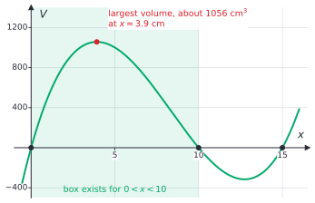
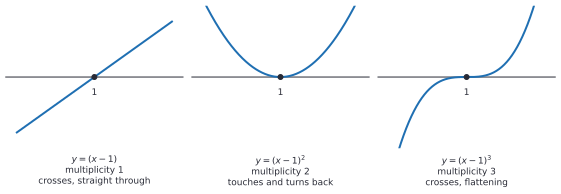
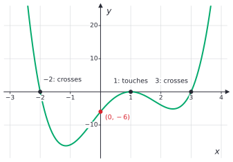

# Polynomial functions and graphs

After this lesson you can describe the end behaviour of a polynomial from its leading term, find its zeros and their multiplicities and say whether the graph crosses or touches the axis at each, sketch the graph from the factored form, use sign changes to locate a zero, and fit a polynomial through given points.

Before this: [factoring polynomials](03-factoring-polynomials.md), [polynomial division and the remainder theorem](04-polynomial-division-and-remainder-theorem.md) and [reading function graphs](../03-functions/02-reading-function-graphs.md).

## Quick check

Try these first. If you get all three right, skip to [Practice](#practice).

1. Describe what the graph of $p(x) = -2x^5 + x^3 - 4$ does far to the left and far to the right.
2. For $p(x) = x^2(x - 3)^3(x + 1)$, list the zeros with their multiplicities, say whether the graph crosses or touches the $x$-axis at each, and give the degree.
3. Show that $x^3 - x - 1$ has a zero between 1 and 2.

<details class="solution" markdown>
<summary>Answers</summary>

1. The leading term is $-2x^5$, with an odd degree and a negative coefficient, so the graph rises on the far left and falls on the far right.
2. The zero $0$ has multiplicity 2 (touches), $3$ has multiplicity 3 (crosses) and $-1$ has multiplicity 1 (crosses). The degree is $2 + 3 + 1 = 6$.
3. At $x = 1$ the value is $1 - 1 - 1 = -1$, and at $x = 2$ it is $8 - 2 - 1 = 5$. The graph goes from below the axis to above it without a break, so it crosses the axis somewhere between 1 and 2.

</details>

## The idea

A sheet of cardboard is 30 cm by 20 cm. Cut a square of side $x$ from each corner and fold up the sides to make an open box. The box has height $x$, length $30 - 2x$ and width $20 - 2x$, so its volume is

$$
V(x) = x(30 - 2x)(20 - 2x) = 4x^3 - 100x^2 + 600x.
$$

A table shows the pattern: $V(1) = 504$, $V(2) = 832$, $V(3) = 1008$, $V(4) = 1056$, $V(5) = 1000$, $V(6) = 864$, and it keeps falling to $V(9) = 216$. The volume rises, peaks near $x = 4$, and falls back toward 0 as the corners get too big. The graph shows the whole function, including values of $x$ that make no box:



The factored form $x(30 - 2x)(20 - 2x)$ tells you where the graph meets the axis: at $0$, $10$ and $15$. The leading term $4x^3$ tells you where the graph goes at the ends: down on the left and up on the right. With those two facts, and the knowledge that the graph has no gaps or corners, you can sketch the shape without a table. This lesson shows how, and what a polynomial graph is and isn't allowed to do.

## Definitions

A **polynomial function** is a function given by a polynomial, $f(x) = a_nx^n + \cdots + a_1x + a_0$, with $x$ any real number. Its graph is the set of points $(x, f(x))$. The graph has no breaks, no jumps and no corners: it is one smooth curve. Calculus proves this ([continuity, asymptotes and the IVT](../../05-university-core/01-limits-and-continuity/03-continuity-asymptotes-and-ivt.md)); here it is used as a fact.

A **zero** of $f$ is a number $c$ with $f(c) = 0$, so the point $(c, 0)$ is an $x$-intercept of the graph. If $c$ is a zero, then $(x - c)$ is a factor ([the factor theorem](04-polynomial-division-and-remainder-theorem.md#definitions)). The **multiplicity** of a zero $c$ is the number $k$ such that $(x - c)^k$ divides $f(x)$ but $(x - c)^{k+1}$ does not. Equivalently, $f(x) = (x - c)^k g(x)$ with $g(c) \ne 0$. In plain words, the multiplicity counts how many times the factor $x - c$ appears. In $x^2(x - 3)^3(x + 1)$ the zero 0 has multiplicity 2, the zero 3 has multiplicity 3 and the zero $-1$ has multiplicity 1.

The **end behaviour** of $f$ describes what $f(x)$ does when $x$ is very large and positive, written $x \to \infty$, and when $x$ is very large and negative, written $x \to -\infty$. The symbol $\infty$ is not a number here; "$x \to \infty$" means that $x$ grows without bound. A **turning point** is a point where the graph changes from rising to falling, or from falling to rising, so it is the top of a hill or the bottom of a valley.

### End behaviour

For large $\lvert x \rvert$ the leading term dominates the polynomial. Factor it out:

$$
a_nx^n + a_{n-1}x^{n-1} + \cdots + a_0 = a_nx^n\left(1 + \frac{a_{n-1}}{a_n x} + \cdots + \frac{a_0}{a_n x^n}\right).
$$

Every fraction in the bracket shrinks toward 0 as $\lvert x \rvert$ grows, so the bracket gets close to 1 and the polynomial behaves like $a_nx^n$. For example, $\frac{x^3 - 100x^2}{x^3} = 1 - \frac{100}{x}$ is $-9$ at $x = 10$, $0.9$ at $x = 1000$ and $0.999$ at $x = 100{,}000$. At $x = 10$ the $-100x^2$ term wins, and by $x = 100{,}000$ the polynomial is within 0.1% of $x^3$. So the end behaviour depends on only two things, the parity of the degree $n$ and the sign of $a_n$:


An even power makes $x^n$ positive on both sides, so the two ends go the same way. An odd power keeps the sign of $x$, so the ends go opposite ways. A negative leading coefficient flips the picture over.

### Crossing and touching

At a zero of odd multiplicity the graph crosses the $x$-axis, and at a zero of even multiplicity it touches the axis and turns back. A higher multiplicity also flattens the graph near the zero:



The reason is in the factorization $f(x) = (x - c)^k g(x)$ with $g(c) \ne 0$. Since the graph has no jumps, $g$ keeps one sign close to $c$, so the sign of $f$ near $c$ is the sign of $(x - c)^k$ times that fixed sign. The power $(x - c)^k$ changes sign at $c$ when $k$ is odd and doesn't when $k$ is even.

### What the graph must do

Four facts hold for every polynomial of degree $n \ge 1$.

1. It has at most $n$ zeros, since a nonzero polynomial of degree $n$ has at most $n$ ([the corollary of the factor theorem](04-polynomial-division-and-remainder-theorem.md#definitions)). Counted with multiplicity, a polynomial that factors completely into linear factors has exactly $n$.
2. Sign changes locate zeros. If $f(a)$ and $f(b)$ have opposite signs, the graph goes from one side of the axis to the other without a gap, so there is at least one zero between $a$ and $b$. This is the intermediate value theorem, stated here in the form we need. The statement is true for polynomials because their graphs are unbroken, and it is proved in calculus.
3. If $n$ is odd, there is at least one real zero. The ends go in opposite directions, so for some $a$ the value $f(a)$ is negative and for some $b$ it is positive, and fact 2 gives a zero between them. For even $n$ this can fail: $x^4 + 1$ has no real zero.
4. It has at most $n - 1$ turning points. The cubic $x^3$ has none, and $x^3 - 3x$ has two. The reason comes from calculus: turning points happen where the slope is 0, and the slope of a polynomial of degree $n$ is a polynomial of degree $n - 1$, which has at most $n - 1$ zeros ([differentiation rules](../../05-university-core/02-derivatives/02-differentiation-rules.md)). This lesson uses fact 4 without proving it.

## How to do it

### Sketching a graph from the factored form

1. Find the degree and the leading coefficient by multiplying out the leading terms of the factors. They give the end behaviour.
2. Find the zeros and their multiplicities from the factors. Mark them on the $x$-axis. Odd multiplicity means the graph crosses and even means it touches.
3. Find the $y$-intercept, $f(0)$, which is the constant term.
4. Find the sign of $f$ on each interval between zeros. Pick a test value in each interval, or start from the sign at the right end and flip the sign at each zero of odd multiplicity.
5. Draw a smooth curve that starts from the left end behaviour, passes through the zeros as the multiplicity says, and stays on the signed side of each interval.
6. Check that the number of turning points is at most $n - 1$, and check one or two points. The sketch isn't to scale, but the zeros, the intercept and the shape should be labelled.

### Writing an equation from a description

1. Write a factor $(x - c)^k$ for each zero, with the multiplicity given by crossing (odd) or touching (even).
2. Put an unknown constant $a$ in front: $f(x) = a(x - c_1)^{k_1}\cdots$.
3. Use one more point on the graph to solve for $a$. A positive $a$ or a negative $a$ also has to agree with the end behaviour.
4. Check the end behaviour and the point.

### Finding a zero by bisection

1. Find $a$ and $b$ with $f(a)$ and $f(b)$ of opposite signs, so a zero is between them.
2. Take the midpoint $m = \frac{a + b}{2}$ and compute $f(m)$.
3. Keep the half whose ends still have opposite signs: replace $b$ by $m$ if $f(a)$ and $f(m)$ differ in sign, otherwise replace $a$ by $m$.
4. Repeat. Each pass halves the interval, so after $k$ passes the zero is known to within $\frac{b - a}{2^k}$.

### Fitting a polynomial through points

A polynomial of degree at most $n$ has $n + 1$ coefficients, so $n + 1$ points can determine one.

1. Write $f(x) = a_nx^n + \cdots + a_0$ with unknown coefficients.
2. Substitute each point $(x_i, y_i)$. Each point gives one linear equation in the coefficients.
3. Solve the system ([systems of linear equations](../02-linear-functions-and-systems/02-systems-of-linear-equations.md)).
4. Check that the polynomial passes through every point.

There is only one answer: if two polynomials of degree at most $n$ both pass through the same $n + 1$ points, their difference has degree at most $n$ and $n + 1$ zeros, so it is the zero polynomial ([division lesson](04-polynomial-division-and-remainder-theorem.md#definitions)).

## Worked examples

<div class="example" markdown>

### Example 1: sketching a quartic

Sketch $p(x) = (x + 2)(x - 1)^2(x - 3)$.

Step 1: the leading terms multiply to $x \cdot x^2 \cdot x = x^4$, so the degree is 4 and the leading coefficient is 1. Even degree and positive coefficient: up on both ends.

Step 2: the zeros are $-2$ (multiplicity 1, crosses), $1$ (multiplicity 2, touches) and $3$ (multiplicity 1, crosses).

Step 3: $p(0) = 2 \cdot 1 \cdot (-3) = -6$.

Step 4: test one value in each interval. $p(-3) = (-1)(16)(-6) = 96$ is positive, $p(0) = -6$ is negative, $p(2) = 4 \cdot 1 \cdot (-1) = -4$ is negative and $p(4) = 6 \cdot 9 \cdot 1 = 54$ is positive. The signs on the intervals are $+, -, -, +$. The sign doesn't change at $x = 1$, which agrees with the zero there being a touch.

Step 5: come down from the upper left, cross at $-2$ into the negative region and bottom out, rise to touch the axis at $x = 1$ from below and turn back down, bottom out again, and cross upward at 3 into the right end.



Step 6: the graph has three turning points (a valley, the touch at 1 and a second valley), which is the most a degree 4 polynomial can have. The valleys are at about $(-1.15, -16.3)$ and $(2.40, -5.2)$, found with a computer; a sketch only needs their rough position. The expanded form $x^4 - 3x^3 - 3x^2 + 11x - 6$ has constant term $-6$, which agrees with the $y$-intercept.

<div class="warning" markdown>

Watch out at Step 5: at a zero of even multiplicity the graph must stay on the same side of the axis. The test values $p(0) = -6$ and $p(2) = -4$ are both negative, so a curve that crosses the axis at $x = 1$ would be wrong.

</div>

</div>

<div class="example" markdown>

### Example 2: an equation from a description

A cubic crosses the $x$-axis at $-1$, touches it at $2$ and passes through $(0, -8)$. Find an equation.

Step 1: a crossing at $-1$ gives the factor $(x + 1)$, and a touch at $2$ gives $(x - 2)^2$. The degree so far is 3, which is what we want. Step 2: $p(x) = a(x + 1)(x - 2)^2$. Step 3: $p(0) = a \cdot 1 \cdot 4 = 4a = -8$, so $a = -2$:

$$
p(x) = -2(x + 1)(x - 2)^2 = -2x^3 + 6x^2 - 8.
$$

Step 4: the leading term is $-2x^3$, odd degree with a negative coefficient, so the graph is up on the left and down on the right. Check: $p(-2) = -2(-1)(16) = 32 > 0$ on the left, and $p(3) = -2(4)(1) = -8 < 0$ on the right. Also $p(0) = -8$, and the zeros are right: $p(-1) = 0$ and $p(2) = 0$.

</div>

<div class="example" markdown>

### Example 3: locating a zero by sign changes

Show that $f(x) = x^3 + x - 3$ has a zero between 1 and 2, and find it to two decimal places.

The values are $f(1) = -1$ and $f(2) = 7$, which have opposite signs, so there is a zero between 1 and 2. Bisect:

| Pass | $a$ | $b$ | midpoint $m$ | $f(m)$ | keep |
|---|---|---|---|---|---|
| 1 | 1 | 2 | 1.5 | $1.875$ | $[1, 1.5]$ |
| 2 | 1 | 1.5 | 1.25 | $0.203$ | $[1, 1.25]$ |
| 3 | 1 | 1.25 | 1.125 | $-0.451$ | $[1.125, 1.25]$ |
| 4 | 1.125 | 1.25 | 1.1875 | $-0.138$ | $[1.1875, 1.25]$ |
| 5 | 1.1875 | 1.25 | 1.21875 | $0.029$ | $[1.1875, 1.21875]$ |
| 6 | 1.1875 | 1.21875 | 1.203125 | $-0.055$ | $[1.203125, 1.21875]$ |

After six passes the zero is in an interval of width $\frac{1}{64} \approx 0.016$, between 1.2031 and 1.2188, so it is about 1.21 to two places (the exact digits are 1.2134). Check: $1.21^3 + 1.21 - 3 = 1.7716 + 1.21 - 3 = -0.018$, close to 0, and $1.22^3 + 1.22 - 3 = 0.036$, so the sign change is between 1.21 and 1.22.

The zero isn't rational: the candidates $\pm 1$ and $\pm 3$ from the rational root theorem give $f(1) = -1$, $f(-1) = -5$, $f(3) = 27$ and $f(-3) = -33$, and none of them is 0. Cubics always have a real zero, as fact 3 says, but it needn't be a nice number.

<div class="warning" markdown>

Watch out: no sign change doesn't mean no zero. The polynomial $(x - 1)(x - 2)$ has $f(0) = 2$ and $f(3) = 2$, both positive, yet it has two zeros between them. A sign change guarantees an odd number of zeros (counted with multiplicity) in between, and no sign change guarantees an even number, possibly 0.

</div>

</div>

<div class="example" markdown>

### Example 4: a quadratic through three points (finish it yourself)

Find the quadratic $f(x) = ax^2 + bx + c$ through $(1, 4)$, $(2, 3)$ and $(4, 7)$.

Substitute each point:

$$
a + b + c = 4, \qquad 4a + 2b + c = 3, \qquad 16a + 4b + c = 7.
$$

Subtract the first equation from the second, and the second from the third, to remove $c$: $3a + b = -1$ and $12a + 2b = 4$. Now solve for $a$, $b$ and $c$, and check all three points.

<details class="solution" markdown>
<summary>Finish</summary>

Divide the second new equation by 2: $6a + b = 2$. Subtracting $3a + b = -1$ gives $3a = 3$, so $a = 1$. Then $b = -1 - 3 = -4$ and $c = 4 - 1 + 4 = 7$. The quadratic is $f(x) = x^2 - 4x + 7$.

Check: $f(1) = 1 - 4 + 7 = 4$, $f(2) = 4 - 8 + 7 = 3$ and $f(4) = 16 - 16 + 7 = 7$. By the uniqueness argument, no other quadratic passes through all three points.

</details>

</div>

## Edge cases and common mistakes

<div class="warning" markdown>

Watch out: a polynomial of degree $n$ has at most $n$ real zeros, not exactly $n$. The quadratic $x^2 + 1$ has none, and $x^3$ has one zero (of multiplicity 3). If someone asks for "the" number of zeros, count with multiplicity and include only real zeros, and say that the total can be less than $n$. [The complex numbers](../05-quadratics-and-complex-numbers/03-complex-numbers.md) fill in the missing ones.

</div>

<div class="warning" markdown>

Watch out: the leading coefficient does not give the $y$-intercept. The $y$-intercept is the constant term, $f(0)$. In $p(x) = x^4 - 3x^3 - 3x^2 + 11x - 6$ the leading coefficient is 1 and the intercept is $-6$.

</div>

<div class="warning" markdown>

Watch out: a polynomial graph has no corners, gaps or vertical lines. Where it touches the axis at a double zero, the curve is rounded like the bottom of a parabola, not a sharp "V". And it doesn't go straight at a triple zero: it flattens and crosses.

</div>

<div class="warning" markdown>

Watch out: fitting more parameters is not better. A degree 5 polynomial through six points matches all of them and can still be a bad model between and beyond them. In [In code](#in-code) it predicts 22.8 at $x = 6$ where the data suggest about 7.

</div>

The end behaviour says nothing about the middle. Two polynomials with the same degree and leading coefficient can have different numbers of turning points and different zeros, and the leading term only decides where the graph ends up.

The count "at most $n - 1$ turning points" is an upper bound. The graph of $x^3$ has none, and $x^4$ has one, not three. To find how many turning points there are exactly, you need the slope, which comes in calculus ([concavity and curve sketching](../../05-university-core/03-applications-of-derivatives/04-concavity-and-curve-sketching.md)).

A sketch doesn't have to be to scale. The first valley in Example 1 is about three times as deep as the second, but a sketch only needs the correct order: zeros marked, the intercept, the sign on each interval and the right number of turns.

## Tricks and shortcuts

When the polynomial is given factored, the $y$-intercept is the product of the constants in the factors, with signs: for $(x + 2)(x - 1)^2(x - 3)$ it is $2 \cdot 1 \cdot (-3) = -6$, and you can see it without expanding.

To find the sign on each interval without testing, start at the right end, where the sign is the sign of the leading coefficient, and move left. The sign flips at each zero of odd multiplicity and stays the same at each zero of even multiplicity. In Example 1, from $+$ on the right, crossing 3 gives $-$, touching 1 keeps $-$, and crossing $-2$ gives $+$.

A polynomial with only even powers, such as $x^4 - 5x^2 + 4$, is symmetric about the $y$-axis, since changing $x$ to $-x$ changes nothing. With only odd powers, such as $x^3 - 3x$, it is symmetric about the origin, since changing $x$ to $-x$ changes the sign of the output. Spotting this halves the work of a sketch.

For a graph given as a picture, count the zeros with multiplicity: a crossing is 1 or 3, and a touch is 2. The degree is at least that total. The number of turning points $+ 1$ is also a lower bound for the degree.

## In code

Bisection is a loop that halves an interval, and it works for any continuous function, not just polynomials. NumPy's `polyfit` solves the fitting problem from the lesson: it finds the polynomial of a chosen degree that is closest to the points, and when the degree is one less than the number of points it passes through all of them.

<details class="code" markdown>
<summary>In code</summary>

```python
import numpy as np

def p(x):
    return x**3 + x - 3

def bisect(f, lo, hi, tol=1e-9):
    assert f(lo) * f(hi) < 0          # a sign change, so a zero is between
    while hi - lo > tol:
        mid = (lo + hi) / 2
        if f(lo) * f(mid) <= 0:
            hi = mid
        else:
            lo = mid
    return (lo + hi) / 2

print(round(bisect(p, 1, 2), 4))                       # 1.2134

xs = [0, 1, 2, 3, 4, 5]
ys = [1.0, 2.2, 2.9, 4.4, 4.7, 6.1]
line = np.polyfit(xs, ys, 1)                           # degree 1
quint = np.polyfit(xs, ys, 5)                          # degree 5: six points, six coefficients
print(np.round(line, 4))                               # [0.9857 1.0857]
print(round(float(np.polyval(line, 6)), 1),
      round(float(np.polyval(quint, 6)), 1))           # 7.0 22.8
print(float(np.max(np.abs(np.polyval(quint, xs) - ys))) < 1e-8)   # True: it hits every point
```

The line is $y \approx 0.9857x + 1.0857$ and misses most points slightly. The degree 5 polynomial passes through all six, which the last line confirms up to rounding, but it swings up steeply after the last point: at $x = 6$ it predicts 22.8, while the line predicts 7.0. A model that fits the data perfectly is not a model that predicts well, and this gap is called overfitting. The bisection result agrees with the table in Example 3.

</details>

## FAQ

### Why can't a polynomial graph have a corner or a gap?

A polynomial is built from the variable using only addition and multiplication, and both operations turn a smooth curve into another smooth curve. Calculus makes this exact. The reason matters here only because sketching relies on it: between two points, the graph has to pass through every height in between.

### Why does the number of turning points have an upper limit?

Because each turning point is a place where the slope is 0, and the slope of a polynomial of degree $n$ is a polynomial of degree $n - 1$. A polynomial of degree $n - 1$ has at most $n - 1$ zeros, so there are at most $n - 1$ places where the slope is 0. The slope of a polynomial is its derivative; [differentiation rules](../../05-university-core/02-derivatives/02-differentiation-rules.md) shows how to find it.

### If a polynomial can pass through any $n + 1$ points, why not always do that?

Because the data usually have noise, and a high-degree polynomial chases the noise. Between the points it can swing far above and below them, and beyond the last point it shoots off, as in the code above. Practical fitting uses a low degree, or a method that balances the fit against the size of the coefficients. The line of best fit in [scatter plots and two-way tables](../../02-middle-school/07-statistics-and-probability/03-scatter-plots-and-two-way-tables.md) is the degree 1 case.

### What if the polynomial won't factor?

You can still sketch the end behaviour and the $y$-intercept, and find the zeros numerically, for example by bisection. A graphing tool or `numpy.roots` does this. The shape is then drawn from the zeros it finds.

## Practice

### Warm-up

1\. Describe the end behaviour of (a) $3x^4 - x^2$, (b) $-x^3 + 5x$ and (c) $2 - x^2 - x^6$.

<details class="solution" markdown>
<summary>Solution</summary>

- (a) The leading term is $3x^4$: even degree, positive coefficient, so up on both ends.
- (b) The leading term is $-x^3$: odd degree, negative coefficient, so up on the left and down on the right.
- (c) In standard form the polynomial is $-x^6 - x^2 + 2$, so the leading term is $-x^6$: even degree, negative coefficient, so down on both ends. The term written first, $2$, is not the leading one.

Check with large values: at $x = 10$, (a) is about 29,900 and at $x = -10$ it is the same, both large and positive. For (b), $p(10) = -950$ and $p(-10) = 950$.

</details>

2\. List the zeros and multiplicities, and say whether the graph crosses or touches at each: (a) $p(x) = x(x - 2)^2(x + 3)$ and (b) $q(x) = (x + 1)^3(x - 4)$.

<details class="solution" markdown>
<summary>Solution</summary>

(a) The zero $0$ has multiplicity 1 (crosses), $2$ has multiplicity 2 (touches) and $-3$ has multiplicity 1 (crosses). The degree is 4.

(b) The zero $-1$ has multiplicity 3 (crosses, flattening) and $4$ has multiplicity 1 (crosses). The degree is 4.

Check: the multiplicities add up to the degree, $1 + 2 + 1 = 4$ and $3 + 1 = 4$.

</details>

3\. For $p(x) = (x - 1)(x + 2)(x - 3)$, find the zeros, the $y$-intercept, the end behaviour and the sign of $p$ on each interval.

<details class="solution" markdown>
<summary>Solution</summary>

The zeros are $-2$, $1$ and $3$, all of multiplicity 1. The $y$-intercept is $p(0) = (-1)(2)(-3) = 6$. The leading term is $x^3$, so the graph is down on the left and up on the right.

Test values: $p(-3) = (-4)(-1)(-6) = -24$, $p(0) = 6$, $p(2) = (1)(4)(-1) = -4$ and $p(4) = (3)(6)(1) = 18$. The signs on $(-\infty, -2)$, $(-2, 1)$, $(1, 3)$ and $(3, \infty)$ are $-, +, -, +$.

Check: the signs alternate, as they should when every zero is a crossing, and they start negative on the left and end positive on the right, as the end behaviour says.

</details>

### Standard

4\. Describe the graph of $p(x) = -x^2(x - 2)(x + 1)$: end behaviour, zeros and what happens at each, $y$-intercept, the sign on each interval and the number of turning points.

<details class="solution" markdown>
<summary>Solution</summary>

The leading term is $-x^4$, so the graph is down on both ends. The zeros are $-1$ (multiplicity 1, crosses), $0$ (multiplicity 2, touches) and $2$ (multiplicity 1, crosses). The $y$-intercept is $p(0) = 0$.

Test values: $p(-2) = -4(-4)(-1) = -16$, $p(-0.5) = -0.25(-2.5)(0.5) = 0.3125$, $p(1) = -1(-1)(2) = 2$ and $p(3) = -9(1)(4) = -36$. The signs are $-, +, +, -$ on the intervals $(-\infty, -1)$, $(-1, 0)$, $(0, 2)$ and $(2, \infty)$. The sign stays $+$ across $x = 0$, as a touch requires.

The graph comes up from the lower left, crosses at $-1$, rises to a hill, comes down to touch the axis at $0$ (a valley with value 0), rises to a second hill and crosses downward at 2. There are three turning points, the most a quartic allows.

Check: the expanded form is $-x^4 + x^3 + 2x^2$, with leading term $-x^4$ and constant term 0, as found.

</details>

5\. Find an equation of a quartic that crosses the $x$-axis at $-2$, flattens and crosses at $1$ (multiplicity 3), and passes through $(0, 2)$.

<details class="solution" markdown>
<summary>Solution</summary>

The factors are $(x + 2)$ for the crossing and $(x - 1)^3$ for the flat crossing, so $p(x) = a(x + 2)(x - 1)^3$, which has degree 4. At $x = 0$: $a \cdot 2 \cdot (-1) = -2a = 2$, so $a = -1$. Then $p(x) = -(x + 2)(x - 1)^3$.

Check: $p(0) = -(2)(-1) = 2$. The leading term is $-x^4$, down on both ends, and the test values agree: $p(-3) = -(-1)(-64) = -64 < 0$ and $p(2) = -(4)(1) = -4 < 0$.

</details>

6\. Show that $f(x) = x^3 - 3x + 1$ has three real zeros, and explain why it has no more.

<details class="solution" markdown>
<summary>Solution</summary>

Compute: $f(-2) = -8 + 6 + 1 = -1$, $f(-1) = -1 + 3 + 1 = 3$, $f(0) = 1$, $f(1) = 1 - 3 + 1 = -1$ and $f(2) = 8 - 6 + 1 = 3$. There is a sign change between $-2$ and $-1$ (negative to positive), between $0$ and $1$ (positive to negative) and between $1$ and $2$ (negative to positive). Each change gives a zero in that interval, so there are at least three.

A cubic has at most 3 zeros, so there are exactly three.

Check: a computer gives the zeros $-1.879$, $0.347$ and $1.532$, one in each interval.

</details>

### Challenge

7\. Find the cubic through $(0, 1)$, $(1, 2)$, $(2, 9)$ and $(3, 28)$, and explain why there is only one.

<details class="solution" markdown>
<summary>Solution</summary>

Let $f(x) = ax^3 + bx^2 + cx + d$. The point $(0, 1)$ gives $d = 1$. The other three points give

$$
a + b + c = 1, \qquad 8a + 4b + 2c = 8, \qquad 27a + 9b + 3c = 27.
$$

Divide the second by 2 and the third by 3: $4a + 2b + c = 4$ and $9a + 3b + c = 9$. Subtract the first equation from each: $3a + b = 3$ and $8a + 2b = 8$, and the second of these is $4a + b = 4$. Subtracting $3a + b = 3$ gives $a = 1$, then $b = 0$ and $c = 0$. So $f(x) = x^3 + 1$.

Uniqueness: if $g$ is another polynomial of degree at most 3 through the same four points, then $f - g$ has degree at most 3 and four zeros, so it is the zero polynomial, and $g = f$.

Check: $f(0) = 1$, $f(1) = 2$, $f(2) = 9$ and $f(3) = 28$.

</details>

8\. (Reviews [scatter plots and two-way tables](../../02-middle-school/07-statistics-and-probability/03-scatter-plots-and-two-way-tables.md).) The six points $(0, 1)$, $(1, 2.2)$, $(2, 2.9)$, $(3, 4.4)$, $(4, 4.7)$ and $(5, 6.1)$ have the line of best fit $y \approx 0.9857x + 1.0857$ and the degree 5 polynomial through all of them, which predicts 22.8 at $x = 6$. (a) What does the line predict at $x = 6$? (b) Is each prediction interpolation or extrapolation? (c) Which would you trust?

<details class="solution" markdown>
<summary>Solution</summary>

(a) $0.9857 \cdot 6 + 1.0857 = 5.914 + 1.086 = 7.0$.

(b) Both are extrapolation: $x = 6$ is outside the data, which run from 0 to 5.

(c) The line. The points rise by about 1 each step, so a value near 7 fits the trend, while 22.8 would need a jump of about 16.7 from the last point at $x = 5$, where the value is 6.1. The degree 5 polynomial fits the six points exactly but has no reason to follow the trend beyond them.

Check: the line gives 6.1 at $x = 5$ (about $0.9857 \cdot 5 + 1.0857 = 6.014$), close to the data, so its increase from there to 7.0 is a step of about 1.

</details>

## Where this shows up

- In calculus, [curve sketching](../../05-university-core/03-applications-of-derivatives/04-concavity-and-curve-sketching.md) finds the exact turning points with the derivative, and Taylor polynomials ([power series and Taylor series](../../05-university-core/05-sequences-and-series/04-power-series-and-taylor-series.md)) approximate other functions by polynomials. [Rational functions and asymptotes](../06-rational-expressions-and-equations/02-rational-functions-and-asymptotes.md) compares the leading terms of two polynomials, and [polynomial and rational inequalities](../06-rational-expressions-and-equations/04-polynomial-and-rational-inequalities.md) uses the sign chart from this lesson.
- In CS, bisection is binary search on a continuous function, and numerical libraries use it, and faster relatives, to find zeros. Overfitting in machine learning is the degree 5 curve in the figure: a model with enough freedom matches its training data and predicts badly elsewhere. Correlation and linear regression<!-- link: ../../05-university-core/08-statistics/04-correlation-and-linear-regression.md --> is where this is made precise.
- In economics, a total cost curve is often modelled as a cubic, and a profit that is a polynomial in quantity is positive between its zeros, as in Practice problem 6 of the [factoring lesson](03-factoring-polynomials.md#practice).
