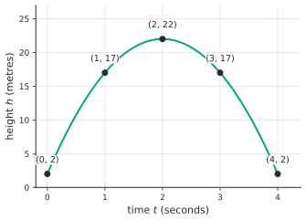
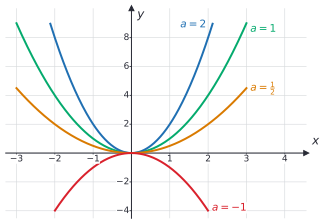
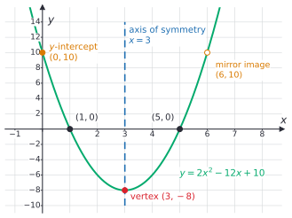
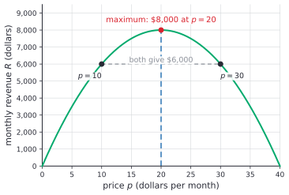
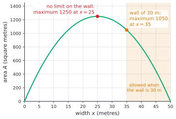

# Quadratic functions and graphs

After this lesson you can graph a quadratic function from its standard, vertex or factored form, find its vertex, axis of symmetry and intercepts, complete the square to get vertex form, and use the vertex to find the best price, the highest point of a throw or the largest area.

Before this: [slope and linear equations](../../02-middle-school/05-linear-relationships-and-functions/02-slope-and-linear-equations.md), [introduction to functions](../../02-middle-school/05-linear-relationships-and-functions/03-intro-to-functions.md) and [factoring polynomials](../04-radicals-and-polynomials/03-factoring-polynomials.md). The shifts in [transformations of functions](../03-functions/04-transformations-of-functions.md) explain why vertex form looks the way it does.

## Quick check

Try these first. If you get all three right, skip to [Practice](#practice).

1. For $y = x^2 - 4x - 5$, say which way the parabola opens, and find the vertex, the $y$-intercept and the $x$-intercepts.
2. Write $y = 2x^2 + 8x + 3$ in the form $y = a(x - h)^2 + k$.
3. A ball's height in metres after $t$ seconds is $h = -5t^2 + 30t + 1$. When is it highest, and how high does it get?

<details class="solution" markdown>
<summary>Answers</summary>

1. It opens up, since the coefficient of $x^2$ is positive. The axis is $x = -\frac{-4}{2} = 2$, and $y = 4 - 8 - 5 = -9$ there, so the vertex is $(2, -9)$. The $y$-intercept is $-5$. Factoring, $x^2 - 4x - 5 = (x - 5)(x + 1)$, so the $x$-intercepts are $5$ and $-1$.
2. $2(x + 2)^2 - 5$. Check by expanding: $2(x^2 + 4x + 4) - 5 = 2x^2 + 8x + 3$.
3. The coefficient $-5$ is negative, so the graph opens down and the vertex is the top. It is at $t = -\frac{30}{2(-5)} = 3$ seconds, and $h(3) = -45 + 90 + 1 = 46$, so the ball reaches 46 m.

</details>

## The idea

Throw a ball straight up from a height of 2 m. Its height $h$, in metres, after $t$ seconds is given by $h = -5t^2 + 20t + 2$. (Gravity's pull gives a coefficient near $-4.9$; the round number $-5$ keeps the arithmetic clean.) Here are the heights at whole seconds:

| Time $t$ (s) | 0 | 1 | 2 | 3 | 4 |
|---|---|---|---|---|---|
| Height $h$ (m) | 2 | 17 | 22 | 17 | 2 |
| Change from the row before | | $+15$ | $+5$ | $-5$ | $-15$ |
| Change in the change | | | $-10$ | $-10$ | $-10$ |

A linear function changes by the same amount every step, which is why its graph is straight ([slope and linear equations](../../02-middle-school/05-linear-relationships-and-functions/02-slope-and-linear-equations.md)). Here the changes themselves change, by the same amount each time, $-10$. That steady change in the change is the fingerprint of a quadratic function. The ball rises quickly, slows, stops at the top and then falls faster and faster.



The picture is a **parabola**, and it is symmetric. The ball is at 17 m one second after the throw and again one second before it lands at the same level, and the top sits exactly halfway between. Much of this lesson comes from that symmetry: find the middle, and you find the highest or lowest point.

The same shape appears whenever two quantities that depend on one choice get multiplied. If you raise a price, each customer pays more, but fewer customers buy. The revenue, price times customers, rises and then falls, and the best price sits at the top of a parabola.

## Definitions

A **quadratic function** is a function that can be written as

$$
f(x) = ax^2 + bx + c,
$$

where $a$, $b$ and $c$ are real numbers and $a \ne 0$. This is the **standard form**. The number $a$ is the quadratic coefficient (also called the leading coefficient), $b$ is the linear coefficient and $c$ is the constant term.

In plain words, a quadratic function has $x^2$ as its highest power. The requirement $a \ne 0$ matters: with $a = 0$ the $x^2$ term disappears and $f(x) = bx + c$ is a line.

The graph of a quadratic function is a **parabola**. It opens up when $a > 0$ and down when $a < 0$. The **vertex** is the point where the parabola turns around. It is the lowest point of a parabola that opens up and the highest point of one that opens down. The $y$-coordinate of the vertex is the **minimum value** or the **maximum value** of the function. The **axis of symmetry** is the vertical line through the vertex. Reflecting the parabola in that line gives the same parabola.

The **$y$-intercept** is the point where the graph crosses the $y$-axis, which is $(0, f(0)) = (0, c)$. An **$x$-intercept** is a point where the graph meets the $x$-axis. Its $x$-coordinate $x_0$ satisfies $f(x_0) = 0$ and is called a **zero** of $f$, or a **root** of the equation $ax^2 + bx + c = 0$. A parabola has 0, 1 or 2 $x$-intercepts: $y = x^2 + 1$ never reaches the axis, and $y = (x - 2)^2$ only touches it at $x = 2$.

The same function can be written in three forms, and each one shows something different at a glance.

| Form | Written as | What you can read off |
|---|---|---|
| standard | $ax^2 + bx + c$ | the $y$-intercept $c$; the axis is $x = -\frac{b}{2a}$ |
| vertex | $a(x - h)^2 + k$ | the vertex $(h, k)$; the axis is $x = h$ |
| factored | $a(x - r)(x - s)$ | the $x$-intercepts $r$ and $s$; the axis is $x = \frac{r + s}{2}$ |

In **vertex form**, $f(x) = a(x - h)^2 + k$, the vertex is $(h, k)$. In **factored form** (also called intercept form), $f(x) = a(x - r)(x - s)$, the zeros are $r$ and $s$. In all three forms the same letter $a$ is the leading coefficient. It sets the opening and the width: the larger $\lvert a \rvert$ is, the narrower the parabola, and a negative $a$ flips it upside down.



## How to do it

### Why the vertex form works

The three forms describe one function only if you can move between them. The move from standard to vertex form is called completing the square, and it also proves where the vertex is.

*Theorem.* For $a \ne 0$,

$$
ax^2 + bx + c = a(x - h)^2 + k, \qquad \text{where } h = -\frac{b}{2a} \text{ and } k = c - \frac{b^2}{4a}.
$$

So the parabola $y = ax^2 + bx + c$ has its vertex at $(h, k)$, the axis of symmetry is $x = h$, and $k = f(h)$ is the minimum value if $a > 0$ and the maximum value if $a < 0$.

We know how to expand a square, $(x + m)^2 = x^2 + 2mx + m^2$, and that the square of a real number is never negative. We want to rewrite $ax^2 + bx + c$ so that $x$ appears only inside one square. The plan is to factor $a$ out of the two terms that contain $x$, then add and subtract the number that turns those terms into a perfect square.

*Proof.* Factor $a$ out of the first two terms:

$$
ax^2 + bx + c = a\left(x^2 + \frac{b}{a}x\right) + c.
$$

A square of the form $(x + m)^2$ has the middle term $2mx$, so we need $2m = \frac{b}{a}$, which gives $m = \frac{b}{2a}$. The missing piece is $m^2 = \frac{b^2}{4a^2}$. Add it and subtract it inside the bracket, which changes nothing:

$$
\begin{aligned}
ax^2 + bx + c &= a\left(x^2 + \frac{b}{a}x + \frac{b^2}{4a^2} - \frac{b^2}{4a^2}\right) + c \\
&= a\left(x + \frac{b}{2a}\right)^2 - a \cdot \frac{b^2}{4a^2} + c \\
&= a\left(x + \frac{b}{2a}\right)^2 + \left(c - \frac{b^2}{4a}\right).
\end{aligned}
$$

This is $a(x - h)^2 + k$ with $h = -\frac{b}{2a}$ and $k = c - \frac{b^2}{4a}$.

For the vertex, put $x = h + d$ and $x = h - d$ for any number $d$. Both give $a d^2 + k$, because $(h + d - h)^2 = d^2 = (h - d - h)^2$. So the graph is symmetric about $x = h$. Since $d^2 \ge 0$, we get $f(x) = a d^2 + k \ge k$ when $a > 0$, with equality only at $d = 0$, so the lowest point is $(h, k)$. When $a < 0$ the inequality flips and $(h, k)$ is the highest point. $\blacksquare$

Look back. The step that does the work is adding and subtracting $m^2$, where $m$ is half the coefficient of $x$ (after dividing by $a$). Remember the formula $h = -\frac{b}{2a}$ and not the one for $k$: once you have $h$, the value $k = f(h)$ comes from substituting. The $-$ in $(x - h)$ explains the signs: $a(x + 2)^2 + 1$ has $h = -2$, because $x + 2 = x - (-2)$. Setting the bracket to zero is the quickest way to find the vertex's $x$.

### Graphing from standard form

1. Read the sign of $a$. If $a > 0$ the parabola opens up and the vertex is a minimum. If $a < 0$ it opens down and the vertex is a maximum.
2. Mark the $y$-intercept $(0, c)$.
3. Find the axis $x = -\frac{b}{2a}$. Substitute it into $f$ to get the $y$-coordinate of the vertex.
4. Find the $x$-intercepts by solving $ax^2 + bx + c = 0$. Factoring is the quickest way when it works, and the next lesson gives a method that always works. If there are none, say so and plot a couple of extra points instead.
5. Reflect the points you have in the axis. The mirror image of the $y$-intercept $(0, c)$ is $(2h, c)$, a free second point.
6. Draw one smooth curve through the points. It is rounded at the vertex, not pointed, and it keeps getting steeper as it moves away from the axis.
7. Check one more value: pick an $x$ you haven't used, compute $f(x)$ and make sure the point lies on your curve.

### Completing the square to get vertex form

This is the proof above as a routine. You can use the formulas $h = -\frac{b}{2a}$ and $k = f(h)$, or work the steps, which also explains the formulas.

1. Factor $a$ out of the $x^2$ and $x$ terms only. Leave $c$ outside: $a\left(x^2 + \frac{b}{a}x\right) + c$.
2. Halve the coefficient of $x$ inside the bracket and square the result.
3. Add and subtract that number inside the bracket. The number you subtract is inside a bracket multiplied by $a$, so when it leaves the bracket it becomes $a$ times itself.
4. Write the first three terms inside the bracket as a square, and combine the constants outside.
5. Check by expanding the answer. You should get the standard form back.

For $2x^2 + 8x + 3$: factor out the 2 to get $2(x^2 + 4x) + 3$. Half of 4 is 2, and $2^2 = 4$, so $2(x^2 + 4x + 4 - 4) + 3 = 2(x + 2)^2 - 8 + 3 = 2(x + 2)^2 - 5$. The $-4$ inside the bracket became $-8$ outside, since it was multiplied by the 2.

### Finding an equation from a graph

Pick the form that matches what you are given, put in the known numbers and solve for the one missing number, usually $a$.

| You know | Start from | Then |
|---|---|---|
| the vertex $(h, k)$ and one more point | $a(x - h)^2 + k$ | put in the other point and solve for $a$ |
| the $x$-intercepts $r$, $s$ and one more point | $a(x - r)(x - s)$ | put in the other point and solve for $a$ |
| three points | $ax^2 + bx + c$ | put in each point to get three equations in $a$, $b$, $c$, and solve the system |

### Maximum and minimum problems

1. Name the quantity you want to maximize or minimize, and the one quantity you control. Give the second one a letter.
2. Write the first quantity as a function of the second. If two variables appear, use the condition in the problem (a fixed amount of fence, a demand rule) to remove one.
3. Write down the allowed values of the variable: a price can't be negative, and a width can't be longer than the fence.
4. Find the vertex. The $x$-value is $-\frac{b}{2a}$, and the best value is $f$ at that point.
5. If the vertex's $x$ is allowed, you are done. If it isn't, the best allowed value is the one closest to the vertex, at the end of the allowed range.
6. Answer the question that was asked, with units: the price, the revenue and the time are three different answers.
7. Check by trying values on both sides of the vertex. They should all do worse.

For revenue, the quantity is $R = p \cdot q$, price times quantity sold. A linear demand rule gives $q$ as a linear function of $p$, so $R = p(mp + n)$ is quadratic in $p$, with $m < 0$ because a higher price sells less. It opens down and passes through $R = 0$ at $p = 0$. It has a second zero at the price where $q = 0$, and by symmetry the vertex is halfway between them: the revenue-maximizing price is half the price at which nobody buys.

## Worked examples

<div class="example" markdown>

### Example 1: graphing a parabola in standard form

Graph $f(x) = 2x^2 - 12x + 10$. Find the vertex, the axis, the intercepts and the vertex form.

Step 1: $a = 2 > 0$, so the parabola opens up and the vertex is a minimum.

Step 2: the $y$-intercept is $(0, 10)$.

Step 3: the axis is $x = -\frac{-12}{2 \cdot 2} = 3$. Then $f(3) = 2 \cdot 9 - 36 + 10 = -8$, so the vertex is $(3, -8)$.

Step 4: factor out the 2, $f(x) = 2(x^2 - 6x + 5) = 2(x - 1)(x - 5)$. The $x$-intercepts are $1$ and $5$, and their midpoint is 3, matching the axis.

Step 5: the mirror image of $(0, 10)$ in the line $x = 3$ is $(6, 10)$.

Step 6: draw the curve through $(0, 10)$, $(1, 0)$, $(3, -8)$, $(5, 0)$ and $(6, 10)$.



For the vertex form, use the completing-the-square steps. Step 1: $2(x^2 - 6x) + 10$. Step 2: half of $-6$ is $-3$, and $(-3)^2 = 9$. Step 3: $2(x^2 - 6x + 9 - 9) + 10$. Step 4: $2(x - 3)^2 - 18 + 10 = 2(x - 3)^2 - 8$. The vertex $(3, -8)$ is visible in it.

Step 7: check one more value. $f(2) = 8 - 24 + 10 = -6$ and $f(4) = 32 - 48 + 10 = -6$, two points the same distance from the axis at the same height, as symmetry says. Expanding the vertex form gives $2(x^2 - 6x + 9) - 8 = 2x^2 - 12x + 10$.

</div>

<div class="example" markdown>

### Example 2: the best price for a subscription

A small app has 600 subscribers at \$10 a month. A survey suggests that each \$1 increase in the price loses 20 subscribers. What price maximizes monthly revenue, and what is that revenue?

Steps 1 and 2: the quantity to maximize is the revenue $R$, and the quantity you control is the price $p$. The number of subscribers is $q = 600 - 20(p - 10) = 800 - 20p$. So

$$
R = p \cdot q = p(800 - 20p) = -20p^2 + 800p.
$$

Step 3: the price is at least 0, and subscribers can't be negative, which means $800 - 20p \ge 0$ and $p \le 40$. The allowed prices are $0 \le p \le 40$.

Step 4: the parabola opens down ($a = -20$), so the vertex is the maximum. Its $p$-value is $-\frac{800}{2(-20)} = 20$. Then $q = 800 - 400 = 400$ and $R = 20 \cdot 400 = 8000$.

The factored form shows why: $R = -20p(p - 40)$ has zeros at 0 and 40, the free price and the price at which nobody subscribes, and 20 is halfway between them.



Step 5: 20 is in the allowed range. Step 6: the best price is \$20 a month, which gives 400 subscribers and \$8,000 a month.

Step 7: check on both sides. At \$19 there are $800 - 380 = 420$ subscribers and $19 \cdot 420 = 7980$. At \$21 there are 380 and $21 \cdot 380 = 7980$. Both are below \$8,000. At \$10 and \$30 the revenue is \$6,000, as the graph shows.

This is revenue, not profit. If each subscriber also costs \$4 a month to serve, the profit is $(p - 4)(800 - 20p) = -20(p - 4)(p - 40)$. Its zeros are 4 and 40, so its vertex is at $p = 22$, a higher price than the one that maximizes revenue.

</div>

<div class="example" markdown>

### Example 3: a fence against a wall, and an edge case

You have 100 m of fencing for a rectangular pen. One side is a long straight wall, so you fence the other three sides. What dimensions give the largest area?

Steps 1 and 2: let $x$ be the width, the two sides at right angles to the wall. The side parallel to the wall then uses $100 - 2x$ metres, and

$$
A = x(100 - 2x) = -2x^2 + 100x.
$$

Step 3: $x > 0$, and the parallel side must be positive, so $x < 50$.

Step 4: the parabola opens down, and its vertex is at $x = -\frac{100}{2(-2)} = 25$. The parallel side is $100 - 50 = 50$ m, and the area is $25 \cdot 50 = 1250 \text{ m}^2$. The pen is 25 m by 50 m: the side along the wall is twice the other.

Check: the fence used is $25 + 25 + 50 = 100$ m. A pen 24 m by 52 m has an area of 1248, and one 26 m by 48 m has an area of 1248, both a little smaller.

Now the edge case. Suppose the wall is only 30 m long, so the parallel side can be at most 30 m. That means $100 - 2x \le 30$, so $x \ge 35$, and the allowed values are $35 \le x < 50$. The vertex at $x = 25$ is now outside the allowed range (Step 5).



On the allowed range the graph is decreasing, so the best choice is the end closest to the vertex, $x = 35$. The pen is 35 m by 30 m with an area of $1050 \text{ m}^2$. Check by trying a neighbour: $x = 36$ gives $36 \cdot 28 = 1008$, which is smaller.

</div>

<div class="example" markdown>

### Example 4: the highest point of a throw (finish it yourself)

A ball is thrown upward from 1.5 m. Ignoring air resistance, its height in metres after $t$ seconds is $h(t) = -4.9t^2 + 19.6t + 1.5$. When is the ball highest, and how high does it get?

Steps 1 and 2: the height is already a function of the time. Step 3: the allowed times start at $t = 0$.

Step 4: $a = -4.9 < 0$, so the parabola opens down and the vertex is the maximum. The axis is at $t = -\frac{19.6}{2(-4.9)} = 2$ seconds.

Now find the maximum height by substituting $t = 2$, write the vertex form, and check using the symmetry of the graph.

<details class="solution" markdown>
<summary>Finish</summary>

$h(2) = -4.9 \cdot 4 + 19.6 \cdot 2 + 1.5 = -19.6 + 39.2 + 1.5 = 21.1$. The ball is highest after 2 seconds, at 21.1 m. The vertex form is $h(t) = -4.9(t - 2)^2 + 21.1$.

Check: by symmetry the ball is back at its starting height 2 seconds after the top, at $t = 4$. Indeed $h(4) = -4.9 \cdot 16 + 78.4 + 1.5 = 1.5 = h(0)$.

</details>

</div>

## Edge cases and common mistakes

<div class="warning" markdown>

Watch out for the sign in vertex form. The function $y = 2(x + 3)^2 - 8$ has its vertex at $(-3, -8)$, not $(3, -8)$. Rewrite $x + 3$ as $x - (-3)$ to see $h = -3$. The constant $k$ keeps its sign as written. Setting the bracket to zero gives the vertex's $x$ at once: $x + 3 = 0$.

</div>

<div class="warning" markdown>

Watch out when $a \ne 1$ in completing the square. For $2x^2 + 8x + 3$, adding and subtracting 4 inside the bracket means subtracting $2 \cdot 4 = 8$ outside. Subtracting 4 gives $2(x + 2)^2 - 1$, which is wrong: at $x = 0$ it is 7, but the original is 3. Expanding the answer is the check that catches this.

</div>

<div class="warning" markdown>

Watch out: $-\frac{b}{2a}$ is the $x$-coordinate of the vertex, not the maximum or minimum. In Example 2 it gives the price, \$20. The maximum revenue is the $y$-coordinate, \$8,000, which you get by substituting. Say which of the two the question asks for.

</div>

<div class="warning" markdown>

Watch out for the allowed values. The vertex of the fence area for a 30 m wall is outside the allowed range (Example 3), and a negative time or price means nothing in a word problem. If the vertex isn't allowed, the answer is at the end of the range.

</div>

A parabola is not a pair of straight lines, and it is not a "U" with parallel sides. It is flat at the vertex and gets steeper the farther you go, forever. Some people also expect a negative $a$ to make the parabola narrow. It flips the parabola over; the width depends on $\lvert a \rvert$.

When $a = 0$ the function is linear, not quadratic. When $a > 0$ and the vertex is above the axis ($k > 0$), or $a < 0$ and the vertex is below it ($k < 0$), there are no $x$-intercepts, and the factored form doesn't exist with real numbers. The [complex numbers](03-complex-numbers.md) lesson gives such parabolas zeros of a new kind.

## Tricks and shortcuts

The axis is halfway between any two points of the graph at the same height. Since $f(1) = f(5) = 0$ for Example 1, the axis is $x = 3$. In the ball table above, $h(1) = h(3) = 17$ puts the top at $t = 2$.

For quick sketches, use the 1, 4, 9 pattern. Starting from the vertex, one step across moves $a$ vertically, two steps move $4a$ and three steps move $9a$. For $2(x - 3)^2 - 8$, the points at $x = 2$ and $x = 4$ are 2 above the vertex, at $-6$. Those at $x = 1$ and $x = 5$ are 8 above it, at 0, which are the intercepts.

If you have values at equally spaced inputs one step apart, the change in the change is $2a$. In the ball table it is $-10$, so $a = -5$. This works because $f(x + 1) - f(x) = 2ax + a + b$ is a linear function of $x$ with slope $2a$.

You can check vertex form by setting $x = 0$: $a h^2 + k$ must equal $c$. For $2(x - 3)^2 - 8$ that is $18 - 8 = 10$, the $y$-intercept from Example 1.

## In code

The vertex of $ax^2 + bx + c$ is two lines of code. Using `Fraction` keeps the answers exact. The other lines search prices for the best revenue, then recover a quadratic from three points.

<details class="code" markdown>
<summary>In code</summary>

```python
from fractions import Fraction

import numpy as np


def vertex_form(a, b, c):
    """Return (a, h, k) with a*x**2 + b*x + c = a*(x - h)**2 + k."""
    h = Fraction(-b, 2 * a)
    k = a * h**2 + b * h + c
    return a, h, k


print(vertex_form(2, -12, 10))  # (2, Fraction(3, 1), Fraction(-8, 1))
print(vertex_form(2, 8, 3))     # (2, Fraction(-2, 1), Fraction(-5, 1))
print(vertex_form(-4, 3, 1))    # (-4, Fraction(3, 8), Fraction(25, 16))

revenue = lambda p: p * (800 - 20 * p)
best = max(range(0, 41), key=revenue)
print(best, revenue(best))      # 20 8000

# A quadratic through three points: (0, 2), (1, 17), (2, 22).
a, b, c = np.polyfit([0, 1, 2], [2, 17, 22], 2)
print(round(a, 6), round(b, 6), round(c, 6))  # -5.0 20.0 2.0

# Squared error of a guess m for the data 2, 4, 9 is a parabola in m.
data = [2, 4, 9]
errors = {m / 10: sum((x - m / 10) ** 2 for x in data) for m in range(0, 121)}
print(min(errors, key=errors.get), sum(data) / len(data))  # 5.0 5.0
```

The first three lines return exact fractions, so the vertex of $-4x^2 + 3x + 1$ is $\left(\frac{3}{8}, \frac{25}{16}\right)$ with no rounding. The search over whole-dollar prices agrees with the algebra. The `polyfit` call is a least-squares fit, but with three points and a degree-2 fit it matches the points exactly, and the `round` removes the tiny floating-point noise. The last two lines show a fact used in statistics: the guess that minimizes the total squared error is the mean.

</details>

## FAQ

### Why is the graph a smooth U and not a V?

Because the slope keeps changing. Between $x$ and $x + 1$ the slope is $2ax + a + b$, which grows steadily as $x$ increases: near the vertex it is close to 0, so the curve is flat there, and farther away it gets steeper and steeper. A V has the same slope on each side. The graph of $y = \lvert x \rvert$ is a V; the graph of $y = x^2$ is not.

### Why is the vertex at $-\frac{b}{2a}$?

The proof above gives one reason. Here is a second, from symmetry. The function $ax^2 + bx = x(ax + b)$ has zeros at $0$ and $-\frac{b}{a}$, so its axis is halfway between them, at $-\frac{b}{2a}$. Adding $c$ lifts the whole graph without moving it sideways, so $ax^2 + bx + c$ has the same axis. Calculus gives a third reason: the slope $2ax + b$ is zero exactly at $x = -\frac{b}{2a}$ ([the derivative definition](../../05-university-core/02-derivatives/01-the-derivative-definition.md)).

### What if the vertex isn't at a nice number?

Then use fractions or decimals; the steps don't change. The vertex of $-4x^2 + 3x + 1$ is at $x = \frac{3}{8}$, with $y = \frac{25}{16}$, and in a real problem that is just 0.375 and 1.5625.

### Do all three forms always exist?

Standard form and vertex form always exist for a quadratic function, because completing the square works for every $a \ne 0$. Factored form needs the $x$-intercepts to exist. The parabola $y = x^2 + 1$ has none, so it has no factored form with real numbers. [Solving quadratic equations](02-solving-quadratic-equations.md) says exactly when the intercepts exist, and [complex numbers](03-complex-numbers.md) supplies a factored form even when they don't.

## Practice

### Warm-up

1\. For $f(x) = -3(x + 1)^2 + 7$ and $g(x) = \frac{1}{2}(x - 4)^2 - 2$, say which way each parabola opens and give the vertex, the axis of symmetry, the maximum or minimum value and the $y$-intercept.

<details class="solution" markdown>
<summary>Solution</summary>

For $f$: $a = -3 < 0$, so it opens down. Writing $x + 1 = x - (-1)$ gives the vertex $(-1, 7)$ and the axis $x = -1$. The maximum value is 7. The $y$-intercept is $f(0) = -3 + 7 = 4$.

For $g$: $a = \frac{1}{2} > 0$, so it opens up. The vertex is $(4, -2)$, the axis is $x = 4$, the minimum value is $-2$, and the $y$-intercept is $g(0) = \frac{1}{2} \cdot 16 - 2 = 6$.

Check by symmetry: $f(-2) = -3 + 7 = 4 = f(0)$, and $g(8) = \frac{1}{2} \cdot 16 - 2 = 6 = g(0)$.

</details>

2\. For $g(x) = -(x + 2)(x - 6)$, find the $x$-intercepts, the axis, the vertex and the $y$-intercept, and say which way it opens.

<details class="solution" markdown>
<summary>Solution</summary>

The $x$-intercepts are $-2$ and $6$. The axis is halfway between them, $x = \frac{-2 + 6}{2} = 2$. The vertex has $y = g(2) = -(4)(-4) = 16$, so it is $(2, 16)$. The $y$-intercept is $g(0) = -(2)(-6) = 12$. The leading coefficient is $-1$, so it opens down.

Check: $g(x) = -x^2 + 4x + 12$ when expanded. The $y$-intercept is 12, and $-\frac{b}{2a} = -\frac{4}{-2} = 2$.

</details>

3\. For $f(x) = 3x^2 - 12x + 7$, find the axis, the vertex, the $y$-intercept, the mirror image of the $y$-intercept, and the minimum value.

<details class="solution" markdown>
<summary>Solution</summary>

The axis is $x = -\frac{-12}{2 \cdot 3} = 2$. Then $f(2) = 12 - 24 + 7 = -5$, so the vertex is $(2, -5)$ and the minimum value is $-5$. The $y$-intercept is $(0, 7)$, and its mirror image in $x = 2$ is $(4, 7)$.

Check: $f(4) = 48 - 48 + 7 = 7$.

</details>

### Standard

4\. Write $y = -2x^2 - 12x - 10$ in vertex form, then find its $x$-intercepts by writing it in factored form.

<details class="solution" markdown>
<summary>Solution</summary>

Factor $-2$ out of the first two terms: $-2(x^2 + 6x) - 10$. Half of 6 is 3, and $3^2 = 9$, so

$$
-2(x^2 + 6x + 9 - 9) - 10 = -2(x + 3)^2 + 18 - 10 = -2(x + 3)^2 + 8.
$$

The $+18$ comes from $-2 \cdot (-9)$. The vertex is $(-3, 8)$.

For the factored form, take out $-2$: $-2(x^2 + 6x + 5) = -2(x + 1)(x + 5)$, so the $x$-intercepts are $-1$ and $-5$. Their midpoint is $-3$, matching the vertex.

Check: at $x = 0$, the vertex form gives $-2 \cdot 9 + 8 = -10$ and the factored form gives $-2 \cdot 1 \cdot 5 = -10$, both equal to the $y$-intercept.

</details>

5\. Find the equation of each parabola. (a) The vertex is $(2, -3)$ and the parabola passes through $(4, 5)$. (b) The $x$-intercepts are $-1$ and $5$ and the parabola passes through $(2, 9)$. Give each in standard form.

<details class="solution" markdown>
<summary>Solution</summary>

(a) Start from vertex form, $y = a(x - 2)^2 - 3$. Put in $(4, 5)$: $5 = a \cdot 4 - 3$, so $4a = 8$ and $a = 2$. Then $y = 2(x - 2)^2 - 3 = 2x^2 - 8x + 5$.

(b) Start from factored form, $y = a(x + 1)(x - 5)$. Put in $(2, 9)$: $9 = a \cdot 3 \cdot (-3) = -9a$, so $a = -1$. Then $y = -(x + 1)(x - 5) = -(x^2 - 4x - 5) = -x^2 + 4x + 5$.

Check: in (a), $2 \cdot 16 - 32 + 5 = 5$ at $x = 4$, and the vertex is at $x = -\frac{-8}{4} = 2$. In (b), $-4 + 8 + 5 = 9$ at $x = 2$, and $x = -1$ gives $-1 - 4 + 5 = 0$.

</details>

6\. A theatre sells 500 tickets at \$30. Each \$1 drop in the price sells 25 more tickets, and the hall has 600 seats. (a) Find the revenue as a function of the price $p$, and the price that maximizes it if the number of seats didn't matter. (b) What price maximizes revenue with the 600-seat limit, and what is the revenue?

<details class="solution" markdown>
<summary>Solution</summary>

(a) The number of tickets is $q = 500 + 25(30 - p) = 1250 - 25p$, so $R = p(1250 - 25p) = -25p^2 + 1250p$. The vertex is at $p = -\frac{1250}{2(-25)} = 25$, where $q = 625$ and $R = 15{,}625$.

(b) The hall can't sell 625 tickets. The limit $q \le 600$ means $1250 - 25p \le 600$, so $p \ge 26$. The vertex at $p = 25$ is not allowed, and for $p \ge 26$ the revenue falls as the price rises, so the best allowed price is the closest one to the vertex, $p = 26$. Then $q = 600$ and $R = 26 \cdot 600 = 15{,}600$.

Check: $p = 27$ gives $q = 575$ and $R = 15{,}525$, which is lower. $p = 25$ would need 625 seats.

</details>

### Challenge

7\. Prove that among all rectangles with the same perimeter $P$, the square has the largest area.

<details class="solution" markdown>
<summary>Solution</summary>

We know that the perimeter of a rectangle with width $w$ and length $\ell$ is $2w + 2\ell = P$ and its area is $w\ell$. We want to show that the area is largest when $w = \ell$. The plan is to write the area as a quadratic function of $w$ and find its vertex.

*Proof.* From $2w + 2\ell = P$ we get $\ell = \frac{P}{2} - w$, so the area is

$$
A(w) = w\left(\frac{P}{2} - w\right) = -w^2 + \frac{P}{2}w.
$$

Complete the square, with half of $\frac{P}{2}$ being $\frac{P}{4}$:

$$
A(w) = -\left(w^2 - \frac{P}{2}w + \frac{P^2}{16}\right) + \frac{P^2}{16} = -\left(w - \frac{P}{4}\right)^2 + \frac{P^2}{16}.
$$

The square is never negative, so $A(w) \le \frac{P^2}{16}$, with equality only when $w = \frac{P}{4}$. Then $\ell = \frac{P}{2} - \frac{P}{4} = \frac{P}{4} = w$, so the rectangle is a square. $\blacksquare$

Look back: the maximum area $\frac{P^2}{16}$ doesn't depend on any particular shape, only on $P$. Check with $P = 40$: the square is 10 by 10, with area 100, and $\frac{40^2}{16} = 100$. A 9 by 11 rectangle has area 99 and a 5 by 15 one has 75.

</details>

8\. (Reviews [slope](../../02-middle-school/05-linear-relationships-and-functions/02-slope-and-linear-equations.md).) The ball in the idea has height $h = -5t^2 + 20t + 2$. (a) Find the slope of the segment joining the graph's points at $t = 0$ and $t = 1$, then for $[1, 2]$, $[2, 3]$ and $[3, 4]$. These slopes are average speeds, in metres per second. (b) Describe the pattern, and say what a positive and a negative slope mean here. (c) Find the slope of the segment from $t = 1$ to $t = 3$, and say why that answer fits the symmetry of the graph.

<details class="solution" markdown>
<summary>Solution</summary>

(a) Use the table: $\frac{17 - 2}{1} = 15$, $\frac{22 - 17}{1} = 5$, $\frac{17 - 22}{1} = -5$ and $\frac{2 - 17}{1} = -15$.

(b) The slopes are $15, 5, -5, -15$, dropping by 10 each time, the constant change in the change. A positive slope means the height is rising and a negative one means it is falling. The ball rises at a decreasing rate, changes direction at the top, then falls at an increasing rate.

(c) $\frac{17 - 17}{3 - 1} = 0$. The two points have the same height, so the segment is horizontal. They are the same distance from the axis $t = 2$ on either side, so they have equal heights.

Check with the formula from the tricks section: the slope over $[x, x + 1]$ is $2ax + a + b = -10x + 15$, which gives $15, 5, -5, -15$ for $x = 0, 1, 2, 3$.

</details>

## Where this shows up

- The next lesson, [solving quadratic equations](02-solving-quadratic-equations.md), finds the $x$-intercepts of any parabola with one formula. [Optimization](../../05-university-core/03-applications-of-derivatives/05-optimization.md) in calculus uses the same plan as the maximum and minimum problems here, and finds the top of curves that are not parabolas by setting the slope to 0. [Polynomial functions and graphs](../04-radicals-and-polynomials/05-polynomial-functions-and-graphs.md) is the next step up from degree 2.
- In economics, revenue is price times quantity and profit is revenue minus cost, and many models use quadratic costs or linear demand ([profit maximization and market structure](../../07-economics-math/03-firms-and-consumers/03-profit-maximization-and-market-structure.md)).
- A loop inside a loop that compares every pair of $n$ items does $\frac{n(n-1)}{2}$ comparisons, a quadratic function of $n$ ([asymptotic notation](../../06-cs-math/04-sums-recurrences-and-algorithms/04-asymptotic-notation.md)). In machine learning, the squared error of a single guess is a parabola whose vertex is the mean of the data, as the last lines of the code box show.
