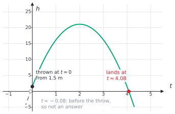

# Solving quadratic equations

After this lesson you can solve a quadratic equation by taking square roots, by factoring, by completing the square and with the quadratic formula, use the discriminant to tell how many real solutions it has, choose the quickest method, and check an answer.

Before this: [quadratic functions and graphs](01-quadratic-functions-and-graphs.md), [multi-step equations](../../02-middle-school/03-expressions-equations-inequalities/04-multi-step-equations.md), [roots, irrational numbers and types of numbers](../../02-middle-school/04-powers-roots-and-real-numbers/03-roots-irrationals-and-types-of-numbers.md) and [factoring polynomials](../04-radicals-and-polynomials/03-factoring-polynomials.md).

## Quick check

Try these first. If you get all three right, skip to [Practice](#practice).

1. Solve $(x - 3)^2 = 25$.
2. Solve $x^2 - 5x - 14 = 0$.
3. How many real solutions does $3x^2 - 2x + 5 = 0$ have? Solve $2x^2 + 3x - 4 = 0$ if you can.

<details class="solution" markdown>
<summary>Answers</summary>

1. Take both square roots: $x - 3 = 5$ or $x - 3 = -5$, so $x = 8$ or $x = -2$. Check: $5^2 = 25$ and $(-5)^2 = 25$.
2. Factor: $(x - 7)(x + 2) = 0$, so $x = 7$ or $x = -2$. Check: $49 - 35 - 14 = 0$ and $4 + 10 - 14 = 0$.
3. The discriminant is $(-2)^2 - 4 \cdot 3 \cdot 5 = 4 - 60 = -56$, which is negative, so there are no real solutions. For the second equation, $b^2 - 4ac = 9 + 32 = 41$, so $x = \frac{-3 \pm \sqrt{41}}{4}$, about $0.851$ and $-2.351$.

</details>

## The idea

In the [last lesson](01-quadratic-functions-and-graphs.md) a ball was thrown up from 1.5 m, with height $h = -4.9t^2 + 19.6t + 1.5$ metres after $t$ seconds. Its highest point came from the vertex. Now ask a different question: when does it hit the ground? That means finding the times when $h = 0$, so you must solve

$$
-4.9t^2 + 19.6t + 1.5 = 0.
$$

A quadratic equation has an unknown squared, and it can have two solutions where a linear equation has one. The two solutions are the two places where the parabola crosses the $x$-axis, or here the two times at which the height is zero. One of them, as Example 3 shows, doesn't belong to the situation.

Four methods solve these equations, and each one is the best choice somewhere. Square roots are quickest when the unknown appears inside a single square. Factoring is quickest when the numbers are small and friendly. Completing the square always works, and it is also how you find the vertex of a parabola. The quadratic formula is completing the square done once and for all, and it always works. This lesson builds the four in that order and then gives a way to decide between them.

## Definitions

A **quadratic equation** in $x$ is an equation that can be written as

$$
ax^2 + bx + c = 0,
$$

with $a$, $b$ and $c$ real numbers and $a \ne 0$. This is its **standard form**: everything on the left, zero on the right.

In plain words, it is an equation where $x^2$ is the highest power. A **solution** (or **root**) is a number that makes the equation true when it replaces $x$. To solve the equation is to find all its solutions. The solutions of $ax^2 + bx + c = 0$ are the zeros of the function $f(x) = ax^2 + bx + c$, the $x$-coordinates of the $x$-intercepts of its graph.

The **zero-product property** says that for real numbers $m$ and $n$, if $mn = 0$ then $m = 0$ or $n = 0$. In plain words, a product is zero only when one of its factors is zero. The reason is short: if $m \ne 0$, you can divide both sides of $mn = 0$ by $m$ to get $n = 0$. The property is about the number 0 only. If $mn = 6$, nothing tells you that $m$ or $n$ is 6.

The **discriminant** of $ax^2 + bx + c = 0$ is the number

$$
D = b^2 - 4ac.
$$

Many books write $\Delta$ for it; this book uses $D$, because $\Delta$ already means "change in". The discriminant is the part under the square root in the quadratic formula, and its sign says how many real solutions the equation has. When $D = 0$, the single solution is called a **repeated root** or double root.

## How to do it

### Solving by square roots

This works when the equation can be put in the form $(x - h)^2 = k$, with $x$ appearing once. Its simplest case, $x^2 = k$, has the solutions $x = \sqrt{k}$ and $x = -\sqrt{k}$ when $k > 0$, because both numbers have a square equal to $k$ (the [principal square root](../../02-middle-school/04-powers-roots-and-real-numbers/03-roots-irrationals-and-types-of-numbers.md) $\sqrt{k}$ is the positive one). When $k = 0$ the only solution is 0, and when $k < 0$ there is no real solution, since a real number's square is never negative.

1. Isolate the squared part: add, subtract and divide until you have $(\text{something})^2 = k$.
2. Take both square roots: $\text{something} = \sqrt{k}$ or $\text{something} = -\sqrt{k}$, written $\pm\sqrt{k}$.
3. Solve each of the two linear equations.
4. Check both solutions in the original equation.

For example, $3(x - 2)^2 = 12$ gives $(x - 2)^2 = 4$, then $x - 2 = \pm 2$, so $x = 4$ or $x = 0$.

### Solving by factoring

1. Move every term to one side so that the other side is 0.
2. Factor the side that isn't 0, as in [factoring polynomials](../04-radicals-and-polynomials/03-factoring-polynomials.md).
3. Set each factor equal to 0. This is the zero-product property.
4. Solve each linear equation.
5. Check each solution in the original equation.

When $a = 1$, look for two integers with product $c$ and sum $b$. When $a \ne 1$, look for two integers with product $ac$ and sum $b$, split the middle term with them and factor by grouping. For $6x^2 + 7x - 3 = 0$, the product $ac = -18$ and the sum 7 are matched by $9$ and $-2$:

$$
6x^2 + 9x - 2x - 3 = 3x(2x + 3) - (2x + 3) = (3x - 1)(2x + 3) = 0,
$$

so $x = \frac{1}{3}$ or $x = -\frac{3}{2}$. If the right side isn't 0, do Step 1 first. The equation $x(x + 3) = 70$ is not solved by setting $x = 70$ or $x + 3 = 70$.

### Solving by completing the square

This is the method that proves the formula, and it works on every quadratic equation. It is the same process as in [the last lesson](01-quadratic-functions-and-graphs.md#completing-the-square-to-get-vertex-form), but now you use it on an equation, so you may add the same number to both sides.

1. Divide both sides by $a$, so that the coefficient of $x^2$ is 1.
2. Move the constant term to the right side.
3. Halve the coefficient of $x$, square it, and add the result to both sides.
4. Write the left side as a square: $x^2 + px + \left(\frac{p}{2}\right)^2 = \left(x + \frac{p}{2}\right)^2$.
5. Take both square roots and solve, as in the first method.
6. Check both solutions.

For $x^2 - 8x + 5 = 0$: the equation becomes $x^2 - 8x = -5$. Half of $-8$ is $-4$ and $(-4)^2 = 16$, so $x^2 - 8x + 16 = 11$, which is $(x - 4)^2 = 11$, so $x = 4 \pm \sqrt{11}$. That is about $7.317$ and $0.683$, and they are untidy on purpose: not every quadratic has nice solutions.

### The quadratic formula

*Theorem (the quadratic formula).* Let $a \ne 0$ and $D = b^2 - 4ac$. The equation $ax^2 + bx + c = 0$ has:

- two real solutions, $x = \dfrac{-b + \sqrt{D}}{2a}$ and $x = \dfrac{-b - \sqrt{D}}{2a}$, when $D > 0$,
- exactly one real solution, $x = -\dfrac{b}{2a}$, when $D = 0$,
- no real solutions when $D < 0$.

We know how to complete the square, and that a real number's square is never negative. We want every $x$ that satisfies the equation, for all $a$, $b$ and $c$ at once. The plan is to run the steps of the method above with letters instead of numbers.

*Proof.* Divide both sides of $ax^2 + bx + c = 0$ by $a$, which is allowed since $a \ne 0$, then move the constant to the right:

$$
x^2 + \frac{b}{a}x = -\frac{c}{a}.
$$

Half of $\frac{b}{a}$ is $\frac{b}{2a}$. Add its square, $\frac{b^2}{4a^2}$, to both sides. The left side becomes a perfect square, and the right side gets a common denominator:

$$
\left(x + \frac{b}{2a}\right)^2 = \frac{b^2}{4a^2} - \frac{c}{a} = \frac{b^2 - 4ac}{4a^2} = \frac{D}{4a^2}.
$$

Now there are three cases. If $D < 0$, the right side is negative, but the left side is the square of a real number and can't be negative, so no real $x$ works. If $D = 0$, the equation says $\left(x + \frac{b}{2a}\right)^2 = 0$, so $x = -\frac{b}{2a}$. If $D > 0$, take both square roots. Since $\sqrt{4a^2} = 2\lvert a \rvert$, we get

$$
x + \frac{b}{2a} = \pm\frac{\sqrt{D}}{2\lvert a \rvert} = \pm\frac{\sqrt{D}}{2a},
$$

where the $\pm$ lets us write $a$ in place of $\lvert a \rvert$ (when $a < 0$ the two signs swap, and the pair of numbers is the same). Subtracting $\frac{b}{2a}$ gives $x = \frac{-b \pm \sqrt{D}}{2a}$. Each step can be reversed, so these numbers are solutions and there are no others. $\blacksquare$

Look back. The formula is completing the square, written once. It also says something about the graph: the solutions are $-\frac{b}{2a} \pm \frac{\sqrt{D}}{2a}$, which are the axis of symmetry from [the last lesson](01-quadratic-functions-and-graphs.md), plus and minus the same distance. The $x$-intercepts sit equally far on both sides of the axis. A larger $D$ puts them farther apart, $D = 0$ puts both at the vertex, and $D < 0$ means the vertex never reaches the $x$-axis.

To use the formula:

1. Write the equation in standard form and read off $a$, $b$ and $c$ with their signs. The equation $3x^2 = 2x + 7$ has $a = 3$, $b = -2$ and $c = -7$.
2. Compute $D = b^2 - 4ac$, keeping track of signs.
3. If $D < 0$, stop: there are no real solutions. If $D = 0$, the only solution is $-\frac{b}{2a}$.
4. If $D > 0$, compute $\frac{-b + \sqrt{D}}{2a}$ and $\frac{-b - \sqrt{D}}{2a}$.
5. Simplify. Pull perfect squares out of $\sqrt{D}$, and divide the whole numerator by $2a$, not just one term.
6. Check both solutions in the original equation, or use the sum and product check from [Tricks and shortcuts](#tricks-and-shortcuts).

### The discriminant

The sign of $D$ decides everything about the real solutions, and you can see it on the graph of $y = ax^2 + bx + c$.

| Discriminant | Real solutions | The parabola |
|---|---|---|
| $D > 0$ | two different ones | crosses the $x$-axis twice |
| $D = 0$ | one (a repeated root) | touches the $x$-axis at its vertex |
| $D < 0$ | none | stays above the axis (if $a > 0$) or below it (if $a < 0$) |


When $a$, $b$ and $c$ are integers, $D$ also tells you what kind of numbers the solutions are. If $D$ is a perfect square, then $\sqrt{D}$ is an integer, the formula gives rational numbers, and the quadratic factors over the integers, so factoring will work. If $D$ is positive but not a perfect square, $\sqrt{D}$ is irrational, so the solutions are irrational and the formula or completing the square is the way to go. When $a$ and $c$ have opposite signs, $ac < 0$, so $-4ac > 0$ and $D > 0$ at once: there are always two real solutions.

### Choosing a method

| The equation looks like | Use | Why |
|---|---|---|
| $ax^2 = k$ or $(x - h)^2 = k$ | square roots | one step and no expanding |
| $ax^2 + bx = 0$ (no constant) | factor out $x$ | $x(ax + b) = 0$, so $x = 0$ or $x = -\frac{b}{a}$ |
| small integers, or $D$ is a perfect square | factoring | the quickest when it works |
| anything else | the quadratic formula | it always works |
| you also want the vertex | completing the square | it gives vertex form on the way |

A good habit is to compute $D$ first. It takes seconds, tells you whether to continue, and decides between factoring and the formula.

### Word problems

1. Name the unknown with a letter and say what it measures, with units.
2. Translate the words into an equation.
3. Rearrange it into standard form.
4. Solve it with the best method.
5. Throw out any solution that doesn't fit the situation: a negative length, a time before the start.
6. Answer in words, with units.
7. Check against the original words of the problem as well as the equation.

## Worked examples

<div class="example" markdown>

### Example 1: the quadratic formula with an untidy answer

Solve $2x^2 + 3x - 4 = 0$.

Step 1: the equation is in standard form, with $a = 2$, $b = 3$ and $c = -4$.

Step 2: $D = 3^2 - 4 \cdot 2 \cdot (-4) = 9 + 32 = 41$. Watch the signs: $-4ac$ is $-4 \cdot 2 \cdot (-4) = +32$, because $c$ is negative.

Step 3: $D = 41 > 0$, so there are two real solutions.

Step 4: substitute into the formula.

$$
x = \frac{-3 \pm \sqrt{41}}{2 \cdot 2} = \frac{-3 \pm \sqrt{41}}{4}.
$$

Step 5: 41 is prime, so $\sqrt{41}$ can't be simplified and the answer is done. As decimals, $\sqrt{41} \approx 6.4031$, so $x \approx \frac{3.4031}{4} \approx 0.851$ or $x \approx \frac{-9.4031}{4} \approx -2.351$.

Step 6: check with the sum and product. The solutions add to $\frac{-3 + \sqrt{41}}{4} + \frac{-3 - \sqrt{41}}{4} = -\frac{3}{2} = -\frac{b}{a}$. They multiply to $\frac{9 - 41}{16} = -2 = \frac{c}{a}$. Substituting the decimal $0.8508$ gives $2(0.7238) + 2.5524 - 4 = 0.0000$ to four places.

Because $D$ isn't a perfect square, factoring over the integers would not have worked, which is why this equation needs the formula.

</div>

<div class="example" markdown>

### Example 2: choosing a method

Solve each equation with the method that suits it. (a) $4x^2 = 49$. (b) $x^2 - 2x - 15 = 0$. (c) $x^2 + 6x + 1 = 0$.

(a) The unknown appears in one square, so use square roots. $x^2 = \frac{49}{4}$, so $x = \pm\frac{7}{2}$. Check: $4 \cdot \frac{49}{4} = 49$.

(b) The numbers are small and the discriminant is $4 + 60 = 64$, a perfect square, so factoring will work. Two integers with product $-15$ and sum $-2$ are $-5$ and $3$, so $(x - 5)(x + 3) = 0$ and $x = 5$ or $x = -3$. Check: $25 - 10 - 15 = 0$ and $9 + 6 - 15 = 0$.

(c) Here $D = 36 - 4 = 32$, not a perfect square, so factoring fails. Complete the square: $x^2 + 6x = -1$, half of 6 is 3, so $x^2 + 6x + 9 = 8$ and $(x + 3)^2 = 8$. Then $x = -3 \pm \sqrt{8} = -3 \pm 2\sqrt{2}$, about $-0.172$ and $-5.828$. Check with the sum: $(-3 + 2\sqrt{2}) + (-3 - 2\sqrt{2}) = -6 = -\frac{b}{a}$.

</div>

<div class="example" markdown>

### Example 3: when does the ball land?

The ball's height is $h = -4.9t^2 + 19.6t + 1.5$ metres after $t$ seconds. When does it hit the ground?

Step 1 of the word-problem list: $t$ is the time in seconds after the throw. Step 2: the ball is on the ground when $h = 0$. Step 3: the equation $-4.9t^2 + 19.6t + 1.5 = 0$ is in standard form, with $a = -4.9$, $b = 19.6$ and $c = 1.5$.

Step 4: use the formula. $D = 19.6^2 - 4(-4.9)(1.5) = 384.16 + 29.4 = 413.56$, and $\sqrt{413.56} \approx 20.336$. So

$$
t = \frac{-19.6 \pm 20.336}{2(-4.9)} = \frac{-19.6 \pm 20.336}{-9.8}.
$$

The plus sign gives $\frac{0.736}{-9.8} \approx -0.075$, and the minus sign gives $\frac{-39.936}{-9.8} \approx 4.075$. (Exactly, the solutions are $2 \pm \frac{\sqrt{211}}{7}$.)



Step 5: a time of $-0.075$ s is before the throw, so it is thrown out. It is a real solution of the equation, because the parabola does continue to the left of $t = 0$, but the ball didn't exist then. Step 6: the ball lands after about 4.08 seconds.

Step 7: check against the story. The ball peaks at 2 s, and by symmetry it would be back at the throwing height of 1.5 m at 4 s, then fall a further 1.5 m to the ground, which takes a little longer. So a landing time slightly after 4 s makes sense. Substituting, $h(4.075) = -4.9(16.606) + 79.87 + 1.5 \approx 0.0$.

</div>

<div class="example" markdown>

### Example 4: the size of a garden (finish it yourself)

A rectangular garden is 3 m longer than it is wide, and its area is $70 \text{ m}^2$. Find its dimensions.

Step 1: let $w$ be the width in metres, so the length is $w + 3$. Step 2: the area is $w(w + 3) = 70$. Step 3: expand and move 70 across, $w^2 + 3w - 70 = 0$.

Now solve it, decide which solution fits the situation, and check your answer against the words of the problem.

<details class="solution" markdown>
<summary>Finish</summary>

Step 4: two integers with product $-70$ and sum 3 are 10 and $-7$, so $(w + 10)(w - 7) = 0$ and $w = -10$ or $w = 7$. (The discriminant is $9 + 280 = 289 = 17^2$, a perfect square, which is why it factors.)

Step 5: a width can't be negative, so $w = 7$. Step 6: the garden is 7 m wide and 10 m long.

Check: $10 - 7 = 3$ and $7 \times 10 = 70$. The rejected $w = -10$ would give a "length" of $-7$ and also an area of 70, which is why a negative solution can look right in the equation and still fail in the problem.

</details>

</div>

## Edge cases and common mistakes

<div class="warning" markdown>

Watch out: don't divide both sides by $x$. For $x^2 = 3x$, dividing gives $x = 3$ and loses the solution $x = 0$. Move everything to one side and factor instead: $x^2 - 3x = x(x - 3) = 0$, so $x = 0$ or $x = 3$. Dividing by an expression that could be zero throws away a solution.

</div>

<div class="warning" markdown>

Watch out: the zero-product property needs 0 on one side. For $(x - 3)(x + 2) = 6$, setting $x - 3 = 6$ gives $x = 9$, and $(9 - 3)(9 + 2) = 66$, not 6. Expand first: $x^2 - x - 6 = 6$, so $x^2 - x - 12 = 0$, which factors as $(x - 4)(x + 3) = 0$. The solutions are 4 and $-3$.

</div>

<div class="warning" markdown>

Watch out for the signs in the formula. In $x^2 - 3x - 5 = 0$, $b = -3$, so $-b = 3$, and $b^2 = 9$, not $-9$. Also $c = -5$, so $-4ac = -4(1)(-5) = +20$, and $D = 9 + 20 = 29$. Computing $9 - 20$ is the usual slip. Write $a$, $b$ and $c$ with their signs before you substitute.

</div>

<div class="warning" markdown>

Watch out when you simplify. For $x^2 - 4x + 1 = 0$ the formula gives $\frac{4 \pm \sqrt{12}}{2} = \frac{4 \pm 2\sqrt{3}}{2}$. Cancelling the 2 against only one term, $4 \pm \sqrt{3}$, is wrong. Divide both terms, or factor first: $\frac{2(2 \pm \sqrt{3})}{2} = 2 \pm \sqrt{3}$.

</div>

<div class="warning" markdown>

Watch out: don't forget the $\pm$. In $(x - 4)^2 = 11$ there are two solutions, $4 + \sqrt{11}$ and $4 - \sqrt{11}$. Taking only the positive root misses one. The sign comes from the fact that both a number and its opposite have the same square.

</div>

When $D = 0$ there is one solution, not none. The equation $4x^2 - 12x + 9 = 0$ has $D = 144 - 144 = 0$, and it is $(2x - 3)^2 = 0$, so $x = \frac{3}{2}$. Its graph touches the $x$-axis at the vertex, and the two "solutions" from the formula coincide.

When $D < 0$, say there are "no real solutions", not "no solutions". The equation $x^2 + 4 = 0$ has none among the real numbers, since $x^2 = -4$ and squares are not negative, but it has two among the complex numbers in the [next lesson](03-complex-numbers.md). A calculator that reports an error for $\sqrt{-16}$ is saying the same thing: there is no real answer.

## Tricks and shortcuts

The solutions add up to $-\frac{b}{a}$ and multiply to $\frac{c}{a}$. These two facts give a check that takes seconds, and they let you guess integer solutions: for $x^2 - 7x + 12 = 0$, look for two numbers with sum 7 and product 12, which are 3 and 4. Practice problem 7 proves both facts.

If $a + b + c = 0$, then $x = 1$ is a solution, since substituting $x = 1$ gives $a + b + c$. The other solution is $\frac{c}{a}$, from the product rule. For $3x^2 - 5x + 2 = 0$, we have $3 - 5 + 2 = 0$, so the solutions are 1 and $\frac{2}{3}$. Similarly, if $a - b + c = 0$, then $x = -1$ is a solution.

Once you know one solution, you can find the other from the axis. The two solutions are the same distance from $-\frac{b}{2a}$ on opposite sides, so the other one is $2 \cdot \left(-\frac{b}{2a}\right) - x_1 = -\frac{b}{a} - x_1$.

If the coefficients are integers and $D$ is a perfect square, the quadratic factors over the integers. Testing $D$ before you spend time looking for factors saves effort: for $x^2 - 2x - 15$, $D = 64 = 8^2$, so a factorization exists, and for $x^2 + 6x + 1$, $D = 32$ is not a square, so none exists.

A trinomial like $x^2 + 10x + 25$ is a perfect square, $(x + 5)^2$, which happens exactly when $D = 0$. Spotting it turns a quadratic equation into a square-root one.

## In code

The quadratic formula is easy to code, and it has a flaw that shows up when $b$ is large compared with $a$ and $c$. Adding or subtracting two nearly equal numbers cancels the leading digits, and floating-point arithmetic (floating point basics<!-- link: ../../06-cs-math/01-number-representation/04-floating-point-basics.md -->) cannot get them back. The fix uses the product of the roots, $\frac{c}{a}$, to find the small root without subtracting.

<details class="code" markdown>
<summary>In code</summary>

```python
import math


def roots_naive(a, b, c):
    d = math.sqrt(b * b - 4 * a * c)
    return (-b + d) / (2 * a), (-b - d) / (2 * a)


def roots_stable(a, b, c):
    disc = b * b - 4 * a * c
    if disc < 0:
        return []                      # no real solutions
    # q has the same sign as -b, so adding -b and the root never cancels
    q = -(b + math.copysign(math.sqrt(disc), b)) / 2
    if q == 0:                         # only when b = 0 and c = 0
        return [0.0, 0.0]
    return sorted([q / a, c / q])      # the two roots multiply to c / a


print(roots_stable(1, 3, -4))          # [-4.0, 1.0]
print(roots_naive(1, -1e8, 1))         # (100000000.0, 7.450580596923828e-09)
print(roots_stable(1, -1e8, 1))        # [1e-08, 100000000.0]
print(roots_stable(1, 0, 4))           # []
```

For $x^2 - 10^8 x + 1 = 0$, the roots are about $10^8$ and $10^{-8}$. The naive version computes $\frac{10^8 - \sqrt{10^{16} - 4}}{2}$, and the two numbers it subtracts agree to about 16 digits, so almost nothing is left: the small root comes out as $7.45 \times 10^{-9}$, about 25% too low. The stable version never subtracts nearly equal numbers. It finds the large root with an addition of two numbers of the same sign, then gets the small root from the product $\frac{c}{a}$, and returns $10^{-8}$. Libraries solve polynomial roots with similar care. When $D$ is negative, this function returns an empty list; the next lesson shows `cmath` for complex roots.

</details>

## FAQ

### Why do quadratic equations have at most two solutions?

A parabola can cross the $x$-axis at most twice, but there is also an algebra reason. If $r$ and $s$ are solutions, the quadratic can be written $a(x - r)(x - s)$ (the factor theorem in [polynomial division and the remainder theorem](../04-radicals-and-polynomials/04-polynomial-division-and-remainder-theorem.md)). By the zero-product property, that product is zero only when $x = r$ or $x = s$, so a third solution would be impossible.

### Why does taking a square root give a plus-or-minus?

Because squaring forgets the sign: $(-3)^2 = 9 = 3^2$. Going backwards from 9, both 3 and $-3$ are candidates. The symbol $\sqrt{9}$ means only the positive one, so the other has to be added by hand with the $\pm$, as in [roots, irrational numbers and types of numbers](../../02-middle-school/04-powers-roots-and-real-numbers/03-roots-irrationals-and-types-of-numbers.md).

### Do I have to memorize the quadratic formula?

Most courses expect you to know it by heart, and it is worth the effort: say it as "negative $b$, plus or minus the square root of $b$ squared minus four $a$ $c$, all over two $a$". If you forget it, the proof above is the recipe to rebuild it, since it is just completing the square with letters.

### What if the equation isn't set equal to zero?

Rearrange it first. The methods that use $a$, $b$ and $c$, which are factoring and the formula, need standard form. An equation like $3x^2 = 2x + 7$ becomes $3x^2 - 2x - 7 = 0$, with $b = -2$ and $c = -7$. Square roots and completing the square also start by moving terms.

## Practice

### Warm-up

1\. Solve by taking square roots: (a) $5x^2 = 80$, (b) $(x - 4)^2 = 9$, (c) $(2x + 1)^2 = 7$.

<details class="solution" markdown>
<summary>Solution</summary>

- (a) $x^2 = 16$, so $x = \pm 4$.
- (b) $x - 4 = \pm 3$, so $x = 7$ or $x = 1$.
- (c) $2x + 1 = \pm\sqrt{7}$, so $2x = -1 \pm \sqrt{7}$ and $x = \frac{-1 \pm \sqrt{7}}{2}$, about $0.823$ and $-1.823$.

Check: $5 \cdot 16 = 80$; $(7 - 4)^2 = 9$ and $(1 - 4)^2 = 9$; and $2(0.8229) + 1 = 2.6458$, whose square is $7.000$.

</details>

2\. Solve by factoring: (a) $x^2 + x - 12 = 0$, (b) $2x^2 - 7x + 3 = 0$, (c) $x^2 - 9x = 0$.

<details class="solution" markdown>
<summary>Solution</summary>

- (a) Two numbers with product $-12$ and sum 1 are 4 and $-3$, so $(x + 4)(x - 3) = 0$ and $x = -4$ or $x = 3$.
- (b) The product $ac = 6$ and the sum $-7$ are matched by $-6$ and $-1$: $2x^2 - 6x - x + 3 = 2x(x - 3) - (x - 3) = (2x - 1)(x - 3)$, so $x = \frac{1}{2}$ or $x = 3$.
- (c) Take out $x$: $x(x - 9) = 0$, so $x = 0$ or $x = 9$.

Check: $16 - 4 - 12 = 0$ and $9 + 3 - 12 = 0$; $2 \cdot \frac{1}{4} - \frac{7}{2} + 3 = 0$ and $18 - 21 + 3 = 0$; and $0 - 0 = 0$, $81 - 81 = 0$.

</details>

3\. Find the discriminant of each equation and say how many real solutions it has: (a) $x^2 - 6x + 9 = 0$, (b) $2x^2 + x - 5 = 0$, (c) $x^2 + 2x + 7 = 0$. (d) For which value of $k$ does $x^2 + 4x + k = 0$ have exactly one solution?

<details class="solution" markdown>
<summary>Solution</summary>

- (a) $D = 36 - 36 = 0$, so one solution ($x = 3$).
- (b) $D = 1 - 4(2)(-5) = 1 + 40 = 41 > 0$, so two solutions.
- (c) $D = 4 - 28 = -24 < 0$, so none.
- (d) One solution needs $D = 16 - 4k = 0$, so $k = 4$. The equation is then $(x + 2)^2 = 0$.

Check (a) by factoring: $(x - 3)^2 = x^2 - 6x + 9$. Check (d): $x^2 + 4x + 4 = (x + 2)^2$.

</details>

### Standard

4\. Solve $2x^2 - 12x + 7 = 0$ by completing the square. Give the exact answer and a decimal approximation.

<details class="solution" markdown>
<summary>Solution</summary>

Divide by 2: $x^2 - 6x + \frac{7}{2} = 0$. Move the constant: $x^2 - 6x = -\frac{7}{2}$. Half of $-6$ is $-3$, and $(-3)^2 = 9$, so

$$
x^2 - 6x + 9 = 9 - \frac{7}{2} = \frac{11}{2}, \quad \text{so} \quad (x - 3)^2 = \frac{11}{2}.
$$

Then $x = 3 \pm \sqrt{\frac{11}{2}} = 3 \pm \frac{\sqrt{22}}{2} = \frac{6 \pm \sqrt{22}}{2}$, which is about $5.345$ and $0.655$.

Check with the sum and product: $\left(3 + \frac{\sqrt{22}}{2}\right) + \left(3 - \frac{\sqrt{22}}{2}\right) = 6 = -\frac{b}{a}$, and the product is $9 - \frac{22}{4} = \frac{7}{2} = \frac{c}{a}$. The formula agrees: $D = 144 - 56 = 88$ and $\frac{12 \pm \sqrt{88}}{4} = \frac{12 \pm 2\sqrt{22}}{4}$.

</details>

5\. Solve $3x^2 = 2x + 7$ with the quadratic formula. Give the exact answers and decimals.

<details class="solution" markdown>
<summary>Solution</summary>

Move everything to the left: $3x^2 - 2x - 7 = 0$, so $a = 3$, $b = -2$, $c = -7$. Then $D = (-2)^2 - 4(3)(-7) = 4 + 84 = 88$, and $\sqrt{88} = 2\sqrt{22}$. So

$$
x = \frac{2 \pm 2\sqrt{22}}{6} = \frac{1 \pm \sqrt{22}}{3}.
$$

The decimals are $\frac{1 + 4.690}{3} \approx 1.897$ and $\frac{1 - 4.690}{3} \approx -1.230$.

Check: for $x = 1.897$, $3x^2 = 10.79$ and $2x + 7 = 10.79$. The sum of the solutions is $\frac{2}{3} = -\frac{b}{a}$.

</details>

6\. The ball with height $h = -5t^2 + 20t + 2$ from the last lesson peaks at 22 m. (a) When is it exactly 17 m high? (b) Show that it is never 30 m high.

<details class="solution" markdown>
<summary>Solution</summary>

(a) Set $-5t^2 + 20t + 2 = 17$, so $-5t^2 + 20t - 15 = 0$. Divide by $-5$: $t^2 - 4t + 3 = 0$, which factors as $(t - 1)(t - 3) = 0$. The ball is at 17 m after 1 s and after 3 s.

(b) Set $-5t^2 + 20t + 2 = 30$, so $-5t^2 + 20t - 28 = 0$. Then $D = 400 - 4(-5)(-28) = 400 - 560 = -160 < 0$, so there is no real solution: the ball never reaches 30 m.

Check: the table in the last lesson has $h(1) = 17$ and $h(3) = 17$. In (b), the maximum height is 22, which is less than 30.

</details>

### Challenge

7\. Prove that if $r$ and $s$ are the two solutions of $ax^2 + bx + c = 0$ with $D > 0$, then $r + s = -\frac{b}{a}$ and $rs = \frac{c}{a}$. Use this to write a quadratic equation with solutions $3 + \sqrt{2}$ and $3 - \sqrt{2}$.

<details class="solution" markdown>
<summary>Solution</summary>

We know the quadratic formula, so $r = \frac{-b + \sqrt{D}}{2a}$ and $s = \frac{-b - \sqrt{D}}{2a}$. We want their sum and product. The plan is to add and multiply the two fractions directly.

*Proof.* The sum has a common denominator:

$$
r + s = \frac{(-b + \sqrt{D}) + (-b - \sqrt{D})}{2a} = \frac{-2b}{2a} = -\frac{b}{a}.
$$

For the product, the numerator is a difference of squares, $(-b)^2 - (\sqrt{D})^2$:

$$
rs = \frac{(-b)^2 - D}{4a^2} = \frac{b^2 - (b^2 - 4ac)}{4a^2} = \frac{4ac}{4a^2} = \frac{c}{a}. \qquad \blacksquare
$$

For the equation, dividing by $a$ turns $ax^2 + bx + c = 0$ into $x^2 - (r + s)x + rs = 0$. Here $r + s = 6$ and $rs = (3 + \sqrt{2})(3 - \sqrt{2}) = 9 - 2 = 7$, so the equation is $x^2 - 6x + 7 = 0$.

Look back: the answer has integer coefficients even though the solutions are irrational, because the $\sqrt{2}$ terms cancel in the sum and the product. Check: for $x^2 - 6x + 7 = 0$, $D = 36 - 28 = 8$ and $x = \frac{6 \pm 2\sqrt{2}}{2} = 3 \pm \sqrt{2}$.

</details>

8\. (Reviews [systems of linear equations](../../02-middle-school/05-linear-relationships-and-functions/04-systems-of-linear-equations.md).) Find the points where the line $y = 2x + 3$ meets the parabola $y = x^2 - 2x - 2$. Use substitution, as for a linear system, and check both points in both equations.

<details class="solution" markdown>
<summary>Solution</summary>

At a point on both graphs the two $y$-values are equal, so set the right sides equal: $x^2 - 2x - 2 = 2x + 3$. Move everything to the left: $x^2 - 4x - 5 = 0$. This factors as $(x - 5)(x + 1) = 0$, so $x = 5$ or $x = -1$.

Put each $x$ into the line: $y = 2(5) + 3 = 13$ and $y = 2(-1) + 3 = 1$. The points are $(5, 13)$ and $(-1, 1)$.

Check in the parabola: $5^2 - 2(5) - 2 = 13$ and $(-1)^2 - 2(-1) - 2 = 1$. Both points work in both equations. A line and a parabola can meet in 0, 1 or 2 points, which is the sign of $D$ for the equation you get after substituting.

</details>

## Where this shows up

- The [next lesson](03-complex-numbers.md) gives solutions of a new kind for the case $D < 0$. Factoring and the quadratic formula return in rational and radical equations<!-- link: ../06-rational-expressions-and-equations/03-rational-and-radical-equations.md -->, where you must also check for extra solutions, and in [polynomial functions and graphs](../04-radicals-and-polynomials/05-polynomial-functions-and-graphs.md).
- In computer graphics, deciding whether a ray hits a sphere means solving a quadratic equation in the distance along the ray, and $D$ tells you whether the ray misses ($D < 0$), grazes the sphere ($D = 0$) or passes through it ($D > 0$). The recurrence for the Fibonacci numbers has the characteristic equation $r^2 = r + 1$, with solutions $\frac{1 \pm \sqrt{5}}{2}$ (recurrences<!-- link: ../../06-cs-math/04-sums-recurrences-and-algorithms/02-recurrences.md -->).
- In economics and finance, break-even points with a quadratic cost and the internal rate of return of a project with two future cash flows are solutions of quadratic equations (present value, NPV and bond prices<!-- link: ../../07-economics-math/04-more-tools/01-present-value-npv-and-bond-prices.md -->).
