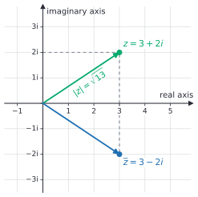
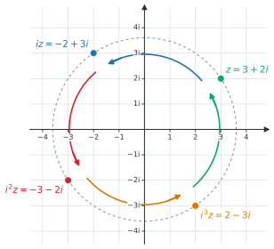

# Complex numbers

After this lesson you can add, subtract, multiply and divide complex numbers, find a conjugate and a modulus, plot a complex number in the complex plane, find the complex solutions of a quadratic equation whose discriminant is negative, and compute with complex numbers in Python.

Before this: [solving quadratic equations](02-solving-quadratic-equations.md), [roots, irrational numbers and types of numbers](../../02-middle-school/04-powers-roots-and-real-numbers/03-roots-irrationals-and-types-of-numbers.md) and [the coordinate plane](../../02-middle-school/05-linear-relationships-and-functions/01-coordinate-plane.md).

## Quick check

Try these first. If you get all three right, skip to [Practice](#practice).

1. Work out $(3 + 2i) + (1 - 5i)$ and $(3 + 2i)(1 - 5i)$, using $i^2 = -1$.
2. Write $\dfrac{2 + i}{1 - i}$ in the form $a + bi$.
3. Solve $x^2 + 2x + 5 = 0$.

<details class="solution" markdown>
<summary>Answers</summary>

1. The sum is $4 - 3i$. For the product, $(3 + 2i)(1 - 5i) = 3 - 15i + 2i - 10i^2 = 3 - 13i + 10 = 13 - 13i$.
2. Multiply the top and bottom by $1 + i$: $\frac{(2 + i)(1 + i)}{(1 - i)(1 + i)} = \frac{2 + 3i + i^2}{2} = \frac{1 + 3i}{2} = \frac{1}{2} + \frac{3}{2}i$.
3. The discriminant is $4 - 20 = -16$, so $x = \frac{-2 \pm \sqrt{-16}}{2} = \frac{-2 \pm 4i}{2} = -1 \pm 2i$.

</details>

## The idea

The equation $x^2 + 1 = 0$ has no real solution: a real number's square is never negative, and the graph of $y = x^2 + 1$ stays above the $x$-axis. We met this in the [last lesson](02-solving-quadratic-equations.md), whenever the discriminant was negative. Every quadratic with $D < 0$ is in the same position.

This has happened before. In grade school, $3 - 5$ had no answer among the counting numbers, and negative numbers were added so that every subtraction would work. Here the same move is made again. Invent a new number $i$ that is defined by one rule, $i^2 = -1$. Then insist that arithmetic keeps working: you can add and multiply the new numbers, the order doesn't matter, and the distributive property holds. See what numbers that creates.

You can multiply $i$ by a real number $b$ to get $bi$, and add a real number $a$ to get $a + bi$. Adding two numbers of this form gives another one. Multiplying two of them, with $i^2$ replaced by $-1$, gives another one too, as you will see below. So numbers of the form $a + bi$ are all you need, and each is described by two real numbers, $a$ and $b$. Two numbers make a point in a plane, and that is how complex numbers are drawn.

## Definitions

The **imaginary unit** $i$ is a number with

$$
i^2 = -1.
$$

It is not a real number, since no real number squares to $-1$. In plain words, $i$ is a square root of $-1$ (so is $-i$, since $(-i)^2 = i^2 = -1$). The word "imaginary" is just a historical label; the rule $i^2 = -1$ is as consistent as any other rule of arithmetic.

A **complex number** is a number of the form $z = a + bi$, where $a$ and $b$ are real numbers. The **real part** is $a$ and the **imaginary part** is $b$, written $\operatorname{Re}(z) = a$ and $\operatorname{Im}(z) = b$. The set of all complex numbers is $\mathbb{C}$. In this lesson $z$ and $w$ stand for complex numbers, and $x$ and $y$ still stand for real numbers.

In plain words, a complex number has a real piece and an imaginary piece: $3 - 2i$ has real part 3 and imaginary part $-2$. The imaginary part is the real number $b$, not the whole term $bi$. A real number $a$ is the complex number $a + 0i$, so $\mathbb{R} \subseteq \mathbb{C}$. A number $bi$ with $b \ne 0$ and no real part, such as $4i$, is called **pure imaginary**.

Two complex numbers are equal exactly when their real parts are equal and their imaginary parts are equal: $a + bi = c + di$ means $a = c$ and $b = d$. If $b \ne d$, we could solve $a + bi = c + di$ for $i = \frac{a - c}{d - b}$, which is real, and that is impossible since no real number squares to $-1$. So $b = d$, and then $a = c$.

For a real number $r > 0$, the principal square root of $-r$ is defined by $\sqrt{-r} = i\sqrt{r}$. So $\sqrt{-16} = 4i$ and $\sqrt{-18} = i\sqrt{18} = 3\sqrt{2}\,i$. Check: $(4i)^2 = 16i^2 = -16$.

The **conjugate** of $z = a + bi$ is $\overline{z} = a - bi$: the same real part and the opposite imaginary part. The **modulus** of $z = a + bi$ is

$$
\lvert z \rvert = \sqrt{a^2 + b^2}.
$$

In plain words, the modulus is the size of $z$, its distance from 0. For a real number $z = a$ it equals the absolute value $\lvert a \rvert$, so it extends the idea from [negative numbers and absolute value](../../02-middle-school/01-integers-and-rational-numbers/01-negative-numbers-and-absolute-value.md). It is always a real number, and it is 0 only for $z = 0$.

The **complex plane** is the coordinate plane where $z = a + bi$ is drawn as the point $(a, b)$. The horizontal axis is the **real axis** and the vertical axis is the **imaginary axis**.



The modulus is the length of the arrow from the origin to $z$, by the Pythagorean theorem: $\lvert 3 + 2i \rvert = \sqrt{9 + 4} = \sqrt{13} \approx 3.61$. The conjugate is the reflection of $z$ in the real axis.

## How to do it

### Adding and subtracting

Combine the real parts and the imaginary parts separately, like the like terms in [equivalent expressions](../../02-middle-school/03-expressions-equations-inequalities/02-equivalent-expressions.md):

$$
(a + bi) + (c + di) = (a + c) + (b + d)i, \qquad (a + bi) - (c + di) = (a - c) + (b - d)i.
$$

In the plane this is vector addition: the point $z + w$ is the fourth corner of the parallelogram with corners $0$, $z$ and $w$. When you subtract, change the sign of every part of the second number, including its imaginary part.

### Multiplying

1. Multiply the two numbers as binomials, using the distributive property: $(a + bi)(c + di) = ac + adi + bci + bdi^2$.
2. Replace $i^2$ by $-1$.
3. Collect the real terms and the imaginary terms: $(ac - bd) + (ad + bc)i$.
4. Check by an independent route, such as comparing moduli (Example 1) or substituting numbers.

You don't need to memorize the formula in Step 3. Multiplying out and replacing $i^2$ gets it every time. The special case of a number and its conjugate gives a real number:

*Theorem.* For $z = a + bi$, $z\,\overline{z} = a^2 + b^2 = \lvert z \rvert^2$.

*Proof.* We know the difference of squares formula, $(p + q)(p - q) = p^2 - q^2$, and $i^2 = -1$. We want the product $(a + bi)(a - bi)$. With $p = a$ and $q = bi$, it is $a^2 - (bi)^2 = a^2 - b^2i^2 = a^2 + b^2$. $\blacksquare$

Look back: the imaginary parts cancel because the two numbers differ only in the sign of $bi$. This is the fact that makes division work. Two more rules about conjugates are used below, and both can be checked directly: $\overline{z + w} = \overline{z} + \overline{w}$, and $\overline{zw} = \overline{z}\,\overline{w}$. For the second, take $z = a + bi$ and $w = c + di$. Then $zw = (ac - bd) + (ad + bc)i$, whose conjugate is $(ac - bd) - (ad + bc)i$, and $\overline{z}\,\overline{w} = (a - bi)(c - di) = ac - adi - bci + bdi^2 = (ac - bd) - (ad + bc)i$, the same.

### Conjugates and division

To divide, make the denominator real, which is what the theorem above allows.

1. Write the quotient as a fraction $\frac{z}{w}$ with $w \ne 0$.
2. Multiply the top and the bottom by the conjugate of the denominator, $\overline{w}$.
3. Multiply out the top as in the multiplying steps. The bottom becomes the real number $c^2 + d^2$.
4. Split into a real part and an imaginary part, each over the real denominator, and simplify.
5. Check by multiplying your answer by $w$: you should get $z$ back.

Written out, with $w = c + di$,

$$
\frac{z}{w} = \frac{z\,\overline{w}}{w\,\overline{w}} = \frac{z\,\overline{w}}{c^2 + d^2}.
$$

In particular, the reciprocal is $\frac{1}{w} = \frac{\overline{w}}{\lvert w \rvert^2}$. So every nonzero complex number has a reciprocal, and the quotient of two complex numbers is again a complex number. Two consequences are needed later: the arithmetic rules from earlier lessons still hold in $\mathbb{C}$, and the zero-product property does too. If $uv = 0$ and $u \ne 0$, multiply by $\frac{1}{u}$ to get $v = 0$.

This is the same idea as removing a radical from a denominator. The product $(a + \sqrt{b})(a - \sqrt{b}) = a^2 - b$ has no radical, and $(a + bi)(a - bi) = a^2 + b^2$ has no $i$.

### Powers of the imaginary unit

The powers of $i$ repeat every four steps: $i^0 = 1$, $i^1 = i$, $i^2 = -1$, $i^3 = i^2 \cdot i = -i$, $i^4 = (-1)(-1) = 1$, and then $i^5 = i$, $i^6 = -1$, and so on.

| $n$ mod 4 | 0 | 1 | 2 | 3 |
|---|---|---|---|---|
| $i^n$ | $1$ | $i$ | $-1$ | $-i$ |

1. Divide the exponent $n$ by 4 and find the remainder $r$, which is 0, 1, 2 or 3. For a negative $n$, use the remainder that is 0, 1, 2 or 3 (so $-3$ has remainder 1, since $-3 = 4(-1) + 1$).
2. Then $i^n = i^r$. This works because $i^4 = 1$, so $i^{4k + r} = (i^4)^k i^r = i^r$.
3. Look up $i^r$ in the table.

### Complex solutions of a quadratic equation

*Theorem.* Let $a$, $b$ and $c$ be real numbers with $a \ne 0$, and suppose the discriminant $D = b^2 - 4ac$ is negative. Then $ax^2 + bx + c = 0$ has exactly two complex solutions,

$$
x = \frac{-b \pm i\sqrt{-D}}{2a} = -\frac{b}{2a} \pm \frac{\sqrt{-D}}{2a}\,i,
$$

and they are conjugates of each other.

We know the algebra from [the last lesson](02-solving-quadratic-equations.md#the-quadratic-formula), which turned the equation into $\left(x + \frac{b}{2a}\right)^2 = \frac{D}{4a^2}$ using only the rules of arithmetic, and those rules hold in $\mathbb{C}$. We want all the complex $x$ that solve it. The plan is to write the right side as a square, which is where the number $i$ is needed.

*Proof.* Since $D < 0$, the number $-D$ is positive and $D = -(\sqrt{-D})^2 = (i\sqrt{-D})^2$. Put $u = x + \frac{b}{2a}$ and $v = \frac{i\sqrt{-D}}{2a}$. The equation says $u^2 = v^2$, so

$$
(u - v)(u + v) = u^2 - v^2 = 0.
$$

By the zero-product property, $u = v$ or $u = -v$, so $x = -\frac{b}{2a} \pm \frac{i\sqrt{-D}}{2a}$. Every step can be reversed, so both numbers are solutions and there are no others. The real part $-\frac{b}{2a}$ and the number $\frac{\sqrt{-D}}{2a}$ are real, so the two solutions differ only in the sign of the imaginary part. $\blacksquare$

Look back: the formula from the last lesson still works when $D < 0$, if you read $\sqrt{D}$ as $i\sqrt{-D}$. The solutions come as a conjugate pair because $a$, $b$ and $c$ are real, so the only non-real thing in the formula is the $\pm i\sqrt{-D}$ term. Real parts, sum and product still behave: the two solutions add to $-\frac{b}{a}$ and multiply to $\frac{c}{a}$, since their sum is $2\operatorname{Re}(x)$ and their product is $x\overline{x} = \lvert x \rvert^2$.

The vertex form from [quadratic functions and graphs](01-quadratic-functions-and-graphs.md) shows the same thing in a picture. If $a(x - h)^2 + k = 0$ and $\frac{k}{a} > 0$, then $(x - h)^2 = -\frac{k}{a}$, and $x = h \pm i\sqrt{\frac{k}{a}}$. The real part is $h$, the axis of symmetry. For $y = x^2 + 2x + 5 = (x + 1)^2 + 4$, that gives $-1 \pm 2i$.


The conjugate pairs are not special to quadratics. If a polynomial $f$ has real coefficients and $f(z) = 0$, then taking the conjugate of both sides and using the rules for conjugates of sums and products, together with $\overline{r} = r$ for real $r$, gives $f(\overline{z}) = 0$. So the non-real zeros of every real polynomial come in conjugate pairs. For $f(x) = x^2 + 2x + 5$ this says that $-1 + 2i$ is a zero exactly when $-1 - 2i$ is.

### Multiplying by $i$ turns a point a quarter turn

Multiplying by $i$ changes $a + bi$ into $i(a + bi) = ai + bi^2 = -b + ai$, so the point $(a, b)$ goes to $(-b, a)$. That is a rotation about the origin by $90^\circ$ counter-clockwise, which keeps the modulus: $\sqrt{b^2 + a^2} = \sqrt{a^2 + b^2}$. Four such steps are a full turn, which is why $i^4 = 1$.



### Why complex numbers are worth having

With only real numbers, $x^2 + 1 = 0$ has no solution. With complex numbers, every polynomial equation does. The fundamental theorem of algebra says that every polynomial of degree at least 1, with real or complex coefficients, has at least one complex zero, and so a polynomial of degree $n$ has exactly $n$ complex zeros when repeated ones are counted. For example, $x^4 - 1 = 0$ has the four solutions $1$, $-1$, $i$ and $-i$, since $i^4 = 1$. This book doesn't prove the theorem; the proofs come in university complex analysis. It is why the number systems stop at $\mathbb{C}$: no further extension is needed to solve polynomial equations.

The picture of multiplying by $i$ as a rotation is the other main reason. Multiplying by a number of modulus 1 turns a point about the origin without changing its distance from it, and the trigonometry lessons ([radians and the unit circle](../09-trigonometry/02-radians-and-the-unit-circle.md)) show that the number $\cos\theta + i\sin\theta$ turns it by the angle $\theta$. A sine wave in a signal can be written as the real part of a rotating complex number, and the fast Fourier transform, used in audio, images and communications, splits a signal into its frequencies using complex arithmetic.

## Worked examples

<div class="example" markdown>

### Example 1: multiplying and checking with the modulus

Compute $(2 - 3i)(4 + i)$.

Step 1: multiply as binomials. $(2 - 3i)(4 + i) = 2 \cdot 4 + 2 \cdot i - 3i \cdot 4 - 3i \cdot i = 8 + 2i - 12i - 3i^2$.

Step 2: replace $i^2$ by $-1$. The last term $-3i^2$ becomes $+3$. This is the step where signs slip: the term is $-3 \cdot (-1) = +3$.

Step 3: collect. The real terms are $8 + 3 = 11$, and the imaginary terms are $2i - 12i = -10i$. The product is $11 - 10i$.

Step 4: check with moduli. A product's modulus is the product of the moduli (Practice problem 7 proves this). Here $\lvert 2 - 3i \rvert = \sqrt{13}$ and $\lvert 4 + i \rvert = \sqrt{17}$, so the product should have modulus $\sqrt{13 \cdot 17} = \sqrt{221}$. And $\lvert 11 - 10i \rvert = \sqrt{121 + 100} = \sqrt{221}$.

</div>

<div class="example" markdown>

### Example 2: dividing

Write $\dfrac{7 + i}{3 - 4i}$ in the form $a + bi$.

Steps 1 and 2: the conjugate of the denominator is $3 + 4i$. Multiply the top and the bottom by it.

Step 3: the top is $(7 + i)(3 + 4i) = 21 + 28i + 3i + 4i^2 = 21 - 4 + 31i = 17 + 31i$. The bottom is $(3 - 4i)(3 + 4i) = 9 + 16 = 25$.

Step 4: split. $\frac{17 + 31i}{25} = \frac{17}{25} + \frac{31}{25}i = 0.68 + 1.24i$. The fractions are untidy, and that is fine.

Step 5: multiply back. $(0.68 + 1.24i)(3 - 4i) = 2.04 - 2.72i + 3.72i - 4.96i^2 = 2.04 + 4.96 + (3.72 - 2.72)i = 7 + i$.

</div>

<div class="example" markdown>

### Example 3: powers of $i$ and a root trap

Find (a) $i^{2026}$, (b) $i^{-3}$, and (c) $\sqrt{-4} \cdot \sqrt{-9}$.

(a) The remainder of $2026$ divided by 4 is 2, because $2026 = 4 \cdot 506 + 2$. So $i^{2026} = i^2 = -1$.

(b) The remainder of $-3$ divided by 4 is 1, since $-3 = 4(-1) + 1$, so $i^{-3} = i$. Check directly: $i^{-3} = \frac{1}{i^3} = \frac{1}{-i} = \frac{i}{-i \cdot i} = \frac{i}{1} = i$.

(c) First rewrite each root, $\sqrt{-4} = 2i$ and $\sqrt{-9} = 3i$, then multiply: $(2i)(3i) = 6i^2 = -6$. The tempting shortcut is $\sqrt{-4} \cdot \sqrt{-9} = \sqrt{36} = 6$, which has the wrong sign. The rule $\sqrt{a}\sqrt{b} = \sqrt{ab}$ was proved in [roots, irrational numbers and types of numbers](../../02-middle-school/04-powers-roots-and-real-numbers/03-roots-irrationals-and-types-of-numbers.md) only for $a, b \ge 0$. Convert negative roots to multiples of $i$ before you combine anything.

</div>

<div class="example" markdown>

### Example 4: a quadratic with no real solutions (finish it yourself)

Solve $2x^2 - 4x + 5 = 0$.

Here $a = 2$, $b = -4$ and $c = 5$, so $D = 16 - 40 = -24 < 0$. The solutions are $x = \frac{4 \pm i\sqrt{24}}{4}$, and $\sqrt{24} = 2\sqrt{6}$.

Simplify the fraction into the form $a + bi$ for each solution, then check using the sum and the product of the solutions.

<details class="solution" markdown>
<summary>Finish</summary>

$x = \frac{4 \pm 2\sqrt{6}\,i}{4} = 1 \pm \frac{\sqrt{6}}{2}i$, about $1 \pm 1.225i$. Divide both terms by 2 and then both of the resulting terms: dividing only one of them is the usual slip.

Check: the sum is $\left(1 + \frac{\sqrt{6}}{2}i\right) + \left(1 - \frac{\sqrt{6}}{2}i\right) = 2 = -\frac{b}{a}$. The product is $1 + \frac{6}{4} = \frac{5}{2} = \frac{c}{a}$, using $z\overline{z} = a^2 + b^2$.

</details>

</div>

## Edge cases and common mistakes

<div class="warning" markdown>

Watch out: forgetting that $i^2 = -1$ when you multiply. For $(2 + 3i)^2 = 4 + 12i + 9i^2$, the last term is $-9$, so the answer is $-5 + 12i$, not $13 + 12i$. Every product of two imaginary parts changes sign.

</div>

<div class="warning" markdown>

Watch out: the product rule for square roots needs non-negative numbers. $\sqrt{-4}\sqrt{-9} = -6$, not $6$ (Example 3). Write $\sqrt{-r}$ as $i\sqrt{r}$ first.

</div>

<div class="warning" markdown>

Watch out: the modulus is not the sum of the parts. $\lvert 3 + 4i \rvert = \sqrt{9 + 16} = 5$, not 7. Also $\operatorname{Im}(3 + 4i) = 4$, not $4i$: the imaginary part is the real number multiplying $i$.

</div>

<div class="warning" markdown>

Watch out: the conjugate changes only the sign of the imaginary part. The conjugate of $-3 + 4i$ is $-3 - 4i$, not $3 - 4i$. To divide by $-3 + 4i$, you multiply by $-3 - 4i$.

</div>

Complex numbers can't be put in order. It makes no sense to say $i > 0$ or $3 + i < 5i$. If $i > 0$, then $i \cdot i > 0$, that is, $-1 > 0$. If $i < 0$, then $-i > 0$ and $(-i)(-i) > 0$, which is again $-1 > 0$. Both are false, so $i$ is neither positive nor negative. You can compare moduli, which are real numbers: $\lvert 3 + 4i \rvert > \lvert 2 + 2i \rvert$.

A real number counts as a complex number, so a formula built for complex numbers also works on real ones: the solutions of $x^2 - 3x + 2 = 0$ come out as $2 + 0i$ and $1 + 0i$. A negative discriminant gives a conjugate pair, a zero discriminant gives one repeated solution, and a positive one gives two real solutions.

Division by zero is still undefined: $\frac{z}{0}$ has no meaning for any complex $z$. The reciprocal formula $\frac{\overline{w}}{\lvert w \rvert^2}$ needs $\lvert w \rvert \ne 0$, which holds exactly when $w \ne 0$.

## Tricks and shortcuts

A number times its conjugate is the square of its modulus, so a real denominator comes for free: $(5 + 12i)(5 - 12i) = 25 + 144 = 169$, and $\lvert 5 + 12i \rvert = 13$.

To square a complex number, use $(a + bi)^2 = (a^2 - b^2) + 2abi$. For $(3 + 4i)^2$ that is $(9 - 16) + 24i = -7 + 24i$.

Multiplying by $i$ swaps the parts and flips one sign: $(a, b) \to (-b, a)$. So $i(5 + 2i) = -2 + 5i$ without any expanding.

For $i^n$, only the remainder of $n$ divided by 4 matters. A quick way to find it is to look at the last two digits of $n$, since 100 is divisible by 4: $2026$ has the same remainder as $26$, which is 2.

To check a division, multiply back. To check a multiplication, compare moduli: $\lvert zw \rvert = \lvert z \rvert \lvert w \rvert$.

## In code

Python has complex numbers built in. The imaginary unit is written `1j` (a bare `j` is just a variable name), and the `cmath` module has the square root, polar form and other functions for complex numbers. The last two lines show how `solve_quadratic` handles a negative discriminant.

<details class="code" markdown>
<summary>In code</summary>

```python
import cmath

z = 3 + 4j
w = 1 - 2j
print(z + w, z * w, z / w)           # (4+2j) (11-2j) (-1+2j)
print(abs(z), z.conjugate(), z.real, z.imag)  # 5.0 (3-4j) 3.0 4.0
print(1j ** 2, (1 + 2j) * (1 - 2j))  # (-1+0j) (5+0j)
print(cmath.sqrt(-4), cmath.sqrt(-4) * cmath.sqrt(-9))  # 2j (-6+0j)


def solve_quadratic(a, b, c):
    d = cmath.sqrt(b * b - 4 * a * c)
    return (-b + d) / (2 * a), (-b - d) / (2 * a)


print(solve_quadratic(1, 2, 5))      # ((-1+2j), (-1-2j))
r1, r2 = solve_quadratic(2, -4, 5)
print(r1, r2)                        # (1+1.224744871391589j) (1-1.224744871391589j)
print(abs(2 * r1 ** 2 - 4 * r1 + 5) < 1e-12)  # True

radius, angle = cmath.polar(1 + 1j)
print(radius, angle)                 # 1.4142135623730951 0.7853981633974483
print([1j ** k for k in range(5)])   # [(1+0j), 1j, (-1+0j), (-0-1j), (1+0j)]
```

Every operation matches the algebra: `z * w` is $(3 + 4i)(1 - 2i) = 11 - 2i$, `abs(z)` is the modulus 5, and `cmath.sqrt(-4)` is $2i$. The product of `cmath.sqrt(-4)` and `cmath.sqrt(-9)` is $-6$, the answer to Example 3(c), whereas `math.sqrt(-4)` raises a `ValueError` because the `math` module works only with real numbers. The last check tests that the solution is correct up to rounding: with square roots in the answer, comparing with exactly 0 would be too strict (see [floating point basics](../../06-cs-math/01-number-representation/04-floating-point-basics.md)). The `cmath.polar` call gives the modulus $\sqrt{2}$ and the angle $\frac{\pi}{4}$ radians, which is $45^\circ$, the direction of $1 + i$. The `(-0-1j)` in the last line is $-i$, with a harmless negative zero as its real part.

</details>

## FAQ

### Are imaginary numbers real?

The word "imaginary" is a label with a history, not a description. A complex number is nothing more than a pair of real numbers $(a, b)$ with a rule for adding, $(a, b) + (c, d) = (a + c, b + d)$, and a rule for multiplying, $(a, b)(c, d) = (ac - bd, ad + bc)$. Writing $(a, b)$ as $a + bi$ is a convenient way to remember the multiplication rule. They are as well defined as negative numbers or fractions, and they describe real things such as rotations and oscillations.

### Why do we multiply by the conjugate when dividing?

Because the product $w\overline{w} = c^2 + d^2$ is a real number. Multiplying the top and the bottom by the same number doesn't change the quotient, and it turns an awkward complex denominator into a real one that you can divide by directly. It is the same trick as rationalizing a radical denominator.

### Do we need yet another kind of number for the square root of $i$?

No. The square root of $i$ is $\frac{1 + i}{\sqrt{2}}$, which is complex again: $\left(\frac{1 + i}{\sqrt{2}}\right)^2 = \frac{1 + 2i + i^2}{2} = \frac{2i}{2} = i$. The fundamental theorem of algebra says the same would happen for any polynomial equation: all of the solutions are already complex numbers.

### Which square root is $\sqrt{-1}$, the one that gives $i$ or $-i$?

By convention $\sqrt{-1} = i$, in the same way as $\sqrt{9} = 3$ chooses the positive root. Both $i$ and $-i$ square to $-1$, and the algebra is the same whichever you call "the" $i$: the complex numbers have a symmetry that swaps them, which is conjugation.

## Practice

### Warm-up

1\. Write each in the form $a + bi$: (a) $\sqrt{-25}$, (b) $\sqrt{-18}$, (c) $(4 - 2i) + (-1 + 6i)$, (d) $(3 + i) - (5 - 4i)$.

<details class="solution" markdown>
<summary>Solution</summary>

- (a) $\sqrt{-25} = i\sqrt{25} = 5i$, which is $0 + 5i$.
- (b) $\sqrt{-18} = i\sqrt{18} = 3\sqrt{2}\,i$, which is $0 + 3\sqrt{2}\,i$.
- (c) Real parts: $4 - 1 = 3$. Imaginary parts: $-2 + 6 = 4$. So $3 + 4i$.
- (d) Real parts: $3 - 5 = -2$. Imaginary parts: $1 - (-4) = 5$. So $-2 + 5i$.

Check: $(5i)^2 = -25$ and $(3\sqrt{2}\,i)^2 = 18i^2 = -18$. For (d), adding the second number back, $(-2 + 5i) + (5 - 4i) = 3 + i$.

</details>

2\. Multiply: (a) $(3 + i)(2 - i)$, (b) $(2 + 5i)^2$, (c) $(1 + i)(1 - i)$.

<details class="solution" markdown>
<summary>Solution</summary>

- (a) $6 - 3i + 2i - i^2 = 6 - i + 1 = 7 - i$.
- (b) $4 + 20i + 25i^2 = 4 + 20i - 25 = -21 + 20i$.
- (c) A number times its conjugate: $1^2 + 1^2 = 2$.

Check with moduli: $\lvert 7 - i \rvert = \sqrt{50}$, and $\sqrt{10} \cdot \sqrt{5} = \sqrt{50}$. For (b), $\lvert -21 + 20i \rvert = \sqrt{841} = 29 = (\sqrt{29})^2$.

</details>

3\. Simplify: (a) $i^7$, (b) $i^{100}$, (c) $i^{-1}$, (d) $i^{45}$.

<details class="solution" markdown>
<summary>Solution</summary>

Find the remainder of the exponent divided by 4.

- (a) $7 = 4 + 3$, so $i^7 = i^3 = -i$.
- (b) $100 = 4 \cdot 25$, remainder 0, so $i^{100} = 1$.
- (c) $-1 = 4(-1) + 3$, remainder 3, so $i^{-1} = i^3 = -i$.
- (d) $45 = 4 \cdot 11 + 1$, so $i^{45} = i$.

Check (c): $\frac{1}{i} = \frac{-i}{i \cdot (-i)} = \frac{-i}{1} = -i$.

</details>

### Standard

4\. Write each quotient in the form $a + bi$: (a) $\dfrac{5}{1 + 2i}$, (b) $\dfrac{3 - i}{2 + 3i}$.

<details class="solution" markdown>
<summary>Solution</summary>

(a) Multiply the top and the bottom by $1 - 2i$: $\frac{5(1 - 2i)}{(1 + 2i)(1 - 2i)} = \frac{5 - 10i}{1 + 4} = 1 - 2i$.

(b) Multiply by $2 - 3i$. The top is $(3 - i)(2 - 3i) = 6 - 9i - 2i + 3i^2 = 3 - 11i$, and the bottom is $4 + 9 = 13$. So the quotient is $\frac{3}{13} - \frac{11}{13}i$.

Check by multiplying back: $(1 - 2i)(1 + 2i) = 5$. And $\left(\frac{3}{13} - \frac{11}{13}i\right)(2 + 3i) = \frac{6 + 9i - 22i - 33i^2}{13} = \frac{39 - 13i}{13} = 3 - i$.

</details>

5\. Let $z = -5 + 12i$. Find $\lvert z \rvert$, $\overline{z}$, $z\overline{z}$, $\frac{1}{z}$ and $iz$. Then say what the point $iz$ is, compared with $z$, in the complex plane.

<details class="solution" markdown>
<summary>Solution</summary>

- $\lvert z \rvert = \sqrt{25 + 144} = 13$.
- $\overline{z} = -5 - 12i$.
- $z\overline{z} = 169 = 13^2$, as it should be.
- $\frac{1}{z} = \frac{\overline{z}}{\lvert z \rvert^2} = \frac{-5 - 12i}{169} = -\frac{5}{169} - \frac{12}{169}i$.
- $iz = -5i + 12i^2 = -12 - 5i$.

The point $z$ is $(-5, 12)$ and $iz$ is $(-12, -5)$. It is the same distance from the origin, $\sqrt{144 + 25} = 13$, and turned a quarter turn counter-clockwise.

Check: the vectors $(-5, 12)$ and $(-12, -5)$ are perpendicular, since $(-5)(-12) + (12)(-5) = 60 - 60 = 0$.

</details>

6\. Solve: (a) $x^2 + 9 = 0$, (b) $x^2 - 6x + 10 = 0$, (c) $3x^2 + 2x + 1 = 0$.

<details class="solution" markdown>
<summary>Solution</summary>

(a) $x^2 = -9$, so $x = \pm\sqrt{-9} = \pm 3i$.

(b) $D = 36 - 40 = -4$, so $x = \frac{6 \pm 2i}{2} = 3 \pm i$.

(c) $D = 4 - 12 = -8$ and $\sqrt{-8} = 2\sqrt{2}\,i$, so $x = \frac{-2 \pm 2\sqrt{2}\,i}{6} = \frac{-1 \pm \sqrt{2}\,i}{3}$.

Check with sums and products: (a) the sum is 0 and the product is $9$, matching $-\frac{b}{a} = 0$ and $\frac{c}{a} = 9$. (b) $6$ and $(3 + i)(3 - i) = 10$. (c) $-\frac{2}{3}$ and $\frac{1 + 2}{9} = \frac{1}{3}$.

</details>

### Challenge

7\. Prove that $\lvert zw \rvert = \lvert z \rvert\lvert w \rvert$ for all complex numbers $z$ and $w$.

<details class="solution" markdown>
<summary>Solution</summary>

We know that $z\overline{z} = \lvert z \rvert^2$ for every complex $z$, and that $\overline{zw} = \overline{z}\,\overline{w}$. We want to show that the modulus of a product is the product of the moduli. The plan is to compare the squares, which are easier to compute, and then take square roots.

*Proof.* Apply the first fact to the number $zw$ and use the second:

$$
\lvert zw \rvert^2 = (zw)\,\overline{zw} = zw\,\overline{z}\,\overline{w} = (z\overline{z})(w\overline{w}) = \lvert z \rvert^2 \lvert w \rvert^2 = \bigl(\lvert z \rvert\lvert w \rvert\bigr)^2.
$$

The middle step reorders the factors, which is allowed because multiplication of complex numbers is commutative. Both $\lvert zw \rvert$ and $\lvert z \rvert\lvert w \rvert$ are non-negative real numbers with the same square, so they are equal. $\blacksquare$

Look back: this is the fact used in the check of Example 1. Check with numbers: $z = 3 + 4i$ and $w = 1 - 2i$ give $zw = 11 - 2i$, and $\lvert zw \rvert = \sqrt{125} = 5\sqrt{5}$, while $\lvert z \rvert\lvert w \rvert = 5\sqrt{5}$.

</details>

8\. (Reviews [quadratic functions and graphs](01-quadratic-functions-and-graphs.md).) For $f(x) = 2x^2 - 8x + 11$: (a) write $f$ in vertex form, (b) explain from the vertex form why the graph has no $x$-intercepts, and (c) find the complex zeros of $f$ from the vertex form and check them with the sum and product of the solutions.

<details class="solution" markdown>
<summary>Solution</summary>

(a) Factor 2 out of the first two terms: $2(x^2 - 4x) + 11$. Half of $-4$ is $-2$ and $(-2)^2 = 4$, so $2(x^2 - 4x + 4 - 4) + 11 = 2(x - 2)^2 - 8 + 11 = 2(x - 2)^2 + 3$.

(b) The parabola opens up ($a = 2 > 0$) and its lowest point is $(2, 3)$, above the $x$-axis. So $f(x) \ge 3 > 0$ for every real $x$, and there are no real zeros.

(c) Set $2(x - 2)^2 + 3 = 0$: $(x - 2)^2 = -\frac{3}{2}$, so $x - 2 = \pm i\sqrt{\frac{3}{2}} = \pm \frac{\sqrt{6}}{2}i$ and $x = 2 \pm \frac{\sqrt{6}}{2}i$. The real part, 2, is the axis of symmetry.

Check: the sum is $4 = -\frac{b}{a} = \frac{8}{2}$, and the product is $4 + \frac{6}{4} = \frac{11}{2} = \frac{c}{a}$. The discriminant gives the same: $D = 64 - 88 = -24$, and $\frac{8 \pm i\sqrt{24}}{4} = 2 \pm \frac{\sqrt{6}}{2}i$.

</details>

## Where this shows up

- Linear algebra needs $\mathbb{C}$ at once: a rotation of the plane has no real eigenvalues, and its eigenvalues are complex numbers ([eigenvalues and eigenvectors](../../05-university-core/06-linear-algebra/08-eigenvalues-and-eigenvectors.md)). A differential equation whose characteristic equation has complex solutions describes an oscillation ([second-order linear equations](../../05-university-core/10-differential-equations-light/02-second-order-linear-equations.md)), and [polynomial functions and graphs](../04-radicals-and-polynomials/05-polynomial-functions-and-graphs.md) uses conjugate pairs of zeros.
- In CS, signal and image processing rely on the discrete Fourier transform, computed with the fast Fourier transform algorithm in complex arithmetic. A 2D rotation in graphics is a multiplication by a complex number of modulus 1, and quantum computing describes the state of a qubit with complex numbers.
- The trigonometry chapter writes complex numbers with a modulus and an angle ([radians and the unit circle](../09-trigonometry/02-radians-and-the-unit-circle.md)), and [power series and Taylor series](../../05-university-core/05-sequences-and-series/04-power-series-and-taylor-series.md) explains the formula that ties $i$ to sines and cosines.
