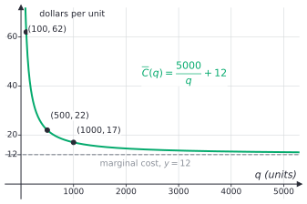

# Rational functions and asymptotes

After this lesson you can find the domain, intercepts, holes and asymptotes of a rational function, sketch its graph from them, and read an asymptote in a model such as the average cost per unit.

Before this: [rational expressions](01-rational-expressions.md), [polynomial division](../04-radicals-and-polynomials/04-polynomial-division-and-remainder-theorem.md), [polynomial functions and graphs](../04-radicals-and-polynomials/05-polynomial-functions-and-graphs.md) and [transformations of functions](../03-functions/04-transformations-of-functions.md).

## Quick check

Try these first. If you get all three right, skip to [Practice](#practice).

1. For $f(x) = \dfrac{x^2 - 1}{x^2 + x - 2}$, find the hole, the vertical asymptote and the horizontal asymptote.
2. Find the slant asymptote of $g(x) = \dfrac{2x^2 + 3x - 1}{x + 1}$.
3. Describe the graph of $y = \dfrac{3}{x + 2} - 1$ as a transformation of $y = \frac{1}{x}$, and give its asymptotes.

<details class="solution" markdown>
<summary>Answers</summary>

1. Factor: $f(x) = \frac{(x - 1)(x + 1)}{(x + 2)(x - 1)}$. The factor $x - 1$ cancels, so there is a hole at $x = 1$, at height $\frac{1 + 1}{1 + 2} = \frac{2}{3}$. The factor $x + 2$ stays, so the vertical asymptote is $x = -2$. The degrees are equal and the leading coefficients are 1 and 1, so the horizontal asymptote is $y = 1$.
2. Divide: $2x^2 + 3x - 1 = (x + 1)(2x + 1) - 2$, so $g(x) = 2x + 1 - \frac{2}{x + 1}$. The slant asymptote is $y = 2x + 1$.
3. Stretch $\frac{1}{x}$ vertically by 3, shift it 2 left and 1 down. The vertical asymptote is $x = -2$ and the horizontal asymptote is $y = -1$.

</details>

## The idea

A small business pays \$5,000 in fixed costs and \$12 for each unit it makes. The cost per unit, the total cost divided by the number of units $q$, is $\frac{5000 + 12q}{q} = \frac{5000}{q} + 12$. For $q = 100$ units it is \$62 per unit. For 500 units it is \$22, and for 1,000 units it is \$17. The \$5,000 gets spread over more and more units, so the cost per unit keeps falling, but it never gets down to \$12, because \$12 is what each unit costs on its own. The graph slides toward the line $y = 12$ and never touches it.

Polynomial graphs are single smooth curves with no breaks. A rational function breaks wherever its denominator is 0, and what the graph does there is one of two things. Either the values blow up in size and the graph shoots up or down along a vertical line, or a single point is missing from an otherwise smooth curve. Far from the origin, the graph also settles down to a line, usually horizontal.

Those lines the graph approaches are called asymptotes. They give a rational graph its skeleton: draw the asymptotes and the intercepts first, and the curve between them has very few ways to go.

## Definitions

A **rational function** is a function $f(x) = \frac{p(x)}{q(x)}$ where $p$ and $q$ are polynomials and $q$ is not the zero polynomial. Its domain is every real number with $q(x) \ne 0$. In plain words, it is a rational expression ([rational expressions](01-rational-expressions.md#definitions)) viewed as a function. A rational function is in lowest terms when $p$ and $q$ have no common factor of degree 1 or more.

A **vertical asymptote** of $f$ is a vertical line $x = a$ such that the values $\lvert f(x) \rvert$ grow without bound as $x$ gets close to $a$, from the left side, the right side or both. A **hole** of $f$ at $x = a$ is a point missing from the graph: $f(a)$ is undefined, but $f(x)$ gets close to one finite number $L$ as $x$ gets close to $a$, and the graph passes through every nearby point except $(a, L)$. A hole is drawn as an open circle. In plain words, a vertical asymptote is where the graph escapes to the sky or the floor, and a hole is a pinprick.

A **horizontal asymptote** is a horizontal line $y = L$ such that $f(x)$ gets close to $L$ as $x$ grows without bound in the positive direction, the negative direction or both. A **slant asymptote** (or oblique asymptote) is a line $y = mx + b$ with $m \ne 0$ that the graph approaches in the same sense. These are statements about the ends of the graph, so the phrase "gets close" is precise only with limits ([continuity, asymptotes and the IVT](../../05-university-core/01-limits-and-continuity/03-continuity-asymptotes-and-ivt.md)). Here it means that the vertical gap between the graph and the line shrinks toward 0 as $x$ moves far out.

### Where the asymptotes are

*Theorem 1 (vertical asymptotes).* Let $f = \frac{p}{q}$ be in lowest terms and let $q(a) = 0$. Then $p(a) \ne 0$ and the line $x = a$ is a vertical asymptote of $f$.

We know the factor theorem: $x - a$ divides a polynomial exactly when the polynomial is 0 at $a$. We want to show that in lowest terms, a zero of the denominator leaves the numerator nonzero, and then see what the graph does. The plan is to use the factor theorem for the first part, and for the second part to look at the size of the numerator and the denominator near $a$.

*Proof.* If $p(a) = 0$ as well, the factor theorem would make $x - a$ a common factor of $p$ and $q$, and the function would not be in lowest terms. So $p(a) \ne 0$. Close to $a$ the value $p(x)$ stays close to the nonzero number $p(a)$, since a polynomial has no jumps. Meanwhile $q(x)$ gets close to $q(a) = 0$. A fraction whose top stays near a nonzero number and whose bottom gets near 0 grows in size without bound, so $x = a$ is a vertical asymptote. $\blacksquare$

Look back: the theorem is about the reduced form. A zero of the original denominator that cancels is not covered, and it gives a hole instead: if $\frac{p}{q}$ reduces to $\frac{p_1}{q_1}$ by cancelling $x - a$ and $q_1(a) \ne 0$, then $\frac{p_1}{q_1}$ has a finite value at $a$, and the original has a single missing point there. The hole's height is found by putting $a$ into the reduced function.

On each side of an asymptote the graph goes up or down depending on a sign. The sign of $f(x)$ just to the left and just to the right of $a$ comes from the signs of the factors, and it flips across $a$ when the factor $(x - a)$ appears an odd number of times in the denominator, and stays the same when it appears an even number of times. For example, $\frac{1}{x}$ goes to $-\infty$ on the left of 0 and to $+\infty$ on the right, while $\frac{1}{x^2}$ goes to $+\infty$ on both sides.

*Theorem 2 (end behaviour).* Let $f(x) = \frac{p(x)}{q(x)}$ in lowest terms, where $p$ has degree $n$ and leading coefficient $a_n$, and $q$ has degree $m$ and leading coefficient $b_m$.

- If $n < m$, the line $y = 0$ is a horizontal asymptote.
- If $n = m$, the line $y = \frac{a_n}{b_m}$ is a horizontal asymptote.
- If $n = m + 1$, there is a slant asymptote, and it is $y = Q(x)$, where $Q$ is the quotient when $p$ is divided by $q$. There is no horizontal asymptote.
- If $n \ge m + 2$, there is no horizontal or slant asymptote.

We know the end behaviour argument for polynomials: for large $\lvert x \rvert$ a polynomial behaves like its leading term ([polynomial functions and graphs](../04-radicals-and-polynomials/05-polynomial-functions-and-graphs.md#end-behaviour)), and every fraction $\frac{c}{x^k}$ with $k \ge 1$ gets close to 0 when $\lvert x \rvert$ is large. We want the behaviour of the quotient. The plan is to divide the top and the bottom by $x^m$, the highest power in the denominator, and for the slant case to use polynomial division.

*Proof.* Divide the top and the bottom by $x^m$:

$$
f(x) = \frac{a_nx^{n-m} + a_{n-1}x^{n-m-1} + \cdots + \frac{a_0}{x^m}}{b_m + \frac{b_{m-1}}{x} + \cdots + \frac{b_0}{x^m}}.
$$

In the denominator every fraction gets close to 0, so the denominator gets close to $b_m$. If $n < m$, every term of the numerator has a negative power of $x$ and gets close to 0, so $f(x)$ gets close to $\frac{0}{b_m} = 0$. If $n = m$, the numerator gets close to $a_n$, so $f(x)$ gets close to $\frac{a_n}{b_m}$. If $n = m + 1$, divide $p$ by $q$: $p = Q\,q + r$ with $\deg r < m$, so $f(x) = Q(x) + \frac{r(x)}{q(x)}$. The degree of $Q$ is $n - m = 1$, so $Q(x) = ux + v$ with $u \ne 0$, and the fraction $\frac{r}{q}$ has a smaller numerator degree than denominator degree, so it gets close to 0 by the first case. The graph of $f$ then gets close to the line $y = ux + v$. If $n \ge m + 2$, the leading behaviour is $\frac{a_n}{b_m}x^{n-m}$ with $n - m \ge 2$, which grows faster than any line. $\blacksquare$

Look back: the three cases are one idea. Only the highest powers matter at the ends, and the comparison is the degree of the top against the degree of the bottom. The same comparison, with $n$ for the size of the input, is how algorithms are compared in computer science ([asymptotic notation](../../06-cs-math/04-sums-recurrences-and-algorithms/04-asymptotic-notation.md)).

### The reciprocal function and its transformations

The simplest rational function is $f(x) = \frac{1}{x}$. Its domain is $x \ne 0$. It is odd, since $\frac{1}{-x} = -\frac{1}{x}$, so its graph is unchanged by a half turn about the origin. It has a vertical asymptote $x = 0$ and a horizontal asymptote $y = 0$, and its two branches lie in the first and third quadrants.

Apply [transformations of functions](../03-functions/04-transformations-of-functions.md#definitions) to it. The function

$$
g(x) = \frac{a}{x - h} + k
$$

is $\frac{1}{x}$ stretched vertically by $\lvert a \rvert$ (and reflected in the $x$-axis if $a < 0$), moved $h$ to the right and $k$ up. The asymptotes move with it: the vertical asymptote is $x = h$ and the horizontal asymptote is $y = k$. If $a > 0$, the two branches lie in the upper right and lower left of the point $(h, k)$, and if $a < 0$ they lie in the upper left and lower right.


Any function $\frac{ax + b}{cx + d}$ with $c \ne 0$ and $ad - bc \ne 0$ can be put in this form by division, which is why its graph is always a shifted and stretched copy of $\frac{1}{x}$. For example, $\frac{2x + 1}{x - 3} = 2 + \frac{7}{x - 3}$, with asymptotes $x = 3$ and $y = 2$. The condition $ad - bc \ne 0$ rules out cases like $\frac{2x + 2}{x + 1}$ where the top is a multiple of the bottom and the function is the constant 2 with a hole.

## How to do it

### Analysing and sketching a rational function

1. Factor the numerator and the denominator completely. Write the domain: all real numbers except the zeros of the denominator.
2. Cancel common factors. For each cancelled factor $(x - a)$ there is a hole at $x = a$, and its height is the value of the reduced function at $a$.
3. In the reduced function, each zero of the denominator is a vertical asymptote. Note whether its factor has an odd or even power.
4. Compare the degrees $n$ (top) and $m$ (bottom) to find the horizontal asymptote, or divide to find the slant asymptote.
5. Find the intercepts. The $x$-intercepts are the zeros of the reduced numerator. The $y$-intercept is $f(0)$, if 0 is in the domain.
6. Make a sign chart. The critical numbers are the zeros of the reduced numerator and denominator. Test one number in each interval between them, or flip the sign at each factor of odd power.
7. Sketch. Draw the asymptotes as dashed lines, plot the intercepts and the hole, and draw each piece of the curve in its interval, following the signs and approaching the asymptotes.
8. Check the sketch with one or two extra points, and make sure that the graph never crosses a vertical asymptote.

The graph can cross a horizontal or slant asymptote at a finite $x$. The asymptote only describes what happens far out. It cannot cross a vertical asymptote, because $f$ is not defined there.

### Models

Two uses of rational functions in a business and in a lab show what the asymptote means.

*Average cost.* If making $q$ units costs $C(q)$ dollars, the average cost per unit is $\overline{C}(q) = \frac{C(q)}{q}$. With a fixed cost $F$ and a constant cost $v$ per unit, $C(q) = F + vq$, and

$$
\overline{C}(q) = \frac{F}{q} + v.
$$

This is $\frac{F}{x}$ shifted up by $v$, with the horizontal asymptote $y = v$. In economics the extra cost of one more unit is the marginal cost, and with this linear cost it is exactly $v$. So average cost falls toward the marginal cost as output grows and never reaches it. If costs also rise with output, say $C(q) = 5000 + 12q + 0.002q^2$, then $\overline{C}(q) = \frac{5000}{q} + 12 + 0.002q$ has the slant asymptote $y = 0.002q + 12$ and the graph is U-shaped: the lowest average cost, about \$18.32, is at $q = 500\sqrt{10} \approx 1581$ units. (The marginal cost of this function is $12 + 0.004q$, which is also \$18.32 at that point. That average cost is lowest where it equals marginal cost is a calculus fact: [rates of change and marginal analysis](../../05-university-core/03-applications-of-derivatives/01-rates-of-change-and-marginal-analysis.md).)

*Concentration over time.* An illustrative model of a drug in the blood, $t$ hours after a dose, is $C(t) = \frac{20t}{t^2 + 4}$ milligrams per litre, for $t \ge 0$. The numerator has degree 1 and the denominator has degree 2, so the horizontal asymptote is $y = 0$: the drug is eventually cleared. The values are 4 at $t = 1$, 5 at $t = 2$, 4 at $t = 4$, about 2.35 at $t = 8$ and about 0.83 at $t = 24$. The peak is at $t = 2$ with $C = 5$, and there is a short argument for that. Since $(t - 2)^2 \ge 0$, we get $t^2 + 4 \ge 4t$, so for $t > 0$,

$$
C(t) = \frac{20t}{t^2 + 4} \le \frac{20t}{4t} = 5,
$$

with equality exactly when $t = 2$. The concentration never exceeds 5 mg/L, and it reaches 5 at 2 hours. This is the model's number only, since a real drug needs real data.

## Worked examples

<div class="example" markdown>

### Example 1: a hole, an asymptote and a horizontal asymptote

Analyse and sketch $f(x) = \dfrac{2x^2 - 8}{x^2 - x - 6}$.

Step 1: factor. The numerator is $2(x - 2)(x + 2)$ and the denominator is $(x - 3)(x + 2)$, as in [Example 1 of the last lesson](01-rational-expressions.md#worked-examples) (with a different constant). The domain is $x \ne 3$ and $x \ne -2$.

Step 2: the factor $x + 2$ cancels, so there is a hole at $x = -2$. The reduced function is $\frac{2(x - 2)}{x - 3}$, whose value at $-2$ is $\frac{2(-4)}{-5} = \frac{8}{5}$. The hole is at $\left(-2, \frac{8}{5}\right)$.

Step 3: the reduced denominator $x - 3$ gives the vertical asymptote $x = 3$, with an odd power, so the graph goes in opposite directions on the two sides.

Step 4: the degrees are both 2, and the leading coefficients are 2 and 1, so the horizontal asymptote is $y = 2$. The reduced form shows how the graph approaches it: $\frac{2(x - 2)}{x - 3} = 2 + \frac{2}{x - 3}$, which is above 2 when $x > 3$ and below 2 when $x < 3$.

Step 5: the $x$-intercept is the zero of $x - 2$, so $(2, 0)$. The $y$-intercept is $f(0) = \frac{-8}{-6} = \frac{4}{3}$, so $\left(0, \frac{4}{3}\right)$.

Step 6: the critical numbers of the reduced function are 2 and 3. The sign is $+$ for $x < 2$ (both factors negative), $-$ for $2 < x < 3$ and $+$ for $x > 3$.

Step 7: the graph for $x < 2$ lies above the $x$-axis, just under the line $y = 2$ at the far left, and passes through the hole and $\left(0, \frac{4}{3}\right)$ on its way down to the intercept $(2, 0)$. Between 2 and 3 it is negative and falls toward $-\infty$ at the asymptote $x = 3$. To the right of 3 it comes down from $+\infty$ toward the line $y = 2$.


Step 8: check near the asymptote. At $x = 3.1$ the function is $22$ and at $x = 2.9$ it is $-18$, so it goes up on the right and down on the left. At $x = 1000$ it is about 2.002.

</div>

<div class="example" markdown>

### Example 2: a slant asymptote

Analyse and sketch $f(x) = \dfrac{x^2 - 3x - 4}{x - 2}$.

Factor the numerator: $x^2 - 3x - 4 = (x - 4)(x + 1)$. Nothing cancels with $x - 2$, so there is no hole, and the domain is $x \ne 2$ with a vertical asymptote at $x = 2$.

The degree of the top is 2 and the degree of the bottom is 1, so there is a slant asymptote. Divide: $x^2 - 3x - 4 = (x - 2)(x - 1) - 6$, so

$$
f(x) = x - 1 - \frac{6}{x - 2}.
$$

The slant asymptote is $y = x - 1$. The graph is above it where $-\frac{6}{x - 2} > 0$, which is $x < 2$, and below it for $x > 2$.

The intercepts are $(4, 0)$ and $(-1, 0)$ from the numerator, and $f(0) = \frac{-4}{-2} = 2$. The sign chart with critical numbers $-1$, $2$ and $4$ gives $-$ for $x < -1$, $+$ for $-1 < x < 2$, $-$ for $2 < x < 4$ and $+$ for $x > 4$. So just left of 2 the graph goes up, and just right of 2 it goes down.


Check: at $x = 10$ the function is $\frac{66}{8} = 8.25$ and the line is at 9, so the gap is $-0.75$, which is $-\frac{6}{8}$. At $x = 100$ the gap is only $-0.06$. The graph is hugging the line.

</div>

<div class="example" markdown>

### Example 3: from a fraction to a transformation of $\frac{1}{x}$

Write $g(x) = \dfrac{x - 1}{x - 3}$ as $\frac{a}{x - h} + k$, and sketch it.

Divide, or add and subtract 2 on top: $\frac{x - 1}{x - 3} = \frac{(x - 3) + 2}{x - 3} = 1 + \frac{2}{x - 3}$.

So $a = 2$, $h = 3$ and $k = 1$. The graph is $y = \frac{1}{x}$ stretched vertically by 2 and moved 3 right and 1 up. The asymptotes are $x = 3$ and $y = 1$. Since $a > 0$, the branches are in the upper right and lower left of the point $(3, 1)$. The $x$-intercept is $x = 1$, and the $y$-intercept is $g(0) = \frac{-1}{-3} = \frac{1}{3}$.

This is the graph in the right panel of the figure above. Check: $g(5) = \frac{4}{2} = 2$ and $1 + \frac{2}{2} = 2$. Check $g(0)$ too: $1 + \frac{2}{-3} = \frac{1}{3}$.

</div>

<div class="example" markdown>

### Example 4: average cost (finish it yourself)

A business has fixed costs of \$5,000 and pays \$12 per unit, so $C(q) = 5000 + 12q$ and $\overline{C}(q) = \frac{5000}{q} + 12$. The values at 100, 500 and 1,000 units are \$62, \$22 and \$17. How many units must it make for the average cost to be within 50 cents of the marginal cost?

The average cost is within 50 cents of \$12 when $\overline{C}(q) - 12 < 0.50$, that is, when $\frac{5000}{q} < 0.5$.

<details class="solution" markdown>
<summary>Finish</summary>

For $q > 0$ multiply both sides by $q$ (a positive number, so the inequality keeps its direction) and divide by 0.5: $5000 < 0.5q$, so $q > 10{,}000$.

So the business needs to make more than 10,000 units. At $q = 10{,}000$ the average cost is exactly $0.50 + 12 = 12.50$, and at 20,000 units it is \$12.25.

Check: $\frac{5000}{10000} + 12 = 12.5$. The graph of $\overline{C}$ is the curve in the figure below: it passes through $(100, 62)$, $(500, 22)$ and $(1000, 17)$ and flattens toward the dashed line at \$12.

</details>



</div>

## Edge cases and common mistakes

<div class="warning" markdown>

Watch out: deciding from the unreduced formula. For $\frac{x^2 - 9}{x - 3}$ the denominator is 0 at $x = 3$, and it is tempting to draw an asymptote there. But $\frac{x^2 - 9}{x - 3} = x + 3$ for $x \ne 3$, so the graph is a straight line with a hole at $(3, 6)$. Cancel first. The zeros of the reduced denominator are the asymptotes, and the cancelled ones are holes.

</div>

<div class="warning" markdown>

Watch out: the horizontal asymptote when the degrees are equal is not 0. For $\frac{3x^2 + 1}{2x^2 - 5}$ the ratio of the leading coefficients gives $y = \frac{3}{2}$. At $x = 100$ the value is $\frac{30001}{19995} \approx 1.5004$. The answer 0 is only for a numerator of smaller degree.

</div>

<div class="warning" markdown>

Watch out: a graph can cross its horizontal asymptote. The function $\frac{2x}{x^2 + 1}$ has the horizontal asymptote $y = 0$ and crosses it at $x = 0$, where $f(0) = 0$. An asymptote says what happens far out, and the graph may wander across it near the middle. It can never cross a vertical asymptote.

</div>

<div class="warning" markdown>

Watch out: a function has at most one horizontal asymptote, and it cannot have a horizontal and a slant asymptote at the same time. When $n \le m$ the ends settle to a horizontal line, when $n = m + 1$ they follow a slant line, and when $n \ge m + 2$ they follow neither. Ask which of the four cases of Theorem 2 you are in before writing an asymptote.

</div>

A rational function whose denominator is never 0 has no vertical asymptote and no hole. The function $\frac{1}{x^2 + 1}$ is an example: it is defined for every real number, is a single smooth hump with maximum 1 at $x = 0$, and has the horizontal asymptote $y = 0$.

The graph of $\frac{1}{x^2}$ goes to $+\infty$ on both sides of 0, because the factor $x$ appears to an even power. A sign chart catches this, and so does a test point on each side.

If the numerator and the denominator are both constants times powers of $x$, such as $\frac{x^3}{x}$, there is nothing to analyse: the function is $x^2$ with a hole at 0.

## Tricks and shortcuts

To find the horizontal or slant asymptote quickly, look only at the leading terms. For $\frac{6x^3 - x + 2}{2x^3 + 5x^2}$ the leading terms give $\frac{6x^3}{2x^3} = 3$, so $y = 3$. For $\frac{x^4 + 1}{x^3 - 2}$ they give $x$, so the slant asymptote is $y = x$. Division confirms it: $x^4 + 1 = x(x^3 - 2) + 2x + 1$, and the remainder fraction $\frac{2x + 1}{x^3 - 2}$ shrinks to 0.

To find the height of a hole, put $a$ in the reduced form, not the original. In Example 1 the original at $x = -2$ is $\frac{0}{0}$, and the reduced form gives $\frac{8}{5}$.

To see which way the graph goes near a vertical asymptote, plug in a number a little to the left and a little to the right. For $x = 3$ in Example 1, the values at 2.9 and 3.1 are $-18$ and $22$, so the left side goes down and the right side goes up, and you can skip the sign chart for that one factor.

## In code

SymPy can find the holes, the vertical asymptotes and the limit at infinity of a rational function, and `apart` does the polynomial division for a slant asymptote. The helper below reduces the function, compares the zeros of the original and reduced denominators, and asks for the limit as $x \to \infty$.

<details class="code" markdown>
<summary>In code</summary>

```python
from sympy import symbols, cancel, fraction, solve, limit, oo, apart

x = symbols("x")

def analyse(expr):
    """Holes, vertical asymptotes and the limit at infinity of a rational function."""
    _, d_all = fraction(expr.together())
    _, d = fraction(cancel(expr))
    zeros = lambda e: [r for r in solve(e, x) if r.is_real]
    holes = [(r, cancel(expr).subs(x, r)) for r in zeros(d_all) if r not in zeros(d)]
    return holes, zeros(d), limit(expr, x, oo)

print(analyse((x**2 - 1) / (x**2 + x - 2)))      # ([(1, 2/3)], [-2], 1)
print(analyse((x**2 - 4) / (x**2 - 1)))          # ([], [-1, 1], 1)
g = (x**2 - 3*x - 4) / (x - 2)
print(analyse(g))                                # ([], [2], oo)
print(apart(g))                                  # x - 1 - 6/(x - 2)
```

Each result is the list of holes as pairs (position, height), then the vertical asymptotes, then the limit at infinity. A limit of `oo` (infinity) means there is no horizontal asymptote, and the `apart` line shows that the function follows the line $y = x - 1$.

</details>

## FAQ

### Why does a vertical asymptote happen when the denominator is 0?

Near such a point the denominator is a very small number, and the numerator is not small (in lowest terms it is nonzero). A normal-sized number divided by a tiny one is huge: $\frac{1}{0.001} = 1000$ and $\frac{1}{0.000001} = 1{,}000{,}000$. The closer $x$ gets to the zero, the bigger the quotient. The sign depends on the sign of the tiny denominator, which is why the two sides of the asymptote can go in different directions.

### How can a graph approach a line forever without touching it?

Because the gap shrinks without ever being exactly 0. For $\frac{5000}{q} + 12$ the gap to $y = 12$ is $\frac{5000}{q}$, which is positive for every $q$ and gets smaller as $q$ grows. A positive fraction with a growing denominator never becomes 0. The same is true of the slant asymptote in Example 2, where the gap is $-\frac{6}{x - 2}$.

### Is a hole a real part of the graph?

No. The function is not defined at $x = a$, so there is no point with that $x$-coordinate. The open circle says the graph is missing exactly that one point. If you define a new function that takes the reduced value at $a$ as well, you get a function without the hole, which is the simplified function $x + 3$ in the warning above. Calculus calls such a break removable.

### Why does the sign chart use the reduced function?

For every $x$ in the domain the original and the reduced function have the same value, so they have the same sign. A cancelled factor such as $(x + 2)$ in Example 1 would flip the sign at $-2$ in the numerator and flip it again in the denominator, so it cancels in the sign too. Using the reduced form avoids a sign change that isn't there.

## Practice

### Warm-up

1\. State the domain and find the holes and vertical asymptotes of (a) $\dfrac{x - 1}{x + 3}$, (b) $\dfrac{x^2 - 9}{x - 3}$ and (c) $\dfrac{1}{x^2 + 1}$.

<details class="solution" markdown>
<summary>Solution</summary>

- (a) The domain is $x \ne -3$. The fraction is in lowest terms, so $x = -3$ is a vertical asymptote and there is no hole.
- (b) The domain is $x \ne 3$. Since $\frac{(x - 3)(x + 3)}{x - 3} = x + 3$, there is a hole at $x = 3$, at height $3 + 3 = 6$, and no vertical asymptote.
- (c) The denominator is never 0, so the domain is all real numbers, with no hole and no vertical asymptote.

Check (a) near the asymptote: at $x = -2.9$ the value is $\frac{-3.9}{0.1} = -39$, a large number. Check (b): at $x = 3.01$ the value is $\frac{9.0601 - 9}{0.01} = 6.01$, close to 6.

</details>

2\. Find the horizontal or slant asymptote, or say there is none: (a) $\dfrac{3x^2 + 1}{2x^2 - 5}$, (b) $\dfrac{x + 4}{x^2 + 1}$, (c) $\dfrac{x^3 + 2}{x^2 - 1}$, (d) $\dfrac{x^4}{x^2 + 1}$.

<details class="solution" markdown>
<summary>Solution</summary>

- (a) The degrees are equal, and the ratio of the leading coefficients gives $y = \frac{3}{2}$.
- (b) The degree of the top is smaller, so $y = 0$.
- (c) The top has degree 3 and the bottom has degree 2, so there is a slant asymptote. Dividing gives $x^3 + 2 = x(x^2 - 1) + (x + 2)$, so the quotient is $x$ and the slant asymptote is $y = x$.
- (d) The top has degree 4 and the bottom has degree 2, which is 2 more, so there is no horizontal or slant asymptote. (The graph follows $y = x^2 - 1$, a parabola.)

Check (a) at $x = 100$: $\frac{30001}{19995} \approx 1.5004$. Check (c) at $x = 100$: $\frac{1000002}{9999} \approx 100.01$, close to 100.

</details>

3\. Describe $y = -\dfrac{2}{x + 1} + 3$ as a transformation of $y = \frac{1}{x}$. Give its asymptotes and its intercepts.

<details class="solution" markdown>
<summary>Solution</summary>

The graph is $\frac{1}{x}$ stretched vertically by 2, reflected in the $x$-axis (because of the minus sign), moved 1 left and 3 up. The asymptotes are $x = -1$ and $y = 3$. Since $a = -2 < 0$, the branches are in the upper left and lower right of the point $(-1, 3)$.

For the $y$-intercept, $y(0) = -2 + 3 = 1$. For the $x$-intercept, solve $-\frac{2}{x + 1} + 3 = 0$, so $\frac{2}{x + 1} = 3$, $x + 1 = \frac{2}{3}$ and $x = -\frac{1}{3}$.

Check: combining, $-\frac{2}{x + 1} + 3 = \frac{3x + 1}{x + 1}$, which is 0 at $x = -\frac{1}{3}$ and equals 1 at $x = 0$.

</details>

### Standard

4\. For $f(x) = \dfrac{x^2 - 4}{x^2 - 1}$ find the intercepts, the asymptotes and the sign of $f$ on each interval, and describe what the graph does near each vertical asymptote.

<details class="solution" markdown>
<summary>Solution</summary>

Factor: $f(x) = \frac{(x - 2)(x + 2)}{(x - 1)(x + 1)}$. No factor cancels, so there are no holes. The domain is $x \ne \pm 1$.

- Vertical asymptotes: $x = 1$ and $x = -1$.
- Horizontal asymptote: the degrees are equal and the leading coefficients are 1 and 1, so $y = 1$.
- Intercepts: the $x$-intercepts are $(-2, 0)$ and $(2, 0)$. The $y$-intercept is $f(0) = \frac{-4}{-1} = 4$.
- Signs: the critical numbers are $-2, -1, 1, 2$. Testing $x = -3, -1.5, 0, 1.5, 3$ gives $+, -, +, -, +$ ($f(-3) = \frac{5}{8}$, $f(-1.5) = \frac{-1.75}{1.25} = -1.4$, $f(0) = 4$, $f(1.5) = -1.4$, $f(3) = \frac{5}{8}$).
- Near the asymptotes: just left of $-1$ the function is negative, so it goes to $-\infty$, and just right of $-1$ it goes to $+\infty$. Just left of 1 it goes to $+\infty$, and just right of 1 it goes to $-\infty$.

Check with symmetry: $f(-x) = f(x)$, so the graph is symmetric about the $y$-axis, which matches the mirror-image values above.

</details>

5\. Analyse $f(x) = \dfrac{x^2 + 2x - 3}{x + 2}$: domain, asymptotes, intercepts and the position of the graph relative to the slant asymptote.

<details class="solution" markdown>
<summary>Solution</summary>

Factor: $\frac{(x + 3)(x - 1)}{x + 2}$. Nothing cancels, so the domain is $x \ne -2$ and $x = -2$ is a vertical asymptote.

Divide: $x^2 + 2x - 3 = x(x + 2) - 3$, so $f(x) = x - \frac{3}{x + 2}$ and the slant asymptote is $y = x$.

The intercepts are $(-3, 0)$ and $(1, 0)$, and $f(0) = -\frac{3}{2}$.

The graph is above the line where $-\frac{3}{x + 2} > 0$, which is $x < -2$, and below it for $x > -2$.

Check: $f(10) = \frac{117}{12} = 9.75$ and $10 - \frac{3}{12} = 9.75$.

</details>

6\. A company has fixed costs of \$8,000 and pays \$20 per unit. (a) Write the average cost $\overline{C}(q)$ and its horizontal asymptote. (b) What is the average cost at 400 units? (c) How many units does the company need to make to bring the average cost within \$1 of the marginal cost?

<details class="solution" markdown>
<summary>Solution</summary>

(a) $C(q) = 8000 + 20q$, so $\overline{C}(q) = \frac{8000}{q} + 20$. The horizontal asymptote is $y = 20$, the marginal cost.

(b) $\overline{C}(400) = \frac{8000}{400} + 20 = 20 + 20 = 40$ dollars per unit.

(c) We need $\frac{8000}{q} < 1$, so $q > 8000$ for $q > 0$. The company must make more than 8,000 units.

Check: at $q = 8000$ the average cost is exactly \$21, and at 16,000 units it is \$20.50.

</details>

### Challenge

7\. A drug's concentration is modelled by $C(t) = \dfrac{30t}{t^2 + 9}$ mg/L, $t \ge 0$ hours. (a) Show that the concentration never exceeds 5 mg/L, and find when it equals 5. (b) At what times is it exactly 2 mg/L?

<details class="solution" markdown>
<summary>Solution</summary>

(a) Since $(t - 3)^2 \ge 0$, we have $t^2 + 9 \ge 6t$. For $t > 0$ dividing $30t$ by the bigger number $t^2 + 9$ gives a smaller result than dividing by $6t$:

$$
C(t) = \frac{30t}{t^2 + 9} \le \frac{30t}{6t} = 5.
$$

Equality holds exactly when $(t - 3)^2 = 0$, so the peak is at $t = 3$, where $C(3) = \frac{90}{18} = 5$.

(b) Solve $\frac{30t}{t^2 + 9} = 2$. Multiply by $t^2 + 9$ (which is never 0): $30t = 2t^2 + 18$, so $t^2 - 15t + 9 = 0$. By the quadratic formula,

$$
t = \frac{15 \pm \sqrt{225 - 36}}{2} = \frac{15 \pm \sqrt{189}}{2} = \frac{15 \pm 3\sqrt{21}}{2},
$$

which is about $0.63$ and $14.37$ hours.

Check: $C(0.626) = \frac{18.78}{9.392} \approx 2.00$ and $C(14.374) = \frac{431.2}{215.6} \approx 2.00$. Both are above the asymptote $y = 0$, as expected, and both are below the peak 5.

</details>

8\. (Reviews [composition and inverse functions](../03-functions/05-composition-and-inverse-functions.md).) Find the inverse of $f(x) = \dfrac{2x + 1}{x - 3}$. Compare the asymptotes of $f$ and of $f^{-1}$.

<details class="solution" markdown>
<summary>Solution</summary>

Write $y = \frac{2x + 1}{x - 3}$ and solve for $x$: $y(x - 3) = 2x + 1$, so $xy - 3y = 2x + 1$ and $x(y - 2) = 3y + 1$. Then $x = \frac{3y + 1}{y - 2}$, and swapping the letters gives

$$
f^{-1}(x) = \frac{3x + 1}{x - 2}.
$$

The function $f = 2 + \frac{7}{x - 3}$ has the asymptotes $x = 3$ and $y = 2$. The inverse has the vertical asymptote $x = 2$ and the horizontal asymptote $y = 3$. The two lines have swapped roles, because the graph of the inverse is the reflection of the graph of $f$ in the line $y = x$, and a reflection swaps $x$ and $y$.

Check: $f(f^{-1}(x))$ should be $x$. For $x = 4$, $f^{-1}(4) = \frac{13}{2}$, and $f\!\left(\frac{13}{2}\right) = \frac{14}{3.5} = 4$.

</details>

## Where this shows up

- The next lessons use what you found here. [Rational and radical equations](03-rational-and-radical-equations.md) solves $f(x) = c$, and [polynomial and rational inequalities](04-polynomial-and-rational-inequalities.md) asks where $f$ is positive, which is the sign chart of Step 6, and where average cost is under a target.
- In calculus, an asymptote is a limit: $\lim_{x \to \infty} f(x) = L$ gives a horizontal asymptote and $\lim_{x \to a} \lvert f(x) \rvert = \infty$ gives a vertical one ([limits, intuition and limit laws](../../05-university-core/01-limits-and-continuity/01-limits-intuition-and-limit-laws.md)). A hole is a removable discontinuity, and [curve sketching](../../05-university-core/03-applications-of-derivatives/04-concavity-and-curve-sketching.md) adds the exact hills and valleys.
- Comparing the growth of algorithms by their leading terms is the idea of Theorem 2 ([asymptotic notation](../../06-cs-math/04-sums-recurrences-and-algorithms/04-asymptotic-notation.md)). In economics, the average cost curve and its U-shape come from this lesson's models ([production and cost functions](../../07-economics-math/03-firms-and-consumers/02-production-and-cost-functions.md)).
