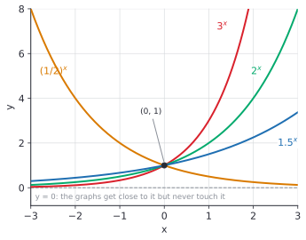
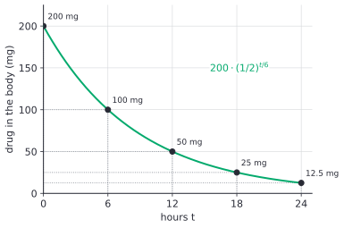
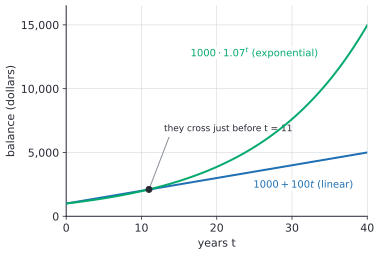

# Exponential functions and growth

After this lesson you can write and graph a function $f(x) = a \cdot b^x$, read its growth or decay factor and its percent rate, build one from a description or from two points, use doubling time and half-life, and compare exponential growth with linear growth.

Before this: [exponent rules](../../02-middle-school/04-powers-roots-and-real-numbers/01-exponent-rules.md), [percent change and applications](../../02-middle-school/02-ratios-rates-percents/04-percent-change-and-applications.md), [radicals and rational exponents](../04-radicals-and-polynomials/01-radicals-and-rational-exponents.md) and [transformations of functions](../03-functions/04-transformations-of-functions.md).

## Quick check

Try these first. If you get all three right, skip to [Practice](#practice).

1. Evaluate $f(x) = 3 \cdot 2^x$ at $x = 4$ and at $x = -1$.
2. A \$50 deposit grows 4% each year. How much is it after 3 years?
3. For $g(x) = 500 \cdot 0.92^x$, is the growth factor above or below 1, and what is the percent change for each step of 1 in $x$?

<details class="solution" markdown>
<summary>Answers</summary>

1. $f(4) = 3 \cdot 16 = 48$ and $f(-1) = 3 \cdot \frac{1}{2} = 1.5$.
2. Each year multiplies by $1.04$, so the amount is $50 \cdot 1.04^3 = 56.2432$, that is, \$56.24.
3. The factor $0.92$ is below 1, so $g$ decays. Each step multiplies by $0.92 = 1 - 0.08$, an 8% decrease.

</details>

## The idea

Suppose you put \$1,000 in an account that pays 7% a year, and your friend puts \$1,000 in a drawer and adds \$100 every year. After 5 years you have \$1,402.55 and your friend has \$1,500, so the drawer is ahead. After 20 years you have \$3,869.68 and your friend has \$3,000. After 40 years the gap is \$14,974.46 against \$5,000. The drawer adds the same amount every year. Your account adds 7% of whatever is already there, so each year's gain is bigger than the last.

That is the difference between linear and exponential growth. In a linear function, equal steps in $x$ add the same amount to $y$. In an exponential function, equal steps in $x$ multiply $y$ by the same factor. Your account's rule is "multiply by $1.07$ each year", so after $x$ years the balance is $1000 \cdot 1.07^x$, and the variable is in the exponent.

Decay is the same rule with a factor below 1. A drug in your blood, a car's resale value and the charge left in a capacitor all shrink by a fixed fraction per step. Because the factor multiplies each time, the quantity gets smaller and smaller but never reaches 0.

## Definitions

An **exponential function** is a function of the form

$$
f(x) = a \cdot b^x,
$$

where $a$ is a nonzero number called the initial value, and the base $b$ is a positive number with $b \ne 1$. The domain is every real number $x$. In plain words, the input is the exponent, and $f(0) = a$ is where the function starts.

The base $b$ is the **growth factor** when $b > 1$ and the **decay factor** when $0 < b < 1$. Each step of 1 in $x$ multiplies the output by $b$. The two restrictions on $b$ have reasons. A negative base breaks down for fractional exponents ($(-4)^{1/2}$ is not a real number, as in [radicals and rational exponents](../04-radicals-and-polynomials/01-radicals-and-rational-exponents.md)), so the function would have gaps. The base $b = 1$ gives $f(x) = a$, a constant, which has no growth or decay.

The formula needs $b^x$ for every real $x$, including fractions and irrational numbers. For a rational $x = \frac{m}{n}$ it means $\sqrt[n]{b^m}$. For an irrational $x$ such as $\sqrt{2}$, it is the number that $b^{1.4}$, $b^{1.41}$, $b^{1.414}$ and so on get closer and closer to. The exponent rules keep holding, so you can use them without worrying about which kind of number $x$ is.

When the factor comes from a percent change, the two are linked by the multiplier from [percent change and applications](../../02-middle-school/02-ratios-rates-percents/04-percent-change-and-applications.md). If each step changes the value by the rate $r$ (written as a decimal, negative for a decrease), then

$$
b = 1 + r.
$$

A 5% rise has $b = 1.05$, and a 15% fall has $b = 0.85$. In plain words, the base is 100% plus the percent change, written as a decimal.

For $a > 0$, these properties hold for every exponential function:

| Property | Growth, $b > 1$ | Decay, $0 < b < 1$ |
|---|---|---|
| domain | all real numbers | all real numbers |
| range | $y > 0$ | $y > 0$ |
| $y$-intercept | $(0, a)$ | $(0, a)$ |
| horizontal asymptote | $y = 0$ on the left | $y = 0$ on the right |
| direction | increasing | decreasing |

A **horizontal asymptote** is a horizontal line that the graph gets arbitrarily close to without touching ([rational functions and asymptotes](../06-rational-expressions-and-equations/02-rational-functions-and-asymptotes.md) covers asymptotes in general). Every output $a \cdot b^x$ is positive when $a$ and $b$ are, so the graph stays above the $x$-axis. If $a < 0$ the whole graph is reflected below the axis, a vertical reflection like those in [transformations of functions](../03-functions/04-transformations-of-functions.md).



All four graphs in the figure pass through $(0, 1)$, because $b^0 = 1$ for every base. A bigger base climbs faster on the right. The decay graph $\left(\frac{1}{2}\right)^x$ is the reflection of $2^x$ in the $y$-axis, since $\left(\frac{1}{2}\right)^x = 2^{-x}$.

## How to do it

### Why equal steps multiply by the same factor

*Theorem.* If $f(x) = a \cdot b^x$, then for every $x$ and every step size $h$,

$$
\frac{f(x + h)}{f(x)} = b^h.
$$

What we know: $f(x) = a \cdot b^x$ with $a \ne 0$ and $b > 0$, so $f(x) \ne 0$ and the quotient makes sense. What we want: the ratio of two outputs that are $h$ apart depends only on $h$, not on $x$.

The plan is to write out $f(x + h)$, split the power with the product rule for exponents, and cancel.

Proof. By the product rule for exponents, $b^{x+h} = b^x \cdot b^h$. So

$$
\frac{f(x + h)}{f(x)} = \frac{a \cdot b^{x+h}}{a \cdot b^x} = \frac{a \cdot b^x \cdot b^h}{a \cdot b^x} = b^h. \qquad \blacksquare
$$

Looking back: with $h = 1$ this says each step of 1 multiplies the output by $b$, which is what "growth factor" means. A linear function has the matching property that $f(x + h) - f(x)$ depends only on $h$. The only difference is subtraction against division.

### Building an exponential model

1. Find the starting value $a$, the amount when $x = 0$.
2. Find the factor $b$ for one step of the input. A percent rate $r$ gives $b = 1 + r$. Say what one step is: a year, a month or an hour.
3. If the factor is given for a period of length $T$ but the input $t$ is measured in other units, use the exponent $\frac{t}{T}$. A factor $b$ that applies every $T$ units gives $f(t) = a \cdot b^{t/T}$.
4. Write $f(x) = a \cdot b^x$ and evaluate. Keep every digit and round once, at the end.
5. Check by repeated multiplication for a small input, or by an estimate.

### Finding $a$ and $b$ from two points

Suppose you know $f(x_1) = y_1$ and $f(x_2) = y_2$. Divide the second equation by the first. The theorem above shows that the $a$ cancels:

$$
\frac{y_2}{y_1} = b^{x_2 - x_1}, \qquad\text{so}\qquad b = \left(\frac{y_2}{y_1}\right)^{1/(x_2 - x_1)}.
$$

Then put $b$ back into either equation to find $a$. The fractional power is a root, as in [radicals and rational exponents](../04-radicals-and-polynomials/01-radicals-and-rational-exponents.md). The two outputs must have the same sign and be nonzero, because an exponential function never changes sign and never hits 0.

### Doubling time and half-life

Some quantities are described by how long they take to double or to halve, not by a percent rate. If a quantity doubles every $T_d$ units of time, then

$$
A(t) = A_0 \cdot 2^{t/T_d},
$$

where $A_0$ is the amount at time 0. The **doubling time** $T_d$ is the time for the quantity to double. If it is cut in half every $T_h$ units, then

$$
A(t) = A_0 \cdot \left(\frac{1}{2}\right)^{t/T_h},
$$

and $T_h$ is the **half-life**. In plain words, the exponent counts how many doubling times (or half-lives) have passed. After 3 half-lives, the amount is $\left(\frac{1}{2}\right)^3 = \frac{1}{8}$ of the start, and the exponent need not be a whole number.

The per-step factor is a root: if the quantity doubles every 3 hours, then in one hour it multiplies by $2^{1/3} \approx 1.26$, which is 26% growth per hour. A quantity that doubles every 3 hours does not grow by one third of 100% each hour. Percent growth compounds, which is the point of this lesson.



The figure shows a 200 mg dose with a half-life of 6 hours. Each 6-hour step halves the amount, whatever amount you start from: from 200 to 100, then 50, then 25. The graph flattens, but it never touches 0.

### Compound interest as a preview

Interest that is added to the balance and then earns interest itself is **compound interest**. If you invest a present value $\text{PV}$ at the rate $r$ per period for $n$ periods, each period multiplies the balance by $1 + r$, so the future value is

$$
\text{FV} = \text{PV}(1 + r)^n.
$$

This is an exponential function of $n$ with initial value $\text{PV}$ and growth factor $1 + r$. For \$1,000 at 5% a year for 10 years, $\text{FV} = 1000 \cdot 1.05^{10} = 1628.89$, about \$1,628.89. The finance chapter develops this fully (compound interest<!-- link: ../../08-financial-math/02-interest-and-growth/02-compound-interest.md -->); here it is the main everyday example of an exponential function.

What if the 5% a year is paid in $m$ equal parts, with $\frac{r}{m}$ added $m$ times a year? Then each of the $mt$ periods multiplies the balance by $1 + \frac{r}{m}$, and

$$
\text{FV} = \text{PV}\left(1 + \frac{r}{m}\right)^{mt}.
$$

With monthly compounding ($m = 12$), \$1,000 at 5% for 10 years becomes $1000\left(1 + \frac{0.05}{12}\right)^{120} = 1647.01$. That is \$18.12 more than with annual compounding, because the interest starts earning interest sooner.

### The number $e$

Push this further. Take \$1 at 100% a year ($r = 1$, $t = 1$) and compound $m$ times: the value is $\left(1 + \frac{1}{m}\right)^m$. More frequent compounding helps, but less and less:

| Compounded | $m$ | $\left(1 + \frac{1}{m}\right)^m$ |
|---|---|---|
| yearly | 1 | 2.000000 |
| twice a year | 2 | 2.250000 |
| monthly | 12 | 2.613035 |
| daily | 365 | 2.714567 |
| every hour | 8,760 | 2.718127 |
| a million times | 1,000,000 | 2.718280 |

The values do not grow forever. They approach a limit, which is called **Euler's number** and written $e$:

$$
e = \lim_{m \to \infty} \left(1 + \frac{1}{m}\right)^m \approx 2.718281828\ldots
$$

In plain words, $e$ is what \$1 grows to in one year at 100% interest when the interest is added continuously. Proving that the limit exists needs calculus, so here it is accepted from the table. The number $e$ is irrational, like $\pi$.

The same limit gives the general rule. Compounding continuously at the rate $r$ for $t$ years turns $\text{PV}$ into $\text{PV} \cdot e^{rt}$. For \$1,000 at 5% for 10 years, that is $1000 \cdot e^{0.5} = 1648.72$, only \$1.71 above monthly compounding. The finance chapter picks this up in continuous compounding and e<!-- link: ../../08-financial-math/02-interest-and-growth/04-continuous-compounding-and-e.md -->.

The function $f(x) = e^x$ is the **natural exponential function**, and more generally

$$
f(t) = a \cdot e^{kt}
$$

describes continuous growth for $k > 0$ and continuous decay for $k < 0$. The constant $k$ is the continuous growth rate. Every exponential function can be written this way, because $b^x = (e^k)^x = e^{kx}$ when $e^k = b$. For example, $1.08^x = e^{kx}$ with $k = \ln 1.08 \approx 0.0770$, where $\ln$ is the logarithm that [the next lesson](02-logarithms.md) defines. So $e^{0.0770} \approx 1.08$: a continuous rate of about 7.7% per year gives the same growth as 8% compounded once a year.

Why use $e$ at all, when $b$ could be anything? In calculus, the function $e^x$ is its own derivative, and that makes the formulas for rates of change simplest in base $e$ (the derivative definition<!-- link: ../../05-university-core/02-derivatives/01-the-derivative-definition.md -->). Many science and economics formulas are written with $e$ for that reason.

### Linear and exponential growth side by side

The opening example is in this table. The linear column adds \$100 each year, and the exponential column multiplies by 1.07 each year.

| Year $t$ | Linear: $1000 + 100t$ | Exponential: $1000 \cdot 1.07^t$ |
|---|---|---|
| 0 | \$1,000.00 | \$1,000.00 |
| 5 | \$1,500.00 | \$1,402.55 |
| 10 | \$2,000.00 | \$1,967.15 |
| 15 | \$2,500.00 | \$2,759.03 |
| 20 | \$3,000.00 | \$3,869.68 |
| 30 | \$4,000.00 | \$7,612.26 |
| 40 | \$5,000.00 | \$14,974.46 |



The exponential curve starts below the line, crosses it just before year 11 (at year 10 the balances are \$2,000.00 and \$1,967.15, and at year 11 they are \$2,104.85 and \$2,100.00), and then pulls away. Any exponential function with $b > 1$ and $a > 0$ eventually passes any linear function, however steep. It can take a long time, and a slow rate makes it longer, but it always happens.

## Worked examples

<div class="example" markdown>

### Example 1: a population growing 8% a year

A town of 400 people grows 8% a year. Write a function for the population after $t$ years and find the population after 10 years.

Step 1: the starting value is $a = 400$, the population at $t = 0$.

Step 2: one step is one year, and the rate is $r = 0.08$, so the growth factor is $b = 1 + 0.08 = 1.08$.

Step 3: the factor is given per year and $t$ is in years, so the exponent is just $t$.

Step 4: the function is $P(t) = 400 \cdot 1.08^t$. At $t = 10$,

$$
P(10) = 400 \cdot 1.08^{10} = 400 \cdot 2.158925\ldots = 863.57\ldots
$$

So the population is about 864 people. The answer is not a whole number because the model is a smooth curve; a real population is rounded to whole people.

Step 5: check by estimating. At 8% a year, a quantity roughly doubles in 9 years (since $1.08^9 = 1.999$), so after 10 years it is a little over twice 400. That fits 864. Also, 10 years of "8% more" is not 80% more: $1.08^{10} - 1 = 1.159$, so the town grew by about 115.9%, not 80%.

<div class="warning" markdown>

Watch out at Step 4: the 10 is an exponent, not a multiplier. Computing $400 \cdot 1.08 \cdot 10 = 4320$ treats the growth as linear and is far too big, while $400 + 10 \cdot 0.08 \cdot 400 = 720$ treats it as simple growth and is too small.

</div>

</div>

<div class="example" markdown>

### Example 2: a car losing value

A new car costs \$30,000 and loses 15% of its value each year (an assumed rate, to keep the numbers tidy). Find its value after 5 years, and say in which year it first falls below half its price.

Steps 1 to 3: $a = 30000$, the rate is $r = -0.15$ so $b = 0.85$, and $t$ is in years. The function is $V(t) = 30000 \cdot 0.85^t$.

Step 4: after 5 years, $V(5) = 30000 \cdot 0.85^5 = 30000 \cdot 0.4437\ldots = 13311.16$, about \$13,311.16.

For the second question, half the price is \$15,000. Try whole years:

| Year $t$ | $V(t)$ |
|---|---|
| 3 | \$18,423.75 |
| 4 | \$15,660.19 |
| 5 | \$13,311.16 |

The value is still above \$15,000 after 4 years and below it after 5, so it first falls below half its price during the fifth year. Notice that a 15% loss per year does not cost 75% over 5 years: the car keeps $0.85^5 = 44.4\%$ of its price, so the total loss is 55.6%.

Step 5: check by repeated multiplication: $30000 \to 25500 \to 21675 \to 18423.75 \to 15660.19 \to 13311.16$.

</div>

<div class="example" markdown>

### Example 3: two points that are not one step apart

An exponential function has $f(2) = 18$ and $f(5) = 486$. Find $f(x)$.

Divide the second equation by the first. Then $\frac{486}{18} = b^{5-2}$, so $b^3 = 27$ and $b = 27^{1/3} = 3$. Now put $b = 3$ into $f(2) = a \cdot 3^2 = 18$, which gives $9a = 18$ and $a = 2$. So $f(x) = 2 \cdot 3^x$.

Check: $f(2) = 2 \cdot 9 = 18$ and $f(5) = 2 \cdot 243 = 486$. Both match.

The base was a clean 3 because the problem was built that way. With most real data, the answer for $b$ is a decimal, and that is fine: the points $(1, 5)$ and $(3, 12)$ give $b^2 = 2.4$, so $b = \sqrt{2.4} \approx 1.549$, and $a = \frac{5}{1.549} \approx 3.23$.

</div>

<div class="example" markdown>

### Example 4: a drug's half-life (finish it yourself)

A patient takes a 200 mg dose of a drug with a half-life of 6 hours. How much is in the body after 15 hours, assuming the amount follows the half-life model?

Step 1: the starting value is $a = 200$ mg.

Step 2: the amount halves every 6 hours, so the factor per period is $\frac{1}{2}$ and the period is $T_h = 6$ hours.

Step 3: the time is measured in hours, so the exponent is $\frac{t}{6}$ and $A(t) = 200 \cdot \left(\frac{1}{2}\right)^{t/6}$.

Now do Step 4 at $t = 15$, round once, and check that the answer lies between the amounts at 12 hours and 18 hours.

<details class="solution" markdown>
<summary>Finish</summary>

Step 4: $A(15) = 200 \cdot \left(\frac{1}{2}\right)^{15/6} = 200 \cdot \left(\frac{1}{2}\right)^{2.5} = 200 \cdot 0.17677\ldots = 35.36$, so about 35.4 mg.

Check: from the figure, the amounts at 12 and 18 hours are 50 mg and 25 mg, and 35.4 lies between them. The amount at 15 hours is also the geometric middle of those two: $\sqrt{50 \cdot 25} = \sqrt{1250} = 35.36$, which agrees.

</details>

</div>

## Edge cases and common mistakes

<div class="warning" markdown>

Watch out: $ab^x$ is not $(ab)^x$. In $3 \cdot 2^x$ only the 2 gets the exponent. At $x = 2$ the first is $3 \cdot 4 = 12$, and $(3 \cdot 2)^2 = 36$. The order of operations ([exponents and order of operations](../../02-middle-school/01-integers-and-rational-numbers/04-exponents-and-order-of-operations.md)) does the power before the multiplication.

</div>

<div class="warning" markdown>

Watch out: the decay factor is $1 - r$, not $r$. A 15% yearly loss has $b = 0.85$. Using $b = 0.15$ says the car keeps only 15% each year, and using $b = 1.15$ says it gains 15%.

</div>

<div class="warning" markdown>

Watch out: do not add percents across steps. Two 50% losses do not leave nothing: $0.5 \cdot 0.5 = 0.25$, so 25% remains. Ten years of 8% growth is a 115.9% rise, not 80%.

</div>

<div class="warning" markdown>

Watch out: $x^2$ and $2^x$ are different kinds of function. In $x^2$ the variable is the base, and in $2^x$ it is the exponent. They agree at $x = 2$ and at $x = 4$ (both give 4 and 16), but at $x = 10$ the first is 100 and the second is 1,024. Past $x = 4$, $2^x$ stays ahead.

</div>

<div class="warning" markdown>

Watch out: keep the units of the rate and the exponent the same. A rate of 2% a month goes with $t$ in months. If $t$ is in years, either change the exponent to $12t$ or convert the factor: $1.02^{12}$ is the yearly factor, about 1.268, which is 26.8% a year, not 24%.

</div>

Zero and negative inputs are fine. For every base, $b^0 = 1$, so $f(0) = a$, and $b^{-x} = \frac{1}{b^x}$, so negative inputs give values on the other side of the $y$-axis: $3 \cdot 2^{-3} = \frac{3}{8}$. These are "before the start" values. A town that grows 8% a year was smaller $3$ years ago by the factor $1.08^{-3} = 0.794$.

The base cannot be negative or 1, as the definitions say. The initial value $a$ can be negative: $f(x) = -3 \cdot 2^x$ is a growth function that falls away from 0 toward $-\infty$, and its range is $y < 0$. Such a function still has the same constant ratio $b = 2$ between outputs.

An exponential function never equals 0. If a question asks "when does the drug amount reach 0?" the honest answer is "never, in the model". In practice you ask when it falls below a threshold, which needs logarithms and comes in [exponential and logarithmic equations](04-exponential-and-logarithmic-equations.md).

## Tricks and shortcuts

The numbers $2^{10} = 1024 \approx 1000$ give quick estimates in computing. Each 10 doublings multiply a quantity by about 1,000: after 20 doublings it is about a million times larger and after 30 about a billion times. That is why a quantity that doubles every day goes from 1 gram to about a tonne in 20 days ($2^{20} = 1{,}048{,}576$ grams).

A small percent over many steps can be estimated by the rule of 72, which says that at $r\%$ per step a quantity doubles in about $\frac{72}{r}$ steps. At 8% that is $\frac{72}{8} = 9$ steps, and indeed $1.08^9 = 1.999$. It gets its own treatment, with its limits, in [exponential and logarithmic equations](04-exponential-and-logarithmic-equations.md#the-rule-of-72).

For one or two steps of a small rate, $(1 + r)^n \approx 1 + nr$ is fine: $1.01^2 = 1.0201$ is close to $1.02$. It gets worse as $nr$ grows. For $r = 0.01$ and $n = 10$ it says 1.10, while the true value is $1.1046$, and it is far off for 8% over 10 years (1.8 against 2.159).

## In code

The code evaluates models, recovers $a$ and $b$ from two points, and shows compounding approaching $e$.

<details class="code" markdown>
<summary>In code</summary>

```python
import math

def exponential(a, b, x):
    return a * b**x

print(round(exponential(400, 1.08, 10), 2))   # town after 10 years: 863.57
print(round(exponential(30000, 0.85, 5), 2))  # car after 5 years: 13311.16

# Find a and b from two points: f(2) = 18, f(5) = 486
b = (486 / 18) ** (1 / (5 - 2))
a = 18 / b**2
print(round(b, 6), round(a, 6))               # 3.0 2.0

# Compounding more often approaches e
for m in (1, 12, 365, 1_000_000):
    print(m, round((1 + 1 / m) ** m, 6))
# 1 2.0
# 12 2.613035
# 365 2.714567
# 1000000 2.71828
print(round(math.e, 6))                       # 2.718282

# Balance after 10 years at 5%: annual, monthly, continuous
print(round(1000 * 1.05**10, 2),
      round(1000 * (1 + 0.05 / 12) ** 120, 2),
      round(1000 * math.exp(0.05 * 10), 2))   # 1628.89 1647.01 1648.72
```

</details>

## FAQ

### Why must the base be positive?

For a negative base such as $-2$, the value $(-2)^x$ is defined for $x = 2$ (it is 4) and for $x = 3$ (it is $-8$), but not for $x = \frac{1}{2}$, since that needs $\sqrt{-2}$. The graph would be a scatter of separate points rather than a curve, and a function with gaps can't model smooth growth. So the base is positive, and the graph is one unbroken curve.

### Why does compounding more often not give unlimited money?

Splitting a year into more pieces earns interest on interest sooner, but each piece is smaller. The gain from going from yearly to twice a year is 25 cents on a dollar at 100%. The gain from monthly to daily is about 10 cents, and from hourly to once a second it is under two hundredths of a cent. The gains shrink fast enough that the total stays under the limit $e \approx 2.718$.

### Is $e$ just another base, or is it special?

Any base can be rewritten with $e$, as the $e^{kt}$ form shows, so no formula needs $e$. It is special because calculus formulas for $e^{kt}$ are the cleanest: the rate of change of $e^{kt}$ is exactly $k$ times itself. That is the reason scientists and economists use $e$ for continuous growth and decay.

## Practice

### Warm-up

1\. For $f(x) = 5 \cdot 3^x$, find $f(-1)$, $f(0)$ and $f(2)$. Is $f$ growth or decay, and what is its growth factor?

<details class="solution" markdown>
<summary>Solution</summary>

Substitute each input: $f(-1) = 5 \cdot 3^{-1} = \frac{5}{3}$, $f(0) = 5 \cdot 1 = 5$ and $f(2) = 5 \cdot 9 = 45$. The base is $3 > 1$, so $f$ is growth with growth factor 3: each step of 1 triples the output.

Check: going from $x = 0$ to $x = 2$ is two steps, and $5 \cdot 3 \cdot 3 = 45$. Going from $-1$ to $0$ multiplies by 3: $\frac{5}{3} \cdot 3 = 5$.

</details>

2\. A \$60 monthly subscription rises 4% each month for a while, as a model. Write the price after $t$ months and find it after 6 months.

<details class="solution" markdown>
<summary>Solution</summary>

The starting value is $a = 60$ and the factor is $b = 1.04$, so $P(t) = 60 \cdot 1.04^t$. After 6 months, $P(6) = 60 \cdot 1.04^6 = 60 \cdot 1.265319\ldots = 75.919\ldots$, about \$75.92.

Check by estimate: 4% of 60 is about \$2.40, so six steps of about \$2.40 or a bit more would reach about \$74.40 or more. The answer \$75.92 is a little above that, as it should be, since growth compounds.

</details>

3\. Say whether each function is growth or decay and give its percent change per step: (a) $g(x) = 1200 \cdot 0.88^x$, (b) $h(x) = 7 \cdot 1.5^x$. Then find $g(3)$.

<details class="solution" markdown>
<summary>Solution</summary>

(a) The base 0.88 is below 1, so $g$ is decay. Since $b = 1 + r$, we get $r = 0.88 - 1 = -0.12$, a 12% decrease per step.

(b) The base 1.5 is above 1, so $h$ is growth, with $r = 0.5$: a 50% increase per step.

For $g(3)$: $1200 \cdot 0.88^3 = 1200 \cdot 0.681472 = 817.7664$, so about 817.77.

Check: three 12% drops are a bit less than 36% in total (compounding makes each smaller), and $1200 \cdot 0.64 = 768$ would be a 36% drop. The real answer 817.77 is higher, about a 31.9% drop, which is consistent.

</details>

### Standard

4\. An exponential function has $f(1) = 12$ and $f(3) = 48$. Find $f(x)$ and then $f(0)$.

<details class="solution" markdown>
<summary>Solution</summary>

Divide: $\frac{48}{12} = b^{3-1}$, so $b^2 = 4$. The base must be positive, so $b = 2$ (the root $-2$ is not allowed). From $f(1) = a \cdot 2 = 12$, $a = 6$. So $f(x) = 6 \cdot 2^x$, and $f(0) = 6$.

Check: $f(1) = 6 \cdot 2 = 12$ and $f(3) = 6 \cdot 8 = 48$.

</details>

5\. A culture starts with 1,000 bacteria that double every 20 minutes. Write $N(t)$ with $t$ in minutes, and find the count after 2 hours and after 50 minutes.

<details class="solution" markdown>
<summary>Solution</summary>

The doubling time is 20 minutes, so $N(t) = 1000 \cdot 2^{t/20}$.

After 2 hours, $t = 120$ and $\frac{t}{20} = 6$, so $N = 1000 \cdot 2^6 = 64000$ bacteria. After 50 minutes, $\frac{t}{20} = 2.5$, so $N = 1000 \cdot 2^{2.5} = 1000 \cdot 5.65685\ldots = 5656.85$, about 5,657.

Check: 50 minutes is between 40 minutes (2 doublings, 4,000) and 60 minutes (3 doublings, 8,000), and 5,657 is between them. Also $\sqrt{4000 \cdot 8000} = 5656.85$.

</details>

6\. A laptop bought for \$1,600 loses 25% of its value each year (an assumed rate). (a) What is it worth after 3 years? (b) After how many whole years is it first worth less than \$500?

<details class="solution" markdown>
<summary>Solution</summary>

The function is $V(t) = 1600 \cdot 0.75^t$.

(a) $V(3) = 1600 \cdot 0.421875 = 675$, so \$675.00.

(b) Try the next years: $V(4) = 1600 \cdot 0.75^4 = 506.25$, which is above \$500, and $V(5) = 1600 \cdot 0.75^5 = 379.69$, which is below. So after 5 years it is first worth less than \$500.

Check by repeated multiplication: $1600 \to 1200 \to 900 \to 675 \to 506.25 \to 379.6875$.

</details>

### Challenge

7\. Plan A starts with \$1,000 and adds \$75 each year. Plan B starts with \$1,000 and grows 5% a year. (a) Find the balances of both after 10 years. (b) In which year does Plan B first have more money than Plan A?

<details class="solution" markdown>
<summary>Solution</summary>

Plan A is linear, $A(t) = 1000 + 75t$. Plan B is exponential, $B(t) = 1000 \cdot 1.05^t$.

(a) $A(10) = 1750$ and $B(10) = 1000 \cdot 1.628895\ldots = 1628.89$. Plan A is ahead by about \$121.

(b) Compare year by year. At $t = 16$, $A = 2200$ and $B = 2182.87$, so A is still ahead. At $t = 17$, $A = 2275$ and $B = 2292.02$, so B is ahead.

So Plan B first has more money in year 17.

Check: $1.05^{17} = 2.292018\ldots$, so $B(17) = 2292.02$, and $1000 + 75 \cdot 17 = 2275$. At $t = 16$, $1.05^{16} = 2.182875$ gives \$2,182.87.

</details>

8\. (Reviews [percent change and applications](../../02-middle-school/02-ratios-rates-percents/04-percent-change-and-applications.md).) A town's population grows 3% in one year and 2% the next. (a) What is the total percent growth over the two years? (b) What single yearly rate, applied twice, gives the same total?

<details class="solution" markdown>
<summary>Solution</summary>

(a) Multiply the multipliers: $1.03 \cdot 1.02 = 1.0506$, a total growth of 5.06%. Adding the percents (5%) is slightly off.

(b) We need a factor $b$ with $b^2 = 1.0506$, so $b = \sqrt{1.0506} = 1.024988\ldots$, a yearly rate of about 2.499%, which is just under 2.5%. This is the geometric mean of the two factors, the same idea as the average growth rate in [radicals and rational exponents](../04-radicals-and-polynomials/01-radicals-and-rational-exponents.md).

Check: $1.024988^2 = 1.0506$. Taking the plain average 2.5% would give $1.025^2 = 1.050625$, a hair too much.

</details>

## Where this shows up

- The next lesson, [logarithms](02-logarithms.md), is the inverse of the exponential function and lets you solve for the exponent: "how long until it doubles?"
- Finance is built on $\text{FV} = \text{PV}(1 + r)^n$. See compound interest<!-- link: ../../08-financial-math/02-interest-and-growth/02-compound-interest.md --> and, for the economics side, growth rates and CAGR<!-- link: ../../07-economics-math/01-measuring-the-economy/03-growth-rates-and-cagr.md -->.
- In computer science, an algorithm that tries every subset of $n$ items takes about $2^n$ steps, and that is exponential time: asymptotic notation<!-- link: ../../06-cs-math/04-sums-recurrences-and-algorithms/04-asymptotic-notation.md --> shows why such algorithms stop being usable at $n$ around 50. Recurrences<!-- link: ../../06-cs-math/04-sums-recurrences-and-algorithms/02-recurrences.md --> often have exponential solutions.
