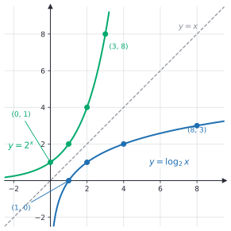
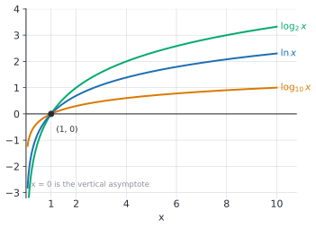

# Logarithms

After this lesson you can read $\log_b x$ as "the exponent that turns $b$ into $x$", switch between logarithm form and exponent form, evaluate simple logarithms by hand and others with a calculator, graph a logarithmic function with its domain, and use $\log_2 n$ to count halvings, binary search steps and bits.

Before this: [exponential functions and growth](01-exponential-functions-and-growth.md), [composition and inverse functions](../03-functions/05-composition-and-inverse-functions.md) and [exponent rules](../../02-middle-school/04-powers-roots-and-real-numbers/01-exponent-rules.md).

## Quick check

Try these first. If you get all three right, skip to [Practice](#practice).

1. Evaluate $\log_2 32$, $\log_{10} 0.001$ and $\log_9 3$.
2. What is the domain of $f(x) = \log_3(x - 2)$?
3. About how many comparisons does binary search need, at most, in a sorted list of 1,000,000 items?

<details class="solution" markdown>
<summary>Answers</summary>

1. $\log_2 32 = 5$ because $2^5 = 32$. Next, $\log_{10} 0.001 = -3$ because $10^{-3} = 0.001$. Last, $\log_9 3 = \frac{1}{2}$ because $9^{1/2} = 3$.
2. The input of a logarithm must be positive, so $x - 2 > 0$, which gives $x > 2$.
3. Each comparison halves the list, so the count is about $\log_2 1{,}000{,}000 = 19.93\ldots$, which means at most 20 comparisons.

</details>

## The idea

Take 1,024 and keep halving: 512, 256, 128, 64, 32, 16, 8, 4, 2, 1. That took 10 halvings. In other words, 10 is the answer to "how many times must I halve 1,024 to reach 1?", and also to "2 to what power is 1,024?", since $2^{10} = 1024$. The two questions are the same question, and the number 10 is called the base-2 logarithm of 1,024.

The same idea counts digits. The number 1,000,000 has 7 digits, and $10^6 = 1{,}000{,}000$, so the exponent 6 is one less than the digit count. A number such as 4,500 is between $10^3$ and $10^4$, so its exponent is between 3 and 4: the base-10 logarithm of 4,500 is about 3.65, and it has 4 digits. A logarithm answers "what exponent?", and because exponents add where numbers multiply, it turns very large numbers into small, manageable ones.

Last lesson you had a base and an exponent and found the result: $2^{10} = 1024$. A logarithm runs the machine backwards. You have the base and the result, and you want the exponent. This is exactly what an inverse function does ([composition and inverse functions](../03-functions/05-composition-and-inverse-functions.md)), so the logarithm is the inverse of the exponential function.


## Definitions

Let $b$ be a positive number with $b \ne 1$, and let $x$ be a positive number. The **logarithm** of $x$ with base $b$, written $\log_b x$, is the exponent to which $b$ must be raised to get $x$. In symbols,

$$
\log_b x = y \quad\text{exactly when}\quad b^y = x.
$$

In plain words, $\log_b x$ is the answer to the question "$b$ to what power gives $x$?". The equation $\log_2 8 = 3$ and the equation $2^3 = 8$ say the same thing in two forms, called logarithm form and exponent form. In the exponent form $b^y = x$, the base $b$ stays the base and the log is the exponent $y$.

The function $f(x) = b^x$ is one-to-one, because it is always increasing (if $b > 1$) or always decreasing (if $0 < b < 1$), so it passes the horizontal line test from [composition and inverse functions](../03-functions/05-composition-and-inverse-functions.md). So it has an inverse. The inverse of $b^x$ is the **logarithmic function** $f^{-1}(x) = \log_b x$. Since the inverse swaps domain and range, the domain of $\log_b x$ is $x > 0$ (the range of $b^x$) and its range is all real numbers (the domain of $b^x$).

Undoing and then redoing gives back the input, which is what an inverse does:

$$
\log_b\left(b^x\right) = x \text{ for every real } x, \qquad b^{\log_b x} = x \text{ for every } x > 0.
$$

Two values come straight from the definition: $\log_b 1 = 0$ because $b^0 = 1$, and $\log_b b = 1$ because $b^1 = b$.

Three bases are used so often that they have their own names and notation.

| Name | Notation | Base | Where you see it |
|---|---|---|---|
| **common logarithm** | $\log_{10} x$ | 10 | digits, orders of magnitude, decibels, pH |
| **natural logarithm** | $\ln x$ | $e \approx 2.71828$ | calculus, continuous growth, statistics |
| **binary logarithm** | $\log_2 x$, also written $\lg x$ | 2 | halving, bits, algorithm analysis |

A bare $\log x$ with no base is ambiguous. High school courses and calculators mean base 10. Most advanced math books and Python's `math.log` mean base $e$. Many computer science books use $\lg x$ for base 2, though the ISO standard and some science books use $\lg$ for base 10. This book always writes the base, except for $\ln$ which always means base $e$.

## How to do it

### Switching between the two forms

1. Name the three parts: the base $b$, the exponent $y$ and the result $x$.
2. To go from logarithm form to exponent form, write $\log_b x = y$ as $b^y = x$. The base stays the base, the log goes up to be the exponent, and the argument is the result.
3. To go the other way, write $b^y = x$ as $\log_b x = y$.
4. Check that each form says the same thing by substituting a number.

For example, $\log_5 125 = 3$ becomes $5^3 = 125$, and $10^{-2} = 0.01$ becomes $\log_{10} 0.01 = -2$. The expression $e^x = 5$ becomes $x = \ln 5$.

### Evaluating a logarithm by hand

1. Set $y = \log_b x$ and write the equation in exponent form: $b^y = x$.
2. Write $x$ as a power of $b$. If $b$ and $x$ are not powers of one another, write both as powers of a common smaller number (use prime factorization from [factors, multiples and primes](../../01-elementary/08-factors-multiples-and-primes.md)).
3. Because $b^x$ is one-to-one, equal powers of the same base have equal exponents. Read off $y$.
4. If $x$ is not a power of $b$ at all, bracket it between two powers to estimate $y$, then use the calculator rule below.
5. Check by raising $b$ to your answer.

Some values to know:

| $k$ | 0 | 1 | 2 | 3 | 4 | 5 | 6 | 7 | 8 | 9 | 10 |
|---|---|---|---|---|---|---|---|---|---|---|---|
| $2^k$ | 1 | 2 | 4 | 8 | 16 | 32 | 64 | 128 | 256 | 512 | 1024 |

So $\log_2$ of each number in the second row is the number in the first row, and $\log_2 \frac{1}{8} = -3$ because $2^{-3} = \frac{1}{8}$. A logarithm of a number between 0 and 1 is negative when the base is above 1.

A calculator has $\log_{10}$ (the "log" key) and $\ln$, so for any other base use the change of base formula

$$
\log_b x = \frac{\ln x}{\ln b} = \frac{\log_{10} x}{\log_{10} b}.
$$

For example, $\log_2 50 = \frac{\ln 50}{\ln 2} \approx \frac{3.91202}{0.69315} \approx 5.6439$, between 5 and 6 as it must be, since $2^5 = 32$ and $2^6 = 64$. The formula is proved in [logarithm properties](03-logarithm-properties.md#change-of-base).

### The graph of a logarithm

Because $\log_b x$ is the inverse of $b^x$, its graph is the graph of $b^x$ reflected in the line $y = x$: each point $(p, q)$ on one graph matches a point $(q, p)$ on the other.



In the figure, the green point $(3, 8)$ on $2^x$ matches the blue point $(8, 3)$ on $\log_2 x$, which says $2^3 = 8$ and $\log_2 8 = 3$ in two ways. The horizontal asymptote $y = 0$ of $2^x$ becomes a vertical asymptote $x = 0$ for $\log_2 x$: the graph gets close to the $y$-axis but never touches it, because there is no power of 2 that equals 0.

For $b > 1$, the graph of $\log_b x$ has these features:

- domain $x > 0$ and range all real numbers,
- the $x$-intercept $(1, 0)$, since $\log_b 1 = 0$, and the point $(b, 1)$,
- a vertical asymptote at $x = 0$, where the values fall without bound,
- increasing, and slowly: to go up by 1, $x$ must be multiplied by $b$.



Different bases give the same shape, all crossing at $(1, 0)$. A bigger base makes the curve flatter: at $x = 10$, $\log_2 10 = 3.32$, $\ln 10 = 2.30$ and $\log_{10} 10 = 1$.

Transformations work as in [transformations of functions](../03-functions/04-transformations-of-functions.md). The graph of $y = \log_b(x - h) + k$ is $\log_b x$ moved $h$ units right and $k$ units up. Its domain is $x > h$, and its vertical asymptote is $x = h$.

### Counting halvings and digits

Halving is the natural "how many times?" question for a computer, and the answer is a base-2 logarithm.

If a list has $n$ items, a binary search compares the target with the middle item and throws away the half that can't contain it. After one step, at most about $\frac{n}{2}$ items are left, after two steps about $\frac{n}{4}$, and the search stops when none or one is left. The number of halvings before reaching 1 is about $\log_2 n$. Counting the loop iterations exactly (one midpoint check per iteration), the worst case for a list of $n$ items is $\lfloor \log_2 n \rfloor + 1$, which the code at the end of this lesson confirms for small $n$.

| List size $n$ | $\log_2 n$ | Worst-case iterations |
|---|---|---|
| 1,000 | 9.97 | 10 |
| 1,000,000 | 19.93 | 20 |
| 1,000,000,000 | 29.90 | 30 |

A search through a billion sorted items takes about 30 comparisons, against up to a billion for scanning one by one. That is why $O(\log n)$ algorithms are so fast, and why the binary logarithm is the one that appears most in computer science ([asymptotic notation](../../06-cs-math/04-sums-recurrences-and-algorithms/04-asymptotic-notation.md)).

The same logarithm counts bits. A bit has two values, so $k$ bits can represent $2^k$ different values ([number bases and conversions](../../06-cs-math/01-number-representation/01-number-bases-and-conversions.md)). To label $n$ distinct things you need the smallest $k$ with $2^k \ge n$, which is $\lceil \log_2 n \rceil$ bits. A million distinct IDs need $\lceil 19.93 \rceil = 20$ bits, and 1,000 IDs need 10. A memory address space of $2^{32}$ bytes needs exactly $\log_2 2^{32} = 32$ bits.

The logarithm of a number is also connected to how many digits it has. The next theorem says exactly how, for base 10 and for any base.

*Theorem.* Let $n$ be a positive integer and $b \ge 2$ an integer. The number of digits of $n$ written in base $b$ is $\lfloor \log_b n \rfloor + 1$.

What we know: $n$ has $d$ digits in base $b$ exactly when $b^{d-1} \le n < b^d$. For example, a 3-digit number in base 10 is at least 100 and below 1000. What we want: $d = \lfloor \log_b n \rfloor + 1$.

The plan is to take the logarithm of the inequality, which keeps its direction because $\log_b$ is increasing.

Proof. Take $\log_b$ of each part of $b^{d-1} \le n < b^d$. Since $\log_b$ is increasing and $\log_b b^k = k$,

$$
d - 1 \le \log_b n < d.
$$

The integer $d - 1$ that is at most $\log_b n$ and within 1 of it is the floor, so $d - 1 = \lfloor \log_b n \rfloor$. Adding 1 gives $d = \lfloor \log_b n \rfloor + 1$. $\blacksquare$

Looking back: with $b = 10$ the digit count is $\lfloor \log_{10} n \rfloor + 1$, so $4500$ gives $\lfloor 3.65 \rfloor + 1 = 4$. With $b = 2$ it is the number of bits in the binary form of $n$: $1000$ needs $\lfloor 9.97 \rfloor + 1 = 10$ bits (it is $1111101000_2$). Python's `n.bit_length()` returns this count.

## Worked examples

<div class="example" markdown>

### Example 1: evaluating $\log_4 32$

Find $\log_4 32$.

Step 1: set $y = \log_4 32$, which means $4^y = 32$.

Step 2: the numbers 4 and 32 are not powers of one another, since $4^2 = 16$ and $4^3 = 64$. Both are powers of 2: $4 = 2^2$ and $32 = 2^5$. So the equation is $(2^2)^y = 2^5$, which is $2^{2y} = 2^5$ by the power-of-a-power rule.

Step 3: equal powers of 2 have equal exponents, so $2y = 5$ and $y = \frac{5}{2}$.

So $\log_4 32 = \frac{5}{2} = 2.5$. A fraction is a fine answer, and it passes the bracket test from Step 4: 32 is between $4^2 = 16$ and $4^3 = 64$, so $y$ is between 2 and 3.

Step 5: check by raising: $4^{5/2} = \left(\sqrt{4}\right)^5 = 2^5 = 32$. Also, by the change of base formula, $\frac{\ln 32}{\ln 4} = \frac{3.4657}{1.3863} = 2.5$.

<div class="warning" markdown>

Watch out at Step 2: $\log_4 32$ is not $\log_2 8$ or $\frac{32}{4} = 8$. Division and logarithms are different operations. The answer 2.5 is an exponent, not a quotient.

</div>

</div>

<div class="example" markdown>

### Example 2: three quick ones, with an unknown base and an unknown argument

(a) Find $\log_3 \frac{1}{9}$. (b) Solve $\log_x 81 = 4$. (c) Solve $\log_5 y = -2$.

(a) Set $3^y = \frac{1}{9} = 3^{-2}$, so $y = -2$. A negative logarithm means the argument is between 0 and 1.

(b) In exponent form, $x^4 = 81$. Since $3^4 = 81$, $x = 3$. The base must be positive, which rules out $x = -3$. Check: $\log_3 81 = 4$ because $3^4 = 81$.

(c) In exponent form, $y = 5^{-2} = \frac{1}{25}$. Check: $\log_5 \frac{1}{25} = -2$, since $5^{-2} = \frac{1}{25}$.

</div>

<div class="example" markdown>

### Example 3: domain and graph of $f(x) = \log_3(x - 2) + 1$

The input of a logarithm must be positive, so $x - 2 > 0$ and the domain is $x > 2$. The value $x = 2$ gives $\log_3 0$, which is undefined because no power of 3 equals 0, and $x = -1$ gives $\log_3(-3)$, undefined because every power of 3 is positive. So the vertical asymptote is $x = 2$.

This is $\log_3 x$ moved 2 right and 1 up. Move the key points $(1, 0)$, $(3, 1)$ and $(9, 2)$ of $\log_3 x$ the same way: they become $(3, 1)$, $(5, 2)$ and $(11, 3)$. Check one directly: $f(5) = \log_3 3 + 1 = 2$.

For the $x$-intercept, set $f(x) = 0$: $\log_3(x - 2) = -1$, so $x - 2 = 3^{-1} = \frac{1}{3}$ and $x = \frac{7}{3}$. Check: $f\left(\frac{7}{3}\right) = \log_3 \frac{1}{3} + 1 = -1 + 1 = 0$. The range is all real numbers. This is an edge case worth remembering: the asymptote is at the edge of the domain, not at $x = 0$.

</div>

<div class="example" markdown>

### Example 4: how many digits does $2^{100}$ have? (finish it yourself)

A calculator without big-integer support can't show $2^{100}$, but a logarithm can count its digits. Use $\log_{10} 2 \approx 0.30103$.

By the theorem, the digit count is $\lfloor \log_{10} 2^{100} \rfloor + 1$. We need $\log_{10} 2^{100}$. Since $2^{100}$ is $2$ multiplied 100 times, and the exponent counts those, $\log_{10} 2^{100} = 100 \log_{10} 2$ (the power rule, proved in [logarithm properties](03-logarithm-properties.md)). Now compute $100 \cdot 0.30103$, take the floor, and add 1.

<details class="solution" markdown>
<summary>Finish</summary>

We get $100 \cdot 0.30103 = 30.103$, so $\lfloor 30.103 \rfloor = 30$, and the digit count is $30 + 1 = 31$.

Check: Python gives `len(str(2**100))` equal to 31, and $2^{100} = 1{,}267{,}650{,}600{,}228{,}229{,}401{,}496{,}703{,}205{,}376$ has 31 digits. As a sanity check, $2^{10} \approx 10^3$, so $2^{100} \approx 10^{30}$, which has 31 digits.

</details>

</div>

## Edge cases and common mistakes

<div class="warning" markdown>

Watch out: you can't take the logarithm of 0 or of a negative number, in the real numbers. The expression $\log_2(-4)$ asks "2 to what power gives $-4$?", and no real power of 2 is negative. A calculator shows an error, and Python raises a `ValueError`.

</div>

<div class="warning" markdown>

Watch out: $\log_b x$ is not $\log$ multiplied by $b$ and it is not $b^x$. The little $b$ below the log is a base, which sets the question being asked. Also, $\log_2 8 = 3$ does not mean $\frac{8}{2}$ or $8 - 2$.

</div>

<div class="warning" markdown>

Watch out: $\ln$ and the "log" key on a calculator are different (base $e$ and base 10), and Python's `math.log(x)` is the natural logarithm, not base 10. Use `math.log10(x)` for base 10 and `math.log2(x)` for base 2. If a result is off by a factor of about 2.3, this mix-up is the likely cause.

</div>

<div class="warning" markdown>

Watch out: when you rewrite a logarithm as a power, the base stays the base and the logarithm becomes the exponent. So $\log_5 125 = 3$ becomes $5^3 = 125$. Writing $3^5 = 125$ swaps the roles of the base and the logarithm, and it is false.

</div>

The base can't be 1, because $1^y = 1$ for every $y$, so $\log_1 x$ would be undefined for $x \ne 1$ and not unique for $x = 1$. It can't be 0 or negative either, for the same reason as in exponential functions. A base between 0 and 1 is allowed, and then $\log_b$ is decreasing: $\log_{1/2} 8 = -3$ because $\left(\frac{1}{2}\right)^{-3} = 8$. Such bases are rare, since $\log_{1/2} x = -\log_2 x$.

Logarithms are often irrational, and that is normal: $\log_2 3$ can't be written as a fraction. Leave an exact answer as $\log_2 3$ and use a calculator only when a decimal is asked for. Another case is $\log_{10} 2 = 0.30103\ldots$. The answer is a whole number only when the argument is a whole-number power of the base, as in $\log_2 64 = 6$.

## Tricks and shortcuts

For counting, memorize the powers of 2 up to $2^{10} = 1024$ and the fact that $2^{10} \approx 10^3$. Then each factor of 1,000 costs about 10 bits: a thousand values need 10 bits, a million need 20, a billion need 30. For $\log_2$ of a power of ten, multiply the exponent by 3.32: $\log_2 10^6 \approx 6 \cdot 3.32 = 19.9$, which matches 19.93.

The digit count of a number is its base-10 logarithm rounded down, plus 1. So $\log_{10} N$ is a decimal whose whole part says "which power of 10" and whose fractional part says where within that power. For $N = 4.5 \times 10^4$ (scientific notation, as in [scientific notation](../../02-middle-school/04-powers-roots-and-real-numbers/02-scientific-notation.md)), $\log_{10} N = 4.653$: the 4 is the exponent, and $0.653$ describes the coefficient 4.5.

When $b$ and $x$ are powers of the same number, the logarithm is a ratio of exponents: $\log_{2^m} 2^n = \frac{n}{m}$. For example $\log_{8} 32 = \frac{5}{3}$, since $8 = 2^3$ and $32 = 2^5$.

## In code

Python has all three common logarithms, and `bit_length` counts bits. The last block confirms the binary search count by testing every target in lists of several sizes.

<details class="code" markdown>
<summary>In code</summary>

```python
import math

print(math.log2(1024))             # 10.0
print(math.log10(0.001))           # -3.0
print(round(math.log(50, 2), 4))   # 5.6439   (log base 2 of 50)
print(round(math.log(math.e), 1))  # 1.0      (math.log with one argument is ln)

n = 2**100
print(len(str(n)), math.floor(100 * math.log10(2)) + 1)  # 31 31
print((1000).bit_length(), (1024).bit_length())          # 10 11

def binary_search_steps(items, target):
    low, high, steps = 0, len(items) - 1, 0
    while low <= high:
        mid = (low + high) // 2
        steps += 1
        if items[mid] == target:
            break
        elif items[mid] < target:
            low = mid + 1
        else:
            high = mid - 1
    return steps

for size in (1, 7, 8, 1000, 1024):
    items = list(range(size))
    worst = max(binary_search_steps(items, t) for t in items)
    print(size, worst, math.floor(math.log2(size)) + 1)
# 1 1 1
# 7 3 3
# 8 4 4
# 1000 10 10
# 1024 11 11
```

</details>

The worst case matches $\lfloor \log_2 n \rfloor + 1$ every time. Note that 1,024 items need 11 steps, not 10: the formula has the "+1" because the last step is the one that finds a list of size 1.

## FAQ

### Why is $\ln$ called the "natural" logarithm?

It is the logarithm that calculus makes simplest: the rate of change of $\ln x$ at $x$ is exactly $\frac{1}{x}$, with no extra constant, and the inverse $e^x$ is its own rate of change ([the derivative definition](../../05-university-core/02-derivatives/01-the-derivative-definition.md)). A logarithm in any other base carries an extra constant factor. You don't need calculus yet to use $\ln$: it behaves like every other logarithm, and the base $e \approx 2.718$ came from continuous compounding in [exponential functions and growth](01-exponential-functions-and-growth.md#the-number-e).

### What about logarithms of negative numbers?

In the real numbers they don't exist, since a positive base raised to any real power is positive. Mathematicians extend the logarithm to negative numbers using complex numbers ([complex numbers](../05-quadratics-and-complex-numbers/03-complex-numbers.md)), where $\ln(-1) = \pi i$. For this chapter and for algorithm analysis, the argument is always positive.

### Why doesn't the base matter in big O?

By the change of base formula, $\log_2 n = \frac{\ln n}{\ln 2}$, which is the natural log times the constant $\frac{1}{\ln 2} \approx 1.44$. Changing the base only multiplies by a constant, and big O ignores constant factors. So $O(\log_2 n)$, $O(\ln n)$ and $O(\log_{10} n)$ describe the same growth. The formula is proved in [logarithm properties](03-logarithm-properties.md#change-of-base).

### Why is base 2 so common in computer science?

Computers store bits, which have two values, and many algorithms (binary search, merge sort, balanced trees) split a problem in half at each step. Halving $n$ down to 1 takes $\log_2 n$ steps, and writing $n$ in binary takes about $\log_2 n$ bits. Both are the question "$2$ to what power gives $n$?" (bits and information<!-- link: ../../06-cs-math/01-number-representation/02-bits-and-information.md -->).

## Practice

### Warm-up

1\. Evaluate: (a) $\log_2 64$, (b) $\log_5 \frac{1}{125}$, (c) $\log_7 1$, (d) $\log_9 9$.

<details class="solution" markdown>
<summary>Solution</summary>

Write each in exponent form.

- (a) $2^y = 64$ and $2^6 = 64$, so $y = 6$.
- (b) $5^y = \frac{1}{125} = 5^{-3}$, so $y = -3$.
- (c) $7^0 = 1$, so $y = 0$. Every base gives $\log_b 1 = 0$.
- (d) $9^1 = 9$, so $y = 1$. Every base gives $\log_b b = 1$.

Check: $2^6 = 64$, $5^{-3} = \frac{1}{125}$, $7^0 = 1$ and $9^1 = 9$.

</details>

2\. Rewrite each equation in the other form: (a) $10^4 = 10{,}000$, (b) $2^{-3} = \frac{1}{8}$, (c) $\log_6 36 = 2$, (d) $e^x = 5$.

<details class="solution" markdown>
<summary>Solution</summary>

- (a) $\log_{10} 10000 = 4$.
- (b) $\log_2 \frac{1}{8} = -3$.
- (c) $6^2 = 36$.
- (d) $x = \ln 5$, which is about 1.609.

Check: in each, the base stays the base, the exponent equals the logarithm, and the result is the argument. For (d), $e^{1.609} \approx 5$.

</details>

3\. Find the domain of (a) $f(x) = \log_2(5 - x)$ and (b) $g(x) = \ln(x + 4)$.

<details class="solution" markdown>
<summary>Solution</summary>

The input of a logarithm must be positive.

- (a) $5 - x > 0$ gives $x < 5$. The domain is $x < 5$.
- (b) $x + 4 > 0$ gives $x > -4$. The domain is $x > -4$.

Check: $f(4) = \log_2 1 = 0$ is defined, while $f(5) = \log_2 0$ is not. And $g(-3) = \ln 1 = 0$ is defined, while $g(-4) = \ln 0$ is not.

</details>

### Standard

4\. Evaluate without a calculator: (a) $\log_8 32$, (b) $\log_{1/2} 8$, (c) $\log_{100} 0.1$.

<details class="solution" markdown>
<summary>Solution</summary>

(a) Write both as powers of 2: $8^y = 32$ becomes $2^{3y} = 2^5$, so $3y = 5$ and $y = \frac{5}{3}$.

(b) $\left(\frac{1}{2}\right)^y = 8$. Since $\frac{1}{2} = 2^{-1}$, this is $2^{-y} = 2^3$, so $y = -3$.

(c) $100^y = 0.1$ becomes $10^{2y} = 10^{-1}$, so $2y = -1$ and $y = -\frac{1}{2}$.

Check: $8^{5/3} = \left(\sqrt[3]{8}\right)^5 = 2^5 = 32$. Also $\left(\frac{1}{2}\right)^{-3} = 8$, and $100^{-1/2} = \frac{1}{\sqrt{100}} = \frac{1}{10} = 0.1$.

</details>

5\. A sorted table holds 5,000,000 records. (a) What is the greatest number of binary search steps needed? (b) How many bits are needed to give each record a different ID?

<details class="solution" markdown>
<summary>Solution</summary>

(a) The worst case is $\lfloor \log_2 5{,}000{,}000 \rfloor + 1$. Since $\log_2 5{,}000{,}000 = 22.25\ldots$, the floor is 22 and the answer is 23 steps.

(b) The smallest $k$ with $2^k \ge 5{,}000{,}000$ is $\lceil 22.25 \rceil = 23$ bits.

Check: $2^{22} = 4{,}194{,}304$ is below 5,000,000 and $2^{23} = 8{,}388{,}608$ is above it, so 22 bits are not enough and 23 are.

</details>

6\. How many digits does $7^{50}$ have? Use $\log_{10} 7 \approx 0.845098$.

<details class="solution" markdown>
<summary>Solution</summary>

The digit count is $\lfloor \log_{10} 7^{50} \rfloor + 1$, and $\log_{10} 7^{50} = 50 \log_{10} 7 = 50 \cdot 0.845098 = 42.2549$. The floor is 42, so $7^{50}$ has $42 + 1 = 43$ digits.

Check: Python gives `len(str(7**50))` equal to 43. Also $7^{50}$ is about $10^{42.25}$, which is a bit under $2 \times 10^{42}$, and a number in the $10^{42}$ range has 43 digits.

</details>

### Challenge

7\. Let $f(x) = \log_2(x + 3) - 1$. (a) Find the domain and the vertical asymptote. (b) Find the $x$-intercept and the $y$-intercept. (c) Find $f^{-1}(x)$ and check it.

<details class="solution" markdown>
<summary>Solution</summary>

(a) We need $x + 3 > 0$, so the domain is $x > -3$ and the vertical asymptote is $x = -3$.

(b) For the $x$-intercept, solve $f(x) = 0$: $\log_2(x + 3) = 1$, so $x + 3 = 2$ and $x = -1$. For the $y$-intercept, $f(0) = \log_2 3 - 1 \approx 1.585 - 1 = 0.585$.

(c) Write $y = \log_2(x + 3) - 1$ and solve for $x$. Add 1: $y + 1 = \log_2(x + 3)$. In exponent form $x + 3 = 2^{y+1}$, so $x = 2^{y+1} - 3$. Swapping the letters, $f^{-1}(x) = 2^{x+1} - 3$.

Check: $f\left(f^{-1}(x)\right) = \log_2\left(2^{x+1} - 3 + 3\right) - 1 = \log_2 2^{x+1} - 1 = (x + 1) - 1 = x$. The domain of $f^{-1}$ is all reals, which is the range of $f$, and its range is $y > -3$, the domain of $f$.

</details>

8\. (Reviews [scientific notation](../../02-middle-school/04-powers-roots-and-real-numbers/02-scientific-notation.md).) Write $N = a \times 10^k$ with $1 \le a < 10$ and $k$ an integer. Show that $\log_{10} N = k + \log_{10} a$ with $0 \le \log_{10} a < 1$, and use it to find $\log_{10}$ of Avogadro's number, $6.02 \times 10^{23}$.

<details class="solution" markdown>
<summary>Solution</summary>

Since $a = 10^{\log_{10} a}$, we get $N = 10^{\log_{10} a} \cdot 10^k = 10^{k + \log_{10} a}$ by the product rule for exponents. So $\log_{10} N = k + \log_{10} a$. Because $1 \le a < 10$, we have $10^0 \le a < 10^1$, so $0 \le \log_{10} a < 1$ as $\log_{10}$ is increasing.

Therefore the whole part of $\log_{10} N$ is the exponent $k$ of the scientific notation, and the order of magnitude from the earlier lesson is $\lfloor \log_{10} N \rfloor$.

For $6.02 \times 10^{23}$: $k = 23$ and $\log_{10} 6.02 = 0.7796$, so $\log_{10} N = 23.7796$.

Check: $10^{0.7796} = 6.02$, and $23.7796$ has whole part 23, the exponent in the notation.

</details>

## Where this shows up

- The next lesson, [logarithm properties](03-logarithm-properties.md), gives the rules that turn products into sums. After it, [exponential and logarithmic equations](04-exponential-and-logarithmic-equations.md) uses logarithms to solve for an exponent.
- In algorithm analysis, $\log_2 n$ counts the levels of a balanced tree, the halving steps of binary search, and the levels of recursion in merge sort ([divide and conquer and the master theorem](../../06-cs-math/04-sums-recurrences-and-algorithms/05-divide-and-conquer-and-master-theorem.md)). In information theory, $\log_2$ measures information in bits.
- In calculus, $\ln x$ is the antiderivative of $\frac{1}{x}$, and in economics and finance, growth rates are often computed as differences of logarithms (growth rates and CAGR<!-- link: ../../07-economics-math/01-measuring-the-economy/03-growth-rates-and-cagr.md -->).
