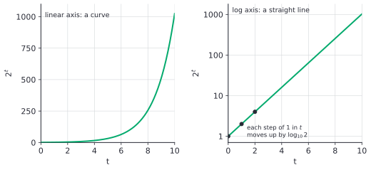
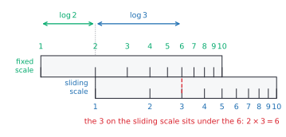

# Logarithm properties

After this lesson you can use the product, quotient and power rules and the change of base formula to expand and condense logarithms, prove each rule from the exponent rules, avoid the standard logarithm mistakes, and read a logarithmic scale such as decibels, magnitude and pH.

Before this: [logarithms](02-logarithms.md) and [exponent rules](../../02-middle-school/04-powers-roots-and-real-numbers/01-exponent-rules.md).

## Quick check

Try these first. If you get all three right, skip to [Practice](#practice).

1. Expand $\log_2 \dfrac{8x^3}{y}$, where $x, y > 0$.
2. Write $2\ln x + \ln 5$ as a single logarithm.
3. Is $\log(a + b) = \log a + \log b$ true? Test it with $a = b = 10$ in base 10.

<details class="solution" markdown>
<summary>Answers</summary>

1. The quotient rule splits off $y$, the product rule splits $8$ from $x^3$, and the power rule brings the 3 down: $\log_2 8 + 3\log_2 x - \log_2 y = 3 + 3\log_2 x - \log_2 y$.
2. Move the 2 up as a power, then add logs by multiplying: $\ln x^2 + \ln 5 = \ln\left(5x^2\right)$.
3. No. With $a = b = 10$, the left side is $\log 20 = 1.301\ldots$ and the right side is $1 + 1 = 2$. The rule is about products, not sums.

</details>

## The idea

Multiply 2 by 3 and the answer is 6. Now look at their base-10 logarithms: $\log_{10} 2 = 0.3010$, $\log_{10} 3 = 0.4771$ and $\log_{10} 6 = 0.7782$. Add the first two and you get $0.3010 + 0.4771 = 0.7781$, which is the logarithm of 6 (the last digit differs only because of rounding). Multiplying the numbers added their logarithms.

That is no accident. A logarithm is an exponent, and exponents add when you multiply powers of the same base: $b^m \cdot b^n = b^{m+n}$. So "the logarithm of a product is the sum of the logarithms" is the product rule for exponents, said in the language of logarithms. The quotient rule and the power rule come from the other exponent rules in the same way.

Addition is easier than multiplication by hand, and a sum of moderate numbers is easier to handle than a product of huge or tiny ones. Tables of logarithms were how people multiplied large numbers for centuries, and logarithms still keep computers from overflowing or underflowing on long products.

## Definitions

Let $b$ be a positive number with $b \ne 1$, let $M$ and $N$ be positive numbers, and let $p$ be a real number. These identities are the **laws of logarithms**:

| Rule | Identity |
|---|---|
| product | $\log_b(MN) = \log_b M + \log_b N$ |
| quotient | $\log_b\left(\dfrac{M}{N}\right) = \log_b M - \log_b N$ |
| power | $\log_b\left(M^p\right) = p \log_b M$ |
| change of base | $\log_b M = \dfrac{\log_c M}{\log_c b}$, for any base $c > 0$ with $c \ne 1$ |

In plain words: the log of a product is the sum of the logs, the log of a quotient is the difference, and an exponent inside a log comes down as a multiplier. To change the base, divide by the log of the old base, measured in the new base.

Special cases of these follow at once. With $M = 1$ in the quotient rule, $\log_b \frac{1}{N} = -\log_b N$. With $p = \frac{1}{n}$ in the power rule, $\log_b \sqrt[n]{M} = \frac{1}{n}\log_b M$. And the cancellation identities from the last lesson still hold: $\log_b b^p = p$ and $b^{\log_b M} = M$.

## How to do it

### Why the rules are true

Each rule is an exponent rule read backwards. In all four proofs, $u$ and $v$ are the logarithms, which exist because $M$ and $N$ are positive.

*Theorem (product rule).* $\log_b(MN) = \log_b M + \log_b N$.

What we know: $M, N > 0$. Set $u = \log_b M$ and $v = \log_b N$, so that $b^u = M$ and $b^v = N$ by the definition of a logarithm. What we want: $\log_b(MN) = u + v$.

The plan is to multiply the two powers, add the exponents, and read the result as a logarithm.

Proof. $MN = b^u \cdot b^v = b^{u+v}$ by the product rule for exponents. By the definition of a logarithm, $b^{u+v} = MN$ means $\log_b(MN) = u + v = \log_b M + \log_b N$. $\blacksquare$

Looking back: nothing more than the exponent rule $b^u b^v = b^{u+v}$ was used. It also shows why $M$ and $N$ must be positive: otherwise $u$ or $v$ would not exist.

*Theorem (quotient rule).* $\log_b\left(\dfrac{M}{N}\right) = \log_b M - \log_b N$.

What we know: the same $u$ and $v$. What we want: $\log_b \frac{M}{N} = u - v$. The plan is the same, with division in place of multiplication.

Proof. $\dfrac{M}{N} = \dfrac{b^u}{b^v} = b^{u-v}$ by the quotient rule for exponents, so $\log_b \frac{M}{N} = u - v$. $\blacksquare$

Looking back: this is the exponent rule that subtracts, as the product rule was the one that adds.

*Theorem (power rule).* $\log_b\left(M^p\right) = p\log_b M$ for every real number $p$.

What we know: $M > 0$, $u = \log_b M$ so $b^u = M$, and $p$ is any real number. What we want: $\log_b(M^p) = pu$. The plan is to raise both sides of $b^u = M$ to the power $p$, use the power-of-a-power rule, and read it as a logarithm.

Proof. $M^p = \left(b^u\right)^p = b^{up}$ by the power-of-a-power rule, so $\log_b\left(M^p\right) = up = p\log_b M$. $\blacksquare$

Looking back: the exponent $p$ can be a fraction, which covers roots ($p = \frac{1}{2}$ for a square root), or negative, which covers reciprocals ($p = -1$).

### Change of base

A calculator has only a few logarithm keys, and the fourth rule says how to get the others.

*Theorem (change of base).* For $c > 0$ with $c \ne 1$, $\log_b M = \dfrac{\log_c M}{\log_c b}$.

What we know: $M > 0$, and $y = \log_b M$, so $b^y = M$. What we want: $y = \frac{\log_c M}{\log_c b}$. The plan is to take $\log_c$ of both sides of $b^y = M$, bring the $y$ down with the power rule, and solve for $y$.

Proof. Taking $\log_c$ of both sides of $b^y = M$ gives $\log_c\left(b^y\right) = \log_c M$. By the power rule the left side is $y \log_c b$, so $y \log_c b = \log_c M$. Since $b \ne 1$, we have $\log_c b \ne 0$, and dividing gives $y = \dfrac{\log_c M}{\log_c b}$. $\blacksquare$

Looking back: the proof is the calculator method from the last lesson. It shows that every logarithm is a constant multiple of every other: $\log_b M = \frac{1}{\log_c b} \cdot \log_c M$. Two useful consequences are $\log_b a = \dfrac{1}{\log_a b}$ (take $c = a$ and $M = a$) and $\log_{b^k} M = \dfrac{1}{k}\log_b M$.

### Reading the rules in both directions

Expanding writes one logarithm as several, and condensing does the reverse:

| Expanding (one log to several) | Condensing (several logs to one) |
|---|---|
| $\log_b(xy) \to \log_b x + \log_b y$ | $\log_b x + \log_b y \to \log_b(xy)$ |
| $\log_b\frac{x}{y} \to \log_b x - \log_b y$ | $\log_b x - \log_b y \to \log_b\frac{x}{y}$ |
| $\log_b x^p \to p\log_b x$ | $p\log_b x \to \log_b x^p$ |

### Expanding a logarithm

1. Rewrite roots and reciprocals as powers: $\sqrt{y} = y^{1/2}$ and $\frac{1}{y} = y^{-1}$.
2. Use the quotient rule on the main fraction line. The top gets $+$ and the bottom gets $-$.
3. Use the product rule to split each product into a sum.
4. Use the power rule to bring each exponent down in front of its log.
5. Evaluate any logs that are exact, such as $\log_2 8 = 3$.
6. Check with numbers: pick values for the variables and compare the original and the expansion.

### Condensing logarithms

1. Use the power rule backwards: move every coefficient up as an exponent.
2. Combine logs that are added by multiplying their arguments, and logs that are subtracted by dividing.
3. Write the result as one logarithm with a simplified argument.
4. Check the domain. The condensed form must not accept values the original would not.
5. Check with numbers.

All the logarithms must have the same base, and each rule needs a coefficient of 1 in front of a log before it combines with another (the rule has no way to combine $2\log x$ and $\log y$ until the 2 goes up).

### Log scales

Some quantities range over many powers of ten, and a scale based on logarithms keeps the numbers manageable. On a log scale, each step of 1 means a multiplication by the base, not an addition.

The **decibel** scale measures the level of a sound with intensity $I$ against a reference intensity $I_0$ by

$$
L = 10 \log_{10}\frac{I}{I_0} \text{ dB}.
$$

Doubling the intensity adds $10\log_{10} 2 = 3.01$ dB. Ten times the intensity adds 10 dB, and a thousand times adds 30 dB. A sound with 50 times the intensity is $10 \log_{10} 50 = 17.0$ dB higher. (This formula is for intensity and power. For amplitude, such as voltage, the factor is 20, because power is proportional to the square of the amplitude, and the power rule brings a 2 down.)

A **magnitude scale** such as the one for earthquakes is also logarithmic. By the USGS description, each whole number step on the scale means 10 times the measured ground-motion amplitude, and about 32 times the energy released ([USGS, earthquake magnitude, energy release and shaking intensity](https://www.usgs.gov/programs/earthquake-hazards/earthquake-magnitude-energy-release-and-shaking-intensity), checked 2026). The 32 is $10^{1.5} \approx 31.6$ ([USGS, how much bigger?](https://earthquake.usgs.gov/education/how_much_bigger.php)). So a magnitude 7 earthquake has $10^2 = 100$ times the amplitude of a magnitude 5, and about $10^{1.5 \cdot 2} = 10^3 = 1000$ times the energy.

The **pH** of a solution is $\text{pH} = -\log_{10}[\text{H}^+]$, where $[\text{H}^+]$ is the concentration of hydrogen ions in moles per litre. A concentration of $10^{-7}$ gives pH 7. A sample with $[\text{H}^+] = 3.2 \times 10^{-4}$ has pH $= -\log_{10}(3.2 \times 10^{-4}) = 3.49$. The minus sign makes more acidic solutions have lower numbers, and each drop of 1 in pH means 10 times as many hydrogen ions. A solution of pH 4 has $10^3 = 1000$ times the concentration of pH 7.

A chart can use a log scale too. On a **logarithmic axis**, equal distances stand for equal ratios, not equal amounts. A quantity growing by a constant factor, like $2^t$, is a curve on an ordinary axis and a straight line on a log axis:



This works because $\log_{10}\left(2^t\right) = t\log_{10} 2$ is a linear function of $t$, with slope $\log_{10} 2 \approx 0.301$. So on a log chart, a straight line means a constant percent growth, and a steeper line means a faster rate. That is the standard way to compare growth of cases, prices or data sizes. It also gives a way to test whether data is exponential: plot the logarithm of $y$ against $x$, and if the points fall on a line, the data is exponential.

### Why a logarithm turns multiplication into addition

A **slide rule** is two rulers marked on a log scale: the mark for the number $k$ sits at distance $\log_{10} k$ from the mark for 1. To multiply 2 by 3, slide the second ruler so its 1 sits under the 2 of the first. Then the 3 of the second ruler sits at distance $\log 2 + \log 3$ from the start, which is where the number 6 is marked, and you read the answer.



The same idea protects programs. A model might give the probability of a data set as a product of many small independent probabilities. With 1,000 factors of 0.01, the true product is $10^{-2000}$, far smaller than the smallest positive number a 64-bit float can hold (about $10^{-308}$ for ordinary values, and about $5 \times 10^{-324}$ at the very smallest), so the computer rounds it to 0. This is **underflow** ([floating point basics](../../06-cs-math/01-number-representation/04-floating-point-basics.md) explains why). The sum of the logs, $1000 \cdot \ln 0.01 = -4605.17$, is a normal number. Machine learning code therefore stores and adds log probabilities. Since $\log$ is increasing, the largest probability has the largest log, so comparisons and maximizing give the same answer.

## Worked examples

<div class="example" markdown>

### Example 1: expanding

Expand $\log_2 \dfrac{8x^3}{\sqrt{y}}$, where $x, y > 0$.

Step 1: write the root as a power: $\sqrt{y} = y^{1/2}$.

Step 2: the main fraction line gives the quotient rule:

$$
\log_2 \frac{8x^3}{y^{1/2}} = \log_2\left(8x^3\right) - \log_2\left(y^{1/2}\right).
$$

Step 3: split the product $8x^3$ with the product rule:

$$
\log_2\left(8x^3\right) = \log_2 8 + \log_2 x^3.
$$

Step 4: bring down the exponents: $\log_2 x^3 = 3\log_2 x$ and $\log_2 y^{1/2} = \frac{1}{2}\log_2 y$.

Step 5: $\log_2 8 = 3$. So

$$
\log_2 \frac{8x^3}{\sqrt{y}} = 3 + 3\log_2 x - \tfrac{1}{2}\log_2 y.
$$

Step 6: check with $x = 2$ and $y = 16$. The original is $\log_2 \frac{8 \cdot 8}{4} = \log_2 16 = 4$. The expansion is $3 + 3 \cdot 1 - \frac{1}{2} \cdot 4 = 3 + 3 - 2 = 4$.

<div class="warning" markdown>

Watch out at Step 3: the product rule splits $8x^3$ because it is a product. If the top were $8 + x^3$, a sum, nothing could be split, and $\log_2(8 + x^3)$ would stay whole. There is no rule that splits a sum inside a log.

</div>

</div>

<div class="example" markdown>

### Example 2: values from two known logarithms

Given $\log_{10} 2 \approx 0.3010$ and $\log_{10} 3 \approx 0.4771$, find $\log_{10} 12$, $\log_{10} 1.5$, $\log_{10} 5$ and $\log_{10} 0.0003$.

- $12 = 2^2 \cdot 3$, so $\log_{10} 12 = 2 \cdot 0.3010 + 0.4771 = 1.0791$.
- $1.5 = \frac{3}{2}$, so $\log_{10} 1.5 = 0.4771 - 0.3010 = 0.1761$.
- $5 = \frac{10}{2}$, so $\log_{10} 5 = 1 - 0.3010 = 0.6990$.
- $0.0003 = 3 \times 10^{-4}$, so $\log_{10} 0.0003 = 0.4771 + (-4) = -3.5229$.

Check with a calculator: $\log_{10} 12 = 1.0792$, $\log_{10} 1.5 = 0.1761$, $\log_{10} 5 = 0.6990$ and $\log_{10} 0.0003 = -3.5229$. The first differs in the last digit from rounding the inputs to four places.

</div>

<div class="example" markdown>

### Example 3: the domain can change when you condense

(a) Is $\ln\left(x^2\right) = 2\ln x$? (b) Condense $\ln(x - 1) + \ln(x - 3)$ and compare domains.

(a) The power rule needs $M > 0$ and $\ln(x^2)$ is defined for every $x \ne 0$, but $2\ln x$ needs $x > 0$. At $x = -3$, the left side is $\ln 9 = 2.197$ and the right side doesn't exist. The correct identity that works for all nonzero $x$ is $\ln\left(x^2\right) = 2\ln\lvert x \rvert$.

(b) The product rule gives $\ln(x - 1) + \ln(x - 3) = \ln\left((x - 1)(x - 3)\right)$, but the left side needs $x > 1$ and $x > 3$, so $x > 3$. The right side is defined whenever the product is positive, which is also true for $x < 1$. For $x = 0$ the right side is $\ln 3$, while the left side is undefined.

So the equation is only true for $x > 3$. Always keep the domain of the original expression when you condense, and for $x < 1$ the correct expansion of $\ln\left((x-1)(x-3)\right)$ would be $\ln(1 - x) + \ln(3 - x)$. Check at $x = 0$: $\ln(1) + \ln(3) = 1.0986 = \ln 3$.

</div>

<div class="example" markdown>

### Example 4: how many decibels louder? (finish it yourself)

Sound A has 50 times the intensity of sound B. By how many decibels is A louder than B? Do it without a calculator, using $\log_{10} 2 \approx 0.301$.

The levels are $L_A = 10\log_{10}\frac{I_A}{I_0}$ and $L_B = 10\log_{10}\frac{I_B}{I_0}$, so the difference is

$$
L_A - L_B = 10\left(\log_{10}\frac{I_A}{I_0} - \log_{10}\frac{I_B}{I_0}\right) = 10\log_{10}\frac{I_A}{I_B},
$$

by the quotient rule, where the reference $I_0$ cancels. Here $\frac{I_A}{I_B} = 50$. Write $50 = \frac{100}{2}$ and finish.

<details class="solution" markdown>
<summary>Finish</summary>

Here $\log_{10} 50 = \log_{10} 100 - \log_{10} 2 = 2 - 0.301 = 1.699$, so the difference is $10 \cdot 1.699 = 16.99$, about 17.0 dB.

Check: $10^{1.699} = 50.0$, and a direct calculation gives $10\log_{10} 50 = 16.99$. As a sense check, 50 is between 10 (10 dB) and 100 (20 dB), and 17 is between them.

</details>

</div>

## Edge cases and common mistakes

<div class="warning" markdown>

Watch out: there is no rule for the logarithm of a sum, so $\log(a + b) \ne \log a + \log b$. With base 10, $\log(2 + 3) = \log 5 = 0.699$, while $\log 2 + \log 3 = 0.778$. The sum $\log a + \log b$ is the logarithm of the product $ab$, which is 6. The exponent rules have nothing for $b^m + b^n$, and the log rules come from the exponent rules, so they have nothing for a sum either.

</div>

<div class="warning" markdown>

Watch out: $\dfrac{\log a}{\log b}$ is not $\log a - \log b$. The difference is the log of a quotient, $\log\frac{a}{b}$. A quotient of logs is a different thing, the change of base formula: $\frac{\log 8}{\log 2} = \log_2 8 = 3$, while $\log 8 - \log 2 = \log 4 = 0.602$ (base 10).

</div>

<div class="warning" markdown>

Watch out: $\log(x^p)$ is $p\log x$, but $(\log x)^p$ is a different number. With $x = 10$ and natural logs, $\ln\left(10^2\right) = \ln 100 = 4.605$ and $(\ln 10)^2 = 2.3026^2 = 5.302$. The power rule applies only when the exponent is on the argument inside the log.

</div>

<div class="warning" markdown>

Watch out: the coefficient in front of a log is a multiplier outside it, so $2\log x$ is not $\log(2x)$. It is $\log x^2$. And $\log_2(x) \cdot \log_2(y)$, a product of logs, has no simplification at all.

</div>

Rules need matching bases. A sum such as $\log_2 x + \log_3 y$ can't be condensed, because the logarithms ask different questions. Convert one to the other's base with the change of base formula first.

Rules also need positive arguments. Example 3 showed that condensing can add values to a domain, and expanding can remove them: $\ln\left((x - 1)(x - 3)\right)$ is defined for $x < 1$, but the expanded sum is not. When you solve an equation after condensing or expanding, check every answer in the original (that is the topic of [exponential and logarithmic equations](04-exponential-and-logarithmic-equations.md)).

Negative and zero arguments never become valid by using a rule: $\log(-2) + \log(-3)$ does not equal $\log 6$, since the left side is undefined in the reals.

## Tricks and shortcuts

The two values $\log_{10} 2 \approx 0.301$ and $\log_{10} 3 \approx 0.477$ give a good number of others by the rules. Any number built from 2, 3 and 5 has a log you can build, using $\log_{10} 5 = 1 - 0.301 = 0.699$. For example, $\log_{10} 600 = \log_{10} 6 + 2 = 0.301 + 0.477 + 2 = 2.778$.

To compare two huge numbers, compare their logs. Which is bigger, $2^{100}$ or $3^{64}$? Their logs are $100 \log_{10} 2 = 30.103$ and $64\log_{10} 3 = 30.536$. The log is increasing, so $3^{64}$ is the larger.

For decibels, memorize $+3$ dB for double and $+10$ dB for ten times. Then 8 times the intensity is three doublings, $3 \cdot 3 = 9$ dB (the exact value is 9.03), and 20 times is $10 + 3 = 13$ dB (exact 13.01).

For bits, $\log_2 3 \approx 1.585$: a choice among three equally likely options carries about 1.6 bits. And by change of base, $\log_2 x \approx 3.32\log_{10} x$.

## In code

The code checks the product and power rules numerically, compares two huge numbers, and shows the underflow that log probabilities avoid. A float check uses `math.isclose`, because floats are never exactly equal.

<details class="code" markdown>
<summary>In code</summary>

```python
import math

a, b = 2, 3
print(math.isclose(math.log10(a * b), math.log10(a) + math.log10(b)))  # True
print(math.isclose(math.log10(a**5), 5 * math.log10(a)))               # True
print(round(math.log10(a + b), 3), round(math.log10(a) + math.log10(b), 3))  # 0.699 0.778

# Which is bigger, 2**100 or 3**64? Compare logs without building the numbers.
print(round(100 * math.log10(2), 3), round(64 * math.log10(3), 3))     # 30.103 30.536

# 1000 probabilities of 0.01: the product underflows, the sum of logs does not.
probs = [0.01] * 1000
product = 1.0
for p in probs:
    product *= p
print(product)                                        # 0.0
print(round(sum(math.log(p) for p in probs), 2))      # -4605.17
```

</details>

## FAQ

### Is there really no rule for $\log(a + b)$?

There is no identity that rewrites it in terms of $\log a$ and $\log b$. The sum of the logs is the log of the product, and the product is a different number from the sum. You can still compute $\log(a + b)$: add first, then take the log. In numerical work with log probabilities, the sum of two probabilities given as logs is handled with the "log-sum-exp" trick, which is a way to compute $\log(e^u + e^v)$ without overflow, not a rule that splits it.

### Why do machine learning methods maximize the log of a probability?

The log is increasing, so the value that makes the likelihood biggest also makes its logarithm biggest, and taking the log doesn't change the answer. It does change the work: a product of $n$ probabilities becomes a sum of $n$ logs, which is stable on a computer (no underflow) and simpler to differentiate.

### Do the rules work for a natural logarithm and a common logarithm alike?

Yes, in any base. Every rule above holds with the same base on every log in the formula. Only the numbers in the answers change with the base: $\ln 2 = 0.693$ and $\log_{10} 2 = 0.301$, but both satisfy $\log(2 \cdot 3) = \log 2 + \log 3$.

## Practice

### Warm-up

1\. Use the rules to evaluate: (a) $\log_6 4 + \log_6 9$, (b) $\log_2 40 - \log_2 5$, (c) $\log_5 \sqrt{5}$.

<details class="solution" markdown>
<summary>Solution</summary>

- (a) Add logs by multiplying: $\log_6 (4 \cdot 9) = \log_6 36 = 2$.
- (b) Subtract logs by dividing: $\log_2 \frac{40}{5} = \log_2 8 = 3$.
- (c) The root is a power: $\log_5 5^{1/2} = \frac{1}{2}\log_5 5 = \frac{1}{2}$.

Check: $6^2 = 36$, $2^3 = 8$ and $5^{1/2} = \sqrt{5}$.

</details>

2\. Expand $\log_3 \dfrac{9x}{y^2}$, where $x, y > 0$.

<details class="solution" markdown>
<summary>Solution</summary>

By the quotient rule, $\log_3(9x) - \log_3 y^2$. The product rule splits $\log_3(9x) = \log_3 9 + \log_3 x = 2 + \log_3 x$, and the power rule gives $\log_3 y^2 = 2\log_3 y$. So the result is $2 + \log_3 x - 2\log_3 y$.

Check with $x = 3$ and $y = 3$: the original is $\log_3 \frac{27}{9} = \log_3 3 = 1$, and the expansion is $2 + 1 - 2 = 1$.

</details>

3\. For each, say whether it is true or false and give a number check: (a) $\log_2(8 \cdot 4) = \log_2 8 + \log_2 4$, (b) $\log_2(8 + 4) = \log_2 8 + \log_2 4$, (c) $\dfrac{\log_2 8}{\log_2 4} = \log_2 2$, (d) $\log_2\left(8^2\right) = 2\log_2 8$.

<details class="solution" markdown>
<summary>Solution</summary>

- (a) True: $\log_2 32 = 5$ and $3 + 2 = 5$.
- (b) False: $\log_2 12 = 3.585\ldots$ but $3 + 2 = 5$.
- (c) False: the left side is $\frac{3}{2} = 1.5$ and the right side is $\log_2 2 = 1$. The quotient of logs is not the log of the quotient.
- (d) True: $\log_2 64 = 6$ and $2 \cdot 3 = 6$.

The true ones are the product and power rules. The false ones are the sum mistake and the quotient mistake.

</details>

### Standard

4\. Condense $2\ln x - \ln 3 + 4\ln y$ into one logarithm. For which $x$ and $y$ is the original expression defined?

<details class="solution" markdown>
<summary>Solution</summary>

Move the coefficients up: $\ln x^2 - \ln 3 + \ln y^4$. Subtract by dividing and add by multiplying: $\ln \dfrac{x^2 y^4}{3}$.

The original needs $x > 0$ (for $\ln x$) and $y > 0$ (for $\ln y$). The condensed form is defined for every $x$ and $y$ with $xy \ne 0$, which is more, so the condensed form must be paired with $x, y > 0$.

Check with $x = 3$ and $y = 1$: the original is $2\ln 3 - \ln 3 + 0 = \ln 3 = 1.0986$, and the condensed form is $\ln \frac{9 \cdot 1}{3} = \ln 3$.

</details>

5\. Given $\ln 2 \approx 0.6931$ and $\ln 3 \approx 1.0986$, find $\ln 12$, $\ln 1.5$, $\ln 18$ and $\ln \sqrt{6}$.

<details class="solution" markdown>
<summary>Solution</summary>

- $12 = 2^2 \cdot 3$, so $\ln 12 = 2(0.6931) + 1.0986 = 2.4848$.
- $1.5 = \frac{3}{2}$, so $\ln 1.5 = 1.0986 - 0.6931 = 0.4055$.
- $18 = 2 \cdot 3^2$, so $\ln 18 = 0.6931 + 2(1.0986) = 2.8903$.
- $\sqrt{6} = (2 \cdot 3)^{1/2}$, so $\ln\sqrt{6} = \frac{1}{2}(0.6931 + 1.0986) = 0.8959$ (about 0.896).

Check with a calculator: $\ln 12 = 2.4849$, $\ln 1.5 = 0.4055$, $\ln 18 = 2.8904$ and $\ln \sqrt{6} = 0.8959$. The first and third differ by 0.0001 because the inputs were rounded.

</details>

6\. (a) Sound A has 2,000 times the intensity of sound B. How many decibels louder is it? (b) A sound is 20 dB louder than another. What is the ratio of their intensities?

<details class="solution" markdown>
<summary>Solution</summary>

(a) The difference is $10\log_{10} 2000 = 10(\log_{10} 2 + 3) = 10(3.301) = 33.0$ dB.

(b) $10\log_{10} r = 20$ gives $\log_{10} r = 2$, so $r = 10^2 = 100$. The louder sound has 100 times the intensity.

Check: $10^{3.301} = 2000$, and 10 dB is a factor of 10, so 20 dB is a factor of $10 \cdot 10 = 100$.

</details>

### Challenge

7\. (a) Which is larger, $2^{100}$ or $3^{64}$, and by what factor? (b) How many digits does each have?

<details class="solution" markdown>
<summary>Solution</summary>

(a) Compare the logs: $\log_{10} 2^{100} = 100 \cdot 0.30103 = 30.103$ and $\log_{10} 3^{64} = 64 \cdot 0.47712 = 30.536$. So $3^{64}$ is larger. The ratio has $\log_{10} \frac{3^{64}}{2^{100}} = 30.536 - 30.103 = 0.433$ and $10^{0.433} = 2.71$, so $3^{64}$ is about 2.7 times as large.

(b) The digit count is the floor plus 1: $\lfloor 30.103 \rfloor + 1 = 31$ digits and $\lfloor 30.536 \rfloor + 1 = 31$ digits. Both have 31 digits.

Check: Python gives $3^{64} = 3{,}433{,}683{,}820{,}292{,}512{,}484{,}657{,}849{,}089{,}281$ and $2^{100} = 1{,}267{,}650{,}600{,}228{,}229{,}401{,}496{,}703{,}205{,}376$, both 31 digits, and the ratio is $2.7087$.

</details>

8\. (Reviews [radicals and rational exponents](../04-radicals-and-polynomials/01-radicals-and-rational-exponents.md).) Show that $\log_b \sqrt[n]{x} = \frac{1}{n}\log_b x$ for $x > 0$, and use it to expand $\log_3 \dfrac{\sqrt[4]{x^3 y}}{z^2}$ for $x, y, z > 0$.

<details class="solution" markdown>
<summary>Solution</summary>

The $n$-th root is a rational power, $\sqrt[n]{x} = x^{1/n}$, so the power rule with $p = \frac{1}{n}$ gives $\log_b x^{1/n} = \frac{1}{n}\log_b x$.

For the expansion, write the fourth root as the power $\frac{1}{4}$ and use the quotient rule: $\log_3 \sqrt[4]{x^3 y} - \log_3 z^2 = \frac{1}{4}\log_3\left(x^3 y\right) - 2\log_3 z$. The product rule and the power rule on the first term give $\frac{1}{4}\left(3\log_3 x + \log_3 y\right)$. So the result is

$$
\tfrac{3}{4}\log_3 x + \tfrac{1}{4}\log_3 y - 2\log_3 z.
$$

Check with $x = 81$, $y = 3$ and $z = 3$. The original is $\log_3 \frac{\sqrt[4]{81^3 \cdot 3}}{9}$. Here $81^3 \cdot 3 = 3^{13}$, so the fourth root is $3^{13/4}$ and dividing by $9 = 3^2$ gives $3^{5/4}$, so the original is $\frac{5}{4}$. The expansion is $\frac{3}{4}(4) + \frac{1}{4}(1) - 2(1) = 3 + 0.25 - 2 = 1.25$.

</details>

## Where this shows up

- The next lesson, [exponential and logarithmic equations](04-exponential-and-logarithmic-equations.md), uses the power rule to bring an unknown exponent down so it can be solved for.
- In algorithm analysis, the change of base formula is why the base of a logarithm doesn't matter in big O ([asymptotic notation](../../06-cs-math/04-sums-recurrences-and-algorithms/04-asymptotic-notation.md)), and the product rule gives $\log_2 n! = \sum_{k=1}^{n} \log_2 k$, which grows like $n\log_2 n$ and gives the bound for sorting by comparisons.
- In calculus, logarithmic differentiation uses these rules to turn a messy product or power into a sum ([differentiation rules](../../05-university-core/02-derivatives/02-differentiation-rules.md)). In economics, differences of logs approximate percent changes (growth rates and CAGR<!-- link: ../../07-economics-math/01-measuring-the-economy/03-growth-rates-and-cagr.md -->).
