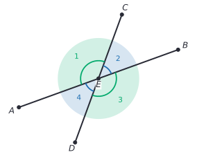
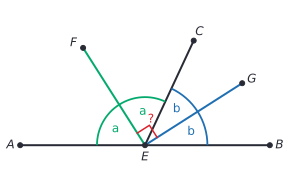

# Definitions, postulates and proof

After this lesson you can say what a definition, a postulate and a theorem are, rewrite a statement as "if P then Q" and form its converse, write a short geometry proof first in two columns and then as a paragraph, and find a counterexample to a false claim.

Before this: [angles and triangles](../../02-middle-school/06-geometry/01-angles-and-triangles.md) (vertical angles, linear pairs, parallel lines) and [real numbers, axioms and set notation](../01-algebra-foundations/01-real-numbers-axioms-and-set-notation.md) (the properties of equality).

## Quick check

Try these first. If you get all three right, skip to [Practice](#practice).

1. Write the converse of "If a number is divisible by 6, then it is divisible by 3". Is the original true? Is the converse?
2. Rewrite "Two angles that form a linear pair are supplementary" as "if ..., then ...", and name the hypothesis and the conclusion.
3. Find a counterexample to "If $x^2 > 9$, then $x > 3$".

<details class="solution" markdown>
<summary>Answers</summary>

1. The converse is "If a number is divisible by 3, then it is divisible by 6". The original is true, since $6 = 2 \times 3$. The converse is false: 9 is divisible by 3 but not by 6.
2. "If two angles form a linear pair, then they are supplementary." The hypothesis is "two angles form a linear pair" and the conclusion is "they are supplementary".
3. Take $x = -4$. Then $x^2 = 16 > 9$, but $x = -4$ is not greater than 3.

</details>

## The idea

Think of a board game. Before anyone moves a piece, the players agree on the rules, and every move after that is justified by pointing at a rule. "You can't move there, because the rule says bishops move diagonally." Nobody accepts "because I felt like it", and nobody argues about the rules in the middle of the game.

A proof is a sequence of moves in that kind of game. The rules are the definitions and postulates, which we agree on at the start. Each move is a statement, and each statement must be justified by a rule or by a fact already proved from the rules. At the end, the statement we wanted is on the board, and nobody can reasonably deny it.

In middle school you met many geometry facts, such as the triangle angle sum, and saw short arguments for them. Those arguments were convincing but loose about what they were allowed to use. This chapter tightens the game: it names the rules, gives a standard layout for proofs, and builds up congruence, similarity and coordinate methods one proved fact at a time. The skill you practise here, justifying every step from agreed starting points, is the same one that discrete math, algorithms and linear algebra courses ask for.

## Definitions

### Undefined terms

You can't define everything. A definition explains a word using other words, so if you try to define every word, you go in circles or never start. Geometry begins with a few **undefined terms**, which are described but not defined.

- A point has a position and no size. We draw it as a dot and name it with a capital letter, such as $A$.
- A line is straight, has no thickness and goes on forever in both directions. Two points determine exactly one line.
- A plane is flat, has no thickness and goes on forever in every direction, like an endless sheet of paper.

In plain words: we all agree what these mean from pictures and experience, and we don't try to say more. Everything else is built from them.

### Definitions

A **definition** states exactly what a word means, using undefined terms and words already defined. A good definition names the kind of thing it defines and then says what makes it special. For example, "a **midpoint** of a segment is the point on the segment that divides it into two equal segments". A definition is reversible: it says "exactly when", so it works in both directions. If $M$ is a midpoint, the two halves are equal, and if a point on the segment makes two equal halves, it is the midpoint.

Here are the definitions used in this chapter. The ones from the [angles and triangles](../../02-middle-school/06-geometry/01-angles-and-triangles.md#definitions) lesson are repeated in one line.

| Term | Meaning |
|---|---|
| segment $AB$ | the part of a line between points $A$ and $B$, including both; its length is also written $AB$ |
| ray $AB$ | the part of the line from $A$ through $B$ that goes on forever past $B$ |
| opposite rays | two rays with the same endpoint that together form a line |
| angle $\angle ABC$ | two rays with a common endpoint (the vertex $B$), measured in degrees |
| linear pair | two adjacent angles whose outer sides are opposite rays |
| vertical angles | two angles formed by two crossing lines, across from each other |
| midpoint | the point of a segment that makes two equal segments |
| angle **bisector** | a ray inside an angle that splits it into two equal angles |
| **perpendicular** lines | two lines that meet at a right angle ($90^\circ$) |
| complementary, supplementary | two angles whose measures add to $90^\circ$, or to $180^\circ$ |

A segment bisector is a point, line or ray through the midpoint of the segment. A perpendicular bisector of a segment is a line that is perpendicular to the segment and passes through its midpoint.

This book writes $AB$ for a segment and also for its length, and $\angle A = \angle B$ for "these angles have equal measures". Many proof textbooks write $\overline{AB} \cong \overline{CD}$ and $\angle A \cong \angle B$ for equal segments and angles, and use $=$ only for numbers. Both mean the same thing.

### Postulates and theorems

A **postulate** (also called an **axiom**) is a statement we accept without proof, as one of the rules of the game. A **theorem** is a statement that has been proved from definitions, postulates and earlier theorems. A **lemma** is a theorem proved mainly to help prove a bigger one, and a **corollary** is a theorem that follows quickly from one just proved. The proofs and logic part of this book spends a whole chapter on these words, starting with [what is a proof](../../04-proofs-and-logic/01-language-and-notation/01-what-is-a-proof.md). The paragraph above is all you need here.

Here is the list of postulates and properties this chapter allows as reasons. Different textbooks arrange the list differently, but all agree on what can be proved from it.

| Name | Statement |
|---|---|
| Two points postulate | Two different points lie on exactly one line. |
| Segment addition postulate | If $B$ is between $A$ and $C$, then $AB + BC = AC$. |
| Angle addition postulate | If a ray $EC$ lies inside $\angle AEB$, then $\angle AEC + \angle CEB = \angle AEB$. |
| Linear pair postulate | If two angles form a linear pair, then they are supplementary: they add to $180^\circ$. |
| Corresponding angles postulate | If a transversal crosses two parallel lines, then corresponding angles are equal. Conversely, if corresponding angles are equal, the lines are parallel. |
| Reflexive property | $a = a$ |
| Symmetric property | If $a = b$, then $b = a$. |
| Transitive property | If $a = b$ and $b = c$, then $a = c$. |
| Substitution | If $a = b$, then $a$ can replace $b$ in any statement. |
| Addition and subtraction properties | If $a = b$, then $a + c = b + c$ and $a - c = b - c$. |
| Multiplication and division properties | If $a = b$, then $ac = bc$, and $\frac{a}{c} = \frac{b}{c}$ when $c \ne 0$. |
| Distributive property | $a(b + c) = ab + ac$ |

The properties of equality are about numbers, and they apply to lengths and angle measures because those are numbers. They are the same properties the [real number axioms](../01-algebra-foundations/01-real-numbers-axioms-and-set-notation.md) list.

### Euclid's postulates

Around 300 BCE, Euclid wrote a book, the *Elements*, that organized geometry into definitions, postulates and theorems. It is the first large example of the method this lesson describes. He used five postulates for plane geometry, which in modern wording say:

1. A straight segment can be drawn between any two points.
2. A segment can be extended without end in a straight line.
3. A circle can be drawn with any centre and any radius.
4. All right angles are equal.
5. If a line crosses two other lines so that the two interior angles on one side add to less than $180^\circ$, then the two lines meet on that side if extended far enough.

The fifth postulate is long, and for centuries mathematicians suspected it could be proved from the other four. It can't. It is equivalent to the statement used in this book: through a point not on a line there is exactly one parallel to the line. On a sphere, such as the surface of the Earth, "lines" are great circles, there are no parallels, and the angles of a triangle add to more than $180^\circ$. So the fifth postulate is a real choice about the kind of space we study, which is why it has to be a postulate. The corresponding angles postulate in the table is the version we use.

### Conditional statements

Most theorems have the shape "if this, then that". A **conditional statement** has the form "if $P$, then $Q$". The part after "if" is the **hypothesis**, what we assume, and the part after "then" is the **conclusion**, what we claim follows.

Take "If an animal is a dog, then it is a mammal". The hypothesis is "an animal is a dog" and the conclusion is "it is a mammal". The statement is true, because every dog is a mammal. A conditional is false only when there is a case where the hypothesis is true and the conclusion is false.

Many statements hide the "if" in their wording. "Vertical angles are equal" means "If two angles are vertical angles, then they are equal". To find the hypothesis, ask what you are given, and to find the conclusion, ask what you are told is true about it.

Swapping the two parts gives the **converse**: "If $Q$, then $P$". The converse of the dog statement is "If an animal is a mammal, then it is a dog", which is false, since a cat is a mammal. A true statement can have a false converse, and mixing the two up is the most common error in a first proof course. "If a figure is a square, then it is a rectangle" is true, and its converse "If a figure is a rectangle, then it is a square" is false.

Two related statements are worth a name. The **contrapositive** of "if $P$, then $Q$" is "if not $Q$, then not $P$". It is true exactly when the original is true: if every dog is a mammal, then an animal that is not a mammal cannot be a dog. The inverse, "if not $P$, then not $Q$", is the converse of the contrapositive and has the same truth value as the converse. The full story, with truth tables, is in [conditionals and biconditionals](../../04-proofs-and-logic/02-logic-and-sets/02-conditionals-and-biconditionals.md).

When a statement and its converse are both true, they combine into a **biconditional**, "$P$ if and only if $Q$". Definitions are biconditionals: "$M$ is the midpoint of $AB$ if and only if $M$ is on $AB$ and $AM = MB$".

A **counterexample** to a conditional statement is a case where the hypothesis is true and the conclusion is false. One counterexample is enough to show the statement is false, and no number of examples that work can prove it true.

## How to do it

### Two-column and paragraph proofs

A geometry proof starts from a **Given** (the hypothesis, in terms of the figure) and ends at a **Prove** (the conclusion). A **two-column proof** lists numbered statements on the left and the reason for each on the right. A **paragraph proof** says the same thing in sentences, with the reasons built into the sentences. The two-column form is for learning, because it forces you to give a reason for every line. The paragraph form is how proofs are written in most books and courses, and it is the form to move toward.

Each reason must be one of four things: "Given", a definition, a postulate or a theorem proved earlier. "It looks right" is never a reason.

What may you read from a figure? You may read which points lie on which line, which point is between two others, and that a ray lies inside an angle, as long as the figure makes these unmistakable. You may not read sizes: that an angle is $90^\circ$, that two segments are equal, or that two lines are parallel or perpendicular. Those need to be marked in the figure or stated in the Given.

### How to read and plan a proof

1. Draw the figure and mark everything in the Given: equal segments with matching tick marks, equal angles with matching arcs, right angles with a small square.
2. Write the Prove statement in terms of the figure: which angles or segments are equal.
3. Work backward from the Prove. Ask: "What single fact would give me this?" and then "What do I need for that fact?" Keep going until you reach something you are given.
4. Work forward from the Given. Unpack each definition in it. If $M$ is a midpoint, write $AM = MB$ at once.
5. When the two ends meet, write the two-column proof in the forward order, with a reason on every line.
6. Rewrite it as a paragraph.
7. Check each line: does the reason really give the statement, and does any line use the thing we are trying to prove?

Steps 3 and 4 are the plan. In this book every proof is framed the way George Polya's *How to Solve It* suggests: what we know, what we want, a plan, the proof and a look back. The plan comes before the proof, because it explains why the proof's steps are in the order they are.

### A first proof: vertical angles are equal

Middle school gave an argument for this. Here it is as a proof with a reason on every line.

*Theorem (vertical angles).* If two lines cross, then the vertical angles are equal.

What we know: lines $AB$ and $CD$ cross at the point $E$, as in the figure. The four angles are $\angle 1 = \angle AEC$, $\angle 2 = \angle CEB$, $\angle 3 = \angle BED$ and $\angle 4 = \angle DEA$. The angles $\angle 1$ and $\angle 3$ are vertical, and so are $\angle 2$ and $\angle 4$.



What we want: $\angle 1 = \angle 3$.

The plan: the angles $\angle 1$ and $\angle 3$ are not next to each other, so look for an angle next to both. The angle $\angle 2$ forms a linear pair with each of them. The linear pair postulate then says each of $\angle 1$ and $\angle 3$ is "$180^\circ$ minus $\angle 2$", so they are equal.

The proof, in two columns:

| Step | Statement | Reason |
|---|---|---|
| 1 | Lines $AB$ and $CD$ cross at $E$ | Given |
| 2 | $\angle 1$ and $\angle 2$ form a linear pair | They share ray $EC$, and their other sides $EA$ and $EB$ are opposite rays (definition of linear pair) |
| 3 | $\angle 1 + \angle 2 = 180^\circ$ | Linear pair postulate (step 2) |
| 4 | $\angle 2$ and $\angle 3$ form a linear pair | They share ray $EB$, and their other sides $EC$ and $ED$ are opposite rays (definition of linear pair) |
| 5 | $\angle 2 + \angle 3 = 180^\circ$ | Linear pair postulate (step 4) |
| 6 | $\angle 1 + \angle 2 = \angle 2 + \angle 3$ | Transitive property (steps 3 and 5 are both equal to $180^\circ$) |
| 7 | $\angle 1 = \angle 3$ | Subtraction property of equality (subtract $\angle 2$ from both sides of step 6) |

The same proof as a paragraph:

*Proof.* Angles $\angle 1$ and $\angle 2$ share the ray $EC$, and their other sides $EA$ and $EB$ are opposite rays, so they form a linear pair and add to $180^\circ$ by the linear pair postulate. In the same way, $\angle 2$ and $\angle 3$ form a linear pair and also add to $180^\circ$. So $\angle 1 + \angle 2 = \angle 2 + \angle 3$, and subtracting $\angle 2$ from both sides gives $\angle 1 = \angle 3$. $\blacksquare$

Looking back: the proof never used a size for any angle, so it holds for every pair of crossing lines. It also proves something slightly more general: two angles that are supplements of the same angle are equal. We will reuse that. And the black square $\blacksquare$ marks the end of a proof.

### A slightly harder proof: the bisectors of a linear pair

*Theorem.* The bisectors of the two angles of a linear pair are perpendicular.

What we know: the points $A$, $E$ and $B$ are on one line, with $E$ between $A$ and $B$, and $C$ is a point off the line. So $\angle AEC$ and $\angle CEB$ form a linear pair. The ray $EF$ bisects $\angle AEC$ and the ray $EG$ bisects $\angle CEB$.



What we want: $\angle FEG = 90^\circ$.

The plan: the angle $\angle FEG$ is made of two parts, $\angle FEC$ (half of $\angle AEC$) and $\angle CEG$ (half of $\angle CEB$). So $\angle FEG$ is half of $\angle AEC + \angle CEB$, and that sum is a linear pair, which is $180^\circ$. Half of $180^\circ$ is $90^\circ$.

The proof, in two columns:

| Step | Statement | Reason |
|---|---|---|
| 1 | $\angle AEC + \angle CEB = 180^\circ$ | Linear pair postulate |
| 2 | $\angle AEF = \angle FEC$ | Definition of angle bisector ($EF$ bisects $\angle AEC$) |
| 3 | $\angle AEC = \angle AEF + \angle FEC$ | Angle addition postulate |
| 4 | $\angle AEC = 2\angle FEC$ | Substitution (step 2 into step 3) |
| 5 | $\angle FEC = \frac{1}{2}\angle AEC$ | Division property of equality |
| 6 | $\angle CEG = \frac{1}{2}\angle CEB$ | Same argument as steps 2 to 5, for the bisector $EG$ of $\angle CEB$ |
| 7 | $\angle FEG = \angle FEC + \angle CEG$ | Angle addition postulate (ray $EC$ lies inside $\angle FEG$) |
| 8 | $\angle FEG = \frac{1}{2}\angle AEC + \frac{1}{2}\angle CEB$ | Substitution (steps 5 and 6 into step 7) |
| 9 | $\angle FEG = \frac{1}{2}(\angle AEC + \angle CEB)$ | Distributive property |
| 10 | $\angle FEG = \frac{1}{2}(180^\circ) = 90^\circ$ | Substitution (step 1) |

The same proof as a paragraph:

*Proof.* The angles $\angle AEC$ and $\angle CEB$ form a linear pair, so they add to $180^\circ$. Because $EF$ bisects $\angle AEC$, the two parts $\angle AEF$ and $\angle FEC$ are equal and add to $\angle AEC$, so $\angle FEC = \frac{1}{2}\angle AEC$. In the same way, $\angle CEG = \frac{1}{2}\angle CEB$. The ray $EC$ lies between $EF$ and $EG$, so $\angle FEG = \angle FEC + \angle CEG = \frac{1}{2}(\angle AEC + \angle CEB) = \frac{1}{2}(180^\circ) = 90^\circ$. $\blacksquare$

Looking back: the figure shows $\angle AEC = 115^\circ$ and $\angle CEB = 65^\circ$, but the proof never uses those numbers, so it works for every ray $EC$. Step 7 relies on a fact read from the figure: that $EC$ lies inside $\angle FEG$. That is an order fact, which is allowed, and not a size fact. As a quick check, take the figure's numbers: the bisectors split $115^\circ$ and $65^\circ$ into $57.5^\circ$ and $32.5^\circ$, and $57.5^\circ + 32.5^\circ = 90^\circ$.

## Worked examples

<div class="example" markdown>

### Example 1: adding equal segments

The points $A$, $B$, $C$ and $D$ lie on a line in that order. Given $AB = CD$, prove $AC = BD$.

Step 1 (draw and mark): put the four points on a line, and put one tick mark on $AB$ and one on $CD$. The segments $AC$ and $BD$ overlap in the middle segment $BC$.

Step 2 (work backward): $AC = AB + BC$ and $BD = BC + CD$, from the segment addition postulate. So $AC$ and $BD$ are both an equal piece plus the shared piece $BC$.

Step 3 (two columns):

| Step | Statement | Reason |
|---|---|---|
| 1 | $AB = CD$ | Given |
| 2 | $BC = BC$ | Reflexive property |
| 3 | $AB + BC = CD + BC$ | Addition property of equality (steps 1 and 2) |
| 4 | $AB + BC = AC$ | Segment addition postulate ($B$ is between $A$ and $C$) |
| 5 | $CD + BC = BD$ | Segment addition postulate ($C$ is between $B$ and $D$) |
| 6 | $AC = BD$ | Substitution (steps 4 and 5 into step 3) |

Step 4 (paragraph): because $B$ is between $A$ and $C$, and $C$ is between $B$ and $D$, the segment addition postulate gives $AC = AB + BC$ and $BD = BC + CD$. Since $AB = CD$, the two right-hand sides are equal, so $AC = BD$. $\blacksquare$

Check with numbers: if $AB = CD = 3$ and $BC = 2$, then $AC = 5$ and $BD = 5$.

</div>

<div class="example" markdown>

### Example 2: converse, contrapositive and truth

Take the statement "If a quadrilateral is a rectangle, then its diagonals are equal". Write its converse and contrapositive, and decide which of the three are true.

The original is true: the diagonals of a rectangle are equal (a proof comes in [coordinate geometry and circles](04-coordinate-geometry-and-circles.md)). The converse is "If the diagonals of a quadrilateral are equal, then it is a rectangle". That is false: an isosceles trapezoid with legs 5, bases 6 and 12 has equal diagonals and no right angles. The contrapositive is "If the diagonals of a quadrilateral are not equal, then it is not a rectangle". It is true, because it says the same thing as the original.

Check: the contrapositive must be true whenever the original is, so the false converse cannot be the contrapositive. The isosceles trapezoid with bases 6 and 12 and height 4 has diagonals of length $\sqrt{9^2 + 4^2} = \sqrt{97}$, and the same for both, so the example fits.

</div>

<div class="example" markdown>

### Example 3: a counterexample to a plausible claim

Is it true that "if two angles are supplementary, then they form a linear pair"?

This is the converse of the linear pair postulate, so it isn't guaranteed. To test it, look for two angles that add to $180^\circ$ but are not next to each other. Take an angle of $60^\circ$ in one corner of a page and an angle of $120^\circ$ in the opposite corner. They add to $180^\circ$, so they are supplementary, but they don't share a vertex, so they are not a linear pair. The statement is false.

The postulate itself is fine: when two angles do form a linear pair, they are supplementary. Only the reverse direction fails, and it fails for the reason that supplementary describes the sum, and linear pair describes the position.

</div>

<div class="example" markdown>

### Example 4: complements of the same angle (finish it yourself)

Given: $\angle 1$ and $\angle 2$ are complementary, and $\angle 3$ and $\angle 2$ are complementary. Prove $\angle 1 = \angle 3$.

Plan: write each complement relationship as an equation, then show that $\angle 1$ and $\angle 3$ both equal $90^\circ - \angle 2$. This is the same pattern as the vertical angles proof, with $90^\circ$ in place of $180^\circ$.

| Step | Statement | Reason |
|---|---|---|
| 1 | $\angle 1 + \angle 2 = 90^\circ$ | Definition of complementary angles |
| 2 | $\angle 3 + \angle 2 = 90^\circ$ | Definition of complementary angles |
| 3 | $\angle 1 + \angle 2 = \angle 3 + \angle 2$ | ? |
| 4 | $\angle 1 = \angle 3$ | ? |

Fill in the two reasons.

<details class="solution" markdown>
<summary>Finish</summary>

Step 3: transitive property, since steps 1 and 2 are both equal to $90^\circ$. Step 4: subtraction property of equality, subtracting $\angle 2$ from both sides.

As a paragraph: both $\angle 1 + \angle 2$ and $\angle 3 + \angle 2$ equal $90^\circ$, so they equal each other, and subtracting $\angle 2$ gives $\angle 1 = \angle 3$. $\blacksquare$

Check: if $\angle 2 = 35^\circ$, then $\angle 1 = 55^\circ$ and $\angle 3 = 55^\circ$.

</details>

</div>

## Edge cases and common mistakes

<div class="warning" markdown>

Watch out for proving the converse. A theorem "if $P$, then $Q$" is proved by assuming $P$ and reaching $Q$. If you assume $Q$ and reach $P$, you have proved the converse, which may be false. Before you start, write down the Given (the $P$ part) and the Prove (the $Q$ part) and check which is which.

</div>

<div class="warning" markdown>

Watch out for reading sizes from the figure. A drawing that looks like a right angle, or two sides that look equal, proves nothing. Unless a mark or the Given says so, the angle can be any size. The figure in the bisector proof shows $115^\circ$ and $65^\circ$, and the proof is still valid for every other pair that adds to $180^\circ$.

</div>

<div class="warning" markdown>

Watch out for circular reasoning, which is using the statement you want to prove as one of your steps. If you are proving $\angle 1 = \angle 3$, you can't write "$\angle 1 = \angle 3$" as step 3 with the reason "vertical angles". Every reason must be something already established, not the claim itself.

</div>

<div class="warning" markdown>

Watch out for "obvious" as a reason, and for reasons that are the wrong kind of fact. "Substitution" is not a reason for a step that needs the linear pair postulate. If you can't name the definition, postulate or theorem, the step is not yet proved.

</div>

Some proofs have a first line that isn't a "Given" but an unpacked definition: if the Given says "$M$ is the midpoint of $AB$", step 1 might be "$AM = MB$ (definition of midpoint)". Writing down what a definition means is usually the best first move, because definitions are what proofs are made from.

A proof can be correct and still too long. If the same four steps repeat, prove them once as a theorem, as in Example 4, which is the complement version of the vertical angle argument. Proving a short theorem so that later proofs can cite it is how a body of results grows.

## Tricks and shortcuts

When you are stuck, name the type of statement you must reach. Is it "two angles are equal", "two segments are equal", "two lines are parallel" or "an angle is $90^\circ$"? Then list the tools that give that kind of statement. For "two angles are equal" the tools so far are: vertical angles, congruent supplements or complements, corresponding angles from parallel lines, and (soon) corresponding parts of congruent triangles. For "an angle is $90^\circ$" they are: the definition of perpendicular, a linear pair of two equal angles, and the converse of the Pythagorean theorem.

Mark the figure while you read the Given. A proof that looks impossible often becomes a two-step proof once the equal marks are on the figure and the shared pieces, such as the segment $BC$ in Example 1, stand out.

## In code

Examples can't prove a statement for all cases, but a short search can find a counterexample. The expression $n^2 + n + 41$ gives a prime for each $n$ from 0 to 39, which tempts people to claim it always does. A loop settles it.

<details class="code" markdown>
<summary>In code</summary>

```python
def is_prime(m):
    if m < 2:
        return False
    return all(m % d for d in range(2, int(m ** 0.5) + 1))

print(all(is_prime(n * n + n + 41) for n in range(40)))    # True
for n in range(100):
    if not is_prime(n * n + n + 41):
        print(n, n * n + n + 41)                           # 40 1681
        break
```

Forty cases in a row all work, and the forty-first fails: $40^2 + 40 + 41 = 1681 = 41^2$. A pattern that holds for 40 examples is still not a proof. A proof covers every case at once, and a single counterexample ends a false claim.

</details>

## FAQ

### Why do we prove things we can already see are true?

Because seeing is not reliable, and because a proof also tells you why. A picture of a triangle shows one triangle, with specific angles. A proof about the labels $A$, $B$ and $C$ covers every triangle. Also, a proof of a fact you already believe teaches the method on a safe example, so you can use it later on claims that you can't check by looking.

### Why do we need postulates? Why not prove everything?

A proof gives reasons, and a reason needs something to rest on. If every statement needed a proof, the proofs would never start. So we pick a small list of simple statements to accept, and prove the rest from them. Different lists are possible, and the choice of the parallel postulate decides whether you are doing flat geometry or the geometry of a sphere.

### What is the difference between a two-column proof and a paragraph proof?

Nothing in the logic: both give the same steps and the same reasons. The two-column proof puts every reason in view, so a missing one stands out. The paragraph proof reads more smoothly and is the form used in university courses. When you write a paragraph proof, you should still be able to point to the reason for each sentence.

### Can I use a theorem I haven't seen proved?

Only if it is in the list of facts you have accepted for the course, such as the Pythagorean theorem or the triangle angle sum, which are proved in earlier lessons. Don't use a result that depends on the thing you are proving. If you use the triangle angle sum to prove something, make sure the triangle angle sum doesn't depend on it.

## Practice

### Warm-up

1\. Write "Vertical angles are equal" as an if-then statement. Name the hypothesis and the conclusion, write the converse, and decide whether the converse is true.

<details class="solution" markdown>
<summary>Solution</summary>

"If two angles are vertical angles, then they are equal." The hypothesis is "two angles are vertical angles" and the conclusion is "they are equal". The converse is "If two angles are equal, then they are vertical angles". It is false: two right angles in different places are equal and are not vertical angles.

Check: the counterexample has a true hypothesis (the angles are equal) and a false conclusion (they are not vertical).

</details>

2\. Give the reason for each step. Given: $M$ is the midpoint of $AB$ and $AB = 10$. Prove $AM = 5$.

| Step | Statement | Reason |
|---|---|---|
| 1 | $AM = MB$ | ? |
| 2 | $AM + MB = AB$ | ? |
| 3 | $AM + AM = 10$ | ? |
| 4 | $2AM = 10$ | Combine like terms |
| 5 | $AM = 5$ | ? |

<details class="solution" markdown>
<summary>Solution</summary>

Step 1: definition of midpoint. Step 2: segment addition postulate, since $M$ is between $A$ and $B$. Step 3: substitution, replacing $MB$ with $AM$ (step 1) and $AB$ with 10 (Given). Step 5: division property of equality, dividing both sides by 2.

Check: $5 + 5 = 10$.

</details>

3\. Find a counterexample to "If a quadrilateral has four equal sides, then it has four right angles".

<details class="solution" markdown>
<summary>Solution</summary>

A rhombus with angles $60^\circ$, $120^\circ$, $60^\circ$ and $120^\circ$ has four equal sides and no right angle. The hypothesis is true and the conclusion is false.

Check: the angles add to $360^\circ$, as they must for a quadrilateral, so the shape exists.

</details>

### Standard

4\. Given: $\angle 1$ and $\angle 2$ are supplementary, and $\angle 2$ and $\angle 3$ are supplementary. Prove $\angle 1 = \angle 3$ in two columns.

<details class="solution" markdown>
<summary>Solution</summary>

What we know: two supplementary relationships that share $\angle 2$. What we want: $\angle 1 = \angle 3$. Plan: the same as Example 4, with $180^\circ$.

| Step | Statement | Reason |
|---|---|---|
| 1 | $\angle 1 + \angle 2 = 180^\circ$ | Definition of supplementary |
| 2 | $\angle 2 + \angle 3 = 180^\circ$ | Definition of supplementary |
| 3 | $\angle 1 + \angle 2 = \angle 2 + \angle 3$ | Transitive property (steps 1 and 2) |
| 4 | $\angle 1 = \angle 3$ | Subtraction property of equality |

Check: if $\angle 2 = 70^\circ$, both $\angle 1$ and $\angle 3$ are $110^\circ$.

</details>

5\. The points $A$, $M$, $B$, $N$ and $C$ lie on a line in that order. Given: $M$ is the midpoint of $AB$ and $N$ is the midpoint of $BC$. Prove $MN = \frac{1}{2}AC$.

<details class="solution" markdown>
<summary>Solution</summary>

What we know: $AM = MB = \frac{1}{2}AB$ and $BN = NC = \frac{1}{2}BC$. What we want: $MN = \frac{1}{2}AC$. Plan: $MN$ is $MB + BN$, so write both pieces as halves and add.

| Step | Statement | Reason |
|---|---|---|
| 1 | $MB = \frac{1}{2}AB$ and $BN = \frac{1}{2}BC$ | Definition of midpoint, with segment addition and division |
| 2 | $MN = MB + BN$ | Segment addition postulate ($B$ is between $M$ and $N$) |
| 3 | $MN = \frac{1}{2}AB + \frac{1}{2}BC$ | Substitution |
| 4 | $MN = \frac{1}{2}(AB + BC)$ | Distributive property |
| 5 | $AB + BC = AC$ | Segment addition postulate |
| 6 | $MN = \frac{1}{2}AC$ | Substitution (step 5 into step 4) |

Check: with $AB = 8$ and $BC = 6$, $MB = 4$, $BN = 3$, $MN = 7$ and $\frac{1}{2}AC = \frac{1}{2}(14) = 7$.

</details>

6\. Two lines $AB$ and $CD$ cross at $E$, and $\angle AEC = 90^\circ$. Write a paragraph proof that all four angles at $E$ are $90^\circ$.

<details class="solution" markdown>
<summary>Solution</summary>

What we know: $\angle AEC = 90^\circ$, with the angles numbered as in the vertical angles figure. What we want: $\angle CEB$, $\angle BED$ and $\angle DEA$ are all $90^\circ$. Plan: use the linear pair postulate for the neighbours and vertical angles for the opposite one.

*Proof.* The angles $\angle AEC$ and $\angle CEB$ form a linear pair, so they add to $180^\circ$, and $\angle CEB = 180^\circ - 90^\circ = 90^\circ$. The angle $\angle BED$ is vertical to $\angle AEC$, so it is equal to $90^\circ$ by the vertical angles theorem. The angle $\angle DEA$ is vertical to $\angle CEB$, so it is also $90^\circ$. $\blacksquare$

Check: four right angles add to $360^\circ$, the full turn around $E$.

</details>

### Challenge

7\. Two lines $AB$ and $CD$ cross at $E$. The ray $EF$ bisects $\angle AEC$, and the ray $EG$ bisects $\angle BED$, which is vertical to $\angle AEC$. Prove that $F$, $E$ and $G$ lie on one line, meaning $\angle FEG = 180^\circ$ when measured through $C$ and $B$.

<details class="solution" markdown>
<summary>Solution</summary>

What we know: $\angle AEC = \angle BED$ (vertical angles), and each is cut in half by a bisector. What we want: the angle from $EF$ around to $EG$ is $180^\circ$. Plan: let $x$ be the measure of $\angle AEC$, find each piece of the angle in terms of $x$ and add.

*Proof.* Let $x = \angle AEC$. Then $\angle BED = x$ by the vertical angles theorem. Since $EF$ bisects $\angle AEC$, $\angle FEC = \frac{x}{2}$, and since $EG$ bisects $\angle BED$, $\angle BEG = \frac{x}{2}$. The angles $\angle AEC$ and $\angle CEB$ form a linear pair, so $\angle CEB = 180^\circ - x$. The rays $EF$, $EC$, $EB$ and $EG$ come in that order, so by the angle addition postulate, the angle from $EF$ to $EG$ is

$$
\frac{x}{2} + (180^\circ - x) + \frac{x}{2} = 180^\circ.
$$

An angle of $180^\circ$ is a straight angle, so $EF$ and $EG$ are opposite rays and $F$, $E$ and $G$ are on one line. $\blacksquare$

Check with $x = 130^\circ$: $65^\circ + 50^\circ + 65^\circ = 180^\circ$.

</details>

8\. (Reviews [angles and triangles](../../02-middle-school/06-geometry/01-angles-and-triangles.md).) In $\triangle ABC$, the angle $\angle C = 90^\circ$. Prove in two columns that $\angle A$ and $\angle B$ are complementary.

<details class="solution" markdown>
<summary>Solution</summary>

What we know: a triangle with a right angle at $C$, and the triangle angle sum theorem. What we want: $\angle A + \angle B = 90^\circ$. Plan: write the angle sum, put in $90^\circ$ and subtract.

| Step | Statement | Reason |
|---|---|---|
| 1 | $\angle C = 90^\circ$ | Given |
| 2 | $\angle A + \angle B + \angle C = 180^\circ$ | Triangle angle sum theorem |
| 3 | $\angle A + \angle B + 90^\circ = 180^\circ$ | Substitution (step 1 into step 2) |
| 4 | $\angle A + \angle B = 90^\circ$ | Subtraction property of equality |
| 5 | $\angle A$ and $\angle B$ are complementary | Definition of complementary angles |

Check: a $3$-$4$-$5$ triangle has acute angles of about $36.9^\circ$ and $53.1^\circ$, which add to $90^\circ$.

</details>

## Where this shows up

- The next lessons in this chapter use this layout throughout: [congruence and triangle proofs](02-congruence-and-triangle-proofs.md), [similarity](03-similarity.md) and [coordinate geometry and circles](04-coordinate-geometry-and-circles.md).
- Every proof course, from discrete math to analysis, uses hypotheses and conclusions, converses and counterexamples. They are developed further in [what is a proof](../../04-proofs-and-logic/01-language-and-notation/01-what-is-a-proof.md) and [counterexamples and disproof](../../04-proofs-and-logic/04-more-proof-methods/04-counterexamples-and-disproof.md).
- In computer science, a postulate is an axiom of a formal system, and a proof checker accepts a proof only when each line follows from earlier lines by a stated rule, which is the two-column layout made precise.
