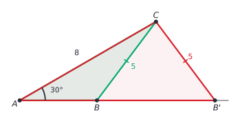
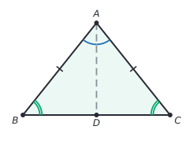
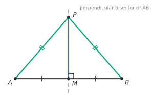
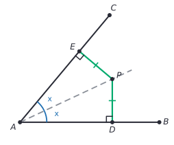
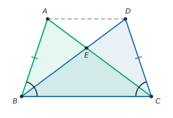
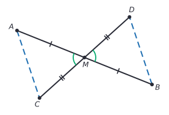

# Congruence and triangle proofs

After this lesson you can prove two triangles congruent with SSS, SAS, ASA, AAS or HL, use CPCTC to conclude that other parts are equal, prove the isosceles triangle theorem and its converse, and use the perpendicular bisector and angle bisector theorems in proofs.

Before this: [definitions, postulates and proof](01-definitions-postulates-and-proof.md) (the two-column format and the postulates), and [transformations, congruence and similarity](../../02-middle-school/06-geometry/05-transformations-congruence-similarity.md#congruence-and-similarity).

## Quick check

Try these first. If you get all three right, skip to [Practice](#practice).

1. In $\triangle ABC$ and $\triangle DEF$, $AB = DE = 5$, $BC = EF = 7$ and $\angle B = \angle E = 40^\circ$. Which test shows the triangles are congruent? Write the congruence statement.
2. In $\triangle ABC$, $AB = AC$ and $\angle B = 50^\circ$. Find $\angle C$ and $\angle A$.
3. The point $P$ is on the perpendicular bisector of segment $AB$, and $PA = 9$. Find $PB$.

<details class="solution" markdown>
<summary>Answers</summary>

1. SAS: the angle $B$ sits between the sides $AB$ and $BC$, and the angle $E$ sits between $DE$ and $EF$. The statement is $\triangle ABC \cong \triangle DEF$.
2. The angles opposite the equal sides are equal, so $\angle C = \angle B = 50^\circ$. Then $\angle A = 180^\circ - 50^\circ - 50^\circ = 80^\circ$.
3. Every point on the perpendicular bisector is the same distance from $A$ and $B$, so $PB = 9$.

</details>

## The idea

A triangle has six measurements: three sides and three angles. Do you need to know all six to be sure that two triangles are copies of each other? Try building one. Cut three straws of length 5, 6 and 7 cm and join them at the ends. The straws can't flex at the joints, so there is only one triangle you can make. Anyone else who uses the same three lengths gets a triangle of exactly the same shape and size. Three measurements were enough.

But not every set of three measurements works. Three angles, such as $30^\circ$, $60^\circ$ and $90^\circ$, fit a small triangle and a huge one. And two sides with an angle that isn't between them can sometimes make two different triangles. Finding which sets of three measurements pin a triangle down is the first job of this lesson.

The second job is to use them. Once two triangles are known to be congruent, every other pair of matching parts is equal for free. That is how geometry proofs show that two segments or two angles are equal: put them in a pair of triangles, prove the triangles congruent from three easier facts, and read off the rest. This is the engine behind most of the proofs in this chapter.

## Definitions

Two triangles are **congruent** when every pair of corresponding sides and every pair of corresponding angles are equal. We write $\triangle ABC \cong \triangle DEF$, and the order of the letters matters: it says $A$ matches $D$, $B$ matches $E$ and $C$ matches $F$. So $AB = DE$, $BC = EF$, $CA = FD$, $\angle A = \angle D$, $\angle B = \angle E$ and $\angle C = \angle F$. In plain words, congruent triangles are the same shape and size, and one can be slid, turned or flipped onto the other. This agrees with the [rigid motion definition](../../02-middle-school/06-geometry/05-transformations-congruence-similarity.md#congruence-and-similarity) from middle school.

An angle is **included** between two sides when its vertex is the common endpoint of those sides. In $\triangle ABC$, the angle $\angle B$ is included between $AB$ and $BC$. A side is included between two angles when it joins their vertices: $AB$ is included between $\angle A$ and $\angle B$.

The proof habit this lesson builds on is the word **CPCTC**, which stands for "corresponding parts of congruent triangles are congruent". It is not a new rule. It is the definition of congruent triangles used in the other direction: once you know $\triangle ABC \cong \triangle DEF$, each pair of corresponding parts is equal. In plain words: congruence of the whole gives equality of every part.

### Parts of a triangle used in proofs

In an isosceles triangle, the two equal sides are the **legs**, the third side is the **base**, the angles at the ends of the base are the **base angles**, and the angle between the legs is the **vertex angle**. The middle-school lesson [angles and triangles](../../02-middle-school/06-geometry/01-angles-and-triangles.md#triangles) introduced these names and used the base angle theorem without proof. This lesson proves it.

A **median** of a triangle is a segment from a vertex to the midpoint of the opposite side. An **altitude** is a segment from a vertex perpendicular to the line containing the opposite side. The **perpendicular bisector** of a segment is the line perpendicular to it through its midpoint.

### The postulates

Three tests are accepted as postulates, which is the standard high school approach.

| Postulate | Two triangles are congruent when |
|---|---|
| SSS | the three sides of one equal the three sides of the other |
| SAS | two sides and the angle between them are equal |
| ASA | two angles and the side between them are equal |

Why believe them? Take SAS. Slide $\triangle ABC$ so that $A$ lands on $D$ and the side $AB$ lies along $DE$. Because $AB = DE$, the point $B$ lands exactly on $E$. Because $\angle A = \angle D$, the ray $AC$ lands on the ray $DF$, and because $AC = DF$, the point $C$ lands on $F$. Both triangles now have the same three vertices, and two points determine one line, so the third sides coincide. ASA can be argued the same way, and SSS takes more care. We take all three as postulates because the full proofs rest on a careful treatment of "slide, turn and flip" that high school geometry skips.

## How to do it

### The five tests

Two more tests are theorems that follow from the postulates. All five are in the figure, with the equal parts in colour.


*Theorem (AAS).* If two angles and a side that is not between them in one triangle equal the matching parts of another, the triangles are congruent.

What we know: in $\triangle ABC$ and $\triangle DEF$, $\angle A = \angle D$, $\angle B = \angle E$ and $BC = EF$.

What we want: $\triangle ABC \cong \triangle DEF$.

The plan: if the third angles are equal as well, then $BC$ is between two pairs of equal angles, and ASA applies.

*Proof.* By the triangle angle sum, $\angle C = 180^\circ - \angle A - \angle B$ and $\angle F = 180^\circ - \angle D - \angle E$. The right-hand sides are equal, so $\angle C = \angle F$. Now $\angle B = \angle E$, $BC = EF$ and $\angle C = \angle F$, and $BC$ is the side between $\angle B$ and $\angle C$, so the triangles are congruent by ASA. $\blacksquare$

*Theorem (HL).* If two right triangles have equal hypotenuses and one pair of equal legs, they are congruent.

What we know: $\triangle ABC$ has a right angle at $B$, and $\triangle DEF$ has a right angle at $E$. The hypotenuses are equal, $AC = DF$, and so is one leg, $AB = DE$.

What we want: $\triangle ABC \cong \triangle DEF$.

The plan: the Pythagorean theorem gives the other leg from the hypotenuse and the first leg, so the third sides are equal too, and SSS applies.

*Proof.* By the [Pythagorean theorem](../../02-middle-school/06-geometry/04-pythagorean-theorem.md#the-theorem-and-its-proof), $BC^2 = AC^2 - AB^2$ and $EF^2 = DF^2 - DE^2$. Since $AC = DF$ and $AB = DE$, the right-hand sides are equal, so $BC^2 = EF^2$. Lengths are positive, so $BC = EF$. All three pairs of sides are equal, so the triangles are congruent by SSS. $\blacksquare$

Looking back: HL is a case where two sides and a non-included angle do work. The angle is a right angle, and that is what makes the Pythagorean theorem available.

### Why SSA fails

Is "two sides and an angle that is not between them" a test? The figure says no. Take $\angle A = 30^\circ$, $AC = 8$ and $BC = 5$. Draw the angle at $A$, mark $C$ on one ray at distance 8, and then look for a point $B$ on the other ray that is 5 away from $C$. The distance from $C$ to that ray is $8\sin 30^\circ = 4$, which is less than 5, so a circle of radius 5 around $C$ crosses the ray in two points, $B$ and $B'$.



Both triangles $ABC$ and $AB'C$ have an angle of $30^\circ$ at $A$, a side $AC = 8$ and a side of length 5 opposite the $30^\circ$ angle. But $AB \approx 3.93$ and $AB' \approx 9.93$, so they are not congruent. The three given parts don't pin the triangle down. SSA is therefore not a test, and the same goes for AAA, which fits any size of triangle.

[The law of sines](../09-trigonometry/05-law-of-sines-and-cosines.md) returns to this as "the ambiguous case". For now the rule is: the equal angle must be included between the equal sides (SAS), or a side must be opposite a known angle in a matching position (AAS), or the triangles must be right triangles (HL).

### Writing a congruence proof

1. Mark the figure with everything in the Given, using matching tick marks and arcs.
2. Find two triangles that contain the parts you want to show equal. If they overlap, redraw them apart.
3. List three pairs of equal parts, looking for the usual sources: the Given, a shared side (reflexive property), vertical angles, angles made by parallel lines, midpoints and bisectors.
4. Name the test and write the congruence with the letters in matching order.
5. Use CPCTC to state the equality you wanted.
6. Check that the order of letters matches the figure and that your final parts really correspond.

### The isosceles triangle theorem

The middle-school lessons used this as a fact. Here it is proved.

*Theorem (isosceles triangle).* If two sides of a triangle are equal, then the angles opposite them are equal. In symbols, if $AB = AC$ then $\angle B = \angle C$.

What we know: in $\triangle ABC$, $AB = AC$.

What we want: $\angle B = \angle C$.

The plan: the angles $\angle B$ and $\angle C$ are in different corners, so cut the triangle into two triangles that contain them. Draw the bisector of the angle at $A$, let it meet $BC$ at $D$, and show $\triangle BAD \cong \triangle CAD$ by SAS.



The proof, in two columns:

| Step | Statement | Reason |
|---|---|---|
| 1 | $AB = AC$ | Given |
| 2 | Let the bisector of $\angle BAC$ meet $BC$ at $D$ | Every angle has a bisector, and the bisector of an angle of a triangle meets the opposite side |
| 3 | $\angle BAD = \angle CAD$ | Definition of angle bisector |
| 4 | $AD = AD$ | Reflexive property |
| 5 | $\triangle BAD \cong \triangle CAD$ | SAS (steps 1, 3 and 4; the angle at $A$ is between the sides) |
| 6 | $\angle B = \angle C$ | CPCTC |

As a paragraph: draw the bisector of $\angle A$ to a point $D$ on $BC$. The triangles $BAD$ and $CAD$ have $AB = AC$, equal angles at $A$ by the bisector, and the shared side $AD$, so they are congruent by SAS. Corresponding angles of congruent triangles are equal, so $\angle B = \angle C$. $\blacksquare$

Looking back: step 2 added a line that wasn't in the original figure, which is a standard move, justified by the fact that angle bisectors exist. The same congruence tells more: by CPCTC, $BD = CD$ and $\angle ADB = \angle ADC$. These two angles form a linear pair, so they add to $180^\circ$ and each is $90^\circ$. In an isosceles triangle, the bisector of the vertex angle is also the median and the altitude to the base: it is the perpendicular bisector of the base.

*Theorem (converse of the isosceles triangle theorem).* If two angles of a triangle are equal, then the sides opposite them are equal. In symbols, if $\angle B = \angle C$ then $AB = AC$.

What we know: in $\triangle ABC$, $\angle B = \angle C$.

What we want: $AB = AC$.

The plan: the same cut as before, with the bisector $AD$. This time the triangles share two angles and a side, so AAS applies.

| Step | Statement | Reason |
|---|---|---|
| 1 | $\angle B = \angle C$ | Given |
| 2 | Let the bisector of $\angle BAC$ meet $BC$ at $D$ | As before |
| 3 | $\angle BAD = \angle CAD$ | Definition of angle bisector |
| 4 | $AD = AD$ | Reflexive property |
| 5 | $\triangle BAD \cong \triangle CAD$ | AAS (steps 1, 3 and 4; $AD$ is opposite $\angle B$ in one triangle and opposite $\angle C$ in the other) |
| 6 | $AB = AC$ | CPCTC |

Looking back: the theorem and its converse together say that a triangle has two equal sides exactly when it has two equal angles. Two consequences: a triangle with three equal sides has three equal angles, and since they add to $180^\circ$, each is $60^\circ$. And a triangle with three equal angles has three equal sides. So "equilateral" and "equiangular" describe the same triangles.

### The perpendicular bisector theorem

*Theorem.* A point is on the perpendicular bisector of a segment $AB$ if and only if it is equally far from $A$ and from $B$.

"If and only if" means two things must be proved: one direction and its converse.



What we know for the first direction: $M$ is the midpoint of $AB$, the line $PM$ is perpendicular to $AB$ at $M$.

What we want: $PA = PB$.

The plan: $PA$ and $PB$ are sides of the triangles $PMA$ and $PMB$. These share $PM$ and have equal sides $AM = MB$ and equal right angles at $M$, so SAS works.

*Proof of the first direction.* $AM = MB$ because $M$ is the midpoint. $\angle PMA = \angle PMB = 90^\circ$ because $PM$ is perpendicular to $AB$. $PM = PM$. So $\triangle PMA \cong \triangle PMB$ by SAS, and $PA = PB$ by CPCTC. $\blacksquare$

What we know for the converse: $P$ is not on line $AB$ and $PA = PB$. (If $P$ is on the line, then $PA = PB$ forces $P$ to be the midpoint, which is on the bisector already.)

What we want: $P$ is on the perpendicular bisector of $AB$.

The plan: let $M$ be the midpoint of $AB$ and join $P$ to $M$. Show that $PM$ is perpendicular to $AB$, so that the line $PM$ is the perpendicular bisector.

*Proof of the converse.* The triangles $PAM$ and $PBM$ have $PA = PB$ (Given), $AM = BM$ (definition of midpoint) and $PM = PM$ (reflexive), so they are congruent by SSS. By CPCTC, $\angle PMA = \angle PMB$. These two angles form a linear pair, so they add to $180^\circ$, and each is $90^\circ$. So $PM$ is perpendicular to $AB$ and goes through its midpoint $M$: it is the perpendicular bisector, and $P$ is on it. $\blacksquare$

Looking back: the first direction used SAS and the converse used SSS, so the same figure can need different tests. The theorem says the perpendicular bisector is exactly the set of points equally far from the two ends, which is why a point equally far from two towns lies on their perpendicular bisector.

### The angle bisector theorem

The distance from a point to a line is the length of the perpendicular segment from the point to the line.

*Theorem.* A point inside an angle is on the bisector of the angle if and only if it is equally far from the two sides of the angle.



What we know for the first direction: $P$ is on the bisector of $\angle BAC$, $PD \perp AB$ and $PE \perp AC$, with $D$ on $AB$ and $E$ on $AC$. The angle is drawn acute, so that the feet $D$ and $E$ land on the rays $AB$ and $AC$. The theorem is true for every angle, but an obtuse angle needs an extra remark about where the feet land.

What we want: $PD = PE$.

The plan: the segments $PD$ and $PE$ are sides of the right triangles $ADP$ and $AEP$. They share $AP$ and have equal angles at $A$ and equal right angles, so AAS applies.

*Proof of the first direction.* $\angle DAP = \angle EAP$ because $AP$ bisects $\angle BAC$. $\angle ADP = \angle AEP = 90^\circ$. $AP = AP$. So $\triangle ADP \cong \triangle AEP$ by AAS ($AP$ is opposite the right angle in both), and $PD = PE$ by CPCTC. $\blacksquare$

What we know for the converse: $P$ is inside $\angle BAC$, $PD \perp AB$, $PE \perp AC$ and $PD = PE$.

What we want: $\angle DAP = \angle EAP$, so that $AP$ is the bisector.

The plan: $ADP$ and $AEP$ are right triangles with a shared hypotenuse $AP$ and one equal leg, which is HL.

*Proof of the converse.* The triangles $ADP$ and $AEP$ are right triangles, with right angles at $D$ and $E$. They have the same hypotenuse $AP$ and the equal legs $PD = PE$. So they are congruent by HL, and $\angle DAP = \angle EAP$ by CPCTC. Since $P$ is inside the angle, the ray $AP$ lies inside it and splits it into two equal angles, so it is the bisector. $\blacksquare$

Looking back: the converse is the one that uses HL, which was the reason to prove HL: SSA doesn't work in general, but with a right angle it does.

## Worked examples

<div class="example" markdown>

### Example 1: overlapping triangles

In the figure, $AB = DC$ and $\angle ABC = \angle DCB$. The segments $AC$ and $DB$ cross at $E$. Prove (a) $AC = DB$ and (b) $EB = EC$.



Step 1 (mark the figure): the ticks and arcs show the Given. The two triangles $ABC$ and $DCB$ overlap in the triangle $EBC$.

Step 2 (find the triangles): the segments $AC$ and $DB$ are sides of $\triangle ABC$ and $\triangle DCB$. Pull the triangles apart in your head, or on paper, and the side $BC$ appears in both.

Step 3 (three pairs): $AB = DC$ (Given). $\angle ABC = \angle DCB$ (Given). $BC = CB$ (reflexive, the shared side).

Step 4 (the test): the angle at $B$ is between $AB$ and $BC$, and the angle at $C$ is between $DC$ and $CB$, so $\triangle ABC \cong \triangle DCB$ by SAS. Notice the order of letters: $A \to D$, $B \to C$, $C \to B$.

Step 5 (CPCTC): $AC = DB$, which is part (a). Also $\angle ACB = \angle DBC$, which we keep for part (b).

For part (b), $E$ is on $AC$ and on $DB$, so $\angle ECB = \angle ACB$ and $\angle EBC = \angle DBC$. By part (a) and CPCTC these are equal, so $\angle ECB = \angle EBC$. In $\triangle EBC$, the angles at $B$ and $C$ are equal, so by the converse of the isosceles triangle theorem, the sides opposite them are equal: $EC = EB$. $\blacksquare$

Check with coordinates $B = (0, 0)$, $C = (5, 0)$, $A = (1, 3)$ and $D = (4, 3)$: $AC = \sqrt{16 + 9} = 5 = DB$, and $E = (2.5, 1.875)$ is 3.125 from both $B$ and $C$.

</div>

<div class="example" markdown>

### Example 2: parallel lines from congruent triangles

The segments $AB$ and $CD$ cross at $M$, and $M$ is the midpoint of both. Prove that $AC$ is parallel to $BD$.



What we want is a pair of equal angles that are alternate interior angles for $AC$ and $BD$ cut by the transversal $AB$. These are $\angle CAM$ and $\angle DBM$, and they are corresponding angles of triangles $AMC$ and $BMD$.

| Step | Statement | Reason |
|---|---|---|
| 1 | $AM = BM$ and $CM = DM$ | Definition of midpoint (Given) |
| 2 | $\angle AMC = \angle BMD$ | Vertical angles are equal |
| 3 | $\triangle AMC \cong \triangle BMD$ | SAS (steps 1 and 2) |
| 4 | $\angle CAM = \angle DBM$ | CPCTC |
| 5 | $AC \parallel BD$ | Alternate interior angles are equal, so the lines are parallel |

Step 5 uses the converse of the parallel line theorems from [angles and triangles](../../02-middle-school/06-geometry/01-angles-and-triangles.md#parallel-lines-and-a-transversal): the transversal $AB$ makes equal alternate interior angles $\angle CAB$ and $\angle DBA$.

Check with coordinates $M = (0, 0)$, $A = (-3, 1.2)$, $B = (3, -1.2)$, $C = (-2, -1.8)$ and $D = (2, 1.8)$: the slope of $AC$ is $\frac{-3}{1} = -3$ and the slope of $BD$ is $\frac{3}{-1} = -3$, equal, so the lines are parallel.

</div>

<div class="example" markdown>

### Example 3: which pairs are congruent?

For each pair of triangles, decide whether the given facts prove congruence, and name the test.

(a) $\triangle ABC$ has $AB = 6$, $BC = 9$ and $\angle A = 40^\circ$; $\triangle DEF$ has $DE = 6$, $EF = 9$ and $\angle D = 40^\circ$.

(b) $\triangle ABC$ has $\angle A = 40^\circ$, $\angle B = 60^\circ$ and $AB = 7$; $\triangle DEF$ has $\angle D = 40^\circ$, $\angle E = 60^\circ$ and $EF = 7$.

(c) Two right triangles each have a hypotenuse of 13 and a leg of 5.

(d) Two equilateral triangles, one with side 4 and one with side 5.

For (a), the angle $A$ is not between $AB$ and $BC$, so this is SSA, and the triangles need not be congruent. For (b), $AB$ is between the angles $A$ and $B$ in the first triangle, but in the second triangle $EF$ is opposite $\angle D$. The third angles are $80^\circ$ in both, so in the first triangle the side 7 is opposite $80^\circ$ and in the second it is opposite $40^\circ$. The matching is wrong, so these are not congruent. For (c), HL applies: the other leg is $\sqrt{169 - 25} = 12$ in both. For (d), the angles all match ($60^\circ$ each), which is AAA, and the sides are different, so they are not congruent, though they are similar.

Only (c) proves congruence. Check (b): both triangles have angles $40^\circ$, $60^\circ$ and $80^\circ$. The longest side is opposite the largest angle, so in the first triangle the longest side is 7, and in the second triangle the side opposite $80^\circ$ is longer than the 7 opposite $40^\circ$. The sizes differ.

</div>

<div class="example" markdown>

### Example 4: the median of an isosceles triangle (finish it yourself)

In $\triangle ABC$, $AB = AC$, and $D$ is the midpoint of $BC$. Prove that $AD$ is perpendicular to $BC$.

Plan: show $\triangle ABD \cong \triangle ACD$ by SSS, then show that the equal angles at $D$ are right angles.

| Step | Statement | Reason |
|---|---|---|
| 1 | $AB = AC$ | Given |
| 2 | $BD = CD$ | Definition of midpoint |
| 3 | $AD = AD$ | Reflexive property |
| 4 | $\triangle ABD \cong \triangle ACD$ | SSS |
| 5 | ? | ? |
| 6 | ? | ? |

Fill in steps 5 and 6.

<details class="solution" markdown>
<summary>Finish</summary>

Step 5: $\angle ADB = \angle ADC$ by CPCTC. Step 6: these angles form a linear pair, so they add to $180^\circ$, and each is $90^\circ$. So $AD \perp BC$. $\blacksquare$

Check: for $B = (-3, 0)$, $C = (3, 0)$, $A = (0, 4)$, we have $AB = AC = 5$, $D = (0, 0)$ and $AD$ is along the $y$-axis, which is perpendicular to the $x$-axis.

</details>

</div>

## Edge cases and common mistakes

<div class="warning" markdown>

Watch out for SSA. Two sides and an angle that is not between them do not prove congruence, and a proof that cites "SSA" is wrong. The only exception is HL, where the angle is a right angle. Before writing "SAS", check that the angle is the one between the two sides.

</div>

<div class="warning" markdown>

Watch out for the order of the letters. If $\triangle ABC \cong \triangle DCB$, then $A$ matches $D$, $B$ matches $C$ and $C$ matches $B$. Writing $\triangle ABC \cong \triangle DBC$ says something different, and a CPCTC step based on it matches the wrong sides. Write the corresponding vertices in the same positions, and check each pair against the figure.

</div>

<div class="warning" markdown>

Watch out for using CPCTC too early. CPCTC says that parts of triangles known to be congruent are equal, so it comes after the congruence is proved, never before. A proof that says "$\angle B = \angle E$ by CPCTC" and then uses that to prove the triangles congruent is circular.

</div>

<div class="warning" markdown>

Watch out for AAA and for AAS with the side in the wrong place. Three equal angles give similar triangles, not congruent ones. For AAS the side must be opposite the same angle in both triangles, as in Example 3(b).

</div>

The shared side or angle is the easiest fact to forget because nobody marks it. Whenever two triangles touch, look for a side or an angle that belongs to both, and for vertical angles where lines cross.

An overlapping figure can hide the triangles you need. Redraw the two triangles separately, side by side, with the equal parts marked, before you decide on a test.

## Tricks and shortcuts

When you must show two segments or two angles equal, ask which triangles contain them, then list what you know about those triangles. If you have only two facts, look for the third in the shared side, the vertical angles, or in a midpoint or bisector in the Given.

For a pair of equal sides, a tick mark tells you what you have. Matching ticks on two sides, and an arc on the angle that sits between them, means SAS. Two sides marked and no included angle means you should look for a third side (SSS) or the angle.

For right triangles, check for HL first: a right angle, equal hypotenuses and one equal leg is quicker than finding a third fact.

## In code

SSA fails because a circle can meet a ray twice. This code finds the two points $B$ in the figure and checks that both triangles have the same three given parts.

<details class="code" markdown>
<summary>In code</summary>

```python
import math

A = (0.0, 0.0)
C = (8 * math.cos(math.radians(30)), 8 * math.sin(math.radians(30)))   # AC = 8, angle A = 30 degrees
h = C[1]                           # distance from C to the line through A and B
d = math.sqrt(5**2 - h**2)         # BC = 5 meets the line at C_x minus d and C_x plus d
for bx in (C[0] - d, C[0] + d):
    B = (bx, 0.0)
    print(round(math.dist(A, B), 3), math.dist(B, C), math.dist(A, C))
# 3.928 5.0 8.0
# 9.928 5.0 8.0
```

Both triangles have $BC = 5$, $AC = 8$ and the same angle at $A$, and $AB$ is 3.928 in one and 9.928 in the other. The third side differs, so the triangles are not congruent.

</details>

## FAQ

### Why is SAS a test but SSA is not?

In SAS, the angle is between the two sides, so the two sides start at one point and are fixed in direction. The third side is then forced. In SSA, one side is the free end opposite the angle. It can swing in a circle around its end point and cross the ray in two places, as in the figure.

### Is CPCTC a postulate?

No. It is the definition of congruent triangles read backward. Congruent triangles are defined to have all six parts equal, so after you prove two triangles congruent by a test, the six equalities follow from the definition.

### Why prove the isosceles triangle theorem when I already knew it?

Because it is a good example of the method: draw a helpful line, find two triangles, use a test and CPCTC. Also, later results depend on it: the converse of the isosceles triangle theorem was used in Example 1, and the perpendicular bisector proofs use SSS and SAS in the same way.

### Do I always have to draw the bisector in the isosceles proof?

No. There are other proofs, such as comparing $\triangle ABC$ with $\triangle ACB$ and using SAS on the same triangle in the opposite order. The bisector proof is common because every step is easy to check.

## Practice

### Warm-up

1\. Which test, if any, proves each pair of triangles congruent? (a) $AB = DE$, $BC = EF$, $CA = FD$. (b) $\angle A = \angle D = 50^\circ$, $AB = DE = 7$, $AC = DF = 4$. (c) $\angle A = \angle D$, $\angle B = \angle E$, $\angle C = \angle F$. (d) $AB = DE = 6$, $BC = EF = 9$, $\angle A = \angle D = 40^\circ$.

<details class="solution" markdown>
<summary>Solution</summary>

(a) SSS. (b) SAS: the angle $A$ is between $AB$ and $AC$. (c) None: AAA does not prove congruence. (d) None: the angle $A$ is not between $AB$ and $BC$, so this is SSA.

Check (b): the sides $AB$ and $AC$ are the two sides at the vertex $A$, so $\angle A$ is between them.

</details>

2\. $\triangle PQR \cong \triangle XYZ$, with $PQ = 8$, $QR = 10$ and $\angle R = 35^\circ$. Find $XY$, $YZ$ and $\angle Z$.

<details class="solution" markdown>
<summary>Solution</summary>

The letters match in order: $P \to X$, $Q \to Y$, $R \to Z$. So $XY = PQ = 8$, $YZ = QR = 10$ and $\angle Z = \angle R = 35^\circ$.

Check: $XY$ joins the first two letters of $XYZ$, as $PQ$ does in $PQR$.

</details>

3\. (a) In $\triangle ABC$, $AB = AC$ and $\angle A = 48^\circ$. Find $\angle B$ and $\angle C$. (b) In another isosceles triangle with $AB = AC$, the base angles are $(2x + 10)^\circ$ and $(3x - 5)^\circ$. Find $x$ and $\angle A$.

<details class="solution" markdown>
<summary>Solution</summary>

(a) The base angles are equal, and the three angles add to $180^\circ$, so $\angle B = \angle C = \frac{180^\circ - 48^\circ}{2} = 66^\circ$.

(b) The base angles are equal: $2x + 10 = 3x - 5$, so $x = 15$. Each base angle is $2(15) + 10 = 40^\circ$, and $\angle A = 180^\circ - 80^\circ = 100^\circ$.

Check: $66 + 66 + 48 = 180$, and $3(15) - 5 = 40$ too.

</details>

### Standard

4\. In quadrilateral $ABCD$, $AB = CD$ and $AD = CB$. Prove $\angle A = \angle C$.

<details class="solution" markdown>
<summary>Solution</summary>

What we know: two pairs of opposite sides are equal. What we want: the angles at $A$ and $C$ are equal. Plan: draw the diagonal $BD$, which splits the quadrilateral into two triangles with $A$ and $C$ as matching corners, and use SSS.

| Step | Statement | Reason |
|---|---|---|
| 1 | $AB = CD$ and $AD = CB$ | Given |
| 2 | $BD = DB$ | Reflexive property |
| 3 | $\triangle ABD \cong \triangle CDB$ | SSS (steps 1 and 2) |
| 4 | $\angle A = \angle C$ | CPCTC |

Check the letters: $A \to C$, $B \to D$, $D \to B$. Side $AB$ matches $CD$, side $AD$ matches $CB$ and side $BD$ matches $DB$, as in step 1 and step 2.

</details>

5\. In quadrilateral $ABCD$, the diagonal $BD$ bisects both $\angle ABC$ and $\angle ADC$. Prove $AB = CB$ and $AD = CD$.

<details class="solution" markdown>
<summary>Solution</summary>

What we know: $\angle ABD = \angle CBD$ and $\angle ADB = \angle CDB$. What we want: $AB = CB$ and $AD = CD$. Plan: the triangles $ABD$ and $CBD$ share $BD$, which is between the two pairs of equal angles, so ASA applies.

| Step | Statement | Reason |
|---|---|---|
| 1 | $\angle ABD = \angle CBD$ | Definition of angle bisector |
| 2 | $BD = BD$ | Reflexive property |
| 3 | $\angle ADB = \angle CDB$ | Definition of angle bisector |
| 4 | $\triangle ABD \cong \triangle CBD$ | ASA (steps 1, 2 and 3; $BD$ is between the angles at $B$ and $D$) |
| 5 | $AB = CB$ and $AD = CD$ | CPCTC |

Check with a figure symmetric about $BD$: $B = (0, 2)$, $D = (0, -2)$, $A = (-1, 0)$ and $C = (1, 0)$ give $AB = CB = \sqrt{5}$ and $AD = CD = \sqrt{5}$.

</details>

6\. The point $P$ is on the perpendicular bisector of $AB$, with $PA = 3x + 4$ and $PB = 5x - 6$. Find $x$ and $PA$. Name the theorem you used.

<details class="solution" markdown>
<summary>Solution</summary>

A point on the perpendicular bisector is equally far from $A$ and $B$, so $3x + 4 = 5x - 6$. Then $10 = 2x$ and $x = 5$. So $PA = 3(5) + 4 = 19$.

Check: $PB = 5(5) - 6 = 19$. The theorem is the perpendicular bisector theorem.

</details>

### Challenge

7\. Prove that the perpendicular bisectors of the three sides of a triangle meet at one point, which is equally far from the three vertices.

<details class="solution" markdown>
<summary>Solution</summary>

What we know: a triangle $ABC$ and the perpendicular bisectors of its sides. What we want: all three pass through one point $O$ with $OA = OB = OC$. Plan: let two of the bisectors meet, use the perpendicular bisector theorem to get two equalities, and use its converse to show that the third bisector passes through the same point.

*Proof.* The perpendicular bisectors of $AB$ and $BC$ meet. If they were parallel, then $AB$ and $BC$, which are perpendicular to them, would both be perpendicular to the same direction and so parallel to each other. But $AB$ and $BC$ meet at $B$ and are different lines. Let $O$ be the point where the two bisectors cross.

Since $O$ is on the perpendicular bisector of $AB$, $OA = OB$. Since $O$ is on the perpendicular bisector of $BC$, $OB = OC$. So $OA = OC$. By the converse of the perpendicular bisector theorem, $O$ is on the perpendicular bisector of $AC$. So all three bisectors pass through $O$, and $OA = OB = OC$. $\blacksquare$

Check with $A = (0, 0)$, $B = (4, 0)$ and $C = (0, 3)$: the bisectors of $AB$ and $AC$ are $x = 2$ and $y = 1.5$, and they cross at $O = (2, 1.5)$. Its distances to $A$, $B$ and $C$ are all $\sqrt{4 + 2.25} = 2.5$, so it is also on the bisector of $BC$.

</details>

8\. (Reviews [the Pythagorean theorem](../../02-middle-school/06-geometry/04-pythagorean-theorem.md).) Two right triangles each have a hypotenuse of 17 and one leg of 8. Without using HL, show that they are congruent.

<details class="solution" markdown>
<summary>Solution</summary>

In each triangle, the Pythagorean theorem gives the other leg: $\sqrt{17^2 - 8^2} = \sqrt{289 - 64} = \sqrt{225} = 15$. So both triangles have sides 8, 15 and 17. All three pairs of sides are equal, so the triangles are congruent by SSS.

Check: $8^2 + 15^2 = 64 + 225 = 289 = 17^2$.

</details>

## Where this shows up

- The next lesson, [similarity](03-similarity.md), uses the same proof layout with ratios of lengths in place of equal lengths. The SSA case returns in [the law of sines and cosines](../09-trigonometry/05-law-of-sines-and-cosines.md), where it is the ambiguous case.
- In computer graphics and engineering, rigid motions keep every side and angle, which is what congruence describes. Triangles are the building block of 3D meshes and of bridge trusses because three side lengths fix the shape, which is SSS.
- Every later proof course reuses the habit of saying what you know, what you want and the plan before the steps, as in [how to read a proof](../../04-proofs-and-logic/03-core-proof-methods/02-how-to-read-a-proof.md).
