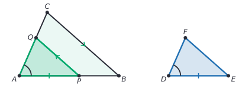
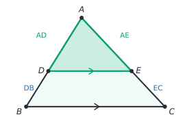
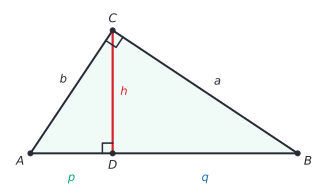
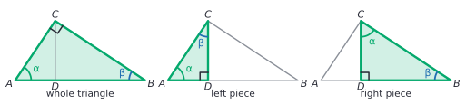
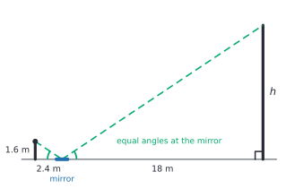

# Similarity

After this lesson you can prove two triangles similar with AA, SAS or SSS, use the triangle proportionality theorem, find the lengths in a right triangle cut by its altitude, prove the Pythagorean theorem with similar triangles, and measure heights and widths you can't reach.

Before this: [congruence and triangle proofs](02-congruence-and-triangle-proofs.md) and [transformations, congruence and similarity](../../02-middle-school/06-geometry/05-transformations-congruence-similarity.md) (dilations and scale factors).

## Quick check

Try these first. If you get all three right, skip to [Practice](#practice).

1. Are the triangles with sides 3, 4, 5 and 9, 12, 16 similar?
2. In $\triangle ABC$, the point $D$ is on $AB$ and $E$ is on $AC$, with $DE \parallel BC$. If $AD = 4$, $DB = 6$ and $AE = 5$, find $EC$.
3. In a right triangle, the altitude to the hypotenuse cuts the hypotenuse into pieces of length 4 and 9. How long is the altitude?

<details class="solution" markdown>
<summary>Answers</summary>

1. The ratios of matching sides are $\frac{9}{3} = 3$, $\frac{12}{4} = 3$ and $\frac{16}{5} = 3.2$. They are not all equal, so the triangles are not similar. (Check: the first is a right triangle, and $9^2 + 12^2 = 225 \ne 256$.)
2. The line $DE$ cuts the sides in proportion: $\frac{AD}{DB} = \frac{AE}{EC}$, so $\frac{4}{6} = \frac{5}{EC}$ and $EC = 7.5$.
3. The altitude is the geometric mean of the two pieces: $h = \sqrt{4 \times 9} = 6$.

</details>

## The idea

Zoom in on a photo of a building. Every line gets longer by the same factor, and every angle stays the same. A window that was a quarter of the door's width is still a quarter of the door's width. The photo and the building have the same shape and different sizes: they are similar.

For triangles, "same shape" has a surprisingly short test. You don't need to compare six measurements. Two matching angles are enough, because the third angle then matches too. Once you know two triangles have the same shape, their sides are in proportion, and one measured triangle tells you about the other. That is how a surveyor finds the width of a river without crossing it.

Similarity also gives a fresh proof of the Pythagorean theorem. Cut a right triangle by the altitude to the hypotenuse, and you get two smaller right triangles, each the same shape as the whole. Writing the proportions for those three similar triangles gives $a^2 + b^2 = c^2$ in a few lines. The lesson proves the tests, then the proportionality theorem, then that proof.

## Definitions

Two triangles are **similar** when their corresponding angles are equal and their corresponding sides are in proportion. We write $\triangle ABC \sim \triangle DEF$, with the letters in matching order, which means

$$
\angle A = \angle D, \quad \angle B = \angle E, \quad \angle C = \angle F, \qquad \frac{AB}{DE} = \frac{BC}{EF} = \frac{CA}{FD}.
$$

The common value of the three ratios is the **scale factor** $k$ from $\triangle DEF$ to $\triangle ABC$. In plain words, similar triangles have the same shape, and one is an enlarged or shrunk copy of the other. Congruent triangles are the special case $k = 1$. This agrees with the [definition by dilations](../../02-middle-school/06-geometry/05-transformations-congruence-similarity.md#congruence-and-similarity) from middle school.

The ratios of sides can be written two ways. If $\frac{AB}{DE} = \frac{AC}{DF}$, then the reciprocals are equal too, and so are the swapped ratios: $\frac{AB}{AC} = \frac{DE}{DF}$. The second version compares two sides inside one triangle with the two matching sides inside the other. Both forms are the same statement, and the proofs below use whichever is handy.

### The postulate behind the tests

*AA similarity.* If two angles of one triangle equal two angles of another, the triangles are similar.

This is the starting point for similarity. Here is why it holds. Say $\angle A = \angle D$ and $\angle B = \angle E$. Dilate $\triangle ABC$ by the factor $k = \frac{DE}{AB}$. Dilations keep angles and multiply lengths by $k$, so the image $\triangle A'B'C'$ has the same angles as $\triangle ABC$, and $A'B' = kAB = DE$. Now $\triangle A'B'C'$ and $\triangle DEF$ have two equal angles and the equal side between them, so they are congruent by ASA. So $\triangle DEF$ is a dilation of $\triangle ABC$ followed by a rigid motion, which is the definition of similar.

The third angles match automatically, since each is $180^\circ$ minus the same sum. That is why two angles are enough and the test has no "AAA".

## How to do it

### SAS and SSS similarity

Two more tests follow from AA and the congruence tests of the last lesson.

*Theorem (SAS similarity).* If an angle of one triangle equals an angle of another, and the sides that include these angles are in proportion, the triangles are similar.

What we know: $\angle A = \angle D$ and $\frac{AB}{DE} = \frac{AC}{DF}$.

What we want: $\triangle ABC \sim \triangle DEF$.

The plan: cut a copy of $\triangle DEF$ out of $\triangle ABC$. Mark $P$ on $AB$ with $AP = DE$, and draw a line through $P$ parallel to $BC$. The small triangle at the top is similar to $\triangle ABC$ by AA. Then show it is congruent to $\triangle DEF$.



*Proof.* Swap the names of the two triangles if needed so that $DE < AB$. (If $DE = AB$, the ratio is 1 and SAS gives congruence.) Mark the point $P$ on $AB$ with $AP = DE$, and draw the line through $P$ parallel to $BC$, meeting $AC$ at $Q$.

The angles $\angle APQ$ and $\angle ABC$ are corresponding angles for the parallel lines $PQ$ and $BC$, so they are equal. The angle $\angle A$ is shared. By AA, $\triangle APQ \sim \triangle ABC$, so $\frac{AP}{AB} = \frac{AQ}{AC}$.

Since $AP = DE$, this says $\frac{DE}{AB} = \frac{AQ}{AC}$. The hypothesis, with reciprocals taken, says $\frac{DE}{AB} = \frac{DF}{AC}$. So $\frac{AQ}{AC} = \frac{DF}{AC}$, and therefore $AQ = DF$.

Now $\triangle APQ$ and $\triangle DEF$ have $AP = DE$, $\angle A = \angle D$ and $AQ = DF$, so they are congruent by SAS. A congruent copy has the same angles and the same ratios of sides, so $\triangle DEF$ is similar to $\triangle ABC$, just as $\triangle APQ$ is. $\blacksquare$

*Theorem (SSS similarity).* If the three sides of one triangle are in proportion to the three sides of another, the triangles are similar.

What we know: $\frac{AB}{DE} = \frac{BC}{EF} = \frac{CA}{FD} = k$.

What we want: $\triangle ABC \sim \triangle DEF$.

The plan: the same cut as before. This time show the cut-off triangle is congruent to $\triangle DEF$ by SSS.

*Proof.* Swap the names if needed so that $DE < AB$, so $k > 1$. Mark $P$ on $AB$ with $AP = DE$, and draw $PQ \parallel BC$ with $Q$ on $AC$. As before, $\triangle APQ \sim \triangle ABC$ by AA, so

$$
\frac{AP}{AB} = \frac{PQ}{BC} = \frac{AQ}{AC}.
$$

Since $AP = DE$, the first ratio is $\frac{DE}{AB} = \frac{1}{k}$. So $PQ = \frac{BC}{k} = EF$, using $\frac{BC}{EF} = k$, and in the same way $AQ = \frac{AC}{k} = DF$. Now $\triangle APQ$ and $\triangle DEF$ have three equal pairs of sides, so they are congruent by SSS, and as before $\triangle DEF \sim \triangle ABC$. $\blacksquare$

Looking back: both proofs have one idea, which is to turn a question about shape into a question about congruence by cutting a copy out of the big triangle. The summary of all the tests:

| Test | Two triangles are similar when |
|---|---|
| AA | two pairs of angles are equal |
| SAS similarity | one pair of angles is equal and the sides including them are in proportion |
| SSS similarity | all three pairs of sides are in proportion |

### The triangle proportionality theorem

*Theorem (triangle proportionality, also called the side-splitter theorem).* If a line parallel to one side of a triangle meets the other two sides at different points, it divides those two sides in proportion. In symbols: in $\triangle ABC$, with $D$ on $AB$ and $E$ on $AC$, if $DE \parallel BC$ then

$$
\frac{AD}{DB} = \frac{AE}{EC}.
$$



What we know: $DE \parallel BC$.

What we want: $\frac{AD}{DB} = \frac{AE}{EC}$.

The plan: the small triangle $ADE$ and the big triangle $ABC$ have the same shape, so the sides along $AB$ and $AC$ are in the same ratio. That ratio compares a part with a whole; the theorem compares part with part, so convert at the end.

*Proof.* The angles $\angle ADE$ and $\angle ABC$ are corresponding angles for the parallel lines $DE$ and $BC$ with the transversal $AB$, so they are equal. The angle $\angle A$ is shared. By AA, $\triangle ADE \sim \triangle ABC$, so

$$
\frac{AD}{AB} = \frac{AE}{AC}.
$$

By the segment addition postulate, $AB = AD + DB$ and $AC = AE + EC$. Substituting,

$$
\frac{AD}{AD + DB} = \frac{AE}{AE + EC}.
$$

Cross-multiplying gives $AD(AE + EC) = AE(AD + DB)$, which expands to $AD \cdot AE + AD \cdot EC = AE \cdot AD + AE \cdot DB$. The terms $AD \cdot AE$ cancel, leaving $AD \cdot EC = AE \cdot DB$. Dividing both sides by $DB \cdot EC$ gives

$$
\frac{AD}{DB} = \frac{AE}{EC}. \qquad \blacksquare
$$

The converse is also true, and it is how you prove two lines parallel.

*Theorem (converse).* If $D$ is on $AB$ and $E$ is on $AC$, and $\frac{AD}{DB} = \frac{AE}{EC}$, then $DE \parallel BC$.

What we know: $\frac{AD}{DB} = \frac{AE}{EC}$.

What we want: $DE \parallel BC$.

The plan: reverse the algebra to get $\frac{AD}{AB} = \frac{AE}{AC}$, use SAS similarity to get equal angles, then use corresponding angles.

*Proof.* Cross-multiplying the hypothesis gives $AD \cdot EC = AE \cdot DB$. Add $AD \cdot AE$ to both sides: $AD(AE + EC) = AE(AD + DB)$, which is $AD \cdot AC = AE \cdot AB$. So $\frac{AD}{AB} = \frac{AE}{AC}$. With the shared angle $\angle A$, SAS similarity gives $\triangle ADE \sim \triangle ABC$. So $\angle ADE = \angle ABC$. These are corresponding angles for the lines $DE$ and $BC$ cut by $AB$, so $DE \parallel BC$. $\blacksquare$

Looking back: the first proof is the algebra "part over whole becomes part over part", and the second runs it backward. Both rest on the same similar triangles.

A **midsegment** of a triangle is a segment joining the midpoints of two sides. If $D$ and $E$ are the midpoints of $AB$ and $AC$, then $\frac{AD}{DB} = 1 = \frac{AE}{EC}$, so the converse gives $DE \parallel BC$. And $\triangle ADE \sim \triangle ABC$ with scale factor $\frac{AD}{AB} = \frac{1}{2}$, so $DE = \frac{1}{2}BC$. This is the midsegment theorem: a midsegment is parallel to the third side and half as long.

### The altitude to the hypotenuse

*Theorem.* In a right triangle, the altitude to the hypotenuse cuts the triangle into two triangles that are similar to each other and to the original triangle.

What we know: $\triangle ABC$ has a right angle at $C$. The point $D$ is on $AB$ and $CD \perp AB$.

What we want: $\triangle ACD \sim \triangle ABC \sim \triangle CBD$.

The plan: find two equal angles in each pair. Each small triangle has a right angle and shares an acute angle with the big one.



*Proof.* In $\triangle ACD$ and $\triangle ABC$: the angle $\angle A$ is shared, and $\angle ADC = 90^\circ = \angle ACB$. By AA, $\triangle ACD \sim \triangle ABC$. In $\triangle CBD$ and $\triangle ABC$: the angle $\angle B$ is shared, and $\angle CDB = 90^\circ = \angle ACB$. By AA, $\triangle CBD \sim \triangle ABC$. Two triangles similar to the same triangle are similar to each other, because the scale factors multiply, so $\triangle ACD \sim \triangle CBD$. $\blacksquare$

The figure shows all three with the matching angles marked. Call the acute angles of the big triangle $\alpha$ at $A$ and $\beta$ at $B$, so $\alpha + \beta = 90^\circ$. In $\triangle ACD$, the angle at $C$ is $90^\circ - \alpha = \beta$. In $\triangle CBD$, the angle at $C$ is $90^\circ - \beta = \alpha$.



Now name the lengths as in the first figure: $p = AD$, $q = DB$, $h = CD$, $b = AC$, $a = BC$ and $c = AB = p + q$. A **geometric mean** of two positive numbers $x$ and $y$ is the positive number $g$ with $\frac{x}{g} = \frac{g}{y}$, which means $g = \sqrt{xy}$. In plain words, it is the number whose ratio to $x$ is the same as the ratio of $y$ to it.

*Theorem (geometric mean).* In the right triangle above, (a) $h^2 = pq$, so the altitude is the geometric mean of the two pieces of the hypotenuse, and (b) $b^2 = pc$ and $a^2 = qc$, so each leg is the geometric mean of the hypotenuse and the piece of it next to that leg.

*Proof.* (a) Match $\triangle ACD$ with $\triangle CBD$ by the angles: $A \to C$, $C \to B$, $D \to D$ (angle $\alpha$ at $A$ and at $C$, angle $\beta$ at $C$ and at $B$, right angles at $D$). Corresponding sides are $AD \to CD$, $CD \to BD$ and $AC \to CB$, so

$$
\frac{AD}{CD} = \frac{CD}{BD}, \quad \text{that is,} \quad \frac{p}{h} = \frac{h}{q}.
$$

Cross-multiplying gives $h^2 = pq$.

(b) Match $\triangle ACD$ with $\triangle ABC$: $A \to A$, $C \to B$, $D \to C$. Corresponding sides are $AD \to AC$ and $AC \to AB$, so $\frac{AD}{AC} = \frac{AC}{AB}$, which is $\frac{p}{b} = \frac{b}{c}$ and gives $b^2 = pc$. In the same way, $\triangle CBD \sim \triangle ABC$ with $B \to B$, $C \to A$, $D \to C$ gives $\frac{BD}{BC} = \frac{BC}{BA}$, so $a^2 = qc$. $\blacksquare$

Looking back: each of the three equations is a proportion with the same number in the middle, which is what "mean" means. In the example from the Quick check, $p = 4$ and $q = 9$ give $h = 6$, and $c = 13$ gives $b = \sqrt{52}$ and $a = \sqrt{117}$.

### A proof of the Pythagorean theorem

The geometric mean theorem gives the theorem with no area picture.

*Theorem (Pythagoras).* In a right triangle with legs $a$ and $b$ and hypotenuse $c$, $a^2 + b^2 = c^2$.

What we know: the triangle is $\triangle ABC$ with a right angle at $C$, and the facts $b^2 = pc$ and $a^2 = qc$ above.

What we want: $a^2 + b^2 = c^2$.

The plan: add the two leg equations. The right side becomes $c(p + q)$, and $p + q = c$.

*Proof.* Draw the altitude from $C$ to $AB$, meeting it at $D$, and let $p = AD$ and $q = DB$. By the geometric mean theorem, $b^2 = pc$ and $a^2 = qc$. Adding,

$$
a^2 + b^2 = pc + qc = (p + q)c = c \cdot c = c^2,
$$

since $D$ is between $A$ and $B$, so $p + q = AB = c$ by the segment addition postulate. $\blacksquare$

Looking back: this proof differs from the [area proof in middle school](../../02-middle-school/06-geometry/04-pythagorean-theorem.md#the-theorem-and-its-proof), and it rests on a different idea: similar triangles, not areas. The two don't depend on each other, so having both is a good check on the theorem.

### Indirect measurement

**Indirect measurement** finds a length you can't measure with a ruler by making a similar triangle you can. The steps:

1. Draw the two triangles and mark the lengths you know and the one you want.
2. Show the triangles are similar, usually by AA. Look for right angles, a shared angle, vertical angles, equal angles from parallel lines, or equal angles from a reflection.
3. Match the vertices, then write the proportion with the same triangle on top on both sides.
4. Solve for the unknown length.
5. Check: the ratio of two sides inside one triangle should equal the ratio of the matching sides inside the other.

## Worked examples

<div class="example" markdown>

### Example 1: a building and a mirror

A person with eyes 1.6 m above the ground puts a small mirror flat on the ground, 18 m from the base of a building, and steps back until they see the top of the building in the mirror. They stand 2.4 m from the mirror. How tall is the building?



Step 1 (draw): two right triangles, one with legs 1.6 m (eye height) and 2.4 m (to the mirror), and one with legs $h$ and 18 m.

Step 2 (show similar): the person and the building both stand at right angles to the level ground. Light bounces off a mirror so that the incoming and outgoing rays make equal angles with the mirror, so the angles at the mirror are equal. Two pairs of equal angles: by AA, the triangles are similar.

Step 3 (match and write): the height of the person corresponds to the height of the building, and the 2.4 m corresponds to the 18 m. Heights on top, ground distances on the bottom:

$$
\frac{h}{18} = \frac{1.6}{2.4}.
$$

Step 4 (solve): $h = 18 \times \frac{1.6}{2.4} = 18 \times \frac{2}{3} = 12$. The building is 12 m tall.

Step 5 (check): inside the small triangle, height over distance is $1.6 \div 2.4 = 0.667$. For the building, $12 \div 18 = 0.667$. They match.

</div>

<div class="example" markdown>

### Example 2: which similarity test?

For each pair, decide whether the triangles are similar and name the test.

(a) One triangle has sides 4 and 6 with an included angle of $50^\circ$. The other has sides 6 and 9 with an included angle of $50^\circ$.

(b) One triangle has sides 3, 4 and 6. The other has sides 4.5, 6 and 9.

(c) One triangle has sides 5, 7 and 9. The other has sides 10, 14 and 20.

(a) The ratios of the sides that include the angle are $\frac{6}{4} = 1.5$ and $\frac{9}{6} = 1.5$. They are equal and the included angles are equal, so SAS similarity applies, with scale factor 1.5.

(b) Pair the shortest with the shortest, and so on: $\frac{4.5}{3} = 1.5$, $\frac{6}{4} = 1.5$ and $\frac{9}{6} = 1.5$. All three ratios are equal, so SSS similarity applies, with scale factor 1.5.

(c) The ratios are $\frac{10}{5} = 2$, $\frac{14}{7} = 2$ and $\frac{20}{9} \approx 2.22$. They are not all equal, so the triangles are not similar. Two out of three matching ratios proves nothing.

Check (a): if the two triangles are similar with factor 1.5, the third sides should also be in ratio 1.5. By the [law of cosines](../09-trigonometry/05-law-of-sines-and-cosines.md) the third sides are $\sqrt{4^2 + 6^2 - 2(4)(6)\cos 50^\circ} \approx 4.60$ and $\sqrt{6^2 + 9^2 - 2(6)(9)\cos 50^\circ} \approx 6.90$, and $6.90 \div 4.60 = 1.5$.

</div>

<div class="example" markdown>

### Example 3: the altitude of an untidy right triangle

A right triangle has legs 6 and 7. Find the hypotenuse, the altitude to the hypotenuse and the two pieces of the hypotenuse.

The hypotenuse is $c = \sqrt{6^2 + 7^2} = \sqrt{85} \approx 9.220$. Let $a = 6$ and $b = 7$ be the legs, and let $p$ be the piece next to the leg $b$ and $q$ the piece next to the leg $a$, as in the figure.

The geometric mean theorem gives $b^2 = pc$ and $a^2 = qc$, so

$$
p = \frac{b^2}{c} = \frac{49}{\sqrt{85}} \approx 5.315, \qquad q = \frac{a^2}{c} = \frac{36}{\sqrt{85}} \approx 3.905.
$$

The altitude satisfies $h^2 = pq = \frac{49 \times 36}{85} = \frac{1764}{85}$, so $h = \frac{42}{\sqrt{85}} \approx 4.556$.

These are untidy numbers, and that is fine: the exact forms use $\sqrt{85}$. Check: $p + q = \frac{85}{\sqrt{85}} = \sqrt{85} = c$, as it must. Also, the area of the triangle is $\frac{1}{2}(6)(7) = 21$ and also $\frac{1}{2}ch = \frac{1}{2}\sqrt{85} \cdot \frac{42}{\sqrt{85}} = 21$.

</div>

<div class="example" markdown>

### Example 4: are the lines parallel? (finish it yourself)

In $\triangle ABC$, the point $D$ is on $AB$ and $E$ is on $AC$, with $AD = 6$, $DB = 9$, $AE = 8$ and $EC = 12$. (a) Is $DE$ parallel to $BC$? (b) If $DE = 10$, find $BC$.

Step 1: compare the ratios along the two sides: $\frac{AD}{DB} = \frac{6}{9} = \frac{2}{3}$ and $\frac{AE}{EC} = \frac{8}{12} = \frac{2}{3}$. They are equal, so by the converse of the triangle proportionality theorem, $DE \parallel BC$. That answers (a).

Step 2: for (b), $\triangle ADE \sim \triangle ABC$, and the scale factor from the small triangle to the big one is $\frac{AB}{AD}$, where $AB = AD + DB = 15$. Careful: it is not $\frac{DB}{AD}$.

Now find $BC$ and check.

<details class="solution" markdown>
<summary>Finish</summary>

The scale factor is $\frac{15}{6} = 2.5$, and the side $DE$ corresponds to $BC$, so $BC = 2.5 \times 10 = 25$.

Check: the same factor applies along $AC$: $AC = 8 + 12 = 20$, and $\frac{20}{8} = 2.5$. Using $DB$ by mistake would give a factor of 1.5 and $BC = 15$, but then $\frac{BC}{DE} = 1.5$ would not match $\frac{AC}{AE} = 2.5$.

</details>

</div>

## Edge cases and common mistakes

<div class="warning" markdown>

Watch out for matching the wrong sides. In $\triangle ABC \sim \triangle DEF$, the side $AB$ corresponds to $DE$ only because of the order of the letters. Match vertices by equal angles first, then read corresponding sides from the letters. The shortest side goes with the shortest side, and the longest with the longest.

</div>

<div class="warning" markdown>

Watch out in the triangle proportionality theorem: the proportion $\frac{AD}{DB} = \frac{AE}{EC}$ compares parts, but the similar triangles compare a part with the whole: $\frac{AD}{AB} = \frac{DE}{BC}$. Writing $\frac{AD}{DB} = \frac{DE}{BC}$ is a mistake. The small triangle $ADE$ goes with the big triangle $ABC$, and $DB$ is not a side of either.

</div>

<div class="warning" markdown>

Watch out for testing two sides out of three. SSS similarity needs all three ratios equal. Two equal ratios, as in Example 2(c), say nothing about the third pair of sides. For two sides, you need the angle between them as well (SAS).

</div>

<div class="warning" markdown>

Watch out for adding instead of multiplying. If one triangle has sides 3, 4, 5 and another has sides 5, 6, 7, then each side is 2 bigger, but the triangles are not similar. Similar means each side is multiplied by the same number, not increased by the same amount.

</div>

When two similar triangles share a vertex and overlap, as in the side-splitter figure, mark the equal angles on both triangles before you write any proportion. A proportion with the wrong triangle on top is the most common wrong answer.

If the line in the proportionality theorem is not parallel to the third side, the sides are not divided in proportion. The converse shows that proportion and parallelism go together: you can't have one without the other.

## Tricks and shortcuts

For a right triangle cut by the altitude, remember the pattern "square of a part equals the product of its neighbours". The leg squared is the piece next to it times the whole hypotenuse, and the altitude squared is the product of the two pieces. A quick way to recall which is which: the altitude is in the middle of the two pieces, so it is their geometric mean, and each leg touches the whole hypotenuse and one piece.

Once you know one pair of similar triangles has scale factor $k$, then every pair of matching lengths has ratio $k$, including heights, medians and perimeters. Areas have ratio $k^2$ (the review problem proves this).

To check a proportion, cross-multiply and see whether the products are equal: $\frac{6}{9} = \frac{8}{12}$ because $6 \times 12 = 72 = 9 \times 8$.

## In code

A short function can test whether two triangles are similar by sorting the sides and checking that the ratios agree, and a second can cut a right triangle by its altitude.

<details class="code" markdown>
<summary>In code</summary>

```python
import math

def similar(t1, t2, tol=1e-9):
    """Are two triangles, given by their three side lengths, similar (SSS test)?"""
    s1, s2 = sorted(t1), sorted(t2)
    ratios = [y / x for x, y in zip(s1, s2)]
    return max(ratios) - min(ratios) < tol, ratios

print(similar((3, 4, 5), (9, 12, 15)))     # (True, [3.0, 3.0, 3.0])
print(similar((3, 4, 5), (9, 12, 16)))     # (False, [3.0, 3.0, 3.2])

a, b = 6, 7                                 # legs of a right triangle
c = math.hypot(a, b)
p, q = b**2 / c, a**2 / c                   # pieces of the hypotenuse
h = math.sqrt(p * q)                        # altitude, the geometric mean
print(round(c, 3), round(p, 3), round(q, 3), round(h, 3))    # 9.22 5.315 3.905 4.556
print(round(a * b / c, 3))                  # 4.556, the same altitude from the area
```

The last line computes the altitude a second way, from the area $\frac{1}{2}ab = \frac{1}{2}ch$, and the two answers agree.

</details>

## FAQ

### Why do two angles prove similarity, but two sides don't?

The angle sum gives you the third angle for free, so two angles fix all three. For sides, two ratios fix two sides of the small triangle, but the angle between them can still vary, which changes the third side. That is why the side test needs either all three sides (SSS) or two sides plus the included angle (SAS).

### Why are both $\frac{AD}{AB} = \frac{AE}{AC}$ and $\frac{AD}{DB} = \frac{AE}{EC}$ true?

They are different statements, and both hold when $DE \parallel BC$. $\frac{AD}{AB} = \frac{AE}{AC}$ compares each part with its whole side. $\frac{AD}{DB} = \frac{AE}{EC}$ compares the part with the remainder. The proof of the proportionality theorem shows that the two forms are equivalent, so either can be used, as long as you keep both sides of the proportion in the same form.

### Are all right triangles with a $30^\circ$ angle similar?

Yes. Each has angles $30^\circ$, $60^\circ$ and $90^\circ$, so they are similar by AA, and their side ratios are the same: the short leg is half the hypotenuse. That fact, that the ratio depends only on the angle, is the whole idea of [right triangle trigonometry](../09-trigonometry/01-right-triangle-trigonometry.md).

## Practice

### Warm-up

1\. One triangle has angles $40^\circ$ and $75^\circ$. Another has angles $65^\circ$ and $75^\circ$. Are they similar?

<details class="solution" markdown>
<summary>Solution</summary>

The third angle of the first is $180^\circ - 40^\circ - 75^\circ = 65^\circ$, and of the second it is $180^\circ - 65^\circ - 75^\circ = 40^\circ$. Both have angles $40^\circ$, $65^\circ$ and $75^\circ$, so they are similar by AA.

Check: the angles of each add to $180^\circ$.

</details>

2\. Are the triangles with sides 8, 12, 16 and 6, 9, 12 similar? If so, give the scale factor from the second to the first.

<details class="solution" markdown>
<summary>Solution</summary>

The ratios of matching sides are $\frac{8}{6} = \frac{4}{3}$, $\frac{12}{9} = \frac{4}{3}$ and $\frac{16}{12} = \frac{4}{3}$. All three are equal, so the triangles are similar by SSS similarity, with scale factor $\frac{4}{3}$.

Check: $6 \times \frac{4}{3} = 8$, $9 \times \frac{4}{3} = 12$ and $12 \times \frac{4}{3} = 16$.

</details>

3\. In $\triangle ABC$, $DE \parallel BC$ with $D$ on $AB$ and $E$ on $AC$. If $AD = 3$, $DB = 2$ and $AE = 4.5$, find $EC$.

<details class="solution" markdown>
<summary>Solution</summary>

By the triangle proportionality theorem, $\frac{AD}{DB} = \frac{AE}{EC}$, so $\frac{3}{2} = \frac{4.5}{EC}$. Then $EC = \frac{4.5 \times 2}{3} = 3$.

Check: $\frac{AE}{EC} = \frac{4.5}{3} = 1.5 = \frac{3}{2}$.

</details>

### Standard

4\. A surveyor wants the width of a river. The point $A$ is on the near bank, directly across from a tree $T$ on the far bank. She walks along the bank to a point $B$ that is 30 m from $A$, then continues in the same direction to a point $C$ that is 10 m past $B$. At $C$ she turns away from the river at a right angle and walks to the point $D$ where $T$, $B$ and $D$ line up. She measures $CD = 8$ m. How wide is the river?

<details class="solution" markdown>
<summary>Solution</summary>

What we know: $\angle TAB = 90^\circ$ because $AT$ is across the river from $A$, $\angle DCB = 90^\circ$, $AB = 30$, $BC = 10$ and $CD = 8$. What we want: $AT$. Plan: show $\triangle ABT \sim \triangle CBD$ by AA.

The angles at $A$ and $C$ are both right angles. The angles $\angle ABT$ and $\angle CBD$ are vertical angles, because $T$, $B$, $D$ are on one line and $A$, $B$, $C$ are on another. So by AA, $\triangle ABT \sim \triangle CBD$, with $A \to C$, $B \to B$, $T \to D$. Then

$$
\frac{AT}{CD} = \frac{AB}{CB}, \quad \text{so} \quad AT = 8 \times \frac{30}{10} = 24.
$$

The river is 24 m wide. Check: the ratio of legs in the small triangle, $\frac{CD}{CB} = \frac{8}{10} = 0.8$, equals $\frac{AT}{AB} = \frac{24}{30} = 0.8$.

</details>

5\. A right triangle has legs 9 and 12 and hypotenuse 15. Find the altitude to the hypotenuse and the two pieces it cuts the hypotenuse into.

<details class="solution" markdown>
<summary>Solution</summary>

By the geometric mean theorem, the pieces are $\frac{9^2}{15} = 5.4$ (next to the leg 9) and $\frac{12^2}{15} = 9.6$ (next to the leg 12). The altitude is $h = \sqrt{5.4 \times 9.6} = \sqrt{51.84} = 7.2$.

Check: $5.4 + 9.6 = 15$, and the area gives $\frac{9 \times 12}{15} = 7.2$ for the altitude.

</details>

6\. The lines $AD$ and $BE$ cross at $C$, with $C$ between $A$ and $D$ and between $B$ and $E$, and $AB \parallel DE$. Prove $\triangle ABC \sim \triangle DEC$, and find $EC$ if $AB = 6$, $DE = 9$ and $BC = 8$.

<details class="solution" markdown>
<summary>Solution</summary>

What we know: $AB \parallel DE$. What we want: similar triangles and then $EC$. Plan: find two pairs of equal angles, one from the parallel lines and one from the crossing lines.

*Proof.* The angles $\angle BAC$ and $\angle EDC$ are alternate interior angles for the parallel lines $AB$ and $DE$ and the transversal $AD$, so they are equal. The angles $\angle ACB$ and $\angle DCE$ are vertical angles, so they are equal. By AA, $\triangle ABC \sim \triangle DEC$ with $A \to D$, $B \to E$, $C \to C$. $\blacksquare$

Then $\frac{AB}{DE} = \frac{BC}{EC}$, so $\frac{6}{9} = \frac{8}{EC}$ and $EC = \frac{8 \times 9}{6} = 12$.

Check: $\frac{BC}{EC} = \frac{8}{12} = \frac{2}{3} = \frac{6}{9}$.

</details>

### Challenge

7\. Prove that the three midsegments of a triangle divide it into four congruent triangles.

<details class="solution" markdown>
<summary>Solution</summary>

What we know: $D$, $E$ and $F$ are the midpoints of $AB$, $AC$ and $BC$ in $\triangle ABC$. Write $a = BC$, $b = CA$ and $c = AB$. What we want: the four triangles $ADE$, $DBF$, $EFC$ and $FED$ are congruent. Plan: use the midsegment theorem on each pair of sides to find the lengths, and then SSS.

*Proof.* By the midsegment theorem, $DE = \frac{a}{2}$ (it joins the midpoints of $AB$ and $AC$), $DF = \frac{b}{2}$ (midpoints of $AB$ and $BC$) and $EF = \frac{c}{2}$ (midpoints of $AC$ and $BC$). Since $D$ is the midpoint of $AB$, $AD = DB = \frac{c}{2}$. In the same way, $AE = EC = \frac{b}{2}$ and $BF = FC = \frac{a}{2}$.

The sides of the four triangles are:

| Triangle | Sides |
|---|---|
| $ADE$ | $AD = \frac{c}{2}$, $AE = \frac{b}{2}$, $DE = \frac{a}{2}$ |
| $DBF$ | $DB = \frac{c}{2}$, $DF = \frac{b}{2}$, $BF = \frac{a}{2}$ |
| $EFC$ | $EF = \frac{c}{2}$, $EC = \frac{b}{2}$, $FC = \frac{a}{2}$ |
| $FED$ | $FE = \frac{c}{2}$, $FD = \frac{b}{2}$, $ED = \frac{a}{2}$ |

Each triangle has sides $\frac{a}{2}$, $\frac{b}{2}$ and $\frac{c}{2}$, so any two are congruent by SSS. $\blacksquare$

Check with the triangle $A = (0, 0)$, $B = (8, 0)$, $C = (0, 6)$: the midpoints are $D = (4, 0)$, $E = (0, 3)$ and $F = (4, 3)$, and each of the four small triangles has sides 3, 4 and 5, half of the original 6, 8 and 10.

</details>

8\. (Reviews [transformations, congruence and similarity](../../02-middle-school/06-geometry/05-transformations-congruence-similarity.md#scaling-areas-and-volumes).) Prove that if $\triangle ABC \sim \triangle DEF$ with scale factor $k$, then the area of $\triangle ABC$ is $k^2$ times the area of $\triangle DEF$.

<details class="solution" markdown>
<summary>Solution</summary>

What we know: $\frac{AB}{DE} = \frac{BC}{EF} = k$, and the angles match. What we want: $\text{area}(ABC) = k^2\, \text{area}(DEF)$. Plan: use the formula $\frac{1}{2} \times \text{base} \times \text{height}$ and show that the heights are in ratio $k$ too, by similar right triangles.

*Proof.* Draw the altitude $AH$ to $BC$ and the altitude $DK$ to $EF$. The triangles $ABH$ and $DEK$ have right angles at $H$ and $K$ and $\angle B = \angle E$, so they are similar by AA. Hence $\frac{AH}{DK} = \frac{AB}{DE} = k$. The areas are $\frac{1}{2}(BC)(AH)$ and $\frac{1}{2}(EF)(DK)$, so

$$
\frac{\text{area}(ABC)}{\text{area}(DEF)} = \frac{BC}{EF} \cdot \frac{AH}{DK} = k \cdot k = k^2. \qquad \blacksquare
$$

Check: the 3, 4, 5 triangle has area 6 and the 6, 8, 10 triangle has area 24, and $24 \div 6 = 4 = 2^2$.

</details>

## Where this shows up

- Trigonometry is built on similarity: every right triangle with a given acute angle has the same side ratios, which is why sine, cosine and tangent are well defined ([right triangle trigonometry](../09-trigonometry/01-right-triangle-trigonometry.md)). The next lesson, [coordinate geometry and circles](04-coordinate-geometry-and-circles.md), uses slopes, which are ratios from similar right triangles.
- Computer graphics scales and zooms images by dilations. Self-similar shapes, such as the Sierpinski triangle, are made of smaller copies of themselves: it is three copies at half the size.
- Economics and engineering use scale models and the $k$, $k^2$, $k^3$ rules for length, area and volume ([transformations, congruence and similarity](../../02-middle-school/06-geometry/05-transformations-congruence-similarity.md#scaling-areas-and-volumes)).
