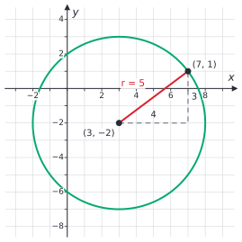
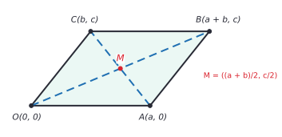
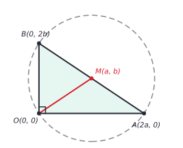
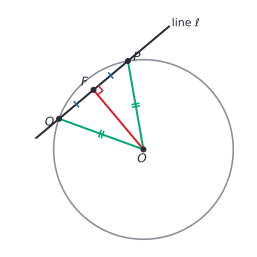

# Coordinate geometry and circles

After this lesson you can use the distance, midpoint and slope formulas to prove geometry facts with coordinates, write the equation of a circle, find the centre and radius of a circle from an equation by completing the square, and decide whether a line crosses, touches or misses a circle.

Before this: [the Pythagorean theorem](../../02-middle-school/06-geometry/04-pythagorean-theorem.md#the-distance-between-two-points) (distance between points), [forms of linear equations](../02-linear-functions-and-systems/01-forms-of-linear-equations.md#parallel-and-perpendicular-lines) (perpendicular slopes) and [quadratic functions and graphs](../05-quadratics-and-complex-numbers/01-quadratic-functions-and-graphs.md#completing-the-square-to-get-vertex-form) (completing the square).

## Quick check

Try these first. If you get all three right, skip to [Practice](#practice).

1. Find the distance between $(-2, 3)$ and $(4, -1)$, and the midpoint of the segment between them.
2. Are the line through $(0, 0)$ and $(2, 3)$ and the line through $(0, 0)$ and $(-3, 2)$ perpendicular?
3. Find the centre and radius of the circle $x^2 + y^2 - 6x + 4y - 12 = 0$.

<details class="solution" markdown>
<summary>Answers</summary>

1. The distance is $\sqrt{(4 - (-2))^2 + (-1 - 3)^2} = \sqrt{36 + 16} = \sqrt{52} = 2\sqrt{13} \approx 7.21$. The midpoint is $\left(\frac{-2 + 4}{2}, \frac{3 + (-1)}{2}\right) = (1, 1)$.
2. The slopes are $\frac{3}{2}$ and $\frac{2}{-3} = -\frac{2}{3}$. Their product is $-1$, so the lines are perpendicular.
3. Complete the square: $(x - 3)^2 - 9 + (y + 2)^2 - 4 - 12 = 0$, so $(x - 3)^2 + (y + 2)^2 = 25$. The centre is $(3, -2)$ and the radius is 5.

</details>

## The idea

Coordinates give every point a pair of numbers, so that a geometry question becomes an algebra question. A circle is no longer a drawing: it is every point whose distance from a fixed point is 5, and "distance" is a formula. A line is an equation. "Are these two lines perpendicular" becomes "do the slopes multiply to $-1$".

This changes how proofs work. In the last two lessons, the proofs were built from congruent and similar triangles and needed a clever picture. A coordinate proof needs a good choice of coordinates and then careful arithmetic. If the arithmetic comes out the same on both sides, the theorem is proved, with no figure to misread. That is also why computer graphics, robotics and map software all work with coordinates.

The second half of the lesson turns to one shape, the circle. Its equation is the distance formula in disguise, so everything about circles reduces to the same three formulas: distance, midpoint and slope.

## Definitions

The three formulas, for the points $A = (x_1, y_1)$ and $B = (x_2, y_2)$, are as follows.

The **distance formula** gives the length of segment $AB$:

$$
AB = \sqrt{(x_2 - x_1)^2 + (y_2 - y_1)^2}.
$$

It is the Pythagorean theorem applied to the right triangle with a horizontal leg of length $\lvert x_2 - x_1 \rvert$ and a vertical leg of length $\lvert y_2 - y_1 \rvert$; the [middle-school lesson](../../02-middle-school/06-geometry/04-pythagorean-theorem.md#the-distance-between-two-points) draws the triangle. In plain words, it is the straight-line distance between the points, from "run" and "rise".

The **midpoint formula** gives the midpoint of $AB$:

$$
M = \left(\frac{x_1 + x_2}{2}, \frac{y_1 + y_2}{2}\right).
$$

In plain words, the midpoint's coordinates are the averages of the endpoints' coordinates.

*Proof of the midpoint formula.* The points of the line through $A$ and $B$ are $P_t = (x_1 + t(x_2 - x_1),\ y_1 + t(y_2 - y_1))$, one for each number $t$, with $P_0 = A$ and $P_1 = B$. The distance from $A$ to $P_t$ is

$$
\sqrt{t^2(x_2 - x_1)^2 + t^2(y_2 - y_1)^2} = \lvert t \rvert \cdot AB.
$$

For $t = \frac{1}{2}$, the point $P_{1/2}$ is half of $AB$ away from $A$ on the segment, so $AP_{1/2} = \frac{1}{2}AB$, and in the same way $P_{1/2}B = \frac{1}{2}AB$. It is the midpoint. Its coordinates are $x_1 + \frac{1}{2}(x_2 - x_1) = \frac{x_1 + x_2}{2}$ and the same for $y$. $\blacksquare$

The **slope** of the line through $A$ and $B$, when $x_1 \ne x_2$, is $m = \frac{y_2 - y_1}{x_2 - x_1}$, rise over run. From [forms of linear equations](../02-linear-functions-and-systems/01-forms-of-linear-equations.md#parallel-and-perpendicular-lines): two non-vertical lines are parallel exactly when their slopes are equal, and perpendicular exactly when the product of their slopes is $-1$. Vertical lines have no slope: a vertical line is perpendicular to a horizontal one, and parallel to another vertical line.

### Circles

A **circle** with centre $C$ and radius $r > 0$ is the set of all points in the plane whose distance from $C$ is $r$. A segment from the centre to a point on the circle is also called a radius. A **chord** is a segment joining two points of the circle, and a **diameter** is a chord through the centre. A **tangent** line touches the circle at exactly one point, and a **secant** line meets it at two.

*Theorem (equation of a circle).* The circle with centre $(h, k)$ and radius $r$ is the set of points $(x, y)$ with

$$
(x - h)^2 + (y - k)^2 = r^2.
$$

*Proof.* A point $(x, y)$ is on the circle exactly when its distance from $(h, k)$ is $r$. By the distance formula that distance is $\sqrt{(x - h)^2 + (y - k)^2}$. Both sides of $\sqrt{(x - h)^2 + (y - k)^2} = r$ are non-negative, so squaring gives an equivalent equation, $(x - h)^2 + (y - k)^2 = r^2$. $\blacksquare$

In plain words, the equation says "the distance to the centre, squared, is $r^2$". The centre is read with the opposite signs: $(x + 2)^2$ means $h = -2$. With centre at the origin the equation is $x^2 + y^2 = r^2$.



In the figure the point $(7, 1)$ is on the circle: the legs of the dashed triangle are $7 - 3 = 4$ and $1 - (-2) = 3$, and $4^2 + 3^2 = 25 = 5^2$.

## How to do it

### Coordinate proofs

A **coordinate proof** proves a geometry theorem by putting the figure on the plane and calculating. The steps:

1. Place the figure so that many coordinates are 0: one vertex at the origin, one side along the $x$-axis. Moving a figure doesn't change distances, midpoints or whether lines are parallel or perpendicular, so this loses nothing.
2. Name the other coordinates with letters, not numbers, so that the proof covers every figure of that kind. If a midpoint will appear, use $2a$ and $2b$ so that the halves come out as $a$ and $b$.
3. Write the coordinates of every point that the Given forces, using definitions: parallel sides mean equal slopes, a right angle means slopes with product $-1$, and so on.
4. Compute what the conclusion needs: a distance, a midpoint or a slope.
5. Compare the results and say in words what that proves.
6. Check the result with one set of numbers.

A proof with numbers only proves one figure. The letters are what make it a proof of the theorem.

### The diagonals of a parallelogram bisect each other

A **parallelogram** is a quadrilateral whose opposite sides are parallel.

*Theorem.* The diagonals of a parallelogram bisect each other: they have the same midpoint.

What we know: $OABC$ is a parallelogram. Place $O$ at the origin and $A$ on the $x$-axis, so $O = (0, 0)$ and $A = (a, 0)$ with $a > 0$. Let $C = (b, c)$ with $c \ne 0$.

What we want: the midpoint of diagonal $OB$ equals the midpoint of diagonal $AC$.

The plan: first find $B$ from the Given, using parallel sides. Then compute the two midpoints with the midpoint formula and compare.



*Proof.* Step 1, find $B$. The side $CB$ is parallel to $OA$, which is horizontal, so $B$ is at the same height as $C$: $B = (d, c)$ for some $d$. The side $AB$ is parallel to $OC$. The slope of $OC$ is $\frac{c}{b}$ and the slope of $AB$ is $\frac{c}{d - a}$. Equal slopes give $d - a = b$, so $d = a + b$ and $B = (a + b, c)$. (If $b = 0$, then $OC$ is vertical, so $AB$ is vertical too, which gives $d = a$, and again $d = a + b$.)

Step 2, the midpoints. The diagonal $OB$ has midpoint $\left(\frac{0 + a + b}{2}, \frac{0 + c}{2}\right) = \left(\frac{a + b}{2}, \frac{c}{2}\right)$. The diagonal $AC$ has midpoint $\left(\frac{a + b}{2}, \frac{0 + c}{2}\right) = \left(\frac{a + b}{2}, \frac{c}{2}\right)$.

The two midpoints are the same point, $M$, so each diagonal passes through the midpoint of the other: they bisect each other. $\blacksquare$

Looking back: letters carried the proof for every parallelogram at once. For a check with numbers, $a = 4$, $b = 2$ and $c = 2.5$ give $B = (6, 2.5)$ and both midpoints are $(3, 1.25)$. The Given was used only in step 1, and everything after that was a midpoint formula.

### The midpoint of the hypotenuse

*Theorem.* In a right triangle, the midpoint of the hypotenuse is the same distance from all three vertices.

What we know: the triangle has a right angle at $O$. Put $O = (0, 0)$, $A = (2a, 0)$ and $B = (0, 2b)$, with $a$ and $b$ positive. The right angle is at the origin because the sides lie along the axes. The even numbers $2a$ and $2b$ are chosen so that the midpoint has no fractions.

What we want: $MO = MA = MB$, where $M$ is the midpoint of $AB$.

The plan: find $M$ and then use the distance formula three times.



*Proof.* The midpoint of $AB$ is $M = \left(\frac{2a + 0}{2}, \frac{0 + 2b}{2}\right) = (a, b)$. Then

$$
MO = \sqrt{a^2 + b^2}, \quad MA = \sqrt{(2a - a)^2 + (0 - b)^2} = \sqrt{a^2 + b^2}, \quad MB = \sqrt{(0 - a)^2 + (2b - b)^2} = \sqrt{a^2 + b^2}.
$$

All three distances are equal. $\blacksquare$

Looking back: the equal distances mean that a circle centred at $M$ passes through $O$, $A$ and $B$, so the hypotenuse is a diameter of the circle through the three vertices. In particular, the median from the right angle is half the hypotenuse. Check with $a = 3$ and $b = 2$: the hypotenuse $AB$ runs from $(6, 0)$ to $(0, 4)$ and has length $\sqrt{52}$, and $MO = \sqrt{9 + 4} = \sqrt{13}$, which is half of $\sqrt{52}$.

### The diagonals of a rectangle are equal

*Theorem.* The diagonals of a rectangle are equal.

This was promised in [the first lesson](01-definitions-postulates-and-proof.md#worked-examples). A rectangle has four right angles, so place it with a corner at the origin and sides along the axes: $O = (0, 0)$, $A = (a, 0)$, $B = (a, b)$ and $C = (0, b)$. The diagonals are $OB$ and $AC$, and

$$
OB = \sqrt{a^2 + b^2}, \qquad AC = \sqrt{(0 - a)^2 + (b - 0)^2} = \sqrt{a^2 + b^2}.
$$

They are equal. $\blacksquare$

### Completing the square for a circle

An equation such as $x^2 + y^2 - 6x + 4y - 12 = 0$ is the equation of a circle in expanded form. To find the centre and radius, complete the square in $x$ and in $y$, as in [quadratic functions and graphs](../05-quadratics-and-complex-numbers/01-quadratic-functions-and-graphs.md#completing-the-square-to-get-vertex-form).

1. If $x^2$ and $y^2$ have the same coefficient other than 1, divide the whole equation by it.
2. Move the constant to the right, and group the $x$ terms and the $y$ terms: $(x^2 - 6x) + (y^2 + 4y) = 12$.
3. Halve the coefficient of $x$, square it, and add the result to both sides. Do the same for $y$.
4. Write each group as a square: $(x - 3)^2 + (y + 2)^2 = 12 + 9 + 4 = 25$.
5. Read the centre (opposite signs) and the radius (square root of the right side): centre $(3, -2)$, radius 5.
6. Check: expand the answer, or test a point.

Step 3 adds the same numbers to the right side, because the equation must stay balanced: half of $-6$ is $-3$, and $(-3)^2 = 9$. For $y$, half of 4 is 2, and $2^2 = 4$.

### A tangent is perpendicular to the radius

*Theorem.* A line that is tangent to a circle at the point $P$ is perpendicular to the radius $OP$. Conversely, a line through $P$ that is perpendicular to the radius $OP$ is tangent to the circle.

What we know for the first direction: the circle has centre $O$ and radius $r$. The line $\ell$ meets the circle at exactly one point, $P$.

What we want: $\ell \perp OP$.

The plan, which uses proof by contradiction: assume $\ell$ is not perpendicular to $OP$. Drop the perpendicular from $O$ to $\ell$, with foot $F$. Because $\ell$ is not perpendicular to $OP$, the point $F$ is not $P$. Reflect $P$ across $F$ along $\ell$ to get a point $Q$. Show that $Q$ is also on the circle, which contradicts "exactly one point".



*Proof.* Suppose $\ell$ is not perpendicular to $OP$. Let $F$ be the foot of the perpendicular from $O$ to $\ell$. Then $F \ne P$. Choose $Q$ on $\ell$ on the other side of $F$ from $P$, with $FQ = FP$. The right triangles $OFP$ and $OFQ$ have $OF = OF$, $FP = FQ$ and right angles at $F$, so they are congruent by SAS, and $OQ = OP = r$. So $Q$ is on the circle. But $Q \ne P$, so $\ell$ meets the circle in two points, which contradicts the assumption that it is tangent. So $\ell \perp OP$. $\blacksquare$

For the converse, let $\ell$ pass through $P$ with $\ell \perp OP$. Take any other point $Q$ on $\ell$. The triangle $OPQ$ has a right angle at $P$, so by the Pythagorean theorem $OQ^2 = OP^2 + PQ^2 = r^2 + PQ^2 > r^2$. So $OQ > r$, and every point of $\ell$ other than $P$ is outside the circle. The line touches the circle only at $P$. $\blacksquare$

Looking back: the contradiction step said that a slanted line through $P$ always cuts the circle a second time, on the side toward $F$. Only the line perpendicular to the radius avoids that.

In coordinates, this gives the tangent line at $P = (x_0, y_0)$ on the circle with centre $(h, k)$. The radius has slope $\frac{y_0 - k}{x_0 - h}$, so the tangent has the negative reciprocal slope, $-\frac{x_0 - h}{y_0 - k}$, provided neither is 0. If $y_0 = k$, the radius is horizontal and the tangent is the vertical line $x = x_0$; if $x_0 = h$, the tangent is the horizontal line $y = y_0$.

### A line and a circle

To find where a line meets a circle, solve the two equations together.

1. Solve the line equation for $y$ (or $x$), and substitute into the circle equation.
2. Expand and collect terms into a quadratic equation in one variable.
3. Solve it. If the [discriminant](../05-quadratics-and-complex-numbers/02-solving-quadratic-equations.md#the-discriminant) is positive, there are two real solutions, and the line is a secant that meets the circle in two points. If it is 0 (a double root), the line is tangent. If it is negative, there are no real solutions and the line misses the circle.
4. Put each solution back into the line equation to get the second coordinate.
5. Check: each point should satisfy both equations.

The figure shows the three cases for the circle $x^2 + y^2 = 25$ and the lines $3x + 4y = c$ with $c = 10$, 25 and 35.


For the tangent line, $c = 25$, the point of contact is $(3, 4)$ and the radius has slope $\frac{4}{3}$. The line $3x + 4y = 25$ has slope $-\frac{3}{4}$, and $\frac{4}{3} \times \left(-\frac{3}{4}\right) = -1$, as the theorem says.

## Worked examples

<div class="example" markdown>

### Example 1: showing that a quadrilateral is a rectangle

Show that $A(1, 1)$, $B(5, 3)$, $C(4, 5)$ and $D(0, 3)$ are the vertices of a rectangle.

Step 1 (place): the points are given as numbers, so there is nothing to place. We plan to show that opposite sides are parallel (a parallelogram) and that one angle is a right angle.

Step 2 and 3 (letters, coordinates): not needed here, since the figure is a specific one.

Step 4 (compute): the slopes are

$$
m_{AB} = \frac{3 - 1}{5 - 1} = \frac{1}{2}, \quad m_{BC} = \frac{5 - 3}{4 - 5} = -2, \quad m_{CD} = \frac{3 - 5}{0 - 4} = \frac{1}{2}, \quad m_{DA} = \frac{1 - 3}{1 - 0} = -2.
$$

Step 5 (compare): $AB \parallel CD$ (both $\frac{1}{2}$) and $BC \parallel DA$ (both $-2$), so $ABCD$ is a parallelogram. Also $m_{AB} \cdot m_{BC} = \frac{1}{2}(-2) = -1$, so $AB \perp BC$, and the parallelogram has a right angle. A parallelogram with one right angle has four, so $ABCD$ is a rectangle.

Step 6 (check): the diagonals of a rectangle are equal. $AC = \sqrt{3^2 + 4^2} = 5$ and $BD = \sqrt{(0 - 5)^2 + (3 - 3)^2} = 5$. The midpoints of the diagonals agree too: both are $(2.5, 3)$.

</div>

<div class="example" markdown>

### Example 2: where a line meets a circle

Find the points where the line $x + 2y = 5$ meets the circle $x^2 + y^2 = 25$.

Solve the line for $x$: $x = 5 - 2y$. Substitute into the circle:

$$
(5 - 2y)^2 + y^2 = 25 \quad \Rightarrow \quad 25 - 20y + 4y^2 + y^2 = 25 \quad \Rightarrow \quad 5y^2 - 20y = 0.
$$

Factor: $5y(y - 4) = 0$, so $y = 0$ or $y = 4$. Then $x = 5 - 2(0) = 5$ and $x = 5 - 2(4) = -3$. The line is a secant and meets the circle at $(5, 0)$ and $(-3, 4)$.

Check: $5^2 + 0^2 = 25$ and $(-3)^2 + 4^2 = 9 + 16 = 25$. And $5 + 2(0) = 5$ and $-3 + 2(4) = 5$.

</div>

<div class="example" markdown>

### Example 3: a circle that isn't one

What does each equation describe? (a) $x^2 + y^2 + 4x - 6y + 13 = 0$. (b) $x^2 + y^2 + 2x + 2y + 5 = 0$.

(a) Group and complete the square: $(x^2 + 4x + 4) + (y^2 - 6y + 9) = -13 + 4 + 9 = 0$, so $(x + 2)^2 + (y - 3)^2 = 0$. A sum of two squares is zero only when both are zero, so the equation describes the single point $(-2, 3)$. This is a circle of radius 0.

(b) $(x^2 + 2x + 1) + (y^2 + 2y + 1) = -5 + 1 + 1 = -3$, so $(x + 1)^2 + (y + 1)^2 = -3$. A sum of squares can't be negative, so no point satisfies the equation. There is no graph at all.

So after completing the square, the right side decides: positive for a circle, 0 for a single point, negative for nothing. Check (a) with the point: $(-2)^2 + 3^2 + 4(-2) - 6(3) + 13 = 4 + 9 - 8 - 18 + 13 = 0$.

</div>

<div class="example" markdown>

### Example 4: a tangent line (finish it yourself)

Find the equation of the tangent line to the circle $(x - 1)^2 + (y + 2)^2 = 25$ at the point $(4, 2)$.

Step 1: check the point is on the circle: $(4 - 1)^2 + (2 + 2)^2 = 9 + 16 = 25$. Yes.

Step 2: the centre is $(1, -2)$, so the radius to $(4, 2)$ has slope $\frac{2 - (-2)}{4 - 1} = \frac{4}{3}$.

Step 3: the tangent is perpendicular to the radius, so its slope is the negative reciprocal. Find that slope, write the line through $(4, 2)$, put it in standard form and check.

<details class="solution" markdown>
<summary>Finish</summary>

The slope is $-\frac{3}{4}$. Point-slope form: $y - 2 = -\frac{3}{4}(x - 4)$. Multiply by 4: $4y - 8 = -3x + 12$, so $3x + 4y = 20$.

Check: $(4, 2)$ satisfies it, since $12 + 8 = 20$. The slope $-\frac{3}{4}$ times $\frac{4}{3}$ is $-1$. And the vector from the centre to the point, $(3, 4)$, is perpendicular to the direction $(4, -3)$ of the line, since $3 \cdot 4 + 4 \cdot (-3) = 0$.

</details>

</div>

## Edge cases and common mistakes

<div class="warning" markdown>

Watch out for the signs of the centre. In $(x + 2)^2 + (y - 3)^2 = 16$ the centre is $(-2, 3)$, not $(2, -3)$. The equation has $x - h$, so $x + 2$ means $h = -2$. Test it: the centre must make both brackets zero.

</div>

<div class="warning" markdown>

Watch out when completing the square: whatever you add on the left, add on the right. In $x^2 + y^2 - 6x + 4y - 12 = 0$, adding 9 and 4 on the left means the right side becomes $12 + 9 + 4 = 25$, not $12$. Forgetting this gives the wrong radius.

</div>

<div class="warning" markdown>

Watch out for a leading coefficient. The equation $2x^2 + 2y^2 - 12x + 4y - 6 = 0$ must be divided by 2 before completing the square, giving $x^2 + y^2 - 6x + 2y - 3 = 0$. Completing the square with the 2 still in place gives the wrong numbers.

</div>

<div class="warning" markdown>

Watch out for the slope test with vertical lines. The product-of-slopes rule needs both slopes to exist. A vertical line and a horizontal line are perpendicular even though one of them has no slope, so check for them first.

</div>

<div class="warning" markdown>

Watch out for proving a theorem with specific numbers. Checking one rectangle shows that the theorem is true for that rectangle only. A coordinate proof uses letters for the lengths so that it covers every rectangle.

</div>

The distance formula does not split: $\sqrt{a^2 + b^2}$ is not $a + b$. Check with $a = 3$ and $b = 4$: the square root is 5, and the sum is 7.

The midpoint is an average, so you add the coordinates and divide by 2. Subtracting them gives half the length of the segment, not its midpoint.

## Tricks and shortcuts

A quick way to find a perpendicular direction: to turn $(x, y)$ a quarter turn, swap the coordinates and change one sign, which gives $(-y, x)$. The vector $(3, 4)$ becomes $(-4, 3)$, and the slope $\frac{4}{3}$ becomes $-\frac{3}{4}$.

For the tangent line at $(x_0, y_0)$ on the circle $(x - h)^2 + (y - k)^2 = r^2$ there is a single formula:

$$
(x_0 - h)(x - h) + (y_0 - k)(y - k) = r^2.
$$

It comes from the fact that the tangent consists of all the points $(x, y)$ where $(x - x_0, y - y_0)$ is perpendicular to the radius $(x_0 - h, y_0 - k)$, with no slope division needed. In Example 4 it gives $3(x - 1) + 4(y + 2) = 25$, which is $3x + 4y = 20$ again.

For a circle at the origin and a line $3x + 4y = c$, the distance from the origin to the line is $\frac{\lvert c \rvert}{5}$, because $\left(\frac{3c}{25}, \frac{4c}{25}\right)$ is on the line and the vector $(3, 4)$ is perpendicular to the line. So the line meets a circle of radius 5 twice when $\lvert c \rvert < 25$, touches it when $\lvert c \rvert = 25$ and misses it when $\lvert c \rvert > 25$, which matches the figure.

## In code

Two small functions do the routine work: one turns $x^2 + y^2 + Dx + Ey + F = 0$ into a centre and radius, the other finds where a line meets a circle by solving the quadratic from step 2.

<details class="code" markdown>
<summary>In code</summary>

```python
import math

def circle_from_general(D, E, F):
    """x^2 + y^2 + D x + E y + F = 0  ->  centre (h, k) and r^2."""
    h, k = -D / 2, -E / 2
    return (h, k), h * h + k * k - F

def line_circle(m, b, h, k, r2):
    """Intersections of y = m x + b with (x - h)^2 + (y - k)^2 = r2."""
    A = 1 + m * m
    B = 2 * (m * (b - k) - h)
    C = h * h + (b - k) ** 2 - r2
    disc = B * B - 4 * A * C
    if disc < 0:
        return []
    xs = {(-B + s * math.sqrt(disc)) / (2 * A) for s in (1, -1)}
    return [(x, m * x + b) for x in sorted(xs)]

print(circle_from_general(-6, 4, -12))      # ((3.0, -2.0), 25.0)
print(circle_from_general(4, -6, 13))       # ((-2.0, 3.0), 0.0)
print(circle_from_general(2, 2, 5))         # ((-1.0, -1.0), -3.0)
print(line_circle(-0.5, 2.5, 0, 0, 25))     # [(-3.0, 4.0), (5.0, 0.0)]
print(line_circle(2, 5, 0, 0, 5))           # [(-2.0, 1.0)]
print(line_circle(1, 10, 0, 0, 25))         # []
```

The outputs match Examples 2 and 3. The line $y = 2x + 5$ touches $x^2 + y^2 = 5$ at the single point $(-2, 1)$, and the line $y = x + 10$ misses $x^2 + y^2 = 25$.

</details>

## FAQ

### Why use letters like $a$ and $b$ instead of actual numbers?

Letters keep the figure general. A proof with the rectangle $2 \times 3$ shows only that rectangle. A proof with sides $a$ and $b$, where $a$ and $b$ can be any positive numbers, shows it for all rectangles at once.

### Can I really put the origin anywhere I like?

Yes. Moving or turning a figure doesn't change distances, midpoints or whether lines are parallel or perpendicular, so the theorem is true for the moved figure exactly when it is true for the original. Putting a vertex at the origin and a side on the $x$-axis makes many coordinates 0 and makes the algebra shorter.

### Is a tangent line always perpendicular to the radius?

For a circle, yes, at every point of contact. The proof above works for any point $P$. For other curves, a tangent is defined differently, and the idea of "perpendicular to the radius" has no meaning, but the tangent to a smooth curve is still the line that just touches it. This is the starting point of the derivative definition<!-- link: ../../05-university-core/02-derivatives/01-the-derivative-definition.md -->.

### What if the equation has an $xy$ term?

Then it is not a circle. An $xy$ term tilts the curve away from the axes: $x^2 + xy + y^2 = 1$ is a tilted ellipse, and $xy = 1$ is a hyperbola. The optional lesson on [conic sections](05-conic-sections.md) looks at the shapes with the axes lined up.

## Practice

### Warm-up

1\. Find the distance between $(3, -1)$ and $(-5, 5)$, and the midpoint of the segment between them.

<details class="solution" markdown>
<summary>Solution</summary>

The distance is $\sqrt{(-5 - 3)^2 + (5 - (-1))^2} = \sqrt{64 + 36} = \sqrt{100} = 10$. The midpoint is $\left(\frac{3 + (-5)}{2}, \frac{-1 + 5}{2}\right) = (-1, 2)$.

Check: the midpoint is 5 from each end: $\sqrt{(3 - (-1))^2 + (-1 - 2)^2} = \sqrt{16 + 9} = 5$.

</details>

2\. Write the equation of the circle with centre $(-2, 3)$ and radius 4. Then give the centre and radius of $(x - 5)^2 + y^2 = 7$.

<details class="solution" markdown>
<summary>Solution</summary>

With $h = -2$, $k = 3$ and $r = 4$: $(x + 2)^2 + (y - 3)^2 = 16$. For the second equation, $h = 5$, $k = 0$ and $r^2 = 7$, so the centre is $(5, 0)$ and the radius is $\sqrt{7} \approx 2.65$.

Check: the point $(2, 3)$ is 4 units to the right of the centre $(-2, 3)$, and $(2 + 2)^2 + (3 - 3)^2 = 16$.

</details>

3\. Are the lines $2x - 3y = 6$ and $3x + 2y = 1$ parallel, perpendicular or neither?

<details class="solution" markdown>
<summary>Solution</summary>

The slope of $Ax + By = C$ is $-\frac{A}{B}$. For the first line it is $-\frac{2}{-3} = \frac{2}{3}$, and for the second it is $-\frac{3}{2}$. The product is $\frac{2}{3} \times \left(-\frac{3}{2}\right) = -1$, so the lines are perpendicular.

Check: the direction $(3, 2)$ of the first line and $(2, -3)$ of the second satisfy $3 \cdot 2 + 2 \cdot (-3) = 0$.

</details>

### Standard

4\. Find the centre and radius of (a) $x^2 + y^2 + 8x - 10y + 16 = 0$ and (b) $2x^2 + 2y^2 - 12x + 4y - 6 = 0$.

<details class="solution" markdown>
<summary>Solution</summary>

(a) Group: $(x^2 + 8x) + (y^2 - 10y) = -16$. Add $16$ and $25$ to both sides: $(x + 4)^2 + (y - 5)^2 = -16 + 16 + 25 = 25$. The centre is $(-4, 5)$ and the radius is 5.

(b) Divide by 2: $x^2 + y^2 - 6x + 2y - 3 = 0$. Then $(x^2 - 6x + 9) + (y^2 + 2y + 1) = 3 + 9 + 1 = 13$, so $(x - 3)^2 + (y + 1)^2 = 13$. The centre is $(3, -1)$ and the radius is $\sqrt{13} \approx 3.61$.

Check (a): expanding $(x + 4)^2 + (y - 5)^2 - 25$ gives $x^2 + 8x + y^2 - 10y + 16$. Check (b): expanding $2(x - 3)^2 + 2(y + 1)^2 - 26$ gives $2x^2 - 12x + 2y^2 + 4y - 6$.

</details>

5\. Prove with coordinates that the midpoints of the sides of any quadrilateral are the vertices of a parallelogram.

<details class="solution" markdown>
<summary>Solution</summary>

What we know: a quadrilateral $ABCD$. Place $A = (0, 0)$ and $B = (2a, 0)$, and let $C = (2b, 2c)$ and $D = (2d, 2e)$ be any other points. The even numbers avoid fractions in the midpoints. What we want: the midpoints $P$, $Q$, $R$ and $S$ of $AB$, $BC$, $CD$ and $DA$ form a parallelogram. Plan: find the four midpoints and compare the displacements along opposite sides.

The midpoints are $P = (a, 0)$, $Q = (a + b, c)$, $R = (b + d, c + e)$ and $S = (d, e)$.

The displacement from $P$ to $Q$ is $(b, c)$, and the displacement from $S$ to $R$ is $(b + d - d, c + e - e) = (b, c)$. The displacement from $Q$ to $R$ is $(d - a, e)$, and from $P$ to $S$ it is $(d - a, e)$.

Opposite sides $PQ$ and $SR$ have the same run and rise, so they are parallel (and equal in length), and the same holds for $QR$ and $PS$. So $PQRS$ is a parallelogram. $\blacksquare$

Check with $a = 3$, $b = 2$, $c = 5$, $d = 1$ and $e = 4$: $P = (3, 0)$, $Q = (5, 5)$, $R = (3, 9)$, $S = (1, 4)$, and both $PQ$ and $SR$ go over 2 and up 5.

</details>

6\. How many points do the line $y = 3x - 10$ and the circle $x^2 + y^2 = 10$ have in common? Find them, and show that the line is perpendicular to the radius at each one.

<details class="solution" markdown>
<summary>Solution</summary>

Substitute: $x^2 + (3x - 10)^2 = 10$ gives $10x^2 - 60x + 100 = 10$, so $10x^2 - 60x + 90 = 0$ and $x^2 - 6x + 9 = 0$, which is $(x - 3)^2 = 0$. There is one solution, $x = 3$, with $y = 3(3) - 10 = -1$. The line is tangent to the circle at $(3, -1)$.

The radius from the origin to $(3, -1)$ has slope $-\frac{1}{3}$, and the line has slope 3. The product is $-1$, so they are perpendicular, as the tangent theorem says.

Check: $3^2 + (-1)^2 = 10$, and $-1 = 3(3) - 10$.

</details>

### Challenge

7\. Prove that an angle inscribed in a semicircle is a right angle. That is, if $A$ and $B$ are the ends of a diameter of a circle and $P$ is another point on the circle, then $\angle APB = 90^\circ$.

<details class="solution" markdown>
<summary>Solution</summary>

What we know: put the centre at the origin, $A = (-r, 0)$ and $B = (r, 0)$, and let $P = (x, y)$ be on the circle, so $x^2 + y^2 = r^2$, with $y \ne 0$ because $P$ is not $A$ or $B$. What we want: $PA \perp PB$. Plan: multiply the slopes.

The slope of $PA$ is $\frac{y}{x + r}$ and the slope of $PB$ is $\frac{y}{x - r}$. Their product is

$$
\frac{y^2}{(x + r)(x - r)} = \frac{y^2}{x^2 - r^2} = \frac{y^2}{-y^2} = -1,
$$

using $x^2 - r^2 = -y^2$ from the circle equation. (The slopes exist since $x \ne \pm r$ when $y \ne 0$.) The product is $-1$, so $PA \perp PB$. $\blacksquare$

Check with $r = 5$ and $P = (3, 4)$: the slopes are $\frac{4}{8} = \frac{1}{2}$ and $\frac{4}{-2} = -2$, with product $-1$.

</details>

8\. (Reviews [quadratic functions and graphs](../05-quadratics-and-complex-numbers/01-quadratic-functions-and-graphs.md).) Find the point on the line $y = 2x + 5$ that is closest to the origin, by writing the squared distance as a quadratic in $x$ and completing the square. Then show that the circle through that point centred at the origin is tangent to the line.

<details class="solution" markdown>
<summary>Solution</summary>

A point on the line is $(x, 2x + 5)$. Its squared distance from the origin is

$$
x^2 + (2x + 5)^2 = 5x^2 + 20x + 25 = 5(x^2 + 4x + 4) - 20 + 25 = 5(x + 2)^2 + 5.
$$

This is smallest when $x = -2$, giving $y = 2(-2) + 5 = 1$ and a squared distance of 5. The closest point is $(-2, 1)$, at distance $\sqrt{5}$.

The circle $x^2 + y^2 = 5$ passes through $(-2, 1)$. Substituting the line gives $5(x + 2)^2 + 5 = 5$, so $(x + 2)^2 = 0$: one solution, so the line is tangent. The radius to $(-2, 1)$ has slope $-\frac{1}{2}$, and the line has slope 2, with product $-1$.

Check: every other point of the line has squared distance $5(x + 2)^2 + 5 > 5$, so it is outside the circle.

</details>

## Where this shows up

- The next lesson, [conic sections](05-conic-sections.md), extends the circle equation to ellipses, parabolas and hyperbolas. In trigonometry, the circle $x^2 + y^2 = 1$ defines sine and cosine ([radians and the unit circle](../09-trigonometry/02-radians-and-the-unit-circle.md)).
- In linear algebra, the distance formula becomes the length of a vector, and "perpendicular" becomes "dot product equal to 0" (vectors in the plane<!-- link: ../10-vectors-and-matrices/01-vectors-in-the-plane.md -->). In machine learning, the distance between points is how nearest-neighbour methods decide what is close.
- Collision detection in games and maps tests whether the distance between two centres is less than the sum of the radii, which is the circle equation used as an inequality.
