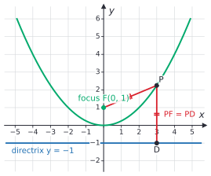
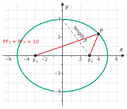
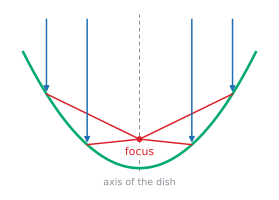

# Conic sections

After this lesson you can name a conic section from its equation, write and read the standard equations of parabolas, ellipses and hyperbolas centred at the origin, find their foci, and explain why a satellite dish has the shape it has.

<div class="note" markdown>

This lesson is optional. Nothing later in the book depends on it, so skip it if you are short on time. It is here because parabolas show up in quadratics, ellipses in statistics and orbits, and hyperbolas in economics and navigation, and because the proofs use the circle and congruence ideas from this chapter.

</div>

Before this: [coordinate geometry and circles](04-coordinate-geometry-and-circles.md) (the distance formula and completing the square) and [quadratic functions and graphs](../05-quadratics-and-complex-numbers/01-quadratic-functions-and-graphs.md) (parabolas).

## Quick check

Try these first. If you get all three right, skip to [Practice](#practice).

1. Which kind of conic is each? (a) $4x^2 + 9y^2 = 36$, (b) $x^2 - y^2 = 1$, (c) $y = \frac{x^2}{8}$.
2. Find the focus of the parabola $x^2 = 8y$.
3. Find the foci of the ellipse $\frac{x^2}{25} + \frac{y^2}{9} = 1$.

<details class="solution" markdown>
<summary>Answers</summary>

1. (a) An ellipse: both squared terms are positive and the coefficients differ. (b) A hyperbola: the squared terms have opposite signs. (c) A parabola: only one variable is squared.
2. Compare with $x^2 = 4py$: $4p = 8$, so $p = 2$ and the focus is $(0, 2)$.
3. Here $a^2 = 25$ and $b^2 = 9$, so $c^2 = a^2 - b^2 = 16$ and $c = 4$. The foci are $(\pm 4, 0)$.

</details>

## The idea

Hold a flashlight at a wall. Pointed straight at the wall, it makes a circle of light. Tilt it and the circle stretches into an oval. Tilt it further, until the top edge of the beam is parallel to the wall, and the oval opens out and never closes. Tilt it past that and you see one branch of a curve that opens the other way. These shapes are the slices of a cone of light by a flat plane, and the same four families of curves appear every time: circles, ellipses, parabolas and hyperbolas.

Each curve also has a description that uses only distances. A parabola is the set of points equally far from a point and a line. An ellipse is the set of points whose distances to two pins add to a fixed length, which is how a gardener marks an oval flower bed with a loop of string. A hyperbola is the set where the two distances differ by a fixed length. These distance descriptions give simple equations and explain the useful properties: a parabolic dish gathers parallel rays at one point, a planet's orbit is an ellipse with the Sun at a pin, and a pair of radio stations can locate a ship along a hyperbola.

## Definitions

A **conic section** is a curve formed by cutting a double cone, two cones joined tip to tip, with a plane that doesn't pass through the tip. The figure shows the cone from the side, with each cutting plane seen edge-on as a line.


A plane parallel to the base gives a circle. A slightly tilted plane that cuts only one half of the cone gives an ellipse. A plane parallel to a side of the cone gives a parabola. A plane steep enough to cut both halves gives a hyperbola, which has two branches. A plane through the tip gives a point, a line or two crossing lines, and these are called degenerate conics.

The distance descriptions are the way to work with them.

A **parabola** is the set of points in the plane that are the same distance from a fixed point $F$, the **focus**, as from a fixed line $d$, the **directrix**, where $F$ is not on $d$.

An **ellipse** is the set of points for which the sum of the distances to two fixed points $F_1$ and $F_2$, the **foci** (plural of focus), is a constant $2a$, where $2a$ is more than the distance $F_1F_2$.

A **hyperbola** is the set of points for which the difference of the distances to two fixed points $F_1$ and $F_2$ is a constant $2a$ in absolute value, where $2a$ is less than the distance $F_1F_2$.

In plain words: one pin and a line; two pins and a loop of string; two pins and a fixed gap in distances. A circle is an ellipse whose two foci are the same point, since then both distances are the radius and the sum $2r$ is constant.

## How to do it

### Standard equations

Put the centre (or the vertex of a parabola) at the origin and the foci on an axis. Each definition then turns into an equation, and the derivations show where the numbers come from.

*Theorem (parabola).* The parabola with focus $(0, p)$ and directrix $y = -p$ has the equation $x^2 = 4py$.

What we know: $p \ne 0$. A point $(x, y)$ is on the parabola when its distance to $F = (0, p)$ equals its distance to the line $y = -p$.

What we want: the equation in $x$ and $y$.

The plan: write both distances, set them equal and square.

*Proof.* The distance to $F$ is $\sqrt{x^2 + (y - p)^2}$, and the distance to the line $y = -p$ is $\lvert y + p \rvert$. Setting them equal and squaring,

$$
x^2 + (y - p)^2 = (y + p)^2 \quad \Rightarrow \quad x^2 + y^2 - 2py + p^2 = y^2 + 2py + p^2 \quad \Rightarrow \quad x^2 = 4py. \qquad \blacksquare
$$

Looking back: the parabola opens upward if $p > 0$ and downward if $p < 0$. With the roles of $x$ and $y$ swapped, the focus $(p, 0)$ and directrix $x = -p$ give $y^2 = 4px$, which opens right or left. This is the $y = ax^2$ parabola of [quadratic functions and graphs](../05-quadratics-and-complex-numbers/01-quadratic-functions-and-graphs.md) with $a = \frac{1}{4p}$.



In the figure, $p = 1$, and the point $P = (3, 2.25)$ is $\sqrt{9 + 1.25^2} = 3.25$ from the focus and $2.25 + 1 = 3.25$ from the directrix.

*Theorem (ellipse).* The ellipse with foci $(\pm c, 0)$ and constant sum $2a$, where $a > c > 0$, has the equation

$$
\frac{x^2}{a^2} + \frac{y^2}{b^2} = 1, \qquad \text{where } b^2 = a^2 - c^2.
$$

What we know: $F_1 = (-c, 0)$, $F_2 = (c, 0)$, and a point $(x, y)$ is on the ellipse when its distances to $F_1$ and $F_2$ add to $2a$.

What we want: the equation in $x$ and $y$.

The plan: write the sum condition, move one square root to the other side, and square twice to remove both.

*Proof.* The condition is $\sqrt{(x + c)^2 + y^2} + \sqrt{(x - c)^2 + y^2} = 2a$. Move the second root across and square:

$$
(x + c)^2 + y^2 = 4a^2 - 4a\sqrt{(x - c)^2 + y^2} + (x - c)^2 + y^2.
$$

Expanding $(x + c)^2 - (x - c)^2 = 4cx$ and rearranging gives $a\sqrt{(x - c)^2 + y^2} = a^2 - cx$. Square again:

$$
a^2\left(x^2 - 2cx + c^2 + y^2\right) = a^4 - 2a^2 cx + c^2x^2.
$$

The terms $-2a^2cx$ cancel. Collecting the $x^2$ terms gives $(a^2 - c^2)x^2 + a^2y^2 = a^2(a^2 - c^2)$. Since $a > c$, the number $a^2 - c^2$ is positive, so we may call it $b^2$. Then $b^2x^2 + a^2y^2 = a^2b^2$, and dividing by $a^2b^2$ gives the equation. The squaring steps can be reversed, because the quantities squared are positive for points on the curve, so the equation describes exactly the ellipse. $\blacksquare$

Looking back: the vertices are $(\pm a, 0)$, where $y = 0$, and the co-vertices are $(0, \pm b)$, where $x = 0$. The segment from a co-vertex $(0, b)$ to a focus $(c, 0)$ has length $\sqrt{b^2 + c^2} = a$, so $a$, $b$ and $c$ form a right triangle with hypotenuse $a$. That triangle is the figure's dashed segment of length 5, with legs $b = 4$ and $c = 3$. The ellipse is wider than tall when $a > b$. If instead $b > a$, the long axis is vertical, the foci are $(0, \pm c)$ and $c^2 = b^2 - a^2$. In every case the larger denominator belongs to the longer axis, and $c^2$ is the larger denominator minus the smaller one.



*Theorem (hyperbola).* The hyperbola with foci $(\pm c, 0)$ and constant difference $2a$, where $0 < a < c$, has the equation

$$
\frac{x^2}{a^2} - \frac{y^2}{b^2} = 1, \qquad \text{where } b^2 = c^2 - a^2.
$$

*Proof.* The condition is $\sqrt{(x + c)^2 + y^2} - \sqrt{(x - c)^2 + y^2} = \pm 2a$. The steps of the ellipse proof work again with the sign of $2a$ allowed to change: isolate one root, square, which gives $cx - a^2 = \pm a\sqrt{(x - c)^2 + y^2}$, and square again. The result is $(c^2 - a^2)x^2 - a^2y^2 = a^2(c^2 - a^2)$. This time $c > a$, so $c^2 - a^2$ is positive and equals $b^2$. Dividing by $a^2b^2$ gives the equation. $\blacksquare$

The hyperbola gets close to two lines, its **asymptotes** $y = \pm\frac{b}{a}x$. To see why, solve for $y$ on the upper right branch: $y = \frac{b}{a}\sqrt{x^2 - a^2}$. The vertical gap between this and the line $y = \frac{b}{a}x$ is

$$
\frac{b}{a}\left(x - \sqrt{x^2 - a^2}\right) = \frac{b}{a} \cdot \frac{a^2}{x + \sqrt{x^2 - a^2}},
$$

which gets as small as you like when $x$ grows. The branches open between the asymptotes. The box with corners $(\pm a, \pm b)$ helps with sketching: the asymptotes are the diagonals of the box.


The table collects the forms centred at the origin.

| Conic | Equation | Key facts |
|---|---|---|
| parabola opening up or down | $x^2 = 4py$ | vertex $(0, 0)$, focus $(0, p)$, directrix $y = -p$ |
| parabola opening right or left | $y^2 = 4px$ | vertex $(0, 0)$, focus $(p, 0)$, directrix $x = -p$ |
| ellipse, wider than tall | $\frac{x^2}{a^2} + \frac{y^2}{b^2} = 1$, $a > b > 0$ | vertices $(\pm a, 0)$, foci $(\pm c, 0)$, $c^2 = a^2 - b^2$ |
| ellipse, taller than wide | $\frac{x^2}{b^2} + \frac{y^2}{a^2} = 1$, $a > b > 0$ | vertices $(0, \pm a)$, foci $(0, \pm c)$, $c^2 = a^2 - b^2$ |
| hyperbola opening left and right | $\frac{x^2}{a^2} - \frac{y^2}{b^2} = 1$ | vertices $(\pm a, 0)$, foci $(\pm c, 0)$, $c^2 = a^2 + b^2$, asymptotes $y = \pm\frac{b}{a}x$ |
| hyperbola opening up and down | $\frac{y^2}{a^2} - \frac{x^2}{b^2} = 1$ | vertices $(0, \pm a)$, foci $(0, \pm c)$, $c^2 = a^2 + b^2$, asymptotes $y = \pm\frac{a}{b}x$ |

To move the centre to $(h, k)$, replace $x$ by $x - h$ and $y$ by $y - k$, as in [transformations of functions](../03-functions/04-transformations-of-functions.md). When an equation arrives in expanded form, complete the square in $x$ and in $y$ first, as in the [circle lesson](04-coordinate-geometry-and-circles.md#completing-the-square-for-a-circle).

### Reading the shape from an equation

1. Look at the squared terms. If only one variable is squared, the conic is a parabola. If both are squared with the same sign, it is an ellipse (a circle if the coefficients are equal). If they have opposite signs, it is a hyperbola.
2. Put the equation in standard form: for an ellipse or a hyperbola, move the constant to the right and divide so that the right side is 1.
3. Read $a$ and $b$. For an ellipse, $a^2$ is the larger denominator. For a hyperbola, $a^2$ is the denominator of the positive term, whichever is larger.
4. Compute $c$ with the formula for that conic, and write down the vertices, foci and asymptotes.
5. Check one point of the curve in the original equation.

### The reflective property of the parabola

A mirror reflects a ray so that the angle between the ray and the mirror equals the angle between the reflected ray and the mirror. For a curved mirror, "the mirror" at a point means the tangent line there.

*Theorem.* A ray that travels parallel to the axis of a parabola and hits the parabola at $P$ is reflected through the focus $F$.

What we know: the parabola has focus $F$ and directrix $d$. Let $P$ be a point on it, and $D$ the foot of the perpendicular from $P$ to $d$. So $PF = PD$.

What we want: the tangent line at $P$ makes equal angles with the incoming ray (which runs along the line $DP$) and with $PF$.

The plan: show that the perpendicular bisector of $FD$ is the tangent at $P$. Then use the isosceles triangle $PFD$: the perpendicular bisector of its base passes through the apex $P$ and bisects the angle there.


*Proof.* Since $PF = PD$, the triangle $PFD$ is isosceles with apex $P$. Let $\ell$ be the perpendicular bisector of the base $FD$. By the [perpendicular bisector theorem](02-congruence-and-triangle-proofs.md#the-perpendicular-bisector-theorem), the point $P$ is on $\ell$, since it is equally far from $F$ and $D$.

The line $\ell$ is tangent to the parabola at $P$: take any other point $Q$ on $\ell$. Then $QF = QD$ by the same theorem. The distance from $Q$ to the directrix is at most $QD$, and equals $QD$ only when $D$ is the foot of the perpendicular from $Q$, which happens only for $Q = P$. So for $Q \ne P$, the distance from $Q$ to the directrix is less than $QF$, and $Q$ is not on the parabola; it lies outside it. The line $\ell$ touches the parabola at $P$ only.

By the isosceles triangle theorem and its consequences ([congruence and triangle proofs](02-congruence-and-triangle-proofs.md#the-isosceles-triangle-theorem)), the perpendicular bisector of the base also bisects the apex angle: $\ell$ bisects $\angle FPD$. So the angle between $PF$ and the part of $\ell$ below $P$ is half of $\angle FPD$, and so is the angle between $PD$ and that same part of $\ell$. The incoming ray comes down along the line $DP$ and meets $\ell$ at $P$. The angle between the upward part of that line and the upper part of $\ell$ is vertical to the angle between $PD$ and the lower part of $\ell$, so it is also half of $\angle FPD$. These are the two angles marked $\alpha$ in the figure: the incoming ray and the ray $PF$ make equal angles with the tangent. So the reflected ray leaves along $PF$. $\blacksquare$

Looking back: the proof is the focus-and-directrix definition plus one fact about isosceles triangles, with no coordinates. In the figure, $P = (3, 2.25)$, the tangent slope is $\frac{x}{2} = 1.5$ (from $y = \frac{x^2}{4}$), and the perpendicular bisector of $F = (0, 1)$ and $D = (3, -1)$ passes through their midpoint $(1.5, 0)$ with slope $\frac{3}{2}$, which is the same line.



A satellite dish, a car headlight and a solar cooker all use this. A dish receiving a signal gathers all the parallel rays at the focus, where the receiver sits. A headlight does the reverse: a bulb at the focus sends a parallel beam out.

An ellipse has a similar property that is stated here without proof: a ray from one focus reflects off the ellipse to the other focus. A room with an elliptical ceiling makes a whisper at one focus audible at the other.

### Hyperbolas and positioning

Suppose two radio stations $F_1$ and $F_2$ send a signal at the same instant. A receiver at $P$ measures the difference in the arrival times, which is the difference $PF_1 - PF_2$ in distances, divided by the speed of the signal. A constant difference of distances is a hyperbola, so $P$ is on a known hyperbola with the stations as foci. A second pair of stations gives a second hyperbola, and the receiver is at their intersection. Radio navigation systems such as LORAN worked this way. GPS itself measures distances to satellites, which gives spheres, not hyperbolas, but the idea of locating a point from distance information is the same.

## Worked examples

<div class="example" markdown>

### Example 1: graphing an ellipse

Identify $9x^2 + 4y^2 = 36$, and find its vertices, co-vertices and foci.

Step 1 (squared terms): both are squared, with the same sign, so it is an ellipse.

Step 2 (standard form): divide by 36: $\frac{x^2}{4} + \frac{y^2}{9} = 1$.

Step 3 (read $a$ and $b$): the larger denominator is 9, under $y^2$, so the long axis is vertical, with $a^2 = 9$ and $b^2 = 4$. So $a = 3$ and $b = 2$. The vertices are $(0, \pm 3)$ and the co-vertices are $(\pm 2, 0)$.

Step 4 ($c$): $c^2 = a^2 - b^2 = 9 - 4 = 5$, so $c = \sqrt{5} \approx 2.236$. The foci are $(0, \pm\sqrt{5})$, on the long axis.

Step 5 (check): the point $(2, 0)$ is on the curve, since $\frac{4}{4} + 0 = 1$. Its distances to the foci are each $\sqrt{4 + 5} = 3$, and they add to $6 = 2a$, as the definition requires.

</div>

<div class="example" markdown>

### Example 2: where to put the receiver of a dish

A satellite dish is a paraboloid. Its cross-section is a parabola, and the dish is 3 m across and 0.5 m deep. How far above the bottom of the dish should the receiver be?

Put the vertex at the origin with the parabola $x^2 = 4py$, opening upward. The rim point is at half the width, 1.5 m, and at the depth, 0.5 m: $(1.5, 0.5)$. Substitute:

$$
1.5^2 = 4p(0.5) \quad \Rightarrow \quad 2.25 = 2p \quad \Rightarrow \quad p = 1.125.
$$

The focus is $(0, 1.125)$, so the receiver should be 1.125 m above the vertex, which is 0.625 m above the plane of the rim. Check: $x^2 = 4py$ with $p = 1.125$ gives $1.5^2 = 4(1.125)(0.5) = 2.25$. In the same way, a dish 2.4 m across and 0.6 m deep has $p = \frac{1.2^2}{4(0.6)} = 0.6$, so its focus is exactly at the height of the rim.

</div>

<div class="example" markdown>

### Example 3: a hyperbola

Find the vertices, foci and asymptotes of $\frac{x^2}{16} - \frac{y^2}{9} = 1$.

The terms have opposite signs, so it is a hyperbola. The positive term is $x^2$, so it opens left and right, with $a^2 = 16$ and $b^2 = 9$: $a = 4$ and $b = 3$. The vertices are $(\pm 4, 0)$. For a hyperbola, $c^2 = a^2 + b^2 = 25$, so $c = 5$ and the foci are $(\pm 5, 0)$. The asymptotes are $y = \pm\frac{3}{4}x$.

Check: the point $P = \left(5, \frac{9}{4}\right)$ is on the curve, since $\frac{25}{16} - \frac{81/16}{9} = \frac{25}{16} - \frac{9}{16} = 1$. Its distance to $(5, 0)$ is $\frac{9}{4}$, and to $(-5, 0)$ is $\sqrt{100 + \frac{81}{16}} = \frac{41}{4}$. The difference is $\frac{41}{4} - \frac{9}{4} = 8 = 2a$.

</div>

<div class="example" markdown>

### Example 4: an ellipse from its foci (finish it yourself)

An ellipse has foci $(\pm 3, 0)$, and the sum of the distances from any point on it to the foci is 10. Find its equation.

Step 1: the sum is $2a = 10$, so $a = 5$. The foci give $c = 3$.

Step 2: the foci are on the $x$-axis, so the long axis is horizontal and the equation is $\frac{x^2}{a^2} + \frac{y^2}{b^2} = 1$ with $b^2 = a^2 - c^2$.

Find $b^2$, write the equation and check a point.

<details class="solution" markdown>
<summary>Finish</summary>

$b^2 = 25 - 9 = 16$, so the equation is $\frac{x^2}{25} + \frac{y^2}{16} = 1$.

Check: the point $(0, 4)$ is on it, and its distance to each focus is $\sqrt{9 + 16} = 5$. The sum is $5 + 5 = 10$. The point $(4, 2.4)$ is also on it, since $\frac{16}{25} + \frac{5.76}{16} = 0.64 + 0.36 = 1$, and its distances to the foci are $\sqrt{49 + 5.76} = 7.4$ and $\sqrt{1 + 5.76} = 2.6$, which add to 10.

</details>

</div>

## Edge cases and common mistakes

<div class="warning" markdown>

Watch out for $a$ and $b$ in an ellipse. The letter $a$ always goes with the longer semi-axis, so $a^2$ is the larger denominator, even when it sits under $y^2$. In $\frac{x^2}{4} + \frac{y^2}{9} = 1$, the long axis is vertical, and $c^2 = 9 - 4$.

</div>

<div class="warning" markdown>

Watch out for the formula for $c$. It is $c^2 = a^2 - b^2$ for an ellipse (the foci are inside, $c < a$) and $c^2 = a^2 + b^2$ for a hyperbola (the foci are outside the vertices, $c > a$). Mixing them up puts the foci in the wrong place.

</div>

<div class="warning" markdown>

Watch out for the number in $y^2 = 4px$. The number in front of $x$ is $4p$, not $p$. For $y^2 = 12x$, $4p = 12$, so $p = 3$ and the focus is $(3, 0)$, not $(12, 0)$.

</div>

<div class="warning" markdown>

Watch out for the asymptote slope of a hyperbola that opens up and down. For $\frac{y^2}{a^2} - \frac{x^2}{b^2} = 1$, the asymptotes are $y = \pm\frac{a}{b}x$, with $a$ on top, the opposite of the left-right case.

</div>

Degenerate cases appear when the right side is 0. The equation $\frac{x^2}{4} - \frac{y^2}{9} = 0$ factors as $\left(\frac{x}{2} - \frac{y}{3}\right)\left(\frac{x}{2} + \frac{y}{3}\right) = 0$, which is the pair of crossing lines $y = \pm\frac{3}{2}x$. This is a plane through the tip of the cone. The equation $\frac{x^2}{4} + \frac{y^2}{9} = 0$ has the single solution $(0, 0)$.

A circle is the ellipse with $a = b$, which gives $c = 0$, the two foci at the centre. Its ratio $\frac{c}{a}$ is 0, and the more stretched the ellipse, the closer $\frac{c}{a}$ gets to 1. The [FAQ](#faq) gives this ratio its name.

## Tricks and shortcuts

To remember the formula for $c$, think of the two right triangles. For the ellipse, $c$ is a leg and $a$ is the hypotenuse: $a^2 = b^2 + c^2$. For the hyperbola, $c$ is the hypotenuse: $c^2 = a^2 + b^2$. That is why the foci are further out than the vertices: they lie on the circle through the corners of the sketching box, whose half-diagonal is $\sqrt{a^2 + b^2} = c$.

To check an ellipse quickly, use the string. Pin the two ends of a loop of length $2a + 2c$ at the foci, pull it taut with a pencil, and trace. The pencil keeps the sum of the two distances equal to $2a$, which is the definition. Doing this on paper with $a = 5$ and $c = 3$ draws the ellipse $\frac{x^2}{25} + \frac{y^2}{16} = 1$.

## In code

The definitions are easy to test numerically. This code takes points on each standard curve and checks the property that defines it.

<details class="code" markdown>
<summary>In code</summary>

```python
import math

# Ellipse x^2/25 + y^2/16 = 1, foci (+-3, 0): the sum of the distances is 10.
for t in (0.3, 1.1, 2.5):
    P = (5 * math.cos(t), 4 * math.sin(t))
    print(round(math.dist(P, (-3, 0)) + math.dist(P, (3, 0)), 9))     # 10.0 each time

# Hyperbola x^2/16 - y^2/9 = 1, foci (+-5, 0): the difference of the distances is 8.
for s in (0.2, 0.9, 1.5):
    P = (4 * math.cosh(s), 3 * math.sinh(s))
    print(round(abs(math.dist(P, (-5, 0)) - math.dist(P, (5, 0))), 9))   # 8.0 each time

# Parabola y = x^2/4, focus (0, 1), directrix y = -1: distance to focus equals distance to directrix.
for x in (-3.0, 0.5, 4.0):
    y = x * x / 4
    print(round(math.dist((x, y), (0, 1)), 9), y + 1)                 # equal pairs
```

The ellipse and hyperbola lines print the same number for every point, which is what the definitions say. The parabola lines print two equal numbers for each point: 3.25 for $(-3, 2.25)$, 1.0625 for $(0.5, 0.0625)$ and 5 for $(4, 4)$.

</details>

## FAQ

### Why do a cone and a plane give the same curves as the distance definitions?

The two descriptions give the same curves, but proving it takes an argument with spheres that fit inside the cone and touch the plane, which this book doesn't cover. What we proved here is the part that matters for working with the curves: the definition by distances gives the equations above.

### Why does the receiver of a dish go at the focus?

Because of the reflective property. Every ray parallel to the axis bounces off the parabola through the same point, so the focus collects the whole signal, which is far stronger there than anywhere else.

### Is a circle an ellipse?

Yes. It is the case of equal foci. All the ellipse formulas still work: with $a = b$ they give $c = 0$ and the equation $x^2 + y^2 = a^2$.

### What does the eccentricity of an orbit mean?

The ratio $e = \frac{c}{a}$ of the distance from the centre to a focus to the long semi-axis is called the eccentricity of the ellipse. It is 0 for a circle and closer to 1 for a longer, thinner ellipse. According to the [NASA Earth fact sheet](https://nssdc.gsfc.nasa.gov/planetary/factsheet/earthfact.html) (updated 15 November 2024), Earth's orbit has $e = 0.0167$ and a semi-major axis of 149.598 million km. Then $c = ae \approx 2.5$ million km, and the semi-minor axis is $b = \sqrt{a^2 - c^2} \approx 149.577$ million km, only 0.014% shorter than $a$. The orbit is very close to a circle, with the Sun 2.5 million km off centre. The [NASA comet fact sheet](https://nssdc.gsfc.nasa.gov/planetary/factsheet/cometfact.html) (updated 4 January 2016) gives Halley's comet $e = 0.967$ and $a = 17.94$ AU, so its distance from the Sun ranges from about $a(1 - e) \approx 0.59$ AU to $a(1 + e) \approx 35.3$ AU.

## Practice

### Warm-up

1\. Identify each conic: (a) $4x^2 + y^2 = 16$, (b) $x^2 - 4y^2 = 4$, (c) $y^2 = 8x$, (d) $x^2 + y^2 = 9$.

<details class="solution" markdown>
<summary>Solution</summary>

(a) An ellipse: both squares, same sign, different coefficients. (b) A hyperbola: opposite signs. (c) A parabola: only $y$ is squared. (d) A circle, which is an ellipse with $a = b = 3$.

Check (a) by dividing by 16: $\frac{x^2}{4} + \frac{y^2}{16} = 1$, which is in the ellipse form.

</details>

2\. Find the focus and directrix of (a) $x^2 = 12y$ and (b) $y^2 = -8x$.

<details class="solution" markdown>
<summary>Solution</summary>

(a) $4p = 12$, so $p = 3$. The focus is $(0, 3)$ and the directrix is $y = -3$. (b) $4p = -8$, so $p = -2$. The focus is $(-2, 0)$ and the directrix is $x = 2$. The parabola opens to the left.

Check (b): the point $(-2, 4)$ is on it, since $16 = -8(-2)$. Its distance to the focus is $4$, and to the line $x = 2$ is $\lvert -2 - 2 \rvert = 4$.

</details>

3\. Find the vertices and foci of $\frac{x^2}{49} + \frac{y^2}{25} = 1$.

<details class="solution" markdown>
<summary>Solution</summary>

Here $a^2 = 49$ and $b^2 = 25$, so $a = 7$ and $b = 5$, and the long axis is horizontal. The vertices are $(\pm 7, 0)$. Then $c^2 = 49 - 25 = 24$ and $c = \sqrt{24} = 2\sqrt{6} \approx 4.899$, so the foci are $(\pm 2\sqrt{6}, 0)$.

Check: the point $(0, 5)$ is $\sqrt{24 + 25} = 7$ from each focus, which equals $a$, as for any co-vertex.

</details>

### Standard

4\. Find the equation of the hyperbola with vertices $(\pm 3, 0)$ and foci $(\pm 5, 0)$, and give its asymptotes.

<details class="solution" markdown>
<summary>Solution</summary>

The vertices give $a = 3$ and the foci give $c = 5$. So $b^2 = c^2 - a^2 = 25 - 9 = 16$ and $b = 4$. The equation is $\frac{x^2}{9} - \frac{y^2}{16} = 1$, and the asymptotes are $y = \pm\frac{4}{3}x$.

Check: the point $\left(5, \frac{16}{3}\right)$ satisfies $\frac{25}{9} - \frac{256/9}{16} = \frac{25}{9} - \frac{16}{9} = 1$.

</details>

5\. A dish is 2.4 m across and 0.6 m deep. How far is the focus from the vertex? How does that compare with the depth of the dish?

<details class="solution" markdown>
<summary>Solution</summary>

Use $x^2 = 4py$ with the rim point $(1.2, 0.6)$: $1.44 = 4p(0.6) = 2.4p$, so $p = 0.6$ m. The focus is 0.6 m above the vertex, which equals the depth, so it is in the plane of the rim.

Check: $4(0.6)(0.6) = 1.44 = 1.2^2$.

</details>

6\. Identify the conic $9x^2 + 16y^2 - 18x + 64y - 71 = 0$, and find its centre, $a$, $b$ and foci.

<details class="solution" markdown>
<summary>Solution</summary>

Complete the square: $9(x^2 - 2x) + 16(y^2 + 4y) = 71$, so $9(x - 1)^2 - 9 + 16(y + 2)^2 - 64 = 71$, which gives $9(x - 1)^2 + 16(y + 2)^2 = 144$. Divide by 144: $\frac{(x - 1)^2}{16} + \frac{(y + 2)^2}{9} = 1$.

It is an ellipse with centre $(1, -2)$, $a = 4$ (horizontal long axis) and $b = 3$. Then $c = \sqrt{16 - 9} = \sqrt{7} \approx 2.646$, and the foci are $(1 \pm \sqrt{7}, -2)$.

Check: expanding $9(x - 1)^2 + 16(y + 2)^2 - 144$ gives $9x^2 - 18x + 16y^2 + 64y - 71$.

</details>

### Challenge

7\. For a point $P = (x, y)$ on the ellipse $\frac{x^2}{a^2} + \frac{y^2}{b^2} = 1$ with foci $(\pm c, 0)$, show that the distance from $P$ to the focus $(c, 0)$ is $a - \frac{c}{a}x$, and use it to show again that the distances to the two foci add to $2a$.

<details class="solution" markdown>
<summary>Solution</summary>

What we know: $b^2 = a^2 - c^2$, so $y^2 = b^2\left(1 - \frac{x^2}{a^2}\right) = (a^2 - c^2)\left(1 - \frac{x^2}{a^2}\right)$. What we want: $PF_2 = a - \frac{c}{a}x$. Plan: write $PF_2^2$, substitute $y^2$ and see a perfect square.

$$
PF_2^2 = (x - c)^2 + y^2 = x^2 - 2cx + c^2 + a^2 - c^2 - x^2 + \frac{c^2}{a^2}x^2 = a^2 - 2cx + \frac{c^2}{a^2}x^2 = \left(a - \frac{c}{a}x\right)^2.
$$

Since $\lvert x \rvert \le a$ and $c < a$, the quantity $a - \frac{c}{a}x$ is positive, so $PF_2 = a - \frac{c}{a}x$. The same steps with $c$ replaced by $-c$ give $PF_1 = a + \frac{c}{a}x$. The sum is $PF_1 + PF_2 = 2a$. $\blacksquare$

Check with $P = (4, 2.4)$ on $\frac{x^2}{25} + \frac{y^2}{16} = 1$ ($a = 5$, $c = 3$): $PF_2 = 5 - \frac{3}{5}(4) = 2.6$ and $PF_1 = 5 + 2.4 = 7.4$, as in Example 4.

</details>

8\. (Reviews [coordinate geometry and circles](04-coordinate-geometry-and-circles.md#a-line-and-a-circle).) Find the points where the line $y = x + 1$ meets the ellipse $\frac{x^2}{4} + y^2 = 1$.

<details class="solution" markdown>
<summary>Solution</summary>

Substitute the line into the ellipse: $\frac{x^2}{4} + (x + 1)^2 = 1$, so $\frac{x^2}{4} + x^2 + 2x + 1 = 1$, which gives $\frac{5}{4}x^2 + 2x = 0$ and $x(5x + 8) = 0$. So $x = 0$ or $x = -\frac{8}{5}$. The points are $(0, 1)$ and $\left(-\frac{8}{5}, -\frac{3}{5}\right)$.

Check: for the second point, $\frac{(8/5)^2}{4} + \left(\frac{3}{5}\right)^2 = \frac{64}{100} + \frac{36}{100} = 1$, and $-\frac{3}{5} = -\frac{8}{5} + 1$.

</details>

## Where this shows up

- In statistics, the contours of a bivariate normal distribution are ellipses, which is the shape behind confidence regions and principal component analysis in machine learning. In economics, the curve $xy = k$ is a hyperbola: it is a unit-elastic demand curve (price times quantity is constant) and an indifference curve for the utility $u = xy$.
- In physics, projectiles follow parabolas when air resistance is ignored, planets follow ellipses (Kepler's first law), and a spacecraft with enough speed follows a hyperbola past a planet.
- Calculus gives the same shapes a second life. The tangent line of a parabola is a first example of a derivative ([the derivative definition](../../05-university-core/02-derivatives/01-the-derivative-definition.md)), and the reflective property is why mirrors are built as paraboloids.
