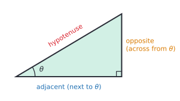
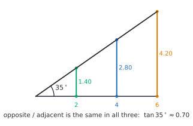

# Right triangle trigonometry

After this lesson you can use sine, cosine and tangent to find a missing side or angle in a right triangle, and you know the exact values for $30^\circ$, $45^\circ$ and $60^\circ$.

Before this: [the Pythagorean theorem](../../02-middle-school/06-geometry/04-pythagorean-theorem.md), [transformations, congruence and similarity](../../02-middle-school/06-geometry/05-transformations-congruence-similarity.md) (similar triangles) and [roots, irrationals and types of numbers](../../02-middle-school/04-powers-roots-and-real-numbers/03-roots-irrationals-and-types-of-numbers.md).

## Quick check

Try these first. If you get all three right, skip to [Practice](#practice).

1. A right triangle has sides 5, 12 and 13. For the angle $A$ across from the side of length 5, find $\sin A$, $\cos A$ and $\tan A$ as fractions.
2. The hypotenuse of a right triangle is 10, and one acute angle is $30^\circ$. How long is the side across from that angle?
3. A ramp rises 0.75 m over a horizontal distance of 9 m. What angle does it make with the ground, to the nearest tenth of a degree?

<details class="solution" markdown>
<summary>Answers</summary>

1. The hypotenuse is 13, the side opposite $A$ is 5 and the side adjacent to $A$ is 12. So $\sin A = \frac{5}{13}$, $\cos A = \frac{12}{13}$ and $\tan A = \frac{5}{12}$.
2. The side opposite $30^\circ$ is half the hypotenuse, so it is 5. (The sine of $30^\circ$ is exactly $\frac{1}{2}$, and $10 \times \frac{1}{2} = 5$.)
3. $\tan\theta = \frac{0.75}{9}$, so $\theta = \tan^{-1}\left(\frac{0.75}{9}\right) \approx 4.8^\circ$.

</details>

## The idea

A ramp is steep or gentle depending on its angle, and you can describe that angle without a protractor: say how far it rises for each metre you move along the ground. A ramp that rises 1 m over 12 m of ground is gentle. One that rises 1 m over 2 m is steep. The rise per unit of run is the slope from [slope and linear equations](../../02-middle-school/05-linear-relationships-and-functions/02-slope-and-linear-equations.md), and it is fixed by the angle alone. Build the ramp twice as long at the same angle and the rise doubles with the run, so rise divided by run stays put.

Trigonometry names this idea and extends it. Pick an acute angle $\theta$ and draw any right triangle with $\theta$ as one of its angles. The three side lengths change with the size of the triangle, but the ratios between them don't. Each ratio gets a name, and the names let you turn "I know an angle and one side" into "I know every side", and the other way round. Surveyors measuring the height of a tower, game engines aiming a camera and engineers sizing a roof all use this.



## Definitions

In a right triangle, the longest side, across from the right angle, is the **hypotenuse**. Choose one of the two acute angles, $\theta$. The **opposite** side is the side across from $\theta$, and the **adjacent** side is the leg that touches $\theta$ (the other side that touches $\theta$ is the hypotenuse). In plain words: "opposite" means "not touching the angle", and "adjacent" means "next to the angle, other than the hypotenuse". The names depend on which acute angle you chose. From the other acute angle, opposite and adjacent swap.

For an acute angle $\theta$ in a right triangle, the **sine**, **cosine** and **tangent** of $\theta$ are

$$
\sin\theta = \frac{\text{opposite}}{\text{hypotenuse}}, \qquad \cos\theta = \frac{\text{adjacent}}{\text{hypotenuse}}, \qquad \tan\theta = \frac{\text{opposite}}{\text{adjacent}}.
$$

In plain words, each one is a ratio of two sides, so it is a plain number with no units. Sine and cosine compare a leg with the hypotenuse; tangent compares the two legs. The memory aid is **SOH CAH TOA**: Sine is Opposite over Hypotenuse, Cosine is Adjacent over Hypotenuse, Tangent is Opposite over Adjacent.

These definitions are legitimate because each ratio depends only on $\theta$, and not on which right triangle you drew. That needs a proof.

*Theorem.* If two right triangles have the same acute angle $\theta$, then their ratios $\frac{\text{opp}}{\text{hyp}}$, $\frac{\text{adj}}{\text{hyp}}$ and $\frac{\text{opp}}{\text{adj}}$ are equal.

What we know: triangle $T$ and triangle $T'$ each have a right angle and an angle $\theta$.

What we want: the three ratios are the same for $T$ and $T'$.

The plan: show the triangles are similar, then use the fact that corresponding sides of similar triangles are in the same ratio.

The proof: both triangles have angles $90^\circ$ and $\theta$, so by the [triangle angle sum](../../02-middle-school/06-geometry/01-angles-and-triangles.md#the-angles-of-a-triangle-add-to-180-degrees) their third angles are both $90^\circ - \theta$. Two pairs of equal angles make the triangles similar (the AA test from [congruence and similarity](../../02-middle-school/06-geometry/05-transformations-congruence-similarity.md#congruence-and-similarity)). So there is a scale factor $k$ with $\text{opp}' = k \cdot \text{opp}$, $\text{adj}' = k \cdot \text{adj}$ and $\text{hyp}' = k \cdot \text{hyp}$. Then

$$
\frac{\text{opp}'}{\text{hyp}'} = \frac{k \cdot \text{opp}}{k \cdot \text{hyp}} = \frac{\text{opp}}{\text{hyp}},
$$

and the same cancellation of $k$ works for the other two ratios. $\blacksquare$

Looking back: this is why a calculator can have a single button for $\sin$. The button doesn't need a triangle, only the angle. The figure shows three triangles with a $35^\circ$ angle. Their legs are 2, 4 and 6 along the ground and 1.40, 2.80 and 4.20 up, and every quotient is $0.70$ to two decimal places.



Two more facts come straight from the definitions. In a right triangle the other acute angle is $90^\circ - \theta$, and the side opposite $\theta$ is the side adjacent to $90^\circ - \theta$. So

$$
\sin\theta = \cos(90^\circ - \theta), \qquad \cos\theta = \sin(90^\circ - \theta).
$$

In plain words, the sine of an angle is the cosine of its complement, which is where the "co" in "cosine" comes from. And because the hypotenuse is the longest side, for an acute angle both $\sin\theta$ and $\cos\theta$ are between 0 and 1. The tangent can be any positive number.

## How to do it

### Exact values for 30, 45 and 60 degrees

Three angles come up so often that you should know their ratios exactly, as expressions with roots. Both come from the Pythagorean theorem and a symmetry.

For $45^\circ$, take a square with side 1 and cut it along a diagonal. The two halves are right triangles with legs 1 and 1 and angles $45^\circ$, $45^\circ$, $90^\circ$. The hypotenuse is $\sqrt{1^2 + 1^2} = \sqrt{2}$.

For $30^\circ$ and $60^\circ$, take an equilateral triangle with side 2 and draw the altitude from one vertex to the opposite side. By symmetry the altitude cuts that side into two pieces of length 1 and bisects the angle at the vertex, so each half is a right triangle with angles $30^\circ$, $60^\circ$ and $90^\circ$. The hypotenuse is 2, the short leg is 1, and the long leg is $\sqrt{2^2 - 1^2} = \sqrt{3}$.


Reading off the ratios with SOH CAH TOA gives this table.

| Angle $\theta$ | $\sin\theta$ | $\cos\theta$ | $\tan\theta$ |
|---|---|---|---|
| $30^\circ$ | $\frac{1}{2}$ | $\frac{\sqrt{3}}{2}$ | $\frac{1}{\sqrt{3}} = \frac{\sqrt{3}}{3}$ |
| $45^\circ$ | $\frac{\sqrt{2}}{2}$ | $\frac{\sqrt{2}}{2}$ | $1$ |
| $60^\circ$ | $\frac{\sqrt{3}}{2}$ | $\frac{1}{2}$ | $\sqrt{3}$ |

The form $\frac{\sqrt{3}}{3}$ comes from rationalizing the denominator, the technique in [radicals and rational exponents](../04-radicals-and-polynomials/01-radicals-and-rational-exponents.md). Either form is correct; in a calculation, $\frac{1}{\sqrt{3}}$ is just as good.

### Solving a right triangle

To solve a triangle means to find every side and every angle. These steps find a missing side.

1. Draw the triangle and label what you know and what you want. Mark the angle $\theta$ you are using.
2. Name the sides relative to $\theta$: opposite, adjacent, hypotenuse.
3. Choose the ratio that contains the side you know and the side you want, and no other. Two sides are involved, so one of sine, cosine and tangent always fits.
4. Write the equation, for example $\sin 40^\circ = \frac{x}{25}$, and solve. If the unknown is the numerator, multiply both sides by the denominator. If the unknown is the denominator, as in $\tan 35^\circ = \frac{50}{x}$, multiply both sides by $x$ and then divide by $\tan 35^\circ$.
5. Check the calculator is in degree mode, then evaluate and round once at the end.
6. Check the answer: the hypotenuse must be the longest side, the larger angle must face the longer side, and the sides should satisfy $a^2 + b^2 = c^2$.

To find a missing angle instead, take the ratio of the two sides you know and use an inverse. The **inverse sine** $\sin^{-1}$ undoes sine: $\theta = \sin^{-1}(r)$ is the acute angle whose sine is $r$. In plain words, $\sin^{-1}(0.5)$ asks "which angle has sine 0.5?", and the answer is $30^\circ$. The inverse cosine $\cos^{-1}$ and inverse tangent $\tan^{-1}$ work the same way. They are also written $\arcsin$, $\arccos$ and $\arctan$. The full definition of these functions, with their domains, is in [trig identities and inverse trig](04-trig-identities-and-inverse-trig.md).

The remaining angle in a right triangle is $90^\circ$ minus the one you found, so you never need a second inverse.

### Angles of elevation and depression

The **angle of elevation** is the angle above the horizontal when you look up at something. The **angle of depression** is the angle below the horizontal when you look down at something. Both are measured from a horizontal line, never from the vertical.


The two horizontal lines in the figure are parallel, and the line of sight crosses both. Alternate angles are equal (see [angles and triangles](../../02-middle-school/06-geometry/01-angles-and-triangles.md)), so the angle of elevation from the observer to the top equals the angle of depression from the top back to the observer. This is useful because a problem may give you one and need the other.

One more point: when a person measures the angle, the horizontal line starts at their eye, not at the ground. Add the eye height to the height you calculate.

## Worked examples

<div class="example" markdown>

### Example 1: a ladder against a wall

A 6.0 m ladder leans against a wall and makes a $72^\circ$ angle with the level ground. How high up the wall does it reach, and how far is its foot from the wall?

Step 1: draw the right triangle. The ladder is the hypotenuse, 6.0 m. The wall and the ground are the legs. Use $\theta = 72^\circ$, at the foot of the ladder.

Step 2: the height on the wall is across from $\theta$, so it is the opposite side. The distance from the wall is next to $\theta$, so it is the adjacent side.

Step 3: for the height we know the hypotenuse and want the opposite side, which is sine. For the distance we want the adjacent side, which is cosine.

Step 4: write and solve:

$$
\sin 72^\circ = \frac{h}{6.0} \quad\Rightarrow\quad h = 6.0 \sin 72^\circ.
$$

Step 5: in degree mode, $\sin 72^\circ = 0.95106\ldots$, so $h = 5.706\ldots$, about 5.7 m. In the same way,

$$
d = 6.0 \cos 72^\circ = 6.0 \times 0.30902\ldots = 1.854\ldots,
$$

so the foot is about 1.9 m from the wall. Both answers are rounded once, at the end.

Step 6: check with the Pythagorean theorem. $5.706^2 + 1.854^2 = 32.56 + 3.44 = 36.00$, and $6.0^2 = 36$. Also, the height is less than the ladder, and the ladder is steep, so the foot should be close to the wall, as it is.

</div>

<div class="example" markdown>

### Example 2: finding an angle from two sides

A ramp rises 0.75 m over a horizontal distance of 9.0 m. What angle does it make with the ground? What is its length?

The rise is opposite the angle $\theta$ and the horizontal distance is adjacent, so tangent connects them. Then

$$
\tan\theta = \frac{0.75}{9.0} = \frac{1}{12}, \qquad \theta = \tan^{-1}\left(\frac{1}{12}\right) = 4.76\ldots^\circ \approx 4.8^\circ.
$$

For the length, the hypotenuse is a Pythagorean calculation: $\sqrt{0.75^2 + 9.0^2} = \sqrt{81.5625} = 9.031\ldots$, about 9.03 m. The ramp is only 3 cm longer than the ground it covers, which fits such a shallow angle.

Check: $9.03 \times \sin 4.76^\circ = 0.749\ldots$, which matches the rise, 0.75 m.

</div>

<div class="example" markdown>

### Example 3: elevation, eye height and an unknown denominator

You stand 40 m from the base of a tower on level ground. Your eyes are 1.7 m above the ground, and the angle of elevation to the top is $35^\circ$. How tall is the tower?

The height above your eye level is opposite the $35^\circ$ angle, and the 40 m is adjacent, so use tangent:

$$
\tan 35^\circ = \frac{x}{40} \quad\Rightarrow\quad x = 40 \tan 35^\circ = 40 \times 0.70021\ldots = 28.008\ldots
$$

That is the height above your eyes. The tower is $28.008 + 1.7 = 29.708$, about 29.7 m tall.

Now the same situation reversed. From the top of a 50 m cliff, a boat is seen at an angle of depression of $20^\circ$. How far is the boat from the base of the cliff? By the parallel lines above, the angle of elevation from the boat to the top is also $20^\circ$, and the 50 m is opposite it. The distance $y$ is adjacent, and now it sits in the denominator:

$$
\tan 20^\circ = \frac{50}{y} \quad\Rightarrow\quad y = \frac{50}{\tan 20^\circ} = \frac{50}{0.36397\ldots} = 137.37\ldots
$$

The boat is about 137 m from the base.

Check: $137.37 \times \tan 20^\circ = 50.0$. A boat that far away should make a small angle, and $20^\circ$ is small.

</div>

<div class="example" markdown>

### Example 4: solve the whole triangle (finish it yourself)

A right triangle has legs $a = 9$ and $b = 12$, where $a$ is across from angle $A$ and $b$ is across from angle $B$. Find $A$, $B$ and the hypotenuse $c$.

Step 1: $a$ is opposite $A$ and $b$ is adjacent to it, so $\tan A = \frac{9}{12} = 0.75$ and $A = \tan^{-1}(0.75) \approx 36.87^\circ$.

Now find $B$ and $c$, and check your answers.

<details class="solution" markdown>
<summary>Finish</summary>

The acute angles add to $90^\circ$, so $B = 90^\circ - 36.87^\circ = 53.13^\circ$. For the hypotenuse, use Pythagoras: $c = \sqrt{9^2 + 12^2} = \sqrt{225} = 15$. (A trigonometric route gives the same: $c = \frac{9}{\sin 36.87^\circ} = 15.0$.)

Check: the angles add to $36.87 + 53.13 + 90 = 180$. The longest side, 15, faces the right angle, and the shorter leg, 9, faces the smaller angle, $36.87^\circ$. This is a 3-4-5 triangle scaled by 3.

</details>

</div>

## Edge cases and common mistakes

<div class="warning" markdown>

Watch out: the calculator mode. Calculators measure angles in degrees or in radians, and the wrong mode gives a wrong answer with no warning. In degree mode, $\sin 30^\circ = 0.5$. In radian mode, typing $\sin 30$ gives $-0.988$, because it computes the sine of 30 radians. Check the mode every time, with the test $\sin 30 = 0.5$.

</div>

<div class="warning" markdown>

Watch out: $\sin^{-1}$ is not a reciprocal. The expression $\sin^{-1}(0.5)$ means the angle whose sine is 0.5, which is $30^\circ$. It is not $\frac{1}{\sin 0.5}$. The reciprocal of the sine is written $\frac{1}{\sin\theta}$ and has its own name, the cosecant, which comes up in [trig identities and inverse trig](04-trig-identities-and-inverse-trig.md). The superscript $-1$ here is the same notation as for the inverse of a function in [composition and inverse functions](../03-functions/05-composition-and-inverse-functions.md), and not an exponent.

</div>

<div class="warning" markdown>

Watch out: opposite and adjacent depend on the angle. In the 3-4-5 triangle, the side of length 3 is opposite the smaller angle and adjacent to the larger one. Before you write a ratio, mark the angle you are using and name the sides from it. Mixing up the two angles turns $\sin$ into $\cos$.

</div>

<div class="warning" markdown>

Watch out: rounding in the middle. If you round $\tan 35^\circ$ to 0.7 and then multiply by 40, you get 28, not 28.008. Keep every digit on the calculator until the last step, as with percents.

</div>

<div class="warning" markdown>

Watch out: these ratios are for right triangles. If the triangle has no right angle, SOH CAH TOA doesn't apply directly. You can split an acute triangle into two right triangles with an altitude, or use the law of sines and the law of cosines (the optional lesson [law of sines and law of cosines](05-law-of-sines-and-cosines.md)).

</div>

Some cases are special. For an acute angle, $\sin\theta$ and $\cos\theta$ lie strictly between 0 and 1, so $\sin^{-1}(1.3)$ is an error: no right triangle has a leg longer than its hypotenuse. If your calculator reports an error for an inverse sine, a leg may have been swapped with the hypotenuse. As an acute angle gets close to $90^\circ$, the adjacent side shrinks toward 0, and $\tan\theta = \frac{\text{opp}}{\text{adj}}$ becomes huge. At exactly $90^\circ$ there is no triangle, and $\tan 90^\circ$ is undefined, because it would be division by 0.

Answers can be untidy. A side of 5.706 m or an angle of $4.76^\circ$ is a normal result. Round to the precision of the data: if the ladder is measured to 0.1 m, an answer to the nearest centimetre claims too much.

## Tricks and shortcuts

The exact values follow a pattern that is easy to rebuild. For sine, write the numbers $\sqrt{1}$, $\sqrt{2}$, $\sqrt{3}$ over 2 for $30^\circ$, $45^\circ$, $60^\circ$:

$$
\sin 30^\circ = \frac{\sqrt{1}}{2}, \qquad \sin 45^\circ = \frac{\sqrt{2}}{2}, \qquad \sin 60^\circ = \frac{\sqrt{3}}{2}.
$$

The cosines are the same list backwards, by $\cos\theta = \sin(90^\circ - \theta)$. The tangent is the sine divided by the cosine, which gives the table's last column. If you forget the pattern, sketch the two special triangles in 10 seconds and read the ratios off.

Two sanity checks save time. In a $30^\circ$ right triangle, the side opposite is half the hypotenuse, because $\sin 30^\circ = \frac{1}{2}$. In a $45^\circ$ right triangle, the legs are equal and the hypotenuse is about 1.41 times a leg.

For a small angle, the opposite side is almost the whole arc of a circle, which makes $\tan\theta$ and $\sin\theta$ close to each other and to $\theta$ measured in radians. You can see that for $\theta = 5^\circ$: $\sin 5^\circ = 0.0872$ and $\tan 5^\circ = 0.0875$. The next lesson explains the radian unit.

## In code

Python's `math` functions work in radians, so convert degrees first with `math.radians`. The snippet solves Example 1 and recovers the angle with an inverse.

<details class="code" markdown>
<summary>In code</summary>

```python
import math

ladder = 6.0
angle = 72

height = ladder * math.sin(math.radians(angle))
foot = ladder * math.cos(math.radians(angle))
print(round(height, 2), round(foot, 2))  # 5.71 1.85

back = math.degrees(math.asin(height / ladder))
print(round(back, 1))  # 72.0

print(round(math.sin(30), 3))                # -0.988 (30 radians!)
print(round(math.sin(math.radians(30)), 3))  # 0.5
```

The function `math.asin` is the inverse sine, and it returns radians, so `math.degrees` converts the result back. Forgetting `math.radians` is the code version of a calculator in the wrong mode. The reason Python works in radians is in [radians and the unit circle](02-radians-and-the-unit-circle.md).

</details>

## FAQ

### Why does the ratio depend only on the angle?

Because all right triangles with the same acute angle are similar, so one is an enlarged copy of the other and every ratio of sides is preserved. The proof is in [Definitions](#definitions). Notice that it used the angle sum of a triangle, so it fails in settings where that sum isn't $180^\circ$, such as triangles drawn on a sphere.

### Why are there three ratios when two sides give only one?

A right triangle has three sides, and three ways to pick two of them. Each ratio is the right tool for a different pair of known and unknown sides. Cosine is the sine of the complementary angle, so the three are not independent: you could write every problem using only the tangent, since $\sin\theta = \frac{\tan\theta}{\sqrt{1 + \tan^2\theta}}$ for acute angles, but that formula is far less pleasant to use.

### What about $0^\circ$, $90^\circ$ and angles bigger than $90^\circ$?

A right triangle can't have an angle of $0^\circ$ or $90^\circ$ as an acute angle, and it can't have an angle larger than $90^\circ$ either. The next lesson extends sine, cosine and tangent to every angle by moving to a circle, and the values agree with these ones for acute angles. In that extension, $\sin 0^\circ = 0$, $\sin 90^\circ = 1$ and $\tan 90^\circ$ is undefined.

### Can I use the $\sin^{-1}$ button to find an angle bigger than $90^\circ$?

Not from a right triangle: the angles you find in a right triangle are acute. The inverse sine button also only returns angles from $-90^\circ$ to $90^\circ$, even when another angle has the same sine. Why it works that way is explained in [trig identities and inverse trig](04-trig-identities-and-inverse-trig.md).

## Practice

### Warm-up

1\. A right triangle has legs 8 and 15 and hypotenuse 17. For the angle $A$ across from the leg of length 8, find $\sin A$, $\cos A$ and $\tan A$, and for the other acute angle $B$ find $\sin B$.

<details class="solution" markdown>
<summary>Solution</summary>

The opposite side is 8, the adjacent side is 15 and the hypotenuse is 17. So $\sin A = \frac{8}{17}$, $\cos A = \frac{15}{17}$ and $\tan A = \frac{8}{15}$. For $B$ the opposite side is 15, so $\sin B = \frac{15}{17}$.

Check: $\sin B = \cos A$, as it should be for complementary angles. Also $8^2 + 15^2 = 64 + 225 = 289 = 17^2$.

</details>

2\. Without a calculator, give the exact values of $\sin 30^\circ$, $\cos 45^\circ$, $\tan 60^\circ$ and $\cos 60^\circ$.

<details class="solution" markdown>
<summary>Solution</summary>

From the table: $\sin 30^\circ = \frac{1}{2}$, $\cos 45^\circ = \frac{\sqrt{2}}{2}$, $\tan 60^\circ = \sqrt{3}$ and $\cos 60^\circ = \frac{1}{2}$.

Check with the triangle of sides 1, $\sqrt{3}$, 2: the side opposite $60^\circ$ is $\sqrt{3}$ and the adjacent side is 1, so $\tan 60^\circ = \frac{\sqrt{3}}{1}$. Also $\cos 60^\circ = \sin 30^\circ$, and both are $\frac{1}{2}$.

</details>

3\. A right triangle has hypotenuse 25 and an angle of $40^\circ$. Find both legs to two decimal places.

<details class="solution" markdown>
<summary>Solution</summary>

The leg opposite $40^\circ$ is $25 \sin 40^\circ = 25 \times 0.64279 = 16.07$. The leg adjacent to it is $25 \cos 40^\circ = 25 \times 0.76604 = 19.15$.

Check: $16.07^2 + 19.15^2 = 258.24 + 366.72 = 624.97$, and $\sqrt{624.97} = 24.999$, which rounds to 25.

</details>

### Standard

4\. A flagpole casts a shadow 12 m long on level ground when the sun's angle of elevation is $52^\circ$. How tall is the flagpole?

<details class="solution" markdown>
<summary>Solution</summary>

The pole is opposite the $52^\circ$ angle at the end of the shadow, and the shadow is adjacent. So $\tan 52^\circ = \frac{h}{12}$ and $h = 12 \tan 52^\circ = 12 \times 1.27994 = 15.36$. The pole is about 15.4 m tall.

Check: $\tan^{-1}\left(\frac{15.36}{12}\right) = 52.0^\circ$. A shadow shorter than the pole means an angle over $45^\circ$, which matches.

</details>

5\. A 4.5 m ladder reaches 4.0 m up a wall. What angle does it make with the ground, and how far from the wall is its foot?

<details class="solution" markdown>
<summary>Solution</summary>

The height 4.0 is opposite the angle at the ground and the ladder is the hypotenuse, so $\sin\theta = \frac{4.0}{4.5} = 0.8889$ and $\theta = \sin^{-1}(0.8889) = 62.7^\circ$. The foot is $\sqrt{4.5^2 - 4.0^2} = \sqrt{4.25} = 2.06$ m from the wall.

Check: $4.5 \cos 62.73^\circ = 2.06$, matching the Pythagorean value. The steep angle and short distance fit together.

</details>

6\. In a right triangle, angle $A$ is $33^\circ$ and the leg $b$ adjacent to it is 18. Solve the triangle: find $B$, $a$ and $c$.

<details class="solution" markdown>
<summary>Solution</summary>

The other acute angle is $B = 90^\circ - 33^\circ = 57^\circ$. The leg $a$ is opposite $A$ and $b = 18$ is adjacent, so $a = 18 \tan 33^\circ = 18 \times 0.64941 = 11.69$. The hypotenuse is adjacent over cosine: $c = \frac{18}{\cos 33^\circ} = \frac{18}{0.83867} = 21.46$.

Check: $\sqrt{11.69^2 + 18^2} = \sqrt{460.66} = 21.46$, and $c$ is the longest side.

</details>

### Challenge

7\. You stand 60 m from the base of a building. The angle of elevation to the top of the building is $48^\circ$, and to the top of an antenna on the roof it is $53^\circ$. Ignore your eye height. How tall is the antenna?

<details class="solution" markdown>
<summary>Solution</summary>

Find the height of each top above your eye level with tangent. The building is $60 \tan 48^\circ = 60 \times 1.11061 = 66.637$ m and the antenna's top is $60 \tan 53^\circ = 60 \times 1.32704 = 79.623$ m. The antenna is the difference, $79.623 - 66.637 = 12.986$, about 13.0 m.

Check: $\tan^{-1}\left(\frac{79.623}{60}\right) = 53.0^\circ$ and $\tan^{-1}\left(\frac{66.637}{60}\right) = 48.0^\circ$. Subtracting the angles first would be wrong: $60 \tan 5^\circ = 5.2$ m, because the tangent of a difference is not the difference of the tangents.

</details>

8\. (Reviews [similar triangles](../../02-middle-school/06-geometry/05-transformations-congruence-similarity.md).) A person 1.8 m tall casts a shadow 2.7 m long, and at the same moment a tree casts a shadow 13.5 m long. (a) Find the tree's height with similar triangles. (b) Find the sun's angle of elevation. (c) Check the tree's height again with tangent.

<details class="solution" markdown>
<summary>Solution</summary>

(a) The person and the tree are both vertical, and the sun's rays are parallel, so the two shadow triangles have equal angles and are similar. The shadows are in the ratio $\frac{13.5}{2.7} = 5$, so the tree is $5 \times 1.8 = 9.0$ m tall.

(b) The height 1.8 is opposite the sun's angle and the shadow is adjacent, so $\tan\theta = \frac{1.8}{2.7} = \frac{2}{3}$ and $\theta = \tan^{-1}\left(\frac{2}{3}\right) = 33.7^\circ$.

(c) The tree gives $13.5 \tan 33.69^\circ = 13.5 \times 0.6667 = 9.0$ m.

Check: both methods give 9.0 m. This is the same idea as the proof in [Definitions](#definitions): the tangent is the unit rate that all the similar triangles share.

</details>

## Where this shows up

- The next lesson, [radians and the unit circle](02-radians-and-the-unit-circle.md), removes the restriction to acute angles. The one after, [graphs of trig functions](03-graphs-of-trig-functions.md), shows these ratios as waves.
- Computer graphics, robotics and games use sine and cosine to turn an angle and a length into $x$ and $y$ positions: a point at distance $r$ and angle $\theta$ is at $(r\cos\theta, r\sin\theta)$. Navigation and surveying use the same triangles to find distances that can't be measured directly.
- The small-angle idea from the tricks section, $\sin\theta \approx \theta$ for a small angle in radians, returns in linear approximation and L'Hopital's rule<!-- link: ../../05-university-core/03-applications-of-derivatives/02-linear-approximation-and-lhopitals-rule.md -->.
