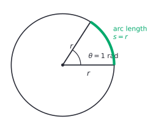

# Radians and the unit circle

After this lesson you can convert between degrees and radians, find arc lengths and sector areas, and find the exact sine, cosine and tangent of any angle that is a multiple of $30^\circ$ or $45^\circ$.

Before this: [right triangle trigonometry](01-right-triangle-trigonometry.md), [area and circles](../../02-middle-school/06-geometry/02-area-and-circles.md) (arcs and sectors) and [the Pythagorean theorem](../../02-middle-school/06-geometry/04-pythagorean-theorem.md).

## Quick check

Try these first. If you get all three right, skip to [Practice](#practice).

1. Convert $150^\circ$ to radians, and $\frac{5\pi}{4}$ radians to degrees.
2. A sector has radius 8 cm and central angle $\frac{3\pi}{4}$. Find its arc length and its area.
3. Find the exact values of $\cos 240^\circ$ and $\sin\frac{5\pi}{3}$.

<details class="solution" markdown>
<summary>Answers</summary>

1. Multiply degrees by $\frac{\pi}{180}$: $150 \cdot \frac{\pi}{180} = \frac{5\pi}{6}$. Multiply radians by $\frac{180}{\pi}$: $\frac{5\pi}{4} \cdot \frac{180}{\pi} = 225^\circ$.
2. Arc length $s = r\theta = 8 \cdot \frac{3\pi}{4} = 6\pi \approx 18.85$ cm. Area $\frac{1}{2}r^2\theta = \frac{1}{2} \cdot 64 \cdot \frac{3\pi}{4} = 24\pi \approx 75.40$ cm$^2$.
3. The angle $240^\circ$ is in quadrant III with reference angle $60^\circ$, and cosine is negative there, so $\cos 240^\circ = -\frac{1}{2}$. The angle $\frac{5\pi}{3}$ is $300^\circ$, in quadrant IV with reference angle $60^\circ$, and sine is negative there, so $\sin\frac{5\pi}{3} = -\frac{\sqrt{3}}{2}$.

</details>

## The idea

Degrees divide a full turn into 360 pieces, and the number 360 is a convention (it divides evenly by many numbers). A circle itself suggests a more natural way to measure an angle: by how far you walk along the circle. Stand at the centre of a circle of radius $r$, open your arms to some angle, and look at the piece of the circle between your hands. The longer that arc, the bigger the angle. Better, the ratio of the arc length to the radius doesn't depend on how big the circle is, because a bigger circle scales both lengths by the same factor. That ratio is the angle.

On a circle of radius 1, the ratio is just the arc length. An angle that cuts off an arc of length 1 is one radian. A full turn cuts off the whole circumference, which is $2\pi \cdot 1 = 2\pi$, so a full turn is $2\pi$ radians, about 6.28.

The same picture gives trigonometry a definition that works for every angle. Right triangles only contain acute angles, but you can walk any distance around a circle, forwards or backwards, past a full turn or not. The point where you end up has two coordinates, and those are the cosine and the sine of the angle. For acute angles this agrees with SOH CAH TOA from the last lesson.



## Definitions

A **radian** is the angle at the centre of a circle that cuts off an arc whose length equals the radius. More generally, if an arc of length $s$ on a circle of radius $r$ is cut off by a central angle of $\theta$ radians, then

$$
\theta = \frac{s}{r}.
$$

In plain words, the angle in radians is the arc length measured in radiuses. Since $s$ and $r$ are both lengths, $\theta$ is a ratio with no unit, and "rad" is often left out: "an angle of 2" means 2 radians. A full turn is $\frac{2\pi r}{r} = 2\pi$ radians, so

$$
360^\circ = 2\pi \text{ radians}, \qquad 180^\circ = \pi \text{ radians}.
$$

The **unit circle** is the circle of radius 1 centred at the origin of the coordinate plane. It consists of the points $(x, y)$ with $x^2 + y^2 = 1$. In plain words, it is every point at distance 1 from the origin.

An angle is in **standard position** when its vertex is at the origin and its initial side lies along the positive $x$-axis. A positive angle is measured counterclockwise from the initial side and a negative angle clockwise. The other side of the angle is its terminal side. Two angles are **coterminal** when they have the same terminal side, which happens exactly when they differ by a whole number of full turns: $\theta$ and $\theta + 2\pi k$ for an integer $k$ (or $\theta + 360^\circ k$ in degrees).

For any angle $\theta$ in standard position, let $P$ be the point where the terminal side crosses the unit circle. The **cosine** and **sine** of $\theta$ are the coordinates of $P$, and the **tangent** is their quotient:

$$
P = (\cos\theta, \sin\theta), \qquad \tan\theta = \frac{\sin\theta}{\cos\theta} \quad (\cos\theta \ne 0).
$$

In plain words, cosine is the horizontal position and sine is the vertical position of the point you reach after walking an arc of length $\theta$ from $(1, 0)$. The tangent is the slope of the terminal side, rise over run. It is undefined where $\cos\theta = 0$, at $\frac{\pi}{2}$, $\frac{3\pi}{2}$ and every angle coterminal with them.

This agrees with the last lesson. For an acute angle $\theta$, drop a perpendicular from $P$ to the $x$-axis. That makes a right triangle with hypotenuse 1, adjacent side $x$ and opposite side $y$, so $\cos\theta = \frac{x}{1}$ and $\sin\theta = \frac{y}{1}$, as before. For a circle of radius $r$ instead of 1, the point is $P = (r\cos\theta, r\sin\theta)$, because scaling the picture by $r$ scales both coordinates by $r$.


The **reference angle** of $\theta$ is the acute angle between the terminal side of $\theta$ and the $x$-axis. In plain words, it is how far the terminal side is from the nearest part of the horizontal axis, always between $0$ and $\frac{\pi}{2}$ (that is, $90^\circ$). The point $P$ for $\theta$ is a reflection of the point for its reference angle across the $x$-axis, the $y$-axis or the origin, so the two points have the same coordinates up to sign. That is why the reference angle gives the size of $\sin\theta$ and $\cos\theta$, and the quadrant gives the signs.

| Quadrant | Angles | $\sin\theta$ | $\cos\theta$ | $\tan\theta$ | Reference angle |
|---|---|---|---|---|---|
| I | $0$ to $\frac{\pi}{2}$ | $+$ | $+$ | $+$ | $\theta$ |
| II | $\frac{\pi}{2}$ to $\pi$ | $+$ | $-$ | $-$ | $\pi - \theta$ |
| III | $\pi$ to $\frac{3\pi}{2}$ | $-$ | $-$ | $+$ | $\theta - \pi$ |
| IV | $\frac{3\pi}{2}$ to $2\pi$ | $-$ | $+$ | $-$ | $2\pi - \theta$ |

The signs follow from the coordinates: cosine is $x$, which is positive on the right of the $y$-axis, and sine is $y$, which is positive above the $x$-axis. Tangent is $\frac{y}{x}$, so it is positive when $x$ and $y$ have the same sign.

## How to do it

### Converting between degrees and radians

Because $180^\circ = \pi$ radians, a conversion is a multiplication by one of two fractions that both equal 1.

1. Degrees to radians: multiply by $\frac{\pi}{180^\circ}$. For example, $60^\circ \cdot \frac{\pi}{180} = \frac{\pi}{3}$.
2. Radians to degrees: multiply by $\frac{180^\circ}{\pi}$. For example, $\frac{3\pi}{4} \cdot \frac{180}{\pi} = 135^\circ$, and $1 \cdot \frac{180}{\pi} \approx 57.3^\circ$.
3. Check: a full turn is $360^\circ$, so an angle of $x$ radians should be about $57.3x$ degrees. An answer to a degrees question that is a multiple of $\pi$ means you stopped halfway.

The angles used most are $30^\circ = \frac{\pi}{6}$, $45^\circ = \frac{\pi}{4}$, $60^\circ = \frac{\pi}{3}$, $90^\circ = \frac{\pi}{2}$ and $180^\circ = \pi$. Every other special angle is a multiple of $\frac{\pi}{6}$ or $\frac{\pi}{4}$.

### Arc length and sector area

The definition $\theta = \frac{s}{r}$ solves for the arc length:

$$
s = r\theta.
$$

A sector is the part of the disc between two radii. The central angle $\theta$ is the fraction $\frac{\theta}{2\pi}$ of a full turn, so the sector takes the same fraction of the disc's area $\pi r^2$:

$$
A = \frac{\theta}{2\pi} \cdot \pi r^2 = \frac{1}{2}r^2\theta.
$$

In plain words, the arc is $r$ times the angle, and the sector is half of $r$ times the arc, the same shape as the triangle area $\frac{1}{2} \cdot \text{base} \cdot \text{height}$ with base $s$ and height $r$. These are the formulas from [area and circles](../../02-middle-school/06-geometry/02-area-and-circles.md#arcs-and-sectors), now with no $360$ in them. They only hold when $\theta$ is in radians. If the angle is given in degrees, convert it first.

### Finding trig values for any angle

1. Reduce the angle by adding or subtracting full turns ($2\pi$ or $360^\circ$) until it lies in $[0, 2\pi)$. For a negative angle, add $2\pi$ until it is positive.
2. Find the quadrant, using the table above.
3. Find the reference angle.
4. Evaluate the function at the reference angle, from the exact values, using this table:

| Reference angle | $0$ | $\frac{\pi}{6}$ | $\frac{\pi}{4}$ | $\frac{\pi}{3}$ | $\frac{\pi}{2}$ |
|---|---|---|---|---|---|
| Degrees | $0^\circ$ | $30^\circ$ | $45^\circ$ | $60^\circ$ | $90^\circ$ |
| $\sin$ | $0$ | $\frac{1}{2}$ | $\frac{\sqrt{2}}{2}$ | $\frac{\sqrt{3}}{2}$ | $1$ |
| $\cos$ | $1$ | $\frac{\sqrt{3}}{2}$ | $\frac{\sqrt{2}}{2}$ | $\frac{1}{2}$ | $0$ |
| $\tan$ | $0$ | $\frac{\sqrt{3}}{3}$ | $1$ | $\sqrt{3}$ | undefined |

5. Attach the sign from the quadrant.
6. Check: the size of an answer should be at most 1 for sine and cosine, and the sign should match the position of the point on the circle.

The two figures below show every multiple of $30^\circ$ and $45^\circ$ around the circle. You don't need to memorize them, since the steps above rebuild any of them.


### The Pythagorean identity

The notation $\sin^2\theta$ means $(\sin\theta)^2$.

*Theorem.* For every angle $\theta$,

$$
\sin^2\theta + \cos^2\theta = 1.
$$

What we know: the point $P = (\cos\theta, \sin\theta)$ lies on the unit circle, which is the set of points at distance 1 from the origin.

What we want: $(\cos\theta)^2 + (\sin\theta)^2 = 1$.

The plan: the distance from the origin to $P = (x, y)$ is given by the Pythagorean theorem, $\sqrt{x^2 + y^2}$, and we know it is 1.

The proof: the point $P$ is on the unit circle, so its distance from the origin is 1. By the [distance formula](../../02-middle-school/06-geometry/04-pythagorean-theorem.md#the-distance-between-two-points), the distance from $(0, 0)$ to $(x, y)$ is $\sqrt{x^2 + y^2}$. So $\sqrt{x^2 + y^2} = 1$, and squaring both sides gives $x^2 + y^2 = 1$. Since $x = \cos\theta$ and $y = \sin\theta$, this is $\cos^2\theta + \sin^2\theta = 1$. $\blacksquare$

Looking back: for an acute angle, it is the Pythagorean theorem for the right triangle in the picture, divided by the square of the hypotenuse: $\text{opp}^2 + \text{adj}^2 = \text{hyp}^2$ becomes $\left(\frac{\text{opp}}{\text{hyp}}\right)^2 + \left(\frac{\text{adj}}{\text{hyp}}\right)^2 = 1$. The unit-circle version extends it to every angle. Two things follow at once: $-1 \le \sin\theta \le 1$ and $-1 \le \cos\theta \le 1$, because a coordinate of a point on the circle can't be bigger than the radius; and knowing one of sine and cosine, plus the quadrant, determines the other.

### Why calculus and code use radians

Radians are the unit in which the formulas are simplest. The arc length is $s = r\theta$ with no conversion factor. And for small angles measured in radians, the sine is nearly the angle itself:

| $\theta$ in radians | $\sin\theta$ | $\frac{\sin\theta}{\theta}$ |
|---|---|---|
| $1$ | $0.84147$ | $0.84147$ |
| $0.1$ | $0.09983$ | $0.99833$ |
| $0.01$ | $0.0099998$ | $0.99998$ |

The ratio $\frac{\sin\theta}{\theta}$ approaches 1 as $\theta$ approaches 0. In degrees the same ratio would approach $\frac{\pi}{180} \approx 0.01745$ and every derivative would carry that factor. In calculus the derivative of $\sin x$ is $\cos x$ only when $x$ is in radians. For this reason every programming language's `sin`, `cos` and `tan` take radians, and so do spreadsheets' `SIN` function.

## Worked examples

<div class="example" markdown>

### Example 1: exact values for angles of any size

Find the exact value of (a) $\sin\frac{7\pi}{6}$, (b) $\cos\frac{17\pi}{3}$ and (c) $\tan\left(-\frac{5\pi}{6}\right)$.

(a) Step 1: $\frac{7\pi}{6}$ is already between $0$ and $2\pi$. Step 2: since $\pi = \frac{6\pi}{6}$ and $\frac{3\pi}{2} = \frac{9\pi}{6}$, the angle is between them, so it is in quadrant III. Step 3: the reference angle is $\theta - \pi = \frac{7\pi}{6} - \frac{6\pi}{6} = \frac{\pi}{6}$. Step 4: $\sin\frac{\pi}{6} = \frac{1}{2}$. Step 5: sine is negative in quadrant III, so $\sin\frac{7\pi}{6} = -\frac{1}{2}$.

(b) Step 1: subtract full turns. $\frac{17\pi}{3} - 2\pi = \frac{11\pi}{3}$ and $\frac{11\pi}{3} - 2\pi = \frac{5\pi}{3}$, which is between $0$ and $2\pi$. Step 2: $\frac{5\pi}{3} = 300^\circ$ is in quadrant IV. Step 3: the reference angle is $2\pi - \frac{5\pi}{3} = \frac{\pi}{3}$. Step 4: $\cos\frac{\pi}{3} = \frac{1}{2}$. Step 5: cosine is positive in quadrant IV, so $\cos\frac{17\pi}{3} = \frac{1}{2}$.

(c) Step 1: add one turn to the negative angle: $-\frac{5\pi}{6} + 2\pi = \frac{7\pi}{6}$. Step 2: that is quadrant III. Step 3: the reference angle is $\frac{\pi}{6}$. Step 4: $\tan\frac{\pi}{6} = \frac{\sqrt{3}}{3}$. Step 5: tangent is positive in quadrant III, so $\tan\left(-\frac{5\pi}{6}\right) = \frac{\sqrt{3}}{3}$.

Step 6: check on a calculator in radian mode: $\sin\frac{7\pi}{6} = -0.5$, $\cos\frac{17\pi}{3} = 0.5$ and $\tan\left(-\frac{5\pi}{6}\right) = 0.5774 = \frac{\sqrt{3}}{3}$. Each sign also matches the quadrant. The result in (c) is positive even though the angle is negative: the sign of the angle says which way you turned, not the sign of the function.

</div>

<div class="example" markdown>

### Example 2: converting, and arc length and area of a sector

A lawn sprinkler of reach 6 m sweeps through an angle of $150^\circ$. Find the length of the edge of the wet region along the grass, and the area watered.

First convert to radians: $150^\circ \cdot \frac{\pi}{180} = \frac{5\pi}{6}$. The wet region is a sector with $r = 6$, so

$$
s = r\theta = 6 \cdot \frac{5\pi}{6} = 5\pi \approx 15.71 \text{ m}, \qquad A = \frac{1}{2}r^2\theta = \frac{1}{2} \cdot 36 \cdot \frac{5\pi}{6} = 15\pi \approx 47.12 \text{ m}^2.
$$

Check with fractions of a full turn, as in the earlier lesson. The fraction is $\frac{150}{360} = \frac{5}{12}$. The circumference is $12\pi$ and $\frac{5}{12} \cdot 12\pi = 5\pi$. The disc has area $36\pi$ and $\frac{5}{12} \cdot 36\pi = 15\pi$. Both match.

Now the reverse: a wheel of radius 33 cm turns through 2.5 radians. A point on its rim travels $s = 33 \cdot 2.5 = 82.5$ cm, and in degrees the turn is $2.5 \cdot \frac{180}{\pi} \approx 143.2^\circ$.

</div>

<div class="example" markdown>

### Example 3: using the identity

Suppose $\sin\theta = -\frac{3}{5}$ and $\theta$ is in quadrant III. Find $\cos\theta$ and $\tan\theta$.

By the identity, $\cos^2\theta = 1 - \sin^2\theta = 1 - \frac{9}{25} = \frac{16}{25}$, so $\cos\theta = \pm\frac{4}{5}$. Both signs solve the equation, and the quadrant decides: cosine is negative in quadrant III, so $\cos\theta = -\frac{4}{5}$. Then

$$
\tan\theta = \frac{\sin\theta}{\cos\theta} = \frac{-3/5}{-4/5} = \frac{3}{4}.
$$

Check: the point $\left(-\frac{4}{5}, -\frac{3}{5}\right)$ is in quadrant III, and $\left(-\frac{4}{5}\right)^2 + \left(-\frac{3}{5}\right)^2 = \frac{16 + 9}{25} = 1$. Tangent is positive in quadrant III, as found. A calculator gives the angle in the first quadrant, $\tan^{-1}\left(\frac{3}{4}\right) = 36.87^\circ$, which is the reference angle. The actual angle is $180^\circ + 36.87^\circ = 216.87^\circ$.

</div>

<div class="example" markdown>

### Example 4: a point on a bigger circle (finish it yourself)

A robot arm of length 10 cm is fixed at the origin and rotates to an angle of $\frac{5\pi}{6}$. Find the coordinates of its tip.

The tip is on the circle of radius 10, so its coordinates are $(10\cos\theta, 10\sin\theta)$ with $\theta = \frac{5\pi}{6}$. The angle is in quadrant II, with reference angle $\pi - \frac{5\pi}{6} = \frac{\pi}{6}$. So $\cos\frac{5\pi}{6}$ has the size of $\cos\frac{\pi}{6}$, with the sign of quadrant II, and the same goes for sine.

Finish the coordinates and check them.

<details class="solution" markdown>
<summary>Finish</summary>

In quadrant II, cosine is negative and sine is positive. So $\cos\frac{5\pi}{6} = -\frac{\sqrt{3}}{2}$ and $\sin\frac{5\pi}{6} = \frac{1}{2}$. The tip is at

$$
\left(10 \cdot \left(-\frac{\sqrt{3}}{2}\right),\ 10 \cdot \frac{1}{2}\right) = \left(-5\sqrt{3},\ 5\right) \approx (-8.66,\ 5).
$$

Check: the distance from the origin is $\sqrt{75 + 25} = \sqrt{100} = 10$. The tip is left of the $y$-axis and above the $x$-axis, as quadrant II requires.

</details>

</div>

## Edge cases and common mistakes

<div class="warning" markdown>

Watch out: the mode. A calculator in degree mode treats $\sin 2$ as the sine of $2^\circ$, which is $0.0349$, and a calculator in radian mode treats $\sin 30$ as the sine of 30 radians, which is $-0.988$. The question's unit and the calculator's mode have to agree, every time.

</div>

<div class="warning" markdown>

Watch out: the formulas $s = r\theta$ and $A = \frac{1}{2}r^2\theta$ need radians. With $\theta = 150$ (degrees) in the area formula for $r = 6$, you would get $\frac{1}{2} \cdot 36 \cdot 150 = 2700$ square metres, far more than the whole disc, $36\pi \approx 113$. Convert first, or use the fraction $\frac{\theta}{360^\circ}$ in the earlier form.

</div>

<div class="warning" markdown>

Watch out: the calculator's inverse functions give the reference angle or the principal angle, not necessarily your angle. In Example 3 the calculator returns $36.87^\circ$ from $\tan^{-1}\left(\frac{3}{4}\right)$, but the angle in quadrant III is $216.87^\circ$. Always check the quadrant.

</div>

<div class="warning" markdown>

Watch out: $\sin^2\theta$ means $(\sin\theta)^2$, and it is not $\sin(\theta^2)$ and not $\sin(\sin\theta)$. Also $\sin 2\theta$ is not $2\sin\theta$: at $\theta = 30^\circ$ the first is $\sin 60^\circ = 0.866$ and the second is $1$. Sine is not multiplication, so you can't pull a number out of it.

</div>

<div class="warning" markdown>

Watch out: the reference angle is not the same as the angle. The reference angle for $\frac{7\pi}{6}$ is $\frac{\pi}{6}$, and the reference angle is always acute. Using $\frac{7\pi}{6}$ itself as if it were the reference angle gives the wrong size.

</div>

Some cases need care. At the axes the reference angle is $0$ or $\frac{\pi}{2}$, and the point is one of $(\pm 1, 0)$ and $(0, \pm 1)$. So $\sin\pi = 0$, $\cos\pi = -1$ and $\tan\pi = 0$, and the tangent is undefined at $\frac{\pi}{2}$ because the denominator $\cos\frac{\pi}{2}$ is 0. Angles bigger than $2\pi$ and negative angles are fine: the point is found by going around, and the coterminal angle in $[0, 2\pi)$ gives the same values. A decimal angle like $\theta = 2$ is a legitimate angle in radians. It is a little over $\frac{\pi}{2} \approx 1.57$, so it is in quadrant II, and $\cos 2 = -0.416$ is negative, as it should be.

## Tricks and shortcuts

To convert fast, think of $\pi$ as "half a turn". The angle $60^\circ$ is one third of a half-turn, so it is $\frac{\pi}{3}$. The angle $45^\circ$ is a quarter of a half-turn, so $\frac{\pi}{4}$. The angle $270^\circ$ is three halves of a half-turn, so $\frac{3\pi}{2}$.

For signs in the four quadrants, a common phrase is "All Students Take Calculus": starting in quadrant I and going counterclockwise, All functions are positive in I, Sine (and its reciprocal) in II, Tangent in III and Cosine in IV.

For coordinates, remember that cosine comes before sine in the alphabet, just as $x$ comes before $y$. So the pair is (cosine, sine) and not the other way round. Quick checks: at $0$ the point is $(1, 0)$, so $\cos 0 = 1$ and $\sin 0 = 0$; at $\frac{\pi}{2}$ it is $(0, 1)$.

When the angle is a multiple of $\frac{\pi}{2}$, no reference triangle is needed. The values only depend on which axis you land on, so $\sin\frac{3\pi}{2} = -1$ and $\cos 3\pi = -1$.

## In code

Python's `math` module measures angles in radians and has `math.radians` and `math.degrees` for conversion.

<details class="code" markdown>
<summary>In code</summary>

```python
import math

print(math.radians(150), 5 * math.pi / 6)   # 2.6179938779914944 2.6179938779914944
print(math.degrees(1))                      # 57.29577951308232

r, theta = 6, 5 * math.pi / 6
print(r * theta, 0.5 * r**2 * theta)        # 15.707963267948966 47.1238898038469

x, y = math.cos(theta), math.sin(theta)
print(round(x, 4), round(y, 4))             # -0.866 0.5
print(math.isclose(x * x + y * y, 1))       # True

print(math.sin(math.pi))                    # 1.2246467991473532e-16, not 0
print(math.isclose(math.sin(math.pi), 0, abs_tol=1e-12))  # True
```

The value of `math.sin(math.pi)` is about $10^{-16}$ and not 0, because `math.pi` is a float that is a tiny bit off from $\pi$, and floats have limited precision. So compare floats with `math.isclose` and a tolerance, as explained in floating point basics<!-- link: ../../06-cs-math/01-number-representation/04-floating-point-basics.md -->.

</details>

## FAQ

### Why $2\pi$ for a full turn, and not something simpler?

A full turn walks around the whole circumference, and the circumference of a circle of radius 1 is $2\pi$. The number $\pi$ comes from the circle (circumference divided by diameter), so no convention is involved. A half turn is $\pi$, a quarter turn is $\frac{\pi}{2}$. The factor of 2 is there because $\pi$ was defined with the diameter and not the radius.

### Is a radian a unit?

It is a unit in the way a percent is: a ratio of two lengths, so a pure number. That is why you can write "$\theta = 2$" with no unit, and why $r\theta$ comes out in the same unit as $r$ (centimetres times a plain number is centimetres). Writing "rad" is a reminder that the angle is not in degrees, which matters when the number could be read either way.

### Why does the definition work for angles bigger than $90^\circ$ when the triangle doesn't?

A right triangle can have only acute angles, so the definition by sides can't describe $120^\circ$. The coordinates definition can: the point $P$ exists for every angle. For acute angles the two definitions give the same numbers, as shown in [Definitions](#definitions). For other angles the coordinates definition is the definition, and it keeps the rules that matter, like $\sin^2\theta + \cos^2\theta = 1$.

### Why is the derivative of sine only $\cos x$ in radians?

Because the derivative is a limit that involves $\frac{\sin h}{h}$ as $h \to 0$, and that limit is 1 only in radians. If you measure in degrees, $\sin(x^\circ) = \sin\left(\frac{\pi x}{180}\right)$, and the chain rule adds the factor $\frac{\pi}{180}$: the derivative becomes $\frac{\pi}{180}\cos(x^\circ)$. Calculus would still work, but every formula would carry the extra constant, and radians remove it. The details are in differentiation rules<!-- link: ../../05-university-core/02-derivatives/02-differentiation-rules.md -->.

## Practice

### Warm-up

1\. Convert $72^\circ$ to radians and $\frac{7\pi}{12}$ to degrees. Convert $2$ radians to degrees to the nearest tenth.

<details class="solution" markdown>
<summary>Solution</summary>

$72 \cdot \frac{\pi}{180} = \frac{2\pi}{5}$. Next, $\frac{7\pi}{12} \cdot \frac{180}{\pi} = 105^\circ$. Finally, $2 \cdot \frac{180}{\pi} = 114.59\ldots \approx 114.6^\circ$.

Check: $\frac{2\pi}{5} = 1.2566$ and $1.2566 \cdot 57.2958 = 72.0$. Also $2$ radians is a little more than $\frac{\pi}{2} = 1.57$ radians ($90^\circ$), and $114.6^\circ$ is a little more than $90^\circ$.

</details>

2\. Give the exact values of $\sin\frac{\pi}{3}$, $\cos\pi$, $\tan\frac{3\pi}{4}$ and $\sin\frac{5\pi}{6}$.

<details class="solution" markdown>
<summary>Solution</summary>

- $\sin\frac{\pi}{3} = \frac{\sqrt{3}}{2}$, from the table.
- $\cos\pi = -1$, the $x$-coordinate of $(-1, 0)$.
- $\frac{3\pi}{4}$ is in quadrant II with reference angle $\frac{\pi}{4}$, where $\tan\frac{\pi}{4} = 1$. Tangent is negative in quadrant II, so $\tan\frac{3\pi}{4} = -1$.
- $\frac{5\pi}{6}$ is in quadrant II with reference angle $\frac{\pi}{6}$, and sine is positive in quadrant II, so $\sin\frac{5\pi}{6} = \frac{1}{2}$.

Check: $\frac{3\pi}{4} = 135^\circ$, whose point is $\left(-\frac{\sqrt{2}}{2}, \frac{\sqrt{2}}{2}\right)$, and the ratio $y \div x = -1$. A calculator gives $\sin 150^\circ = 0.5$.

</details>

3\. A circle has radius 10 and a sector has central angle 0.6 radians. Find the arc length and the area of the sector.

<details class="solution" markdown>
<summary>Solution</summary>

The arc length is $s = r\theta = 10 \cdot 0.6 = 6$. The area is $\frac{1}{2}r^2\theta = \frac{1}{2} \cdot 100 \cdot 0.6 = 30$.

Check: the area is also $\frac{1}{2}rs = \frac{1}{2} \cdot 10 \cdot 6 = 30$. The angle $0.6$ radians is about $34^\circ$, which is about $\frac{1}{10.5}$ of a turn, and one tenth of the area of the disc $100\pi = 314$ is about 31.

</details>

### Standard

4\. Find the exact values of (a) $\cos\frac{13\pi}{6}$, (b) $\sin\left(-\frac{\pi}{4}\right)$, (c) $\tan\frac{4\pi}{3}$ and (d) $\cos 315^\circ$.

<details class="solution" markdown>
<summary>Solution</summary>

(a) $\frac{13\pi}{6} - 2\pi = \frac{\pi}{6}$, in quadrant I, so $\cos\frac{13\pi}{6} = \cos\frac{\pi}{6} = \frac{\sqrt{3}}{2}$.

(b) $-\frac{\pi}{4} + 2\pi = \frac{7\pi}{4}$, in quadrant IV with reference angle $\frac{\pi}{4}$. Sine is negative there, so $\sin\left(-\frac{\pi}{4}\right) = -\frac{\sqrt{2}}{2}$.

(c) $\frac{4\pi}{3}$ is in quadrant III with reference angle $\frac{\pi}{3}$, and tangent is positive there, so $\tan\frac{4\pi}{3} = \tan\frac{\pi}{3} = \sqrt{3}$.

(d) $315^\circ$ is in quadrant IV with reference angle $45^\circ$, and cosine is positive there, so $\cos 315^\circ = \frac{\sqrt{2}}{2}$.

Check with a calculator in radian mode (degree mode for (d)): $0.8660$, $-0.7071$, $1.7321$ and $0.7071$, matching $\frac{\sqrt{3}}{2}$, $-\frac{\sqrt{2}}{2}$, $\sqrt{3}$ and $\frac{\sqrt{2}}{2}$.

</details>

5\. If $\cos\theta = \frac{5}{13}$ and $\theta$ is in quadrant IV, find $\sin\theta$ and $\tan\theta$.

<details class="solution" markdown>
<summary>Solution</summary>

By the identity, $\sin^2\theta = 1 - \frac{25}{169} = \frac{144}{169}$, so $\sin\theta = \pm\frac{12}{13}$. Sine is negative in quadrant IV, so $\sin\theta = -\frac{12}{13}$. Then $\tan\theta = \frac{-12/13}{5/13} = -\frac{12}{5}$.

Check: $\left(\frac{5}{13}\right)^2 + \left(-\frac{12}{13}\right)^2 = \frac{25 + 144}{169} = 1$. The tangent is negative in quadrant IV, as expected. This is the 5-12-13 triangle again.

</details>

6\. The minute hand of a clock is 12 cm long. How far does its tip travel in 20 minutes, and how much area does the hand sweep?

<details class="solution" markdown>
<summary>Solution</summary>

In 20 minutes the hand turns $\frac{20}{60} = \frac{1}{3}$ of a full turn, which is $\theta = \frac{2\pi}{3}$. The tip travels $s = r\theta = 12 \cdot \frac{2\pi}{3} = 8\pi \approx 25.13$ cm. The area swept is $\frac{1}{2}r^2\theta = \frac{1}{2} \cdot 144 \cdot \frac{2\pi}{3} = 48\pi \approx 150.80$ cm$^2$.

Check: one third of the circumference $24\pi$ is $8\pi$, and one third of the area $144\pi$ is $48\pi$.

</details>

### Challenge

7\. A chord joins the ends of an arc of a circle of radius $r$ with central angle $\theta$. (a) Show that the chord has length $2r\sin\frac{\theta}{2}$ (for $0 < \theta < \pi$). (b) For $r = 5$ and $\theta = \frac{2\pi}{3}$, compare the chord with the arc.

<details class="solution" markdown>
<summary>Solution</summary>

(a) Draw the radius that bisects the angle. It is the perpendicular bisector of the chord, because the triangle formed by the two radii and the chord is isosceles. That splits the isosceles triangle into two right triangles, each with hypotenuse $r$ and angle $\frac{\theta}{2}$ at the centre. The side opposite $\frac{\theta}{2}$ is half the chord, so $\sin\frac{\theta}{2} = \frac{\text{chord}/2}{r}$ and the chord is $2r\sin\frac{\theta}{2}$.

(b) The chord is $2 \cdot 5 \cdot \sin\frac{\pi}{3} = 10 \cdot \frac{\sqrt{3}}{2} = 5\sqrt{3} \approx 8.66$. The arc is $s = r\theta = 5 \cdot \frac{2\pi}{3} = \frac{10\pi}{3} \approx 10.47$. The arc is longer, since a straight segment is the shortest path.

Check: the same chord by the distance formula between $(5, 0)$ and $5\left(\cos\frac{2\pi}{3}, \sin\frac{2\pi}{3}\right) = (-2.5, 4.33)$ is $\sqrt{7.5^2 + 4.33^2} = \sqrt{75} = 8.66$.

</details>

8\. (Reviews [the Pythagorean theorem](../../02-middle-school/06-geometry/04-pythagorean-theorem.md).) Show that the point $\left(\frac{3}{5}, -\frac{4}{5}\right)$ is on the unit circle. Then find $\sin\theta$, $\cos\theta$ and $\tan\theta$ for the angle $\theta$ in standard position whose terminal side passes through it, and find $\theta$ in radians in $[0, 2\pi)$.

<details class="solution" markdown>
<summary>Solution</summary>

The distance from the origin is $\sqrt{\left(\frac{3}{5}\right)^2 + \left(\frac{4}{5}\right)^2} = \sqrt{\frac{25}{25}} = 1$, so the point is on the unit circle. By definition, $\cos\theta = \frac{3}{5}$, $\sin\theta = -\frac{4}{5}$ and $\tan\theta = -\frac{4}{3}$.

The point is in quadrant IV, with reference angle $\tan^{-1}\left(\frac{4}{3}\right) = 0.9273$ radians ($53.13^\circ$). So $\theta = 2\pi - 0.9273 = 5.3559$ radians, which is $306.87^\circ$.

Check: $\cos 5.3559 = 0.6$ and $\sin 5.3559 = -0.8$ in radian mode. The angle is between $\frac{3\pi}{2} = 4.71$ and $2\pi = 6.28$, which is quadrant IV.

</details>

## Where this shows up

- The next lesson, [graphs of trig functions](03-graphs-of-trig-functions.md), plots $\sin\theta$ and $\cos\theta$ against the angle in radians. [Trig identities and inverse trig](04-trig-identities-and-inverse-trig.md) builds on the identity proved above.
- Complex numbers have a polar form, $r(\cos\theta + i\sin\theta)$, that is the unit circle again (see [complex numbers](../05-quadratics-and-complex-numbers/03-complex-numbers.md)). Rotations in graphics and robotics use the matrix with entries $\cos\theta$ and $\sin\theta$ ([matrix basics](../10-vectors-and-matrices/02-matrix-basics.md)).
- Every language's trig functions take radians, so unit mistakes (degrees passed to `sin`) are a common source of bugs in graphics and simulation code. Calculus uses radians throughout, starting with differentiation rules<!-- link: ../../05-university-core/02-derivatives/02-differentiation-rules.md -->.
