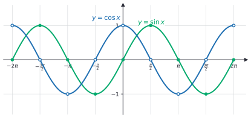
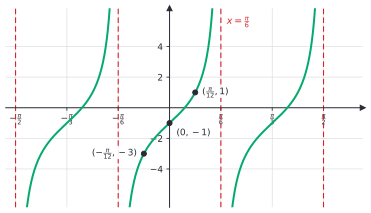
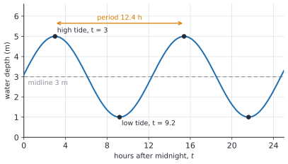

# Graphs of trig functions

After this lesson you can sketch $y = A\sin(B(x - C)) + D$ and the matching cosine and tangent graphs, read amplitude, period, midline and phase shift from an equation, and build a sinusoidal model from data.

Before this: [radians and the unit circle](02-radians-and-the-unit-circle.md) and [transformations of functions](../03-functions/04-transformations-of-functions.md).

## Quick check

Try these first. If you get all three right, skip to [Practice](#practice).

1. For $y = 3\sin\bigl(2(x - \frac{\pi}{4})\bigr) + 1$, state the amplitude, period, midline and phase shift.
2. Write a cosine function with amplitude 2, period 8, midline $y = -1$ and a maximum at $x = 0$.
3. What is the period of $y = \tan x$, and where are its vertical asymptotes?

<details class="solution" markdown>
<summary>Answers</summary>

1. Amplitude $3$, period $\frac{2\pi}{2} = \pi$, midline $y = 1$, and a phase shift of $\frac{\pi}{4}$ to the right.
2. The period 8 gives $B = \frac{2\pi}{8} = \frac{\pi}{4}$, so $y = 2\cos\left(\frac{\pi}{4}x\right) - 1$. Cosine already has its maximum at $x = 0$, so there is no shift.
3. The period is $\pi$, and the asymptotes are at $x = \frac{\pi}{2} + k\pi$ for every integer $k$, where $\cos x = 0$.

</details>

## The idea

Picture a point travelling around the unit circle at a steady speed, and watch only its height. The height rises from 0 to 1, falls back through 0 to $-1$ and rises to 0 again, then repeats for every lap. If you plot that height against the angle travelled, you get the graph of the sine function, a wave. Watching the horizontal position instead gives the cosine, the same wave starting a quarter-lap earlier.

Many real quantities behave like this. The hours of daylight in Toronto climb to a peak in June and sink to a low in December, then do it again the next year. The depth of water in a harbour rises and falls with the tide. The voltage from a wall socket and the position of a speaker cone playing a pure note follow the same shape. In each case, a few numbers describe the whole wave: how high it goes, how low it goes, how long one cycle takes, and where in the cycle you start. These are the four numbers in $y = A\sin(B(x - C)) + D$.



## Definitions

A function $f$ is **periodic** if there is a positive number $p$ such that $f(x + p) = f(x)$ for every $x$ in its domain. The smallest such $p$ is the **period**. In plain words, the graph repeats itself exactly every $p$ units along the $x$-axis, and the period is the length of one full cycle.

The sine and cosine functions, defined in the last lesson, have domain all real numbers, range $[-1, 1]$, and period $2\pi$, because one lap of the unit circle is $2\pi$ radians. The sine is an odd function ($\sin(-x) = -\sin x$, so its graph has half-turn symmetry about the origin) and the cosine is even ($\cos(-x) = \cos x$, so its graph is symmetric about the $y$-axis). These come from the circle: the angles $x$ and $-x$ give points that are mirror images across the $x$-axis, with the same horizontal position and opposite heights. The two graphs are the same wave shifted: $\cos x = \sin\left(x + \frac{\pi}{2}\right)$.

The tangent function, $\tan x = \frac{\sin x}{\cos x}$, has domain all real numbers except $x = \frac{\pi}{2} + k\pi$ for integers $k$, and range all real numbers. Its period is $\pi$, not $2\pi$. A **vertical asymptote** is a vertical line that the graph approaches without touching, getting arbitrarily close to it while the values grow without bound in size. The tangent has one at each $x$ where $\cos x = 0$, because there the quotient divides a nonzero number by zero.

A **sinusoidal function** is a function of the form

$$
y = A\sin\bigl(B(x - C)\bigr) + D \qquad \text{or} \qquad y = A\cos\bigl(B(x - C)\bigr) + D.
$$

Its features are named as follows. The **midline** is the horizontal line $y = D$, halfway between the highest and lowest values. The **amplitude** is $\lvert A \rvert$, the distance from the midline to a peak, which is half the distance from the minimum to the maximum. The period is $\frac{2\pi}{\lvert B \rvert}$. The **phase shift** is $C$, the horizontal shift of the wave: to the right when $C$ is positive and to the left when it is negative. In plain words, $D$ lifts the wave, $A$ stretches it vertically, $B$ squeezes it horizontally (a bigger $B$ means shorter cycles), and $C$ slides it sideways.

The amplitude is a distance, so it is never negative. A negative $A$ doesn't change the amplitude; it flips the wave upside down. The **frequency** is the number of cycles per unit of $x$, which is $\frac{1}{\text{period}}$. It is the quantity that signal processing and audio work with, so a note of 440 cycles per second has period $\frac{1}{440}$ s.


The form $B(x - C)$ is the same one as in [transformations of functions](../03-functions/04-transformations-of-functions.md#why-the-inside-acts-backwards). The sine is the parent function, and the four numbers are its four transformations: shift up by $D$, stretch vertically by $\lvert A \rvert$ (and reflect if $A < 0$), compress horizontally by the factor $\frac{1}{\lvert B \rvert}$, shift right by $C$. Factoring $B$ out of the bracket matters: the shift is $C$, not the number you get before factoring.

## How to do it

### Sketching a sinusoidal graph

1. Write the function in the form $A\sin(B(x - C)) + D$, factoring $B$ out of the bracket if needed. Make $B$ positive by using $\sin(-u) = -\sin u$, which moves a sign to $A$.
2. Draw the midline $y = D$.
3. Mark the maximum $D + \lvert A \rvert$ and minimum $D - \lvert A \rvert$, then count amplitude upward and downward from the midline.
4. Find the period $p = \frac{2\pi}{B}$. One cycle runs from $x = C$ to $x = C + p$. Divide the cycle into four equal parts of length $\frac{p}{4}$.
5. Plot five key points, at $x = C$, $C + \frac{p}{4}$, $C + \frac{p}{2}$, $C + \frac{3p}{4}$ and $C + p$. For $A > 0$ a sine starts on the midline going up, then goes to the maximum, back to the midline, to the minimum and back to the midline. (For $A < 0$ the pattern is flipped.)
6. Join the points with a smooth curve, rounded at the peaks and not pointed, and repeat the cycle in both directions.
7. Check one point by substituting its $x$ into the equation.

For a cosine, the five points go maximum, midline, minimum, midline, maximum, because the cosine starts at its peak.

### Writing an equation from a graph or from data

1. Find the maximum $M$ and the minimum $m$. Then $A = \frac{M - m}{2}$ and $D = \frac{M + m}{2}$.
2. Find the period $p$ as the distance between two consecutive maxima (or from a maximum to the next minimum, doubled). Then $B = \frac{2\pi}{p}$.
3. Choose cosine if you know where a maximum is, and put $C$ at that $x$. Choose sine if you know where the wave crosses the midline going up, and put $C$ there.
4. Substitute a data point that you did not use to build it, and compare.

Either choice gives the same wave. Cosine with a maximum at $x = h$ is the same as sine with the shift $h - \frac{p}{4}$, since $\cos u = \sin\left(u + \frac{\pi}{2}\right)$.

### The tangent graph

The tangent has no amplitude, because it is not bounded. The function $y = A\tan(B(x - C)) + D$ has period $\frac{\pi}{\lvert B \rvert}$, and one branch of the curve sits between each pair of consecutive asymptotes.

1. Find the asymptotes: they are where $B(x - C) = \frac{\pi}{2} + k\pi$, which gives $x = C + \frac{\pi}{2B} + \frac{k\pi}{B}$. Draw them as dashed vertical lines.
2. Between two asymptotes, the centre of the branch is at the midpoint. There, $\tan$ is 0, so the curve passes through $(x, D)$.
3. Halfway between the centre and each asymptote, the tangent is $\pm 1$, so the curve passes through points at heights $D + A$ and $D - A$.
4. Draw the branch rising (for $A > 0$) from near the lower asymptote through those three points and up towards the upper asymptote. Repeat.


Near an asymptote the values grow without bound. For example, $\tan 1.5 = 14.1$, $\tan 1.57 = 1255.8$ and $\tan(1.5707) = 10381$. Just to the right of $\frac{\pi}{2}$ the tangent is a very large negative number, for example $\tan 1.5708 = -272{,}241$. So the graph has separate branches, one between each pair of asymptotes.

## Worked examples

<div class="example" markdown>

### Example 1: sketch a transformed sine

Sketch two cycles of $y = 3\sin\bigl(2(x - \frac{\pi}{4})\bigr) + 1$.

Step 1: it is already in the form $A\sin(B(x - C)) + D$ with $A = 3$, $B = 2$, $C = \frac{\pi}{4}$ and $D = 1$.

Step 2: the midline is $y = 1$.

Step 3: the maximum is $1 + 3 = 4$ and the minimum is $1 - 3 = -2$.

Step 4: the period is $\frac{2\pi}{2} = \pi$. One cycle runs from $x = \frac{\pi}{4}$ to $x = \frac{5\pi}{4}$, and each quarter is $\frac{\pi}{4}$.

Step 5: the five key points, starting from the left end of the cycle, are

$$
\left(\tfrac{\pi}{4}, 1\right),\ \left(\tfrac{\pi}{2}, 4\right),\ \left(\tfrac{3\pi}{4}, 1\right),\ \left(\pi, -2\right),\ \left(\tfrac{5\pi}{4}, 1\right).
$$

Step 6: join them with a smooth curve and repeat the cycle. The figure above in [Definitions](#definitions) shows the result.

Step 7: check one point by substitution. At $x = \frac{\pi}{2}$ the bracket is $2\left(\frac{\pi}{2} - \frac{\pi}{4}\right) = \frac{\pi}{2}$ and $3\sin\frac{\pi}{2} + 1 = 4$, as plotted. A tempting mistake is to read the shift as $\frac{\pi}{2}$ from $\sin(2x - \frac{\pi}{2})$: that is the same function, but it has to be factored as $\sin(2(x - \frac{\pi}{4}))$ before the shift can be read off.

</div>

<div class="example" markdown>

### Example 2: modelling the hours of daylight in Toronto

Sunrisesunset.io's Toronto page for 2026 lists the longest day, June 21, as 15 h 27 min of daylight, and the shortest, December 21, as 8 h 55 min (source: [sunrisesunset.io, Toronto](https://sunrisesunset.io/ca/ontario/toronto-county/), read in October 2026). It also lists 11 h 48 min on October 1 and 10 h 22 min on October 31. Build a model $L(t)$ for the hours of daylight on day $t$ of the year (January 1 is day 1) and test it on the October values.

Step 1: in hours, the maximum is $15 + \frac{27}{60} = 15.45$ and the minimum is $8 + \frac{55}{60} = 8.92$. Then $A = \frac{15.45 - 8.92}{2} = 3.27$ and the midline is $D = \frac{15.45 + 8.92}{2} = 12.18$ hours. The midline is a little above 12 hours, which is fine: it is only the average of the two extremes.

Step 2: a year is 365 days, so $B = \frac{2\pi}{365}$.

Step 3: the maximum is on June 21, which is day 172 ($31 + 28 + 31 + 30 + 31 = 151$ days to the end of May, plus 21). Cosine has its maximum where the bracket is 0, so use $C = 172$:

$$
L(t) = 3.27\cos\left(\frac{2\pi}{365}(t - 172)\right) + 12.18.
$$

Step 4: test on data that wasn't used. October 1 is day 274 and October 31 is day 304. Then $L(274) = 11.58$ hours, which is 11 h 35 min, and the listed value is 11 h 48 min, 13 minutes more. And $L(304) = 10.07$ hours, which is 10 h 4 min, against 10 h 22 min listed, 18 minutes more. The model is within 20 minutes of the data.

That is a typical result: a sinusoid is a good first model for something periodic, and not an exact one. The real curve is not a perfect cosine, and in October both listed values sit above the model. Use the model to predict: on March 20 (day 79), $L(79) = 12.08$ hours, about 12 h 5 min, close to the 12 hours you would expect near an equinox.


</div>

<div class="example" markdown>

### Example 3: a tangent with a stretch and a shift

Sketch one full branch of $y = 2\tan(3x) - 1$ and find its asymptotes.

The period is $\frac{\pi}{3}$. The asymptotes are where $3x = \frac{\pi}{2} + k\pi$, that is, $x = \frac{\pi}{6} + \frac{k\pi}{3}$, so for example at $x = -\frac{\pi}{6}$ and $x = \frac{\pi}{6}$. The branch between them is centred at $x = 0$, where $y = 2\tan 0 - 1 = -1$. Halfway towards each asymptote, at $x = \pm\frac{\pi}{12}$, we have $3x = \pm\frac{\pi}{4}$ and $\tan\left(\pm\frac{\pi}{4}\right) = \pm 1$, so $y = 2 \cdot 1 - 1 = 1$ at $x = \frac{\pi}{12}$ and $y = -2 - 1 = -3$ at $x = -\frac{\pi}{12}$.

Check: the three points are $\left(-\frac{\pi}{12}, -3\right)$, $(0, -1)$ and $\left(\frac{\pi}{12}, 1\right)$. They rise by 2 on each side of the centre, as the stretch $A = 2$ says, and the whole curve is 1 lower than the plain tangent because $D = -1$.



</div>

<div class="example" markdown>

### Example 4: a tide (finish it yourself)

The numbers in this example are made up to show the method. In a harbour, the water depth is at most 5 m and at least 1 m. High tide is at $t = 3$ hours after midnight, and the time between high tides is 12.4 hours. Model the depth $d(t)$ in metres and find the depth at $t = 5$.

The maximum is 5 and the minimum is 1, so $A = 2$ and $D = 3$. The period is 12.4 h, so $B = \frac{2\pi}{12.4} \approx 0.5067$. There is a maximum at $t = 3$, so use cosine with $C = 3$:

$$
d(t) = 2\cos\left(\frac{2\pi}{12.4}(t - 3)\right) + 3.
$$

Now find $d(5)$, and find the time of the first low tide, using a half period.

<details class="solution" markdown>
<summary>Finish</summary>

At $t = 5$, the bracket is $\frac{2\pi}{12.4}(2) = 1.0134$ radians, and $\cos 1.0134 = 0.5290$. So $d(5) = 2(0.5290) + 3 = 4.06$ m. A low tide comes half a period after a high tide, at $t = 3 + 6.2 = 9.2$ hours, and there $d(9.2) = 2\cos\pi + 3 = 1$ m.

Check: depth at $t = 5$ should be between the midline and the maximum, since $t = 5$ is a little after high tide, and $4.06$ is. A calculator in radian mode gives the same cosine value.



</details>

</div>

## Edge cases and common mistakes

<div class="warning" markdown>

Watch out: read the shift after factoring. For $y = \sin(2x - \pi)$, the shift is not $\pi$. Factor out the 2: $\sin(2x - \pi) = \sin\bigl(2(x - \frac{\pi}{2})\bigr)$, so the shift is $\frac{\pi}{2}$ to the right. Check with the first point of the cycle: the wave starts when the bracket is 0, and $2x - \pi = 0$ at $x = \frac{\pi}{2}$.

</div>

<div class="warning" markdown>

Watch out: the period is $\frac{2\pi}{B}$, not $2\pi B$. A bigger $B$ means shorter cycles. For $y = \sin(3x)$ the period is $\frac{2\pi}{3}$, so there are three cycles between $0$ and $2\pi$.

</div>

<div class="warning" markdown>

Watch out: the amplitude is never negative, and tangent has none. In $y = -4\cos x$ the amplitude is 4, and the minus sign reflects the graph. The tangent graph is unbounded, so asking for its amplitude has no answer. You can ask for its period, which is $\frac{\pi}{\lvert B \rvert}$ (not $\frac{2\pi}{B}$).

</div>

<div class="warning" markdown>

Watch out: the angle mode again. If you plot $y = \sin x$ on a graphing tool in degree mode, the wave takes 360 units to repeat and looks flat on a window of $-2\pi$ to $2\pi$. A graph in this lesson has $x$ in radians.

</div>

<div class="warning" markdown>

Watch out: don't connect the branches of a tangent graph. The curve is not defined at the asymptotes, so it has separate branches. Joining the end of one branch to the start of the next draws a line that is not part of the graph.

</div>

Some cases to know. If $B$ is negative, rewrite using $\sin(-u) = -\sin u$ or $\cos(-u) = \cos u$ so that $B$ is positive. For example, $y = \sin(-2x) = -\sin(2x)$ and $y = \cos(-2x) = \cos(2x)$. If $A = 0$, the function is the constant $D$. A model like the daylight curve is only good in the range where the data was collected; real quantities don't repeat perfectly and a model tuned to one year drifts as years go by. Answers are often untidy: the amplitude 3.27 and midline 12.18 are measured numbers, and it would be false precision to write them to ten digits.

## Tricks and shortcuts

Five points per cycle are enough to sketch a sinusoid. Memorize the pattern of the unshifted sine: up from the midline, peak at a quarter of the way, midline at a half, trough at three quarters and back at the full cycle. Cosine is the same wave starting a quarter cycle earlier, at the peak.

To find the equation from a graph, read off the highest and lowest points first. The average of their heights is the midline and half their difference is the amplitude. You don't need the equation of any other feature.

To convert between sine and cosine, remember that $\sin x = \cos\left(x - \frac{\pi}{2}\right)$: the sine is the cosine delayed by a quarter of a turn. That means one wave can be written in either form, and you can choose the one with the simpler shift.

For the tangent, the centre of each branch is at the midpoint of its two asymptotes. If you know the period $\frac{\pi}{B}$, the asymptotes are half a period either side of each centre.

## In code

A model is a function, so it can be checked against data in a few lines. The code here evaluates the daylight model from Example 2 at the four listed dates.

<details class="code" markdown>
<summary>In code</summary>

```python
import math

def daylight(t):
    return 3.27 * math.cos(2 * math.pi / 365 * (t - 172)) + 12.18

listed = {"Jun 21": (172, 15 + 27 / 60), "Oct 1": (274, 11 + 48 / 60),
          "Oct 31": (304, 10 + 22 / 60), "Dec 21": (355, 8 + 55 / 60)}

for name, (day, hours) in listed.items():
    model = daylight(day)
    print(name, round(model, 2), round(hours, 2), round((model - hours) * 60), "min")
# Jun 21 15.45 15.45 0 min
# Oct 1 11.58 11.8 -13 min
# Oct 31 10.07 10.37 -18 min
# Dec 21 8.91 8.92 0 min

print(round(daylight(79), 2))  # 12.08
```

A negative last column means the model is below the listed value. In a spreadsheet the same model is `=3.27*COS(2*PI()/365*(A2-172))+12.18`, and it too uses radians. The conversion functions `math.radians` and `math.degrees` are in [radians and the unit circle](02-radians-and-the-unit-circle.md#in-code).

</details>

## FAQ

### Why is the graph of sine a wave and not something with corners?

Because the height of a point moving steadily around a circle changes fastest as it crosses the horizontal axis and slowest at the top and bottom, where it turns around. Near the top the point is moving almost sideways, so its height barely changes, which makes the rounded peak. Calculus makes this precise: the slope of the sine curve is the cosine, which is 0 at every peak.

### Is cosine just sine in disguise?

Yes. Shifting the sine graph left by $\frac{\pi}{2}$ gives the cosine graph exactly: $\cos x = \sin\left(x + \frac{\pi}{2}\right)$. Whether to use sine or cosine in a model is a matter of convenience, and the choice only changes the phase shift.

### Why is the period of tangent $\pi$ and not $2\pi$?

Adding $\pi$ to an angle moves the point to the opposite side of the circle, which changes the signs of both coordinates but not their quotient. So $\tan(x + \pi) = \frac{-\sin x}{-\cos x} = \tan x$. Sine and cosine need a whole lap because each of them changes sign after half a lap.

### Why write $B(x - C)$ and not $Bx - C$?

Because the shift is then readable straight from the equation, and the horizontal transformations act in a clear order: scale by $B$, then shift by $C$. In the form $Bx - C$ the shift is $\frac{C}{B}$, which you would have to compute. Both forms describe the same functions, and you can always factor to move from one to the other.

## Practice

### Warm-up

1\. For $y = -2\cos\left(\frac{\pi}{3}x\right) + 4$, give the amplitude, period, midline, maximum value and minimum value.

<details class="solution" markdown>
<summary>Solution</summary>

The amplitude is $\lvert -2 \rvert = 2$. The period is $\frac{2\pi}{\pi/3} = 6$. The midline is $y = 4$. The maximum is $4 + 2 = 6$ and the minimum is $4 - 2 = 2$. The minus sign means the graph starts at its minimum: at $x = 0$, $y = -2 + 4 = 2$.

Check: at $x = 3$, half a period, the bracket is $\pi$, so $y = -2(-1) + 4 = 6$, the maximum.

</details>

2\. Find the period and the vertical asymptotes of $y = \tan(2x)$, and where it crosses the $x$-axis.

<details class="solution" markdown>
<summary>Solution</summary>

The period is $\frac{\pi}{2}$. The asymptotes are where $2x = \frac{\pi}{2} + k\pi$, so $x = \frac{\pi}{4} + \frac{k\pi}{2}$. The graph crosses the $x$-axis where $2x = k\pi$, that is, $x = \frac{k\pi}{2}$.

Check: the zero at $x = 0$ lies halfway between the asymptotes at $x = -\frac{\pi}{4}$ and $x = \frac{\pi}{4}$, as the centre of a branch should.

</details>

3\. State the range of $y = 5\sin x - 2$ and of $y = 5\sin(4x) - 2$.

<details class="solution" markdown>
<summary>Solution</summary>

The sine takes every value from $-1$ to $1$, so $5\sin x$ takes every value from $-5$ to $5$, and subtracting 2 gives the range $[-7, 3]$. The factor 4 inside only squeezes the graph horizontally and doesn't change which heights are reached, so the range of $y = 5\sin(4x) - 2$ is also $[-7, 3]$.

Check: the midline is $-2$ and the amplitude is 5, so the extremes are $-2 \pm 5 = 3$ and $-7$.

</details>

### Standard

4\. Rewrite $y = \sin(3x - \pi)$ in the form $A\sin(B(x - C)) + D$, and give the period and the shift. Then find $y$ at $x = 1$ both ways.

<details class="solution" markdown>
<summary>Solution</summary>

Factor out $3$: $3x - \pi = 3\left(x - \frac{\pi}{3}\right)$. So $y = \sin\bigl(3(x - \frac{\pi}{3})\bigr)$, with $A = 1$, $B = 3$, $C = \frac{\pi}{3}$ and $D = 0$. The period is $\frac{2\pi}{3}$ and the shift is $\frac{\pi}{3}$ to the right.

Check at $x = 1$: $\sin(3 - \pi) = -0.1411$ and $\sin\bigl(3(1 - \frac{\pi}{3})\bigr) = \sin(3 - \pi) = -0.1411$.

</details>

5\. A Ferris wheel has its lowest point 2 m above the ground and its highest point 22 m above the ground, and it takes 8 minutes for one rotation. A rider is at the lowest point at $t = 0$. Write the height $h(t)$ in metres and find the height after 1 minute.

<details class="solution" markdown>
<summary>Solution</summary>

The midline is $\frac{22 + 2}{2} = 12$ and the amplitude is $\frac{22 - 2}{2} = 10$. The period is 8, so $B = \frac{2\pi}{8} = \frac{\pi}{4}$. At $t = 0$ the rider is at the minimum, so use a reflected cosine with no shift: $h(t) = -10\cos\left(\frac{\pi}{4}t\right) + 12$. After 1 minute, $h(1) = -10\cos\frac{\pi}{4} + 12 = -10 \cdot 0.7071 + 12 = 4.93$ m.

Check: $h(0) = 2$, $h(4) = -10\cos\pi + 12 = 22$ and $h(2) = 12$, the bottom, the top and the middle, as expected.

</details>

6\. Using the daylight model $L(t) = 3.27\cos\left(\frac{2\pi}{365}(t - 172)\right) + 12.18$, estimate the hours of daylight on day 100 (April 10). Is it more or fewer than on day 244 (September 1)?

<details class="solution" markdown>
<summary>Solution</summary>

For day 100, $t - 172 = -72$, and $\frac{2\pi}{365}(-72) = -1.2394$, with $\cos(-1.2394) = 0.3253$. So $L(100) = 3.27(0.3253) + 12.18 = 13.24$ hours, about 13 h 14 min. For day 244, $t - 172 = 72$ and the cosine is the same, so $L(244) = 13.24$ too. The two days are the same number of days (72) before and after the peak, and cosine is even.

Check: both days are between the equinox and the solstice, so the daylight should be between 12.2 and 15.5 hours, and it is. The real curve is not perfectly symmetric, so the actual values differ by a few minutes.

</details>

### Challenge

7\. Using the same model, on which days of the year does Toronto have more than 14 hours of daylight? Give the first and last day number and the dates.

<details class="solution" markdown>
<summary>Solution</summary>

Solve $3.27\cos\left(\frac{2\pi}{365}(t - 172)\right) + 12.18 = 14$. Then $\cos(\cdot) = \frac{1.82}{3.27} = 0.5566$, so the bracket is $\pm\cos^{-1}(0.5566) = \pm 0.9805$ radians (in the interval $[-\pi, \pi]$ around the peak). Then $t - 172 = \pm 0.9805 \cdot \frac{365}{2\pi} = \pm 56.96$. The days are $t = 172 - 56.96 = 115.04$ and $t = 172 + 56.96 = 228.96$. So the model says more than 14 hours of daylight from about day 116 to day 228, which is April 26 to August 16. (Day 115 is April 25 and day 229 is August 17, the days when the model is almost exactly 14 hours.)

Check: $L(115) = 13.998$ and $L(229) = 13.998$, and $L(172) = 15.45$ is higher. The answers are symmetric about day 172, as the cosine model requires: $115 + 229 = 344 = 2 \cdot 172$.

</details>

8\. (Reviews [transformations of functions](../03-functions/04-transformations-of-functions.md).) Describe how $y = -2\sin\left(\frac{1}{2}x - \frac{\pi}{4}\right) + 1$ is obtained from $y = \sin x$, in order. Then find where the point $\left(\frac{\pi}{2}, 1\right)$ of $y = \sin x$ goes, and check it.

<details class="solution" markdown>
<summary>Solution</summary>

Factor: $\frac{1}{2}x - \frac{\pi}{4} = \frac{1}{2}\left(x - \frac{\pi}{2}\right)$. So the function is $-2\sin\left(\frac{1}{2}\left(x - \frac{\pi}{2}\right)\right) + 1$, with $A = -2$, $B = \frac{1}{2}$, $C = \frac{\pi}{2}$ and $D = 1$. Starting from $y = \sin x$: stretch horizontally by a factor of 2 (the period becomes $4\pi$), stretch vertically by a factor of 2, reflect in the $x$-axis, shift right by $\frac{\pi}{2}$ and shift up by 1.

For the point $\left(\frac{\pi}{2}, 1\right)$: the horizontal stretch sends $x = \frac{\pi}{2}$ to $\pi$, and the shift sends it to $\pi + \frac{\pi}{2} = \frac{3\pi}{2}$. The height 1 becomes $-2(1) + 1 = -1$. So the image is $\left(\frac{3\pi}{2}, -1\right)$.

Check: $-2\sin\left(\frac{1}{2} \cdot \frac{3\pi}{2} - \frac{\pi}{4}\right) + 1 = -2\sin\frac{\pi}{2} + 1 = -1$.

</details>

## Where this shows up

- The next lesson, [trig identities and inverse trig](04-trig-identities-and-inverse-trig.md), solves equations such as $\sin x = \frac{1}{2}$, which asks where a horizontal line meets the wave, and it uses the symmetries of these graphs.
- Signals are sums of sinusoids: audio, radio and image compression all describe data by amplitude, frequency and phase (Fourier analysis, in later courses). In economics, seasonal patterns such as monthly retail sales or electricity demand are often modelled with a sinusoid on top of a trend.
- In calculus, you will differentiate and integrate these functions, and the derivative of $\sin x$ being $\cos x$ is why the two graphs are shifted copies of each other (differentiation rules<!-- link: ../../05-university-core/02-derivatives/02-differentiation-rules.md -->).
