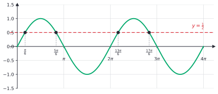

# Trig identities and inverse trig

After this lesson you can prove a trig identity by working one side, use the sum, difference and double-angle formulas, evaluate inverse trig functions, and solve trig equations on an interval and in general.

Before this: [radians and the unit circle](02-radians-and-the-unit-circle.md), [graphs of trig functions](03-graphs-of-trig-functions.md) and [composition and inverse functions](../03-functions/05-composition-and-inverse-functions.md).

## Quick check

Try these first. If you get all three right, skip to [Practice](#practice).

1. Simplify $\tan x \cos x$.
2. Find the exact values of $\sin^{-1}\left(-\frac{1}{2}\right)$ and $\cos^{-1}\left(-\frac{1}{2}\right)$, in radians.
3. Solve $\sin x = \frac{\sqrt{2}}{2}$ for $x$ in $[0, 2\pi)$.

<details class="solution" markdown>
<summary>Answers</summary>

1. Since $\tan x = \frac{\sin x}{\cos x}$, the product is $\frac{\sin x}{\cos x} \cdot \cos x = \sin x$.
2. The inverse sine returns an angle in $\left[-\frac{\pi}{2}, \frac{\pi}{2}\right]$, so $\sin^{-1}\left(-\frac{1}{2}\right) = -\frac{\pi}{6}$. The inverse cosine returns an angle in $[0, \pi]$, so $\cos^{-1}\left(-\frac{1}{2}\right) = \frac{2\pi}{3}$.
3. Sine is positive in quadrants I and II, with reference angle $\frac{\pi}{4}$, so $x = \frac{\pi}{4}$ and $x = \frac{3\pi}{4}$.

</details>

## The idea

An equation such as $2x + 1 = 7$ is true for one value of $x$. An equation such as $x^2 - 1 = (x - 1)(x + 1)$ is true for every value of $x$, because both sides are the same expression written two ways. Trigonometry has many equations of the second kind. They come from the unit circle, and they let you swap one trig expression for another that is easier to work with. The one you know already is $\sin^2 x + \cos^2 x = 1$.

Why do they matter? Simplifying an expression, solving an equation and integrating a function in calculus are all much easier after you rewrite the expression in a better form. And many identities say something about shapes. The sum formulas describe what happens when you turn a point by one angle and then by another. The double-angle formulas are the special case of turning twice by the same angle.

The second half of the lesson goes the other way. Given a value such as $\frac{1}{2}$, which angle has this sine? Many angles do, because the wave in the last lesson crosses every height again and again. To make "the angle whose sine is $\frac{1}{2}$" a function, with one answer, we pick one stretch of the wave where each height appears exactly once. That is the restricted-domain idea from the lesson on inverse functions. Solving a trig equation then means finding one angle with the inverse and using the symmetries of the circle and the period to find the rest.

## Definitions

The three **reciprocal trig functions** are the cosecant, secant and cotangent:

$$
\csc\theta = \frac{1}{\sin\theta}, \qquad \sec\theta = \frac{1}{\cos\theta}, \qquad \cot\theta = \frac{1}{\tan\theta} = \frac{\cos\theta}{\sin\theta}.
$$

In plain words, each is the reciprocal of a function you already know, defined wherever the denominator isn't 0. For example, $\sec\theta$ is undefined at $\frac{\pi}{2}$, where $\cos\theta = 0$.

An **identity** is an equation that is true for every value of the variable for which both sides are defined. An equation that is true only for some values is a conditional equation, and solving it means finding those values. In plain words, an identity says that two expressions are the same function, written differently. Because "every value for which both sides are defined" is part of the definition, the identity $\tan x + \cot x = \sec x \csc x$ below is only claimed for $x$ that are not multiples of $\frac{\pi}{2}$.

The basic identities are these.

| Name | Identities |
|---|---|
| Quotient | $\tan\theta = \dfrac{\sin\theta}{\cos\theta}$, $\ \cot\theta = \dfrac{\cos\theta}{\sin\theta}$ |
| Reciprocal | $\csc\theta = \dfrac{1}{\sin\theta}$, $\ \sec\theta = \dfrac{1}{\cos\theta}$, $\ \cot\theta = \dfrac{1}{\tan\theta}$ |
| Pythagorean | $\sin^2\theta + \cos^2\theta = 1$, $\ 1 + \tan^2\theta = \sec^2\theta$, $\ 1 + \cot^2\theta = \csc^2\theta$ |
| Even and odd | $\sin(-\theta) = -\sin\theta$, $\ \cos(-\theta) = \cos\theta$, $\ \tan(-\theta) = -\tan\theta$ |
| Cofunction | $\sin\left(\frac{\pi}{2} - \theta\right) = \cos\theta$, $\ \cos\left(\frac{\pi}{2} - \theta\right) = \sin\theta$ |

The second and third Pythagorean identities come from the first by dividing. Dividing $\sin^2\theta + \cos^2\theta = 1$ by $\cos^2\theta$ gives $\tan^2\theta + 1 = \sec^2\theta$, and dividing by $\sin^2\theta$ gives $1 + \cot^2\theta = \csc^2\theta$. The even and odd rules come from the unit circle: the angles $\theta$ and $-\theta$ give points that are mirror images across the $x$-axis. The cofunction rule comes from the formulas below, and from right triangles in the first lesson of this chapter.

An **inverse trig function** undoes a trig function on a restricted domain. Each trig function repeats, so it fails the horizontal line test, and it has no inverse until we choose a piece on which it is one-to-one. The standard pieces are these.

| Function | Restricted domain | Inverse | Domain of inverse | Range of inverse |
|---|---|---|---|---|
| $\sin$ | $\left[-\frac{\pi}{2}, \frac{\pi}{2}\right]$ | $\sin^{-1}$ or $\arcsin$ | $[-1, 1]$ | $\left[-\frac{\pi}{2}, \frac{\pi}{2}\right]$ |
| $\cos$ | $[0, \pi]$ | $\cos^{-1}$ or $\arccos$ | $[-1, 1]$ | $[0, \pi]$ |
| $\tan$ | $\left(-\frac{\pi}{2}, \frac{\pi}{2}\right)$ | $\tan^{-1}$ or $\arctan$ | all real numbers | $\left(-\frac{\pi}{2}, \frac{\pi}{2}\right)$ |

In plain words, $\sin^{-1}(c)$ is "the angle between $-\frac{\pi}{2}$ and $\frac{\pi}{2}$ whose sine is $c$", and the other two are read the same way with their own ranges. Each piece is chosen because it covers every output value exactly once and contains the acute angles. The notation $\sin^{-1}$ is the inverse-function notation from [composition and inverse functions](../03-functions/05-composition-and-inverse-functions.md#restricting-a-domain), and not an exponent: $\sin^{-1}(c)$ is not $\frac{1}{\sin c}$, which is $\csc c$. The names $\arcsin$, $\arccos$ and $\arctan$ avoid that confusion, since the output of an inverse is an arc length on the unit circle.


Because an inverse function undoes the original on the restricted domain, we get these two-way rules. The first of each pair holds for every value in the domain of the inverse. The second holds only on the restricted piece.

$$
\sin(\sin^{-1} x) = x \ \text{ for } -1 \le x \le 1, \qquad \sin^{-1}(\sin x) = x \ \text{ only for } -\tfrac{\pi}{2} \le x \le \tfrac{\pi}{2},
$$

and similarly for cosine on $[0, \pi]$ and tangent on $\left(-\frac{\pi}{2}, \frac{\pi}{2}\right)$.

## How to do it

### Proving an identity

A proof of $L = R$ starts from one side and turns it into the other, with each step justified by an algebra rule or a known identity.

1. Choose a side to work on, usually the more complicated one, since it is easier to simplify than to build up. Don't touch the other side.
2. If you don't see a move, rewrite everything in terms of $\sin$ and $\cos$.
3. Use one step at a time: combine fractions over a common denominator, expand, factor, cancel, or substitute an identity (most often $\sin^2\theta = 1 - \cos^2\theta$ or its relatives).
4. Stop when the side you are working on is exactly the other side.
5. Check at one angle on a calculator. This catches slips, but it is not part of the proof, since agreement at one value doesn't show agreement at all values.

You may also reduce both sides separately to the same middle expression. What you may not do is begin with the equation $L = R$ and operate on both sides.

#### Why not do the same to both sides

It is tempting to treat a claim like an equation to solve: write $L = R$, add, square or multiply both sides, and stop at a true statement like $1 = 1$. This doesn't prove the claim, because you have assumed the claim at the start. Consider the false claim $-1 = 1$. Square both sides and you get $1 = 1$, which is true. The error is that squaring is not reversible: from $1 = 1$ you can't get back to $-1 = 1$. The same trap exists with a trig claim. Suppose someone wants to prove $\sin x = \cos x$ (which is false in general). Squaring both sides gives $\sin^2 x = \cos^2 x$, which is true at $x = \frac{\pi}{4}$, and so a student who stops at some true fact would "prove" a false statement.

The proof is valid only if every step can be reversed. Some steps can, such as adding the same number to both sides. Others can't, such as squaring, multiplying by an expression that might be 0, or taking a function of both sides that isn't one-to-one. Checking each step is extra work, so the standard rule is to work on one side. Then there is only a chain of equalities from $L$ to $R$, each of them true, and nothing has been assumed.

### The sum and difference formulas

*Theorem.* For all angles $a$ and $b$,

$$
\cos(a - b) = \cos a\cos b + \sin a\sin b.
$$

What we know: the distance formula (from the Pythagorean theorem) and the unit-circle definition of sine and cosine. Rotating the plane about the origin doesn't change the distance between two points.

What we want: a formula for $\cos(a - b)$ in terms of the sines and cosines of $a$ and $b$.

The plan: put two points on the unit circle at angles $a$ and $b$ and compute the distance between them in two ways. First directly. Then after rotating the plane by $-b$, which moves one of the points to $(1, 0)$ and the other to the point at angle $a - b$.

The proof: let $P = (\cos a, \sin a)$ and $Q = (\cos b, \sin b)$. The squared distance between them is

$$
d^2 = (\cos a - \cos b)^2 + (\sin a - \sin b)^2 = (\cos^2 a + \sin^2 a) + (\cos^2 b + \sin^2 b) - 2\cos a\cos b - 2\sin a\sin b.
$$

Each pair in brackets is 1, so $d^2 = 2 - 2\cos a\cos b - 2\sin a\sin b$.

Now rotate the picture clockwise by $b$. The point $Q$ goes to $Q' = (1, 0)$ and $P$ goes to $P' = (\cos(a - b), \sin(a - b))$, because the angle of $P$ decreases by $b$. The distance is unchanged, so

$$
d^2 = (\cos(a - b) - 1)^2 + \sin^2(a - b) = \cos^2(a - b) + \sin^2(a - b) + 1 - 2\cos(a - b) = 2 - 2\cos(a - b).
$$

Setting the two expressions for $d^2$ equal, $2 - 2\cos(a - b) = 2 - 2\cos a\cos b - 2\sin a\sin b$, and subtracting 2 and dividing by $-2$ gives the formula. $\blacksquare$


Looking back: the proof is a "compute the same quantity in two ways" argument, and it works for any $a$ and $b$, including obtuse angles. The other formulas follow from this one.

Replace $b$ by $-b$ and use $\cos(-b) = \cos b$ and $\sin(-b) = -\sin b$:

$$
\cos(a + b) = \cos a\cos b - \sin a\sin b.
$$

Next, put $a = \frac{\pi}{2}$ in the difference formula: $\cos\left(\frac{\pi}{2} - b\right) = \cos\frac{\pi}{2}\cos b + \sin\frac{\pi}{2}\sin b = \sin b$, which proves the cofunction identity. Now write $\sin(a + b) = \cos\left(\frac{\pi}{2} - (a + b)\right) = \cos\left(\left(\frac{\pi}{2} - a\right) - b\right)$ and apply the difference formula:

$$
\sin(a + b) = \cos\left(\tfrac{\pi}{2} - a\right)\cos b + \sin\left(\tfrac{\pi}{2} - a\right)\sin b = \sin a\cos b + \cos a\sin b.
$$

Replacing $b$ by $-b$ gives the sine of a difference. The tangent formulas come from dividing sine by cosine. Here is the full list.

| Formula | Statement |
|---|---|
| $\sin(a \pm b)$ | $\sin a\cos b \pm \cos a\sin b$ |
| $\cos(a \pm b)$ | $\cos a\cos b \mp \sin a\sin b$ |
| $\tan(a \pm b)$ | $\dfrac{\tan a \pm \tan b}{1 \mp \tan a\tan b}$ |

In the cosine row, the sign flips: plus on the left gives minus on the right. Setting $b = a$ in the sum formulas gives the double-angle formulas.

### Double-angle formulas

$$
\sin 2\theta = 2\sin\theta\cos\theta, \qquad \cos 2\theta = \cos^2\theta - \sin^2\theta = 2\cos^2\theta - 1 = 1 - 2\sin^2\theta, \qquad \tan 2\theta = \frac{2\tan\theta}{1 - \tan^2\theta}.
$$

The three forms of $\cos 2\theta$ come from the first one and $\sin^2\theta + \cos^2\theta = 1$: replace $\sin^2\theta$ by $1 - \cos^2\theta$ to get $2\cos^2\theta - 1$, or replace $\cos^2\theta$ by $1 - \sin^2\theta$ to get $1 - 2\sin^2\theta$. Rearranged, the last two give the power-reduction formulas

$$
\cos^2\theta = \frac{1 + \cos 2\theta}{2}, \qquad \sin^2\theta = \frac{1 - \cos 2\theta}{2},
$$

which turn a square into a first power of a double angle. Calculus uses them to integrate $\sin^2 x$.

### Solving trig equations

1. Use algebra and identities to rewrite the equation as "some trig function of something equals a number", or as a product of such factors equal to 0. If more than one trig function appears, substitute an identity to leave one (for instance replace $\cos^2 x$ by $1 - \sin^2 x$). Never divide by an expression that can be 0; factor instead.
2. Solve for the trig function. A quadratic in $\sin x$ or $\cos x$ is solved by factoring or by the quadratic formula.
3. For each value, find the angles in one full period, using the unit circle and reference angles. Sine and cosine values have two angles per period (for $\lvert c \rvert < 1$), and tangent has one angle per period $\pi$. The values $\sin x = c$ or $\cos x = c$ with $\lvert c \rvert > 1$ have no solution.
4. To get an interval, list the angles that fall inside it. To get the general solution, add whole periods.
5. If the angle is a multiple such as $2x$, first translate the interval: if $0 \le x < 2\pi$, then $0 \le 2x < 4\pi$, so there are two periods to cover. Solve for $2x$, then divide by 2.
6. Check by substitution, and discard values that make an original expression undefined, or that were introduced by squaring.

The general solutions follow from the unit circle and the period. Let $\alpha$ be the value of the inverse function, and $k$ any integer.

| Equation | General solution |
|---|---|
| $\sin x = c$, $\lvert c \rvert \le 1$ | $x = \alpha + 2\pi k$ or $x = \pi - \alpha + 2\pi k$, where $\alpha = \sin^{-1} c$ |
| $\cos x = c$, $\lvert c \rvert \le 1$ | $x = \pm\alpha + 2\pi k$, where $\alpha = \cos^{-1} c$ |
| $\tan x = c$ | $x = \alpha + \pi k$, where $\alpha = \tan^{-1} c$ |

The two families for sine come from the symmetry of the circle: the points at angles $\alpha$ and $\pi - \alpha$ have the same height. The figure shows $\sin x = \frac{1}{2}$ with $\alpha = \frac{\pi}{6}$. On $[0, 4\pi]$ the wave crosses the line $y = \frac{1}{2}$ four times, at $\frac{\pi}{6}$, $\frac{5\pi}{6}$, $\frac{13\pi}{6}$ and $\frac{17\pi}{6}$, and it keeps crossing it in both directions forever.



## Worked examples

<div class="example" markdown>

### Example 1: proving an identity

Prove that $\tan x + \cot x = \sec x \csc x$ for all $x$ that are not multiples of $\frac{\pi}{2}$.

Step 1: the left side has two terms and the right side has one product. Work on the left, which is the longer one, and leave the right side alone.

Step 2: rewrite in sines and cosines using the quotient identities:

$$
\tan x + \cot x = \frac{\sin x}{\cos x} + \frac{\cos x}{\sin x}.
$$

Step 3: combine over the common denominator $\sin x\cos x$, then use the Pythagorean identity in the numerator:

$$
\frac{\sin x}{\cos x} + \frac{\cos x}{\sin x} = \frac{\sin^2 x + \cos^2 x}{\sin x\cos x} = \frac{1}{\sin x\cos x}.
$$

Step 4: split the fraction and use the reciprocal identities: $\frac{1}{\sin x\cos x} = \frac{1}{\cos x} \cdot \frac{1}{\sin x} = \sec x\csc x$, which is the right side. $\blacksquare$

Step 5: check at $x = \frac{\pi}{6}$: $\tan\frac{\pi}{6} + \cot\frac{\pi}{6} = 0.5774 + 1.7321 = 2.3094$, and $\sec\frac{\pi}{6}\csc\frac{\pi}{6} = 1.1547 \times 2 = 2.3094$. The numbers agree, as they should, but the algebra is the proof. The restriction on $x$ is where both sides are defined: $\tan x$ needs $\cos x \ne 0$ and $\cot x$ needs $\sin x \ne 0$.

</div>

<div class="example" markdown>

### Example 2: exact values from the formulas

(a) Find $\sin 75^\circ$ exactly. Write $75^\circ = 45^\circ + 30^\circ$ and use the sum formula:

$$
\sin 75^\circ = \sin 45^\circ\cos 30^\circ + \cos 45^\circ\sin 30^\circ = \frac{\sqrt{2}}{2} \cdot \frac{\sqrt{3}}{2} + \frac{\sqrt{2}}{2} \cdot \frac{1}{2} = \frac{\sqrt{6} + \sqrt{2}}{4}.
$$

Check: $\frac{2.4495 + 1.4142}{4} = 0.9659$, and a calculator gives $\sin 75^\circ = 0.9659$.

(b) Suppose $\sin\theta = \frac{3}{5}$ and $\theta$ is in quadrant II. Find $\sin 2\theta$, $\cos 2\theta$ and the quadrant of $2\theta$. From the Pythagorean identity, $\cos\theta = -\frac{4}{5}$ (negative in quadrant II). Then

$$
\sin 2\theta = 2 \cdot \frac{3}{5} \cdot \left(-\frac{4}{5}\right) = -\frac{24}{25}, \qquad \cos 2\theta = \cos^2\theta - \sin^2\theta = \frac{16}{25} - \frac{9}{25} = \frac{7}{25}.
$$

With sine negative and cosine positive, $2\theta$ is in quadrant IV. Check: $\left(-\frac{24}{25}\right)^2 + \left(\frac{7}{25}\right)^2 = \frac{576 + 49}{625} = 1$. Also $\theta \approx 143.13^\circ$, so $2\theta \approx 286.26^\circ$, which is in quadrant IV.

</div>

<div class="example" markdown>

### Example 3: inverse functions and the restricted range

Evaluate (a) $\sin^{-1}\left(\sin\frac{5\pi}{6}\right)$, (b) $\cos\left(\sin^{-1}\frac{3}{5}\right)$ and (c) $\tan\left(\cos^{-1}\left(-\frac{1}{2}\right)\right)$.

(a) The angle $\frac{5\pi}{6}$ is outside the range $\left[-\frac{\pi}{2}, \frac{\pi}{2}\right]$ of the inverse sine, so the answer is not $\frac{5\pi}{6}$. First, $\sin\frac{5\pi}{6} = \frac{1}{2}$. Then $\sin^{-1}\left(\frac{1}{2}\right)$ is the angle in the range with sine $\frac{1}{2}$, which is $\frac{\pi}{6}$.

(b) Let $\theta = \sin^{-1}\frac{3}{5}$. It is in $\left[-\frac{\pi}{2}, \frac{\pi}{2}\right]$ with a positive sine, so it is in quadrant I and $\cos\theta > 0$. By the Pythagorean identity, $\cos\theta = \sqrt{1 - \frac{9}{25}} = \frac{4}{5}$.

(c) Let $\theta = \cos^{-1}\left(-\frac{1}{2}\right) = \frac{2\pi}{3}$. Then $\tan\frac{2\pi}{3} = \frac{\sin(2\pi/3)}{\cos(2\pi/3)} = \frac{\sqrt{3}/2}{-1/2} = -\sqrt{3}$.

Check: in a calculator in radian mode, $\sin^{-1}(\sin(5\pi/6)) = 0.5236 = \frac{\pi}{6}$, and $\cos(\sin^{-1}(0.6)) = 0.8$ and $\tan(\cos^{-1}(-0.5)) = -1.7321$. Also $\sin^{-1}(2)$ would be an error, since 2 is outside $[-1, 1]$: no angle has sine 2.

</div>

<div class="example" markdown>

### Example 4: solving equations

Solve $2\cos^2 x - \cos x - 1 = 0$ on $[0, 2\pi)$, and then write the general solution.

Step 1: only cosine appears, so there is nothing to substitute. The left side is a quadratic in $\cos x$.

Step 2: factor: $(2\cos x + 1)(\cos x - 1) = 0$. So $\cos x = -\frac{1}{2}$ or $\cos x = 1$.

Step 3: the equation $\cos x = -\frac{1}{2}$ has the reference angle $\frac{\pi}{3}$ and cosine is negative in quadrants II and III, so $x = \frac{2\pi}{3}$ and $x = \frac{4\pi}{3}$. The equation $\cos x = 1$ gives $x = 0$.

Step 4: on $[0, 2\pi)$ the solutions are $x = 0$, $\frac{2\pi}{3}$ and $\frac{4\pi}{3}$. In general they are $x = 2\pi k$, $x = \pm\frac{2\pi}{3} + 2\pi k$, where $k$ is any integer ($\frac{4\pi}{3}$ is the same as $-\frac{2\pi}{3} + 2\pi$).

Step 6: check $x = \frac{2\pi}{3}$: $2\left(-\frac{1}{2}\right)^2 - \left(-\frac{1}{2}\right) - 1 = \frac{1}{2} + \frac{1}{2} - 1 = 0$. For $x = 0$: $2 - 1 - 1 = 0$.

A second one, where the angle is doubled: solve $\cos 2x = -\frac{\sqrt{3}}{2}$ on $[0, 2\pi)$. By Step 5, $0 \le 2x < 4\pi$. The cosine is $-\frac{\sqrt{3}}{2}$ at the reference angle $\frac{\pi}{6}$ in quadrants II and III, so $2x = \frac{5\pi}{6}, \frac{7\pi}{6}$ in the first turn and $\frac{5\pi}{6} + 2\pi, \frac{7\pi}{6} + 2\pi$ in the second. Dividing by 2 gives $x = \frac{5\pi}{12}, \frac{7\pi}{12}, \frac{17\pi}{12}, \frac{19\pi}{12}$. There are four solutions, not two, because doubling the angle fits two periods into the interval. Check: $\cos\left(2 \cdot \frac{5\pi}{12}\right) = \cos\frac{5\pi}{6} = -\frac{\sqrt{3}}{2}$.

</div>

<div class="example" markdown>

### Example 5: don't divide by a trig function (finish it yourself)

Solve $\sin 2x = \sin x$ on $[0, 2\pi)$.

Step 1: use $\sin 2x = 2\sin x\cos x$ to get $2\sin x\cos x = \sin x$. A common move is to divide by $\sin x$, giving $2\cos x = 1$. That loses the solutions where $\sin x = 0$. Instead move everything to one side and factor:

$$
2\sin x\cos x - \sin x = 0 \quad\Rightarrow\quad \sin x\,(2\cos x - 1) = 0.
$$

So $\sin x = 0$ or $\cos x = \frac{1}{2}$. Now find all the angles in $[0, 2\pi)$ for each, and check them.

<details class="solution" markdown>
<summary>Finish</summary>

The equation $\sin x = 0$ gives $x = 0$ and $x = \pi$. The equation $\cos x = \frac{1}{2}$ has the reference angle $\frac{\pi}{3}$ and cosine is positive in quadrants I and IV, so $x = \frac{\pi}{3}$ and $x = \frac{5\pi}{3}$. The solutions are $x = 0, \frac{\pi}{3}, \pi, \frac{5\pi}{3}$.

Check: at $x = \pi$, $\sin 2\pi = 0 = \sin\pi$. At $x = \frac{5\pi}{3}$, $\sin\frac{10\pi}{3} = \sin\frac{4\pi}{3} = -\frac{\sqrt{3}}{2}$ and $\sin\frac{5\pi}{3} = -\frac{\sqrt{3}}{2}$. Dividing by $\sin x$ would have lost $x = 0$ and $x = \pi$.

</details>

</div>

## Edge cases and common mistakes

<div class="warning" markdown>

Watch out: the sum formulas don't distribute. $\sin(a + b)$ is not $\sin a + \sin b$. At $a = b = 30^\circ$, the left side is $\sin 60^\circ = 0.866$ and the right side is $0.5 + 0.5 = 1$. The same goes for $\cos(a + b)$, and for $\sin 2\theta$, which is not $2\sin\theta$.

</div>

<div class="warning" markdown>

Watch out: working on both sides of a claim you want to prove. Starting from $L = R$ and squaring, multiplying or cross-multiplying until you reach a true statement proves nothing, because false claims also lead to true statements (square $-1 = 1$). Start from one side and reach the other.

</div>

<div class="warning" markdown>

Watch out: $\sin^{-1}(\sin x) = x$ is not always true. The inverse returns the angle in $\left[-\frac{\pi}{2}, \frac{\pi}{2}\right]$, so $\sin^{-1}\left(\sin\frac{5\pi}{6}\right) = \frac{\pi}{6}$, not $\frac{5\pi}{6}$. Likewise $\cos^{-1}(\cos x) = x$ only for $x$ in $[0, \pi]$.

</div>

<div class="warning" markdown>

Watch out: a calculator's inverse gives one answer, but the equation has more. For $\sin x = 0.3$, $\sin^{-1}(0.3) = 0.3047$ is one solution, and $\pi - 0.3047 = 2.8369$ is another in the same period. Use the unit circle to find the second.

</div>

<div class="warning" markdown>

Watch out: squaring can add solutions that don't work. Solve $\sin x + \cos x = 1$ on $[0, 2\pi)$ by squaring: $1 + 2\sin x\cos x = 1$, so $\sin 2x = 0$ and $x = 0, \frac{\pi}{2}, \pi, \frac{3\pi}{2}$. Checking each in the original equation: $x = 0$ gives $0 + 1 = 1$ (works), $x = \frac{\pi}{2}$ gives $1 + 0 = 1$ (works), $x = \pi$ gives $0 - 1 = -1$ (fails) and $x = \frac{3\pi}{2}$ gives $-1 + 0 = -1$ (fails). The solutions are $0$ and $\frac{\pi}{2}$ only.

</div>

Some cases to know. An equation like $\sin x = 2$ or $\cos x = -1.5$ has no solution, since sine and cosine only take values in $[-1, 1]$. The equation $\tan x = c$ has a solution for every real $c$. In a general solution, always say that $k$ is an integer. The functions $\tan$ and $\sec$ are undefined at the odd multiples of $\frac{\pi}{2}$, so those angles are never solutions of an equation that contains them. At $\sin x = 1$, the two families $\alpha + 2\pi k$ and $\pi - \alpha + 2\pi k$ coincide, because $\alpha = \frac{\pi}{2}$, and there is only one solution per period, not two.

## Tricks and shortcuts

If an identity has a sum of squares, think of $\sin^2 + \cos^2 = 1$ first. If it has fractions with $1 \pm \cos x$ or $1 \pm \sin x$ in the denominator, multiply the top and bottom by the conjugate, for example $(1 - \cos x)$, to turn the denominator into $\sin^2 x$. If it has $\tan$, $\sec$ or $\cot$, rewrite in sines and cosines.

To remember the signs in the sum formulas: sine keeps the sign of the angle sum (plus gives plus), and cosine flips it. For the cosine formula a way to remember it is that $\cos(a - b)$ must equal $1$ when $a = b$, and $\cos a\cos a + \sin a\sin a = 1$, which only works with a plus sign on the right.

For the double-angle form to use: if the problem has $\sin\theta$, use $1 - 2\sin^2\theta$; if it has $\cos\theta$, use $2\cos^2\theta - 1$; if it has both, use $\cos^2\theta - \sin^2\theta$.

In solving, a table of the quick angles is faster than a calculator. Sine or cosine values of $\pm\frac{1}{2}$, $\pm\frac{\sqrt{2}}{2}$, $\pm\frac{\sqrt{3}}{2}$, $0$ and $\pm 1$ all come from the reference angles $\frac{\pi}{6}$, $\frac{\pi}{4}$, $\frac{\pi}{3}$, 0 and $\frac{\pi}{2}$, and the quadrant rules give the angles.

## In code

A quick numeric test can't prove an identity but it can quickly catch a wrong one, which is what the check in Step 5 does. The code tests random angles, then shows how the inverse functions return one angle only.

<details class="code" markdown>
<summary>In code</summary>

```python
import math
import random

random.seed(1)
xs = [random.uniform(-6, 6) for _ in range(1000)]

# An identity passes every test.
print(all(math.isclose(math.sin(2 * x), 2 * math.sin(x) * math.cos(x), abs_tol=1e-12) for x in xs))  # True
# A false "identity" fails quickly.
print(all(math.isclose(math.sin(2 * x), 2 * math.sin(x), abs_tol=1e-12) for x in xs))                # False

# The inverse returns one angle, in the principal range.
print(math.asin(math.sin(5 * math.pi / 6)), math.pi / 6)  # 0.5235987755982988 0.5235987755982988

# Both solutions of sin x = 0.5 in [0, 2*pi):
a = math.asin(0.5)
print(round(a, 4), round(math.pi - a, 4))  # 0.5236 2.618
```

If a test passes for many random values, it is evidence and not proof. A function such as $\sin x$ and the line $y = x$ agree to many decimal places for tiny angles but are not equal, so only algebra proves an identity. The library `sympy` can also do symbolic checks, but plain `math` is enough here.

</details>

## FAQ

### Why can't I square both sides to prove an identity?

Because squaring loses information: $a$ and $-a$ have the same square, so from $a^2 = b^2$ you can only conclude $a = \pm b$. A proof must be a chain where each statement follows from the last and the last is what you wanted. If you start from the claim, your chain ends at something true, and that shows only that the claim implies something true, which many false claims do. The details are in [Why not do the same to both sides](#why-not-do-the-same-to-both-sides) above; the proof methods here connect to direct proof<!-- link: ../../04-proofs-and-logic/03-core-proof-methods/01-direct-proof.md --> in the proofs chapter.

### Why is the inverse sine's range $\left[-\frac{\pi}{2}, \frac{\pi}{2}\right]$ and not $[0, \pi]$?

Sine has to be one-to-one on the piece we choose, and both $\left[-\frac{\pi}{2}, \frac{\pi}{2}\right]$ and $\left[\frac{\pi}{2}, \frac{3\pi}{2}\right]$ work. The choice is a convention. The piece around 0 is used because it contains the acute angles and the small negative ones, and the function is increasing there. On $[0, \pi]$ the sine isn't one-to-one: it comes back down. For cosine, $[0, \pi]$ plays the same role, because there it is decreasing and takes each value once.

### Which form of $\cos 2\theta$ should I use?

They are equal, so any form is correct, but one may be shorter. Use $1 - 2\sin^2\theta$ when the rest of the problem is in terms of sine, $2\cos^2\theta - 1$ when it is in terms of cosine, and $\cos^2\theta - \sin^2\theta$ when both appear.

### Why are there infinitely many solutions to a trig equation?

Because the functions are periodic: if $x$ is a solution, so is $x + 2\pi$. The graph meets a horizontal line like $y = \frac{1}{2}$ over and over. A question that gives an interval, such as $[0, 2\pi)$, picks out a finite number of them. If no interval is given, the answer is a general solution with an integer $k$.

## Practice

### Warm-up

1\. Simplify (a) $\tan x\cos x$, (b) $\sec^2 x - \tan^2 x$ and (c) $(1 - \sin x)(1 + \sin x)$.

<details class="solution" markdown>
<summary>Solution</summary>

(a) $\frac{\sin x}{\cos x}\cdot\cos x = \sin x$.

(b) The identity $1 + \tan^2 x = \sec^2 x$ gives $\sec^2 x - \tan^2 x = 1$.

(c) A difference of squares gives $1 - \sin^2 x = \cos^2 x$.

Check at $x = \frac{\pi}{3}$: (a) $\tan\frac{\pi}{3}\cos\frac{\pi}{3} = \sqrt{3}\cdot\frac{1}{2} = 0.866 = \sin\frac{\pi}{3}$. (b) $4 - 3 = 1$. (c) $\left(1 - 0.866\right)\left(1 + 0.866\right) = 0.25 = \cos^2\frac{\pi}{3}$.

</details>

2\. Find the exact values of $\sin^{-1}\left(\frac{\sqrt{3}}{2}\right)$, $\cos^{-1}\left(-\frac{\sqrt{2}}{2}\right)$ and $\tan^{-1}(-1)$.

<details class="solution" markdown>
<summary>Solution</summary>

The inverse sine of $\frac{\sqrt{3}}{2}$ is $\frac{\pi}{3}$, in $\left[-\frac{\pi}{2}, \frac{\pi}{2}\right]$. The inverse cosine of $-\frac{\sqrt{2}}{2}$ is in $[0, \pi]$ with reference angle $\frac{\pi}{4}$ and a negative cosine, so it is $\pi - \frac{\pi}{4} = \frac{3\pi}{4}$. The inverse tangent of $-1$ is $-\frac{\pi}{4}$, in $\left(-\frac{\pi}{2}, \frac{\pi}{2}\right)$.

Check: $\sin\frac{\pi}{3} = 0.866$, $\cos\frac{3\pi}{4} = -0.7071$ and $\tan\left(-\frac{\pi}{4}\right) = -1$.

</details>

3\. Solve $2\cos x = \sqrt{3}$ on $[0, 2\pi)$.

<details class="solution" markdown>
<summary>Solution</summary>

Then $\cos x = \frac{\sqrt{3}}{2}$, with reference angle $\frac{\pi}{6}$. Cosine is positive in quadrants I and IV, so $x = \frac{\pi}{6}$ and $x = \frac{11\pi}{6}$.

Check: $2\cos\frac{\pi}{6} = 2 \cdot 0.866 = 1.732 = \sqrt{3}$, and $\cos\frac{11\pi}{6} = \cos\left(-\frac{\pi}{6}\right)$ is the same.

</details>

### Standard

4\. Prove that $\dfrac{\sin x}{1 + \cos x} + \dfrac{1 + \cos x}{\sin x} = 2\csc x$.

<details class="solution" markdown>
<summary>Solution</summary>

Work on the left side. Combine over the common denominator $\sin x(1 + \cos x)$:

$$
\frac{\sin^2 x + (1 + \cos x)^2}{\sin x(1 + \cos x)} = \frac{\sin^2 x + 1 + 2\cos x + \cos^2 x}{\sin x(1 + \cos x)}.
$$

Use $\sin^2 x + \cos^2 x = 1$ in the numerator: $\frac{2 + 2\cos x}{\sin x(1 + \cos x)} = \frac{2(1 + \cos x)}{\sin x(1 + \cos x)} = \frac{2}{\sin x} = 2\csc x$. $\blacksquare$

Check at $x = 1$ (radian): the left side is $\frac{0.8415}{1.5403} + \frac{1.5403}{0.8415} = 0.5463 + 1.8305 = 2.3768$, and $2\csc 1 = \frac{2}{0.8415} = 2.3768$. The identity holds where $\sin x \ne 0$ and $1 + \cos x \ne 0$.

</details>

5\. Find the exact values of $\cos 105^\circ$ and $\tan 75^\circ$.

<details class="solution" markdown>
<summary>Solution</summary>

Write $105^\circ = 60^\circ + 45^\circ$: $\cos 105^\circ = \cos 60^\circ\cos 45^\circ - \sin 60^\circ\sin 45^\circ = \frac{1}{2}\cdot\frac{\sqrt{2}}{2} - \frac{\sqrt{3}}{2}\cdot\frac{\sqrt{2}}{2} = \frac{\sqrt{2} - \sqrt{6}}{4}$.

Write $75^\circ = 45^\circ + 30^\circ$: $\tan 75^\circ = \frac{\tan 45^\circ + \tan 30^\circ}{1 - \tan 45^\circ\tan 30^\circ} = \frac{1 + \frac{1}{\sqrt{3}}}{1 - \frac{1}{\sqrt{3}}} = \frac{\sqrt{3} + 1}{\sqrt{3} - 1}$. Multiply the top and bottom by $\sqrt{3} + 1$: $\frac{(\sqrt{3} + 1)^2}{3 - 1} = \frac{4 + 2\sqrt{3}}{2} = 2 + \sqrt{3}$.

Check: $\frac{1.4142 - 2.4495}{4} = -0.2588 = \cos 105^\circ$ (negative, since $105^\circ$ is in quadrant II) and $2 + 1.7321 = 3.7321 = \tan 75^\circ$.

</details>

6\. Solve $2\cos^2 x + \sin x - 1 = 0$ on $[0, 2\pi)$.

<details class="solution" markdown>
<summary>Solution</summary>

Two functions appear, so replace $\cos^2 x$ by $1 - \sin^2 x$: $2(1 - \sin^2 x) + \sin x - 1 = 0$, which is $-2\sin^2 x + \sin x + 1 = 0$, or $2\sin^2 x - \sin x - 1 = 0$. Factor: $(2\sin x + 1)(\sin x - 1) = 0$, so $\sin x = -\frac{1}{2}$ or $\sin x = 1$.

For $\sin x = -\frac{1}{2}$, the reference angle is $\frac{\pi}{6}$ and sine is negative in quadrants III and IV: $x = \frac{7\pi}{6}$ and $x = \frac{11\pi}{6}$. For $\sin x = 1$: $x = \frac{\pi}{2}$.

Check $x = \frac{7\pi}{6}$: $2\cos^2\frac{7\pi}{6} = 2 \cdot \frac{3}{4} = 1.5$ and $\sin\frac{7\pi}{6} = -0.5$, so $1.5 - 0.5 - 1 = 0$. Check $x = \frac{\pi}{2}$: $0 + 1 - 1 = 0$.

</details>

### Challenge

7\. Show that $\sin 3\theta = 3\sin\theta - 4\sin^3\theta$. Then use it to check $\sin\frac{\pi}{2}$ with $\theta = \frac{\pi}{6}$.

<details class="solution" markdown>
<summary>Solution</summary>

Write $3\theta = 2\theta + \theta$ and use the sum formula: $\sin 3\theta = \sin 2\theta\cos\theta + \cos 2\theta\sin\theta$. Substitute $\sin 2\theta = 2\sin\theta\cos\theta$ and $\cos 2\theta = 1 - 2\sin^2\theta$:

$$
\sin 3\theta = 2\sin\theta\cos^2\theta + (1 - 2\sin^2\theta)\sin\theta.
$$

Replace $\cos^2\theta$ by $1 - \sin^2\theta$: $2\sin\theta - 2\sin^3\theta + \sin\theta - 2\sin^3\theta = 3\sin\theta - 4\sin^3\theta$. $\blacksquare$

With $\theta = \frac{\pi}{6}$, $\sin\theta = \frac{1}{2}$, so the right side is $3 \cdot \frac{1}{2} - 4 \cdot \frac{1}{8} = \frac{3}{2} - \frac{1}{2} = 1$, and $\sin\frac{3\pi}{6} = \sin\frac{\pi}{2} = 1$.

Check: at $\theta = \frac{\pi}{4}$, the left side is $\sin\frac{3\pi}{4} = 0.7071$ and the right side is $3(0.7071) - 4(0.3536) = 2.1213 - 1.4142 = 0.7071$.

</details>

8\. (Reviews [composition and inverse functions](../03-functions/05-composition-and-inverse-functions.md).) The function $f(x) = 2\sin x + 1$ is restricted to $\left[-\frac{\pi}{2}, \frac{\pi}{2}\right]$. Find its inverse, with the domain and range of the inverse, and check that $f(f^{-1}(2)) = 2$.

<details class="solution" markdown>
<summary>Solution</summary>

On the restricted domain $f$ is one-to-one. Write $y = 2\sin x + 1$ and solve for $x$: $\sin x = \frac{y - 1}{2}$, so $x = \sin^{-1}\left(\frac{y - 1}{2}\right)$, valid because $x$ is in the range of $\sin^{-1}$. Swap the letters: $f^{-1}(x) = \sin^{-1}\left(\frac{x - 1}{2}\right)$.

On $\left[-\frac{\pi}{2}, \frac{\pi}{2}\right]$, $f$ takes values from $2(-1) + 1 = -1$ to $2(1) + 1 = 3$. So the domain of $f^{-1}$ is $[-1, 3]$, and its range is $\left[-\frac{\pi}{2}, \frac{\pi}{2}\right]$.

Check: $f^{-1}(2) = \sin^{-1}\left(\frac{1}{2}\right) = \frac{\pi}{6}$, and $f\left(\frac{\pi}{6}\right) = 2 \cdot \frac{1}{2} + 1 = 2$.

</details>

## Where this shows up

- Integration by parts and trig integrals<!-- link: ../../05-university-core/04-integrals/04-integration-by-parts-and-trig-integrals.md --> uses the double-angle formulas to integrate $\sin^2 x$ and $\cos^2 x$, and inverse trig functions appear as antiderivatives, for example of $\frac{1}{1 + x^2}$.
- The sum formulas are the multiplication rule for rotations: turning by $a$ and then by $b$ is turning by $a + b$. In [complex numbers](../05-quadratics-and-complex-numbers/03-complex-numbers.md) this becomes multiplying the angles, and in graphics it is the composition of rotation matrices.
- The last lesson in the chapter, the optional [law of sines and law of cosines](05-law-of-sines-and-cosines.md), uses the identities from this lesson. Signals and waves (sound, radio) combine sines with different phases, and the sum formulas turn $\sin(\omega t + \varphi)$ into a mix of sine and cosine.
