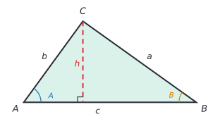
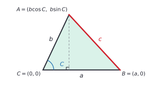

# Law of sines and law of cosines

After this lesson you can find the missing sides and angles of any triangle, including ones with no right angle, and you can tell when the given information fits two triangles, one or none.

This lesson is optional. The rest of the book doesn't depend on it, but it shows where the Pythagorean theorem comes from in general, and it is the standard tool for surveying and navigation problems.

Before this: [right triangle trigonometry](01-right-triangle-trigonometry.md), [radians and the unit circle](02-radians-and-the-unit-circle.md) and [the Pythagorean theorem](../../02-middle-school/06-geometry/04-pythagorean-theorem.md).

## Quick check

Try these first. If you get all three right, skip to [Practice](#practice).

1. In a triangle, $A = 40^\circ$, $B = 65^\circ$ and the side $a$ opposite $A$ is 8. Find the side $b$ opposite $B$.
2. In a triangle, $a = 5$, $b = 7$ and the angle between them is $C = 60^\circ$. Find $c$.
3. Find the area of the triangle in question 2.

<details class="solution" markdown>
<summary>Answers</summary>

1. By the law of sines, $\frac{b}{\sin 65^\circ} = \frac{8}{\sin 40^\circ}$, so $b = \frac{8\sin 65^\circ}{\sin 40^\circ} = 11.28$.
2. By the law of cosines, $c^2 = 25 + 49 - 2(5)(7)\cos 60^\circ = 74 - 35 = 39$, so $c = \sqrt{39} = 6.24$.
3. The area is $\frac{1}{2}ab\sin C = \frac{1}{2}(5)(7)\sin 60^\circ = 15.16$.

</details>

## The idea

Suppose you want the width of a river without crossing it. Stand at a point $P$ on your bank, pick a rock $R$ on the far bank, and walk 150 m along the bank to a point $Q$. You can measure the angles at $P$ and $Q$ between the baseline and the lines of sight to the rock. That gives you a triangle with no right angle: two angles and the side between them. Right-triangle trigonometry doesn't apply directly, because none of the angles is $90^\circ$.

There are two ways to proceed. You can cut the triangle into two right triangles with an altitude, and that is exactly how the laws below are proved. Or you can use the laws directly. The law of sines says that in every triangle the ratio of a side to the sine of its opposite angle is the same for all three sides. The law of cosines is the Pythagorean theorem with a correction term that depends on the angle between the two sides, and the term vanishes when that angle is $90^\circ$.

## Definitions

Label a triangle in the standard way: the vertices (and the angles at them) are $A$, $B$ and $C$, and the side opposite each angle has the matching lowercase letter, $a$, $b$ and $c$. So the side $a$ runs between $B$ and $C$. In plain words, a side and the angle opposite it have the same letter.

The **law of sines** says that in every triangle,

$$
\frac{a}{\sin A} = \frac{b}{\sin B} = \frac{c}{\sin C}.
$$

In plain words, a bigger angle faces a longer side, and the sine of the angle is in proportion to the side.

The **law of cosines** says that in every triangle,

$$
c^2 = a^2 + b^2 - 2ab\cos C,
$$

and by relabelling, the same pattern holds for each of the other sides: $a^2 = b^2 + c^2 - 2bc\cos A$ and $b^2 = a^2 + c^2 - 2ac\cos B$. In plain words, the square of a side is the sum of the squares of the other two sides, minus a correction that uses the angle between those two sides. When $C = 90^\circ$ the cosine is 0 and this is the Pythagorean theorem.

The **area** of a triangle with two sides $a$ and $b$ and the angle $C$ between them is

$$
\text{area} = \frac{1}{2}ab\sin C.
$$

In plain words, it is $\frac{1}{2} \cdot \text{base} \cdot \text{height}$, where the height is worked out from an angle and not measured.

## How to do it

### Why the laws are true

*Theorem (law of sines).* In every triangle, $\frac{a}{\sin A} = \frac{b}{\sin B}$ (and in the same way for the third ratio).

What we know: a triangle $ABC$ with its sides and angles. We can draw the altitude from $C$ to the line $AB$, call its length $h$, and the right triangles it makes obey SOH CAH TOA.

What we want: $\frac{a}{\sin A} = \frac{b}{\sin B}$.

The plan: write $h$ in two ways, once from each of the two right triangles, and equate.

The proof: in the right triangle with the vertex $A$, the altitude $h$ is opposite the angle $A$ and the hypotenuse is $b$, so $\sin A = \frac{h}{b}$ and $h = b\sin A$. In the right triangle with the vertex $B$, the hypotenuse is $a$ and the altitude is opposite $B$, so $h = a\sin B$. Therefore $b\sin A = a\sin B$, and dividing both sides by $\sin A\sin B$ gives $\frac{b}{\sin B} = \frac{a}{\sin A}$. $\blacksquare$



Looking back: the same equation for the pair $(b, c)$ comes from the altitude from $A$, and together they give the full law. If the angle $A$ is obtuse, the foot of the altitude lands outside the side $AB$, on its extension. The right triangle then contains the angle $180^\circ - A$ and $h = b\sin(180^\circ - A)$. Since $\sin(180^\circ - A) = \sin A$ (the points at angles $A$ and $180^\circ - A$ on the unit circle have the same height), the formula $h = b\sin A$ still holds. The same altitude also gives the area: it is $\frac{1}{2} \cdot c \cdot h = \frac{1}{2}cb\sin A$, so the area formula with any two sides and the angle between them.

*Theorem (law of cosines).* In every triangle, $c^2 = a^2 + b^2 - 2ab\cos C$.

What we know: the unit-circle definition of cosine and sine from [radians and the unit circle](02-radians-and-the-unit-circle.md), including the point $(r\cos\theta, r\sin\theta)$ at distance $r$ and angle $\theta$, and the distance formula.

What we want: a formula for $c$ in terms of $a$, $b$ and $C$.

The plan: put the triangle in the coordinate plane with $C$ at the origin and $B$ on the positive $x$-axis, find the coordinates of $A$ with the unit circle definition, and compute the distance $AB$.

The proof: put $C = (0, 0)$ and $B = (a, 0)$. The point $A$ is at distance $b$ from $C$, in the direction of angle $C$ from the positive $x$-axis, so $A = (b\cos C, b\sin C)$. By the distance formula,

$$
c^2 = (b\cos C - a)^2 + (b\sin C - 0)^2 = b^2\cos^2 C - 2ab\cos C + a^2 + b^2\sin^2 C.
$$

Group the terms with $b^2$ and use $\cos^2 C + \sin^2 C = 1$: $c^2 = b^2(\cos^2 C + \sin^2 C) + a^2 - 2ab\cos C = a^2 + b^2 - 2ab\cos C$. $\blacksquare$



Looking back: nothing in the proof assumed that $C$ is acute. If $C$ is obtuse, $\cos C$ is negative, the correction term $-2ab\cos C$ is positive, and $c$ is longer than the Pythagorean value $\sqrt{a^2 + b^2}$, which is what you expect when the angle between two sides opens beyond a right angle. If $C$ is acute, $c$ is shorter. This also proves the claim in the Pythagorean theorem lesson that the sign of the correction term shows whether the angle is acute, right or obtuse.

### Solving a triangle

1. Sketch the triangle and label what is given, using the standard labels (side $a$ opposite angle $A$).
2. Choose the law from what you know, using the table below.
3. Find the missing side or angle.
4. Find the last angle from $A + B + C = 180^\circ$ and then the last side, using either law.
5. Check: the largest angle must face the longest side, and the angles must add to $180^\circ$. A second law gives an independent check.

| Given | Use | Number of triangles |
|---|---|---|
| two angles and a side (AAS or ASA) | law of sines, after finding the third angle | one |
| two sides and the angle between them (SAS) | law of cosines for the third side | one |
| three sides (SSS) | law of cosines for an angle | one, if the triangle inequality holds |
| two sides and an angle not between them (SSA) | law of sines | none, one or two |

For SSS, solve the law of cosines for the cosine: $\cos C = \frac{a^2 + b^2 - c^2}{2ab}$. For the other angles, the law of sines is quicker, but the sine of an angle is the same as the sine of its supplement, so find the largest angle first with the cosine form, which tells you whether it is obtuse. The other two angles must then be acute and the inverse sine gives the right one.

### The ambiguous case (SSA)

Given the angle $A$, the side $a$ opposite it and the side $b$ next to it, the law of sines gives $\sin B = \frac{b\sin A}{a}$. The inverse sine returns an acute angle $B$, but the supplement $180^\circ - B$ has the same sine, so there may be two answers. The figure shows why: swing a segment of length $a$ around the vertex $C$, and it can meet the base line in two places.

Let $h = b\sin A$ be the distance from $C$ to the base line. Then:

| Angle $A$ | Comparison | Triangles |
|---|---|---|
| acute | $a < h$ | none (the side $a$ is too short to reach) |
| acute | $a = h$ | one, a right triangle |
| acute | $h < a < b$ | two |
| acute | $a \ge b$ | one |
| right or obtuse | $a \le b$ | none |
| right or obtuse | $a > b$ | one |


When the case is ambiguous, test the second angle: $B_2 = 180^\circ - B_1$ is valid only if $A + B_2 < 180^\circ$, so that the third angle is positive.

## Worked examples

<div class="example" markdown>

### Example 1: two angles and a side

In triangle $ABC$, $A = 52^\circ$, $B = 63^\circ$ and the side $c = 20$ is between those angles. Find the remaining angle and sides.

Step 1: the side $c$ is opposite $C$ and the given angles are $A$ and $B$, so we know two angles and a side.

Step 2: the table says to use the law of sines, but we need the angle opposite the known side first.

Step 4: $C = 180^\circ - 52^\circ - 63^\circ = 65^\circ$.

Step 3: by the law of sines, $\frac{a}{\sin 52^\circ} = \frac{20}{\sin 65^\circ}$, so $a = \frac{20\sin 52^\circ}{\sin 65^\circ} = 17.39$. In the same way $b = \frac{20\sin 63^\circ}{\sin 65^\circ} = 19.66$.

Step 5: check with the law of cosines, which is a different law: $a^2 + b^2 - 2ab\cos C = 302.4 + 386.6 - 2(17.39)(19.66)\cos 65^\circ = 400.0$, and $c^2 = 400$. The largest angle, $65^\circ$, faces the longest side, 20.

</div>

<div class="example" markdown>

### Example 2: two sides and the angle between them

In triangle $ABC$, $a = 8$, $b = 11$ and $C = 48^\circ$. Find $c$, $A$ and $B$.

The known angle is between the two known sides, so use the law of cosines. Then

$$
c^2 = 8^2 + 11^2 - 2(8)(11)\cos 48^\circ = 185 - 117.77 = 67.23, \qquad c = 8.20.
$$

Now for an angle, use the law of sines: $\sin A = \frac{a\sin C}{c} = \frac{8\sin 48^\circ}{8.20} = 0.7250$, so $A = 46.5^\circ$. Could $A$ be the obtuse angle $180^\circ - 46.5^\circ = 133.5^\circ$? No: $133.5^\circ + 48^\circ$ is already over $180^\circ$. Since $a$ is not the longest side, $A$ isn't the largest angle, and the acute value is right. Then $B = 180^\circ - 48^\circ - 46.5^\circ = 85.5^\circ$.

Check with the law of cosines for $B$: $\cos B = \frac{a^2 + c^2 - b^2}{2ac} = \frac{64 + 67.23 - 121}{2(8)(8.20)} = 0.0781$, so $B = 85.5^\circ$. The longest side, $b = 11$, faces the largest angle.

</div>

<div class="example" markdown>

### Example 3: the ambiguous case

In triangle $ABC$, $A = 30^\circ$, $a = 6$ and $b = 10$. Find all possible triangles.

The angle $A$ is acute and $h = b\sin A = 10 \sin 30^\circ = 5$. Since $h = 5 < a = 6 < b = 10$, there are two triangles.

By the law of sines, $\sin B = \frac{b\sin A}{a} = \frac{10(0.5)}{6} = 0.8333$. The inverse sine gives $B_1 = 56.44^\circ$, and the supplement is $B_2 = 123.56^\circ$. Both leave a positive third angle: $A + B_2 = 153.56^\circ < 180^\circ$.

For $B_1$: $C_1 = 180^\circ - 30^\circ - 56.44^\circ = 93.56^\circ$ and $c_1 = \frac{a\sin C_1}{\sin A} = \frac{6\sin 93.56^\circ}{0.5} = 11.98$.

For $B_2$: $C_2 = 180^\circ - 30^\circ - 123.56^\circ = 26.44^\circ$ and $c_2 = \frac{6\sin 26.44^\circ}{0.5} = 5.34$.

Check with the law of cosines in each triangle: $a^2 = b^2 + c^2 - 2bc\cos A$ gives $100 + 143.5 - 2(10)(11.98)(0.866) = 36.0$ for the first, and $100 + 28.5 - 2(10)(5.34)(0.866) = 36.0$ for the second, and $a^2 = 36$. Both triangles fit the data, as the figure shows: the two base points are $c_1 = 11.98$ and $c_2 = 5.34$ from $A$.

</div>

<div class="example" markdown>

### Example 4: a ship's course (finish it yourself)

A ship leaves port $O$ and sails 25 km on a bearing of $070^\circ$ (measured clockwise from north) to a point $T$. It then turns and sails 18 km on a bearing of $150^\circ$ to a point $E$. How far is $E$ from the port, and on what bearing?

At $T$, the direction back to the port is $070^\circ + 180^\circ = 250^\circ$ and the direction of travel is $150^\circ$, so the angle $\angle OTE$ inside the triangle is $250^\circ - 150^\circ = 100^\circ$. We know two sides, $OT = 25$ and $TE = 18$, and the angle $100^\circ$ between them, so use the law of cosines:

$$
OE^2 = 25^2 + 18^2 - 2(25)(18)\cos 100^\circ = 949 + 156.3 = 1105.3, \qquad OE = 33.25 \text{ km}.
$$

Now find the angle at $O$ between $OT$ and $OE$, then the bearing of $E$, and check your answer.

<details class="solution" markdown>
<summary>Finish</summary>

By the law of sines, $\sin(\angle TOE) = \frac{18\sin 100^\circ}{33.25} = 0.5332$, so $\angle TOE = 32.2^\circ$. It is the acute value, because the triangle already has a $100^\circ$ angle and can't have a second obtuse one. The second leg turns clockwise, so $E$ is clockwise from $T$, and the bearing of $E$ is $70^\circ + 32.2^\circ = 102.2^\circ$. The ship is 33.2 km from the port, on a bearing of about $102^\circ$.

Check with coordinates (east, north): $T = (25\sin 70^\circ, 25\cos 70^\circ) = (23.49, 8.55)$ and $E = T + 18(\sin 150^\circ, \cos 150^\circ) = (23.49 + 9.00, 8.55 - 15.59) = (32.49, -7.04)$. Then $\sqrt{32.49^2 + 7.04^2} = 33.25$, as found, and the bearing $\tan^{-1}\left(\frac{32.49}{-7.04}\right)$ is in the south-east quadrant, $102.2^\circ$ clockwise from north.

</details>

</div>

## Edge cases and common mistakes

<div class="warning" markdown>

Watch out: the inverse sine hides the second angle. If you find $B$ from $\sin B = \frac{b\sin A}{a}$ and stop at the calculator's answer, you may miss a valid obtuse $B$ (Example 3), or you may keep a value that can't fit (Example 2). Always ask whether $180^\circ - B$ also works, by checking that the angle sum stays below $180^\circ$.

</div>

<div class="warning" markdown>

Watch out: in the law of cosines the angle is the one between the two sides, and the side on the left is the one opposite that angle. In $c^2 = a^2 + b^2 - 2ab\cos C$, the angle $C$ faces $c$. Pairing a side with the wrong angle gives a wrong answer with no warning.

</div>

<div class="warning" markdown>

Watch out: the correction is the single term $2ab\cos C$, subtracted from $a^2 + b^2$. A common slip is to subtract $2ab$ first and then multiply by the cosine, or to write $(a + b)^2$ for $a^2 + b^2$. Compute $a^2 + b^2$ and $2ab\cos C$ separately, then subtract.

</div>

<div class="warning" markdown>

Watch out: the angle mode. These formulas work in degrees or radians, but the calculator has to be set to match your numbers. In the wrong mode, $\cos 48$ is $-0.64$ and every result is nonsense with no error message.

</div>

Some special cases. If the three given sides break the triangle inequality, such as $2, 3, 7$, the law of cosines gives a cosine outside $[-1, 1]$ and there is no triangle. If SSA gives $\sin B > 1$, there is no triangle. If it gives $\sin B = 1$, the triangle is a right triangle. If the given angle is obtuse in SSA, at most one triangle exists, since a triangle can't have two obtuse angles. Answers are usually untidy decimals, and rounding the intermediate values causes errors in the last digit, so keep full precision until the end.

## Tricks and shortcuts

To choose a law quickly, look for a matching pair: a side with its opposite angle both known gives the law of sines. If no pair is known, then the law of cosines is the way in, since it needs only the sides and one angle.

When using the law of cosines for an angle, find the largest angle first. The largest angle is opposite the longest side, and the cosine form tells you whether it is obtuse (negative cosine). The other two angles are then acute, so the inverse sine can't mislead you.

A quick test for the type of a triangle uses the sides alone: with $c$ the longest side, $c^2 > a^2 + b^2$ means the angle $C$ is obtuse, $c^2 = a^2 + b^2$ means right and $c^2 < a^2 + b^2$ means acute. This is the sign of the correction term in the law of cosines.

## In code

The ambiguous case is a good function to write: it returns a list of zero, one or two triangles, and it never forgets the second angle.

<details class="code" markdown>
<summary>In code</summary>

```python
import math

def ssa(A, a, b):
    """Every triangle with angle A (degrees), the side a opposite it, and the side b."""
    s = b * math.sin(math.radians(A)) / a       # sin B
    if s > 1:
        return []
    B1 = math.degrees(math.asin(s))
    answers = []
    for B in (B1, 180 - B1):
        C = 180 - A - B
        if C > 1e-9 and (not answers or round(B, 2) != answers[-1][0]):
            c = a * math.sin(math.radians(C)) / math.sin(math.radians(A))
            answers.append((round(B, 2), round(C, 2), round(c, 2)))
    return answers

print(ssa(30, 6, 10))   # [(56.44, 93.56, 11.98), (123.56, 26.44, 5.34)]
print(ssa(30, 5, 10))   # [(90.0, 60.0, 8.66)]
print(ssa(30, 4, 10))   # []
print(ssa(40, 12, 9))   # [(28.82, 111.18, 17.41)]
```

The four calls are the four cases of the table: two triangles, one right triangle, none, and one triangle (when $a \ge b$). The condition on `answers` stops the right-triangle case from being listed twice, since $B$ and $180^\circ - B$ coincide at $90^\circ$.

</details>

## FAQ

### Is the law of cosines a replacement for the Pythagorean theorem?

It contains it. Put $C = 90^\circ$ and $\cos C = 0$, and you get $c^2 = a^2 + b^2$. The theorem is the special case where the correction term disappears. The general version also says by how much a triangle misses being right: the sign of $-2ab\cos C$ tells you whether the angle is obtuse or acute.

### Why does SSA give two triangles but SAS and ASA don't?

In SAS, the angle is between the two sides, so the two sides and the angle fix the third vertex completely. In SSA, the known angle is not between the two known sides, and the side opposite it can swing like a gate: it can meet the base line in two places, as the figure in the lesson shows. The condition $h < a < b$ is what makes the swinging side long enough to reach the base line, but short enough to reach it twice.

### Why $\frac{1}{2}ab\sin C$ and not just $\frac{1}{2} \cdot \text{base} \cdot \text{height}$?

It is the same formula. If the base is $a$, the height is $b\sin C$, the perpendicular distance from the vertex $A$ to the line $BC$. The trigonometric version is useful when you know two sides and the angle between them, and no height.

### Can I use these laws on a right triangle?

Yes, and they agree with SOH CAH TOA. In a right triangle with $C = 90^\circ$ the law of sines gives $\frac{a}{\sin A} = \frac{c}{\sin 90^\circ} = c$, which is $\sin A = \frac{a}{c}$, the definition from the first lesson of the chapter.

## Practice

### Warm-up

1\. In a triangle, $B = 50^\circ$, $C = 70^\circ$ and the side $b = 12$. Find $A$ and the side $c$.

<details class="solution" markdown>
<summary>Solution</summary>

Then $A = 180^\circ - 50^\circ - 70^\circ = 60^\circ$. By the law of sines, $\frac{c}{\sin 70^\circ} = \frac{12}{\sin 50^\circ}$, so $c = \frac{12\sin 70^\circ}{\sin 50^\circ} = 14.72$.

Check: the longest side should face the largest angle. The largest angle is $C = 70^\circ$ and $c = 14.72$ is bigger than $b = 12$. Also, $\frac{a}{\sin 60^\circ}$ with $a = \frac{12\sin 60^\circ}{\sin 50^\circ} = 13.57$ gives the same ratio, 15.67.

</details>

2\. In a triangle, $b = 9$, $c = 12$ and the angle between them is $A = 40^\circ$. Find $a$.

<details class="solution" markdown>
<summary>Solution</summary>

By the law of cosines, $a^2 = 81 + 144 - 2(9)(12)\cos 40^\circ = 225 - 165.46 = 59.54$, so $a = 7.72$.

Check: the angle $40^\circ$ is the smallest of the angles (the side opposite it is the shortest, 7.72 compared with 9 and 12), as it should be, and $a$ is between $12 - 9 = 3$ and $12 + 9 = 21$, which the triangle inequality requires.

</details>

3\. Find the area of a triangle with sides 10 and 13 and the angle $35^\circ$ between them.

<details class="solution" markdown>
<summary>Solution</summary>

The area is $\frac{1}{2}(10)(13)\sin 35^\circ = 65 \times 0.5736 = 37.28$ square units.

Check: the triangle with a right angle between those sides would have area $\frac{1}{2}(10)(13) = 65$, and $\sin 35^\circ$ is a bit over half of 1, so the area should be a bit over half of 65.

</details>

### Standard

4\. A triangle has sides 7, 9 and 12. Find all three angles.

<details class="solution" markdown>
<summary>Solution</summary>

Start with the largest angle, $C$, opposite the longest side 12: $\cos C = \frac{7^2 + 9^2 - 12^2}{2(7)(9)} = \frac{-14}{126} = -0.1111$, so $C = 96.38^\circ$ (obtuse). By the law of sines, $\sin A = \frac{7\sin 96.38^\circ}{12} = 0.5797$, so $A = 35.43^\circ$, and since the other two angles are acute the inverse sine is right. Then $B = 180^\circ - 96.38^\circ - 35.43^\circ = 48.19^\circ$.

Check: the angles add to $180^\circ$, and the smallest angle faces the shortest side (7). The law of cosines for $B$, the angle opposite the side 9, gives $\cos B = \frac{7^2 + 12^2 - 9^2}{2(7)(12)} = \frac{112}{168} = 0.6667$, so $B = 48.19^\circ$, matching.

</details>

5\. In a triangle, $A = 40^\circ$, $a = 7$ and $b = 9$. Find every triangle that fits.

<details class="solution" markdown>
<summary>Solution</summary>

Here $h = 9\sin 40^\circ = 5.79$ and $h < a < b$, so there are two triangles. By the law of sines, $\sin B = \frac{9\sin 40^\circ}{7} = 0.8264$, so $B_1 = 55.73^\circ$ and $B_2 = 124.27^\circ$. Both work, since $40^\circ + 124.27^\circ < 180^\circ$.

For $B_1$: $C_1 = 84.27^\circ$ and $c_1 = \frac{7\sin 84.27^\circ}{\sin 40^\circ} = 10.84$. For $B_2$: $C_2 = 15.73^\circ$ and $c_2 = \frac{7\sin 15.73^\circ}{\sin 40^\circ} = 2.95$.

Check with the law of cosines, $a^2 = b^2 + c^2 - 2bc\cos A$: for $c_1$ it is $81 + 117.4 - 2(9)(10.84)(0.766) = 49.0$, and for $c_2$ it is $81 + 8.7 - 2(9)(2.95)(0.766) = 49.0$, and $a^2 = 49$.

</details>

6\. A surveyor stands at $P$ on one bank of a river and sets a baseline $PQ$ of 150 m along the bank. The angle at $P$ between the baseline and the line to a rock $R$ on the far bank is $48^\circ$, and the angle at $Q$ is $71^\circ$. Find the distance $PR$ and the width of the river (the shortest distance from $R$ to the bank).

<details class="solution" markdown>
<summary>Solution</summary>

The angle at $R$ is $180^\circ - 48^\circ - 71^\circ = 61^\circ$, and the baseline $PQ$ is opposite it. By the law of sines, $\frac{PR}{\sin 71^\circ} = \frac{150}{\sin 61^\circ}$, so $PR = \frac{150\sin 71^\circ}{\sin 61^\circ} = 162.2$ m. The width of the river is the perpendicular distance from $R$ to the bank, which is the altitude: $PR\sin 48^\circ = 162.16 \times 0.7431 = 120.5$ m.

Check: by the other side, $QR = \frac{150\sin 48^\circ}{\sin 61^\circ} = 127.5$, and $QR\sin 71^\circ = 127.45 \times 0.9455 = 120.5$ m, the same width.

</details>

### Challenge

7\. Use the law of cosines to show that angle $C$ is obtuse exactly when $c^2 > a^2 + b^2$. Then classify the triangle with sides 5, 6 and 10 and find its largest angle.

<details class="solution" markdown>
<summary>Solution</summary>

From $c^2 = a^2 + b^2 - 2ab\cos C$ we get $c^2 - (a^2 + b^2) = -2ab\cos C$. Since $2ab > 0$, this is positive exactly when $\cos C < 0$, which happens exactly when $C$ is between $90^\circ$ and $180^\circ$, that is, obtuse. In the same way it is zero when $C = 90^\circ$ and negative when $C$ is acute.

For 5, 6 and 10: $10^2 = 100 > 5^2 + 6^2 = 61$, so the largest angle is obtuse. Then $\cos C = \frac{25 + 36 - 100}{2(5)(6)} = \frac{-39}{60} = -0.65$, so $C = 130.5^\circ$.

Check: the triangle exists because $5 + 6 = 11 > 10$. The other angles come from the law of sines: $\sin A = \frac{5\sin 130.54^\circ}{10} = 0.3801$, so $A = 22.3^\circ$, and $B = 180^\circ - 130.5^\circ - 22.3^\circ = 27.2^\circ$. They are acute, as they must be, and add to $180^\circ$.

</details>

8\. (Reviews [right triangle trigonometry](01-right-triangle-trigonometry.md).) In a triangle, $a = 8$, $b = 11$ and $C = 48^\circ$. Drop an altitude from $B$ to the side $b$, find $c$ using only right-triangle trigonometry and the Pythagorean theorem, and compare with the law of cosines.

<details class="solution" markdown>
<summary>Solution</summary>

The altitude from $B$ meets the side $b$ (which runs from $C$ to $A$) at a foot $F$. In the right triangle $BCF$ with hypotenuse $a = 8$ and the angle $C = 48^\circ$ at $C$, the altitude is $h = 8\sin 48^\circ = 5.945$ and the piece along $b$ is $CF = 8\cos 48^\circ = 5.353$. The rest of the side is $FA = 11 - 5.353 = 5.647$. In the right triangle $BFA$, $c = \sqrt{h^2 + FA^2} = \sqrt{35.34 + 31.89} = \sqrt{67.23} = 8.20$.

The law of cosines gives $c^2 = 64 + 121 - 2(8)(11)\cos 48^\circ = 185 - 117.77 = 67.23$. The two results match, and this is the proof of the law: $h^2 + (b - a\cos C)^2 = a^2\sin^2 C + b^2 - 2ab\cos C + a^2\cos^2 C = a^2 + b^2 - 2ab\cos C$.

Check: $c = 8.20$ is shorter than $\sqrt{8^2 + 11^2} = 13.60$, as it must be for an acute angle $C$.

</details>

## Where this shows up

- Surveying, navigation and GPS positioning solve triangles from measured angles and distances. Triangulation fixes a position from two known points, and the cosine and sine laws are what carry the calculations through.
- The law of cosines is behind the dot product of two vectors, $\mathbf{u}\cdot\mathbf{v} = \lvert\mathbf{u}\rvert\lvert\mathbf{v}\rvert\cos\theta$, which gives the angle between vectors ([vectors in the plane](../10-vectors-and-matrices/01-vectors-in-the-plane.md), then [vectors, dot product and span](../../05-university-core/06-linear-algebra/01-vectors-dot-product-and-span.md)). Cosine similarity in machine learning and search is the same quantity.
- Geometry courses use these laws in proofs about triangles and circles, as in [similarity](../08-geometry-and-proof/03-similarity.md) and [coordinate geometry and circles](../08-geometry-and-proof/04-coordinate-geometry-and-circles.md).
