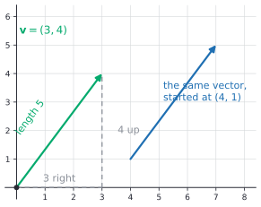
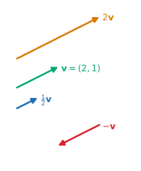
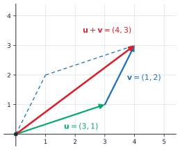
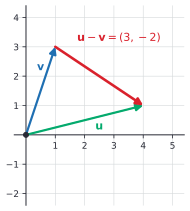
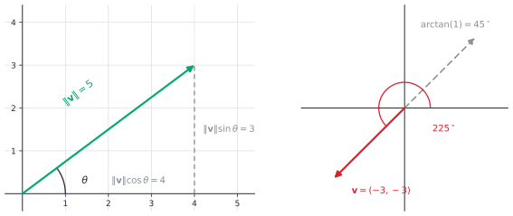
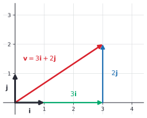
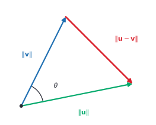
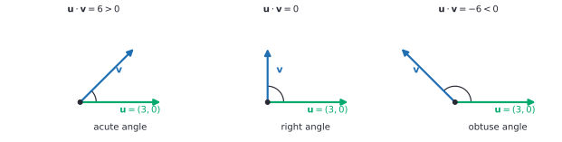
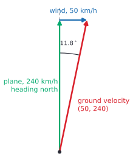

# Vectors in the plane

After this lesson you can add, subtract and scale vectors, find a vector's length and direction, use the dot product to find the angle between two vectors, and set up velocity and force problems with vectors.

Before this: the [coordinate plane](../../02-middle-school/05-linear-relationships-and-functions/01-coordinate-plane.md), the [Pythagorean theorem](../../02-middle-school/06-geometry/04-pythagorean-theorem.md), [translations](../../02-middle-school/06-geometry/05-transformations-congruence-similarity.md) and [right triangle trigonometry](../09-trigonometry/01-right-triangle-trigonometry.md).

## Quick check

Try these first. If you get all three right, skip to [Practice](#practice).

1. For $\mathbf{u} = (3, -1)$ and $\mathbf{v} = (2, 5)$, find $\mathbf{u} + \mathbf{v}$ and $3\mathbf{u} - \mathbf{v}$.
2. Find the length of $(5, -12)$ and a vector of length 1 that points the same way.
3. Find the angle between $(1, 2)$ and $(3, 1)$.

<details class="solution" markdown>
<summary>Answers</summary>

1. Add and scale componentwise: $\mathbf{u} + \mathbf{v} = (3 + 2, -1 + 5) = (5, 4)$ and $3\mathbf{u} - \mathbf{v} = (9 - 2, -3 - 5) = (7, -8)$.
2. The length is $\sqrt{5^2 + (-12)^2} = \sqrt{169} = 13$. Divide each component by 13: $\left(\frac{5}{13}, -\frac{12}{13}\right)$.
3. The dot product is $1 \cdot 3 + 2 \cdot 1 = 5$ and the lengths are $\sqrt{5}$ and $\sqrt{10}$, so $\cos\theta = \frac{5}{\sqrt{50}} = \frac{1}{\sqrt{2}}$ and $\theta = 45^\circ$.

</details>

## The idea

You walk 3 blocks east and then 4 blocks north. The straight-line distance from where you started is 5 blocks, by the Pythagorean theorem. The trip has two pieces of information: how far (5 blocks) and in which direction (more north than east). A friend who starts on a different corner and makes the same two moves ends up in a different place, but made the same trip.

A displacement like this is the standard example of a vector: an amount together with a direction. We draw it as an arrow. The length of the arrow is the distance, the way it points is the direction, and where you draw it doesn't matter. The two arrows below are the same vector, because each goes 3 to the right and 4 up.



Plain numbers can't do this job. "5 km" says how far, but not where. Quantities that are just an amount, such as a temperature, a price or a mass, are called scalars. Velocity (a speed and a heading), force (a size and a direction) and displacement are vectors, and so is any list of numbers you want to treat as one object, such as the prices of three items.

You have already used a vector without the name. In the lesson on [translations](../../02-middle-school/06-geometry/05-transformations-congruence-similarity.md), "3 right and 4 up" moved every point of a shape by the same amount. That move is the vector $(3, 4)$. This lesson gives vectors their own arithmetic: how to add two trips, stretch a trip, measure it, and compare the directions of two trips.

## Definitions

A **vector** in the plane is an ordered pair of real numbers $(a, b)$, called its **components**. Geometrically it is a displacement of $a$ units to the right (left if $a$ is negative) and $b$ units up (down if $b$ is negative), drawn as an arrow from a **tail** to a **tip**. Two vectors are equal exactly when their components are equal, wherever they are drawn. The **zero vector** is $\mathbf{0} = (0, 0)$, the displacement that goes nowhere.

In plain words, a vector is a "move by $a$ and $b$". The arrow is a picture of it, and the pair of numbers is how you compute with it.

This book writes a vector as a bold letter, $\mathbf{v}$, and gives its components in parentheses, $\mathbf{v} = (3, 4)$. On paper or a whiteboard, where bold is hard to write, put an arrow over the letter: $\vec{v}$. The reference page on [symbols and notation](../../reference/symbols-and-notation.md) uses the same convention. Many calculus books write $\langle 3, 4 \rangle$ with angle brackets so that a vector can't be mistaken for a point, and linear algebra often stacks the components in a column (the next lesson does this). All three mean the same thing. Here, the words tell you which is meant: the point $P = (3, 4)$ is a location, and the vector $\mathbf{v} = (3, 4)$ is a move. They are linked, though. The vector from the origin $O$ to $P$, written $\overrightarrow{OP}$, has the same components as $P$ has coordinates, and it is called the **position vector** of $P$.

For two points $P = (x_1, y_1)$ and $Q = (x_2, y_2)$, the vector from $P$ to $Q$ is

$$
\overrightarrow{PQ} = (x_2 - x_1,\; y_2 - y_1).
$$

In plain words, subtract the coordinates of the starting point from the coordinates of the end point, "end minus start". A **scalar** is a real number, used here to scale a vector. The **scalar multiple** of $\mathbf{v} = (a, b)$ by a scalar $c$ is $c\mathbf{v} = (ca, cb)$. It points the same way as $\mathbf{v}$ when $c > 0$, the opposite way when $c < 0$, and is $\lvert c \rvert$ times as long.



The **sum** of $\mathbf{u} = (u_1, u_2)$ and $\mathbf{v} = (v_1, v_2)$ is $\mathbf{u} + \mathbf{v} = (u_1 + v_1,\; u_2 + v_2)$. In plain words, make one trip and then the other, so the right-moves add and the up-moves add. The **difference** is $\mathbf{u} - \mathbf{v} = \mathbf{u} + (-1)\mathbf{v} = (u_1 - v_1,\; u_2 - v_2)$.

The **length** (or **magnitude**) of $\mathbf{v} = (a, b)$ is

$$
\lVert \mathbf{v} \rVert = \sqrt{a^2 + b^2}.
$$

In plain words, it is the length of the hypotenuse of the right triangle whose legs are the two components. It is never negative, and it is $0$ only for the zero vector.

A **unit vector** is a vector of length 1. The two special unit vectors along the axes are $\mathbf{i} = (1, 0)$ and $\mathbf{j} = (0, 1)$. Every vector can be written with them, since $(a, b) = a\mathbf{i} + b\mathbf{j}$. (The bold roman $\mathbf{i}$ is not the imaginary unit $i$ from [complex numbers](../05-quadratics-and-complex-numbers/03-complex-numbers.md); the bold type tells them apart.)

The **direction angle** of a nonzero vector is the angle $\theta$, measured counterclockwise from the positive $x$-axis, to the vector drawn from the origin, taken in $0^\circ \le \theta < 360^\circ$. The zero vector has no direction.

The **dot product** of $\mathbf{u} = (u_1, u_2)$ and $\mathbf{v} = (v_1, v_2)$ is the number

$$
\mathbf{u} \cdot \mathbf{v} = u_1 v_1 + u_2 v_2.
$$

In plain words, multiply the matching components and add. Note that the answer is a number, not a vector. For example, $(1, 2) \cdot (3, 4) = 3 + 8 = 11$. The dot product obeys these rules: $\mathbf{u} \cdot \mathbf{v} = \mathbf{v} \cdot \mathbf{u}$, $\mathbf{u} \cdot (\mathbf{v} + \mathbf{w}) = \mathbf{u} \cdot \mathbf{v} + \mathbf{u} \cdot \mathbf{w}$, $(c\mathbf{u}) \cdot \mathbf{v} = c(\mathbf{u} \cdot \mathbf{v})$, and $\mathbf{u} \cdot \mathbf{u} = \lVert \mathbf{u} \rVert^2$. Each one follows by writing both sides in components.

## How to do it

### Adding, subtracting and scaling

Everything is done one component at a time, because the components are ordinary numbers, so the usual rules (commutative, associative, distributive) carry over. For example, $\mathbf{u} + \mathbf{v} = \mathbf{v} + \mathbf{u}$ because $u_1 + v_1 = v_1 + u_1$ and the same for the second component.

The picture for addition is the tip-to-tail rule. Draw $\mathbf{u}$, start $\mathbf{v}$ at the tip of $\mathbf{u}$, and the sum is the arrow from the tail of $\mathbf{u}$ to the tip of $\mathbf{v}$. Starting with $\mathbf{v}$ instead gives the other two sides of a parallelogram and the same diagonal, which is the picture of $\mathbf{u} + \mathbf{v} = \mathbf{v} + \mathbf{u}$.



Subtraction has a picture too. Put $\mathbf{u}$ and $\mathbf{v}$ tail to tail. The difference $\mathbf{u} - \mathbf{v}$ is the arrow from the tip of $\mathbf{v}$ to the tip of $\mathbf{u}$, because going along $\mathbf{v}$ and then along $\mathbf{u} - \mathbf{v}$ lands you at the tip of $\mathbf{u}$. This is also the reading of $\overrightarrow{PQ} = Q - P$: the arrow from $P$ to $Q$.



### Length, unit vectors and direction

The length formula is the Pythagorean theorem. The vector $(a, b)$ is the hypotenuse of a right triangle with legs $\lvert a \rvert$ and $\lvert b \rvert$, so its length is $\sqrt{a^2 + b^2}$. Putting the tail at a point $P$ and the tip at $Q$ gives $\lVert \overrightarrow{PQ} \rVert = \sqrt{(x_2 - x_1)^2 + (y_2 - y_1)^2}$, the distance formula. Scaling by $c$ scales the length by $\lvert c \rvert$: $\lVert c\mathbf{v} \rVert = \lvert c \rvert \, \lVert \mathbf{v} \rVert$.

To turn a nonzero vector into a unit vector in the same direction (to **normalize** it), divide it by its length:

$$
\hat{\mathbf{v}} = \frac{1}{\lVert \mathbf{v} \rVert}\,\mathbf{v}.
$$

This works because $\lVert \hat{\mathbf{v}} \rVert = \frac{1}{\lVert \mathbf{v} \rVert} \lVert \mathbf{v} \rVert = 1$. For $\mathbf{v} = (3, 4)$ the length is 5 and $\hat{\mathbf{v}} = \left(\frac{3}{5}, \frac{4}{5}\right)$.

Now the direction. In the right triangle with the vector as hypotenuse, the first component is the side next to $\theta$ and the second is the side opposite it. By the definitions of cosine and sine from [right triangle trigonometry](../09-trigonometry/01-right-triangle-trigonometry.md), $a = \lVert \mathbf{v} \rVert \cos\theta$ and $b = \lVert \mathbf{v} \rVert \sin\theta$:

$$
\mathbf{v} = \lVert \mathbf{v} \rVert \,(\cos\theta,\; \sin\theta).
$$

For angles that are not acute, this is how [the unit circle](../09-trigonometry/02-radians-and-the-unit-circle.md) defines cosine and sine, so the formula holds in every quadrant. It shows that $(\cos\theta, \sin\theta)$ is the unit vector with direction angle $\theta$.

The formula works in both directions. Given a length and an angle, it gives the components. Given the components, $\tan\theta = \frac{b}{a}$ gives the angle, but a calculator's $\arctan$ only returns angles between $-90^\circ$ and $90^\circ$, so you must fix the quadrant yourself.

| Components | Direction angle $\theta$ |
|---|---|
| $a > 0$ | $\arctan\frac{b}{a}$, plus $360^\circ$ if that is negative |
| $a < 0$ | $\arctan\frac{b}{a} + 180^\circ$ |
| $a = 0$, $b > 0$ | $90^\circ$ |
| $a = 0$, $b < 0$ | $270^\circ$ |

The left picture below shows the components as the legs of the triangle. The right picture shows why the table needs its second row: for $(-3, -3)$ the ratio $\frac{b}{a} = 1$ and $\arctan(1) = 45^\circ$ points into the opposite quadrant, and adding $180^\circ$ gives the correct $225^\circ$.



Navigation uses a different convention: a bearing is measured clockwise from north, so due east is $90^\circ$. When a problem gives a compass heading, draw the picture first and find the components from it, instead of pushing the number into the formula above.

Here is the picture of $\mathbf{v} = 3\mathbf{i} + 2\mathbf{j}$: three steps along $\mathbf{i}$, then two along $\mathbf{j}$.



### The dot product and the angle between vectors

The formula $u_1 v_1 + u_2 v_2$ doesn't look like it has anything to do with angles. The theorem below says it does. Place two nonzero vectors tail to tail. The **angle between** them is the angle $\theta$, with $0^\circ \le \theta \le 180^\circ$, of the smaller turn from one to the other.

*Theorem.* For nonzero vectors $\mathbf{u}$ and $\mathbf{v}$ with angle $\theta$ between them,

$$
\mathbf{u} \cdot \mathbf{v} = \lVert \mathbf{u} \rVert \, \lVert \mathbf{v} \rVert \cos\theta.
$$

We know the law of cosines from [the law of sines and law of cosines](../09-trigonometry/05-law-of-sines-and-cosines.md): in a triangle with sides $p$, $q$, $r$, where the angle between sides $p$ and $q$ is $C$ (opposite the side $r$), we have $r^2 = p^2 + q^2 - 2pq\cos C$. For $C = 90^\circ$ the last term vanishes and it is the Pythagorean theorem. We want to show the theorem above. The plan is to compute $\lVert \mathbf{u} - \mathbf{v} \rVert^2$ twice, once from the law of cosines and once from components, and compare.

*Proof.* Suppose first that $\mathbf{u}$ and $\mathbf{v}$ are not parallel. Drawn tail to tail, $\mathbf{u}$, $\mathbf{v}$ and $\mathbf{u} - \mathbf{v}$ form a triangle. The sides next to the angle $\theta$ have lengths $\lVert \mathbf{u} \rVert$ and $\lVert \mathbf{v} \rVert$, and the side opposite $\theta$ has length $\lVert \mathbf{u} - \mathbf{v} \rVert$.



The law of cosines gives

$$
\lVert \mathbf{u} - \mathbf{v} \rVert^2 = \lVert \mathbf{u} \rVert^2 + \lVert \mathbf{v} \rVert^2 - 2\lVert \mathbf{u} \rVert \lVert \mathbf{v} \rVert \cos\theta.
$$

Now expand the left side in components, using $\mathbf{u} - \mathbf{v} = (u_1 - v_1, u_2 - v_2)$:

$$
\begin{aligned}
\lVert \mathbf{u} - \mathbf{v} \rVert^2 &= (u_1 - v_1)^2 + (u_2 - v_2)^2 \\
&= u_1^2 + u_2^2 + v_1^2 + v_2^2 - 2(u_1 v_1 + u_2 v_2) \\
&= \lVert \mathbf{u} \rVert^2 + \lVert \mathbf{v} \rVert^2 - 2\,\mathbf{u} \cdot \mathbf{v}.
\end{aligned}
$$

The two right-hand sides are equal. Subtract $\lVert \mathbf{u} \rVert^2 + \lVert \mathbf{v} \rVert^2$ from both and divide by $-2$ to get $\mathbf{u} \cdot \mathbf{v} = \lVert \mathbf{u} \rVert \lVert \mathbf{v} \rVert \cos\theta$.

If $\mathbf{u}$ and $\mathbf{v}$ are parallel, there is no triangle, so check directly. Then $\mathbf{v} = c\mathbf{u}$ for some $c \ne 0$, and $\mathbf{u} \cdot \mathbf{v} = c\,\lVert \mathbf{u} \rVert^2$. If $c > 0$ the angle is $0^\circ$ and the right side is $\lVert \mathbf{u} \rVert \cdot c\lVert \mathbf{u} \rVert \cdot 1$. If $c < 0$ the angle is $180^\circ$ and the right side is $\lVert \mathbf{u} \rVert \cdot \lvert c \rvert \lVert \mathbf{u} \rVert \cdot (-1) = c\,\lVert \mathbf{u} \rVert^2$. Both match. $\blacksquare$

Look back: the proof is a translation. The law of cosines is a statement about lengths, and the dot product appears when you expand a squared length in components, as the cross term. Check with the vectors in the figure, $\mathbf{u} = (5, 1)$ and $\mathbf{v} = (2, 4)$: the dot product is $10 + 4 = 14$, the lengths are $\sqrt{26}$ and $\sqrt{20}$, so $\cos\theta = \frac{14}{\sqrt{520}} \approx 0.614$ and $\theta \approx 52.1^\circ$, which is what the figure shows.

Solving the theorem for the angle gives the working formula, and reading off the sign of $\cos\theta$ gives a test for the type of angle:

$$
\cos\theta = \frac{\mathbf{u} \cdot \mathbf{v}}{\lVert \mathbf{u} \rVert \, \lVert \mathbf{v} \rVert}, \qquad \theta = \arccos\!\left(\frac{\mathbf{u} \cdot \mathbf{v}}{\lVert \mathbf{u} \rVert \, \lVert \mathbf{v} \rVert}\right).
$$

Since $\cos\theta$ is positive for $\theta$ below $90^\circ$, zero at $90^\circ$ and negative above $90^\circ$, and the lengths are positive, the sign of the dot product is the sign of $\cos\theta$. Two nonzero vectors are **perpendicular** (or **orthogonal**) when the angle between them is $90^\circ$, and that happens exactly when $\mathbf{u} \cdot \mathbf{v} = 0$.



In plain words, a positive dot product means the vectors point roughly the same way, zero means they are square to each other, and a negative one means they point roughly opposite ways. The inverse cosine, $\arccos$, is covered in [trig identities and inverse trig](../09-trigonometry/04-trig-identities-and-inverse-trig.md), and it returns angles from $0^\circ$ to $180^\circ$, which is the range the angle between vectors lives in.

### A method for vector problems

1. Draw the vectors, with an axis convention (usually $x$ east, $y$ north).
2. Write each vector in components. If you are given a length and an angle, use $(\lVert \mathbf{v} \rVert\cos\theta,\; \lVert \mathbf{v} \rVert\sin\theta)$. If you are given two points, use "end minus start".
3. Combine the components: add for a sum of trips or forces, subtract for a difference, multiply for a scalar multiple.
4. Find the length with $\sqrt{a^2 + b^2}$ and the direction with $\arctan$, fixing the quadrant from the signs of the components.
5. For an angle between two vectors, compute the dot product and the two lengths, then use $\arccos$.
6. Check against the drawing: is the answer in the right quadrant, and is the length plausible? Also recompute with a different route (for example, check a length with the Pythagorean theorem on the final components).

## Worked examples

<div class="example" markdown>

### Example 1: a plane in a crosswind

A plane flies at an airspeed of 240 km/h with its nose pointing due north. The wind blows toward the east at 50 km/h. What is the plane's velocity relative to the ground, as a speed and a direction?

Step 1: draw it with $x$ east and $y$ north. The plane's own velocity points north and the wind's points east, so the two arrows form two sides of a thin right triangle (the picture is drawn with 1 unit for each 10 km/h).



Step 2: in components, the plane's velocity is $\mathbf{p} = (0, 240)$ and the wind's is $\mathbf{w} = (50, 0)$.

Step 3: the velocity relative to the ground is the sum, because the air carries the plane along:

$$
\mathbf{p} + \mathbf{w} = (50, 240).
$$

Step 4: the ground speed is the length, $\sqrt{50^2 + 240^2} = \sqrt{60100} \approx 245.2$ km/h. The angle between the path and north is $\arctan\frac{50}{240} \approx 11.8^\circ$, so the plane drifts 11.8 degrees east of north. (As a direction angle from the east axis it is $\arctan\frac{240}{50} \approx 78.2^\circ$; the two angles add to $90^\circ$.)

Step 6: check. The ground speed is the hypotenuse of a triangle with legs 240 and 50, so it is a little more than 240, and it is far less than $240 + 50 = 290$. The drift is toward the east, the side the wind blows toward. Practice problem 7 asks what heading the pilot needs to fly due north.

</div>

<div class="example" markdown>

### Example 2: pulling a sled

A rope pulls a sled with a force of 60 N at $30^\circ$ above the horizontal. How much of that force pulls the sled forward, how much lifts it, and how much work is done pulling the sled 20 m along level ground?

Steps 1 and 2: the force has length 60 and direction angle $30^\circ$, so its components are $(60\cos 30^\circ,\; 60\sin 30^\circ) = (30\sqrt{3},\; 30) \approx (51.96,\; 30.00)$ newtons. The forward part is about 52.0 N and the lifting part is 30.0 N.

Work is the dot product of the force and the displacement. The sled moves along the ground, so the displacement is $\mathbf{d} = (20, 0)$ metres, and

$$
W = \mathbf{F} \cdot \mathbf{d} = 51.96 \cdot 20 + 30 \cdot 0 \approx 1039 \text{ J}.
$$

Check: the theorem gives the same thing, $\lVert \mathbf{F} \rVert \lVert \mathbf{d} \rVert \cos 30^\circ = 60 \cdot 20 \cdot 0.8660 = 1039.2$ J. Only the forward component does work, since the lifting part is perpendicular to the motion and adds $30 \cdot 0 = 0$ to the dot product.

</div>

<div class="example" markdown>

### Example 3: an obtuse angle

Find the angle between $\mathbf{u} = (3, 1)$ and $\mathbf{v} = (-2, 4)$.

Step 5: the dot product is $3(-2) + 1 \cdot 4 = -2$. The lengths are $\lVert \mathbf{u} \rVert = \sqrt{10}$ and $\lVert \mathbf{v} \rVert = \sqrt{20}$, whose product is $\sqrt{200} \approx 14.142$. So

$$
\cos\theta = \frac{-2}{14.142} \approx -0.1414, \qquad \theta = \arccos(-0.1414) \approx 98.1^\circ.
$$

The dot product is negative, so the angle must be obtuse, and $98.1^\circ$ is a little over a right angle. That is the check. The vectors are almost, but not quite, perpendicular: $\mathbf{u}$ points about $18.4^\circ$ above the $x$-axis and $\mathbf{v}$ points about $116.6^\circ$ from it, and the difference is $98.1^\circ$.

</div>

<div class="example" markdown>

### Example 4: from one point to another (finish it yourself)

A drone moves from $P = (-2, 5)$ to $Q = (4, -3)$, with distances in metres. Find the vector from $P$ to $Q$, its length, and its direction angle.

Step 2: end minus start gives $\overrightarrow{PQ} = (4 - (-2),\; -3 - 5) = (6, -8)$.

Now do Step 4: find the length, and then the direction angle in $0^\circ \le \theta < 360^\circ$. The first component is positive and the second is negative, so decide which quadrant the angle is in before you use $\arctan$.

<details class="solution" markdown>
<summary>Finish</summary>

The length is $\sqrt{6^2 + (-8)^2} = \sqrt{100} = 10$ m. For the angle, $a = 6 > 0$, so use the first row of the table: $\arctan\frac{-8}{6} \approx -53.13^\circ$, which is negative, so add $360^\circ$ to get $\theta \approx 306.87^\circ$.

Check: $10\cos 306.87^\circ \approx 6.00$ and $10\sin 306.87^\circ \approx -8.00$. The vector points right and down, which is the fourth quadrant, between $270^\circ$ and $360^\circ$.

</details>

</div>

## Edge cases and common mistakes

<div class="warning" markdown>

Watch out: the length of a sum is not the sum of the lengths. For $\mathbf{u} = (3, 0)$ and $\mathbf{v} = (0, 4)$, $\lVert \mathbf{u} + \mathbf{v} \rVert = \lVert (3, 4) \rVert = 5$, but $\lVert \mathbf{u} \rVert + \lVert \mathbf{v} \rVert = 3 + 4 = 7$. The two lengths add only when the vectors point the same way. In every other case the sum is shorter, because one side of a triangle is shorter than the other two together. In the plane example, the ground speed 245.2 is less than $240 + 50 = 290$.

</div>

<div class="warning" markdown>

Watch out: $\arctan\frac{b}{a}$ alone gives the wrong quadrant when $a < 0$. For $(-3, 4)$ the calculator returns $\arctan\frac{4}{-3} \approx -53.1^\circ$, which points into the fourth quadrant. The vector is in the second, and the right answer is $-53.1^\circ + 180^\circ = 126.9^\circ$. Always look at the signs of the components, or use a two-argument arctangent such as `math.atan2(b, a)`.

</div>

<div class="warning" markdown>

Watch out: the dot product of two vectors is a number, not a vector. The expression $(\mathbf{u} \cdot \mathbf{v}) \cdot \mathbf{w}$ makes no sense, since it dots a number with a vector. Also, $\mathbf{u} \cdot \mathbf{v} = \mathbf{u} \cdot \mathbf{w}$ does not mean that $\mathbf{v} = \mathbf{w}$, unlike cancelling a common factor in numbers. For $\mathbf{u} = (1, 0)$, both $(2, 5)$ and $(2, -7)$ give 2.

</div>

<div class="warning" markdown>

Watch out for the order in a difference. $\mathbf{u} - \mathbf{v}$ points from the tip of $\mathbf{v}$ to the tip of $\mathbf{u}$, and $\mathbf{v} - \mathbf{u}$ points the opposite way. For a displacement, "end minus start" is the one that is right: from $(1, 2)$ to $(5, 7)$ is $(5, 7) - (1, 2) = (4, 5)$, not $(-4, -5)$.

</div>

The zero vector needs care. It has length 0 and no direction, so it has no direction angle, you can't normalize it (that divides by 0), and the angle between it and another vector is not defined, because the formula for $\cos\theta$ divides by $\lVert \mathbf{0} \rVert = 0$. The dot product $\mathbf{0} \cdot \mathbf{v}$ is $0$ for every $\mathbf{v}$, so by the "zero means perpendicular" test the zero vector is perpendicular to everything; that is a convention, not a picture, and it is why the test above is stated for nonzero vectors.

Another thing to watch is that vectors are equal when their components are equal, wherever they are drawn. A vector drawn from $(4, 1)$ to $(7, 5)$ is the same vector as the one drawn from the origin to $(3, 4)$. Only the position vector of a point is tied to the origin.

A last mistake to avoid is mixing up perpendicular and parallel. Perpendicular means the dot product is 0. Parallel means one vector is a scalar multiple of the other, $\mathbf{v} = c\mathbf{u}$. The vectors $(2, 6)$ and $(1, 3)$ are parallel, and their dot product is $20$, nowhere near zero.

## Tricks and shortcuts

To get a vector perpendicular to $(a, b)$, swap the components and negate one: $(-b, a)$ or $(b, -a)$. The dot product $(a, b) \cdot (-b, a) = -ab + ab = 0$ confirms it, and $(-b, a)$ is $(a, b)$ turned $90^\circ$ counterclockwise. This is the shortcut behind the perpendicular-slope rule from [forms of linear equations](../02-linear-functions-and-systems/01-forms-of-linear-equations.md): the direction $(1, m)$ has a perpendicular $(-m, 1)$, which is a multiple of $(1, -\frac{1}{m})$.

Know a few Pythagorean triples so that lengths come out whole: $(3, 4)$ has length 5, $(5, 12)$ has length 13, $(8, 15)$ has length 17 and $(7, 24)$ has length 25. Scaling keeps the triple, so $(6, -8)$ has length 10, as in Example 4.

You can often skip the $\arccos$. If the question only asks whether an angle is acute, right or obtuse, the sign of the dot product answers it. If it asks whether two vectors are perpendicular, check whether the dot product is exactly 0.

A vector's direction doesn't change under scaling by a positive number, so to compare directions, normalize both vectors first. Two nonzero vectors point the same way exactly when their unit vectors are equal.

## In code

A vector is a list of numbers, and every operation in this lesson is one line of Python over the components.

<details class="code" markdown>
<summary>In code</summary>

```python
import math

def add(u, v):
    return [a + b for a, b in zip(u, v)]

def scale(c, v):
    return [c * a for a in v]

def length(v):
    return math.sqrt(sum(a * a for a in v))

def dot(u, v):
    return sum(a * b for a, b in zip(u, v))

def angle_deg(u, v):
    c = dot(u, v) / (length(u) * length(v))
    return math.degrees(math.acos(max(-1, min(1, c))))  # clamp rounding error

u, v = [3, -1], [2, 5]
print(add(u, v))                      # [5, 4]
print(add(scale(3, u), scale(-1, v))) # [7, -8]
print(length([5, -12]))               # 13.0
print(angle_deg([1, 2], [3, 1]))      # 45.00000000000001
print(dot([3, 1], [-2, 4]))           # -2

# direction angle of (-3, -3): atan2 knows the quadrant, atan does not
print(math.degrees(math.atan(-3 / -3)))        # 45.0
print(math.degrees(math.atan2(-3, -3)))        # -135.0
print(math.degrees(math.atan2(-3, -3)) % 360)  # 225.0

# the same with NumPy
import numpy as np
a, b = np.array([3, -1]), np.array([2, 5])
print(a + b, a @ b, np.linalg.norm(a))         # [5 4] 1 3.1622776601683795

# cosine similarity of two word-count vectors
doc1 = [2, 0, 1, 0, 1]   # counts of: cat, dog, sat, ran, mat
doc2 = [1, 1, 1, 0, 0]
print(dot(doc1, doc2) / (length(doc1) * length(doc2)))  # 0.7071067811865476
```

The `max(-1, min(1, c))` guards against a rounding error: for two parallel vectors, $c$ can come out as $1.0000000000000002$, and `math.acos` raises an error for any value above 1. The last lines show the idea behind many search and recommendation systems: turn each document into a vector of word counts and measure the angle between the vectors. The number $\cos\theta$ is the cosine similarity, and it is 1 for the same direction and 0 for no words in common. The same code works for vectors with any number of components, not just two. Floating point basics<!-- link: ../../06-cs-math/01-number-representation/04-floating-point-basics.md --> explains the rounding.

</details>

## FAQ

### Why does multiplying components and adding them measure an angle?

Because of the law of cosines. The square of a side opposite an angle is the sum of the other two squares, minus a correction that depends on the angle, and that correction is exactly $2\lVert \mathbf{u} \rVert \lVert \mathbf{v} \rVert \cos\theta$. When you expand $\lVert \mathbf{u} - \mathbf{v} \rVert^2$ in components, the same quantity appears as $2(u_1 v_1 + u_2 v_2)$. One more way to say it: $\frac{\mathbf{u} \cdot \mathbf{v}}{\lVert \mathbf{v} \rVert} = \lVert \mathbf{u} \rVert \cos\theta$ is the signed length of the shadow of $\mathbf{u}$ on the line of $\mathbf{v}$, so the dot product measures how much of $\mathbf{u}$ points along $\mathbf{v}$, times the length of $\mathbf{v}$.

### Is a vector the same thing as a point?

Not quite, although they use the same numbers. A point is a location and a vector is a move. The vector $(3, 4)$ can start anywhere, and the point $(3, 4)$ is one place. The two are linked by the position vector: the move from the origin to the point. Adding two points makes no sense (what is Toronto plus Ottawa?), but adding two moves, or a point and a move, does.

### Why can I slide a vector around?

Because the definition says a vector is only its components. "3 right and 4 up" is the same move from every starting point. This is what makes tip-to-tail addition work: you slide $\mathbf{v}$ so that its tail sits at the tip of $\mathbf{u}$. It doesn't apply to everything. A force acting on a door has a different effect when it acts at the handle and at the hinge, so physics adds a point of application when it matters. Position vectors are also tied to the origin.

### What changes in three dimensions?

Almost nothing. A vector has three components $(a, b, c)$, the length is $\sqrt{a^2 + b^2 + c^2}$, the dot product multiplies and adds three pairs, and the angle formula is the same. The proof above used a triangle, and any two vectors in space lie in one plane, so it still applies. You can't draw the angle $\theta$ from the $x$-axis any more, since a direction needs two angles. Higher dimensions are covered in vectors, dot product and span<!-- link: ../../05-university-core/06-linear-algebra/01-vectors-dot-product-and-span.md -->.

## Practice

### Warm-up

1\. Let $\mathbf{u} = (4, -3)$ and $\mathbf{v} = (-1, 5)$. Find $\mathbf{u} + \mathbf{v}$, $\mathbf{u} - \mathbf{v}$, $2\mathbf{u} - 3\mathbf{v}$ and $\lVert \mathbf{u} \rVert$.

<details class="solution" markdown>
<summary>Solution</summary>

Work one component at a time.

- $\mathbf{u} + \mathbf{v} = (4 - 1,\; -3 + 5) = (3, 2)$.
- $\mathbf{u} - \mathbf{v} = (4 + 1,\; -3 - 5) = (5, -8)$.
- $2\mathbf{u} - 3\mathbf{v} = (8, -6) - (-3, 15) = (11, -21)$.
- $\lVert \mathbf{u} \rVert = \sqrt{16 + 9} = 5$.

Check: $\mathbf{u} + \mathbf{v}$ and $\mathbf{u} - \mathbf{v}$ add to $2\mathbf{u}$, and $(3, 2) + (5, -8) = (8, -6) = 2\mathbf{u}$.

</details>

2\. Find the vector from $P = (1, 2)$ to $Q = (7, 10)$, its length, and the unit vector in its direction.

<details class="solution" markdown>
<summary>Solution</summary>

End minus start: $\overrightarrow{PQ} = (7 - 1,\; 10 - 2) = (6, 8)$. The length is $\sqrt{36 + 64} = 10$. Divide by 10 to get the unit vector $(0.6, 0.8)$, which is $\left(\frac{3}{5}, \frac{4}{5}\right)$.

Check: $0.6^2 + 0.8^2 = 0.36 + 0.64 = 1$.

</details>

3\. Compute the dot product of each pair, and say whether the angle between the vectors is acute, right or obtuse: (a) $(2, 3)$ and $(6, -4)$, (b) $(1, 5)$ and $(2, 1)$, (c) $(-3, 1)$ and $(2, 4)$.

<details class="solution" markdown>
<summary>Solution</summary>

- (a) $2 \cdot 6 + 3(-4) = 12 - 12 = 0$, so the vectors are perpendicular (a right angle).
- (b) $1 \cdot 2 + 5 \cdot 1 = 7 > 0$, so the angle is acute.
- (c) $(-3)(2) + 1 \cdot 4 = -2 < 0$, so the angle is obtuse.

Check (a) by the shortcut for a perpendicular: swapping and negating one component of $(2, 3)$ gives $(3, -2)$, and $(6, -4) = 2(3, -2)$, a multiple of it.

</details>

### Standard

4\. A swimmer crosses a river 120 m wide, swimming straight across (perpendicular to the banks) at 4 m/s in still water. The current carries everything downstream at 1.5 m/s. (a) What is the swimmer's speed relative to the bank? (b) How long does the crossing take, and how far downstream does the swimmer land?

<details class="solution" markdown>
<summary>Solution</summary>

Take $x$ downstream and $y$ across. The swimmer's velocity is $(0, 4)$ and the current's is $(1.5, 0)$, so the velocity relative to the bank is $(1.5, 4)$.

(a) The speed is $\sqrt{1.5^2 + 4^2} = \sqrt{18.25} \approx 4.27$ m/s.

(b) The across-river component of the velocity is 4 m/s, and the current doesn't change it, so the crossing takes $120 \div 4 = 30$ s. In that time the downstream component of 1.5 m/s carries the swimmer $1.5 \times 30 = 45$ m.

Check: the path length is $\sqrt{120^2 + 45^2} = \sqrt{16425} \approx 128.2$ m, and $4.27 \times 30 \approx 128.2$ m.

</details>

5\. A triangle has vertices $A = (1, 1)$, $B = (5, 2)$ and $C = (2, 5)$. Find its three angles, using vectors, and check that they add up to $180^\circ$.

<details class="solution" markdown>
<summary>Solution</summary>

For the angle at $A$, use the vectors from $A$: $\overrightarrow{AB} = (4, 1)$ and $\overrightarrow{AC} = (1, 4)$. Their dot product is $4 + 4 = 8$ and both lengths are $\sqrt{17}$, so $\cos A = \frac{8}{17}$ and $A \approx 61.93^\circ$.

For the angle at $B$, use $\overrightarrow{BA} = (-4, -1)$ and $\overrightarrow{BC} = (-3, 3)$. The dot product is $12 - 3 = 9$, the lengths are $\sqrt{17}$ and $\sqrt{18}$, so $\cos B = \frac{9}{\sqrt{306}} \approx 0.5145$ and $B \approx 59.04^\circ$.

For the angle at $C$, use $\overrightarrow{CA} = (-1, -4)$ and $\overrightarrow{CB} = (3, -3)$. The dot product is $-3 + 12 = 9$ and the lengths are $\sqrt{17}$ and $\sqrt{18}$ again, so $C \approx 59.04^\circ$.

Check: $61.93 + 59.04 + 59.04 = 180.01$, which is $180$ up to rounding. The equal angles at $B$ and $C$ fit the equal sides $AB = AC = \sqrt{17}$.

</details>

6\. (Reviews the [Pythagorean theorem](../../02-middle-school/06-geometry/04-pythagorean-theorem.md).) The points $P = (1, 1)$, $Q = (5, 3)$ and $R = (4, 5)$ form a triangle. Show that it has a right angle at $Q$ in two ways: with a dot product, and with the converse of the Pythagorean theorem.

<details class="solution" markdown>
<summary>Solution</summary>

With vectors: $\overrightarrow{QP} = (-4, -2)$ and $\overrightarrow{QR} = (-1, 2)$. The dot product is $(-4)(-1) + (-2)(2) = 4 - 4 = 0$, so the angle at $Q$ is $90^\circ$.

With squares of the sides: $PQ^2 = 4^2 + 2^2 = 20$, $QR^2 = 1^2 + 2^2 = 5$ and $PR^2 = 3^2 + 4^2 = 25$. Since $20 + 5 = 25$, the converse of the Pythagorean theorem gives a right angle opposite the longest side $PR$, which is at $Q$.

Check: the two methods agree, and they are secretly the same computation. The dot-product proof expanded $\lVert \overrightarrow{PR} \rVert^2$ and found the cross term to be zero.

</details>

### Challenge

7\. A pilot wants to fly due north over the ground. The airspeed is 240 km/h and the wind blows toward the east at 50 km/h. (a) At what angle west of north must the pilot point the nose? (b) What is the ground speed?

<details class="solution" markdown>
<summary>Solution</summary>

Let $\varphi$ be the angle west of north that the nose points. The plane's velocity through the air is $240(-\sin\varphi,\; \cos\varphi)$ and the wind's is $(50, 0)$. The ground velocity is the sum, and for the path to be due north its first component must be 0:

$$
-240\sin\varphi + 50 = 0, \qquad \sin\varphi = \frac{50}{240} = 0.2083\ldots
$$

(a) So $\varphi = \arcsin(0.2083) \approx 12.02^\circ$ west of north. Note that this is not the $11.8^\circ$ of Example 1: that was the drift when the nose pointed north.

(b) The ground velocity is $(0,\; 240\cos\varphi)$, so the ground speed is $240\cos 12.02^\circ \approx 234.7$ km/h. Equivalently, the airspeed is the hypotenuse of a right triangle whose legs are the wind and the ground velocity, so the ground speed is $\sqrt{240^2 - 50^2} = \sqrt{55100} \approx 234.7$ km/h.

Check: with $\varphi = 12.02^\circ$ the velocity through the air is $(-50.00,\; 234.73)$, and adding the wind $(50, 0)$ gives $(0.00,\; 234.73)$, so the path is due north. The ground speed is lower than 240, because part of the airspeed is spent fighting the wind.

</details>

8\. A rhombus has sides $\mathbf{u}$ and $\mathbf{v}$ with $\lVert \mathbf{u} \rVert = \lVert \mathbf{v} \rVert$. Its diagonals are $\mathbf{u} + \mathbf{v}$ and $\mathbf{u} - \mathbf{v}$. Use the dot product to prove that the diagonals are perpendicular.

<details class="solution" markdown>
<summary>Solution</summary>

We know the rules of the dot product from the Definitions section: it is commutative and distributes over addition, and $\mathbf{w} \cdot \mathbf{w} = \lVert \mathbf{w} \rVert^2$. We want $(\mathbf{u} + \mathbf{v}) \cdot (\mathbf{u} - \mathbf{v}) = 0$. The plan is to multiply out as in $(x + y)(x - y)$.

Expanding,

$$
(\mathbf{u} + \mathbf{v}) \cdot (\mathbf{u} - \mathbf{v}) = \mathbf{u} \cdot \mathbf{u} - \mathbf{u} \cdot \mathbf{v} + \mathbf{v} \cdot \mathbf{u} - \mathbf{v} \cdot \mathbf{v} = \lVert \mathbf{u} \rVert^2 - \lVert \mathbf{v} \rVert^2,
$$

because $\mathbf{u} \cdot \mathbf{v} = \mathbf{v} \cdot \mathbf{u}$ makes the two middle terms cancel. The sides of a rhombus have equal length, so $\lVert \mathbf{u} \rVert^2 - \lVert \mathbf{v} \rVert^2 = 0$, and the diagonals are perpendicular. $\blacksquare$

Look back: the proof used equal side lengths and nothing else. Check with numbers: $\mathbf{u} = (4, 3)$ and $\mathbf{v} = (5, 0)$ both have length 5, the diagonals are $(9, 3)$ and $(-1, 3)$, and $(9)(-1) + (3)(3) = 0$.

</details>

## Where this shows up

- The next lesson, [matrix basics](02-matrix-basics.md), builds matrices from the same ideas: multiplying a matrix by a vector is a list of dot products. Vectors, dot product and span<!-- link: ../../05-university-core/06-linear-algebra/01-vectors-dot-product-and-span.md --> extends everything here to any number of components, and the gradient in partial derivatives and the gradient<!-- link: ../../05-university-core/09-multivariable-calculus-light/02-partial-derivatives-and-the-gradient.md --> is a vector that points uphill.
- In computing, a vector is a list of numbers. Game engines and graphics code add and scale position and velocity vectors every frame, and the dot product tests which way a surface faces. Machine learning represents words, images and users as vectors, and cosine similarity compares them.
- In economics, a shopping basket is a vector of quantities and the prices form another vector, so the total cost is a dot product: for prices \$3, \$4 and \$7 and quantities $(2, 5, 1)$ it is $3 \cdot 2 + 4 \cdot 5 + 7 \cdot 1 = 33$ dollars.
