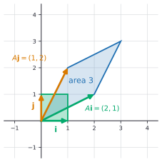
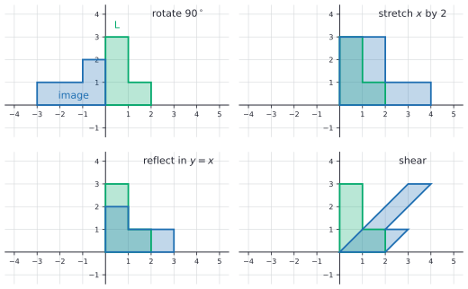
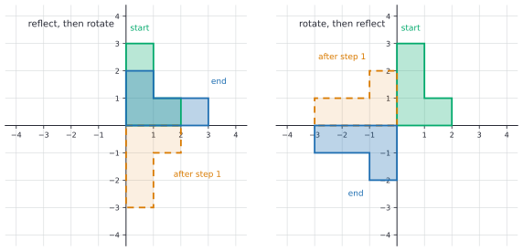
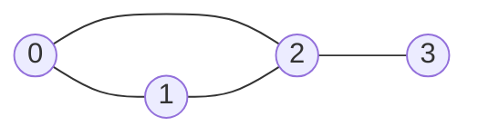

# Matrix basics

After this lesson you can add and multiply matrices and say when a product is defined, write a system of linear equations as $A\mathbf{x} = \mathbf{b}$, find the inverse of a $2 \times 2$ matrix with the determinant, and describe what a $2 \times 2$ matrix does to the plane.

Before this: [vectors in the plane](01-vectors-in-the-plane.md) and [systems of linear equations](../02-linear-functions-and-systems/02-systems-of-linear-equations.md).

## Quick check

Try these first. If you get all three right, skip to [Practice](#practice).

1. The matrix $A$ has 2 rows and 3 columns, and $B$ has 3 rows and 4 columns. Is $AB$ defined, and if so what is its size? Is $BA$ defined?
2. Compute $\begin{pmatrix} 2 & 1 \\ -1 & 3 \end{pmatrix}\begin{pmatrix} 4 \\ -2 \end{pmatrix}$.
3. Find the inverse of $\begin{pmatrix} 3 & 1 \\ 5 & 2 \end{pmatrix}$.

<details class="solution" markdown>
<summary>Answers</summary>

1. $AB$ is defined because $A$ has 3 columns and $B$ has 3 rows. It has $A$'s 2 rows and $B$'s 4 columns, so it is $2 \times 4$. $BA$ is not defined, because $B$ has 4 columns and $A$ has only 2 rows.
2. Row 1 times the column: $2 \cdot 4 + 1 \cdot (-2) = 6$. Row 2: $(-1) \cdot 4 + 3 \cdot (-2) = -10$. The answer is the column $\begin{pmatrix} 6 \\ -10 \end{pmatrix}$.
3. The determinant is $3 \cdot 2 - 1 \cdot 5 = 1$. Swap the diagonal entries, negate the other two, and divide by the determinant: $\begin{pmatrix} 2 & -1 \\ -5 & 3 \end{pmatrix}$. Check: the first row of the product with the original is $2 \cdot 3 + (-1) \cdot 5 = 1$ and $2 \cdot 1 + (-1) \cdot 2 = 0$.

</details>

## The idea

A café keeps a table of what it sold. The rows are days, the columns are items, and each entry is a count:

| | Coffee | Muffin | Sandwich |
|---|---|---|---|
| Monday | 10 | 4 | 3 |
| Tuesday | 8 | 6 | 5 |

Prices are \$3 for a coffee, \$4 for a muffin and \$7 for a sandwich. Monday's revenue multiplies each count by its price and adds: $10 \cdot 3 + 4 \cdot 4 + 3 \cdot 7 = 67$. Tuesday's is $8 \cdot 3 + 6 \cdot 4 + 5 \cdot 7 = 83$. Each of these is a dot product of a row of the table with the price list, from the [last lesson](01-vectors-in-the-plane.md). A matrix is a table of numbers like this one, and multiplying a matrix by a list of numbers does all the row-by-row dot products at once.

Where does "multiply a row by a column" come from? Here is a second source. Suppose $u$ and $v$ are made from $x$ and $y$ by one rule, and $p$ and $q$ are made from $u$ and $v$ by another:

$$
\begin{aligned}
u &= 2x + y, & p &= 3u - v, \\
v &= x + 3y, & q &= u + 2v.
\end{aligned}
$$

To get $p$ and $q$ directly from $x$ and $y$, substitute: $p = 3(2x + y) - (x + 3y) = 5x + 0y$ and $q = (2x + y) + 2(x + 3y) = 4x + 7y$. Each rule is a table of coefficients, and the combined rule has the table $\begin{pmatrix} 5 & 0 \\ 4 & 7 \end{pmatrix}$. The entry $5$ is $3 \cdot 2 + (-1) \cdot 1$: row 1 of the second rule's table, times column 1 of the first rule's. Matrix multiplication is defined to produce exactly this table, so that multiplying matrices means doing one substitution after another. Every unusual feature of matrix multiplication, including the fact that the order matters, follows from that.

A third picture comes at the end of the lesson. A $2 \times 2$ matrix is also a machine that takes each point of the plane to a new point, turning, stretching or flipping the whole plane at once.

## Definitions

A **matrix** is a rectangular array of numbers arranged in rows and columns. A matrix with $m$ rows and $n$ columns has **size** $m \times n$ (read "$m$ by $n$": rows first, then columns). The number in row $i$ and column $j$ is the **entry** $a_{ij}$ of the matrix $A$, so $A = (a_{ij})$. This book writes a matrix inside parentheses, and uses a capital letter for it.

In plain words, a matrix is a table, and $a_{ij}$ is "row $i$, column $j$". In $A = \begin{pmatrix} 1 & 2 & 0 \\ -1 & 3 & 4 \end{pmatrix}$, the size is $2 \times 3$, and $a_{12} = 2$ and $a_{23} = 4$. In mathematics the numbering starts at 1; Python's starts at 0, so $a_{12}$ is `A[0][1]`.

A matrix is **square** if $m = n$. A matrix with one column is a **column vector**, and with one row a **row vector**. In matrix computations, a vector $(x, y)$ is written as a column, $\begin{pmatrix} x \\ y \end{pmatrix}$, which is a $2 \times 1$ matrix; in running text it stays $(x, y)$. Two matrices are equal when they have the same size and the same entries. The **zero matrix** has every entry 0.

The **sum** of two matrices of the same size adds matching entries, and the **scalar multiple** $cA$ multiplies every entry by the number $c$. In plain words, these work one entry at a time, just like vectors. A sum of matrices of different sizes is not defined.

The **product** of an $m \times n$ matrix $A$ and an $n \times p$ matrix $B$ is the $m \times p$ matrix $AB$ whose entry in row $i$ and column $j$ is the dot product of row $i$ of $A$ with column $j$ of $B$:

$$
(AB)_{ij} = a_{i1}b_{1j} + a_{i2}b_{2j} + \dots + a_{in}b_{nj} = \sum_{k=1}^{n} a_{ik}b_{kj}.
$$

The symbol $\sum$ means "add up the terms", as in [summation notation](../11-sequences-series-and-counting/02-summation-notation-and-series.md). In plain words, to get the entry in row $i$ and column $j$, run along row $i$ of the left matrix and down column $j$ of the right matrix, multiply the pairs and add. The product is defined only when the number of columns of $A$ equals the number of rows of $B$.

The **identity matrix** $I_n$ is the $n \times n$ square matrix with 1 on the diagonal (from top left to bottom right) and 0 elsewhere. For $n = 2$ it is $I = \begin{pmatrix} 1 & 0 \\ 0 & 1 \end{pmatrix}$. It satisfies $AI = IA = A$ whenever the product is defined, so it plays the role of the number 1. The **transpose** $A^T$ of a matrix swaps rows and columns: entry $(i, j)$ of $A^T$ is entry $(j, i)$ of $A$. If $A$ is $2 \times 3$, then $A^T$ is $3 \times 2$. With transposes, the dot product of two column vectors is the product of a $1 \times 2$ matrix and a $2 \times 1$ matrix: $\mathbf{u} \cdot \mathbf{v} = \mathbf{u}^T\mathbf{v}$.

For a square matrix $A$, an **inverse** is a matrix $A^{-1}$ with $AA^{-1} = A^{-1}A = I$. A matrix that has an inverse is **invertible**. In plain words, the inverse undoes what $A$ does, like dividing by a number undoes multiplying by it. For a $2 \times 2$ matrix $A = \begin{pmatrix} a & b \\ c & d \end{pmatrix}$, the **determinant** is the number

$$
\det(A) = ad - bc.
$$

You met this number as $D$ in the lesson on [systems of linear equations](../02-linear-functions-and-systems/02-systems-of-linear-equations.md): it was zero exactly when the two equations had no unique solution.

## How to do it

### Adding and scaling

Add or scale entry by entry. For $P = \begin{pmatrix} 2 & -1 \\ 4 & 3 \end{pmatrix}$ and $Q = \begin{pmatrix} 1 & 0 \\ -2 & 2 \end{pmatrix}$ we get $P + Q = \begin{pmatrix} 3 & -1 \\ 2 & 5 \end{pmatrix}$ and $3P = \begin{pmatrix} 6 & -3 \\ 12 & 9 \end{pmatrix}$. All the usual rules hold, because they hold for each entry: $P + Q = Q + P$, $c(P + Q) = cP + cQ$, and so on.

### Multiplying matrices

1. Check the sizes. If $A$ is $m \times n$ and $B$ is $p \times q$, the product $AB$ exists only when $n = p$. Write the sizes side by side, $(m \times n)(n \times q)$, and check that the two middle numbers agree.
2. Read off the size of the answer from the outer numbers: $m \times q$.
3. Fill in each entry. For the entry in row $i$ and column $j$, take row $i$ of $A$ and column $j$ of $B$, multiply the matching entries and add.
4. Check. Is the size right? Recompute one entry. Or use the checks in [Tricks and shortcuts](#tricks-and-shortcuts).

A matrix times a column vector is the special case $q = 1$. There is a second way to read it that you will use constantly in linear algebra: the product $A\mathbf{x}$ is a combination of the *columns* of $A$, with the entries of $\mathbf{x}$ as the weights:

$$
\begin{pmatrix} a & b \\ c & d \end{pmatrix}\begin{pmatrix} x \\ y \end{pmatrix} = \begin{pmatrix} ax + by \\ cx + dy \end{pmatrix} = x\begin{pmatrix} a \\ c \end{pmatrix} + y\begin{pmatrix} b \\ d \end{pmatrix}.
$$

For the matrix in Quick check 2, $4\begin{pmatrix} 2 \\ -1 \end{pmatrix} + (-2)\begin{pmatrix} 1 \\ 3 \end{pmatrix} = \begin{pmatrix} 6 \\ -10 \end{pmatrix}$, the same answer as with rows.

The order of the factors matters. In general, $AB \ne BA$, even when both products exist and have the same size. Take $A = \begin{pmatrix} 1 & 2 \\ 3 & 4 \end{pmatrix}$ and $S = \begin{pmatrix} 0 & 1 \\ 1 & 0 \end{pmatrix}$. Then

$$
AS = \begin{pmatrix} 2 & 1 \\ 4 & 3 \end{pmatrix}, \qquad SA = \begin{pmatrix} 3 & 4 \\ 1 & 2 \end{pmatrix}.
$$

Multiplying by $S$ on the right swaps the columns of $A$, and on the left it swaps the rows. These are different matrices, so there is no "commutative property" to use. Matrix multiplication still has the rules that don't involve swapping, which hold for all matrices where the sizes allow: $(AB)C = A(BC)$, $A(B + C) = AB + AC$, $(A + B)C = AC + BC$ and $c(AB) = (cA)B = A(cB)$. The first rule, associativity, is why a product of three matrices can be written $ABC$ without brackets, and it is the matrix version of "doing three substitutions in a row".

### Why this definition: composing substitutions

The calculation in the idea section works in general. Suppose $\mathbf{v} = B\mathbf{x}$ and $\mathbf{w} = A\mathbf{v}$. Then $\mathbf{w} = A(B\mathbf{x}) = (AB)\mathbf{x}$, and the entry formula for $AB$ is what you get by substituting the entries of $\mathbf{v}$ into the formula for $\mathbf{w}$ and collecting the coefficients of each $x_j$. So $AB$ means "do $B$ first, then $A$". The factor nearest to $\mathbf{x}$ acts first, the same convention as $f(g(x))$ in the lesson on [composition and inverse functions](../03-functions/05-composition-and-inverse-functions.md). This is also why the sizes must match: $B$ produces $n$ numbers, and $A$ must accept exactly $n$ numbers.

### Writing a system as $A\mathbf{x} = \mathbf{b}$

A system of two equations in two unknowns,

$$
a_1 x + b_1 y = c_1, \qquad a_2 x + b_2 y = c_2,
$$

is one matrix equation, because the left sides are the rows of a matrix times a column:

$$
\begin{pmatrix} a_1 & b_1 \\ a_2 & b_2 \end{pmatrix}\begin{pmatrix} x \\ y \end{pmatrix} = \begin{pmatrix} c_1 \\ c_2 \end{pmatrix}.
$$

The matrix on the left is the *coefficient matrix* from the systems lesson. In the short form, $A\mathbf{x} = \mathbf{b}$, the unknown is the column $\mathbf{x}$. The same works for any number of equations and unknowns: $m$ equations in $n$ unknowns give an $m \times n$ matrix $A$. If $A$ is square and has an inverse, multiply both sides on the left by $A^{-1}$:

$$
A^{-1}A\mathbf{x} = A^{-1}\mathbf{b}, \qquad \text{so} \qquad \mathbf{x} = A^{-1}\mathbf{b}.
$$

This is the matrix version of dividing both sides by a number. Multiplying on the left matters, since the order matters. For large systems, elimination is far faster than computing an inverse, and it is what programs do.

### The inverse of a $2 \times 2$ matrix

*Theorem.* Let $A = \begin{pmatrix} a & b \\ c & d \end{pmatrix}$. (a) If $ad - bc \ne 0$, then $A$ is invertible and

$$
A^{-1} = \frac{1}{ad - bc}\begin{pmatrix} d & -b \\ -c & a \end{pmatrix}.
$$

(b) If $ad - bc = 0$, then $A$ has no inverse.

We know how to multiply $2 \times 2$ matrices. We want to show that the matrix in (a) works as an inverse, and that when $ad - bc = 0$ nothing can. The plan is to multiply out for (a), and for (b) to find a nonzero input that $A$ sends to zero, since a matrix with an inverse can't do that.

*Proof of (a).* Multiply $A$ by the matrix with $a$ and $d$ swapped and $b$ and $c$ negated:

$$
\begin{pmatrix} a & b \\ c & d \end{pmatrix}\begin{pmatrix} d & -b \\ -c & a \end{pmatrix} = \begin{pmatrix} ad - bc & -ab + ba \\ cd - dc & -cb + da \end{pmatrix} = (ad - bc)\begin{pmatrix} 1 & 0 \\ 0 & 1 \end{pmatrix}.
$$

Multiplying in the other order gives the same result, $(ad - bc)I$. Dividing the second matrix by the number $ad - bc$, which is allowed because it isn't zero, turns both products into $I$. $\blacksquare$

*Proof of (b).* Suppose $ad - bc = 0$ and, for contradiction, that $A$ has an inverse. Compute $A\begin{pmatrix} d \\ -c \end{pmatrix} = \begin{pmatrix} ad - bc \\ cd - dc \end{pmatrix} = \begin{pmatrix} 0 \\ 0 \end{pmatrix}$. Multiplying both sides by $A^{-1}$ gives $\begin{pmatrix} d \\ -c \end{pmatrix} = A^{-1}\begin{pmatrix} 0 \\ 0 \end{pmatrix} = \begin{pmatrix} 0 \\ 0 \end{pmatrix}$, so $c = d = 0$. In the same way, $A\begin{pmatrix} -b \\ a \end{pmatrix} = \begin{pmatrix} -ab + ba \\ -cb + da \end{pmatrix} = \begin{pmatrix} 0 \\ 0 \end{pmatrix}$ forces $a = b = 0$. Then $A$ is the zero matrix, and $A\mathbf{x} = \mathbf{0}$ for every $\mathbf{x}$, so $AA^{-1} = I$ is impossible. That contradicts the assumption, so there is no inverse. $\blacksquare$

Look back: part (a) is a recipe, "swap, negate, divide by the determinant", and part (b) says the recipe fails exactly when it asks for a division by zero. Check the recipe on $\begin{pmatrix} 3 & 1 \\ 5 & 2 \end{pmatrix}$ from Quick check 3: $\begin{pmatrix} 3 & 1 \\ 5 & 2 \end{pmatrix}\begin{pmatrix} 2 & -1 \\ -5 & 3 \end{pmatrix} = \begin{pmatrix} 1 & 0 \\ 0 & 1 \end{pmatrix}$.

### What a matrix does to the plane

Every $2 \times 2$ matrix $A$ turns a point $(x, y)$ into the point $A\begin{pmatrix} x \\ y \end{pmatrix}$. Since $(x, y) = x\mathbf{i} + y\mathbf{j}$, the column-combination reading above gives

$$
A\begin{pmatrix} x \\ y \end{pmatrix} = x\,(A\mathbf{i}) + y\,(A\mathbf{j}),
$$

and $A\mathbf{i}$ and $A\mathbf{j}$ are just the first and second columns of $A$. So the whole action is decided by where the two unit vectors go, and to build the matrix for a transformation, record the images of $\mathbf{i}$ and $\mathbf{j}$ as the columns. The unit square, with sides $\mathbf{i}$ and $\mathbf{j}$, turns into the parallelogram with sides $A\mathbf{i}$ and $A\mathbf{j}$.



Here are the standard cases. To see a turn or a flip, the pictures use an L-shaped figure, which looks different from its mirror image and from its rotations.

| Transformation | Rows of the matrix | Determinant |
|---|---|---|
| rotate $90^\circ$ counterclockwise | $(0, -1)$ and $(1, 0)$ | $1$ |
| rotate by $\theta$ counterclockwise | $(\cos\theta, -\sin\theta)$ and $(\sin\theta, \cos\theta)$ | $1$ |
| stretch $x$ by 2, $y$ unchanged | $(2, 0)$ and $(0, 1)$ | $2$ |
| reflect in the $x$-axis | $(1, 0)$ and $(0, -1)$ | $-1$ |
| reflect in the line $y = x$ | $(0, 1)$ and $(1, 0)$ | $-1$ |
| shear (slide each row sideways by its height) | $(1, 1)$ and $(0, 1)$ | $1$ |

For the first row, $\mathbf{i} = (1, 0)$ turns into $(0, 1)$ and $\mathbf{j} = (0, 1)$ turns into $(-1, 0)$, and these are the columns. The rotation by $\theta$ has the same idea with $\mathbf{i} \to (\cos\theta, \sin\theta)$ from [the unit circle](../09-trigonometry/02-radians-and-the-unit-circle.md), and for $\theta = 90^\circ$ it gives the first row.



The determinant has a geometric meaning, which is the real reason it matters. The unit square has area 1 and its image has area $\lvert ad - bc \rvert$, so $\lvert \det(A) \rvert$ is the factor by which $A$ scales areas. For the matrix in the figure above, $\det = 2 \cdot 2 - 1 \cdot 1 = 3$ and the parallelogram has area 3: it fits in a $3 \times 3$ box (area 9) with four corner triangles of area $1.5$ cut away, and $9 - 6 = 3$. A negative determinant means that the matrix also flips the plane, as a reflection does, so that an L turns into its mirror image. A determinant of 0 means the plane collapses onto a line or a point, which is why there is then no inverse: Example 4 shows it.

Products of transformations show why the order matters. Reflect in the $x$-axis ($F$, above) and rotate by $90^\circ$ ($R$). The product $RF$ means "reflect first, then rotate" and $FR$ means "rotate first, then reflect":

$$
RF = \begin{pmatrix} 0 & -1 \\ 1 & 0 \end{pmatrix}\begin{pmatrix} 1 & 0 \\ 0 & -1 \end{pmatrix} = \begin{pmatrix} 0 & 1 \\ 1 & 0 \end{pmatrix}, \qquad FR = \begin{pmatrix} 1 & 0 \\ 0 & -1 \end{pmatrix}\begin{pmatrix} 0 & -1 \\ 1 & 0 \end{pmatrix} = \begin{pmatrix} 0 & -1 \\ -1 & 0 \end{pmatrix}.
$$

The first is the reflection in the line $y = x$, and the second is the reflection in the line $y = -x$. The two end shapes in the figure are different, and so are the products.



## Worked examples

<div class="example" markdown>

### Example 1: multiplying a $2 \times 3$ by a $3 \times 2$

Find $AB$ and $BA$ for $A = \begin{pmatrix} 1 & 2 & 0 \\ -1 & 3 & 4 \end{pmatrix}$ and $B = \begin{pmatrix} 2 & 1 \\ 0 & -1 \\ 3 & 5 \end{pmatrix}$.

Step 1: $A$ is $2 \times 3$ and $B$ is $3 \times 2$. For $AB$ the middle numbers are $3$ and $3$, so it is defined.

Step 2: the outer numbers are $2$ and $2$, so $AB$ is $2 \times 2$.

Step 3: take the entries one at a time. For row 1 and column 1, use row $(1, 2, 0)$ and column $(2, 0, 3)$: $1 \cdot 2 + 2 \cdot 0 + 0 \cdot 3 = 2$. For row 1 and column 2, use $(1, 2, 0)$ and $(1, -1, 5)$: $1 - 2 + 0 = -1$. For row 2 and column 1, use $(-1, 3, 4)$ and $(2, 0, 3)$: $-2 + 0 + 12 = 10$. For row 2 and column 2, use $(-1, 3, 4)$ and $(1, -1, 5)$: $-1 - 3 + 20 = 16$. So

$$
AB = \begin{pmatrix} 2 & -1 \\ 10 & 16 \end{pmatrix}.
$$

Step 4: check one entry with the column reading. Column 1 of $AB$ is $A$ times column 1 of $B$, which is $2\begin{pmatrix} 1 \\ -1 \end{pmatrix} + 0\begin{pmatrix} 2 \\ 3 \end{pmatrix} + 3\begin{pmatrix} 0 \\ 4 \end{pmatrix} = \begin{pmatrix} 2 \\ 10 \end{pmatrix}$, as above.

Now $BA$. The sizes are $(3 \times 2)(2 \times 3)$, so it is defined and the answer is $3 \times 3$. Working the same way, $BA = \begin{pmatrix} 1 & 7 & 4 \\ 1 & -3 & -4 \\ -2 & 21 & 20 \end{pmatrix}$. The two products don't even have the same size, so $AB = BA$ is not just false here, it doesn't make sense.

</div>

<div class="example" markdown>

### Example 2: prices from two receipts

Three coffees and two muffins cost \$15.50. One coffee and four muffins cost \$13.50. Find the price of each.

Let $c$ and $m$ be the prices in dollars. The system $3c + 2m = 15.5$, $c + 4m = 13.5$ is

$$
\begin{pmatrix} 3 & 2 \\ 1 & 4 \end{pmatrix}\begin{pmatrix} c \\ m \end{pmatrix} = \begin{pmatrix} 15.5 \\ 13.5 \end{pmatrix}.
$$

The determinant is $3 \cdot 4 - 2 \cdot 1 = 10$, which is not zero, so the inverse exists. Swap, negate and divide by 10:

$$
A^{-1} = \frac{1}{10}\begin{pmatrix} 4 & -2 \\ -1 & 3 \end{pmatrix}.
$$

Then $\mathbf{x} = A^{-1}\mathbf{b} = \frac{1}{10}\begin{pmatrix} 4(15.5) - 2(13.5) \\ -15.5 + 3(13.5) \end{pmatrix} = \frac{1}{10}\begin{pmatrix} 35 \\ 25 \end{pmatrix} = \begin{pmatrix} 3.5 \\ 2.5 \end{pmatrix}$. A coffee costs \$3.50 and a muffin \$2.50.

Check in the original equations: $3(3.5) + 2(2.5) = 10.5 + 5 = 15.5$ and $3.5 + 4(2.5) = 3.5 + 10 = 13.5$.

</div>

<div class="example" markdown>

### Example 3: a matrix that rotates and stretches

Let $A = \begin{pmatrix} 0 & -2 \\ 3 & 0 \end{pmatrix}$. Where does the triangle with vertices $(1, 0)$, $(3, 0)$ and $(1, 2)$ go, and what happens to its area?

The columns of $A$ are the images of $\mathbf{i}$ and $\mathbf{j}$: $A\mathbf{i} = (0, 3)$ and $A\mathbf{j} = (-2, 0)$. So $A$ turns everything by $90^\circ$ and then stretches $x$ by 2 and $y$ by 3: indeed, $A$ is the product of $\begin{pmatrix} 2 & 0 \\ 0 & 3 \end{pmatrix}$ and the rotation $\begin{pmatrix} 0 & -1 \\ 1 & 0 \end{pmatrix}$, with the rotation acting first.

Apply $A$ to each vertex. For $(1, 0)$ we get $(0 \cdot 1 + (-2) \cdot 0,\; 3 \cdot 1 + 0 \cdot 0) = (0, 3)$. For $(3, 0)$ we get $(0, 9)$. For $(1, 2)$ we get $(-4, 3)$.

The original triangle has base 2 and height 2, so its area is 2. The determinant is $0 \cdot 0 - (-2)(3) = 6$, so the image should have area $6 \cdot 2 = 12$. Check: the image triangle has the vertical side from $(0, 3)$ to $(0, 9)$ of length 6, and the third vertex is 4 units to the left of that side, so the area is $\frac{1}{2} \cdot 6 \cdot 4 = 12$.

</div>

<div class="example" markdown>

### Example 4: a matrix with no inverse

Let $A = \begin{pmatrix} 1 & 2 \\ 2 & 4 \end{pmatrix}$. Show that it has no inverse, and explain why in terms of the plane.

The determinant is $1 \cdot 4 - 2 \cdot 2 = 0$, so by part (b) of the theorem there is no inverse.

The plane explanation: $A\begin{pmatrix} x \\ y \end{pmatrix} = (x + 2y)\begin{pmatrix} 1 \\ 2 \end{pmatrix}$, because the second column of $A$ is twice the first. So every point lands on the line through the origin and $(1, 2)$, a line, not the whole plane. Different points land in the same place: $(1, 0)$ and $(3, -1)$ both go to $(1, 2)$, and $(2, -1)$ goes to the origin. An inverse would have to send $(1, 2)$ back to both $(1, 0)$ and $(3, -1)$, which no function can do.

In terms of equations, $A\mathbf{x} = (1, 2)$ has infinitely many solutions (every point with $x + 2y = 1$), and $A\mathbf{x} = (1, 3)$ has none, since $(1, 3)$ is not on the line. This is the "no solution or infinitely many" case from the systems lesson.

</div>

<div class="example" markdown>

### Example 5: shears in both orders (finish it yourself)

Let $P = \begin{pmatrix} 1 & 2 \\ 0 & 1 \end{pmatrix}$ and $Q = \begin{pmatrix} 1 & 0 \\ 3 & 1 \end{pmatrix}$. Find $PQ$ and $QP$, and compare.

Steps 1 and 2: both are $2 \times 2$, so both products exist and are $2 \times 2$. In $PQ$, row 1 of $P$ is $(1, 2)$. Its entries are $1 \cdot 1 + 2 \cdot 3 = 7$ and $1 \cdot 0 + 2 \cdot 1 = 2$, so row 1 of $PQ$ is $(7, 2)$.

Now do Step 3 for row 2 of $PQ$, and then for both rows of $QP$.

<details class="solution" markdown>
<summary>Finish</summary>

Row 2 of $P$ is $(0, 1)$, so row 2 of $PQ$ is $(0 \cdot 1 + 1 \cdot 3,\; 0 \cdot 0 + 1 \cdot 1) = (3, 1)$. Then

$$
PQ = \begin{pmatrix} 7 & 2 \\ 3 & 1 \end{pmatrix}.
$$

For $QP$, row 1 of $Q$ is $(1, 0)$, giving $(1 \cdot 1 + 0 \cdot 0,\; 1 \cdot 2 + 0 \cdot 1) = (1, 2)$. Row 2 of $Q$ is $(3, 1)$, giving $(3 \cdot 1 + 1 \cdot 0,\; 3 \cdot 2 + 1 \cdot 1) = (3, 7)$. So

$$
QP = \begin{pmatrix} 1 & 2 \\ 3 & 7 \end{pmatrix}.
$$

The two products are different, even though every entry of $P$ and $Q$ is a small whole number. Check by the determinants: $\det P = 1$, $\det Q = 1$, and both products have determinant $7 \cdot 1 - 2 \cdot 3 = 1$ and $1 \cdot 7 - 2 \cdot 3 = 1$. (In general, $\det(AB) = \det A \cdot \det B$, which is shown in [determinants](../../05-university-core/06-linear-algebra/06-determinants.md), so both orders must give $1 \cdot 1 = 1$.)

</details>

</div>

## Edge cases and common mistakes

<div class="warning" markdown>

Watch out: multiplying entry by entry. The product $\begin{pmatrix} 1 & 2 \\ 3 & 4 \end{pmatrix}\begin{pmatrix} 0 & 1 \\ 1 & 0 \end{pmatrix}$ is not $\begin{pmatrix} 0 & 2 \\ 3 & 0 \end{pmatrix}$. The entry in row 1 and column 1 is $1 \cdot 0 + 2 \cdot 1 = 2$, a row times a column. Entry-by-entry multiplication exists, but it is a different operation, and it doesn't compose substitutions.

</div>

<div class="warning" markdown>

Watch out: assuming $AB = BA$. This is the one rule from number arithmetic that fails. In algebra it breaks the familiar expansion: $(A + B)^2 = A^2 + AB + BA + B^2$, and this is $A^2 + 2AB + B^2$ only when $AB = BA$. Whenever you rearrange a matrix product, check that you haven't swapped two factors.

</div>

<div class="warning" markdown>

Watch out: cancelling matrices. The product $\begin{pmatrix} 1 & 0 \\ 0 & 0 \end{pmatrix}\begin{pmatrix} 0 & 0 \\ 0 & 1 \end{pmatrix}$ is the zero matrix, although neither factor is zero. So $AB = 0$ doesn't imply $A = 0$ or $B = 0$, and $AB = AC$ doesn't imply $B = C$. Cancelling works only with an invertible matrix, by multiplying both sides by its inverse.

</div>

<div class="warning" markdown>

Watch out: the inverse is not the entrywise reciprocal. The inverse of $\begin{pmatrix} 3 & 1 \\ 5 & 2 \end{pmatrix}$ is $\begin{pmatrix} 2 & -1 \\ -5 & 3 \end{pmatrix}$, not $\begin{pmatrix} \frac{1}{3} & 1 \\ \frac{1}{5} & \frac{1}{2} \end{pmatrix}$. Also, only some square matrices have inverses. A matrix with $\det = 0$ doesn't, and a non-square matrix never does.

</div>

<div class="warning" markdown>

Watch out: multiplying on the wrong side when solving. From $A\mathbf{x} = \mathbf{b}$, the solution is $\mathbf{x} = A^{-1}\mathbf{b}$, and $\mathbf{b}A^{-1}$ is usually not even defined (a $2 \times 1$ column times a $2 \times 2$ matrix). Multiply the inverse on the left of both sides.

</div>

Sizes cause some other slips. A matrix has to be rectangular, so a table with a missing entry is not a matrix. The sum $A + B$ needs the same size, not just the same number of entries, since a $2 \times 3$ matrix and a $3 \times 2$ matrix can't be added. A $1 \times 1$ matrix behaves like a plain number, which is why the dot product $\mathbf{u}^T\mathbf{v}$ can be read as a number.

Finally, the identity is not the matrix of all ones. The all-ones matrix $\begin{pmatrix} 1 & 1 \\ 1 & 1 \end{pmatrix}$ has determinant 0. The identity has ones only on the diagonal.

## Tricks and shortcuts

Check sizes before computing anything: write $(2 \times 3)(3 \times 2)$ and see that the inner numbers match and the outer numbers are the size of the answer. This takes a few seconds and catches most mistakes.

Two row and column facts are handy for checking a single entry. Row $i$ of $AB$ is row $i$ of $A$ times the whole matrix $B$, and column $j$ of $AB$ is $A$ times column $j$ of $B$. So you can find a row or a column of a product without computing the rest.

To invert a $2 \times 2$ matrix in your head: swap the diagonal entries, negate the other two, and divide by $ad - bc$. For a matrix of whole numbers whose determinant is $1$ or $-1$, the inverse also has whole entries, which makes a good check (the matrix $\begin{pmatrix} 3 & 1 \\ 5 & 2 \end{pmatrix}$ is one).

The inverse of a product reverses the order: $(AB)^{-1} = B^{-1}A^{-1}$. Think of socks and shoes: you put on socks and then shoes, and to undo that you take off the shoes first. Practice problem 7 proves it.

To find the matrix of a transformation, don't guess entries. Ask where $\mathbf{i} = (1, 0)$ and $\mathbf{j} = (0, 1)$ land, and write those two answers as the columns.

## In code

Python lists of lists hold matrices, and NumPy does the work for large ones. The code below multiplies the matrices of Example 1, solves Example 2, rotates a point, flips an image, and counts walks in a graph.

<details class="code" markdown>
<summary>In code</summary>

```python
import numpy as np

# Nested lists: one inner list per row
A = [[1, 2, 0],
     [-1, 3, 4]]
B = [[2, 1],
     [0, -1],
     [3, 5]]

def matmul(A, B):
    n = len(B)                 # inner size
    assert all(len(row) == n for row in A), "sizes don't match"
    cols = list(zip(*B))       # the columns of B
    return [[sum(a * b for a, b in zip(row, col)) for col in cols] for row in A]

print(matmul(A, B))            # [[2, -1], [10, 16]]
print(matmul(B, A))            # [[1, 7, 4], [1, -3, -4], [-2, 21, 20]]

# NumPy does the same with @
A, B = np.array(A), np.array(B)
print(A.shape, B.shape, (A @ B).shape)   # (2, 3) (3, 2) (2, 2)
print(A @ B)                   # [[ 2 -1]
                               #  [10 16]]

# Solve Mx = b, the coffee and muffin prices from Example 2
M = np.array([[3, 2], [1, 4]])
b = np.array([15.5, 13.5])
print(np.linalg.det(M))        # 10.000000000000002
print(np.linalg.inv(M))        # [[ 0.4 -0.2]
                               #  [-0.1  0.3]]
print(np.linalg.solve(M, b))   # [3.5 2.5]

# A matrix acting on the plane: rotate (2, 1) by 90 degrees
R = np.array([[0, -1], [1, 0]])
print(R @ np.array([2, 1]))    # [-1  2]

# An image is a matrix of brightness values
img = np.array([[0, 0, 9, 0, 0],
                [0, 9, 9, 9, 0],
                [9, 9, 9, 9, 9],
                [0, 0, 9, 0, 0],
                [0, 0, 9, 0, 0]])
show = lambda m: print("\n".join("".join("#" if v else "." for v in row) for row in m))
J = np.eye(5, dtype=int)[::-1]  # ones on the anti-diagonal
show(J @ img)                  # J on the left reverses the rows: upside down
                               # ..#..
                               # ..#..
                               # #####
                               # .###.
                               # ..#..
print(img.T[0], (img // 3)[2])  # [0 0 9 0 0] [3 3 3 3 3]

# A graph as an adjacency matrix: edges 0-1, 0-2, 1-2, 2-3
G = np.array([[0, 1, 1, 0],
              [1, 0, 1, 0],
              [1, 1, 0, 1],
              [0, 0, 1, 0]])
print(G @ G)                   # [[2 1 1 1]
                               #  [1 2 1 1]
                               #  [1 1 3 0]
                               #  [1 1 0 1]]
print(np.trace(G @ G @ G) // 6)  # 1
```

In NumPy, `A * B` multiplies entry by entry and `A @ B` is the matrix product, so a missing `@` is a silent bug. The `matmul` function is the definition word for word: a sum over the shared index for each row of `A` and column of `B`. In `show`, the matrix `J` has ones on the anti-diagonal, and multiplying by it on the left reverses the order of the rows, so the arrow is upside down; multiplying on the right would reverse the columns. In the adjacency matrix `G`, entry $(i, j)$ is 1 when there is an edge between vertices $i$ and $j$, so the matrix is the whole graph in one table. Its square counts walks with two steps: the entry $(0, 3)$ of $G \cdot G$ is 1, for the one walk $0 \to 2 \to 3$, and the diagonal entries are the degrees (the number of edges at each vertex). Practice problem 8 uses this.

</details>

The graph in the code looks like this:



## FAQ

### Why isn't matrix multiplication done entry by entry?

Because it would not do the job that matrices exist for. The entry-by-entry product exists (it has a name, the Hadamard product, and NumPy's `*` computes it), but it doesn't match composing substitutions, so it doesn't match doing one transformation after another. The row-times-column rule is the one that makes $(AB)\mathbf{x} = A(B\mathbf{x})$ true.

### Why do the sizes have to match?

The matrix $B$ takes $p$ numbers in and gives $n$ numbers out, and $A$ takes $n$ numbers in. To do $B$ and then $A$, the $n$ that $B$ produces must be the $n$ that $A$ accepts. If they differ, there is nothing sensible to compute. The size rule is that requirement written as numbers.

### Why does a determinant of zero mean no inverse?

A determinant of $0$ means the columns of the matrix point along the same line (or are zero), so $A$ squashes the whole plane onto that line, as in Example 4. Squashing loses information: many inputs give one output, and no rule can recover which input it was. The inverse formula says the same thing algebraically, by asking for a division by $ad - bc$.

### Why does AB mean "do B first"?

Because $AB$ is applied to a vector on its right, $(AB)\mathbf{x} = A(B\mathbf{x})$, and the factor next to $\mathbf{x}$ acts first, as in $f(g(x))$. It feels backwards when you read left to right, so say "$A$ after $B$" in words.

## Practice

### Warm-up

1\. The matrix $A$ is $3 \times 2$, $B$ is $2 \times 4$ and $C$ is $4 \times 4$. For each product, say whether it is defined and give its size: (a) $AB$, (b) $BA$, (c) $BC$, (d) $CA$.

<details class="solution" markdown>
<summary>Solution</summary>

Write the sizes side by side and compare the middle numbers.

- (a) $(3 \times 2)(2 \times 4)$: the middle numbers agree, so $AB$ is defined and is $3 \times 4$.
- (b) $(2 \times 4)(3 \times 2)$: $4 \ne 3$, so $BA$ is not defined.
- (c) $(2 \times 4)(4 \times 4)$: defined, and $BC$ is $2 \times 4$.
- (d) $(4 \times 4)(3 \times 2)$: $4 \ne 3$, so $CA$ is not defined.

Check: the product exists exactly when the number of columns of the left matrix equals the number of rows of the right one, and the result has the left matrix's rows and the right matrix's columns.

</details>

2\. Let $P = \begin{pmatrix} 2 & -1 & 0 \\ 4 & 3 & 1 \end{pmatrix}$ and $Q = \begin{pmatrix} 1 & 0 & 5 \\ -2 & 2 & 3 \end{pmatrix}$. Find $P + Q$ and $3P - 2Q$.

<details class="solution" markdown>
<summary>Solution</summary>

Both are $2 \times 3$, so the sum is defined. Work entry by entry: $P + Q = \begin{pmatrix} 3 & -1 & 5 \\ 2 & 5 & 4 \end{pmatrix}$. For the second, $3P = \begin{pmatrix} 6 & -3 & 0 \\ 12 & 9 & 3 \end{pmatrix}$ and $2Q = \begin{pmatrix} 2 & 0 & 10 \\ -4 & 4 & 6 \end{pmatrix}$, so $3P - 2Q = \begin{pmatrix} 4 & -3 & -10 \\ 16 & 5 & -3 \end{pmatrix}$.

Check one entry: in row 2 and column 1, $3 \cdot 4 - 2 \cdot (-2) = 12 + 4 = 16$.

</details>

3\. Find the determinant of each matrix, and the inverse when there is one: (a) $\begin{pmatrix} 4 & 3 \\ 3 & 2 \end{pmatrix}$, (b) $\begin{pmatrix} 2 & 6 \\ 1 & 3 \end{pmatrix}$, (c) $\begin{pmatrix} k & 2 \\ 8 & k \end{pmatrix}$, for which values of $k$ is there no inverse?

<details class="solution" markdown>
<summary>Solution</summary>

- (a) $\det = 4 \cdot 2 - 3 \cdot 3 = -1$. Swap, negate, divide by $-1$: $A^{-1} = \begin{pmatrix} -2 & 3 \\ 3 & -4 \end{pmatrix}$.
- (b) $\det = 2 \cdot 3 - 6 \cdot 1 = 0$, so there is no inverse. (The first row is twice the second.)
- (c) $\det = k^2 - 16$, which is 0 when $k = 4$ or $k = -4$. For all other $k$ the inverse exists.

Check (a): the first row of $A$ times the first column of $A^{-1}$ is $4(-2) + 3 \cdot 3 = 1$, and times the second column it is $4 \cdot 3 + 3(-4) = 0$.

</details>

### Standard

4\. Let $A = \begin{pmatrix} 1 & 2 \\ 3 & 4 \end{pmatrix}$ and $B = \begin{pmatrix} 0 & -1 \\ 1 & 2 \end{pmatrix}$. Find $AB$ and $BA$.

<details class="solution" markdown>
<summary>Solution</summary>

For $AB$, use the rows of $A$ with the columns of $B$, which are $(0, 1)$ and $(-1, 2)$:

- row 1: $1 \cdot 0 + 2 \cdot 1 = 2$ and $1 \cdot (-1) + 2 \cdot 2 = 3$,
- row 2: $3 \cdot 0 + 4 \cdot 1 = 4$ and $3 \cdot (-1) + 4 \cdot 2 = 5$.

So $AB = \begin{pmatrix} 2 & 3 \\ 4 & 5 \end{pmatrix}$. For $BA$, use the rows of $B$ with the columns of $A$, which are $(1, 3)$ and $(2, 4)$:

- row 1, $(0, -1)$: $0 - 3 = -3$ and $0 - 4 = -4$,
- row 2, $(1, 2)$: $1 + 6 = 7$ and $2 + 8 = 10$.

So $BA = \begin{pmatrix} -3 & -4 \\ 7 & 10 \end{pmatrix}$.

Check: $AB \ne BA$, as expected. The determinants agree, as they must: $\det(AB) = 10 - 12 = -2$, $\det(BA) = -30 + 28 = -2$, and $\det A \cdot \det B = (-2)(1) = -2$.

</details>

5\. (Reviews [systems of linear equations](../02-linear-functions-and-systems/02-systems-of-linear-equations.md).) Solve $5x + 2y = 1$, $7x + 3y = 2$ in two ways: with the inverse of the coefficient matrix, and by elimination.

<details class="solution" markdown>
<summary>Solution</summary>

With the inverse: the coefficient matrix is $A = \begin{pmatrix} 5 & 2 \\ 7 & 3 \end{pmatrix}$ and $\det A = 15 - 14 = 1$. Swapping, negating and dividing by 1 gives $A^{-1} = \begin{pmatrix} 3 & -2 \\ -7 & 5 \end{pmatrix}$. Then

$$
\begin{pmatrix} x \\ y \end{pmatrix} = A^{-1}\begin{pmatrix} 1 \\ 2 \end{pmatrix} = \begin{pmatrix} 3 - 4 \\ -7 + 10 \end{pmatrix} = \begin{pmatrix} -1 \\ 3 \end{pmatrix}.
$$

By elimination: multiply the first equation by 3 and the second by 2 to get $15x + 6y = 3$ and $14x + 6y = 4$. Subtracting the second from the first gives $x = -1$. Then $5(-1) + 2y = 1$ gives $y = 3$.

Check: $5(-1) + 2(3) = 1$ and $7(-1) + 3(3) = 2$. Both methods give $(-1, 3)$. Notice that the number $D$ in the elimination method is the determinant: the multipliers 3 and 2 produced the difference $15 - 14 = 1$.

</details>

6\. (Reviews [transformations](../../02-middle-school/06-geometry/05-transformations-congruence-similarity.md).) Write the matrix for each transformation, give its determinant, and find the image of the point $(2, 5)$: (a) reflection in the $y$-axis, (b) a dilation by a factor of 3 centred at the origin, (c) a rotation by $180^\circ$.

<details class="solution" markdown>
<summary>Solution</summary>

In each case, find where $\mathbf{i} = (1, 0)$ and $\mathbf{j} = (0, 1)$ go and use them as the columns.

- (a) The reflection sends $\mathbf{i}$ to $(-1, 0)$ and leaves $\mathbf{j}$ alone: $\begin{pmatrix} -1 & 0 \\ 0 & 1 \end{pmatrix}$, with $\det = -1$ (a flip). The point $(2, 5)$ goes to $(-2, 5)$.
- (b) The dilation sends $\mathbf{i}$ to $(3, 0)$ and $\mathbf{j}$ to $(0, 3)$: $\begin{pmatrix} 3 & 0 \\ 0 & 3 \end{pmatrix}$, with $\det = 9$. The point goes to $(6, 15)$.
- (c) The rotation sends $\mathbf{i}$ to $(-1, 0)$ and $\mathbf{j}$ to $(0, -1)$: $\begin{pmatrix} -1 & 0 \\ 0 & -1 \end{pmatrix}$, with $\det = 1$. The point goes to $(-2, -5)$.

Check: the determinant (b) is 9 because a dilation by 3 multiplies every area by $3^2$, as in the lesson on similarity. For (c), two quarter turns make a half turn, and $\begin{pmatrix} 0 & -1 \\ 1 & 0 \end{pmatrix}\begin{pmatrix} 0 & -1 \\ 1 & 0 \end{pmatrix} = \begin{pmatrix} -1 & 0 \\ 0 & -1 \end{pmatrix}$.

</details>

### Challenge

7\. Let $A$ and $B$ be invertible $2 \times 2$ matrices. Prove that $AB$ is invertible with $(AB)^{-1} = B^{-1}A^{-1}$. Then check it for $A = \begin{pmatrix} 2 & 1 \\ 1 & 1 \end{pmatrix}$ and $B = \begin{pmatrix} 1 & 2 \\ 0 & 1 \end{pmatrix}$, and show that $A^{-1}B^{-1}$ is not the inverse.

<details class="solution" markdown>
<summary>Solution</summary>

We know that $AA^{-1} = A^{-1}A = I$, the same for $B$, that $IM = MI = M$ for every matrix $M$, and that matrix multiplication is associative. We want to show that $B^{-1}A^{-1}$ undoes $AB$ from both sides. The plan is to multiply out and use associativity to regroup.

On one side, $(AB)(B^{-1}A^{-1}) = A(BB^{-1})A^{-1} = AIA^{-1} = AA^{-1} = I$. On the other side, $(B^{-1}A^{-1})(AB) = B^{-1}(A^{-1}A)B = B^{-1}IB = B^{-1}B = I$. So $B^{-1}A^{-1}$ is an inverse of $AB$. $\blacksquare$

Look back: the proof is "socks and shoes". Now the numbers. $\det A = 1$ and $\det B = 1$, so $A^{-1} = \begin{pmatrix} 1 & -1 \\ -1 & 2 \end{pmatrix}$ and $B^{-1} = \begin{pmatrix} 1 & -2 \\ 0 & 1 \end{pmatrix}$. The product $AB = \begin{pmatrix} 2 & 5 \\ 1 & 3 \end{pmatrix}$ has $\det = 6 - 5 = 1$, so $(AB)^{-1} = \begin{pmatrix} 3 & -5 \\ -1 & 2 \end{pmatrix}$ by the formula. Now $B^{-1}A^{-1} = \begin{pmatrix} 1 \cdot 1 + (-2)(-1) & 1 \cdot (-1) + (-2) \cdot 2 \\ 0 \cdot 1 + 1 \cdot (-1) & 0 \cdot (-1) + 1 \cdot 2 \end{pmatrix} = \begin{pmatrix} 3 & -5 \\ -1 & 2 \end{pmatrix}$, which matches. The other order gives $A^{-1}B^{-1} = \begin{pmatrix} 1 & -3 \\ -1 & 4 \end{pmatrix}$, which is different, so it is not the inverse.

</details>

8\. The graph with vertices $0$, $1$, $2$, $3$ and edges $0\text{-}1$, $0\text{-}2$, $1\text{-}2$ and $2\text{-}3$ has the adjacency matrix $G$ in the In code section, and $G^3 = \begin{pmatrix} 2 & 3 & 4 & 1 \\ 3 & 2 & 4 & 1 \\ 4 & 4 & 2 & 3 \\ 1 & 1 & 3 & 0 \end{pmatrix}$. (a) How many walks with exactly 3 edges go from vertex 3 to vertex 0? List them. (b) The sum of the diagonal entries of $G^3$ is 6. Each triangle contributes 6 closed walks of length 3 (a start vertex and a direction, 3 times 2). How many triangles does the graph have?

<details class="solution" markdown>
<summary>Solution</summary>

(a) Entry $(3, 0)$ of $G^3$ counts walks of length 3 from vertex 3 to vertex 0, and it is 1. The first step must be $3 \to 2$, because vertex 3 has only the edge to 2. A walk $3 \to 2 \to x \to 0$ then needs a vertex $x$ joined to both 2 and 0. The neighbours of 2 are 0, 1 and 3, and the neighbours of 0 are 1 and 2, so the only choice is $x = 1$. The one walk is $3 \to 2 \to 1 \to 0$.

(b) The diagonal entries are $2 + 2 + 2 + 0 = 6$, and each triangle gives 6 closed walks of length 3, so there is $6 \div 6 = 1$ triangle.

Check: the graph has one triangle, $\{0, 1, 2\}$, and the diagonal entry for vertex 3 is 0 because vertex 3 is not on a triangle. The three vertices of the triangle each have 2 closed walks of length 3 (one in each direction).

</details>

## Where this shows up

- The next steps in linear algebra, [matrix algebra and inverses](../../05-university-core/06-linear-algebra/03-matrix-algebra-and-inverses.md), [systems and Gaussian elimination](../../05-university-core/06-linear-algebra/02-systems-and-gaussian-elimination.md) and [linear transformations, kernel and image](../../05-university-core/06-linear-algebra/05-linear-transformations-kernel-and-image.md), build on this lesson, and the determinant returns in its general form in [determinants](../../05-university-core/06-linear-algebra/06-determinants.md).
- In computing, graphics code turns a model by multiplying every point by a rotation matrix, and a neural network layer computes a matrix times a vector. A graph is stored as an adjacency matrix, and the powers of the matrix count walks, as in [graph basics](../../06-cs-math/05-graphs/01-graph-basics.md). Images are matrices of pixels, and the NumPy `@` operator is the product from this lesson.
- In economics, an input-output model writes how much each industry needs from the others as a matrix, and its inverse answers questions such as how much each industry must produce to meet a given demand. A market with several goods has one equation per good, which is the system $A\mathbf{x} = \mathbf{b}$.
