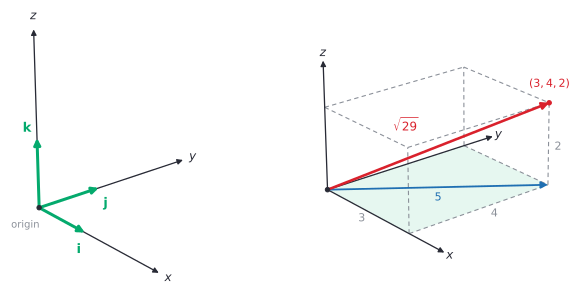
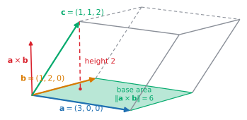
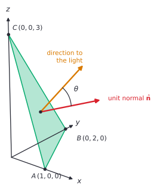

# Vectors in 3D and the cross product

After this lesson you can find lengths and angles for vectors in space, compute a cross product and use it to build a vector perpendicular to two others, find the area of a parallelogram or triangle and the volume of a box, and use these to shade a triangle in a 3D model.

Before this: [vectors in the plane](01-vectors-in-the-plane.md), and [matrix basics](02-matrix-basics.md) for the $2 \times 2$ determinant.

## Quick check

Try these first. If you get all three right, skip to [Practice](#practice).

1. For $\mathbf{u} = (2, -1, 3)$ and $\mathbf{v} = (1, 4, -2)$, find $\mathbf{u} + \mathbf{v}$, $\lVert \mathbf{u} \rVert$ and $\mathbf{u} \cdot \mathbf{v}$.
2. Find the angle between $(1, 2, 2)$ and $(2, 3, 6)$, to the nearest tenth of a degree.
3. Find a vector perpendicular to both $(1, 0, 2)$ and $(3, 1, 0)$.

<details class="solution" markdown>
<summary>Answers</summary>

1. Add componentwise: $\mathbf{u} + \mathbf{v} = (3, 3, 1)$. The length is $\sqrt{4 + 1 + 9} = \sqrt{14}$. The dot product is $2 - 4 - 6 = -8$.
2. The dot product is $2 + 6 + 12 = 20$ and the lengths are $\sqrt{9} = 3$ and $\sqrt{49} = 7$, so $\cos\theta = \frac{20}{21}$ and $\theta \approx 17.8^\circ$.
3. The cross product $(1, 0, 2) \times (3, 1, 0)$ is $(0 \cdot 0 - 2 \cdot 1,\; 2 \cdot 3 - 1 \cdot 0,\; 1 \cdot 1 - 0 \cdot 3) = (-2, 6, 1)$. Check: $(-2, 6, 1) \cdot (1, 0, 2) = 0$ and $(-2, 6, 1) \cdot (3, 1, 0) = 0$.

</details>

## The idea

A game engine stores a 3D model as thousands of triangles, each given by three corner points $(x, y, z)$. To draw one triangle the engine has to answer two questions. Does it face the camera, or is it on the far side of the model? And how bright should it be under a light? Both depend on which way the triangle faces, that is, on a vector at right angles to it.

In the plane this was easy. A perpendicular to $(a, b)$ is $(-b, a)$, found by swapping the entries and changing one sign. In space a triangle has two edges, and we want a vector at right angles to both. The dot product can test whether two vectors are perpendicular, but it can't build a vector that is. The cross product builds one, and its length turns out to be the area of the parallelogram the two edges span.

Space needs three numbers for a position. Take the floor of a room, with $x$ east and $y$ north as on a map, and add $z$ for the height above the floor. The picture on the left below shows the three axes with the unit steps $\mathbf{i}$, $\mathbf{j}$ and $\mathbf{k}$ along them. On the right, the point $(3, 4, 2)$ is 3 east, 4 north and 2 up. Its distance from the origin comes from the Pythagorean theorem twice: the diagonal of the floor rectangle is $\sqrt{3^2 + 4^2} = 5$, and the line from the origin to the point is the hypotenuse of a right triangle with legs 5 and 2, so its length is $\sqrt{25 + 4} = \sqrt{29}$.



Everything about the dot product from the plane carries over with a third term. The new idea in this lesson is the cross product, which exists only in three dimensions.

## Definitions

A point in space is an ordered triple $(x, y, z)$ of real numbers, measured from the origin $(0, 0, 0)$ along three axes at right angles to each other. A coordinate system is **right-handed** when, if you point the fingers of your right hand along the positive $x$-axis and curl them toward the positive $y$-axis, your thumb points along the positive $z$-axis. In plain words, the picture above is the standard one: $x$ comes toward you, $y$ goes right and $z$ goes up. This book always uses right-handed axes.

A **vector in space** is an ordered triple $\mathbf{v} = (a, b, c)$, the move of $a$ along the $x$-axis, $b$ along the $y$-axis and $c$ along the $z$-axis, as in [vectors in the plane](01-vectors-in-the-plane.md#definitions). Equality, the zero vector $\mathbf{0} = (0, 0, 0)$, sums, scalar multiples, position vectors and "end minus start" for the vector from $P$ to $Q$ all work as in the plane, with a third component. The standard unit vectors are $\mathbf{i} = (1, 0, 0)$, $\mathbf{j} = (0, 1, 0)$ and $\mathbf{k} = (0, 0, 1)$, and every vector is $a\mathbf{i} + b\mathbf{j} + c\mathbf{k}$.

The length of $\mathbf{v} = (a, b, c)$ is

$$
\lVert \mathbf{v} \rVert = \sqrt{a^2 + b^2 + c^2}.
$$

In plain words, it is the Pythagorean theorem twice, as for $(3, 4, 2)$ above. The distance between points $P$ and $Q$ is $\lVert \overrightarrow{PQ} \rVert$, and a vector divided by its length is a unit vector in the same direction.

The dot product of $\mathbf{u} = (u_1, u_2, u_3)$ and $\mathbf{v} = (v_1, v_2, v_3)$ is the number $\mathbf{u} \cdot \mathbf{v} = u_1 v_1 + u_2 v_2 + u_3 v_3$. In plain words, multiply matching components and add, one more term than in the plane. The rules from the plane hold: $\mathbf{u} \cdot \mathbf{v} = \mathbf{v} \cdot \mathbf{u}$, the dot product distributes over addition, and $\mathbf{u} \cdot \mathbf{u} = \lVert \mathbf{u} \rVert^2$.

The **cross product** of $\mathbf{u} = (u_1, u_2, u_3)$ and $\mathbf{v} = (v_1, v_2, v_3)$ is the vector

$$
\mathbf{u} \times \mathbf{v} = \left( \det\begin{pmatrix} u_2 & u_3 \\ v_2 & v_3 \end{pmatrix},\; -\det\begin{pmatrix} u_1 & u_3 \\ v_1 & v_3 \end{pmatrix},\; \det\begin{pmatrix} u_1 & u_2 \\ v_1 & v_2 \end{pmatrix} \right),
$$

which written out is $(u_2 v_3 - u_3 v_2,\; u_3 v_1 - u_1 v_3,\; u_1 v_2 - u_2 v_1)$. In plain words, put the two vectors in two rows. For each component, cover one column and take the $2 \times 2$ determinant $ad - bc$ of what is left: cover column 1 for the first component, column 2 for the second (and change its sign), column 3 for the third. For example, $(1, 2, 3) \times (4, 5, 6)$ has first component $2 \cdot 6 - 3 \cdot 5 = -3$, second component $-(1 \cdot 6 - 3 \cdot 4) = 6$ and third component $1 \cdot 5 - 2 \cdot 4 = -3$, so it is $(-3, 6, -3)$.

This cover-a-column pattern is the expansion of a $3 \times 3$ determinant along its top row, with $\mathbf{i}$, $\mathbf{j}$, $\mathbf{k}$ in the top row of the matrix. Determinants of any size come in [determinants](../../05-university-core/06-linear-algebra/06-determinants.md); here we only need the formula.

The direction of $\mathbf{u} \times \mathbf{v}$ is given by the **right-hand rule**: point the fingers of your right hand along $\mathbf{u}$, curl them toward $\mathbf{v}$ through the smaller angle, and your thumb points along $\mathbf{u} \times \mathbf{v}$. In plain words, $\mathbf{i} \times \mathbf{j} = \mathbf{k}$, because curling from $x$ toward $y$ raises your thumb along $z$.

The **triple scalar product** of three vectors is the number $\mathbf{u} \cdot (\mathbf{v} \times \mathbf{w})$. In plain words, cross two of them, then dot the result with the third. It gives a volume, as the last theorem below shows.

## How to do it

### Lengths, unit vectors and angles in space

Everything is the plane version with a third term. For nonzero $\mathbf{u}$ and $\mathbf{v}$ with angle $\theta$ between them, $0^\circ \le \theta \le 180^\circ$,

$$
\mathbf{u} \cdot \mathbf{v} = \lVert \mathbf{u} \rVert \lVert \mathbf{v} \rVert \cos\theta, \qquad \cos\theta = \frac{\mathbf{u} \cdot \mathbf{v}}{\lVert \mathbf{u} \rVert \lVert \mathbf{v} \rVert}.
$$

The proof in the plane lesson used the triangle formed by $\mathbf{u}$, $\mathbf{v}$ and $\mathbf{u} - \mathbf{v}$ and the law of cosines. Two vectors in space drawn from a common point always lie in one plane, so that triangle exists here too, and expanding $\lVert \mathbf{u} - \mathbf{v} \rVert^2$ in components gives the same cross term with one more product in it. The sign tests also carry over: a positive dot product means an acute angle, zero means perpendicular and negative means obtuse.

### Computing a cross product

1. Write the two vectors as the rows of a table, $\mathbf{u}$ above $\mathbf{v}$.
2. Cover column 1. The first component is the determinant of the rest: $u_2 v_3 - u_3 v_2$.
3. Cover column 2. The second component is the negative of the determinant of the rest: $-(u_1 v_3 - u_3 v_1) = u_3 v_1 - u_1 v_3$.
4. Cover column 3. The third component is the determinant of the rest: $u_1 v_2 - u_2 v_1$.
5. Check: dot the result with $\mathbf{u}$ and with $\mathbf{v}$. Both must be exactly 0.

Step 3 is where most slips happen. The second component needs the minus sign, and so $u_3 v_1 - u_1 v_3$ is the reverse of what a plain determinant of the uncovered entries gives. Step 5 catches it every time.

### Why the cross product does what it does

*Theorem 1.* For vectors $\mathbf{u}$ and $\mathbf{v}$ in space:

- (a) $\mathbf{u} \times \mathbf{v}$ is perpendicular to $\mathbf{u}$ and to $\mathbf{v}$.
- (b) $\lVert \mathbf{u} \times \mathbf{v} \rVert^2 = \lVert \mathbf{u} \rVert^2 \lVert \mathbf{v} \rVert^2 - (\mathbf{u} \cdot \mathbf{v})^2$. So if both vectors are nonzero and $\theta$ is the angle between them, $\lVert \mathbf{u} \times \mathbf{v} \rVert = \lVert \mathbf{u} \rVert \lVert \mathbf{v} \rVert \sin\theta$.
- (c) $\mathbf{u} \times \mathbf{v} = \mathbf{0}$ exactly when one of the vectors is $\mathbf{0}$ or they are parallel.

We know the component formula for the cross product and for the dot product. For (a) we want $\mathbf{u} \cdot (\mathbf{u} \times \mathbf{v}) = 0$ and $\mathbf{v} \cdot (\mathbf{u} \times \mathbf{v}) = 0$. The plan is to multiply out and watch the six terms cancel in pairs.

*Proof of (a).* Writing out the first dot product,

$$
\begin{aligned}
\mathbf{u} \cdot (\mathbf{u} \times \mathbf{v}) &= u_1(u_2 v_3 - u_3 v_2) + u_2(u_3 v_1 - u_1 v_3) + u_3(u_1 v_2 - u_2 v_1) \\
&= u_1 u_2 v_3 - u_1 u_3 v_2 + u_2 u_3 v_1 - u_1 u_2 v_3 + u_1 u_3 v_2 - u_2 u_3 v_1 = 0.
\end{aligned}
$$

The first term cancels the fourth, the second cancels the fifth and the third cancels the sixth. For the second dot product,

$$
\begin{aligned}
\mathbf{v} \cdot (\mathbf{u} \times \mathbf{v}) &= v_1(u_2 v_3 - u_3 v_2) + v_2(u_3 v_1 - u_1 v_3) + v_3(u_1 v_2 - u_2 v_1) \\
&= u_2 v_1 v_3 - u_3 v_1 v_2 + u_3 v_1 v_2 - u_1 v_2 v_3 + u_1 v_2 v_3 - u_2 v_1 v_3 = 0.
\end{aligned}
$$

Again the terms cancel in pairs. $\blacksquare$

For (b) we want a formula for the squared length. The plan is to add $(\mathbf{u} \cdot \mathbf{v})^2$ to $\lVert \mathbf{u} \times \mathbf{v} \rVert^2$ and show that the sum is $\lVert \mathbf{u} \rVert^2 \lVert \mathbf{v} \rVert^2$.

*Proof of (b).* Squaring each component of the cross product, the squares are

$$
\lVert \mathbf{u} \times \mathbf{v} \rVert^2 = \underbrace{u_2^2 v_3^2 + u_3^2 v_2^2 + u_3^2 v_1^2 + u_1^2 v_3^2 + u_1^2 v_2^2 + u_2^2 v_1^2}_{\text{six squared terms}} - 2\left(u_2 u_3 v_2 v_3 + u_1 u_3 v_1 v_3 + u_1 u_2 v_1 v_2\right).
$$

Squaring the dot product gives

$$
(\mathbf{u} \cdot \mathbf{v})^2 = u_1^2 v_1^2 + u_2^2 v_2^2 + u_3^2 v_3^2 + 2\left(u_1 u_2 v_1 v_2 + u_1 u_3 v_1 v_3 + u_2 u_3 v_2 v_3\right).
$$

In the sum, the two brackets are equal and have opposite signs, so they cancel. What is left is the six squared terms plus the three from the dot product, which are all nine products $u_i^2 v_j^2$. That is

$$
(u_1^2 + u_2^2 + u_3^2)(v_1^2 + v_2^2 + v_3^2) = \lVert \mathbf{u} \rVert^2 \lVert \mathbf{v} \rVert^2.
$$

So $\lVert \mathbf{u} \times \mathbf{v} \rVert^2 + (\mathbf{u} \cdot \mathbf{v})^2 = \lVert \mathbf{u} \rVert^2 \lVert \mathbf{v} \rVert^2$, which is the first claim. For the second, use $(\mathbf{u} \cdot \mathbf{v})^2 = \lVert \mathbf{u} \rVert^2 \lVert \mathbf{v} \rVert^2 \cos^2\theta$ to get $\lVert \mathbf{u} \times \mathbf{v} \rVert^2 = \lVert \mathbf{u} \rVert^2 \lVert \mathbf{v} \rVert^2 (1 - \cos^2\theta) = \lVert \mathbf{u} \rVert^2 \lVert \mathbf{v} \rVert^2 \sin^2\theta$. Take square roots, using $\sin\theta \ge 0$ for $0^\circ \le \theta \le 180^\circ$. $\blacksquare$

*Proof of (c).* By (b), $\lVert \mathbf{u} \times \mathbf{v} \rVert$ is zero exactly when $\lVert \mathbf{u} \rVert = 0$, or $\lVert \mathbf{v} \rVert = 0$, or $\sin\theta = 0$, that is $\theta = 0^\circ$ or $180^\circ$, which is the case of parallel vectors. $\blacksquare$

Look back: part (a) says $\mathbf{u} \times \mathbf{v}$ lies on the line perpendicular to both vectors, and part (b) says how long it is. That leaves two directions along the line. The formula picks the one the right-hand rule names. Checking it for $\mathbf{i} \times \mathbf{j}$: $(1, 0, 0) \times (0, 1, 0) = (0 \cdot 0 - 0 \cdot 1,\; 0 \cdot 0 - 1 \cdot 0,\; 1 \cdot 1 - 0 \cdot 0) = (0, 0, 1) = \mathbf{k}$. This book accepts that the formula and the hand rule agree for every pair of non-parallel vectors: turn the pair around without ever making them parallel, and neither the formula nor the rule can flip direction, so the agreement at $\mathbf{i}$ and $\mathbf{j}$ persists.


The picture shows both parts at once. The parallelogram with sides $\mathbf{u}$ and $\mathbf{v}$ has base $\lVert \mathbf{u} \rVert$ and height $\lVert \mathbf{v} \rVert \sin\theta$, so by part (b) its area is exactly $\lVert \mathbf{u} \times \mathbf{v} \rVert$. In the figure the area is $2 \cdot 1 = 2$, and the cross product is $(0, 0, 2)$, whose length is 2. The triangle with the same two sides has half the area, $\frac{1}{2}\lVert \mathbf{u} \times \mathbf{v} \rVert$. Swapping the vectors turns the arrow downward, which is the next theorem.

*Theorem 2.* For vectors $\mathbf{u}$, $\mathbf{v}$, $\mathbf{w}$ in space and a number $c$:

- (a) $\mathbf{v} \times \mathbf{u} = -(\mathbf{u} \times \mathbf{v})$, and in particular $\mathbf{u} \times \mathbf{u} = \mathbf{0}$.
- (b) $(c\mathbf{u}) \times \mathbf{v} = c(\mathbf{u} \times \mathbf{v}) = \mathbf{u} \times (c\mathbf{v})$.
- (c) $\mathbf{u} \times (\mathbf{v} + \mathbf{w}) = \mathbf{u} \times \mathbf{v} + \mathbf{u} \times \mathbf{w}$ and $(\mathbf{u} + \mathbf{v}) \times \mathbf{w} = \mathbf{u} \times \mathbf{w} + \mathbf{v} \times \mathbf{w}$.

*Proof.* Each statement follows by writing both sides in components. For (a), swapping $\mathbf{u}$ and $\mathbf{v}$ swaps the two products inside every bracket of the formula, such as $u_2 v_3 - u_3 v_2$ into $v_2 u_3 - v_3 u_2$, and that is the negative. For $\mathbf{u} \times \mathbf{u}$, each bracket becomes $u_2 u_3 - u_3 u_2 = 0$. For (b) and (c), every component is a sum of products of one entry of $\mathbf{u}$ with one entry of $\mathbf{v}$, so it scales and adds in each vector separately. $\blacksquare$

The standard unit vectors give a table to remember. Each row's vector is crossed with each column's vector, so row $\mathbf{j}$, column $\mathbf{k}$ is $\mathbf{j} \times \mathbf{k} = \mathbf{i}$.

| $\times$ | $\mathbf{i}$ | $\mathbf{j}$ | $\mathbf{k}$ |
|---|---|---|---|
| $\mathbf{i}$ | $\mathbf{0}$ | $\mathbf{k}$ | $-\mathbf{j}$ |
| $\mathbf{j}$ | $-\mathbf{k}$ | $\mathbf{0}$ | $\mathbf{i}$ |
| $\mathbf{k}$ | $\mathbf{j}$ | $-\mathbf{i}$ | $\mathbf{0}$ |

Going around the cycle $\mathbf{i} \to \mathbf{j} \to \mathbf{k} \to \mathbf{i}$ gives a plus sign, and going against it gives a minus.

### Volume and the triple scalar product

Three vectors $\mathbf{u}$, $\mathbf{v}$, $\mathbf{w}$ drawn from one corner are the edges of a slanted box called a **parallelepiped**, a solid whose six faces are parallelograms.

*Theorem 3.* The parallelepiped with edges $\mathbf{u}$, $\mathbf{v}$, $\mathbf{w}$ has volume $\lvert \mathbf{u} \cdot (\mathbf{v} \times \mathbf{w}) \rvert$. In components,

$$
\mathbf{u} \cdot (\mathbf{v} \times \mathbf{w}) = u_1(v_2 w_3 - v_3 w_2) + u_2(v_3 w_1 - v_1 w_3) + u_3(v_1 w_2 - v_2 w_1).
$$

We know that the face spanned by $\mathbf{v}$ and $\mathbf{w}$ has area $\lVert \mathbf{v} \times \mathbf{w} \rVert$, and that $\mathbf{v} \times \mathbf{w}$ is perpendicular to that face. We want the volume, which is the base area times the height. The plan is to find the height as the shadow of $\mathbf{u}$ on the direction of $\mathbf{v} \times \mathbf{w}$.

*Proof.* Take the face on $\mathbf{v}$ and $\mathbf{w}$ as the base. If $\mathbf{v} \times \mathbf{w} = \mathbf{0}$ the base is flat, the solid has volume 0, and the formula gives 0. Otherwise let $\mathbf{n} = \mathbf{v} \times \mathbf{w}$, which is perpendicular to the base. The height of the solid is the distance from the tip of $\mathbf{u}$ to the base plane, which is the length of the shadow of $\mathbf{u}$ on the line of $\mathbf{n}$, namely $\frac{\lvert \mathbf{u} \cdot \mathbf{n} \rvert}{\lVert \mathbf{n} \rVert}$. This uses the shadow reading of the dot product from the [plane lesson](01-vectors-in-the-plane.md#faq). Then

$$
\text{volume} = \text{base} \times \text{height} = \lVert \mathbf{n} \rVert \cdot \frac{\lvert \mathbf{u} \cdot \mathbf{n} \rvert}{\lVert \mathbf{n} \rVert} = \lvert \mathbf{u} \cdot (\mathbf{v} \times \mathbf{w}) \rvert.
$$

The component formula is the dot product of $\mathbf{u}$ with the cross product written out. $\blacksquare$

Look back: the formula is the $3 \times 3$ determinant of the rows $\mathbf{u}$, $\mathbf{v}$, $\mathbf{w}$, expanded along the first row, so it is the three-dimensional version of "the determinant is the area of the parallelogram" from [matrix basics](02-matrix-basics.md). The sign is positive when $\mathbf{u}$, $\mathbf{v}$, $\mathbf{w}$ in that order are right-handed, like $\mathbf{i}$, $\mathbf{j}$, $\mathbf{k}$, and negative otherwise. The box below has $\mathbf{a} = (3, 0, 0)$, $\mathbf{b} = (1, 2, 0)$ and $\mathbf{c} = (1, 1, 2)$. Its base has area $\lVert \mathbf{a} \times \mathbf{b} \rVert = \lVert (0, 0, 6) \rVert = 6$ and its height is 2, so the volume is 12, and $\mathbf{c} \cdot (\mathbf{a} \times \mathbf{b}) = 12$.



The tetrahedron (a pyramid with a triangular base) on the same three edges has one sixth of the box's volume. The triple product is $0$ exactly when the three vectors lie in one plane, because then the box is flat.

### Normals, hidden faces and light

A triangle with corners $A$, $B$, $C$ has edge vectors $\overrightarrow{AB}$ and $\overrightarrow{AC}$, and its **normal vector** (a vector perpendicular to the triangle) is $\mathbf{n} = \overrightarrow{AB} \times \overrightarrow{AC}$. By Theorem 1 it is perpendicular to the triangle and $\frac{1}{2}\lVert \mathbf{n} \rVert$ is the area. By the right-hand rule, $\mathbf{n}$ points toward the side from which $A \to B \to C$ looks counterclockwise. Models list their corners in a fixed order so that the normal points out of the solid.

Two uses in graphics follow from the dot product with $\mathbf{n}$.

**Back-face culling** skips triangles that can't be seen. If the camera is at the point $E$, a triangle faces the camera when $\mathbf{n} \cdot \overrightarrow{AE} > 0$, because then the angle between the normal and the direction to the camera is acute. A triangle with $\mathbf{n} \cdot \overrightarrow{AE} \le 0$ faces away, and the engine doesn't draw it. This test only needs a sign, so $\mathbf{n}$ doesn't have to be a unit vector. Roughly half the triangles of a closed solid face away from any one camera, so culling can save about half of the drawing work.

**Diffuse lighting** sets a brightness from the angle $\theta$ between the unit normal $\hat{\mathbf{n}}$ and the unit vector $\hat{\mathbf{l}}$ that points toward the light. A surface is brightest when the light shines straight on, and it gets no light when the light is edge-on or behind it:

$$
\text{brightness} = \max(0,\; \hat{\mathbf{n}} \cdot \hat{\mathbf{l}}) = \max(0, \cos\theta).
$$

Here the vectors must be unit vectors, so the lengths are divided out first.



### A method for problems in space

1. Draw a quick sketch and write each point or vector in components, using "end minus start" for the vector between two points.
2. For a length, a unit vector or an angle, use the dot product: $\lVert \mathbf{v} \rVert = \sqrt{a^2 + b^2 + c^2}$ and $\cos\theta = \frac{\mathbf{u} \cdot \mathbf{v}}{\lVert \mathbf{u} \rVert \lVert \mathbf{v} \rVert}$.
3. For a vector perpendicular to two others, or an area, compute the cross product with the cover-a-column pattern.
4. Check the cross product: its dot product with each of the two vectors is 0.
5. Read off the answer. The area of a parallelogram is $\lVert \mathbf{u} \times \mathbf{v} \rVert$, and a triangle gets half of that. A box has volume $\lvert \mathbf{u} \cdot (\mathbf{v} \times \mathbf{w}) \rvert$ and a tetrahedron one sixth of it.
6. Check the size. The area of a triangle with sides $\mathbf{u}$ and $\mathbf{v}$ can't be more than $\frac{1}{2}\lVert \mathbf{u} \rVert \lVert \mathbf{v} \rVert$, since $\sin\theta \le 1$.

## Worked examples

<div class="example" markdown>

### Example 1: shading a triangle

A model has the triangle $A = (1, 0, 0)$, $B = (0, 2, 0)$, $C = (0, 0, 3)$. The camera is at $E = (5, 4, 3)$ and the light is in the direction $(1, 2, 2)$ from the triangle. Find the normal and the area, decide whether the camera sees the front, and find the brightness.

Step 1: the edge vectors are $\overrightarrow{AB} = (0 - 1,\; 2 - 0,\; 0 - 0) = (-1, 2, 0)$ and $\overrightarrow{AC} = (-1, 0, 3)$.

Step 3: the cross product $\mathbf{n} = \overrightarrow{AB} \times \overrightarrow{AC}$. Cover column 1: $2 \cdot 3 - 0 \cdot 0 = 6$. Cover column 2 and change the sign: $-\big((-1)(3) - 0 \cdot (-1)\big) = -(-3) = 3$. Cover column 3: $(-1)(0) - 2 \cdot (-1) = 2$. So $\mathbf{n} = (6, 3, 2)$.

Step 4: check. $\mathbf{n} \cdot \overrightarrow{AB} = -6 + 6 + 0 = 0$ and $\mathbf{n} \cdot \overrightarrow{AC} = -6 + 0 + 6 = 0$.

Step 5: the length is $\lVert \mathbf{n} \rVert = \sqrt{36 + 9 + 4} = 7$, so the area of the triangle is $\frac{7}{2} = 3.5$. The camera direction is $\overrightarrow{AE} = (4, 4, 3)$, and $\mathbf{n} \cdot \overrightarrow{AE} = 24 + 12 + 6 = 42 > 0$, so the triangle faces the camera and is drawn. A camera at $(-2, -1, -1)$ has $\overrightarrow{AE} = (-3, -1, -1)$ and $\mathbf{n} \cdot \overrightarrow{AE} = -18 - 3 - 2 = -23 < 0$, so from there the triangle is culled.

Step 2, for the light: the unit normal is $\hat{\mathbf{n}} = \left(\frac{6}{7}, \frac{3}{7}, \frac{2}{7}\right)$. The light vector $(1, 2, 2)$ has length 3, so $\hat{\mathbf{l}} = \left(\frac{1}{3}, \frac{2}{3}, \frac{2}{3}\right)$ and

$$
\hat{\mathbf{n}} \cdot \hat{\mathbf{l}} = \frac{6 + 6 + 4}{21} = \frac{16}{21} \approx 0.762.
$$

The angle is $\arccos\frac{16}{21} \approx 40.4^\circ$, as in the figure. A light in the direction $(-1, 0, 0)$ gives $\mathbf{n} \cdot (-1, 0, 0) = -6 < 0$, so the brightness is $\max(0, \text{negative}) = 0$, since that light shines on the back.

Step 6: check. The area 3.5 is below $\frac{1}{2}\lVert \overrightarrow{AB} \rVert \lVert \overrightarrow{AC} \rVert = \frac{1}{2}\sqrt{5}\sqrt{10} \approx 3.54$, as it must be. The brightness 0.762 is between 0 and 1.

</div>

<div class="example" markdown>

### Example 2: angles in a cube

A cube has side 1, with one corner at the origin. Find the angle between a space diagonal and an edge, and between two different space diagonals.

Step 1: put the cube at the origin with the three edges along the axes. The space diagonal from the origin to the opposite corner is $\mathbf{d}_1 = (1, 1, 1)$, and an edge from the origin is $\mathbf{e} = (1, 0, 0)$. The diagonal from the corner $(1, 0, 0)$ to the corner $(0, 1, 1)$ is $\mathbf{d}_2 = (-1, 1, 1)$.

Step 2: for the diagonal and the edge, $\mathbf{d}_1 \cdot \mathbf{e} = 1$, $\lVert \mathbf{d}_1 \rVert = \sqrt{3}$ and $\lVert \mathbf{e} \rVert = 1$, so $\cos\theta = \frac{1}{\sqrt{3}}$ and $\theta \approx 54.7^\circ$. For the two diagonals, $\mathbf{d}_1 \cdot \mathbf{d}_2 = -1 + 1 + 1 = 1$ and both lengths are $\sqrt{3}$, so $\cos\theta = \frac{1}{3}$ and $\theta \approx 70.5^\circ$.

Both angles are acute because both dot products are positive. Check the second by symmetry: every pair of space diagonals of a cube meets at the same angle, so $(1, 1, 1)$ with $(1, 1, -1)$ must also give $\cos\theta = \frac{1}{3}$, and it does, since the dot product is $1 + 1 - 1 = 1$ and the lengths multiply to 3.

</div>

<div class="example" markdown>

### Example 3: when the cross product is zero

(a) Are the points $A = (1, 2, 3)$, $B = (2, 4, 6)$ and $C = (4, 8, 12)$ on one line? (b) Do the points $A = (1, 1, 1)$, $B = (2, 3, 4)$, $C = (3, 1, 2)$ and $D = (4, 3, 5)$ lie in one plane, and what happens if $D$ is moved to $(4, 3, 6)$?

(a) Step 1: $\overrightarrow{AB} = (1, 2, 3)$ and $\overrightarrow{AC} = (3, 6, 9)$. Step 3: the cross product is $(2 \cdot 9 - 3 \cdot 6,\; 3 \cdot 3 - 1 \cdot 9,\; 1 \cdot 6 - 2 \cdot 3) = (0, 0, 0)$. By Theorem 1(c) the vectors are parallel, and since they share the point $A$, the three points lie on one line. Indeed $\overrightarrow{AC} = 3\overrightarrow{AB}$.

(b) Take the three edge vectors from $A$: $\overrightarrow{AB} = (1, 2, 3)$, $\overrightarrow{AC} = (2, 0, 1)$ and $\overrightarrow{AD} = (3, 2, 4)$. The cross product $\overrightarrow{AC} \times \overrightarrow{AD} = (0 \cdot 4 - 1 \cdot 2,\; 1 \cdot 3 - 2 \cdot 4,\; 2 \cdot 2 - 0 \cdot 3) = (-2, -5, 4)$, and the triple product is $(1, 2, 3) \cdot (-2, -5, 4) = -2 - 10 + 12 = 0$. The box on the three vectors is flat, so the four points lie in one plane. In fact $\overrightarrow{AD} = \overrightarrow{AB} + \overrightarrow{AC}$, so $A$, $B$, $D$, $C$ are the corners of a parallelogram.

Move $D$ to $(4, 3, 6)$. Then $\overrightarrow{AD} = (3, 2, 5)$ and $\overrightarrow{AC} \times \overrightarrow{AD} = (0 \cdot 5 - 1 \cdot 2,\; 1 \cdot 3 - 2 \cdot 5,\; 4) = (-2, -7, 4)$. The triple product is $-2 - 14 + 12 = -4$. The four points are no longer in one plane. The box has volume $\lvert -4 \rvert = 4$ and the tetrahedron $ABCD$ has volume $\frac{4}{6} = \frac{2}{3}$. The negative sign means $\overrightarrow{AB}$, $\overrightarrow{AC}$, $\overrightarrow{AD}$ in that order are left-handed.

</div>

<div class="example" markdown>

### Example 4: the area of a triangle in space (finish it yourself)

Find the area of the triangle with corners $P = (2, 1, -1)$, $Q = (3, 3, 1)$ and $R = (4, -1, 0)$.

Step 1: $\overrightarrow{PQ} = (1, 2, 2)$ and $\overrightarrow{PR} = (2, -2, 1)$.

Step 3: the cross product is $\overrightarrow{PQ} \times \overrightarrow{PR} = (6, 3, -6)$.

Now do steps 4 to 6: check that the result is perpendicular to both edges, find the area, and compare it with $\frac{1}{2}\lVert \overrightarrow{PQ} \rVert \lVert \overrightarrow{PR} \rVert$. Is the result a surprise?

<details class="solution" markdown>
<summary>Finish</summary>

Step 4: $(6, 3, -6) \cdot (1, 2, 2) = 6 + 6 - 12 = 0$ and $(6, 3, -6) \cdot (2, -2, 1) = 12 - 6 - 6 = 0$.

Step 5: $\lVert (6, 3, -6) \rVert = \sqrt{36 + 9 + 36} = \sqrt{81} = 9$, so the area is $\frac{9}{2} = 4.5$.

Step 6: the lengths are $\lVert \overrightarrow{PQ} \rVert = \sqrt{9} = 3$ and $\lVert \overrightarrow{PR} \rVert = \sqrt{9} = 3$, so the bound is $\frac{1}{2} \cdot 3 \cdot 3 = 4.5$. The area equals the bound, which happens only when $\sin\theta = 1$, a right angle at $P$. Check: $\overrightarrow{PQ} \cdot \overrightarrow{PR} = 2 - 4 + 2 = 0$.

</details>

</div>

## Edge cases and common mistakes

<div class="warning" markdown>

Watch out for the order. $\mathbf{v} \times \mathbf{u} = -(\mathbf{u} \times \mathbf{v})$, so the order is part of the answer. For $\mathbf{u} = (1, 2, 3)$ and $\mathbf{v} = (4, 5, 6)$ we get $\mathbf{u} \times \mathbf{v} = (-3, 6, -3)$ and $\mathbf{v} \times \mathbf{u} = (3, -6, 3)$. The two have the same length, so an area is unaffected, but a normal that points the wrong way makes a triangle look dark when it should be lit.

</div>

<div class="warning" markdown>

Watch out for the sign of the middle component. It is $u_3 v_1 - u_1 v_3$, not $u_1 v_3 - u_3 v_1$. The pattern is cyclic: the indices run $2, 3$, then $3, 1$, then $1, 2$. If you get the middle sign wrong, the dot-product check in step 4 of the method fails.

</div>

<div class="warning" markdown>

Watch out for mixing up the two products. The dot product $\mathbf{u} \cdot \mathbf{v}$ is a number, and it is 0 when the vectors are perpendicular. The cross product $\mathbf{u} \times \mathbf{v}$ is a vector, and it is $\mathbf{0}$ when the vectors are parallel. So "perpendicular" is a dot product of 0, "parallel" is a cross product of $\mathbf{0}$, and an expression such as $(\mathbf{u} \cdot \mathbf{v}) \times \mathbf{w}$ makes no sense because it crosses a number with a vector.

</div>

<div class="warning" markdown>

Watch out for rules from ordinary multiplication that fail. The cross product is not associative: $\mathbf{i} \times (\mathbf{i} \times \mathbf{j}) = \mathbf{i} \times \mathbf{k} = -\mathbf{j}$, but $(\mathbf{i} \times \mathbf{i}) \times \mathbf{j} = \mathbf{0} \times \mathbf{j} = \mathbf{0}$, so brackets matter. You also can't cancel: $\mathbf{u} \times \mathbf{v} = \mathbf{u} \times \mathbf{w}$ does not give $\mathbf{v} = \mathbf{w}$. For $\mathbf{u} = (1, 0, 0)$, both $(0, 1, 0)$ and $(3, 1, 0)$ give $(0, 0, 1)$. In general, adding any multiple of $\mathbf{u}$ to $\mathbf{v}$ leaves $\mathbf{u} \times \mathbf{v}$ unchanged, because $\mathbf{u} \times \mathbf{u} = \mathbf{0}$.

</div>

The cross product has no meaning for two-component vectors. If you put $\mathbf{0}$ in the third place, $(a, b, 0) \times (c, d, 0) = (0, 0, ad - bc)$, so the result stands straight up, and its one nonzero entry is the $2 \times 2$ determinant from [matrix basics](02-matrix-basics.md), the signed area of the parallelogram in the plane. That is how the plane fits into this lesson, and why a graphics or geometry library often calls $ad - bc$ "the 2D cross product".

The zero vector behaves as in the plane: $\mathbf{0} \times \mathbf{v} = \mathbf{0}$, and it has no direction, so it is a "normal" to nothing. A triangle whose three corners are on one line has $\mathbf{n} = \mathbf{0}$ and area 0. Game engines meet these degenerate triangles and must skip them before dividing by $\lVert \mathbf{n} \rVert$ to make a unit normal.

Handedness is a convention. Some graphics and game systems use left-handed axes, where the thumb rule uses the left hand. The formula for the components doesn't change, but what it means for the normal to point "out" does. A model that looks inside out can come from vertex order or handedness being the opposite of what the code expects.

## Tricks and shortcuts

The cyclic pattern removes the sign bookkeeping. Number the components 1, 2, 3 and go around the cycle: component 1 uses entries 2 and 3, component 2 uses 3 and 1, component 3 uses 1 and 2, and each is "first-vector entry times second-vector entry, minus the reverse". For $(2, 1, 0) \times (0, 2, 2)$ that gives $(1 \cdot 2 - 0 \cdot 2,\; 0 \cdot 0 - 2 \cdot 2,\; 2 \cdot 2 - 1 \cdot 0) = (2, -4, 4)$, which has length 6.

Always do the dot-product check, step 4. It takes ten seconds, and a wrong sign or a wrong entry nearly always makes one of the two dot products nonzero.

Know a few whole-number lengths in space. $(1, 2, 2)$ has length 3, $(2, 3, 6)$ has length 7, $(2, 6, 9)$ has length 11, $(4, 4, 7)$ has length 9 and $(1, 4, 8)$ has length 9, since $1 + 4 + 4 = 9$, $4 + 9 + 36 = 49$, $4 + 36 + 81 = 121$, $16 + 16 + 49 = 81$ and $1 + 16 + 64 = 81$. Scaling keeps them, so $(6, 3, 2)$ in Example 1 has length 7 as well.

For a yes-or-no question about facing, skip the square roots. The sign of $\mathbf{n} \cdot \overrightarrow{AE}$ decides it with no normalizing. For a test of perpendicular or parallel, use the dot product $0$ or the cross product $\mathbf{0}$, and compare to exact 0 only when the numbers are whole.

## In code

NumPy has `np.cross` and `np.dot` for exactly these operations. The code below is Example 1 as a small renderer test: normal, area, culling and brightness. The vectors need three components.

<details class="code" markdown>
<summary>In code</summary>

```python
import numpy as np

# The triangle from Example 1, a camera and a light.
A, B, C = np.array([1, 0, 0]), np.array([0, 2, 0]), np.array([0, 0, 3])
n = np.cross(B - A, C - A)                    # normal, not yet unit length
print(n, np.linalg.norm(n) / 2)               # [6 3 2] 3.5

def facing(eye):
    """True if the triangle faces a camera at `eye` (the back-face test)."""
    return np.dot(n, eye - A) > 0

print(facing(np.array([5, 4, 3])), facing(np.array([-2, -1, -1])))   # True False

def brightness(n, to_light):
    """Diffuse brightness: the cosine of the angle, never below 0."""
    n_hat = n / np.linalg.norm(n)
    l_hat = to_light / np.linalg.norm(to_light)
    return max(0.0, float(np.dot(n_hat, l_hat)))

print(round(brightness(n, np.array([1, 2, 2])), 4))     # 0.7619
print(brightness(n, np.array([-1, 0, 0])))              # 0.0

# The cross product is perpendicular to both inputs, and anticommutative.
u, v = np.array([1, 2, 3]), np.array([4, 5, 6])
w = np.cross(u, v)
print(w, np.dot(w, u), np.dot(w, v), np.cross(v, u))    # [-3  6 -3] 0 0 [ 3 -6  3]

# Its length is |u||v| sin(theta), with the angle from the dot product.
cos_t = np.dot(u, v) / (np.linalg.norm(u) * np.linalg.norm(v))
print(np.isclose(np.linalg.norm(w),
                 np.linalg.norm(u) * np.linalg.norm(v) * np.sqrt(1 - cos_t ** 2)))   # True

# The triple scalar product is the volume of the box, and a 3 x 3 determinant.
a, b, c = np.array([3, 0, 0]), np.array([1, 2, 0]), np.array([1, 1, 2])
print(np.dot(a, np.cross(b, c)), round(np.linalg.det(np.array([a, b, c]))))   # 12 12
```

The `facing` test needs only the sign of a dot product, so it never takes a square root. The `np.isclose` call is there because lengths and angles are floating-point numbers, so two correct computations can differ in the last digits, as in [floating point basics](../../06-cs-math/01-number-representation/04-floating-point-basics.md). Exact equality is safe for the whole-number dot products above, and `np.isclose` is the habit for everything else.

</details>

## FAQ

### Why is there a cross product only in three dimensions?

The cross product of two vectors should be a vector perpendicular to both, with a length that is the parallelogram's area. In the plane there is no direction perpendicular to a vector $(a, b)$ except along the line through $(-b, a)$, and a perpendicular to two non-parallel vectors in the plane would have to be $\mathbf{0}$. In space, the vectors perpendicular to two non-parallel vectors form exactly one line, so there is one direction to choose, with two senses, and the right-hand rule picks the sense. In four dimensions the vectors perpendicular to two given ones form a whole plane, so there is no single answer.

### Why does the cross product use a sine when the dot product uses a cosine?

They measure opposite things. The cosine in the dot product is large when the vectors point the same way, so $\mathbf{u} \cdot \mathbf{v}$ measures how much one vector is along the other. The sine in the cross product is large when they are at right angles, so $\lVert \mathbf{u} \times \mathbf{v} \rVert$ measures how much one is across the other. The two are tied by $\sin^2\theta + \cos^2\theta = 1$, which is exactly Theorem 1(b): $\lVert \mathbf{u} \times \mathbf{v} \rVert^2 + (\mathbf{u} \cdot \mathbf{v})^2 = \lVert \mathbf{u} \rVert^2 \lVert \mathbf{v} \rVert^2$.

### What do the three components of the cross product mean?

Each one is a signed area of a shadow. Look at the parallelogram on $\mathbf{u}$ and $\mathbf{v}$ from straight above, along the $z$-axis. Its shadow on the $xy$-plane is the parallelogram on $(u_1, u_2)$ and $(v_1, v_2)$, and by [matrix basics](02-matrix-basics.md) its signed area is $u_1 v_2 - u_2 v_1$, which is the third component. The first component is the signed area of the shadow on the $yz$-plane, and the second is the shadow on the $zx$-plane. The cross product is the vector of the three shadow areas, which is why its length is the area of the full parallelogram, by the three-dimensional Pythagorean theorem. Practice problem 8 checks this on a triangle.

### Is the right-hand rule a law of nature?

No, it is a convention, in the same way that "$x$ goes right and $y$ goes up" is. The formula for the components is what defines the cross product. The right-hand rule only tells you which way the formula's answer points when the axes are drawn in the right-handed way. In a left-handed system you would use your left hand, and everything else, including the length and the zero test, would be the same.

## Practice

### Warm-up

1\. Let $\mathbf{u} = (2, -3, 6)$ and $\mathbf{v} = (1, 2, 2)$. Find $\lVert \mathbf{u} \rVert$, $\lVert \mathbf{v} \rVert$, $\mathbf{u} \cdot \mathbf{v}$, the angle between them to the nearest tenth of a degree, and the unit vector in the direction of $\mathbf{u}$.

<details class="solution" markdown>
<summary>Solution</summary>

The lengths are $\lVert \mathbf{u} \rVert = \sqrt{4 + 9 + 36} = 7$ and $\lVert \mathbf{v} \rVert = \sqrt{1 + 4 + 4} = 3$. The dot product is $2 - 6 + 12 = 8$. Then $\cos\theta = \frac{8}{21} \approx 0.381$ and $\theta \approx 67.6^\circ$, acute because the dot product is positive. The unit vector is $\frac{1}{7}(2, -3, 6) = \left(\frac{2}{7}, -\frac{3}{7}, \frac{6}{7}\right)$.

Check: $\left(\frac{2}{7}\right)^2 + \left(\frac{3}{7}\right)^2 + \left(\frac{6}{7}\right)^2 = \frac{4 + 9 + 36}{49} = 1$.

</details>

2\. Compute (a) $(1, 2, 3) \times (4, 5, 6)$ and (b) $(2, 0, 0) \times (0, 0, 5)$. Check (a) by dot products.

<details class="solution" markdown>
<summary>Solution</summary>

(a) First component: $2 \cdot 6 - 3 \cdot 5 = -3$. Second: $3 \cdot 4 - 1 \cdot 6 = 6$. Third: $1 \cdot 5 - 2 \cdot 4 = -3$. So the result is $(-3, 6, -3)$.

(b) First: $0 \cdot 5 - 0 \cdot 0 = 0$. Second: $0 \cdot 0 - 2 \cdot 5 = -10$. Third: $2 \cdot 0 - 0 \cdot 0 = 0$. So it is $(0, -10, 0)$, which is $10(-\mathbf{j})$. This agrees with $\mathbf{i} \times \mathbf{k} = -\mathbf{j}$ from the table, scaled by $2 \cdot 5 = 10$.

Check (a): $(-3, 6, -3) \cdot (1, 2, 3) = -3 + 12 - 9 = 0$ and $(-3, 6, -3) \cdot (4, 5, 6) = -12 + 30 - 18 = 0$.

</details>

3\. (Reviews [matrix basics](02-matrix-basics.md).) Compute $(3, 1, 0) \times (1, 2, 0)$, and compare the answer with the determinant of the matrix with rows $(3, 1)$ and $(1, 2)$.

<details class="solution" markdown>
<summary>Solution</summary>

The first component is $1 \cdot 0 - 0 \cdot 2 = 0$ and the second is $0 \cdot 1 - 3 \cdot 0 = 0$. The third is $3 \cdot 2 - 1 \cdot 1 = 5$. So the cross product is $(0, 0, 5)$. The determinant of the matrix with rows $(3, 1)$ and $(1, 2)$ is $3 \cdot 2 - 1 \cdot 1 = 5$, the same number.

Check: the length of $(0, 0, 5)$ is 5, which is the area of the parallelogram on $(3, 1)$ and $(1, 2)$, as in matrix basics. The cross product of two vectors in the $xy$-plane stands straight up, and its height is the $2 \times 2$ determinant.

</details>

### Standard

4\. Find the area of the triangle with corners $P = (1, 0, 2)$, $Q = (3, 1, 4)$ and $R = (0, 2, 3)$, and a vector perpendicular to the triangle.

<details class="solution" markdown>
<summary>Solution</summary>

The edges are $\overrightarrow{PQ} = (2, 1, 2)$ and $\overrightarrow{PR} = (-1, 2, 1)$. The cross product has first component $1 \cdot 1 - 2 \cdot 2 = -3$, second component $2 \cdot (-1) - 2 \cdot 1 = -4$ and third component $2 \cdot 2 - 1 \cdot (-1) = 5$. So $\mathbf{n} = (-3, -4, 5)$ is perpendicular to the triangle, and $\lVert \mathbf{n} \rVert = \sqrt{9 + 16 + 25} = \sqrt{50} = 5\sqrt{2}$. The area is $\frac{5\sqrt{2}}{2} \approx 3.54$. This answer is not a whole number, and that is fine.

Check: $\mathbf{n} \cdot \overrightarrow{PQ} = -6 - 4 + 10 = 0$ and $\mathbf{n} \cdot \overrightarrow{PR} = 3 - 8 + 5 = 0$. The area is below $\frac{1}{2} \cdot 3 \cdot \sqrt{6} \approx 3.67$.

</details>

5\. A parallelepiped has edges $(2, 1, 0)$, $(0, 3, 1)$ and $(1, 0, 4)$ from one corner. Find its volume, and the volume of the tetrahedron on the same three edges.

<details class="solution" markdown>
<summary>Solution</summary>

Call the edges $\mathbf{a}$, $\mathbf{b}$, $\mathbf{c}$. First, $\mathbf{b} \times \mathbf{c} = (3 \cdot 4 - 1 \cdot 0,\; 1 \cdot 1 - 0 \cdot 4,\; 0 \cdot 0 - 3 \cdot 1) = (12, 1, -3)$. Then $\mathbf{a} \cdot (\mathbf{b} \times \mathbf{c}) = 24 + 1 + 0 = 25$. The volume of the box is 25 and of the tetrahedron $\frac{25}{6} \approx 4.17$.

Check: the determinant of the matrix with rows $(2, 1, 0)$, $(0, 3, 1)$, $(1, 0, 4)$ is $2(12 - 0) - 1(0 - 1) + 0 = 24 + 1 = 25$. The result is positive, so the three edges are right-handed in this order.

</details>

6\. A triangle has corners $A = (0, 0, 1)$, $B = (2, 0, 1)$ and $C = (0, 2, 1)$, listed in that order. (a) Find its normal and area. (b) Does it face a camera at $(1, 1, 5)$? At $(1, 1, -3)$? (c) What is its brightness for a light in the direction $(2, 1, 2)$? (d) What changes if the corners are listed in the order $A$, $C$, $B$?

<details class="solution" markdown>
<summary>Solution</summary>

(a) $\overrightarrow{AB} = (2, 0, 0)$ and $\overrightarrow{AC} = (0, 2, 0)$, so $\mathbf{n} = (0, 0, 4)$ by the cover-a-column pattern. The area is $\frac{4}{2} = 2$, which is also the area of a right triangle with legs 2 and 2.

(b) For the camera at $(1, 1, 5)$, $\overrightarrow{AE} = (1, 1, 4)$ and $\mathbf{n} \cdot \overrightarrow{AE} = 16 > 0$, so it faces the camera. For the camera at $(1, 1, -3)$, $\overrightarrow{AE} = (1, 1, -4)$ and the dot product is $-16 < 0$, so it faces away.

(c) The unit normal is $(0, 0, 1)$. The light vector $(2, 1, 2)$ has length 3, so the brightness is $\frac{2}{3} \approx 0.667$.

(d) Reversing the order reverses the normal to $(0, 0, -4)$. The area is unchanged, but now the camera at $(1, 1, 5)$ gets $-16$, so the triangle is culled, and the brightness for the same light is $\max(0, -\frac{2}{3}) = 0$. The order of the corners decides which side is the front.

Check: $\mathbf{n}$ is vertical and the triangle is horizontal (all $z$ equal 1), so they should be perpendicular, and $(0, 0, 4) \cdot (2, 0, 0) = 0$.

</details>

### Challenge

7\. Prove that $(\mathbf{u} + \mathbf{v}) \times (\mathbf{u} - \mathbf{v}) = -2(\mathbf{u} \times \mathbf{v})$ for all vectors $\mathbf{u}$ and $\mathbf{v}$ in space, and say what it says about parallelograms.

<details class="solution" markdown>
<summary>Solution</summary>

We know Theorem 2: the cross product distributes over addition on each side, $\mathbf{v} \times \mathbf{u} = -(\mathbf{u} \times \mathbf{v})$ and $\mathbf{w} \times \mathbf{w} = \mathbf{0}$. We want the identity. The plan is to multiply out as in $(x + y)(x - y)$, but keep every product in order.

Expanding with the distributive law on both sides,

$$
(\mathbf{u} + \mathbf{v}) \times (\mathbf{u} - \mathbf{v}) = \mathbf{u} \times \mathbf{u} - \mathbf{u} \times \mathbf{v} + \mathbf{v} \times \mathbf{u} - \mathbf{v} \times \mathbf{v}.
$$

The first and last terms are $\mathbf{0}$. Since $\mathbf{v} \times \mathbf{u} = -(\mathbf{u} \times \mathbf{v})$, the middle terms are $-\mathbf{u} \times \mathbf{v} - \mathbf{u} \times \mathbf{v} = -2(\mathbf{u} \times \mathbf{v})$. $\blacksquare$

Look back: in ordinary algebra the middle terms of $(x + y)(x - y)$ cancel, but here they add, because swapping the order of a cross product changes its sign. In words: the diagonals $\mathbf{u} + \mathbf{v}$ and $\mathbf{u} - \mathbf{v}$ of a parallelogram span a parallelogram of twice the area.

Check with numbers: for $\mathbf{u} = (1, 2, 3)$ and $\mathbf{v} = (0, 1, -1)$ we have $\mathbf{u} \times \mathbf{v} = (-5, 1, 1)$, and $(1, 3, 2) \times (1, 1, 4) = (10, -2, -2) = -2(-5, 1, 1)$.

</details>

8\. The plane through $A = (2, 0, 0)$, $B = (0, 3, 0)$ and $C = (0, 0, 6)$ cuts a triangle out of the first octant. (a) Find its area. (b) Find the areas of its three shadows on the coordinate planes ($xy$, $yz$ and $zx$) and show that the square of the area is the sum of the squares of the shadow areas.

<details class="solution" markdown>
<summary>Solution</summary>

(a) The edges are $\overrightarrow{AB} = (-2, 3, 0)$ and $\overrightarrow{AC} = (-2, 0, 6)$. The cross product is $(3 \cdot 6 - 0 \cdot 0,\; 0 \cdot (-2) - (-2) \cdot 6,\; (-2) \cdot 0 - 3 \cdot (-2)) = (18, 12, 6)$, with length $\sqrt{324 + 144 + 36} = \sqrt{504}$. The area is $\frac{\sqrt{504}}{2} = \sqrt{126} = 3\sqrt{14} \approx 11.22$.

(b) The shadow on the $xy$-plane has corners $(2, 0)$, $(0, 3)$ and $(0, 0)$, so its area is $\frac{1}{2} \cdot 2 \cdot 3 = 3$. On the $yz$-plane the corners are $(0, 0)$, $(3, 0)$ and $(0, 6)$, which gives $\frac{1}{2} \cdot 3 \cdot 6 = 9$. On the $zx$-plane the corners are $(0, 0)$, $(6, 0)$ and $(0, 2)$, so the area is $\frac{1}{2} \cdot 6 \cdot 2 = 6$. These are half of the components $6$, $18$ and $12$ of the cross product, in the order $xy$, $yz$, $zx$, and the squares add up to $9 + 81 + 36 = 126$, the square of the area in part (a).

Check: this is Pythagoras for areas. The components $(18, 12, 6)$ halved are $(9, 6, 3)$, with $81 + 36 + 9 = 126$, and the area is $\sqrt{126} \approx 11.22$, matching (a).

</details>

## Where this shows up

- The next lesson, [Lines and planes in 3D](04-lines-and-planes-in-3d.md), uses the cross product to find the normal of a plane, and the triple product to test whether two lines meet. Later, [determinants](../../05-university-core/06-linear-algebra/06-determinants.md) extends the volume idea to any size, [orthogonality, projections and least squares](../../05-university-core/06-linear-algebra/07-orthogonality-projections-and-least-squares.md) extends perpendicular, and the gradient in [partial derivatives and the gradient](../../05-university-core/09-multivariable-calculus-light/02-partial-derivatives-and-the-gradient.md) is perpendicular to a level surface.
- In computing, a triangle mesh stores positions, and the renderer computes normals with cross products, culls back faces with a dot product and shades with $\max(0, \hat{\mathbf{n}} \cdot \hat{\mathbf{l}})$. The 2D version $ad - bc$ tells a left turn from a right turn, which convex hull and segment-intersection code relies on. Physics engines use $\mathbf{r} \times \mathbf{F}$ for torque.
- In economics a basket of goods lives in $\mathbb{R}^n$ and the dot product prices it, as in the plane lesson. The cross product has no counterpart there, because it is special to three dimensions.
