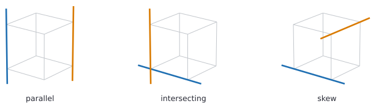
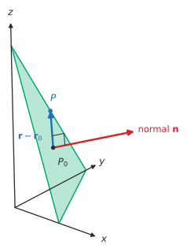
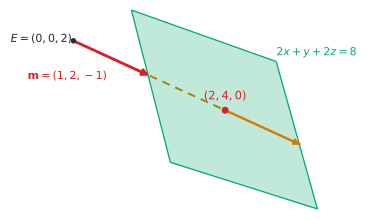
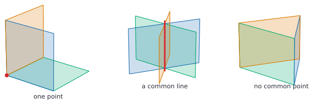

# Lines and planes in 3D

After this lesson you can write a line in space in vector, parametric and symmetric form, write a plane in scalar and vector form with its normal from a cross product, decide whether two lines are parallel, meet or are skew, find where a line meets a plane or two planes meet, and find the distance from a point to a plane.

Before this: [Vectors in 3D and the cross product](03-vectors-in-3d-and-the-cross-product.md), [forms of linear equations](../02-linear-functions-and-systems/01-forms-of-linear-equations.md) and [systems of linear equations](../02-linear-functions-and-systems/02-systems-of-linear-equations.md).

## Quick check

Try these first. If you get all three right, skip to [Practice](#practice).

1. Write the line through $P = (1, 2, 3)$ with direction vector $(2, -1, 4)$ in parametric form, and find its point at $t = 2$.
2. Write the plane through $(1, 0, 0)$ with normal vector $(2, -1, 3)$ in the form $ax + by + cz = d$. Is the point $(2, 2, 0)$ on it?
3. How far is the origin from the plane $2x + 3y + 6z = 14$?

<details class="solution" markdown>
<summary>Answers</summary>

1. The parametric equations are $x = 1 + 2t$, $y = 2 - t$, $z = 3 + 4t$. At $t = 2$ the point is $(5, 0, 11)$.
2. The coefficients are the normal vector, so $2x - y + 3z = d$, and $d = 2 \cdot 1 - 0 + 0 = 2$. The plane is $2x - y + 3z = 2$. For $(2, 2, 0)$ the left side is $4 - 2 + 0 = 2$, so yes, it is on the plane.
3. The distance is $\frac{\lvert 14 \rvert}{\sqrt{4 + 9 + 36}} = \frac{14}{7} = 2$.

</details>

## The idea

A drone hovers 10 m above the ground at $(0, 0, 10)$ and flies with constant velocity $(3, 2, -1)$ metres per second, with $x$ east, $y$ north and $z$ up. After $t$ seconds it is at $(3t, 2t, 10 - t)$. It reaches the ground, $z = 0$, when $10 - t = 0$, so at $t = 10$ s, at the point $(30, 20, 0)$. The recipe "start here, then walk $t$ times this vector" is the equation of a line in space, and it is the same idea as $y = mx + b$, where the slope $m$ plays the part of the direction.

A line in space can't be written as one equation in $x$, $y$ and $z$. In the plane, one linear equation $ax + by = c$ describes a line. In space, one linear equation $ax + by + cz = d$ describes a flat sheet, a plane. Count the freedom: three coordinates, minus one equation, leaves two free directions, a plane. Two independent equations leave one free direction, a line (two planes cut along a line, like two walls meeting at a corner). Three independent equations leave none, a single point, which is the case of three equations in three unknowns from [systems of linear equations](../02-linear-functions-and-systems/02-systems-of-linear-equations.md#three-equations-in-three-unknowns).

Two lines in the plane either cross or are parallel. In space there is a third case. Two lines can miss each other without being parallel, like a road and an overpass crossing above it. Such lines are called skew.



This lesson gives equations for lines and planes, and a test for each of the ways two of them can meet. The cross product and the triple product from the last lesson do most of the work.

## Definitions

A **direction vector** of a line is any nonzero vector parallel to it. Let the line pass through the point $P_0 = (x_0, y_0, z_0)$ with position vector $\mathbf{r}_0$, and let $\mathbf{m} = (a, b, c)$ be a direction vector. A point with position vector $\mathbf{r}$ is on the line exactly when $\mathbf{r} - \mathbf{r}_0$ is a multiple of $\mathbf{m}$. This gives the **vector equation** of the line,

$$
\mathbf{r} = \mathbf{r}_0 + t\,\mathbf{m}, \qquad t \in \mathbb{R}.
$$

In plain words, start at $P_0$ and walk $t$ times $\mathbf{m}$, forward for positive $t$ and backward for negative $t$. In components this is three equations, the **parametric equations**

$$
x = x_0 + at, \qquad y = y_0 + bt, \qquad z = z_0 + ct.
$$

If $a$, $b$ and $c$ are all nonzero, solving each equation for $t$ gives the **symmetric equations**

$$
\frac{x - x_0}{a} = \frac{y - y_0}{b} = \frac{z - z_0}{c}.
$$

In plain words, every point of the line gives the same value of $t$ in all three fractions. If a component of $\mathbf{m}$ is 0, that fraction would divide by 0, so you write that coordinate on its own. For $c = 0$ the symmetric form is $\frac{x - x_0}{a} = \frac{y - y_0}{b}$ together with $z = z_0$.

A plane is described by one of its points $P_0$ and a vector $\mathbf{n} = (a, b, c) \ne \mathbf{0}$ perpendicular to it, a normal vector, as for a triangle in the last lesson. A point with position vector $\mathbf{r}$ is on the plane exactly when $\mathbf{r} - \mathbf{r}_0$ is perpendicular to $\mathbf{n}$, that is, when $\mathbf{n} \cdot (\mathbf{r} - \mathbf{r}_0) = 0$. Expanding, $\mathbf{n} \cdot \mathbf{r} = \mathbf{n} \cdot \mathbf{r}_0$. Writing $d$ for the number $\mathbf{n} \cdot \mathbf{r}_0$ gives the **scalar equation** of the plane,

$$
ax + by + cz = d, \qquad d = ax_0 + by_0 + cz_0.
$$

In plain words, the coefficients of $x$, $y$ and $z$ are the normal vector, and the number on the right comes from putting one known point into the left side. Every equation of this form with $(a, b, c) \ne \mathbf{0}$ is a plane.



A plane can also be described from the inside. If $\mathbf{u}$ and $\mathbf{v}$ are two vectors in the plane that aren't parallel, every point of the plane is reached from $P_0$ by walking some amount along each. This is the vector equation of the plane,

$$
\mathbf{r} = \mathbf{r}_0 + s\,\mathbf{u} + t\,\mathbf{v}, \qquad s, t \in \mathbb{R},
$$

and written in components it gives its parametric equations, one for each of $x$, $y$ and $z$. The two forms are linked by the cross product: $\mathbf{n} = \mathbf{u} \times \mathbf{v}$ is perpendicular to both vectors in the plane, so it is a normal.

Two lines in space are **skew** when they are not parallel and have no point in common. Lines that lie in one plane are **coplanar**, and skew lines are exactly the pairs of lines that are not coplanar.

## How to do it

### A line from a point and a direction, or from two points

1. Pick a point $P_0$ on the line and a direction vector $\mathbf{m}$. For two points $P$ and $Q$, use $P_0 = P$ and $\mathbf{m} = \overrightarrow{PQ} = Q - P$, "end minus start".
2. Write $\mathbf{r} = \mathbf{r}_0 + t\mathbf{m}$, and the parametric equations from its components.
3. For the symmetric form, solve each parametric equation for $t$ and set them equal, if no component of $\mathbf{m}$ is 0.
4. Check: both points are on the line, for two values of $t$.

A line has many equations. Any of its points can be the starting point, and any nonzero multiple of $\mathbf{m}$ is a direction vector. Two equations describe the same line exactly when their direction vectors are parallel and a point of one is on the other.

### A plane from three points

1. From three points $A$, $B$, $C$ not on one line, take two vectors in the plane: $\mathbf{u} = \overrightarrow{AB}$ and $\mathbf{v} = \overrightarrow{AC}$.
2. Compute the normal $\mathbf{n} = \mathbf{u} \times \mathbf{v}$.
3. The coefficients of the scalar equation are $(a, b, c) = \mathbf{n}$, and $d = \mathbf{n} \cdot A$ with any one of the points.
4. Check: all three points satisfy $ax + by + cz = d$.

If the plane is given by a point and a normal, only step 3 is needed. If it is given by the parametric form, the two direction vectors are $\mathbf{u}$ and $\mathbf{v}$ already.

### Two lines: parallel, meeting or skew

Take the lines $\mathbf{r} = \mathbf{r}_1 + s\mathbf{m}_1$ and $\mathbf{r} = \mathbf{r}_2 + t\mathbf{m}_2$. Use two different letters for the parameters, because the lines have no reason to reach a common point at the same value.

1. Test for parallel. The lines are parallel exactly when $\mathbf{m}_1 \times \mathbf{m}_2 = \mathbf{0}$. Then they are the same line if $\mathbf{r}_2 - \mathbf{r}_1$ is also parallel to $\mathbf{m}_1$, and distinct parallel lines otherwise.
2. If the lines aren't parallel, compute the triple product $(\mathbf{r}_2 - \mathbf{r}_1) \cdot (\mathbf{m}_1 \times \mathbf{m}_2)$. If it is 0, the lines meet in exactly one point. If it is not 0, they are skew.
3. To find the point, solve $\mathbf{r}_1 + s\mathbf{m}_1 = \mathbf{r}_2 + t\mathbf{m}_2$. That is three equations in the two unknowns $s$ and $t$. Solve two of them and check the third.

Why the triple product decides it. The three vectors $\mathbf{m}_1$, $\mathbf{m}_2$ and $\mathbf{r}_2 - \mathbf{r}_1$ span a box, and the box is flat exactly when its volume, the triple product up to sign, is 0. If the lines meet, all three vectors lie in the plane through the two lines. Conversely, if the box is flat and the lines aren't parallel, the two lines lie in a common plane, and two non-parallel lines in a plane always meet. The same box also measures the gap: its volume is base times height, and the height is the distance between the lines, so for skew lines

$$
\text{distance} = \frac{\lvert (\mathbf{r}_2 - \mathbf{r}_1) \cdot (\mathbf{m}_1 \times \mathbf{m}_2) \rvert}{\lVert \mathbf{m}_1 \times \mathbf{m}_2 \rVert}.
$$

### A line and a plane

Take the line $\mathbf{r} = \mathbf{r}_0 + t\mathbf{m}$ and the plane $\mathbf{n} \cdot \mathbf{r} = d$. A point of the line is on the plane when $\mathbf{n} \cdot (\mathbf{r}_0 + t\mathbf{m}) = d$, which rearranges to

$$
t\,(\mathbf{n} \cdot \mathbf{m}) = d - \mathbf{n} \cdot \mathbf{r}_0.
$$

1. Compute $\mathbf{n} \cdot \mathbf{m}$.
2. If $\mathbf{n} \cdot \mathbf{m} \ne 0$, there is exactly one value $t = \frac{d - \mathbf{n} \cdot \mathbf{r}_0}{\mathbf{n} \cdot \mathbf{m}}$, so the line meets the plane in one point, $\mathbf{r}_0 + t\mathbf{m}$.
3. If $\mathbf{n} \cdot \mathbf{m} = 0$, the line is parallel to the plane (its direction is perpendicular to the normal). Then the equation reads $0 = d - \mathbf{n} \cdot \mathbf{r}_0$. If that is true, every $t$ works and the line lies in the plane. If it is false, no $t$ works and the line never meets the plane.
4. Check the point by putting it into the plane's equation.



### Two planes, and three planes

Two planes with normals $\mathbf{n}_1$ and $\mathbf{n}_2$ are parallel exactly when $\mathbf{n}_1 \times \mathbf{n}_2 = \mathbf{0}$. They are then the same plane if one equation is a multiple of the other, and they never meet otherwise. If the normals aren't parallel, the planes meet in a line. The direction of that line is perpendicular to both normals, so it is $\mathbf{m} = \mathbf{n}_1 \times \mathbf{n}_2$. To find a point on the line, give one of the unknowns a convenient value, such as $z = 0$, and solve the two equations that are left. The angle between two planes is the angle between their normals, taken between $0^\circ$ and $90^\circ$, so $\cos\theta = \frac{\lvert \mathbf{n}_1 \cdot \mathbf{n}_2 \rvert}{\lVert \mathbf{n}_1 \rVert \lVert \mathbf{n}_2 \rVert}$.

Three planes are a system of three equations in three unknowns, so the question is one about solutions: one, none, or infinitely many. The triple product of the normals, $\mathbf{n}_1 \cdot (\mathbf{n}_2 \times \mathbf{n}_3)$, is the determinant of the coefficient matrix, as in the last lesson.

| Triple product of the normals | What the planes do | Solutions |
|---|---|---|
| not 0 | meet at a single point, like the corner of a room | exactly one |
| 0, and the equations are consistent | share a line, like the pages of an open book (or are all the same plane) | infinitely many |
| 0, and the equations are inconsistent | no point lies on all three, as for the sides of a triangular prism, or two parallel planes cut by a third | none |



When the triple product is 0, elimination decides between the last two rows, as in [systems of linear equations](../02-linear-functions-and-systems/02-systems-of-linear-equations.md): it ends in $0 = 0$ for a line of solutions, or in $0 = k$ with $k \ne 0$ for none. Problem 8 below does one.

### The distance from a point to a plane

*Theorem.* The distance from the point $Q$ to the plane $\mathbf{n} \cdot \mathbf{r} = d$ is

$$
\frac{\lvert \mathbf{n} \cdot Q - d \rvert}{\lVert \mathbf{n} \rVert} = \frac{\lvert aq_1 + bq_2 + cq_3 - d \rvert}{\sqrt{a^2 + b^2 + c^2}}, \qquad Q = (q_1, q_2, q_3).
$$

We know that the plane is the set of points $X$ with $\mathbf{n} \cdot X = d$. We want the smallest value of $\lVert Q - X \rVert$ over all such $X$. The plan is to name the foot of the perpendicular, $F$, and show with the Pythagorean theorem that every other point of the plane is farther away.

*Proof.* Let $F = Q - \frac{\mathbf{n} \cdot Q - d}{\lVert \mathbf{n} \rVert^2}\,\mathbf{n}$. Then $\mathbf{n} \cdot F = \mathbf{n} \cdot Q - (\mathbf{n} \cdot Q - d) = d$, so $F$ is in the plane, and $Q - F$ is a multiple of $\mathbf{n}$. Take any point $X$ of the plane. Then $Q - X = (Q - F) + (F - X)$, where $Q - F$ is a multiple of $\mathbf{n}$ and $\mathbf{n} \cdot (F - X) = d - d = 0$, so $F - X$ is perpendicular to $\mathbf{n}$. The two pieces are at right angles, so by the Pythagorean theorem

$$
\lVert Q - X \rVert^2 = \lVert Q - F \rVert^2 + \lVert F - X \rVert^2 \ge \lVert Q - F \rVert^2,
$$

with equality only for $X = F$. So the distance is $\lVert Q - F \rVert = \frac{\lvert \mathbf{n} \cdot Q - d \rvert}{\lVert \mathbf{n} \rVert^2}\lVert \mathbf{n} \rVert = \frac{\lvert \mathbf{n} \cdot Q - d \rvert}{\lVert \mathbf{n} \rVert}$. $\blacksquare$

Look back: this is the shadow idea again. $\mathbf{n} \cdot Q - d$ is the dot product of $\mathbf{n}$ with $Q - P_0$ for any point $P_0$ of the plane, and dividing by $\lVert \mathbf{n} \rVert$ gives the length of the shadow of $Q - P_0$ along the normal, which is the distance. Two parallel planes with the same normal $\mathbf{n}$ and constants $d_1$ and $d_2$ are $\frac{\lvert d_1 - d_2 \rvert}{\lVert \mathbf{n} \rVert}$ apart. The same formula appears in [parametric, polar and 3D coordinates](../../05-university-core/09-multivariable-calculus-light/01-parametric-polar-and-3d-coordinates.md), argued from the shadow.

## Worked examples

<div class="example" markdown>

### Example 1: a plane through three points, and a distance

Find the plane through $A = (1, 0, 0)$, $B = (0, 2, 0)$ and $C = (0, 0, 3)$, and the distance from $Q = (2, 1, 3)$ to it.

Step 1: $\mathbf{u} = \overrightarrow{AB} = (-1, 2, 0)$ and $\mathbf{v} = \overrightarrow{AC} = (-1, 0, 3)$.

Step 2: the normal is $\mathbf{n} = \mathbf{u} \times \mathbf{v} = (6, 3, 2)$, the same triangle as in the last lesson, where the area was $\frac{7}{2}$ and $\lVert \mathbf{n} \rVert = 7$.

Step 3: $d = \mathbf{n} \cdot A = 6 \cdot 1 + 3 \cdot 0 + 2 \cdot 0 = 6$. The plane is $6x + 3y + 2z = 6$.

Step 4: check the other two points. $B$ gives $0 + 6 + 0 = 6$ and $C$ gives $0 + 0 + 6 = 6$. Dividing by 6 gives $\frac{x}{1} + \frac{y}{2} + \frac{z}{3} = 1$, which says the plane cuts the axes at 1, 2 and 3.

For the distance, put $Q$ in the left side: $6 \cdot 2 + 3 \cdot 1 + 2 \cdot 3 = 21$, and $21 - 6 = 15$. So the distance is $\frac{\lvert 15 \rvert}{7} = \frac{15}{7} \approx 2.14$. The answer is untidy, and that is fine. For the origin the distance is $\frac{\lvert 0 - 6 \rvert}{7} = \frac{6}{7} \approx 0.86$.

Check the distance with the foot of the perpendicular, $F = Q - \frac{15}{49}(6, 3, 2) = \left(\frac{8}{49}, \frac{4}{49}, \frac{117}{49}\right)$. It is in the plane, since $\frac{48 + 12 + 234}{49} = 6$, and $Q - F = \frac{15}{49}(6, 3, 2)$ has length $\frac{15}{49} \cdot 7 = \frac{15}{7}$.

</div>

<div class="example" markdown>

### Example 2: two pairs of lines

Take $L_1$: $\mathbf{r} = (1, 2, 3) + s(2, 1, -1)$. Decide whether it meets (a) $L_2$: $\mathbf{r} = (2, 4, 0) + t(1, -1, 2)$ and (b) $L_3$: $\mathbf{r} = (2, 4, 1) + t(1, -1, 2)$.

Step 1: the direction vectors $(2, 1, -1)$ and $(1, -1, 2)$ are not multiples of each other, so no pair is parallel. Their cross product is $\mathbf{m}_1 \times \mathbf{m}_2 = (1 \cdot 2 - (-1)(-1),\; (-1)(1) - 2 \cdot 2,\; 2(-1) - 1 \cdot 1) = (1, -5, -3)$.

Step 2, for (a): $\mathbf{r}_2 - \mathbf{r}_1 = (1, 2, -3)$ and the triple product is $1 - 10 + 9 = 0$. So $L_1$ and $L_2$ meet in one point.

Step 3: the equations are $1 + 2s = 2 + t$, $2 + s = 4 - t$ and $3 - s = 2t$. Adding the first two gives $3 + 3s = 6$, so $s = 1$ and then $t = 1$. The third equation gives $2 = 2$, true. The point is $(1 + 2, 2 + 1, 3 - 1) = (3, 3, 2)$. Check with $L_2$ at $t = 1$: $(2 + 1, 4 - 1, 0 + 2) = (3, 3, 2)$.

For (b): $\mathbf{r}_3 - \mathbf{r}_1 = (1, 2, -2)$ and the triple product is $1 - 10 + 6 = -3 \ne 0$, so $L_1$ and $L_3$ are skew. Check by solving: the first two equations are the same as before, so $s = t = 1$. The third equation is $3 - s = 1 + 2t$, which gives $2 = 3$, false. The distance between the lines is $\frac{\lvert -3 \rvert}{\lVert (1, -5, -3) \rVert} = \frac{3}{\sqrt{35}} \approx 0.51$.

</div>

<div class="example" markdown>

### Example 3: a ray and a wall, and the edge cases

A camera at $E = (0, 0, 2)$ casts a ray in the direction $\mathbf{m} = (1, 2, -1)$ at the wall $2x + y + 2z = 8$. Where does the ray hit?

Here $\mathbf{n} = (2, 1, 2)$, $d = 8$ and $\mathbf{r}_0 = E$. The line is $\mathbf{r} = (t, 2t, 2 - t)$.

Step 1: $\mathbf{n} \cdot \mathbf{m} = 2 + 2 - 2 = 2 \ne 0$, so there is exactly one hit. Step 2: $\mathbf{n} \cdot E = 4$, so $t = \frac{8 - 4}{2} = 2$. The point is $(2, 4, 0)$.

Step 4: check. $2 \cdot 2 + 4 + 2 \cdot 0 = 8$. Also the camera is $\frac{\lvert 4 - 8 \rvert}{3} = \frac{4}{3}$ from the wall, and the ray is $2\lVert \mathbf{m} \rVert = 2\sqrt{6} \approx 4.9$ long by the time it hits, longer than $\frac{4}{3}$, as it must be for a slanting ray.

Now change the direction to $\mathbf{m}' = (1, 2, -2)$. By step 3, $\mathbf{n} \cdot \mathbf{m}' = 2 + 2 - 4 = 0$, so the ray is parallel to the wall. Since $\mathbf{n} \cdot E = 4 \ne 8$, the equation reads $0 = 4$, so the ray never hits. If the wall were $2x + y + 2z = 4$, the same ray would lie inside it.

</div>

<div class="example" markdown>

### Example 4: where two planes meet (finish it yourself)

The planes $x + y + z = 6$ and $2x - y + z = 3$ have normals $\mathbf{n}_1 = (1, 1, 1)$ and $\mathbf{n}_2 = (2, -1, 1)$. They aren't parallel, so they meet in a line. The direction of the line is $\mathbf{n}_1 \times \mathbf{n}_2 = (2, 1, -3)$.

Now find a point on the line by setting $z = 0$, write the parametric equations, and find where the line meets the third plane $x + 2y - z = 2$.

<details class="solution" markdown>
<summary>Finish</summary>

With $z = 0$ the equations are $x + y = 6$ and $2x - y = 3$. Adding them gives $3x = 9$, so $x = 3$ and $y = 3$. The point is $(3, 3, 0)$, and the line is $x = 3 + 2t$, $y = 3 + t$, $z = -3t$.

Check the line in both planes: $(3 + 2t) + (3 + t) + (-3t) = 6$, and $2(3 + 2t) - (3 + t) + (-3t) = 6 + 4t - 3 - t - 3t = 3$.

For the third plane: $(3 + 2t) + 2(3 + t) - (-3t) = 9 + 7t = 2$, so $t = -1$ and the point is $(1, 2, 3)$. Check: $1 + 4 - 3 = 2$. This is the one solution of the three equations $x + y + z = 6$, $2x - y + z = 3$ and $x + 2y - z = 2$, which practice problem 3 solves by elimination. The triple product of the normals is $7 \ne 0$, which is why there is exactly one point.

</details>

</div>

## Edge cases and common mistakes

<div class="warning" markdown>

Watch out for using the same parameter for both lines. Two lines can cross even though a particle on one reaches the crossing point at a different time from a particle on the other. If you write both lines with $t$ and solve for a common $t$, you test whether two drones collide, not whether their paths cross. In Example 2 the two values happen to be equal ($s = t = 1$), which hides the error. Take $L_1$ again and the line $(3, 3, 2) + t(1, -1, 2)$, which is at $(3, 3, 2)$ when $t = 0$, while $L_1$ gets there at $s = 1$. With one letter the $x$ equation $1 + 2t = 3 + t$ gives $t = 2$, and the $y$ equation $2 + t = 3 - t$ gives $t = \frac{1}{2}$, so the test wrongly says the lines don't meet.

</div>

<div class="warning" markdown>

Watch out for a single equation in space. The equation $x + y = 3$ is a plane in space, not a line. It is the vertical wall through the line $x + y = 3$ of the $xy$-plane, parallel to the $z$-axis, and it contains the point $(1, 2, 7)$ as well as $(1, 2, 0)$. A line in space needs two equations, or a parametric form.

</div>

<div class="warning" markdown>

Watch out for the sign of $d$. The constant is $d = \mathbf{n} \cdot \mathbf{r}_0$, with the plus sign. For the plane through $(1, 2, 3)$ with normal $(2, -1, 4)$, $d = 2 - 2 + 12 = 12$, so the plane is $2x - y + 4z = 12$. A common slip is to write $2(x - 1) - (y - 2) + 4(z - 3) = 0$ and then forget to move the constants. Put the point back in to check.

</div>

<div class="warning" markdown>

Watch out for mixing up "parallel to the plane" and "perpendicular to the plane". A line is parallel to a plane when $\mathbf{m} \cdot \mathbf{n} = 0$. It is perpendicular to the plane when $\mathbf{m}$ is a multiple of $\mathbf{n}$, that is, when $\mathbf{m} \times \mathbf{n} = \mathbf{0}$. The test for "parallel" is a dot product of 0, which looks like the test for perpendicular, because it is the direction $\mathbf{m}$ and the normal $\mathbf{n}$ that are perpendicular.

</div>

Two lines that aren't parallel need not meet in space, which differs from the plane. The test in step 2 of the two-lines method is what decides it, and forgetting the skew case is the usual error.

A distance needs the absolute value. $\mathbf{n} \cdot Q - d$ is negative when $Q$ is on the side of the plane that $\mathbf{n}$ points away from, and the sign tells you which side. A distance is never negative. Also put the equation in the form $ax + by + cz = d$ first. A plane written $ax + by + cz + D = 0$ has $d = -D$, so the numerator is $\lvert aq_1 + bq_2 + cq_3 + D \rvert$.

The same plane has many scalar equations. Doubling every term of $6x + 3y + 2z = 6$ gives another equation of the same plane, with the normal $(12, 6, 4)$, a multiple of the first. To tell whether two equations describe the same plane, check whether the whole equation, including the right side, is a multiple of the other.

A direction vector with a zero component, such as $(2, 0, -1)$, has no symmetric form with three fractions. The line $x = 1 + 2t$, $y = 5$, $z = 3 - t$ is written $\frac{x - 1}{2} = \frac{z - 3}{-1}$ together with $y = 5$.

## Tricks and shortcuts

To go from three points to the plane, you can skip the cross product when the points are on the axes. For the points $(p, 0, 0)$, $(0, q, 0)$ and $(0, 0, r)$ the plane is $\frac{x}{p} + \frac{y}{q} + \frac{z}{r} = 1$, as in Example 1, and multiplying by $pqr$ gives the normal $(qr, pr, pq)$. For $p = 1$, $q = 2$, $r = 3$ that is $(6, 3, 2)$.

To test a point against a plane, substitute it. To test a whole line against a plane, test two of its points, or test $\mathbf{n} \cdot \mathbf{m} = 0$ and one point.

Pick normals with whole-number lengths so that distances are tidy. $(1, 2, 2)$ has length 3, $(2, 3, 6)$ has length 7, and $(2, 6, 9)$ has length 11. In the quick check, the plane $2x + 3y + 6z = 14$ is $14 \div 7 = 2$ from the origin.

The line where two planes meet has direction $\mathbf{n}_1 \times \mathbf{n}_2$. You don't need to solve for it. You only need one point, and setting one variable to 0 and solving for the other two usually finds one. If that gives a contradiction, set a different variable to 0.

## In code

NumPy handles the vector steps and SymPy solves for exact crossing points. The code below follows the examples: a plane from three points, a distance, a ray against a wall, classifying lines and solving three planes.

<details class="code" markdown>
<summary>In code</summary>

```python
import numpy as np
import sympy as sp

# A plane through three points: the normal comes from a cross product.
A, B, C = np.array([1, 0, 0]), np.array([0, 2, 0]), np.array([0, 0, 3])
n = np.cross(B - A, C - A)
d = n @ A
print(n, d)                                    # [6 3 2] 6

# Distance from a point to the plane: |n . Q - d| / |n|.
Q = np.array([2, 1, 3])
print(abs(n @ Q - d) / np.linalg.norm(n))      # 2.142857142857143

# A ray meets a plane: solve n . (r0 + t m) = d for t.
def ray_plane(r0, m, n, d):
    denom = n @ m
    if denom == 0:
        return None                            # parallel to the plane: no single hit
    t = (d - n @ r0) / denom
    return float(t), r0 + t * m

wall = (np.array([2, 1, 2]), 8)                # the plane 2x + y + 2z = 8
print(ray_plane(np.array([0, 0, 2]), np.array([1, 2, -1]), *wall))   # (2.0, array([2., 4., 0.]))
print(ray_plane(np.array([0, 0, 2]), np.array([1, 2, -2]), *wall))   # None

# Two lines: parallel, intersecting or skew, by the triple product.
def classify(r1, m1, r2, m2):
    c = np.cross(m1, m2)
    if not c.any():
        return "parallel"
    return "intersect" if np.dot(r2 - r1, c) == 0 else "skew"

r1, m1 = np.array([1, 2, 3]), np.array([2, 1, -1])
m2 = np.array([1, -1, 2])
print(classify(r1, m1, np.array([2, 4, 0]), m2))   # intersect
print(classify(r1, m1, np.array([2, 4, 1]), m2))   # skew

# Where do the first two lines cross? Solve r1 + s m1 = r2 + t m2 exactly.
s, t = sp.symbols("s t")
r1_, m1_, r2_, m2_ = sp.Matrix(r1), sp.Matrix(m1), sp.Matrix([2, 4, 0]), sp.Matrix(m2)
sol = sp.solve(list(r1_ + s * m1_ - r2_ - t * m2_), [s, t])
print(sol, list(r1_ + sol[s] * m1_))           # {s: 1, t: 1} [3, 3, 2]

# Three planes: a unique point exactly when the determinant is not 0.
M = np.array([[1, 1, 1], [2, -1, 1], [1, 2, -1]])
b = np.array([6, 3, 2])
print(round(np.linalg.det(M)), np.linalg.solve(M, b).round(6))   # 7 [1. 2. 3.]
```

The `classify` function compares the triple product to exactly 0, which is safe for whole-number inputs like these. With measured data, compare with `np.isclose` and a tolerance, since floating-point cross products are rarely exactly 0. To install SymPy, run `pip install sympy`.

</details>

## FAQ

### Why can't a line in space be written as one equation, like $y = mx + b$?

One linear equation in three unknowns removes one degree of freedom and leaves a two-dimensional set, a plane. A line is one-dimensional, so it needs two independent equations, the two planes that meet along it, or one parameter. The symmetric form packs the two equations into one chain: $\frac{x - x_0}{a} = \frac{y - y_0}{b}$ is one plane and $\frac{y - y_0}{b} = \frac{z - z_0}{c}$ is another.

### Why are the coefficients of $x$, $y$ and $z$ the normal vector?

Because $ax + by + cz = d$ is the dot product $(a, b, c) \cdot (x, y, z) = d$. Two points $X_1$ and $X_2$ on the plane both satisfy it, so subtracting gives $(a, b, c) \cdot (X_1 - X_2) = 0$: the vector $(a, b, c)$ is perpendicular to every direction inside the plane. This is the same reason the vector $(a, b)$ is perpendicular to the line $ax + by = c$ in the plane. The Ontario Grade 12 course Calculus and Vectors (MCV4U) writes the scalar equation as $Ax + By + Cz + D = 0$ ([Ontario Curriculum, Grades 11 and 12: Mathematics, 2007](https://www.edu.gov.on.ca/eng/curriculum/secondary/math1112currb.pdf)), which is the same plane with $D = -d$.

### What does a negative value of $t$ mean?

It is a point on the other side of the starting point. The line goes on forever in both directions, and $t = 0$ is only where you chose to start. If you were describing motion, as with the drone, negative $t$ would be where the drone was before the clock started. For a ray from a camera only $t \ge 0$ counts, which is why graphics code discards a hit with negative $t$.

### Do three planes always meet at a point?

No. Three planes in general position meet at one point, but they can also share a line, or have no common point at all, and in those cases the triple product of the normals is 0. Three planes that never all meet can look like the three long sides of a triangular tent. Elimination tells you which case it is.

## Practice

### Warm-up

1\. Write the line through $(1, -2, 4)$ and $(3, 0, 1)$ in vector, parametric and symmetric form. Does $(5, 2, -2)$ lie on it? Does $(-1, -4, 6)$?

<details class="solution" markdown>
<summary>Solution</summary>

The direction is end minus start: $\mathbf{m} = (3 - 1,\; 0 - (-2),\; 1 - 4) = (2, 2, -3)$. Starting at $(1, -2, 4)$, the vector equation is $\mathbf{r} = (1, -2, 4) + t(2, 2, -3)$. The parametric equations are $x = 1 + 2t$, $y = -2 + 2t$, $z = 4 - 3t$. The symmetric form is $\frac{x - 1}{2} = \frac{y + 2}{2} = \frac{z - 4}{-3}$.

For $(5, 2, -2)$: $x$ gives $1 + 2t = 5$, so $t = 2$. Then $y = -2 + 4 = 2$ and $z = 4 - 6 = -2$, both correct, so the point is on the line. For $(-1, -4, 6)$: $x$ gives $t = -1$ and $y = -2 - 2 = -4$, correct, but $z = 4 + 3 = 7 \ne 6$. So the point is not on the line.

Check: at $t = 1$ the line is at $(3, 0, 1)$, the second given point.

</details>

2\. Write the plane through $(2, -1, 3)$ with normal vector $(1, 4, -2)$ in the form $ax + by + cz = d$. Which of $(0, 0, 4)$, $(1, 1, 1)$ and $(4, -3, 0)$ lie on it?

<details class="solution" markdown>
<summary>Solution</summary>

The coefficients are the normal, and $d = 1 \cdot 2 + 4 \cdot (-1) + (-2) \cdot 3 = 2 - 4 - 6 = -8$. The plane is $x + 4y - 2z = -8$.

Put in each point. $(0, 0, 4)$ gives $0 + 0 - 8 = -8$, on the plane. $(1, 1, 1)$ gives $1 + 4 - 2 = 3 \ne -8$, not on it. $(4, -3, 0)$ gives $4 - 12 - 0 = -8$, on the plane.

Check: the original point gives $2 - 4 - 6 = -8$.

</details>

3\. (Reviews [systems of linear equations](../02-linear-functions-and-systems/02-systems-of-linear-equations.md).) Show that the three planes $x + y + z = 6$, $2x - y + z = 3$ and $x + 2y - z = 2$ meet in exactly one point, using the triple product of the normals, and find the point by elimination.

<details class="solution" markdown>
<summary>Solution</summary>

The normals are $(1, 1, 1)$, $(2, -1, 1)$ and $(1, 2, -1)$. First, $(2, -1, 1) \times (1, 2, -1) = \big((-1)(-1) - 1 \cdot 2,\; 1 \cdot 1 - 2 \cdot (-1),\; 2 \cdot 2 - (-1) \cdot 1\big) = (-1, 3, 5)$. The triple product is $(1, 1, 1) \cdot (-1, 3, 5) = 7 \ne 0$, so there is exactly one point.

For the point, subtract the first equation from the second: $x - 2y = -3$. Add the first and third: $2x + 3y = 8$. From the first, $x = 2y - 3$. Then $2(2y - 3) + 3y = 8$ gives $7y = 14$, so $y = 2$, $x = 1$ and $z = 6 - 1 - 2 = 3$.

Check: $1 + 2 + 3 = 6$, $2 - 2 + 3 = 3$ and $1 + 4 - 3 = 2$.

</details>

### Standard

4\. (a) Where does the line $\mathbf{r} = (1, 0, 2) + t(2, 1, -1)$ meet the plane $x + 2y + 3z = 10$? (b) For which value of $k$ is the line parallel to the plane $x + 2y + kz = 10$, and does it then meet the plane? What if the right side is 9?

<details class="solution" markdown>
<summary>Solution</summary>

(a) Here $\mathbf{n} = (1, 2, 3)$ and $\mathbf{m} = (2, 1, -1)$, so $\mathbf{n} \cdot \mathbf{m} = 2 + 2 - 3 = 1 \ne 0$. Also $\mathbf{n} \cdot \mathbf{r}_0 = 1 + 0 + 6 = 7$. So $t = \frac{10 - 7}{1} = 3$ and the point is $(1 + 6, 3, 2 - 3) = (7, 3, -1)$. Check: $7 + 6 - 3 = 10$.

(b) With $\mathbf{n} = (1, 2, k)$, $\mathbf{n} \cdot \mathbf{m} = 2 + 2 - k = 4 - k$, which is 0 for $k = 4$. Then $\mathbf{n} \cdot \mathbf{r}_0 = 1 + 2k = 9$. For the plane $x + 2y + 4z = 10$ the equation reads $0 = 10 - 9 = 1$, so the line never meets it. For $x + 2y + 4z = 9$ it reads $0 = 0$, so the line lies in the plane.

Check the second: the point at $t = 1$ is $(3, 1, 1)$, and $3 + 2 + 4 = 9$.

</details>

5\. Show that the lines $\mathbf{r} = s(1, 2, 2)$ and $\mathbf{r} = (2, -1, 4) + t(2, 1, -2)$ are skew, and find the distance between them.

<details class="solution" markdown>
<summary>Solution</summary>

The directions $(1, 2, 2)$ and $(2, 1, -2)$ aren't multiples of each other. Their cross product is $\big(2(-2) - 2 \cdot 1,\; 2 \cdot 2 - 1 \cdot (-2),\; 1 \cdot 1 - 2 \cdot 2\big) = (-6, 6, -3)$, with length $\sqrt{36 + 36 + 9} = 9$. The vector between the starting points is $(2, -1, 4) - (0, 0, 0) = (2, -1, 4)$, and the triple product is $(2, -1, 4) \cdot (-6, 6, -3) = -12 - 6 - 12 = -30 \ne 0$. So the lines are skew.

The distance is $\frac{\lvert -30 \rvert}{9} = \frac{10}{3} \approx 3.33$.

Check: the closest points are $s = \frac{8}{9}$ on the first line, $\left(\frac{8}{9}, \frac{16}{9}, \frac{16}{9}\right)$, and $t = \frac{5}{9}$ on the second, $\left(\frac{28}{9}, -\frac{4}{9}, \frac{26}{9}\right)$. Their difference is $\left(\frac{20}{9}, -\frac{20}{9}, \frac{10}{9}\right) = \frac{10}{9}(2, -2, 1)$, with length $\frac{10}{9} \cdot 3 = \frac{10}{3}$, and it is a multiple of $(-6, 6, -3)$, so it is perpendicular to both lines.

</details>

6\. The planes $x + y + z = 4$ and $x - y + 2z = 5$ meet in a line. Find the line's direction and a point on it, write its parametric equations, and find the angle between the planes.

<details class="solution" markdown>
<summary>Solution</summary>

The normals are $(1, 1, 1)$ and $(1, -1, 2)$. The direction is their cross product, $\big(1 \cdot 2 - 1 \cdot (-1),\; 1 \cdot 1 - 1 \cdot 2,\; 1 \cdot (-1) - 1 \cdot 1\big) = (3, -1, -2)$.

For a point, set $z = 1$: $x + y = 3$ and $x - y = 3$, so $x = 3$ and $y = 0$. The point is $(3, 0, 1)$ and the line is $x = 3 + 3t$, $y = -t$, $z = 1 - 2t$.

The angle: $\mathbf{n}_1 \cdot \mathbf{n}_2 = 1 - 1 + 2 = 2$, $\lVert \mathbf{n}_1 \rVert = \sqrt{3}$ and $\lVert \mathbf{n}_2 \rVert = \sqrt{6}$, so $\cos\theta = \frac{2}{\sqrt{18}} = \frac{\sqrt{2}}{3} \approx 0.471$ and $\theta \approx 61.9^\circ$.

Check: the point at $t = 1$ is $(6, -1, -1)$, and $6 - 1 - 1 = 4$ and $6 + 1 - 2 = 5$.

</details>

### Challenge

7\. The plane is $x + 2y + 2z = 9$ and $Q = (2, 3, 5)$. Find the distance from $Q$ to the plane, the foot of the perpendicular, and the mirror image of $Q$ in the plane. (In a renderer the mirror image of a point is what a reflection in a flat mirror shows.)

<details class="solution" markdown>
<summary>Solution</summary>

Here $\mathbf{n} = (1, 2, 2)$ with $\lVert \mathbf{n} \rVert = 3$. Then $\mathbf{n} \cdot Q = 2 + 6 + 10 = 18$, and $18 - 9 = 9$. The distance is $\frac{9}{3} = 3$.

The foot is $F = Q - \frac{9}{\lVert \mathbf{n} \rVert^2}\mathbf{n} = (2, 3, 5) - \frac{9}{9}(1, 2, 2) = (1, 1, 3)$. The mirror image $Q'$ is as far on the other side along the same line, so $Q' = Q - 2\,\frac{9}{9}\,\mathbf{n} = (2, 3, 5) - (2, 4, 4) = (0, -1, 1)$.

Check: $F$ is in the plane since $1 + 2 + 6 = 9$. The midpoint of $Q$ and $Q'$ is $(1, 1, 3) = F$. And $Q - Q' = (2, 4, 4) = 2\mathbf{n}$, so the segment $QQ'$ is perpendicular to the plane and has length 6, twice the distance.

</details>

8\. Consider the planes $x + y + z = 1$, $x + 2y + 3z = 2$ and $2x + 3y + kz = m$. For which values of $k$ and $m$ do the three planes have (a) exactly one common point, (b) a line of common points, (c) no common point? In case (b), give the line.

<details class="solution" markdown>
<summary>Solution</summary>

The normals are $(1, 1, 1)$, $(1, 2, 3)$ and $(2, 3, k)$. First, $(1, 2, 3) \times (2, 3, k) = (2k - 9,\; 6 - k,\; 3 - 4) = (2k - 9, 6 - k, -1)$. The triple product is $(1, 1, 1) \cdot (2k - 9, 6 - k, -1) = 2k - 9 + 6 - k - 1 = k - 4$.

(a) If $k \ne 4$ the triple product is not 0, so there is exactly one common point, whatever $m$ is.

For $k = 4$ the third left side is $2x + 3y + 4z = (x + y + z) + (x + 2y + 3z)$, the sum of the first two. So a common point of the first two planes is on the third exactly when $m = 1 + 2 = 3$.

(b) For $k = 4$ and $m = 3$ the third equation adds nothing, and the planes share a line. Subtracting the first two equations gives $y + 2z = 1$. Let $z = t$. Then $y = 1 - 2t$ and $x = 1 - y - z = t$. The line is $(t, 1 - 2t, t)$.

(c) For $k = 4$ and $m \ne 3$ the equations are inconsistent, since the third would say $0 = m - 3$, and there is no common point.

Check (b) with $t = 1$: the point $(1, -1, 1)$ gives $1 - 1 + 1 = 1$, $1 - 2 + 3 = 2$ and $2 - 3 + 4 = 3$.

</details>

## Where this shows up

- In linear algebra, [systems and Gaussian elimination](../../05-university-core/06-linear-algebra/02-systems-and-gaussian-elimination.md) classifies every system by the same three cases, and a plane through the origin is the span of two vectors, as in [vectors, dot product and span](../../05-university-core/06-linear-algebra/01-vectors-dot-product-and-span.md). In calculus, the tangent plane of a surface in [partial derivatives and the gradient](../../05-university-core/09-multivariable-calculus-light/02-partial-derivatives-and-the-gradient.md) is a plane in the sense of this lesson.
- In computing, a ray tracer intersects a ray with every plane and triangle in the scene with the formula $t = \frac{d - \mathbf{n} \cdot \mathbf{r}_0}{\mathbf{n} \cdot \mathbf{m}}$, and a game engine clips and culls against planes by the sign of $\mathbf{n} \cdot Q - d$. Collision detection asks whether a point is within a distance of a plane.
- In economics, a budget $p_1 q_1 + p_2 q_2 + p_3 q_3 = m$ for three goods is a plane whose normal is the price vector, as in [vectors, dot product and span](../../05-university-core/06-linear-algebra/01-vectors-dot-product-and-span.md), and the feasible regions of linear programs, as in [two-variable inequalities and feasible regions](../02-linear-functions-and-systems/03-two-variable-inequalities-and-feasible-regions.md), are bounded by lines with two variables and by planes with three.
