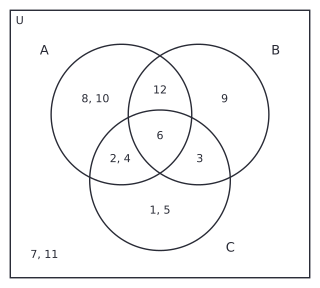
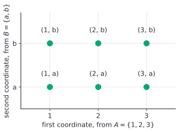

# Sets and set operations

After this lesson you can compute unions, intersections, differences and complements, read Venn diagrams, list power sets and Cartesian products, count with $\lvert A \cup B \rvert = \lvert A \rvert + \lvert B \rvert - \lvert A \cap B \rvert$, and prove a set identity by turning it into a statement of logic.

Before this: [real numbers, axioms and set notation](../../03-high-school/01-algebra-foundations/01-real-numbers-axioms-and-set-notation.md#sets-and-set-notation) (elements, subsets, the empty set, set-builder notation), [compound inequalities and interval notation](../../03-high-school/01-algebra-foundations/03-compound-inequalities-and-interval-notation.md) (union and intersection of solution sets), and [truth tables and logical equivalence](03-truth-tables-and-logical-equivalence.md).

## Quick check

Try these first. If you get all three right, skip to [Practice](#practice).

1. Let $U = \{1, 2, 3, 4, 5, 6\}$, $A = \{1, 2, 3, 4\}$ and $B = \{3, 4, 5\}$. Find $A \cup B$, $A \cap B$, $A \setminus B$, $B \setminus A$ and $A^c$.
2. How many subsets does $\{a, b, c\}$ have? List the ones with exactly two elements.
3. True or false: (a) $\emptyset \in \{\emptyset\}$. (b) $\{1\} \subseteq \{\{1\}, 2\}$. (c) $\{1\} \in \{\{1\}, 2\}$. (d) $(1, 2) = (2, 1)$.

<details class="solution" markdown>
<summary>Answers</summary>

1. $A \cup B = \{1, 2, 3, 4, 5\}$, $A \cap B = \{3, 4\}$, $A \setminus B = \{1, 2\}$, $B \setminus A = \{5\}$, and $A^c = \{5, 6\}$ (the elements of $U$ not in $A$).
2. There are $2^3 = 8$ subsets. The two-element ones are $\{a, b\}$, $\{a, c\}$ and $\{b, c\}$.
3. (a) True: the only element of $\{\emptyset\}$ is the empty set. (b) False: $1$ is not an element of $\{\{1\}, 2\}$, whose elements are the set $\{1\}$ and the number 2. (c) True, for that reason. (d) False: ordered pairs care about order.

</details>

## The idea

A university registrar has two lists: the students taking CS 101 and the students taking ECON 101. Questions about the lists come in a few standard shapes. Who is on both? Who is on at least one? Who is taking CS but not economics? Who is taking neither? Each question builds a new list from the old ones, and the answers can be drawn: two overlapping circles inside a box, with the box being all the students.

Sets give a precise language for such lists, and the language is closely tied to the logic of the first lessons in this chapter. A student is in the "both" list when "taking CS and taking economics" is true of them. A student is in the "at least one" list when the "or" statement is true, and in the "neither" list when "not (CS or economics)" is true. Every operation on sets is a connective in disguise, which is why De Morgan's laws for statements come back as De Morgan's laws for sets, with the same proof.

This lesson sets up the vocabulary (union, intersection, difference, complement, power set, product), and then uses the link to logic to prove identities about sets. The harder proofs about sets, with subsets and equality, get their own lesson later ([proofs about sets](../04-more-proof-methods/03-proofs-about-sets.md)).

## Definitions

### Sets, equality and subsets

A **set** is a collection of objects, its **elements**. We write $x \in A$ when $x$ is an element of $A$, and $x \notin A$ when it is not, as in [real numbers, axioms and set notation](../../03-high-school/01-algebra-foundations/01-real-numbers-axioms-and-set-notation.md#sets-and-set-notation). Order and repeats don't matter: $\{1, 2\} = \{2, 1, 1\}$. A set may be given by a list or by set-builder notation, $\{x \in D : P(x)\}$, which is "the set of all $x$ in $D$ for which the open sentence $P(x)$ is true".

Two sets are **equal** when they have the same elements. In symbols, $A = B$ means $\forall x\,(x \in A \Leftrightarrow x \in B)$. In plain words, a set is nothing more than its elements, so two descriptions of the same elements give the same set: $\{x \in \mathbb{Z} : x^2 = 4\}$ and $\{-2, 2\}$ are equal.

A set $A$ is a **subset** of $B$, written $A \subseteq B$, when $\forall x\,(x \in A \Rightarrow x \in B)$. A **proper subset**, written $A \subsetneq B$, is a subset with $A \ne B$. The **empty set** $\emptyset$ has no elements, and $\emptyset \subseteq A$ for every set $A$, by vacuous truth: no element of $\emptyset$ can fail to be in $A$. Combining the definitions, $A = B$ exactly when $A \subseteq B$ and $B \subseteq A$, which is the usual way to prove two sets are equal.

For complements, every set in a discussion is a subset of one fixed **universe** (or universal set) $U$. It might be $\mathbb{Z}$, the set of all students, or the six numbers in an example. The universe is part of the problem, and it has to be stated.


The figure is a **Venn diagram**: the box is $U$, each circle is a set, and a point inside a circle stands for an element of that set. It shows the three ways two sets can sit: one inside the other, apart (**disjoint** sets, with no element in common, $A \cap B = \emptyset$), or overlapping.

### The four operations

Let $A$ and $B$ be subsets of a universe $U$.

| Operation | Notation | Definition | In logic |
|---|---|---|---|
| **union** | $A \cup B$ | $\{x : x \in A \text{ or } x \in B\}$ | $x \in A \vee x \in B$ |
| **intersection** | $A \cap B$ | $\{x : x \in A \text{ and } x \in B\}$ | $x \in A \wedge x \in B$ |
| **difference** | $A \setminus B$ | $\{x : x \in A \text{ and } x \notin B\}$ | $x \in A \wedge \neg(x \in B)$ |
| **complement** | $A^c$ | $\{x \in U : x \notin A\}$ | $\neg(x \in A)$, for $x \in U$ |

In plain words, the union is everything in at least one of the sets (the inclusive "or" of [statements and connectives](01-statements-and-connectives.md), so an element in both is listed once). The intersection is what the two sets share. The difference $A \setminus B$ is what is left of $A$ after removing the elements of $B$, and the complement $A^c$ is what is left of $U$ after removing $A$, so $A^c = U \setminus A$. Some books write $A'$ or $\overline{A}$ for the complement, and $A - B$ for the difference.


The last column of the table is the whole link to logic: membership in a new set is a compound statement about membership in the old ones. This is how the identities below get proved.

### Three sets, and counting

A diagram with three overlapping circles has eight regions, one for each row of a three-variable truth table. The figure shows an example with $U = \{1, \dots, 12\}$, $A$ the multiples of 2, $B$ the multiples of 3 and $C = \{1, 2, 3, 4, 5, 6\}$.



Write $\lvert A \rvert$ for the number of elements of a finite set $A$ (its **cardinality**). Adding $\lvert A \rvert$ and $\lvert B \rvert$ counts the elements of $A \cap B$ twice, so

$$
\lvert A \cup B \rvert = \lvert A \rvert + \lvert B \rvert - \lvert A \cap B \rvert.
$$

For three sets, the same correction applies at each level:

$$
\lvert A \cup B \cup C \rvert = \lvert A \rvert + \lvert B \rvert + \lvert C \rvert - \lvert A \cap B \rvert - \lvert A \cap C \rvert - \lvert B \cap C \rvert + \lvert A \cap B \cap C \rvert.
$$

In the figure, $\lvert A \rvert = 6$, $\lvert B \rvert = 4$, $\lvert C \rvert = 6$, the pairwise intersections have $2$, $3$ and $2$ elements, and $\lvert A \cap B \cap C \rvert = 1$, so the union has $6 + 4 + 6 - 2 - 3 - 2 + 1 = 10$ elements, which is all of $U$ except 7 and 11. The general rule is inclusion-exclusion and the pigeonhole principle<!-- link: ../../06-cs-math/03-counting-and-discrete-probability/04-inclusion-exclusion-and-pigeonhole.md -->.

### Power sets

The **power set** of $A$, written $\mathcal{P}(A)$, is the set of all subsets of $A$, including $\emptyset$ and $A$ itself:

$$
\mathcal{P}(A) = \{S : S \subseteq A\}.
$$

In plain words, it is the set whose elements are sets. For $A = \{1, 2\}$,

$$
\mathcal{P}(A) = \bigl\{\emptyset,\ \{1\},\ \{2\},\ \{1, 2\}\bigr\}.
$$

If $A$ has $n$ elements, then $\mathcal{P}(A)$ has $2^n$ elements. To build a subset, go through the elements of $A$ one at a time and decide "in" or "out". That is two choices per element, made independently, so $2 \cdot 2 \cdots 2 = 2^n$ subsets. For $n = 3$, $2^3 = 8$ subsets, which matches the quick check.

### Ordered pairs and Cartesian products

An **ordered pair** $(a, b)$ is a pair of objects in which the order matters, and $(a, b) = (c, d)$ exactly when $a = c$ and $b = d$. So $(1, 2) \ne (2, 1)$, and $(3, 3)$ is a perfectly good pair, while $\{3, 3\}$ is the one-element set $\{3\}$. The **Cartesian product** of $A$ and $B$ is the set of all ordered pairs with first entry from $A$ and second entry from $B$:

$$
A \times B = \{(a, b) : a \in A \text{ and } b \in B\}.
$$



For $A = \{1, 2, 3\}$ and $B = \{a, b\}$, the six points in the figure are the elements of $A \times B$. If $A$ and $B$ are finite, $\lvert A \times B \rvert = \lvert A \rvert \cdot \lvert B \rvert$, since each of the $\lvert A \rvert$ first entries goes with each of the $\lvert B \rvert$ second entries. The product is not commutative: $B \times A$ holds pairs like $(a, 1)$, so $A \times B \ne B \times A$ unless the sets are equal or one is empty. Also $A \times \emptyset = \emptyset$, because there is no second entry to pair with. The coordinate plane is $\mathbb{R} \times \mathbb{R} = \mathbb{R}^2$, and $A \times A \times A$ gives ordered triples.

### Indexed families

When there are many sets, it helps to give them labels. A **family of sets** $\{A_i : i \in I\}$ has one set $A_i$ for each index $i$ in an index set $I$. Its union and intersection are

$$
\bigcup_{i \in I} A_i = \{x : \exists i \in I,\ x \in A_i\}, \qquad \bigcap_{i \in I} A_i = \{x : \forall i \in I,\ x \in A_i\}.
$$

In plain words, an element is in the union if it is in at least one of the sets, and in the intersection if it is in every one of them. The union is a long "or" and the intersection is a long "and", matching $\exists$ and $\forall$ from [quantifiers](04-quantifiers.md). For example, let $A_n = (0, \frac{1}{n})$ for each positive integer $n$. Then $A_1 = (0, 1)$, $A_2 = (0, \frac{1}{2})$ and so on, each inside the one before. Example 4 finds the union and the intersection of the whole family.

## How to do it

### Computing with sets

1. Fix the universe $U$ if a complement appears. If the problem doesn't say, say what you take it to be.
2. List the elements of each set. For a set-builder description, run through the candidates in the ground set and keep those that satisfy the condition.
3. Apply each operation element by element, using the "in logic" column of the table: put an element in $A \cup B$ if it is in at least one, in $A \cap B$ if it is in both, and so on. Do the innermost brackets first.
4. Sketch a Venn diagram and put each element in its region, to check the result.
5. Don't list an element twice. Test the count with $\lvert A \cup B \rvert = \lvert A \rvert + \lvert B \rvert - \lvert A \cap B \rvert$ when it applies.

### Proving that two sets are equal

1. Translate each side into a statement about an arbitrary element $x$: write "$x \in \dots$" and unpack it with the definitions of $\cup$, $\cap$, $\setminus$ and complement.
2. Show that the two statements are equivalent. If every step is an equivalence (a chain of "if and only if"), the chain proves both inclusions at once. Otherwise prove $A \subseteq B$ and $B \subseteq A$ separately, each as a conditional about an arbitrary element.
3. Name the logical law (De Morgan, distributive, double negation) beside each step.
4. To show that two sets are not equal, find one element that is in one and not the other. A small example set is a counterexample, and it also catches false identities before you try to prove them.

### Set identities

For all subsets $A$, $B$, $C$ of a universe $U$, the identities in the table below hold. They are the set versions of the logic laws, with $\cup$ in place of $\vee$, $\cap$ in place of $\wedge$, the complement in place of $\neg$, $U$ in place of a tautology and $\emptyset$ in place of a contradiction.

| Name | Identity |
|---|---|
| Commutative | $A \cup B = B \cup A$, $\quad A \cap B = B \cap A$ |
| Associative | $(A \cup B) \cup C = A \cup (B \cup C)$, $\quad (A \cap B) \cap C = A \cap (B \cap C)$ |
| Distributive | $A \cap (B \cup C) = (A \cap B) \cup (A \cap C)$, $\quad A \cup (B \cap C) = (A \cup B) \cap (A \cup C)$ |
| De Morgan's laws | $(A \cup B)^c = A^c \cap B^c$, $\quad (A \cap B)^c = A^c \cup B^c$ |
| Double complement | $(A^c)^c = A$ |
| Idempotent | $A \cup A = A$, $\quad A \cap A = A$ |
| Identity and domination | $A \cup \emptyset = A$, $\ A \cap U = A$, $\ A \cup U = U$, $\ A \cap \emptyset = \emptyset$ |
| Complement | $A \cup A^c = U$, $\quad A \cap A^c = \emptyset$ |
| Absorption | $A \cup (A \cap B) = A$, $\quad A \cap (A \cup B) = A$ |
| Difference | $A \setminus B = A \cap B^c$ |
| Subset | $A \subseteq B \iff A \cap B = A \iff A \cup B = B \iff B^c \subseteq A^c$ |

*Theorem 1 (De Morgan's laws for sets).* For all subsets $A$ and $B$ of $U$, $(A \cup B)^c = A^c \cap B^c$ and $(A \cap B)^c = A^c \cup B^c$.

What we know: the definitions of union, intersection and complement, and De Morgan's laws for statements. What we want: the two sets have the same elements. The plan is to take an arbitrary $x \in U$ and replace "$x \in$ set" by a statement of logic at each step.

*Proof.* Let $x \in U$ be arbitrary. Then

$$
\begin{aligned}
x \in (A \cup B)^c &\iff \neg\,(x \in A \cup B) && \text{definition of complement} \\
&\iff \neg\,(x \in A \vee x \in B) && \text{definition of union} \\
&\iff \neg\,(x \in A) \wedge \neg\,(x \in B) && \text{De Morgan's law for statements} \\
&\iff x \in A^c \wedge x \in B^c && \text{definition of complement} \\
&\iff x \in A^c \cap B^c && \text{definition of intersection}
\end{aligned}
$$

Each step is an equivalence, so every $x$ in one set is in the other, and the sets are equal. The second law has the same proof with $\cap$ and $\vee$ exchanged: $\neg(x \in A \wedge x \in B) \iff \neg(x \in A) \vee \neg(x \in B)$. $\blacksquare$

Look back: nothing about sets was needed beyond the definitions. The set law is the logic law, one level up. The figure shows the first law: shading the outside of the union gives the same region as shading where $A^c$ and $B^c$ overlap.


## Worked examples

<div class="example" markdown>

### Example 1: all the operations on a small example

Let $U = \{1, 2, \dots, 10\}$, $A = \{1, 2, 3, 4, 5\}$ and $B = \{4, 5, 6, 7\}$. Find $A \cup B$, $A \cap B$, $A \setminus B$, $B \setminus A$, $A^c$, $B^c$, $(A \cup B)^c$ and $A^c \cap B^c$.

Step 1: $U$ is given. Step 2: the lists are given. Step 3, one operation at a time. The union takes everything in either list: $A \cup B = \{1, 2, 3, 4, 5, 6, 7\}$. The intersection takes what is in both: $A \cap B = \{4, 5\}$. The difference $A \setminus B$ removes 4 and 5 from $A$ and leaves $\{1, 2, 3\}$, while $B \setminus A$ removes them from $B$ and leaves $\{6, 7\}$. The two differences are different sets. The complements are taken inside $U$: $A^c = \{6, 7, 8, 9, 10\}$ and $B^c = \{1, 2, 3, 8, 9, 10\}$.

Then $(A \cup B)^c = \{8, 9, 10\}$, the elements of $U$ outside the union. And $A^c \cap B^c = \{6, 7, 8, 9, 10\} \cap \{1, 2, 3, 8, 9, 10\} = \{8, 9, 10\}$.

Check with the counting formula: $\lvert A \rvert + \lvert B \rvert - \lvert A \cap B \rvert = 5 + 4 - 2 = 7 = \lvert A \cup B \rvert$. The last two sets agree, as De Morgan's law predicts.

</div>

<div class="example" markdown>

### Example 2: proving an identity with the logic link

Prove that $A \setminus (B \cap C) = (A \setminus B) \cup (A \setminus C)$.

What we want: both sides have the same elements. The plan is to take an arbitrary $x$, turn each membership into logic, and apply De Morgan and the distributive law.

*Proof.* Let $x$ be arbitrary.

$$
\begin{aligned}
x \in A \setminus (B \cap C) &\iff x \in A \wedge \neg\,(x \in B \wedge x \in C) && \text{definitions of difference and intersection} \\
&\iff x \in A \wedge \bigl(x \notin B \vee x \notin C\bigr) && \text{De Morgan's law} \\
&\iff (x \in A \wedge x \notin B) \vee (x \in A \wedge x \notin C) && \text{distributive law} \\
&\iff x \in A \setminus B \ \vee\ x \in A \setminus C && \text{definition of difference} \\
&\iff x \in (A \setminus B) \cup (A \setminus C) && \text{definition of union}
\end{aligned}
$$

Every step is an equivalence, so the two sets are equal. $\blacksquare$

Check with the sets from the three-set figure: $A = \{2, 4, 6, 8, 10, 12\}$, $B = \{3, 6, 9, 12\}$ and $C = \{1, 2, 3, 4, 5, 6\}$. Then $B \cap C = \{3, 6\}$, so the left side is $A \setminus \{3, 6\} = \{2, 4, 8, 10, 12\}$. On the right, $A \setminus B = \{2, 4, 8, 10\}$ and $A \setminus C = \{8, 10, 12\}$, and their union is $\{2, 4, 8, 10, 12\}$, the same set.

</div>

<div class="example" markdown>

### Example 3: edge cases with the empty set, power sets and products

(a) List $\mathcal{P}(\{1, 2, 3\})$. (b) Find $\mathcal{P}(\emptyset)$ and $\mathcal{P}(\{\emptyset\})$. (c) Compare $\{1, 2\} \times \{3\}$, $\{3\} \times \{1, 2\}$ and $\{1, 2\} \times \emptyset$.

(a) Sort the subsets by size. Size 0: $\emptyset$. Size 1: $\{1\}$, $\{2\}$, $\{3\}$. Size 2: $\{1, 2\}$, $\{1, 3\}$, $\{2, 3\}$. Size 3: $\{1, 2, 3\}$. That is $1 + 3 + 3 + 1 = 8 = 2^3$ subsets.

(b) The empty set has one subset, itself, so $\mathcal{P}(\emptyset) = \{\emptyset\}$, a set with one element. That matches $2^0 = 1$. The set $\{\emptyset\}$ has one element, so it has $2^1 = 2$ subsets: $\mathcal{P}(\{\emptyset\}) = \{\emptyset, \{\emptyset\}\}$.

(c) $\{1, 2\} \times \{3\} = \{(1, 3), (2, 3)\}$ and $\{3\} \times \{1, 2\} = \{(3, 1), (3, 2)\}$. They have no pair in common, because the order inside a pair is part of its identity, so the two products are different sets of the same size. And $\{1, 2\} \times \emptyset = \emptyset$.

Check (a): the subset counts by size are the numbers of ways to choose 0, 1, 2 and 3 elements out of 3, which are 1, 3, 3, 1, and they add to 8. Check (c): $\lvert \{1, 2\} \times \{3\} \rvert = 2 \cdot 1 = 2$ and $\lvert \{1, 2\} \times \emptyset \rvert = 2 \cdot 0 = 0$.

</div>

<div class="example" markdown>

### Example 4: an indexed family (finish it yourself)

Let $A_n = (0, \frac{1}{n})$ for each positive integer $n$. Find $\bigcup_{n=1}^{5} A_n$ and $\bigcap_{n=1}^{5} A_n$. Then decide what $\bigcup_{n \in \mathbb{Z}^+} A_n$ and $\bigcap_{n \in \mathbb{Z}^+} A_n$ are.

For the first two, $A_1 = (0, 1)$ contains all of $A_2, \dots, A_5$, so the union of the first five is $(0, 1)$, and the intersection is the smallest one, $A_5 = (0, \frac{1}{5})$. The union over all positive integers is $(0, 1)$ again, since $A_1$ contains every other set. Now finish the last one: show that $\bigcap_{n \in \mathbb{Z}^+} A_n = \emptyset$.

Hint: an element $x$ of the intersection would have $x \in (0, \frac{1}{n})$ for every $n$. In particular $x > 0$. Is there an $n$ with $\frac{1}{n} \le x$?

<details class="solution" markdown>
<summary>Finish</summary>

Suppose $x$ is in the intersection. Then $x > 0$, and $x < \frac{1}{n}$ for every positive integer $n$. But a positive real number $x$ has a positive integer $n$ with $n \ge \frac{1}{x}$ (for instance, $n = \lceil \frac{1}{x} \rceil$), and then $\frac{1}{n} \le x$, which contradicts $x < \frac{1}{n}$. So no $x$ is in the intersection, and the intersection is $\emptyset$.

Check: take $x = 0.001$. Then $n = 1000$ gives $\frac{1}{n} = 0.001$, which is not above $x$, so $x \notin A_{1000}$. The argument is the negation of "$\forall n,\ x < \frac{1}{n}$" from the previous lesson: it produces one $n$ for which the inequality fails.

</details>

</div>

## Edge cases and common mistakes

<div class="warning" markdown>

Watch out: $\in$ and $\subseteq$ are different. The set $\{1\}$ is a subset of $\{1, 2\}$, so $\{1\} \subseteq \{1, 2\}$, but $\{1\} \notin \{1, 2\}$ because the elements of $\{1, 2\}$ are numbers. For $S = \{\{1\}, 2\}$ the roles flip: $\{1\} \in S$ is true and $\{1\} \subseteq S$ is false. Before you write a symbol, ask whether the left side is a single object (use $\in$) or a collection (use $\subseteq$).

</div>

<div class="warning" markdown>

Watch out: $\emptyset$, $\{\emptyset\}$ and $\{0\}$ are three different sets, and $\lvert \mathcal{P}(A) \rvert$ is $2^n$, not $2n$. The power set always contains both $\emptyset$ and $A$ itself, so a one-element set has two subsets, not one.

</div>

<div class="warning" markdown>

Watch out: the difference is not symmetric. The sets $A \setminus B$ and $B \setminus A$ are different (Example 1 has $\{1, 2, 3\}$ and $\{6, 7\}$). The same goes for products: $A \times B \ne B \times A$ in general.

</div>

<div class="warning" markdown>

Watch out: a complement has no meaning without a universe. The complement of $\{1, 2\}$ is $\{3, 4, 5, 6\}$ in $U = \{1, \dots, 6\}$ and the set of all other integers in $U = \mathbb{Z}$. Write the universe down before you start, even if you only write "$U = \mathbb{Z}$".

</div>

<div class="warning" markdown>

Watch out: an ordered pair is not a set. The pair $(a, b)$ is not $\{a, b\}$, because the first respects order and the second doesn't. And $(2, 2)$ is a pair while $\{2, 2\}$ is just $\{2\}$.

</div>

A Venn diagram is a way to find the answer and not a proof, because a picture shows one arrangement of the sets. A diagram with the circles overlapping can hide the case where $A \cap B = \emptyset$ or where $A \subseteq B$. For a proof, use the element argument.

Another small point is counting. When you add two list sizes, you double count the elements in both lists, and the formula $\lvert A \cup B \rvert = \lvert A \rvert + \lvert B \rvert - \lvert A \cap B \rvert$ repairs that. If the sets are disjoint, the correction is zero and the sizes simply add.

The symbol $\subset$ is a trap, since some books mean $\subseteq$ by it and others mean $\subsetneq$. This book writes $\subseteq$ or $\subsetneq$, and when you read a book, check which meaning it uses.

## Tricks and shortcuts

Turn every difference into an intersection with a complement: $A \setminus B = A \cap B^c$. Then a mixture of operations becomes a statement with $\wedge$, $\vee$ and $\neg$ only, and the logic laws apply directly.

Check a conjectured identity on a small example before trying to prove it. If it fails on one example, it is false, and the example is a counterexample. If it holds on an example where all eight regions of a three-set diagram are non-empty, it is very likely true, though the example alone doesn't prove it. The three sets in the figure were chosen so that every region has an element.

A membership table does for sets what a truth table does for statements. Write 1 if an element is in the set and 0 if not, one row for each way an element can sit in $A$, $B$ and $C$, and compare the columns of the two sides. The eight rows of the table are the eight regions of the Venn diagram, and the table is a proof, because it covers every kind of element.

To count subsets, use "in or out" for each element. A 10-element set has $2^{10} = 1{,}024$ subsets, and a 20-element set has $2^{20} = 1{,}048{,}576$.

## In code

Python's `set` has the operations of this lesson: `|` is union, `&` is intersection, `-` is difference, `^` is the symmetric difference (in exactly one of the two), `<=` is $\subseteq$ and `<` is $\subsetneq$. There is no built-in universe, so a complement is `U - A`. In Python a set can't contain a plain set, so a set of sets uses `frozenset`.

<details class="code" markdown>
<summary>In code</summary>

```python
from itertools import chain, combinations, product

U = set(range(1, 11))
A = {1, 2, 3, 4, 5}
B = {4, 5, 6, 7}

print(sorted(A | B), sorted(A & B), sorted(A - B), sorted(B - A))
print(sorted(U - A), sorted(A ^ B))       # complement of A in U; in exactly one of A, B
print(A <= U, A < A, set() <= A)           # True False True
print({1, 2} == {2, 1, 1}, len({1, 2, 2, 3}))   # True 3

# De Morgan's laws, checked on this example
print(U - (A | B) == (U - A) & (U - B), U - (A & B) == (U - A) | (U - B))   # True True

# counting
print(len(A | B), len(A) + len(B) - len(A & B))   # 7 7

# power set and Cartesian product
def power_set(s):
    items = list(s)
    return [set(c) for c in chain.from_iterable(combinations(items, r) for r in range(len(items) + 1))]

print(len(power_set({1, 2, 3})), len(power_set(set())))   # 8 1
print(sorted(product({1, 2, 3}, {"a", "b"})))
# [(1, 'a'), (1, 'b'), (2, 'a'), (2, 'b'), (3, 'a'), (3, 'b')]

# the identity from Example 2, on the sets of the three-set figure
A3 = {2, 4, 6, 8, 10, 12}
B3 = {3, 6, 9, 12}
C3 = {1, 2, 3, 4, 5, 6}
print(A3 - (B3 & C3) == (A3 - B3) | (A3 - C3))   # True

# a set of sets needs frozenset
print(len({frozenset({1}), frozenset({1}), frozenset()}))   # 2
```

The `print(... == ...)` lines are checks on one example and not proofs, so Theorem 1 is what shows De Morgan's laws hold for all sets. The function `power_set` uses `combinations` to pick every subset size from 0 to $n$. The last line shows that `{1}` can't go in a set directly, but the immutable `frozenset({1})` can, and repeats collapse as they do in every set.

</details>

## FAQ

### Is there a set of all sets?

No, and the reason is a short argument. Suppose $R$ were the set of all sets that are not elements of themselves, $R = \{x : x \notin x\}$. Is $R \in R$? If it is, then by its own definition $R \notin R$. If it isn't, then it meets the definition, so $R \in R$. Either answer contradicts the other, so no such set can exist. This is Russell's paradox. It is the reason set-builder notation always starts from a ground set, $\{x \in D : P(x)\}$, and not from a bare condition.

### Why do we need a universe for complements?

Because "everything not in $A$" is too large to be a set. Fixing a universe $U$ makes the complement the set of elements of $U$ not in $A$. In practice the universe is whatever the problem is about: all integers, all students, all outcomes of a die roll. In probability, it is the sample space.

### Why does a set with $n$ elements have $2^n$ subsets?

Because a subset is decided by one yes-or-no question for each element: is it in? There are $n$ questions and the answers are independent, so there are $2 \cdot 2 \cdots 2 = 2^n$ ways to answer. The subset with all "no" answers is $\emptyset$, and the one with all "yes" answers is $A$. The count of subsets of each size, 1, 3, 3, 1 for $n = 3$, comes from the binomial coefficients in counting lessons.

### Is the ordered pair $(a, b)$ the same as the set $\{a, b\}$?

No. A set doesn't record order or repeats, and a pair does: $(a, b) \ne (b, a)$ when $a \ne b$, while $\{a, b\} = \{b, a\}$. Pairs can be defined using sets, as $(a, b) = \{\{a\}, \{a, b\}\}$, and this definition has the one property we need, that $(a, b) = (c, d)$ exactly when $a = c$ and $b = d$. Mathematicians then use pairs without thinking about that construction.

## Practice

### Warm-up

1\. Let $U = \{1, \dots, 8\}$, $A = \{2, 4, 6, 8\}$ and $B = \{1, 2, 3, 4\}$. Find $A \cup B$, $A \cap B$, $A \setminus B$, $B \setminus A$, $A^c$ and $(A \cup B)^c$.

<details class="solution" markdown>
<summary>Solution</summary>

- $A \cup B = \{1, 2, 3, 4, 6, 8\}$.
- $A \cap B = \{2, 4\}$.
- $A \setminus B = \{6, 8\}$ and $B \setminus A = \{1, 3\}$.
- $A^c = \{1, 3, 5, 7\}$.
- $(A \cup B)^c = \{5, 7\}$, the elements of $U$ in neither set.

Check: $\lvert A \cup B \rvert = 4 + 4 - 2 = 6$, and the union listed has 6 elements. Also $(A \cup B)^c = A^c \cap B^c = \{1, 3, 5, 7\} \cap \{5, 6, 7, 8\} = \{5, 7\}$.

</details>

2\. Let $S = \{1, \{2\}, \{1, 2\}\}$. Decide whether each is true. (a) $1 \in S$ (b) $2 \in S$ (c) $\{2\} \in S$ (d) $\{2\} \subseteq S$ (e) $\{1, 2\} \in S$ (f) $\{1, \{2\}\} \subseteq S$ (g) $\emptyset \subseteq S$ (h) $\emptyset \in S$

<details class="solution" markdown>
<summary>Solution</summary>

The elements of $S$ are the number 1, the set $\{2\}$ and the set $\{1, 2\}$. Three elements.

- (a) True. (b) False: the number 2 is not an element, only the set $\{2\}$ is.
- (c) True. (d) False: $\{2\} \subseteq S$ would need $2 \in S$, which is false.
- (e) True. (f) True: both 1 and $\{2\}$ are elements of $S$.
- (g) True, as for every set. (h) False: $\emptyset$ is not one of the three elements.

Check (c) against (d): $\{2\} \in S$ is true and $\{2\} \subseteq S$ is false, the pattern of the first warning above.

</details>

3\. Let $A = \{0, 1\}$ and $B = \{x, y\}$. List $\mathcal{P}(B)$ and $A \times B$, and say how many elements each has.

<details class="solution" markdown>
<summary>Solution</summary>

$\mathcal{P}(B) = \{\emptyset, \{x\}, \{y\}, \{x, y\}\}$, with $2^2 = 4$ elements.

$A \times B = \{(0, x), (0, y), (1, x), (1, y)\}$, with $2 \cdot 2 = 4$ elements.

Check: both counts are 4, but they count different things. The first is a set of sets, and the second is a set of pairs.

</details>

### Standard

4\. In a class of 40 students, 25 take CS, 18 take economics and 8 take both. How many take neither?

<details class="solution" markdown>
<summary>Solution</summary>

Let $C$ be the set of CS students and $E$ the set of economics students. By the counting formula, $\lvert C \cup E \rvert = 25 + 18 - 8 = 35$. The students taking neither are the complement of $C \cup E$ in the class of 40, so $40 - 35 = 5$.

Check with the Venn regions: only CS is $25 - 8 = 17$, only economics is $18 - 8 = 10$, both is 8, and neither is 5. The four regions add to $17 + 10 + 8 + 5 = 40$.

</details>

5\. Prove that $(A \cap B)^c = A^c \cup B^c$ by taking an arbitrary $x$ and giving a chain of equivalences.

<details class="solution" markdown>
<summary>Solution</summary>

What we want: $x$ is in the left set exactly when it is in the right. The plan is to copy the proof of Theorem 1, using the other De Morgan law.

*Proof.* Let $x \in U$ be arbitrary.

$$
\begin{aligned}
x \in (A \cap B)^c &\iff \neg\,(x \in A \cap B) && \text{complement} \\
&\iff \neg\,(x \in A \wedge x \in B) && \text{intersection} \\
&\iff \neg\,(x \in A) \vee \neg\,(x \in B) && \text{De Morgan's law} \\
&\iff x \in A^c \vee x \in B^c && \text{complement} \\
&\iff x \in A^c \cup B^c && \text{union}
\end{aligned}
$$

Since every step is an equivalence, the two sets are equal. $\blacksquare$

Check with $U = \{1, 2, 3, 4\}$, $A = \{1, 2\}$ and $B = \{2, 3\}$: $(A \cap B)^c = \{2\}^c = \{1, 3, 4\}$, and $A^c \cup B^c = \{3, 4\} \cup \{1, 4\} = \{1, 3, 4\}$.

</details>

6\. (a) Prove that $A \setminus (B \cup C) = (A \setminus B) \cap (A \setminus C)$. (b) Show that $A \cup (B \setminus C) = (A \cup B) \setminus C$ is false in general.

<details class="solution" markdown>
<summary>Solution</summary>

(a) Let $x$ be arbitrary.

$$
\begin{aligned}
x \in A \setminus (B \cup C) &\iff x \in A \wedge \neg\,(x \in B \vee x \in C) && \text{difference, union} \\
&\iff x \in A \wedge x \notin B \wedge x \notin C && \text{De Morgan} \\
&\iff (x \in A \wedge x \notin B) \wedge (x \in A \wedge x \notin C) && x \in A \text{ may be repeated} \\
&\iff x \in (A \setminus B) \cap (A \setminus C) && \text{difference, intersection}
\end{aligned}
$$

The third step uses $P \equiv P \wedge P$ (idempotent law) and regroups with the associative and commutative laws. $\blacksquare$

(b) Look for an element that the two sides treat differently. The risky element is one that lies in $A$ and in $C$. Take $A = \{1\}$, $B = \{2\}$ and $C = \{1\}$. Then $B \setminus C = \{2\}$ and $A \cup (B \setminus C) = \{1, 2\}$. On the other side $A \cup B = \{1, 2\}$ and $(A \cup B) \setminus C = \{2\}$. The sets differ, since $1$ is in the first and not in the second, so the statement is false in general.

Check (a) with $A = \{1, \dots, 6\}$, $B = \{1, 2\}$, $C = \{2, 3\}$: the left side is $\{4, 5, 6\}$, and $\{3, 4, 5, 6\} \cap \{1, 4, 5, 6\} = \{4, 5, 6\}$.

</details>

### Challenge

7\. Prove that $A \subseteq B$ if and only if $B^c \subseteq A^c$ (subsets of a universe $U$).

<details class="solution" markdown>
<summary>Solution</summary>

What we know: $A \subseteq B$ means $\forall x\,(x \in A \Rightarrow x \in B)$. What we want: this is equivalent to $\forall x\,(x \in B^c \Rightarrow x \in A^c)$. The plan is to show that the two inner conditionals are contrapositives of each other, so the statements are equivalent for every $x$ and the quantified versions are equivalent too.

*Proof.* For an arbitrary $x \in U$, the contrapositive of $x \in A \Rightarrow x \in B$ is $\neg(x \in B) \Rightarrow \neg(x \in A)$. A conditional and its contrapositive are equivalent (Theorem 3 of the equivalence lesson), so

$$
(x \in A \Rightarrow x \in B) \iff (x \notin B \Rightarrow x \notin A) \iff (x \in B^c \Rightarrow x \in A^c).
$$

Since this holds for each $x$, "for every $x$, the first holds" is equivalent to "for every $x$, the last holds". The first is $A \subseteq B$ and the last is $B^c \subseteq A^c$. $\blacksquare$

Check with $U = \{1, 2, 3, 4\}$, $A = \{1\}$ and $B = \{1, 2\}$: $A \subseteq B$, and $B^c = \{3, 4\}$ is a subset of $A^c = \{2, 3, 4\}$. Now take $A = \{1, 3\}$ and $B = \{1, 2\}$. Here $A \not\subseteq B$, because $3 \in A$ and $3 \notin B$. Also $B^c = \{3, 4\} \not\subseteq \{2, 4\} = A^c$, because $3 \in B^c$ and $3 \notin A^c$. Both sides fail together, as the equivalence says.

</details>

8\. (Reviews [negation and translating English](05-negation-and-translating-english.md).) Write $A \not\subseteq B$ ("$A$ is not a subset of $B$") as a quantified statement with no negation outside the formula. Use it to show that $\{1, 2, 3\} \not\subseteq \{1, 3, 5\}$ and that $\emptyset \not\subseteq A$ is never true.

<details class="solution" markdown>
<summary>Solution</summary>

By definition, $A \subseteq B$ is $\forall x\,(x \in A \Rightarrow x \in B)$. Negate it layer by layer: the $\forall$ becomes $\exists$, and $\neg(P \Rightarrow Q)$ becomes $P \wedge \neg Q$. So $A \not\subseteq B$ means $\exists x\,(x \in A \wedge x \notin B)$: some element of $A$ is not in $B$.

For $\{1, 2, 3\}$ and $\{1, 3, 5\}$, the element $x = 2$ is in the first set and not in the second, so the negation holds, and $\{1, 2, 3\} \not\subseteq \{1, 3, 5\}$.

For $\emptyset \not\subseteq A$ we would need an element $x \in \emptyset$ with $x \notin A$. The empty set has no elements, so there is no such $x$, and the statement is false for every $A$. So $\emptyset \subseteq A$ always.

Check: $2 \in \{1, 2, 3\}$ and $2 \notin \{1, 3, 5\}$, so that example needs only one witness. For the empty set, a witness is impossible, which is the same vacuous-truth argument as in the definitions.

</details>

## Where this shows up

- The next chapter uses sets all the time: [proofs about sets](../04-more-proof-methods/03-proofs-about-sets.md) develops the element arguments of this lesson into a full method, and [relations and their properties](../06-relations-and-functions/01-relations-and-their-properties.md) defines a relation as a subset of a Cartesian product. [Functions and well-definedness](../06-relations-and-functions/04-functions-and-well-definedness.md) uses the same idea for a function.
- Counting and probability are built on this lesson. Events in probability are subsets of a sample space, and the formula for $\lvert A \cup B \rvert$ becomes $P(A \cup B) = P(A) + P(B) - P(A \cap B)$ in sample spaces, events and axioms<!-- link: ../../05-university-core/07-probability/01-sample-spaces-events-and-axioms.md -->.
- In programming, Python sets and the set operations in databases (SQL's `UNION`, `INTERSECT` and `EXCEPT`) are the operations of this lesson, and a SQL `JOIN` builds a subset of a Cartesian product. In economics, a consumer's budget set (the bundles of goods they can afford) is a set, and the bundles they like at least as much as a given one form another set; their intersection is the set of affordable bundles that are at least as good.
