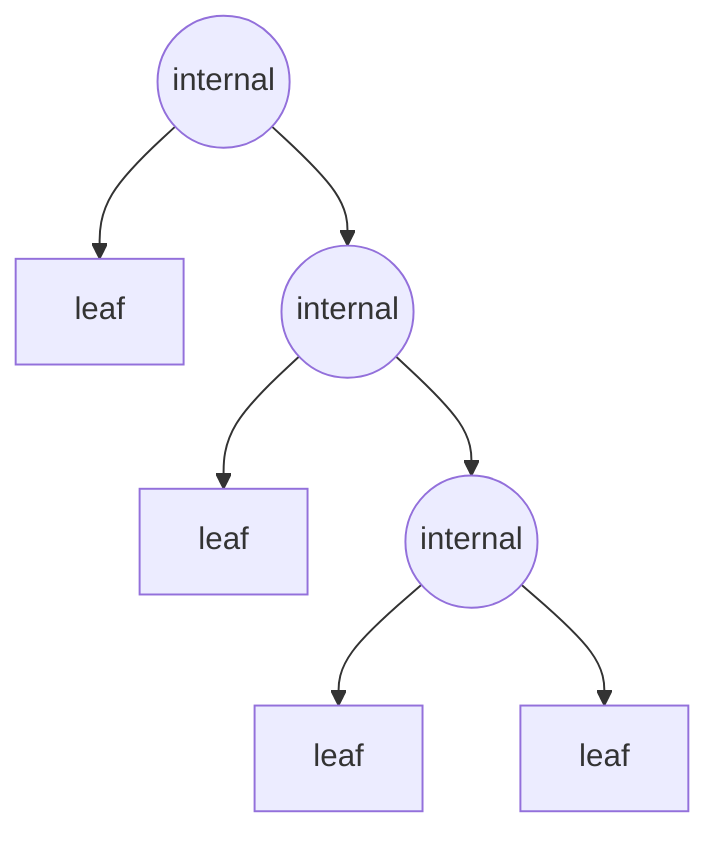

# Recursive definitions and structural induction

After this lesson you can define a set of objects (strings, balanced parentheses, trees, expressions) by recursive rules, define functions on it by recursion, and prove facts about every object in the set by structural induction or by induction on size, including the correctness of a recursive function.

Before this: [mathematical induction](01-mathematical-induction.md), [strong induction and well-ordering](02-strong-induction-and-well-ordering.md) and [sets and set operations](../02-logic-and-sets/06-sets-and-set-operations.md). The recursive sequences of [sequences and recursion](../../03-high-school/11-sequences-series-and-counting/01-sequences-and-recursion.md) are the simplest case of this lesson.

## Quick check

Try these first. If you get all three right, skip to [Practice](#practice).

1. A set $S$ is defined by: $1 \in S$, and if $x \in S$ then $2x \in S$ and $2x + 1 \in S$. List the elements you get after two applications of the rules, and say which numbers $S$ contains.
2. Using only the rules "the empty string is balanced", "if $x$ is balanced then $(x)$ is balanced" and "if $x$ and $y$ are balanced then $xy$ is balanced", show that $(()())$ is balanced.
3. A full binary tree has every node with exactly 0 or 2 children. Draw one with 3 internal nodes (nodes with children) and count its leaves.

<details class="solution" markdown>
<summary>Answers</summary>

1. Start with 1. One application gives 2 and 3. A second gives 4, 5 (from 2) and 6, 7 (from 3). Every positive integer is reached, because $x$ is built from $\lfloor x/2 \rfloor$ by appending one binary digit. So $S$ is the set of positive integers.
2. The empty string is balanced, so $()$ is. Then $()()$ is balanced by the third rule with $x = y = ()$, and $(()())$ is balanced by the second rule.
3. A root with a leaf and an internal node, whose child is another internal node with two leaves (the picture is in Example 2) has 3 internal nodes and 4 leaves. Any full binary tree with 3 internal nodes has 4 leaves.

</details>

## The idea

A linked list in a program is either empty or a value followed by a smaller linked list. A JSON value is a number, a string, or a list or object of smaller JSON values. An arithmetic expression is a number, or two smaller expressions joined by `+` or `*`. In each case the definition gives a few starting objects and a way to build bigger objects from smaller ones, and every object in the set is built in a finite number of steps.

This is the same idea as the recurrences in the sequences lessons: initial conditions and a rule. The difference is that the objects are no longer numbers in a row. A recursive definition produces a set, and the objects can be strings, trees or formulas.

Because every object has a finite construction, a proof can follow the construction. To show that every object has a property, show that the starting objects have it, and that each way of building a new object preserves it. This is structural induction. It is ordinary induction in disguise, counting the number of rule applications instead of the number $n$. Programs that recurse over such data (a function on a list that calls itself on the tail, a function on a tree that calls itself on both subtrees) are proved correct in the same way.

## Definitions

A **recursive definition** of a set $S$ has three parts. The **basis** names some elements of $S$ outright. The **recursive clauses** say how to build new elements of $S$ from elements already in $S$. The **closure clause** says that nothing else is in $S$: the elements are exactly those obtained from the basis by finitely many uses of the recursive clauses.

In plain words: here are some starting objects, here are the ways to make bigger ones, and that is all of them. The closure clause is usually left unsaid, and it matters, because it is what makes proofs by structural induction valid.

Here are the sets used in this lesson.

- The even natural numbers $E$: $0 \in E$, and if $x \in E$ then $x + 2 \in E$.
- The **strings** over an alphabet $\Sigma$ (a finite set of symbols), written $\Sigma^*$: the empty string $\varepsilon \in \Sigma^*$, and if $w \in \Sigma^*$ and $a \in \Sigma$ then $wa \in \Sigma^*$ (the string $w$ followed by the symbol $a$). The **length** $\lvert w \rvert$ is defined by $\lvert \varepsilon \rvert = 0$ and $\lvert wa \rvert = \lvert w \rvert + 1$.
- The **balanced parentheses** $B$ (strings over $\{(, )\}$): $\varepsilon \in B$; if $x \in B$ then $(x) \in B$; if $x, y \in B$ then $xy \in B$.
- The **full binary trees**: a single node (a **leaf**) is a full binary tree; if $T_1$ and $T_2$ are full binary trees, then a new node (the **root**) with $T_1$ and $T_2$ as its left and right subtrees is a full binary tree. A node with children is an **internal node**.
- The **arithmetic expressions** $X$: each number and each variable is in $X$; if $e, f \in X$ then $(e + f) \in X$ and $(e \times f) \in X$.

A function on a recursively defined set is **defined recursively** when its value on a basis element is given directly, and its value on an element built by a clause is given in terms of its values on the parts. For strings, the reversal is $\text{rev}(\varepsilon) = \varepsilon$ and $\text{rev}(wa) = a\,\text{rev}(w)$. For full binary trees, the number of leaves is $\ell(\text{leaf}) = 1$ and $\ell(T) = \ell(T_1) + \ell(T_2)$, and the number of internal nodes is $i(\text{leaf}) = 0$ and $i(T) = i(T_1) + i(T_2) + 1$.

**Structural induction** is the following proof method. Let $S$ be defined recursively and $P(x)$ a statement about elements $x \in S$. If

- (basis step) $P(b)$ is true for every basis element $b$, and
- (recursive step) for each recursive clause, whenever the parts $x_1, \dots, x_m \in S$ used by the clause satisfy $P$, the new element built from them satisfies $P$,

then $P(x)$ is true for every $x \in S$. In plain words: show the starting objects have the property, and show that building preserves it. Then everything has it.

Why this is valid: an element of $S$ is obtained by finitely many rule applications. Let $Q(n)$ be "$P$ holds for every element obtained with at most $n$ rule applications". The basis step is $Q(0)$, the recursive step gives $Q(n) \Rightarrow Q(n+1)$, and ordinary induction gives $Q(n)$ for all $n$. Every element of $S$ appears at some $n$, by the closure clause.

## How to do it

### A structural induction in five steps

1. Write the recursive definition of $S$ with every clause numbered, and state $P(x)$ as a property of an arbitrary element $x \in S$.
2. Basis step: prove $P(b)$ for each basis element. If the basis has several elements (a number and a variable, say), do each.
3. Recursive step: for each recursive clause, take parts $x_1, \dots, x_m$ in $S$, assume $P(x_1), \dots, P(x_m)$ (the inductive hypothesis, one assumption for each part), and prove $P$ for the new element.
4. Check that every clause has been handled. A forgotten clause is the most common failure.
5. Conclude: "By structural induction, $P(x)$ holds for every $x \in S$."

### Induction on length or size

When the objects have a size (the length of a string, the number of nodes of a tree), you can also use ordinary or strong induction on the size: prove the claim for size 0 (or the smallest size), and show that an object of size $k + 1$ is built from objects of size at most $k$. This is the same proof in different clothes, and it is the form to use when you have to split an object in a way the definition doesn't mention. For strings built by appending, a string of length $k + 1$ is $ua$ for a string $u$ of length $k$ and a symbol $a$.

### Proving a recursive function correct

1. State what the function must return for every input in terms of the input (its specification).
2. Prove the specification by induction on the size of the input, using the same structure as the code.
3. Base case: check the branch that returns without a recursive call.
4. Step: assume the recursive calls satisfy the specification (the hypothesis), and show the code combines their answers into an answer that satisfies it.
5. Check that every recursive call is on a smaller input, so that the recursion ends.

## Worked examples

<div class="example" markdown>

### Example 1: balanced parentheses have equal counts

Let $L(x)$ be the number of left brackets "(" in a string $x$ and $R(x)$ the number of right brackets ")".

*Theorem 1.* For every $x \in B$, $L(x) = R(x)$.

What we know: the three clauses defining $B$. What we want: $L(x) = R(x)$ for every balanced string. The plan: structural induction, with one case for each clause. The facts about counts we need are $L(xy) = L(x) + L(y)$, and likewise for $R$, since counting in a concatenation adds.

Step 1: $P(x)$ is "$L(x) = R(x)$".

*Proof.* Step 2, basis. For $\varepsilon$ both counts are 0.

Step 3, recursive step, clause 2. Let $x \in B$ with $L(x) = R(x)$ (the hypothesis). The string $(x)$ has one more "(" and one more ")" than $x$, so $L((x)) = L(x) + 1 = R(x) + 1 = R((x))$.

Recursive step, clause 3. Let $x, y \in B$ with $L(x) = R(x)$ and $L(y) = R(y)$. Then $L(xy) = L(x) + L(y) = R(x) + R(y) = R(xy)$.

Step 4: the clauses are the basis, "(x)" and "xy", and all three are done.

Step 5: by structural induction, $L(x) = R(x)$ for every balanced string. $\blacksquare$

Look back: the converse is false. The string $)($ has one of each bracket and isn't balanced, so equal counts are necessary and not sufficient (Practice problem 3). Check: $(()())$ has three "(" and three ")", and $()(())$ has three of each.

</div>

<div class="example" markdown>

### Example 2: leaves and internal nodes of a full binary tree

*Theorem 2.* A full binary tree with $n$ internal nodes has $n + 1$ leaves. In symbols, $\ell(T) = i(T) + 1$ for every full binary tree $T$.

Here is a full binary tree with $i(T) = 3$ and $\ell(T) = 4$.



What we know: the definitions of $\ell$ and $i$ by recursion on the tree. What we want: $\ell(T) = i(T) + 1$ for every $T$. The plan: structural induction, with one basis case (a leaf) and one recursive clause (join two trees at a new root).

*Proof.* Basis. For a single leaf, $\ell = 1$ and $i = 0$, so $\ell = i + 1$.

Recursive step. Let $T_1$ and $T_2$ be full binary trees with $\ell(T_1) = i(T_1) + 1$ and $\ell(T_2) = i(T_2) + 1$, and let $T$ be the tree with root joining them. The root is an extra internal node, and the leaves of $T$ are the leaves of $T_1$ and $T_2$:

$$
\begin{aligned}
\ell(T) &= \ell(T_1) + \ell(T_2) \\
&= \bigl(i(T_1) + 1\bigr) + \bigl(i(T_2) + 1\bigr) \qquad \text{(hypothesis)} \\
&= \bigl(i(T_1) + i(T_2) + 1\bigr) + 1 = i(T) + 1.
\end{aligned}
$$

By structural induction, $\ell(T) = i(T) + 1$ for every full binary tree. $\blacksquare$

Look back: the fact depends on "full". A root with one leaf child has 1 internal node and 1 leaf, and $1 \ne 2$. The proof breaks because a one-child node is a clause that the definition doesn't contain, and it would need its own recursive step: it adds one internal node and no leaf, and the equation $\ell = i + 1$ would fail. Check: the tree above has $4 = 3 + 1$, and the code at the end of the lesson checks all full trees with up to 8 internal nodes.

</div>

<div class="example" markdown>

### Example 3: reversing a string twice, by induction on length

Reversal is defined by $\text{rev}(\varepsilon) = \varepsilon$ and $\text{rev}(wa) = a\,\text{rev}(w)$ for a string $w$ and a symbol $a$. For example, $\text{rev}(abc) = c\,\text{rev}(ab) = cb\,\text{rev}(a) = cba\,\text{rev}(\varepsilon) = cba$.

*Theorem 3.* For every string $w$, $\text{rev}(\text{rev}(w)) = w$.

The definition only peels off the last symbol, so a direct induction on $w$ gets stuck at $\text{rev}(a\,\text{rev}(u))$, which is the reverse of a string that starts with a symbol. The way out is a lemma that handles concatenation.

*Lemma.* For all strings $u$ and $v$, $\text{rev}(uv) = \text{rev}(v)\,\text{rev}(u)$.

*Proof of the lemma.* Fix $u$ and use induction on the length of $v$. If $\lvert v \rvert = 0$, then $v = \varepsilon$ and both sides are $\text{rev}(u)$. Now let $\lvert v \rvert = k + 1$ and suppose the lemma holds for all strings of length at most $k$ in place of $v$. Then $v = wa$ with $\lvert w \rvert = k$, and

$$
\text{rev}(uwa) = a\,\text{rev}(uw) = a\,\text{rev}(w)\,\text{rev}(u) = \text{rev}(wa)\,\text{rev}(u).
$$

The first equality is the definition of rev applied to the string $uw$ followed by $a$. The second is the hypothesis for $w$. The third is the definition of rev again. $\blacksquare$

*Proof of the theorem.* Induction on $\lvert w \rvert$. For $w = \varepsilon$, $\text{rev}(\text{rev}(\varepsilon)) = \varepsilon$. Let $\lvert w \rvert = k + 1$, so $w = ua$ with $\lvert u \rvert = k$, and suppose the claim for $u$. Then

$$
\text{rev}(\text{rev}(ua)) = \text{rev}(a\,\text{rev}(u)) = \text{rev}(\text{rev}(u))\,\text{rev}(a) = u\,a.
$$

The first equality is the definition of rev. The second is the lemma with the string $a$ in the role of $u$ and the string $\text{rev}(u)$ in the role of $v$, which gives $\text{rev}(a\,\text{rev}(u)) = \text{rev}(\text{rev}(u))\,\text{rev}(a)$. The third uses the hypothesis $\text{rev}(\text{rev}(u)) = u$ and the fact that $\text{rev}(a) = a\,\text{rev}(\varepsilon) = a$. $\blacksquare$

Check: $\text{rev}(abc) = cba$ and $\text{rev}(cba) = abc$.

</div>

<div class="example" markdown>

### Example 4: a recursive sum and a recursive maximum

Here are two functions on lists.

```python
def total(xs):
    if not xs:
        return 0
    return xs[0] + total(xs[1:])

def largest(xs):
    if len(xs) == 1:
        return xs[0]
    m = largest(xs[1:])
    return xs[0] if xs[0] > m else m
```

*Theorem 4.* (a) For every list `xs` of numbers, `total(xs)` equals the sum of its entries. (b) For every nonempty list `xs`, `largest(xs)` is the largest entry.

*Proof of (a).* Induction on the length $n$ of `xs`. Base case, $n = 0$: the list is empty, the code returns 0, and the sum of no entries is 0. Step: let `xs` have length $k + 1$ and suppose `total` is correct on lists of length $k$. The slice `xs[1:]` has length $k$, so `total(xs[1:])` is the sum of the entries after the first, and adding `xs[0]` gives the sum of all entries.

*Proof of (b).* Induction on the length $n \ge 1$. Base case, $n = 1$: the only entry is the largest, and the code returns it. Step: let `xs` have length $k + 1 \ge 2$ and suppose `largest` is correct on nonempty lists of length $k$. Then `m` is the largest entry of `xs[1:]`. Every entry of `xs` is `xs[0]` or an entry of `xs[1:]`, so the largest entry is the larger of `xs[0]` and `m`. That is what the last line returns. $\blacksquare$

Check: `total([3, 1, 4])` is 8 and `largest([3, 1, 4, 1, 5])` is 5. In both functions, the recursive call is on a list one entry shorter, so the recursion ends. The tests in the code section run both on many lists.

</div>

<div class="example" markdown>

### Example 5: operands and operators in an expression (finish it yourself)

*Theorem 5.* In every arithmetic expression $e \in X$, the number of operands (numbers and variables) is one more than the number of operators ($+$ and $\times$).

Let $n(e)$ be the number of operands and $o(e)$ the number of operators.

Step 1: $P(e)$ is "$n(e) = o(e) + 1$".

Step 2, basis: a number or a variable is one operand and has no operators, so $n = 1 = 0 + 1$.

Step 3: for the clause $(e + f)$, let $e, f \in X$ with $n(e) = o(e) + 1$ and $n(f) = o(f) + 1$ (the hypothesis, one for each part).

Now do the recursive step for $(e + f)$, say why $(e \times f)$ needs no new work, and conclude.

<details class="solution" markdown>
<summary>Finish</summary>

The new expression has the operands of $e$ and $f$ and one more operator:

$$
n\bigl((e + f)\bigr) = n(e) + n(f) = o(e) + 1 + o(f) + 1 = \bigl(o(e) + o(f) + 1\bigr) + 1 = o\bigl((e + f)\bigr) + 1.
$$

The clause $(e \times f)$ is the same computation, since only the operator symbol differs. Both clauses and the basis are done, so by structural induction $n(e) = o(e) + 1$ for every expression. $\blacksquare$

Check: $((x + 7) \times x)$ has three operands and two operators.

</details>

</div>

## Edge cases and common mistakes

<div class="warning" markdown>

Watch out for a forgotten clause. A proof by structural induction must treat every clause. Claim: "every nonempty balanced string has the form $(x)$ with $x$ balanced". A student checks clause 2 (it's true by definition), declares the basis $\varepsilon$ irrelevant because it's empty, and stops. Clause 3 was never checked, and the claim is false for $()()$, which is $xy$ with $x = y = ()$ and cannot be written as $(x)$ with $x$ balanced (the inside would be $)($). Practice problem 7 asks for the whole analysis.

</div>

<div class="warning" markdown>

Watch out for assuming the property for the whole new object. In the recursive step you assume $P$ for the parts and prove it for the object built from them. If you assume $P$ for the new object, you have assumed the conclusion. In Example 2 the hypotheses were about $T_1$ and $T_2$, and the conclusion was about $T$.

</div>

<div class="warning" markdown>

Watch out when defining a function by recursion on a set that can be built in two ways. The balanced-parentheses clause $xy$ is ambiguous: the string $()()()$ is $xy$ with $x = ()$ and $y = ()()$, and also with $x = ()()$ and $y = ()$. Try defining $f(\varepsilon) = 0$, $f((x)) = f(x) + 1$ and $f(xy) = 2f(x) + f(y)$. The first splitting gives $f = 2 \cdot 1 + 3 = 5$, and the second gives $2 \cdot 3 + 1 = 7$. The definition doesn't determine a function. Structural induction is still valid on $B$, since it only needs every string to be built somehow. But defining a function by recursion needs every object to have exactly one construction, which is why full binary trees (a node has a definite left and right subtree) and strings built by appending (one last symbol) work smoothly.

</div>

<div class="warning" markdown>

Watch out for leaving out the closure clause. Without "nothing else", a set defined by "$0 \in E$; if $x \in E$ then $x + 2 \in E$" could also contain 1 and every odd number, and the claim "every element of $E$ is even" would no longer follow from the basis and the step. The closure clause is what makes the induction cover everything.

</div>

A basis can have several elements and a clause can have several parts, so check them all. The empty object matters: the empty string, the empty list and the empty tree (if the definition allows it) are usually the basis, and a function that handles only nonempty input needs the base case at length 1, as `largest` does.

## Tricks and shortcuts

The easiest way to find the property for the recursive step is to define counting functions: lengths, numbers of leaves, numbers of operators, heights. Two counting functions that satisfy a simple relation are the typical theorem, and the relation is proved by adding up the parts. For parts that combine by addition (leaves, operators), the step is a line of arithmetic.

If the definition doesn't give the split you need, switch to induction on size. In Example 3, the definition of rev peels off the last symbol, and the lemma about concatenation was proved by induction on the length of $v$ because that's the form the definition allows.

For a recursive function, write the proof from the code line by line: the `if` branch is the base case, the recursive call is where the hypothesis goes, and the `return` is the step. If the proof can't be written that way, the function is probably wrong or the specification is vague.

## In code

Recursive data and recursive functions are written the same way as their definitions. This code builds all balanced strings up to a length, all full binary trees with a given number of internal nodes, and checks the claims of Examples 1 and 2 and the functions of Example 4 on many inputs. These are tests. The proofs above cover every case, and the tests cover only the ones tried.

<details class="code" markdown>
<summary>In code</summary>

```python
import random

def balanced_upto(max_len):
    B = {""}                                   # basis: the empty string
    while True:
        new = {"(" + x + ")" for x in B if len(x) + 2 <= max_len}
        new |= {x + y for x in B for y in B if len(x) + len(y) <= max_len}
        if new <= B:
            return B
        B |= new

B = balanced_upto(12)
print(len(B), all(s.count("(") == s.count(")") for s in B))   # 197 True

def trees(n):                                  # all full binary trees with n internal nodes
    if n == 0:
        return ["leaf"]
    return [(a, b) for i in range(n) for a in trees(i) for b in trees(n - 1 - i)]

def leaves(t):
    return 1 if t == "leaf" else leaves(t[0]) + leaves(t[1])

for n in range(6):
    ts = trees(n)
    print(n, len(ts), all(leaves(t) == n + 1 for t in ts))
# 0 1 True
# 1 1 True
# 2 2 True
# 3 5 True
# 4 14 True
# 5 42 True

def total(xs):
    return 0 if not xs else xs[0] + total(xs[1:])

def largest(xs):
    if len(xs) == 1:
        return xs[0]
    m = largest(xs[1:])
    return xs[0] if xs[0] > m else m

random.seed(1)
lists = [[random.randint(-50, 50) for _ in range(random.randint(1, 12))] for _ in range(300)]
print(all(total(xs) == sum(xs) and largest(xs) == max(xs) for xs in lists))   # True
print(total([3, 1, 4]), largest([3, 1, 4, 1, 5]))                              # 8 5
```

The 197 balanced strings of length at most 12 all have equal counts, as Theorem 1 says for all of them. Each count of trees in the second block is the number of full binary trees with that many internal nodes. Python limits the depth of recursion (about 1000 calls), and `xs[1:]` copies the list on every call, so these versions are for understanding and not for long lists. A loop is the practical choice there.

</details>

## FAQ

### How is structural induction different from ordinary induction?

It is ordinary induction on the number of rule applications used to build the object, with the bookkeeping hidden. You gain the freedom to follow the shape of the definition: a tree splits into two subtrees, which are not "the previous tree" in any list. The logic is the same: a basis, and a step that preserves the property.

### Why do I have to assume the property for every part and not just one?

Because the recursive clause may use several parts, and the new object is built from all of them. In Example 2 the leaves of $T$ come from both $T_1$ and $T_2$, so the count needs the hypothesis for both. Assuming it for only one part would leave the other part's count unknown.

### Do I need the closure clause written out?

Not in the definition you write, but you need it in your head. It is why the theorem covers every element. When you read a definition in a textbook, it is implied by the words "the smallest set such that" or "and nothing else".

### Is a proof that a recursive function is correct the same as testing it?

No. Tests check particular inputs, and the induction covers every input. The induction proof also tells you where bugs hide: in a base case that is missing, or a recursive call on an input that isn't smaller.

## Practice

### Warm-up

1\. A set $S$ is defined by $2 \in S$, and if $x \in S$ then $x + 3 \in S$. List the first five elements in the order they are built, describe $S$, and decide whether 20 and 21 are in $S$.

<details class="solution" markdown>
<summary>Solution</summary>

Starting at 2 and adding 3 repeatedly gives $2, 5, 8, 11, 14$. Every element has the form $2 + 3j$ for an integer $j \ge 0$, and every number of that form is built after $j$ steps. So $S$ is the set of integers $n \ge 2$ that leave remainder 2 on division by 3.

The number 20 is in $S$, because $20 = 2 + 3 \cdot 6$. The number 21 is not, because $21 - 2 = 19$ isn't a multiple of 3.

Check: $20 \div 3$ leaves remainder 2, and $21 \div 3$ leaves remainder 0.

</details>

2\. Use the recursive definitions $\text{rev}(\varepsilon) = \varepsilon$, $\text{rev}(wa) = a\,\text{rev}(w)$ and $\lvert wa \rvert = \lvert w \rvert + 1$ to compute $\text{rev}(abc)$ and $\lvert \text{rev}(abc) \rvert$ step by step.

<details class="solution" markdown>
<summary>Solution</summary>

$\text{rev}(abc) = c\,\text{rev}(ab) = c\,b\,\text{rev}(a) = c\,b\,a\,\text{rev}(\varepsilon) = cba$.

The length: $\lvert cba \rvert = \lvert cb \rvert + 1 = \lvert c \rvert + 2 = \lvert \varepsilon \rvert + 3 = 3$.

Check: reading $abc$ from the right gives $cba$, and both strings have 3 symbols.

</details>

3\. (a) Show that $(()())$ is in $B$ by listing the clauses used. (b) The string $)($ has equal numbers of "(" and ")". Is it in $B$? Explain using the definition.

<details class="solution" markdown>
<summary>Solution</summary>

(a) $\varepsilon \in B$ by the basis. Then $() = (\varepsilon) \in B$ by clause 2. Then $()() \in B$ by clause 3 with $x = y = ()$. Then $(()()) \in B$ by clause 2 with $x = ()()$.

(b) No. Every string in $B$ either is $\varepsilon$, or is $(x)$, which starts with "(", or is $xy$ with $x$ and $y$ in $B$, which starts with the first symbol of $x$ or (if $x = \varepsilon$) of $y$. By structural induction every nonempty string in $B$ starts with "(". The string $)($ starts with ")", so it is not in $B$.

Check: this is why Example 1's statement is "if balanced then equal counts" and not the converse.

</details>

### Standard

4\. Let $L$ be the set of strings over $\{a, b\}$ defined by $\varepsilon \in L$, and if $w \in L$ then $awb \in L$. Prove by structural induction that every $w \in L$ has the same number of $a$'s as $b$'s, and say what the elements of $L$ look like.

<details class="solution" markdown>
<summary>Solution</summary>

What we know: the clause $awb$ adds one $a$ at the front and one $b$ at the end. What we want: $\#_a(w) = \#_b(w)$. The plan: structural induction with one basis and one clause.

*Proof.* Basis: $\varepsilon$ has zero of each. Step: let $w \in L$ with $\#_a(w) = \#_b(w)$. Then $\#_a(awb) = \#_a(w) + 1 = \#_b(w) + 1 = \#_b(awb)$. By structural induction, the claim holds for every $w \in L$. $\blacksquare$

The elements are $\varepsilon, ab, aabb, aaabbb, \dots$: the strings $a^n b^n$ for $n \ge 0$, with $n$ letters $a$ followed by $n$ letters $b$.

Check: $aabb$ is built from $\varepsilon \to ab \to aabb$ and has two of each.

</details>

5\. For a full binary tree $T$, let the height be $h(\text{leaf}) = 0$ and $h(T) = 1 + \max\bigl(h(T_1), h(T_2)\bigr)$. Prove that $\ell(T) \le 2^{h(T)}$ for every full binary tree.

<details class="solution" markdown>
<summary>Solution</summary>

What we know: $\ell(T) = \ell(T_1) + \ell(T_2)$ and the height formula. What we want: $\ell(T) \le 2^{h(T)}$. The plan: structural induction, comparing both subtrees with the larger height.

*Proof.* Basis: a leaf has $\ell = 1 = 2^0 = 2^{h}$.

Step: let $T_1$ and $T_2$ satisfy $\ell(T_j) \le 2^{h(T_j)}$, and let $M = \max(h(T_1), h(T_2))$. Then $2^{h(T_1)} \le 2^M$ and $2^{h(T_2)} \le 2^M$, so

$$
\ell(T) = \ell(T_1) + \ell(T_2) \le 2^{h(T_1)} + 2^{h(T_2)} \le 2 \cdot 2^M = 2^{M+1} = 2^{h(T)}.
$$

By structural induction, the bound holds for every full binary tree. $\blacksquare$

Check: the tree in Example 2 has height 3 and 4 leaves, and $4 \le 8$. A tree with a root and two leaves has height 1 and 2 leaves, and $2 \le 2$.

</details>

6\. Here is a recursive function. Prove that for every nonempty list `xs`, `last_but_sum(xs)` returns the sum of all entries except the last one.

```python
def last_but_sum(xs):
    if len(xs) == 1:
        return 0
    return xs[0] + last_but_sum(xs[1:])
```

<details class="solution" markdown>
<summary>Solution</summary>

What we know: the code has a base branch for length 1 and one recursive call on a list one entry shorter. What we want: the specification "sum of all entries except the last". The plan: induction on the length $n \ge 1$.

*Proof.* Base case, $n = 1$: there are no entries before the last one, the sum of nothing is 0, and the code returns 0. Step: let `xs` have length $k + 1 \ge 2$ and suppose the function is correct on nonempty lists of length $k$. The list `xs[1:]` has length $k \ge 1$ and has the same last entry as `xs`, so the call returns the sum of the entries of `xs[1:]` except the last, which is the sum of the entries of `xs` from index 1 to the second-to-last. Adding `xs[0]` gives the sum of all entries of `xs` except the last. $\blacksquare$

Check: `last_but_sum([3, 1, 4])` is $3 + 1 = 4$, since `xs[1:]` is `[1, 4]` with result 1.

</details>

### Challenge

7\. Find the flaw. Claim: every nonempty $x \in B$ has the form $(y)$ with $y \in B$. "Proof. By structural induction. Clause 2: if $x \in B$ then $(x)$ has the form $(y)$ with $y = x \in B$. So the property is preserved. The basis $\varepsilon$ is empty, so it's excluded." Give a counterexample and say what the proof missed.

<details class="solution" markdown>
<summary>Solution</summary>

The proof handled clause 2 and skipped clause 3 ($xy$). The claim is false: $()()$ is in $B$, since $() \in B$ and clause 3 applies. If $()()$ were $(y)$, then $y$ would be $)($, which is not in $B$ (Practice problem 3). So $()()$ is a counterexample.

In a correct proof, the recursive step for clause 3 would assume the property for $x$ and $y$, and try to prove it for $xy$. It fails, because $xy$ starts with the opening bracket of $x$ and ends with the closing bracket of $y$, and the inside need not be balanced. The failed step tells you what is true instead: "every nonempty balanced string is $(x)y$ for balanced $x$ and $y$".

Check: for $()()$ we have $x = \varepsilon$ and $y = ()$, which gives $(\varepsilon)()$.

</details>

8\. (Reviews [sets and set operations](../02-logic-and-sets/06-sets-and-set-operations.md).) Prove that a set with $n$ elements has $2^n$ subsets, by induction on $n \ge 0$.

<details class="solution" markdown>
<summary>Solution</summary>

What we know: a subset of $A \cup \{x\}$ either contains $x$ or doesn't. What we want: the number of subsets doubles when one element is added. The plan: induction on the size of the set, splitting the subsets by whether they contain the new element.

*Proof.* Base case ($n = 0$): the empty set has one subset, itself, and $2^0 = 1$.

Inductive step: let $k \ge 0$, suppose every set with $k$ elements has $2^k$ subsets, and let $A$ have $k + 1$ elements. Choose $x \in A$ and let $A' = A \setminus \{x\}$, which has $k$ elements. Each subset of $A$ either doesn't contain $x$, in which case it is a subset of $A'$, or contains $x$, in which case removing $x$ gives a subset of $A'$. Each subset of $A'$ arises exactly once in each way (as it is, and with $x$ added). So $A$ has $2 \cdot 2^k = 2^{k+1}$ subsets. By induction, a set with $n$ elements has $2^n$ subsets for every $n \ge 0$. $\blacksquare$

Check: $A = \{1, 2, 3\}$ has the $4$ subsets of $\{1, 2\}$, namely $\emptyset, \{1\}, \{2\}, \{1,2\}$, and the 4 with $3$ added, for $8 = 2^3$ in all.

</details>

## Where this shows up

- Grammars generate languages by recursive rules, and facts about them are proved by structural induction (context-free grammars and pushdown automata<!-- link: ../../06-cs-math/06-theory-of-computation/03-context-free-grammars-and-pushdown-automata.md -->). Trees and their counting facts, such as Example 2, return in paths, connectivity and trees<!-- link: ../../06-cs-math/05-graphs/02-paths-connectivity-and-trees.md -->.
- Correctness proofs for recursive programs follow Example 4, and loops use the same pattern with an invariant (invariants and algorithm correctness<!-- link: ../../06-cs-math/04-sums-recurrences-and-algorithms/03-invariants-and-algorithm-correctness.md -->). The definitions of functions on lists, trees and expressions in functional languages and proof assistants are recursive definitions, and the compiler checks that the recursion ends.
- Proofs about relations and functions (the next chapter starts with [relations and their properties](../06-relations-and-functions/01-relations-and-their-properties.md)) use induction whenever a property has to be shown for chains of any length, such as repeated composition of a function.
