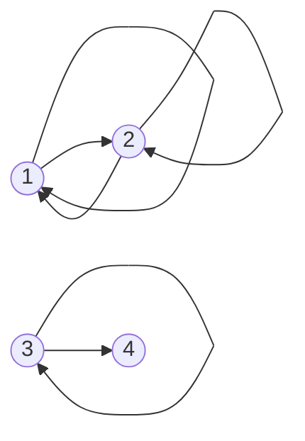

# Relations and their properties

After this lesson you can describe a relation as a set of ordered pairs, show it as a list, a digraph and a matrix, state the four standard properties (reflexive, symmetric, antisymmetric, transitive) precisely, and prove or disprove each one for a given relation.

Before this: [sets and set operations](../02-logic-and-sets/06-sets-and-set-operations.md#ordered-pairs-and-cartesian-products) (ordered pairs and Cartesian products), [quantifiers](../02-logic-and-sets/04-quantifiers.md), [negation and translating English](../02-logic-and-sets/05-negation-and-translating-english.md) and [direct proof](../03-core-proof-methods/01-direct-proof.md).

## Quick check

Try these first. If you get all three right, skip to [Practice](#practice).

1. Let $R = \{(1, 1), (2, 2), (1, 2), (2, 1)\}$ be a relation on $A = \{1, 2, 3\}$. Which of reflexive, symmetric, antisymmetric and transitive does $R$ have?
2. The relation "divides" on $\mathbb{Z}^+$ (so $a \mid b$ means $b = ak$ for some integer $k$). Is it symmetric? If not, give a counterexample.
3. On $\mathbb{R}$, let $x \mathrel{R} y$ mean $\lvert x - y \rvert < 1$. Is $R$ transitive? Prove it or give a counterexample.

<details class="solution" markdown>
<summary>Answers</summary>

1. Not reflexive, because $(3, 3) \notin R$. Symmetric: each pair has its reverse in $R$. Not antisymmetric, because $(1, 2)$ and $(2, 1)$ are both in $R$ and $1 \ne 2$. Transitive: the only pairs that chain together are $(1, 2), (2, 1)$ giving $(1, 1)$, and $(2, 1), (1, 2)$ giving $(2, 2)$, and the loops, and all of those are in $R$.
2. Not symmetric. We have $2 \mid 4$, but $4 \nmid 2$.
3. Not transitive. Take $x = 0$, $y = 0.9$ and $z = 1.8$. Then $\lvert 0 - 0.9 \rvert = 0.9 < 1$ and $\lvert 0.9 - 1.8 \rvert = 0.9 < 1$, but $\lvert 0 - 1.8 \rvert = 1.8 \ge 1$.

</details>

## The idea

Many of the things we say in mathematics compare two objects. Five is less than eight. Six divides twelve. Seventeen and two leave the same remainder when divided by five. In everyday life, Ana is a friend of Ben, and the student with ID 1042 is enrolled in CS 240. Each of these is a statement about a pair of things, and for each pair it is either true or false.

Here is the move that makes such statements something we can prove theorems about. Instead of keeping the sentence, collect every pair for which the sentence is true. The set of those pairs is the relation. The sentence "is less than" on $\{1, 2, 3\}$ becomes the set $\{(1, 2), (1, 3), (2, 3)\}$, a subset of the Cartesian product $\{1, 2, 3\} \times \{1, 2, 3\}$ from [sets and set operations](../02-logic-and-sets/06-sets-and-set-operations.md#ordered-pairs-and-cartesian-products). Once a relation is a set, every tool for sets applies to it, and questions such as "is this relation symmetric?" become precise questions that a proof can answer.

A database table is the same idea. The table `Enrolled(student, course)` is a set of rows, each row an ordered pair, and the set of rows is a subset of $\text{Student} \times \text{Course}$. A row is in the table exactly when the student is enrolled in the course. So a relational database is a collection of relations, and the word "relational" in its name is this one.

The rest of the chapter depends on this lesson. Equivalence relations, partial orders and functions are all relations with extra properties, and the four properties below are the ones that get combined.

## Definitions

### Relations

A **relation** from a set $A$ to a set $B$ is a subset $R$ of $A \times B$. A **relation on** $A$ is a relation from $A$ to $A$, that is, a subset of $A \times A$. We write $a \mathrel{R} b$ (read "$a$ is related to $b$") to mean $(a, b) \in R$, and $a \not\mathrel{R} b$ to mean $(a, b) \notin R$.

In plain words, a relation is a yes-or-no rule for ordered pairs, remembered as the set of pairs where the answer is yes. The order matters: $(2, 4)$ is in the relation "divides" and $(4, 2)$ is not. Most of this chapter is about relations on a single set, so "a relation on $A$" is the default meaning.

The symbol for the relation is usually chosen to look like the relation: $<$, $\le$, $=$, $\mid$, $\subseteq$. Writing $a < b$ is the same as writing $(a, b) \in {<}$. When we have no particular relation in mind we write $R$. (Elsewhere in the book $P$, $Q$ and $R$ stand for statements. In this chapter $R$ is a relation, and the context is always clear.)

The **converse** (or inverse) of a relation $R$ from $A$ to $B$ is the relation $R^{-1}$ from $B$ to $A$ that reverses every pair:

$$
R^{-1} = \{(b, a) : (a, b) \in R\}.
$$

In plain words, $b \mathrel{R^{-1}} a$ exactly when $a \mathrel{R} b$. The converse of "is less than" is "is greater than". This is a different thing from the inverse function of the [composition and inverse functions](../../03-high-school/03-functions/05-composition-and-inverse-functions.md) lesson, although the two are connected, as the lesson on [functions and well-definedness](04-functions-and-well-definedness.md) shows.

### Ways to show a relation

A small relation can be shown in three ways. Take $A = \{1, 2, 3, 4\}$ and

$$
R = \{(1, 1), (2, 2), (3, 3), (1, 2), (2, 1), (3, 4)\}.
$$

The first way is the list of pairs, which is the definition itself. The second is a **digraph** (directed graph), with one vertex for each element of $A$ and an arrow from $a$ to $b$ whenever $a \mathrel{R} b$. A pair $(a, a)$ is an arrow from a vertex to itself, called a loop.



The third is the **matrix** of the relation: a square table with a 1 in row $a$ and column $b$ when $a \mathrel{R} b$, and a 0 otherwise. Row $a$ is the set of things $a$ points to, and column $b$ is the set of things that point to $b$.

$$
M_R = \begin{bmatrix} 1 & 1 & 0 & 0 \\ 1 & 1 & 0 & 0 \\ 0 & 0 & 1 & 1 \\ 0 & 0 & 0 & 0 \end{bmatrix}
$$

The list works for any relation, the digraph is good for seeing structure in a small one, and the matrix is the form a program uses, because a relation on $n$ elements is then an $n \times n$ array of bits. A relation on an infinite set such as $\mathbb{R}$ can't be listed or drawn in full, so it is given by a rule, as in $\{(x, y) \in \mathbb{R} \times \mathbb{R} : x \le y\}$.

### The four properties

Let $R$ be a relation on a set $A$.

$R$ is **reflexive** if $a \mathrel{R} a$ for every $a \in A$. In symbols: $\forall a \in A,\ a \mathrel{R} a$. In plain words, every element is related to itself. In the digraph, every vertex has a loop. In the matrix, the main diagonal is all 1s.

$R$ is **symmetric** if $b \mathrel{R} a$ whenever $a \mathrel{R} b$. In symbols: $\forall a, b \in A,\ (a \mathrel{R} b \Rightarrow b \mathrel{R} a)$. In plain words, every arrow has an arrow coming back. In the matrix, the table equals its own reflection across the diagonal.

$R$ is **antisymmetric** if the only way for both $a \mathrel{R} b$ and $b \mathrel{R} a$ to hold is $a = b$. In symbols: $\forall a, b \in A,\ (a \mathrel{R} b \wedge b \mathrel{R} a \Rightarrow a = b)$. In plain words, two different elements are never related in both directions. In the digraph, the only two-way arrows are loops.

$R$ is **transitive** if $a \mathrel{R} c$ whenever $a \mathrel{R} b$ and $b \mathrel{R} c$. In symbols: $\forall a, b, c \in A,\ (a \mathrel{R} b \wedge b \mathrel{R} c \Rightarrow a \mathrel{R} c)$. In plain words, if you can get from $a$ to $c$ in two steps, you can get there in one. In the digraph, every two-step path has a shortcut.

One more word is needed later. $R$ is **irreflexive** if $a \not\mathrel{R} a$ for every $a \in A$: no element is related to itself, and no vertex has a loop. This is stronger than "not reflexive", which only says that some element fails to be related to itself. The relation $<$ is irreflexive, and the relation $R$ above is neither reflexive nor irreflexive.

The table sums up how each property looks on the three pictures.

| Property | Digraph | Matrix $M$ |
|---|---|---|
| reflexive | a loop at every vertex | all 1s on the diagonal |
| irreflexive | no loops | all 0s on the diagonal |
| symmetric | every arrow comes with a return arrow | $M$ equals its reflection across the diagonal |
| antisymmetric | no two-way arrow between different vertices | no two 1s that mirror each other off the diagonal |
| transitive | every two-step path has a one-step shortcut | whenever row $a$ has a 1 at $b$ and row $b$ has a 1 at $c$, row $a$ has a 1 at $c$ |

Reading the digraph above: vertex 4 has no loop, so $R$ is not reflexive. The arrow $3 \to 4$ has no return arrow, so $R$ is not symmetric. The two-way arrows between 1 and 2 connect different vertices, so $R$ is not antisymmetric. And every two-step path has its shortcut, so $R$ is transitive. Example 1 checks this against the definitions.

## How to do it

### Proving and disproving a property

Every property is a "for all" statement, so each is proved by taking arbitrary objects and disproved by one counterexample. This is the logic of [negation and translating English](../02-logic-and-sets/05-negation-and-translating-english.md): the negation of "for every $a$, $a \mathrel{R} a$" is "for some $a$, not $a \mathrel{R} a$".

1. Write the property from the definition, with the quantifiers: "for all $a, b, c$, if $a \mathrel{R} b$ and $b \mathrel{R} c$, then $a \mathrel{R} c$".
2. Unpack the relation. Replace "$a \mathrel{R} b$" by what it means for this particular relation: an inequality, a divisibility, an equation.
3. To prove it, start with the arbitrary objects and the hypothesis (the part before "then"), and derive the conclusion. Do not pick particular numbers.
4. To disprove it, find specific objects that satisfy the hypothesis and fail the conclusion. Name them, show that the hypothesis holds, and show that the conclusion fails. One example is enough.
5. For a relation given as a finite list, check every pair that could matter, in an organized way. For transitivity, go through each pair of pairs $(a, b), (b, c)$ that chain.
6. Check the answer on a small example.

The hypothesis and the conclusion are different for each property, and this table gives the first line and the last line of each proof, and the form of a counterexample.

| Property | Proof begins | Proof ends | Counterexample is |
|---|---|---|---|
| reflexive | "Let $a \in A$." | $a \mathrel{R} a$ | one $a$ with $a \not\mathrel{R} a$ |
| symmetric | "Suppose $a \mathrel{R} b$." | $b \mathrel{R} a$ | one pair $a \mathrel{R} b$ with $b \not\mathrel{R} a$ |
| antisymmetric | "Suppose $a \mathrel{R} b$ and $b \mathrel{R} a$." | $a = b$ | two different elements related both ways |
| transitive | "Suppose $a \mathrel{R} b$ and $b \mathrel{R} c$." | $a \mathrel{R} c$ | a chain $a \mathrel{R} b$, $b \mathrel{R} c$ with $a \not\mathrel{R} c$ |

The proofs in this lesson are direct proofs, so the previous chapter's [direct proof](../03-core-proof-methods/01-direct-proof.md) lesson is the method, and the disproofs are the counterexamples of [counterexamples and disproof](../04-more-proof-methods/04-counterexamples-and-disproof.md).

### Two theorems to learn from

*Theorem 1.* The relation $\le$ on $\mathbb{R}$ is reflexive, antisymmetric and transitive, and it is not symmetric.

What we know: the order axioms of the real numbers, in particular that if $x \le y$ and $y \le x$ then $x = y$, and that $\le$ chains. What we want: the three properties by direct proof and the failure of symmetry by a counterexample. The plan: follow the table, one property at a time.

*Proof.* Reflexive: let $x \in \mathbb{R}$. Then $x = x$, so $x \le x$.

Antisymmetric: suppose $x \le y$ and $y \le x$. If $x < y$, then $y \le x$ would give $y < y$ by chaining, which is false. So $x < y$ is impossible, and by the same argument so is $y < x$. Hence $x = y$.

Transitive: suppose $x \le y$ and $y \le z$. Then $y - x \ge 0$ and $z - y \ge 0$, so their sum $z - x$ is at least $0$, and $x \le z$.

Not symmetric: $1 \le 2$ is true and $2 \le 1$ is false. $\blacksquare$

Look back: the antisymmetry proof is a short argument by contradiction on each side, and reflexivity is the only property that needed no hypothesis. Check on $\{1, 2, 3\}$: $\le$ has $3 + 2 + 1 = 6$ pairs, namely the three loops and $(1, 2)$, $(1, 3)$, $(2, 3)$. No pair has its reverse except the loops, and every chain such as $(1, 2), (2, 3)$ has its shortcut $(1, 3)$.

*Theorem 2.* Let $n$ be a positive integer. For integers $a$ and $b$, write $a \equiv b \pmod{n}$ when $n \mid a - b$. Then congruence modulo $n$ is a reflexive, symmetric and transitive relation on $\mathbb{Z}$.

What we know: $n \mid m$ means $m = nk$ for some integer $k$. What we want: the three properties. The plan: unpack "$n \mid a - b$" into an equation with a fresh integer, and combine equations.

*Proof.* Reflexive: for $a \in \mathbb{Z}$, $a - a = 0 = n \cdot 0$, so $n \mid a - a$ and $a \equiv a \pmod{n}$.

Symmetric: suppose $a \equiv b \pmod{n}$, so $a - b = nk$ for some integer $k$. Then $b - a = n(-k)$ and $-k$ is an integer, so $b \equiv a \pmod{n}$.

Transitive: suppose $a \equiv b$ and $b \equiv c$, so $a - b = nj$ and $b - c = nk$ for integers $j$ and $k$. Adding the equations,

$$
a - c = (a - b) + (b - c) = nj + nk = n(j + k),
$$

and $j + k$ is an integer, so $a \equiv c \pmod{n}$. $\blacksquare$

Look back: each proof is two lines because the definition of "divides" turns each statement into an equation. This relation is not antisymmetric: $0 \equiv n$ and $n \equiv 0$, and $0 \ne n$. Check with $n = 5$: $17 \equiv 2$ since $17 - 2 = 15 = 5 \cdot 3$, $2 \equiv 17$ since $2 - 17 = -15 = 5 \cdot (-3)$, and $17 \equiv 2$, $2 \equiv -3$ gives $17 \equiv -3$ since $17 - (-3) = 20 = 5 \cdot 4$. The next lesson, [equivalence relations and partitions](02-equivalence-relations-and-partitions.md), puts the three properties of this theorem to work.

### Examples of the four properties

The table below uses the relations that keep coming back. A "yes" has a proof of the kind above, and a "no" has a counterexample. The entries marked "vacuous" are antisymmetric because the hypothesis "$a \mathrel{R} b$ and $b \mathrel{R} a$" never happens, so the statement can't fail.

| Relation | On | Reflexive | Symmetric | Antisymmetric | Transitive |
|---|---|---|---|---|---|
| $=$ | any set | yes | yes | yes | yes |
| $<$ | $\mathbb{R}$ | no | no | yes (vacuous) | yes |
| $\le$ | $\mathbb{R}$ | yes | no | yes | yes |
| $\mid$ (divides) | $\mathbb{Z}^+$ | yes | no | yes | yes |
| $\equiv \pmod{n}$ | $\mathbb{Z}$ | yes | yes | no | yes |
| $\subseteq$ | $\mathcal{P}(S)$, with $S \ne \emptyset$ | yes | no | yes | yes |
| $\ne$ | $\mathbb{Z}$ | no | yes | no | no |
| "is a friend of" | people | no | yes | no | no |
| "is a parent of" | people | no | no | yes (vacuous) | no |

For "is a friend of", the relation is not reflexive if nobody is their own friend, and it is not transitive because a friend of a friend need not be a friend. Both of these depend on the meaning of the English words, and a different convention gives a different table row, which is why the sets and the rules have to be stated.

## Worked examples

<div class="example" markdown>

### Example 1: all four properties on a small relation

Let $A = \{1, 2, 3, 4\}$ and $R = \{(1, 1), (2, 2), (3, 3), (1, 2), (2, 1), (3, 4)\}$, the relation drawn above. Decide each property, with proof or counterexample.

Step 1 and 2: for a finite relation the definitions are statements about the pairs in the list, so we check the list.

Reflexive. We need $(a, a) \in R$ for all four elements. The pair $(4, 4)$ is not in the list, so $R$ is not reflexive. The counterexample is $a = 4$.

Symmetric. The pair $(3, 4)$ is in $R$ and $(4, 3)$ is not, so $R$ is not symmetric. The counterexample is the pair $(3, 4)$.

Antisymmetric. The pairs $(1, 2)$ and $(2, 1)$ are both in $R$ and $1 \ne 2$, so $R$ is not antisymmetric.

Transitive. List every chain $(a, b), (b, c)$ and check $(a, c)$. Chains starting with $(1, 1)$: $(1, 1), (1, 1)$ gives $(1, 1)$, and $(1, 1), (1, 2)$ gives $(1, 2)$. Chains starting with $(1, 2)$: $(1, 2), (2, 2)$ gives $(1, 2)$, and $(1, 2), (2, 1)$ gives $(1, 1)$. Chains starting with $(2, 2)$ and $(2, 1)$ are the mirror images and give $(2, 2)$, $(2, 1)$, $(2, 1)$ and $(2, 2)$. Chains starting with $(3, 3)$: $(3, 3), (3, 3)$ gives $(3, 3)$, and $(3, 3), (3, 4)$ gives $(3, 4)$. The pair $(3, 4)$ continues only if some pair starts with 4, and none does. Every result is in $R$, so $R$ is transitive.

Check: in the digraph, 1 and 2 form a two-way pair with loops, 3 has a loop and an arrow into 4, and 4 is a dead end. Every two-step path has its shortcut, which agrees with the list. The program in [In code](#in-code) gives `(False, False, False, True)`.

</div>

<div class="example" markdown>

### Example 2: divisibility on the positive integers

Prove that "divides" on $\mathbb{Z}^+$ is reflexive, antisymmetric and transitive, and show that it is not antisymmetric on $\mathbb{Z}$.

What we know: $a \mid b$ means $b = ak$ for some integer $k$. The plan: a direct proof for each of the three, with the equations from the definition.

*Proof.* Reflexive: for $a \in \mathbb{Z}^+$, $a = a \cdot 1$, so $a \mid a$.

Transitive: suppose $a \mid b$ and $b \mid c$, so $b = aj$ and $c = bk$ for integers $j$ and $k$. Then $c = (aj)k = a(jk)$ and $jk$ is an integer, so $a \mid c$.

Antisymmetric: suppose $a \mid b$ and $b \mid a$, so $b = aj$ and $a = bk$ with $j$ and $k$ integers. Since $a$ and $b$ are positive, $j$ and $k$ are positive integers, so $j \ge 1$ and $k \ge 1$. Then $b = aj \ge a$ and $a = bk \ge b$, which together give $a = b$. $\blacksquare$

The step that used positivity is the one that fails on $\mathbb{Z}$. In $\mathbb{Z}$ we have $2 \mid -2$ (with $k = -1$) and $-2 \mid 2$, and $2 \ne -2$, so divisibility on $\mathbb{Z}$ is not antisymmetric. It is also not symmetric, on $\mathbb{Z}^+$ or on $\mathbb{Z}$, since $2 \mid 4$ and $4 \nmid 2$.

Check: the relation on $\{1, \dots, 6\}$ has 14 pairs (Practice 3), six of them loops, and the program in [In code](#in-code) reports reflexive, antisymmetric and transitive true and symmetric false.

</div>

<div class="example" markdown>

### Example 3: a relation that fails only transitivity

On $\mathbb{R}$, let $x \mathrel{R} y$ mean $\lvert x - y \rvert < 1$ ("$x$ is near $y$"). Which properties does $R$ have?

Reflexive: $\lvert x - x \rvert = 0 < 1$ for every $x$, so yes. Symmetric: suppose $\lvert x - y \rvert < 1$. Since $\lvert y - x \rvert = \lvert x - y \rvert$, we get $\lvert y - x \rvert < 1$, so yes. Antisymmetric: $0$ and $0.5$ are near each other in both directions and $0 \ne 0.5$, so no.

Transitive: the hypotheses give $\lvert x - y \rvert < 1$ and $\lvert y - z \rvert < 1$, and the triangle inequality only gives $\lvert x - z \rvert < 2$. That is not enough, so we look for a counterexample, as in the Quick check: $x = 0$, $y = 0.9$, $z = 1.8$. Then $x \mathrel{R} y$ and $y \mathrel{R} z$, and $\lvert x - z \rvert = 1.8$, so $x \not\mathrel{R} z$. The relation is not transitive.

Check with the code: `near(0, 0.9)`, `near(0.9, 1.8)` and `near(0, 1.8)` give True, True and False. This relation is the standard example of "close to", which is reflexive and symmetric without being transitive, and it is why a measurement being within a tolerance of another measurement doesn't give equality up to tolerance.

</div>

<div class="example" markdown>

### Example 4: sharing a factor (finish it yourself)

On $\mathbb{Z}^+$, let $a \mathrel{R} b$ mean that $a$ and $b$ have a common divisor greater than 1. Decide the four properties.

Reflexive: $a \mathrel{R} a$ needs a common divisor of $a$ and $a$ that is above 1, which means $a$ itself has a divisor above 1. For $a = 1$ the only divisor is 1, so $1 \not\mathrel{R} 1$ and $R$ is not reflexive. Symmetric: the definition is the same with the roles of $a$ and $b$ swapped, so $R$ is symmetric.

Finish the other two: decide whether $R$ is antisymmetric and whether it is transitive, with a counterexample for each failure.

<details class="solution" markdown>
<summary>Finish</summary>

Not antisymmetric: $2 \mathrel{R} 4$ and $4 \mathrel{R} 2$ (both share the divisor 2), and $2 \ne 4$.

Not transitive: $2 \mathrel{R} 6$ (common divisor 2) and $6 \mathrel{R} 3$ (common divisor 3), but $2$ and $3$ have no common divisor above 1, so $2 \not\mathrel{R} 3$. The two links of the chain use different shared factors, which is why the chain breaks.

Check: the divisors of 2 are 1 and 2, and the divisors of 3 are 1 and 3. Their only common divisor is 1, which isn't above 1.

</details>

</div>

## Edge cases and common mistakes

<div class="warning" markdown>

Watch out: antisymmetric does not mean "not symmetric". The two properties are not opposites. Equality is symmetric and antisymmetric at once, and the relation $R$ of Example 1 is neither. Antisymmetric says that a two-way arrow can only be a loop, and symmetric says that every arrow is two-way. Both can hold (when all arrows are loops), and both can fail (when there is a one-way arrow and also a two-way arrow between different vertices).

</div>

<div class="warning" markdown>

Watch out: a property can hold for the wrong reason, and still hold. The relation $<$ on $\mathbb{R}$ is antisymmetric because $a < b$ and $b < a$ never happen together, so the statement "then $a = b$" has nothing to check. Such a statement is vacuously true, as in the vacuous truths of [conditionals and biconditionals](../02-logic-and-sets/02-conditionals-and-biconditionals.md). Don't add a hypothesis to "repair" it.

</div>

<div class="warning" markdown>

Watch out: reflexivity depends on the set $A$, and the rule alone doesn't decide it. The rule "$a \mid b$" is reflexive on $\mathbb{Z}^+$ and on $\mathbb{Z}$, but "$a \mathrel{R} b$ if $b = 2a$" is not reflexive on any set that contains a non-zero number. And the same rule can fail on a larger set: the rule $x \mathrel{R} y$ if $xy \ge 0$ is reflexive on $\mathbb{R}$, but the rule $x \mathrel{R} y$ if $xy > 0$ fails reflexivity at $x = 0$.

</div>

<div class="warning" markdown>

Watch out: transitivity says "if both hypotheses hold, then the conclusion holds". It does not say that the chain exists. A relation with no chains is transitive. Take $R = \{(1, 2), (3, 4)\}$: no pair ends where another starts, so there is nothing to check and $R$ is transitive, with no shortcut to find. Check the definition literally and don't look for a pattern.

</div>

<div class="warning" markdown>

Watch out: don't "prove" a property by trying a few examples. A table of values agrees with the definition for the pairs in it, and the definition covers all pairs. For a proof, start from arbitrary objects. For a disproof, one specific counterexample is enough, and it must satisfy the hypothesis.

</div>

Some small cases: the empty relation $\emptyset$ on a set $A$ is symmetric, antisymmetric and transitive (all three are vacuous) and is reflexive only when $A$ is empty. The full relation $A \times A$ is reflexive, symmetric and transitive, and antisymmetric only when $A$ has at most one element. The relation $\{(a, a) : a \in A\}$ is equality, which has all four properties.

## Tricks and shortcuts

For a relation drawn as a digraph, run through the properties in this order: loops (reflexive), arrows without return arrows (symmetric), two-way arrows between different vertices (antisymmetric), and then paths of length two (transitive). The first three are one glance each, and the last takes some work.

When a relation is defined by an equation or inequality, it often has a pattern in the proof. If the rule is "$f(a) = f(b)$" for some function $f$, the relation is reflexive, symmetric and transitive for free, because equality is. If the rule is "$f(a) \le f(b)$", it is reflexive and transitive, for the same reason.

You can count relations. A relation on $n$ elements is a subset of the $n^2$ pairs, so there are $2^{n^2}$ of them. A reflexive relation has all $n$ loops forced, and the other $n^2 - n$ pairs are free, so there are $2^{n^2 - n}$ reflexive relations. A symmetric relation is decided by the $n$ loops and the $\frac{n(n-1)}{2}$ unordered pairs of different elements, each in or out, so there are $2^{n + n(n-1)/2} = 2^{n(n+1)/2}$ of them. For $n = 3$ these numbers are 512, 64 and 64, and the program at the end of the lesson confirms them by testing all 512 relations. The counts of antisymmetric and transitive relations don't have such simple formulas: for $n = 3$ they are 216 and 171.

## In code

A finite relation is a set of pairs, and each property is a short test that follows the definition word for word. The program tests the relation of Example 1, divisibility, congruence modulo 3 on a window of integers, the "near" counterexample, and then counts the relations on a 3-element set by testing all 512.

<details class="code" markdown>
<summary>In code</summary>

```python
from itertools import product

def is_reflexive(A, R):
    return all((a, a) in R for a in A)

def is_symmetric(R):
    return all((b, a) in R for (a, b) in R)

def is_antisymmetric(R):
    return all(a == b for (a, b) in R if (b, a) in R)

def is_transitive(R):
    return all((a, d) in R for (a, b) in R for (c, d) in R if b == c)

def report(A, R):
    return (is_reflexive(A, R), is_symmetric(R), is_antisymmetric(R), is_transitive(R))

A = {1, 2, 3, 4}
R = {(1, 1), (2, 2), (3, 3), (1, 2), (2, 1), (3, 4)}
print(report(A, R))                      # (False, False, False, True)

B = range(1, 7)
divides = {(a, b) for a in B for b in B if b % a == 0}
print(len(divides), report(B, divides))  # 14 (True, False, True, True)

Z = range(-6, 7)
cong3 = {(a, b) for a in Z for b in Z if (a - b) % 3 == 0}
print(report(Z, cong3))                  # (True, True, False, True)

# the counterexample for "near" on the reals: 0 is near 0.9, 0.9 is near 1.8, 0 is not near 1.8
near = lambda x, y: abs(x - y) < 1
print(near(0, 0.9), near(0.9, 1.8), near(0, 1.8))   # True True False

# count all relations on a 3-element set by brute force
S = [0, 1, 2]
pairs = list(product(S, S))
total = refl = sym = anti = trans = 0
for mask in range(2 ** len(pairs)):
    Rel = {p for i, p in enumerate(pairs) if mask >> i & 1}
    r, s, a, t = report(S, Rel)
    total += 1; refl += r; sym += s; anti += a; trans += t
print(total, refl, sym, anti, trans)     # 512 64 64 216 171
```

Each test is a direct translation of the quantifiers: `all(...)` is "for every", and the `if` inside is the hypothesis of the conditional. The test for antisymmetry reads "for every pair $(a, b)$ in $R$ whose reverse is also in $R$, $a = b$". The tests check finite relations, and they are not proofs for infinite ones: the window of integers in the congruence line supports Theorem 2 without proving it. The count loop builds each relation from a bit mask, one bit for each of the nine pairs.

</details>

## FAQ

### Why is a relation a set of pairs and not a rule?

Because a rule written in English can be vague, and a set can't. The rule "is near" depends on what near means, and the set $\{(x, y) : \lvert x - y \rvert < 1\}$ doesn't. Two different rules that are true of exactly the same pairs are the same relation, in the same way that $\{x \in \mathbb{Z} : x^2 = 4\}$ and $\{-2, 2\}$ are the same set. This is what lets us prove things about relations: a relation is a mathematical object and not a sentence.

### Can a relation be both symmetric and antisymmetric?

Yes. If $a \mathrel{R} b$, symmetry gives $b \mathrel{R} a$, and then antisymmetry gives $a = b$. So every pair in $R$ has the form $(a, a)$, and $R$ is a subset of equality. The relations with both properties are exactly the subsets of $\{(a, a) : a \in A\}$, which includes equality and the empty relation.

### Is the empty relation reflexive?

It depends on $A$. Reflexive means $a \mathrel{R} a$ for every $a \in A$. If $A$ has an element $a$, the pair $(a, a)$ is missing from $\emptyset$, so the relation isn't reflexive. If $A = \emptyset$, there is no $a$ to fail, so the empty relation on the empty set is reflexive by vacuous truth.

### What is the difference between a relation and a function?

A function from $A$ to $B$ is a relation from $A$ to $B$ with one extra requirement: each element of $A$ is related to exactly one element of $B$. So every function is a relation, and most relations aren't functions. The lesson on [functions and well-definedness](04-functions-and-well-definedness.md) makes this precise, and it is the definition behind the "vertical line test" of [what is a function](../../03-high-school/03-functions/01-what-is-a-function.md).

## Practice

### Warm-up

1\. Let $A = \{a, b, c\}$ and $R = \{(a, a), (b, b), (c, c), (a, b)\}$. Decide whether $R$ is reflexive, symmetric, antisymmetric and transitive.

<details class="solution" markdown>
<summary>Solution</summary>

Reflexive: the three loops $(a, a)$, $(b, b)$ and $(c, c)$ are all in $R$. Yes.

Symmetric: $(a, b) \in R$ and $(b, a) \notin R$. No.

Antisymmetric: the only pair that is not a loop is $(a, b)$, and its reverse is not in $R$, so no two different elements are related both ways. Yes.

Transitive: the chains are $(a, a), (a, b)$ giving $(a, b)$, and $(a, b), (b, b)$ giving $(a, b)$, and the loop chains, which give loops. All results are in $R$. Yes.

Check: the digraph has a loop at every vertex and one arrow from $a$ to $b$, with no return arrow and no shortcut needed.

</details>

2\. For each relation on $\mathbb{Z}$, decide which of the four properties hold, and give a counterexample for each one that fails. (a) $a \mathrel{R} b$ if $a \ne b$. (b) $a \mathrel{R} b$ if $\lvert a \rvert = \lvert b \rvert$. (c) $a \mathrel{R} b$ if $a \mid b$.

<details class="solution" markdown>
<summary>Solution</summary>

- (a) Not reflexive ($1 \not\mathrel{R} 1$). Symmetric: if $a \ne b$ then $b \ne a$. Not antisymmetric: $1 \mathrel{R} 2$ and $2 \mathrel{R} 1$ with $1 \ne 2$. Not transitive: $1 \mathrel{R} 2$ and $2 \mathrel{R} 1$ but $1 \not\mathrel{R} 1$.
- (b) Reflexive, symmetric and transitive (each follows from the same properties of equality for the numbers $\lvert a \rvert$). Not antisymmetric: $2 \mathrel{R} -2$ and $-2 \mathrel{R} 2$ with $2 \ne -2$.
- (c) Reflexive ($a = a \cdot 1$). Not symmetric ($2 \mid 4$, $4 \nmid 2$). Not antisymmetric ($2 \mid -2$ and $-2 \mid 2$). Transitive (as in Example 2: $b = aj$ and $c = bk$ give $c = a(jk)$).

Check (a) and (b) on $\{-2, -1, 0, 1, 2\}$ by running the tests of the program above: the results agree with the answers here.

</details>

3\. List the pairs of "divides" on $\{1, 2, 3, 4, 5, 6\}$ and count them. Which element is related to every element, and which elements are related to nothing except themselves?

<details class="solution" markdown>
<summary>Solution</summary>

For each $a$, the pairs $(a, b)$ are the multiples $b$ of $a$ in the set: $a = 1$ gives six pairs, $a = 2$ gives $(2, 2), (2, 4), (2, 6)$, $a = 3$ gives $(3, 3), (3, 6)$, and $a = 4$, $5$, $6$ give only $(4, 4)$, $(5, 5)$, $(6, 6)$. The total is $6 + 3 + 2 + 1 + 1 + 1 = 14$.

The element $1$ is related to every element, because it divides everything. The elements $4$, $5$ and $6$ are related to nothing but themselves (as the first entry), since the set has no other multiple of them.

Check: the program in the lesson prints 14 for the number of pairs.

</details>

### Standard

4\. On $\mathbb{R}$, let $x \mathrel{R} y$ mean $x^2 \le y^2$. Decide each of the four properties, with a proof or a counterexample.

<details class="solution" markdown>
<summary>Solution</summary>

Reflexive: for every $x$, $x^2 \le x^2$. Yes.

Transitive: suppose $x^2 \le y^2$ and $y^2 \le z^2$. Then $x^2 \le z^2$ by transitivity of $\le$ on the real numbers $x^2, y^2, z^2$. Yes.

Not symmetric: $1^2 \le 2^2$, so $1 \mathrel{R} 2$, but $2^2 \le 1^2$ is false.

Not antisymmetric: $1 \mathrel{R} -1$ and $-1 \mathrel{R} 1$, since $1 \le 1$ both ways, and $1 \ne -1$.

Check: the relation compares absolute values, since $x^2 \le y^2$ exactly when $\lvert x \rvert \le \lvert y \rvert$. That explains the two failures: the order of absolute values is an order, and different numbers with the same absolute value are tied.

</details>

5\. Find the flaw in this "proof" that every symmetric and transitive relation is reflexive. "Let $a \in A$. Pick $b$ with $a \mathrel{R} b$. By symmetry $b \mathrel{R} a$. Then $a \mathrel{R} b$ and $b \mathrel{R} a$ give $a \mathrel{R} a$ by transitivity." Then give a counterexample to the claim.

<details class="solution" markdown>
<summary>Solution</summary>

The flaw is in the second sentence, "Pick $b$ with $a \mathrel{R} b$". Nothing in the hypotheses says that such a $b$ exists for every $a$. The argument works only for the elements that are related to something.

Counterexample: let $A = \{1, 2, 3\}$ and $R = \{(1, 1), (2, 2)\}$. It is symmetric (both pairs are their own reverses) and transitive (the only chains give back $(1, 1)$ and $(2, 2)$). But $(3, 3) \notin R$, so it is not reflexive. An even smaller example is the empty relation on $\{1\}$.

Check: the claim does hold on the subset of elements that are related to something. In $R$ above, $1$ and $2$ both have loops.

</details>

6\. Let $R$ and $S$ be relations on $A$. (a) Prove that if $R$ and $S$ are transitive then $R \cap S$ is transitive. (b) Show that $R \cup S$ need not be transitive.

<details class="solution" markdown>
<summary>Solution</summary>

(a) What we know: the definitions of transitive for $R$ and for $S$, and that $(a, b) \in R \cap S$ means $(a, b) \in R$ and $(a, b) \in S$. What we want: if $(a, b)$ and $(b, c)$ are in $R \cap S$, then so is $(a, c)$. The plan: use each relation separately.

*Proof.* Suppose $(a, b) \in R \cap S$ and $(b, c) \in R \cap S$. Then $(a, b), (b, c) \in R$, and $R$ is transitive, so $(a, c) \in R$. Likewise $(a, b), (b, c) \in S$, and $S$ is transitive, so $(a, c) \in S$. Hence $(a, c) \in R \cap S$. $\blacksquare$

(b) Let $A = \{1, 2, 3\}$, $R = \{(1, 2)\}$ and $S = \{(2, 3)\}$. Each has only one pair, so no chain exists in either, and each is transitive. But $R \cup S = \{(1, 2), (2, 3)\}$ has the chain $(1, 2), (2, 3)$ and does not contain $(1, 3)$. So the union is not transitive.

Check: the intersection of $R$ and $S$ here is empty, and the empty relation is transitive, which agrees with (a).

</details>

### Challenge

7\. Prove that a relation $R$ on $A$ is symmetric if and only if $R = R^{-1}$.

<details class="solution" markdown>
<summary>Solution</summary>

What we know: $R^{-1} = \{(b, a) : (a, b) \in R\}$, so $(a, b) \in R^{-1}$ exactly when $(b, a) \in R$. What we want: the two statements imply each other. The plan: prove each direction as a conditional, using the two-inclusion method for equality of sets.

*Proof.* ($\Rightarrow$) Suppose $R$ is symmetric. If $(a, b) \in R$, then $(b, a) \in R$ by symmetry, so $(a, b) \in R^{-1}$. This shows $R \subseteq R^{-1}$. Conversely, if $(a, b) \in R^{-1}$, then $(b, a) \in R$, so $(a, b) \in R$ by symmetry. This shows $R^{-1} \subseteq R$. So $R = R^{-1}$.

($\Leftarrow$) Suppose $R = R^{-1}$, and let $(a, b) \in R$. Then $(a, b) \in R^{-1}$, which means $(b, a) \in R$. So $R$ is symmetric. $\blacksquare$

Look back: in words, a relation is symmetric when reversing every arrow gives back the same digraph. Check with $R = \{(1, 2), (2, 1), (3, 3)\}$: reversing each pair gives $\{(2, 1), (1, 2), (3, 3)\} = R$, and $R$ is symmetric. For $R = \{(1, 2)\}$ the reverse is $\{(2, 1)\} \ne R$, and $R$ is not symmetric.

</details>

8\. (Reviews [sets and set operations](../02-logic-and-sets/06-sets-and-set-operations.md).) Let $A$ have 4 elements. (a) How many relations are there on $A$? (b) How many of them are reflexive? (c) How many are symmetric? Explain each count.

<details class="solution" markdown>
<summary>Solution</summary>

A relation on $A$ is a subset of $A \times A$, and $\lvert A \times A \rvert = 4 \cdot 4 = 16$.

(a) A set with 16 elements has $2^{16} = 65{,}536$ subsets, so there are 65,536 relations.

(b) A reflexive relation must contain the 4 loops. The other $16 - 4 = 12$ pairs are each in or out, so there are $2^{12} = 4{,}096$ reflexive relations.

(c) A symmetric relation is decided by the 4 loops and by the $\binom{4}{2} = 6$ unordered pairs $\{a, b\}$ of different elements, because $(a, b)$ and $(b, a)$ are either both in or both out. That is $4 + 6 = 10$ independent in-or-out choices, so $2^{10} = 1{,}024$ symmetric relations.

Check: the same reasoning for $n = 3$ gives $2^9 = 512$, $2^6 = 64$ and $2^{3 + 3} = 64$, which the program in the lesson confirms by testing all 512 relations.

</details>

## Where this shows up

- The rest of the chapter combines these four properties. Reflexive, symmetric and transitive together make an [equivalence relation](02-equivalence-relations-and-partitions.md), and reflexive, antisymmetric and transitive together make a [partial order](03-partial-orders.md). A [function](04-functions-and-well-definedness.md) is a relation with one extra condition.
- In CS, a digraph is exactly a relation on its set of vertices (graph basics<!-- link: ../../06-cs-math/05-graphs/01-graph-basics.md -->), and reachability is the transitive closure of the edge relation. Database tables are relations, and a join pairs up rows that agree on a column, which is a composition of relations. A "follows" relation on a social network is typically not symmetric, and a "friends" relation is.
- In economics, a consumer's preferences are a relation on bundles of goods ("at least as good as"), and the standard assumption of a rational consumer is that it is complete and transitive (utility and indifference curves<!-- link: ../../07-economics-math/03-firms-and-consumers/04-utility-and-indifference-curves.md -->).
