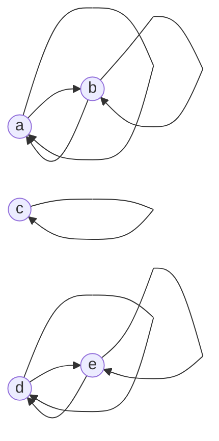

# Equivalence relations and partitions

After this lesson you can prove that a relation is an equivalence relation, find its equivalence classes, prove that the classes split the set into non-overlapping pieces, turn a partition back into an equivalence relation, and describe the integers mod $n$ and the rational numbers as sets of classes.

Before this: [relations and their properties](01-relations-and-their-properties.md) (reflexive, symmetric, transitive), [proofs about sets](../04-more-proof-methods/03-proofs-about-sets.md) and [if and only if proofs](../04-more-proof-methods/01-if-and-only-if-proofs.md), and [long division](../../01-elementary/07-long-division.md) for the division algorithm.

## Quick check

Try these first. If you get all three right, skip to [Practice](#practice).

1. On $\{1, 2, 3, 4\}$ let $R = \{(1, 1), (2, 2), (3, 3), (4, 4), (1, 3), (3, 1)\}$. Is $R$ an equivalence relation? If so, list its equivalence classes.
2. Congruence modulo 4 on $\mathbb{Z}$. Which number in $\{0, 1, 2, 3\}$ is in the same class as $27$? As $-9$?
3. Can two different classes of an equivalence relation share an element?

<details class="solution" markdown>
<summary>Answers</summary>

1. Yes. All four loops are in $R$, the pair $(1, 3)$ has its reverse $(3, 1)$, and the only chains are $(1, 3), (3, 1)$ giving $(1, 1)$ and $(3, 1), (1, 3)$ giving $(3, 3)$, plus loop chains. The classes are $\{1, 3\}$, $\{2\}$ and $\{4\}$.
2. $27 = 6 \cdot 4 + 3$, so $27$ is in the class of $3$. And $-9 = (-3) \cdot 4 + 3$, so $-9$ is also in the class of $3$.
3. No. The theorem of this lesson says that two classes are either equal or have no element in common.

</details>

## The idea

Think of a hash table with 8 buckets. A word is dropped into the bucket numbered by some function of the word. Two words are "the same as far as the table is concerned" when they land in the same bucket. This sameness has the properties we expect of a sameness: a word is in the same bucket as itself, if $x$ is with $y$ then $y$ is with $x$, and if $x$ is with $y$ and $y$ is with $z$ then $x$ is with $z$. And the buckets are separate: every word is in exactly one bucket, so the buckets divide up the set of all words.

That is the whole lesson in an example. A relation that behaves like "being the same in some respect" is an equivalence relation, and the pieces it cuts the set into are its equivalence classes. The same idea sits behind many things that look different: the clock arithmetic in which 15:00 is the same hour as 3:00, the fractions $\frac{1}{2}$ and $\frac{2}{4}$ that name one number, and two graphs that are drawn differently but have the same structure.

The new work is a theorem with a proof. An equivalence relation and a partition (a way to split a set into non-overlapping pieces) are two descriptions of the same thing, and each one can be turned into the other without loss. The theorem lets us replace "an infinite set with a complicated relation" by "a set of classes" and then work with the classes as objects, which is how the integers mod $n$ and the rational numbers are built.

## Definitions

### Equivalence relations

A relation $\sim$ on a set $A$ is an **equivalence relation** if it is reflexive, symmetric and transitive: for all $a, b, c \in A$,

- $a \sim a$,
- if $a \sim b$, then $b \sim a$,
- if $a \sim b$ and $b \sim c$, then $a \sim c$.

In plain words, it is a relation that behaves like equality. We read $a \sim b$ as "$a$ is equivalent to $b$". Equality itself is the simplest example, and congruence modulo $n$ ([Theorem 2 of the previous lesson](01-relations-and-their-properties.md)) is the next one. Notice that all three properties are needed. The "near" relation $\lvert x - y \rvert < 1$ on $\mathbb{R}$ is reflexive and symmetric, and it fails transitivity, so it isn't an equivalence relation.

### Equivalence classes

For $a \in A$, the **equivalence class** of $a$ is the set of everything equivalent to $a$:

$$
[a] = \{x \in A : x \sim a\}.
$$

In plain words, $[a]$ is the bucket that $a$ sits in. An element $a$ chosen to name its class is a **representative** of the class. A class has many representatives: if $[a] = [b]$, either one can be used to name the class. The set of all classes is written $A/{\sim}$ (read "$A$ mod $\sim$").

With the digraph picture: an equivalence relation has a loop at every vertex, an arrow back for every arrow, and a shortcut for every two-step path. The result is that the digraph falls apart into separate groups in which every vertex is joined to every other vertex in its group (including itself) and to nothing outside. Each group is a class.

### Partitions

A **partition** of a set $A$ is a collection of non-empty subsets of $A$, called its **blocks**, such that every element of $A$ is in exactly one block. Said as conditions, (1) each block is non-empty, (2) different blocks are disjoint, and (3) the union of the blocks is $A$.

In plain words, a partition cuts $A$ into pieces with no overlaps and no gaps and no empty pieces. For $A = \{1, 2, 3, 4, 5\}$, the collection $\{\{1, 2\}, \{3\}, \{4, 5\}\}$ is a partition. The collection $\{\{1, 2\}, \{2, 3\}, \{4, 5\}\}$ is not, because 2 is in two blocks, and neither is $\{\{1, 2\}, \{4, 5\}\}$, because 3 is in no block. Different words are in use for the same idea: "a partition of $A$" and "a way to split $A$ into classes".

## How to do it

### Proving that a relation is an equivalence relation

1. State the set $A$ and the relation in terms of its rule.
2. Prove reflexive: "Let $a \in A$", then show $a \sim a$ from the rule.
3. Prove symmetric: "Suppose $a \sim b$", then show $b \sim a$.
4. Prove transitive: "Suppose $a \sim b$ and $b \sim c$", then show $a \sim c$. This is the step that usually needs thought.
5. If the rule has the form "$f(a) = f(b)$" for a function $f$, skip Steps 2 to 4: equality of the values is reflexive, symmetric and transitive, so the relation is an equivalence relation (Theorem 6 below).
6. To describe the classes, solve "$x \sim a$" for $x$ and write $[a]$ as a set.

### The equivalence class theorem

The next theorem lists the facts about classes that everything else uses. Throughout, $\sim$ is an equivalence relation on $A$.

*Theorem 1.* For all $a, b \in A$: (i) $a \in [a]$; (ii) $a \sim b$ if and only if $[a] = [b]$; (iii) if $[a] \cap [b] \ne \emptyset$, then $[a] = [b]$.

What we know: the three properties of $\sim$ and the definition of a class. What we want: three facts, one of them an "if and only if". The plan: (i) is reflexivity. For (ii), prove the two inclusions $[a] \subseteq [b]$ and $[b] \subseteq [a]$ from $a \sim b$, using transitivity, and then go back from equal sets to the relation. For (iii), use a common element to get $a \sim b$ and then apply (ii).

*Proof.* (i) By reflexivity $a \sim a$, so $a \in [a]$.

(ii) ($\Rightarrow$) Suppose $a \sim b$. Let $x \in [a]$, so $x \sim a$. With $a \sim b$, transitivity gives $x \sim b$, so $x \in [b]$. Hence $[a] \subseteq [b]$. By symmetry $b \sim a$, and the same argument with the roles swapped gives $[b] \subseteq [a]$. So $[a] = [b]$.

($\Leftarrow$) Suppose $[a] = [b]$. By (i), $a \in [a]$, so $a \in [b]$, which means $a \sim b$.

(iii) Suppose $x \in [a] \cap [b]$. Then $x \sim a$ and $x \sim b$. By symmetry $a \sim x$, and then transitivity with $x \sim b$ gives $a \sim b$. By (ii), $[a] = [b]$. $\blacksquare$

Look back: the proof uses all three properties, and each one has one job: reflexivity puts $a$ in its own class, symmetry turns $x \sim a$ into $a \sim x$, and transitivity does the linking. Part (ii) is the useful rule: to show two classes are equal, show that their representatives are related. Check with congruence mod 3: $4 \sim 7$ since $3 \mid 3$, and $[4] = \{\dots, 1, 4, 7, 10, \dots\} = [7]$.

*Theorem 2.* The equivalence classes of $\sim$ form a partition of $A$.

What we want: the three conditions of a partition. The plan: use (i) for the first and third, and (iii) for the second.

*Proof.* Non-empty: $a \in [a]$ by (i), so no class is empty. Covering: each $a \in A$ lies in the class $[a]$, so the union of the classes is $A$. Disjoint: if two classes $[a]$ and $[b]$ are different sets, then (iii) says they cannot share an element, so they are disjoint. $\blacksquare$

Look back: the classes can be named in many ways ($[1] = [4] = [7]$ for mod 3), so "the classes" means the distinct sets, each counted once.

### From a partition back to a relation

*Theorem 3.* Let $\mathcal{P}$ be a partition of $A$. Define $a \sim b$ to mean that $a$ and $b$ lie in the same block of $\mathcal{P}$. Then $\sim$ is an equivalence relation on $A$, and its equivalence classes are exactly the blocks of $\mathcal{P}$.

What we know: every element is in exactly one block. What we want: the three properties, and that $[a]$ is the block containing $a$. The plan: check each property from the definition, and use the "exactly one block" condition for transitivity.

*Proof.* Reflexive: each $a$ is in some block (the blocks cover $A$), and $a$ is in the same block as itself. Symmetric: "$a$ and $b$ are in the same block" says the same as "$b$ and $a$ are in the same block". Transitive: suppose $a, b \in B_1$ and $b, c \in B_2$ for blocks $B_1$ and $B_2$. Then $b \in B_1 \cap B_2$. Different blocks are disjoint, so $B_1 = B_2$, and $a, c \in B_1$. So $a \sim c$.

For the classes, let $B$ be the block containing $a$. Then $x \sim a$ exactly when $x$ is in the block containing $a$, which is $B$. So $[a] = B$. Every block is non-empty, so every block is $[a]$ for some $a$ in it. $\blacksquare$

Look back: Theorems 2 and 3 are inverse to each other. Start with a relation, take the classes, and rebuild the relation from them: you get the relation you started with, since $a \sim b$ exactly when $[a] = [b]$. Start with a partition, build the relation, take the classes: you get the same blocks. Equivalence relations on $A$ and partitions of $A$ are one-to-one matched. Counting them: a 3-element set has 5 partitions, so 5 equivalence relations, and the numbers for 1, 2, 3, 4, 5 and 6 elements (the Bell numbers) are 1, 2, 5, 15, 52, 203.

### Congruence modulo $n$ and the classes $[0], \dots, [n-1]$

Fix a positive integer $n$ and let $\sim$ be congruence modulo $n$, an equivalence relation on $\mathbb{Z}$ by the previous lesson. Write $[a]_n$ for the class of $a$ when the modulus needs to be clear. The class $[a]_n$ is $\{a + nk : k \in \mathbb{Z}\}$, since $x \equiv a$ means $x - a = nk$.

*Theorem 4.* There are exactly $n$ classes of congruence modulo $n$, namely $[0], [1], \dots, [n - 1]$, and each integer $a$ is in the class $[r]$, where $r$ is the remainder of $a$ divided by $n$.

What we know: the division algorithm (as in [long division](../../01-elementary/07-long-division.md)): for every integer $a$ there are integers $q$ and $r$ with $a = qn + r$ and $0 \le r < n$. What we want: each class is one of the listed ones, and the listed ones are different. The plan: use $a - r = qn$ for the first, and a size argument for the second.

*Proof.* Let $a \in \mathbb{Z}$, and write $a = qn + r$ with $0 \le r < n$. Then $a - r = qn$, so $a \equiv r$, and $[a] = [r]$ by Theorem 1(ii). So every class is one of $[0], \dots, [n-1]$.

Now suppose $0 \le r < s \le n - 1$. Then $0 < s - r < n$, so $s - r$ is a positive integer smaller than $n$ and $n \nmid s - r$. So $r \not\equiv s$, and $[r] \ne [s]$ by Theorem 1(ii). The $n$ classes are different. $\blacksquare$

Look back: the proof says that the remainder is the best representative, because it is the one in $\{0, \dots, n-1\}$. For $n = 3$ the classes are

$$
[0] = \{\dots, -6, -3, 0, 3, 6, \dots\}, \quad [1] = \{\dots, -5, -2, 1, 4, 7, \dots\}, \quad [2] = \{\dots, -4, -1, 2, 5, 8, \dots\}.
$$

A negative number such as $-7$ is in the class of $2$, since $-7 = (-3) \cdot 3 + 2$, which is also what Python's `-7 % 3` returns. The set of classes is written $\mathbb{Z}_n$ or $\mathbb{Z}/n\mathbb{Z}$. Divisibility and modular arithmetic<!-- link: ../../06-cs-math/02-number-theory/01-divisibility-and-modular-arithmetic.md --> develops arithmetic on these classes, and the lesson on [well-definedness](04-functions-and-well-definedness.md) shows why that arithmetic makes sense.

### The rational numbers as classes of fractions

A fraction is a pair $(a, b)$ of integers with $b \ne 0$, written $\frac{a}{b}$. Different fractions can name the same number: $\frac{1}{2}$ and $\frac{2}{4}$. Define a relation on $\mathbb{Z} \times (\mathbb{Z} \setminus \{0\})$ by

$$
(a, b) \sim (c, d) \quad\text{if}\quad ad = bc.
$$

This is the cross-multiplication rule for equal fractions from [proportional relationships](../../02-middle-school/02-ratios-rates-percents/02-proportional-relationships.md).

*Theorem 5.* The relation $\sim$ above is an equivalence relation on $\mathbb{Z} \times (\mathbb{Z} \setminus \{0\})$.

What we know: $b, d, f \ne 0$ in the pairs, and the integers can be multiplied and cancelled. What we want: three properties. The plan: reflexive and symmetric come from commuting factors; transitive needs a cancellation, and the cancelled number must be non-zero.

*Proof.* Reflexive: $ab = ba$, so $(a, b) \sim (a, b)$. Symmetric: if $ad = bc$ then $cb = da$, which says $(c, d) \sim (a, b)$.

Transitive: suppose $(a, b) \sim (c, d)$ and $(c, d) \sim (e, f)$, so $ad = bc$ and $cf = de$. We want $af = be$. Multiply the first equation by $f$ and the second by $b$:

$$
adf = bcf \qquad\text{and}\qquad bcf = bde.
$$

So $adf = bde$, which gives $d(af - be) = 0$. Since $d \ne 0$, we get $af - be = 0$, so $af = be$ and $(a, b) \sim (e, f)$. $\blacksquare$

Look back: the proof used $d \ne 0$ exactly once, at the cancellation. If a zero denominator were allowed, transitivity would break: $(1, 0) \sim (0, 0)$ holds since $1 \cdot 0 = 0 \cdot 0$, and $(0, 0) \sim (5, 3)$ holds since $0 \cdot 3 = 0 \cdot 5$, but $(1, 0) \sim (5, 3)$ fails since $1 \cdot 3 \ne 0 \cdot 5$. This is why the zero denominator is excluded.

A **rational number** is, formally, an equivalence class $[(a, b)]$ of this relation. In plain words, $\frac{1}{2}$ is the set of all pairs that cross-multiply equal to $(1, 2)$: $(1, 2)$, $(2, 4)$, $(-3, -6)$, and so on. Writing a fraction in lowest terms picks the representative with the smallest positive denominator. The reason that mathematicians go through this construction is that it explains why we can treat $\frac{1}{2}$ and $\frac{2}{4}$ as equal and why we must check that an operation defined with fractions doesn't depend on which name we use, which is the subject of the lesson on [well-definedness](04-functions-and-well-definedness.md).

### The kernel of a function

*Theorem 6.* Let $f \colon A \to B$ be a function. Define $a \sim b$ to mean $f(a) = f(b)$. Then $\sim$ is an equivalence relation on $A$, and its classes are the sets $\{a \in A : f(a) = y\}$ for the outputs $y$ that occur.

*Proof.* Reflexive: $f(a) = f(a)$. Symmetric: if $f(a) = f(b)$ then $f(b) = f(a)$. Transitive: if $f(a) = f(b)$ and $f(b) = f(c)$ then $f(a) = f(c)$. For the classes, $[a] = \{x : f(x) = f(a)\}$, which is the set of inputs with the same output as $a$. $\blacksquare$

This relation is the **kernel** of $f$, and the classes are the sets of inputs that $f$ can't tell apart. In plain words, any function sorts its inputs into the buckets given by its outputs. Hash tables are the standard example: the function is the hash function, and the classes are the buckets.

## Worked examples

<div class="example" markdown>

### Example 1: points at the same distance from the origin

On $\mathbb{R}^2$, define $(x_1, y_1) \sim (x_2, y_2)$ to mean $x_1^2 + y_1^2 = x_2^2 + y_2^2$. Prove that $\sim$ is an equivalence relation and describe the classes.

Step 1: the set is $\mathbb{R}^2$ and the rule is equality of $x^2 + y^2$.

Step 5 applies. Let $f(x, y) = x^2 + y^2$, a function from $\mathbb{R}^2$ to $\mathbb{R}$. Then $(x_1, y_1) \sim (x_2, y_2)$ means $f(x_1, y_1) = f(x_2, y_2)$, so $\sim$ is the kernel of $f$ and Theorem 6 says it is an equivalence relation. (Spelled out: the three properties of $\sim$ are the three properties of equality of real numbers.)

Step 6: the class of $(a, b)$ is $\{(x, y) : x^2 + y^2 = a^2 + b^2\}$, the circle centred at the origin through $(a, b)$, with radius $\sqrt{a^2 + b^2}$. For $(0, 0)$ the class is the single point $\{(0, 0)\}$. For $(3, 4)$, since $9 + 16 = 25$, the class is the circle of radius 5, and it contains $(5, 0)$, $(0, -5)$ and $(-4, 3)$.

Check: $(-4, 3)$ has $16 + 9 = 25$, so $(-4, 3) \sim (3, 4)$ and $[(-4, 3)] = [(3, 4)]$ by Theorem 1(ii). Every point of the plane is on exactly one circle centred at the origin, so the circles partition the plane, as Theorem 2 says.

</div>

<div class="example" markdown>

### Example 2: classes of "same number of divisors"

On $A = \{1, 2, \dots, 12\}$, let $a \sim b$ mean that $a$ and $b$ have the same number of positive divisors. Find the classes.

This is the kernel of the function $d$, where $d(n)$ is the number of divisors of $n$, so it is an equivalence relation. Compute $d$: $d(1) = 1$; $d(2) = d(3) = d(5) = d(7) = d(11) = 2$ (primes); $d(4) = d(9) = 3$ (divisors $1, 2, 4$ and $1, 3, 9$); $d(6) = d(8) = d(10) = 4$ (divisors $1, 2, 3, 6$; $1, 2, 4, 8$; $1, 2, 5, 10$); and $d(12) = 6$. Group by the value:

$$
\{1\}, \quad \{2, 3, 5, 7, 11\}, \quad \{4, 9\}, \quad \{6, 8, 10\}, \quad \{12\}.
$$

Check: the five blocks have $1 + 5 + 2 + 3 + 1 = 12$ elements, one for each number from 1 to 12, so they cover $A$ with no overlap. The program in [In code](#in-code) finds the same blocks.

</div>

<div class="example" markdown>

### Example 3: from a partition to the relation, and an edge case

Let $A = \{a, b, c, d, e\}$ with the partition $\{\{a, b\}, \{c\}, \{d, e\}\}$. Write the equivalence relation of Theorem 3. Then say why $\{\{a, b\}, \{b, c\}, \{d, e\}\}$ doesn't define one.

The block $\{a, b\}$ gives $4$ pairs: $(a, a), (a, b), (b, a), (b, b)$. The block $\{c\}$ gives the loop $(c, c)$. The block $\{d, e\}$ gives $4$ pairs. The relation has $4 + 1 + 4 = 9$ pairs. Its digraph is three separate pieces, each complete inside.



For the second collection, the blocks $\{a, b\}$ and $\{b, c\}$ overlap in $b$, and $a$ and $c$ would be related to $b$ but not to each other. Putting "same block" as the relation gives $a \sim b$ and $b \sim c$ with $a \not\sim c$, which is not transitive. This is the same trouble as in the "near" relation: overlapping neighbourhoods can't be classes.

Check: for the partition, the number of pairs is the sum of the squares of the block sizes, $2^2 + 1^2 + 2^2 = 9$.

</div>

<div class="example" markdown>

### Example 4: the parity relation (finish it yourself)

On $\mathbb{Z}$, let $a \sim b$ mean that $a + b$ is even. Show that $\sim$ is an equivalence relation and find its classes.

Reflexive: $a + a = 2a$ is even. Symmetric: $a + b = b + a$. Transitive: suppose $a + b = 2j$ and $b + c = 2k$. Adding, $a + 2b + c = 2(j + k)$, so $a + c = 2(j + k - b)$, which is even. So $\sim$ is an equivalence relation.

Now find the classes. Show that $[1]$ is the set of odd integers and that $[0]$ is the set of even integers, and say why these are all the classes.

<details class="solution" markdown>
<summary>Finish</summary>

If $x \in [1]$, then $x + 1$ is even, so $x$ is odd. Conversely, if $x$ is odd then $x + 1$ is even, so $x \sim 1$. So $[1]$ is the set of odd integers. In the same way, $x \sim 0$ means $x + 0$ is even, so $[0]$ is the set of even integers. Every integer is even or odd, so every integer is in $[0]$ or $[1]$, and Theorem 1(ii) says the classes of all integers are these two. The classes are the evens and the odds, the same as the classes of congruence modulo 2.

Check: $3 \sim 7$ because $3 + 7 = 10$ is even, and both are in $[1]$. And $3 \not\sim 4$ because $3 + 4 = 7$ is odd, and $4 \in [0]$.

</details>

</div>

## Edge cases and common mistakes

<div class="warning" markdown>

Watch out: $[a] = [b]$ doesn't mean $a = b$. Under congruence mod 3, $[1] = [4]$ and $1 \ne 4$. Different names for the same class are the normal case. Conversely, if $[a] \ne [b]$ then $a \ne b$, and in fact $a \not\sim b$. The test for equal classes is $a \sim b$ (Theorem 1(ii)), not $a = b$.

</div>

<div class="warning" markdown>

Watch out: an equivalence class is a set, and not an element. The expression $[3]_5$ is the set $\{\dots, -2, 3, 8, \dots\}$, and writing $[3]_5 = 3$ is a type error. In the same way, $a \in [a]$ is true and $a = [a]$ is false.

</div>

<div class="warning" markdown>

Watch out: reflexivity doesn't follow from symmetry and transitivity. The "proof" that it does, "$a \sim b$ and $b \sim a$ give $a \sim a$", assumes that $a$ is related to something, as in practice problem 5 of [relations and their properties](01-relations-and-their-properties.md). The relation $\{(1, 1), (2, 2)\}$ on $\{1, 2, 3\}$ is symmetric and transitive, and the element $3$ is in no class at all.

</div>

<div class="warning" markdown>

Watch out: a collection of overlapping sets, or sets that leave out an element, is not a partition. To check a partition, test the three conditions one at a time: no block is empty, no element is in two blocks, no element is in none.

</div>

Some small cases. The relation $=$ has one-element classes $\{a\}$, and its partition is all singletons. The relation $A \times A$ has the single class $A$. On an empty set $A$ the empty relation is an equivalence relation with no classes, and the empty collection is the only partition of $\emptyset$. Finally, an infinite set can have finitely many classes (the $n$ classes of $\mathbb{Z}$ mod $n$) or infinitely many (the circles in Example 1, one for each radius $\ge 0$).

## Tricks and shortcuts

If the relation is "same value of something" (the same remainder, the same length, the same hash, the same absolute value), it is the kernel of a function and is an equivalence relation with no further proof. This covers most equivalence relations you will meet, and it also tells you the classes: the sets of inputs with the same output.

To decide whether two elements are in the same class, look for a canonical representative: the remainder mod $n$, the fraction in lowest terms, the sorted letters of a word. Two elements are equivalent exactly when they have the same canonical form, which is how a program tests it.

To show that a relation is not an equivalence relation, look for a failure of transitivity first, since reflexivity and symmetry are usually easy. Chains that leave a neighbourhood ($0$ near $0.9$ near $1.8$) are the typical failure.

## In code

An equivalence relation is used in code to group things. The program groups integers mod 3, the numbers up to 12 by their number of divisors, fractions by cross-multiplication, words by a hash bucket, and merges classes with a small union-find structure.

<details class="code" markdown>
<summary>In code</summary>

```python
from fractions import Fraction

def classes(A, related):
    """Group A into equivalence classes, given a test related(a, b)."""
    result = []
    for a in A:
        for block in result:
            if related(a, block[0]):
                block.append(a)
                break
        else:
            result.append([a])
    return result

print(classes(range(-4, 8), lambda a, b: (a - b) % 3 == 0))
# [[-4, -1, 2, 5], [-3, 0, 3, 6], [-2, 1, 4, 7]]

def num_divisors(n):
    return sum(1 for d in range(1, n + 1) if n % d == 0)

print(classes(range(1, 13), lambda a, b: num_divisors(a) == num_divisors(b)))
# [[1], [2, 3, 5, 7, 11], [4, 9], [6, 8, 10], [12]]

print([(-7) % 3, 17 % 5, (-1) % 5])           # [2, 2, 4]

# fractions as classes of pairs: (a, b) ~ (c, d) when a*d == b*c
pairs = [(1, 2), (2, 4), (3, 6), (2, 3), (4, 6), (-1, -2)]
print(classes(pairs, lambda p, q: p[0] * q[1] == p[1] * q[0]))
# [[(1, 2), (2, 4), (3, 6), (-1, -2)], [(2, 3), (4, 6)]]
print(Fraction(2, 4) == Fraction(1, 2))       # True

# hashing: the kernel of a hash function is an equivalence relation
words = ["cat", "act", "tac", "dog", "god", "bird"]
buckets = {}
for w in words:
    buckets.setdefault(sum(map(ord, w)) % 8, []).append(w)
print(buckets)
# {0: ['cat', 'act', 'tac'], 2: ['dog', 'god'], 1: ['bird']}

# union-find: merging classes as we learn that two items are equivalent
parent = {x: x for x in range(8)}
def find(x):
    while parent[x] != x:
        parent[x] = parent[parent[x]]
        x = parent[x]
    return x
for a, b in [(0, 1), (2, 3), (1, 3), (5, 6)]:
    parent[find(a)] = find(b)
groups = {}
for x in parent:
    groups.setdefault(find(x), []).append(x)
print(sorted(groups.values()))
# [[0, 1, 2, 3], [4], [5, 6], [7]]
```

The function `classes` compares each element with the first element of each existing block. That is enough because of Theorem 1: if $a$ is equivalent to one member of a class, it is equivalent to all of them. It would give wrong answers on a relation that is not transitive, such as "near". The hash is the sum of the letter codes mod 8, a poor hash on purpose: anagrams always collide, so `cat`, `act` and `tac` share a bucket. The union-find structure keeps a partition and merges two blocks when a new pair is declared equivalent. After the four merges, $0, 1, 2, 3$ are one class because $(0, 1)$, $(2, 3)$ and $(1, 3)$ chain together.

</details>

## FAQ

### Why does the proof of Theorem 1 prove two inclusions?

Because equality of sets means the same elements, which is two inclusions: every element of $[a]$ is in $[b]$ and every element of $[b]$ is in $[a]$. The relation $a \sim b$ isn't symmetric in its roles in the proof, since we use $a \sim b$ for one inclusion and $b \sim a$ for the other, and symmetry of $\sim$ is what turns the first into the second.

### Does every partition come from a relation?

Yes, that is Theorem 3. Say which elements belong together, and the relation "belong together" is automatically reflexive, symmetric and transitive. This is often the easier way to define an equivalence relation: describe the pieces and not the rule.

### What is the point of calling a fraction a class?

It makes "$\frac{1}{2} = \frac{2}{4}$" a true statement about sets. Without it, $\frac{1}{2}$ and $\frac{2}{4}$ are different pairs of integers that we choose to treat as one number. With it, they are two names (representatives) of one object, and the classes can then be added and multiplied, provided the results don't depend on which names we used.

### Is "$\equiv$" the same symbol as the logical equivalence $\equiv$?

The symbol is shared, and the meanings are different. In logic, $P \equiv Q$ means two statements have the same truth table, and in number theory, $a \equiv b \pmod{n}$ means $n \mid a - b$. Logical equivalence is also an equivalence relation, on the set of statements, and its classes are sets of statements with the same truth table.

## Practice

### Warm-up

1\. Let $A = \{1, 2, 3\}$ and $R = \{(1, 1), (2, 2), (3, 3), (1, 2), (2, 1)\}$. Show that $R$ is an equivalence relation and list its classes.

<details class="solution" markdown>
<summary>Solution</summary>

Reflexive: all three loops are in $R$. Symmetric: the only non-loop pairs are $(1, 2)$ and $(2, 1)$, each the reverse of the other. Transitive: the chains $(1, 2), (2, 1)$ and $(2, 1), (1, 2)$ give $(1, 1)$ and $(2, 2)$, the chains $(1, 1), (1, 2)$ and $(1, 2), (2, 2)$ give $(1, 2)$, the chains $(2, 2), (2, 1)$ and $(2, 1), (1, 1)$ give $(2, 1)$, and the loop $(3, 3)$ only chains with itself. All results are in $R$.

The classes are $[1] = [2] = \{1, 2\}$ and $[3] = \{3\}$.

Check: the classes are disjoint, cover $\{1, 2, 3\}$, and the sum of the squares of their sizes is $2^2 + 1^2 = 5$, the number of pairs in $R$.

</details>

2\. For congruence modulo 4, find the number in $\{0, 1, 2, 3\}$ whose class contains (a) 7, (b) $-7$, (c) 100, (d) $-100$.

<details class="solution" markdown>
<summary>Solution</summary>

Divide with a remainder in $\{0, 1, 2, 3\}$.

- (a) $7 = 1 \cdot 4 + 3$, so the class of 3.
- (b) $-7 = (-2) \cdot 4 + 1$, so the class of 1.
- (c) $100 = 25 \cdot 4 + 0$, so the class of 0.
- (d) $-100 = (-25) \cdot 4 + 0$, so the class of 0.

Check: $7 - 3 = 4$, $-7 - 1 = -8$, $100 - 0 = 100$ and $-100 - 0 = -100$ are all multiples of 4. Python gives `7 % 4 == 3`, `-7 % 4 == 1`.

</details>

3\. Which of these are partitions of $\{1, 2, 3, 4\}$? (a) $\{\{1, 2\}, \{3, 4\}\}$ (b) $\{\{1, 2\}, \{2, 3\}, \{4\}\}$ (c) $\{\{1\}, \{2\}, \{3\}\}$ (d) $\{\{1, 3\}, \{2\}, \{4\}\}$. For each partition, say how many pairs the equivalence relation has.

<details class="solution" markdown>
<summary>Solution</summary>

(a) A partition. The relation has $2^2 + 2^2 = 8$ pairs. (b) Not a partition: 2 is in two blocks. (c) Not a partition: 4 is in no block. (d) A partition. The relation has $2^2 + 1 + 1 = 6$ pairs: $(1, 1), (1, 3), (3, 1), (3, 3), (2, 2), (4, 4)$.

Check (d): this is the relation $R$ in the Quick check, and its list has 6 pairs.

</details>

### Standard

4\. On $\mathbb{R}$, let $x \sim y$ mean $x - y \in \mathbb{Z}$. Prove that $\sim$ is an equivalence relation, and show that every class has exactly one element in $[0, 1)$.

<details class="solution" markdown>
<summary>Solution</summary>

*Proof.* Reflexive: $x - x = 0 \in \mathbb{Z}$. Symmetric: if $x - y = k \in \mathbb{Z}$, then $y - x = -k \in \mathbb{Z}$. Transitive: if $x - y = j$ and $y - z = k$ with $j, k \in \mathbb{Z}$, then $x - z = j + k \in \mathbb{Z}$.

For the representative: given $x$, let $r = x - \lfloor x \rfloor$, the fractional part, which lies in $[0, 1)$. Then $x - r = \lfloor x \rfloor \in \mathbb{Z}$, so $x \sim r$, and the class of $x$ has an element in $[0, 1)$. For uniqueness, suppose $r, s \in [0, 1)$ with $r \sim s$. Then $r - s$ is an integer with $-1 < r - s < 1$, so $r - s = 0$ and $r = s$. $\blacksquare$

Check: the class of $0.25$ is $\{\dots, -1.75, -0.75, 0.25, 1.25, \dots\}$, and $3.25$ and $-0.75$ are both in it. Their fractional parts are $0.25$ and $0.25$.

</details>

5\. Find the flaw in this argument. "Claim: the classes of an equivalence relation are disjoint. Proof: if $a \ne b$, then $[a] \cap [b] = \emptyset$." Then state the correct theorem.

<details class="solution" markdown>
<summary>Solution</summary>

The flaw is that the proof assumes $a \ne b$ means $[a] \ne [b]$. Different representatives can name the same class. Under congruence mod 3, $1 \ne 4$ but $[1] = [4]$, and these sets share every element, so $[1] \cap [4] \ne \emptyset$.

The correct statement is that if $[a] \ne [b]$ as sets, then $[a] \cap [b] = \emptyset$, which is Theorem 1(iii) read backwards: sharing an element forces the classes to be equal. The claim "classes are disjoint" is true when "classes" means the distinct sets.

Check: with $a = 1$ and $b = 2$, $[1] \ne [2]$ and the two sets $\{\dots, 1, 4, \dots\}$ and $\{\dots, 2, 5, \dots\}$ have no common element.

</details>

6\. Let $f \colon A \to B$ be a function and let $a \sim b$ mean $f(a) = f(b)$. For $f \colon \mathbb{Z} \to \mathbb{Z}$ with $f(n) = n^2$, describe the classes. Then prove that if $f$ is injective, every class has exactly one element.

<details class="solution" markdown>
<summary>Solution</summary>

For $f(n) = n^2$, $a \sim b$ when $a^2 = b^2$, which means $a = b$ or $a = -b$. The classes are $\{0\}$ and $\{-k, k\}$ for each positive integer $k$.

Now suppose $f$ is injective, which means that $f(a) = f(b)$ implies $a = b$. Let $x \in [a]$. Then $f(x) = f(a)$, so $x = a$ by injectivity. So $[a] = \{a\}$. (By Theorem 1(i), $a \in [a]$, so the class is non-empty, and now it has exactly one element.) $\blacksquare$

Check: for $f(n) = n^2$ the function is not injective, and the class $\{-2, 2\}$ has two elements. For $f(n) = 2n$ the function is injective, and every class is a single number.

</details>

### Challenge

7\. On $\mathbb{N} \times \mathbb{N}$, define $(a, b) \sim (c, d)$ to mean $a + d = b + c$. Prove that $\sim$ is an equivalence relation. Find the class of $(5, 2)$ and say what the classes represent.

<details class="solution" markdown>
<summary>Solution</summary>

What we know: addition of natural numbers can be cancelled. The plan: check the three properties with the equations.

*Proof.* Reflexive: $a + b = b + a$, so $(a, b) \sim (a, b)$. Symmetric: if $a + d = b + c$, then $c + b = d + a$, which says $(c, d) \sim (a, b)$. Transitive: suppose $a + d = b + c$ and $c + f = d + e$. Adding the two equations, $a + d + c + f = b + c + d + e$. Cancel $c + d$ from both sides to get $a + f = b + e$, so $(a, b) \sim (e, f)$. $\blacksquare$

The class of $(5, 2)$ is all $(c, d)$ with $5 + d = 2 + c$, that is, $c - d = 3$: the pairs $(3, 0), (4, 1), (5, 2), (6, 3), \dots$. Each class is one value of "first minus second", which can be any integer. So the classes represent the integers: the pair $(a, b)$ stands for $a - b$, and this is how the integers can be built from the natural numbers.

Check: $(5, 2)$ and $(3, 0)$ have $5 + 0 = 5 = 2 + 3$, so they are in the same class, and both have difference 3.

</details>

8\. (Reviews [relations and their properties](01-relations-and-their-properties.md).) For $x \in \mathbb{R}$ let $N(x) = \{y \in \mathbb{R} : \lvert x - y \rvert < 1\}$. Show that the sets $N(x)$ are not the classes of an equivalence relation, by finding $x$ and $x'$ with $N(x) \ne N(x')$ and $N(x) \cap N(x') \ne \emptyset$.

<details class="solution" markdown>
<summary>Solution</summary>

Take $x = 0$ and $x' = 1$. Then $N(0) = (-1, 1)$ and $N(1) = (0, 2)$. They are different sets, because $-0.5 \in N(0)$ and $-0.5 \notin N(1)$. They share the element $0.5$, since $\lvert 0 - 0.5 \rvert = 0.5 < 1$ and $\lvert 1 - 0.5 \rvert = 0.5 < 1$.

By Theorem 1(iii), the classes of an equivalence relation that share an element are equal. Here two different sets share an element, so these sets are not the classes of an equivalence relation. This matches the fact that the "near" relation fails transitivity.

Check: $0 \mathrel{R} 0.5$ and $0.5 \mathrel{R} 1$ are true, and $0 \not\mathrel{R} 1$ is true since $\lvert 0 - 1 \rvert = 1$ is not less than 1.

</details>

## Where this shows up

- The next lessons use classes directly. A function on classes is only a function when it doesn't depend on the representative, which is [well-definedness](04-functions-and-well-definedness.md), and the equivalence of sets with the same number of elements is the subject of [cardinality and countability](06-cardinality-and-countability.md).
- Modular arithmetic works on the classes $[0], \dots, [n - 1]$ (divisibility and modular arithmetic<!-- link: ../../06-cs-math/02-number-theory/01-divisibility-and-modular-arithmetic.md -->), and in linear algebra the kernel of a linear map plays the role of the kernel of Theorem 6 ([linear transformations, kernel and image](../../05-university-core/06-linear-algebra/05-linear-transformations-kernel-and-image.md)).
- In CS, hash tables, canonical forms, type equivalence, "same up to isomorphism" for graphs, the states of a minimized finite automaton (finite automata: DFA and NFA<!-- link: ../../06-cs-math/06-theory-of-computation/01-finite-automata-dfa-and-nfa.md -->) and the union-find data structure are all about equivalence classes.
