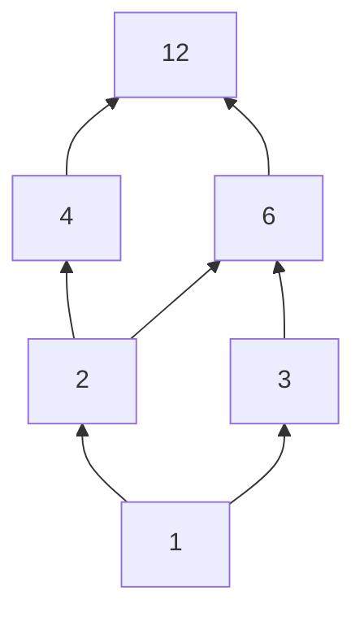
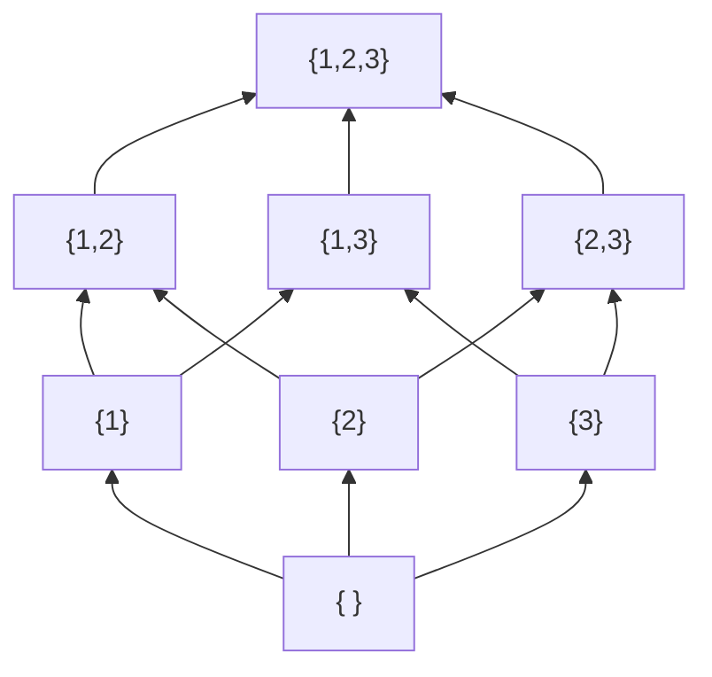

# Partial orders

After this lesson you can prove that a relation is a partial order, draw its Hasse diagram, tell minimal and maximal elements from least and greatest ones, find chains and antichains, and sort tasks that have dependencies into a valid order.

Before this: [relations and their properties](01-relations-and-their-properties.md) (reflexive, antisymmetric, transitive), [equivalence relations and partitions](02-equivalence-relations-and-partitions.md), [proof by contradiction](../03-core-proof-methods/06-proof-by-contradiction.md), and [sets and set operations](../02-logic-and-sets/06-sets-and-set-operations.md#power-sets) (power sets).

## Quick check

Try these first. If you get all three right, skip to [Practice](#practice).

1. Under divisibility on $\{1, 2, 3, 6, 12\}$, which pairs of elements are incomparable?
2. In $\mathcal{P}(\{1, 2, 3\})$ ordered by $\subseteq$, find the least and the greatest element.
3. A project has tasks A, B, C, D where B and C each need A, and D needs both B and C. List every valid order of the four tasks.

<details class="solution" markdown>
<summary>Answers</summary>

1. Two elements are comparable when one divides the other. The number $1$ divides everything, $2 \mid 6$, $2 \mid 12$, $3 \mid 6$, $3 \mid 12$ and $6 \mid 12$. The only pair left over is $2$ and $3$, so $\{2, 3\}$ is the only incomparable pair.
2. The least element is $\emptyset$ (it is a subset of every set) and the greatest is $\{1, 2, 3\}$.
3. A must come first and D last, and B and C can go in either order: A, B, C, D and A, C, B, D.

</details>

## The idea

A university has course prerequisites: you can't take Algorithms before Data Structures, and you can't take Data Structures before Programming 1. Prerequisites don't rank every pair of courses. Linear Algebra and Data Structures have nothing to do with each other, and neither comes first. What prerequisites do give is a "must come before" relation that is consistent: nothing is its own prerequisite, and a prerequisite of a prerequisite is a prerequisite.

That kind of relation is called a partial order. The word "partial" is the point: some pairs are comparable and some are not. The usual order $\le$ on numbers is the special case in which every pair is comparable, and it is the one that most of school mathematics uses, so we tend to forget that it is a choice. Divisibility is a partial order in which many pairs are not comparable ($2$ and $3$), and so is "is a subset of".

The reason to study such orders carefully is that a lot of computing is about ordering things that are only partly ordered. A build system must compile a file after the files it imports. A spreadsheet must evaluate a cell after the cells it refers to. A scheduler must run a job after its dependencies. In each case the question is how to line things up in a single sequence that respects the partial order, and the answer is a topological sort, which this lesson proves always works for finite sets.

## Definitions

### Partial orders

A relation $\preceq$ on a set $A$ is a **partial order** if it is reflexive, antisymmetric and transitive: for all $a, b, c \in A$,

- $a \preceq a$,
- if $a \preceq b$ and $b \preceq a$, then $a = b$,
- if $a \preceq b$ and $b \preceq c$, then $a \preceq c$.

A set with a partial order is a **partially ordered set**, or **poset**, written $(A, \preceq)$. In plain words, $a \preceq b$ says "$a$ is below $b$, or equal to it". The symbol looks like $\le$ on purpose, and the three properties are the ones that $\le$ on numbers has.

Two elements $a$ and $b$ are **comparable** if $a \preceq b$ or $b \preceq a$, and **incomparable** otherwise. A partial order is a **total order** (or linear order) if every two elements are comparable. In plain words, a total order lines all elements up in a single row, and a partial order may leave some pairs side by side with no ranking between them. The relation $\le$ on $\mathbb{R}$ is total. The relation "divides" on $\mathbb{Z}^+$ is not, since $2$ and $3$ are incomparable.

### Strict orders

The **strict order** that goes with a partial order $\preceq$ is $a \prec b$, defined to mean $a \preceq b$ and $a \ne b$. In plain words, $\prec$ is the "below, and not equal" version, like $<$ for $\le$. A strict order is irreflexive and transitive (Practice 4 proves this), and a relation with those two properties is called a **strict partial order**. Going the other way, from a strict order $\prec$ to a partial order $\preceq$, means adding the equality: $a \preceq b$ means $a \prec b$ or $a = b$. So the two come in matching pairs.

### Examples

| Order | On | Total? | Notes |
|---|---|---|---|
| $\le$ | $\mathbb{R}$, $\mathbb{Z}$ | yes | the usual order |
| $\mid$ (divides) | $\mathbb{Z}^+$ | no | $2$ and $3$ are incomparable |
| $\subseteq$ | $\mathcal{P}(S)$ | no, if $S$ has two elements | $\{1\}$ and $\{2\}$ are incomparable |
| lexicographic order | strings over an ordered alphabet | yes | the order of a dictionary |
| lexicographic order | pairs $(a, b) \in \mathbb{N} \times \mathbb{N}$ | yes | compare first entries, then second |
| "is a prerequisite of" | courses | no | the strict version is a strict order |
| $\ge$ | $\mathbb{R}$ | yes | the reverse of a partial order is a partial order |

The relation $=$ is a partial order in which no two different elements are comparable, and it is the smallest one.

The **lexicographic order** on strings is the order of a dictionary. Fix an order on the letters ($a < b < \dots < z$). Then a string $u$ comes before a string $v$ when either $u$ is a prefix of $v$ (so "app" comes before "apple"), or at the first position where they differ, the letter of $u$ is below the letter of $v$ (so "ape" comes before "app"). The empty string comes first. Every two different strings are comparable, so it is a total order. Python's `<` on strings compares codes of characters in this way, which is why `"Zebra" < "apple"` is true: every capital letter has a smaller code than every lowercase letter.

### Hasse diagrams

A finite poset is drawn as a **Hasse diagram**. The element $b$ **covers** $a$ if $a \prec b$ and there is no $c$ with $a \prec c \prec b$: $b$ is immediately above $a$. In the diagram, each element is a dot, with $b$ drawn higher than $a$ and joined to it by a line whenever $b$ covers $a$. Then $a \preceq b$ exactly when there is a path from $a$ up to $b$ (or $a = b$).

The diagram leaves out the loops (the reflexive pairs) and the lines that follow from transitivity (so there is no line from $1$ to $12$ if there is a path $1, 2, 4, 12$). Here are the divisors of 12 under divisibility, and the subsets of $\{1, 2, 3\}$ under $\subseteq$. The edges go from lower to upper.





The second diagram is a cube. It has $2^3 = 8$ vertices, and each vertex is joined to the sets that have one element more or one element fewer. A total order has a Hasse diagram that is a single vertical line.

### Minimal, maximal, least and greatest

Let $(A, \preceq)$ be a poset and $S$ a subset of $A$.

An element $m \in S$ is **minimal** in $S$ if no element of $S$ is strictly below it: there is no $x \in S$ with $x \prec m$. It is **least** in $S$ if $m \preceq x$ for every $x \in S$. The words **maximal** and **greatest** are the same with the order reversed.

In plain words, a minimal element has nothing below it, and a least element is below everything. These sound alike and they are not the same. In the poset $\{2, 3, 4, 6\}$ under divisibility, the elements $2$ and $3$ are both minimal (nothing in the set divides either one, apart from itself), and neither is least, because $2 \nmid 3$ and $3 \nmid 2$. Similarly $4$ and $6$ are both maximal and there is no greatest element.

A **chain** is a subset in which every two elements are comparable, and an **antichain** is a subset in which no two different elements are comparable. In plain words, a chain is a path going up in the Hasse diagram, and an antichain is a set of elements that are all side by side. In the divisors of $12$, the set $\{1, 2, 4, 12\}$ is a chain and $\{4, 6\}$ is an antichain.

## How to do it

### Proving that a relation is a partial order

1. Say the set $A$ and what $a \preceq b$ means.
2. Reflexive: let $a \in A$ and show $a \preceq a$.
3. Antisymmetric: suppose $a \preceq b$ and $b \preceq a$, and show $a = b$. This is the step that fails most often (divisibility on $\mathbb{Z}$, $x^2 \le y^2$ on $\mathbb{R}$), so look at it first.
4. Transitive: suppose $a \preceq b$ and $b \preceq c$ and show $a \preceq c$.
5. To show the order is total, take two arbitrary elements and show one of the two relations holds. To show it is not total, give an incomparable pair.

### Finding minimal, maximal, least and greatest elements

1. Draw the Hasse diagram, or list the pairs.
2. A minimal element has no line going down from it. A maximal element has no line going up from it.
3. A least element is one from which there is a path up to every other element, so it sits below all of them. A greatest element is the same at the top.
4. Several minimal elements can exist at once. If there is more than one minimal element, there is no least element.

*Theorem 1.* Let $S$ be a subset of a poset. (i) If $S$ has a least element, then it is unique. (ii) A least element of $S$ is a minimal element of $S$.

What we know: a least element $m$ has $m \preceq x$ for every $x \in S$. What we want: uniqueness, and no element of $S$ strictly below $m$. The plan: for (i), compare two least elements with antisymmetry. For (ii), suppose $x \prec m$ and show a contradiction.

*Proof.* (i) Suppose $m$ and $m'$ are both least in $S$. Since $m$ is least, $m \preceq m'$. Since $m'$ is least, $m' \preceq m$. By antisymmetry $m = m'$.

(ii) Let $m$ be least in $S$ and suppose, for contradiction, that some $x \in S$ has $x \prec m$. Then $x \preceq m$ and $x \ne m$. But $m$ is least, so $m \preceq x$ as well. Antisymmetry gives $x = m$, which contradicts $x \ne m$. So no such $x$ exists and $m$ is minimal. $\blacksquare$

Look back: the converse of (ii) is false, and the set $\{2, 3, 4, 6\}$ is the example: $2$ is minimal and not least. The same proof gives the corresponding facts for greatest and maximal elements, with all the inequalities reversed.

*Theorem 2.* Every non-empty finite poset has a minimal element.

What we know: the poset is finite and non-empty. What we want: an element with nothing strictly below it. The plan is a proof by contradiction: if there were none, we could walk downward forever, and a finite set can't hold an endless descent of different elements.

*Proof.* Let $A$ be a non-empty finite poset and suppose, for contradiction, that $A$ has no minimal element. Pick $x_0 \in A$. Since $x_0$ is not minimal, there is $x_1 \in A$ with $x_1 \prec x_0$. Since $x_1$ is not minimal, there is $x_2 \prec x_1$, and so on, producing elements $x_0 \succ x_1 \succ x_2 \succ \cdots$. By transitivity, $x_j \prec x_i$ whenever $j > i$, and in particular $x_j \ne x_i$ (a strict order is irreflexive). So the elements $x_0, x_1, x_2, \dots$ are all different. That gives infinitely many different elements of $A$, which contradicts that $A$ is finite. $\blacksquare$

Look back: finiteness is used, and the theorem fails without it. The integers under $\le$ have no minimal element ($-5$ is not minimal because $-6$ is below it), and neither does the set of positive reals. The natural numbers under $\le$ do have one, $0$, though it is infinite. A set in which every non-empty subset has a least element is called well-ordered, and that property of $\mathbb{N}$ is the content of the [well-ordering principle](../05-induction/02-strong-induction-and-well-ordering.md).

### Topological sorting

A **linear extension** of a finite poset $(A, \preceq)$ is a list $x_1, x_2, \dots, x_n$ of all the elements of $A$, each exactly once, such that $x_i \preceq x_j$ implies $i \le j$. In plain words, it is a total order that agrees with the partial order: whenever $a$ must come before $b$, it does. Producing one from the dependencies is called **topological sorting**.

*Theorem 3.* Every finite poset has a linear extension.

What we know: Theorem 2, that a non-empty finite poset has a minimal element. What we want: a single list that respects $\preceq$. The plan: induction on the number of elements $n$. Take a minimal element, put it first, and order the rest with the induction hypothesis. (This is [mathematical induction](../05-induction/01-mathematical-induction.md), and the algorithm it proves is "repeatedly remove a minimal element".)

*Proof.* For $n = 0$ the empty list works. Suppose that every poset with $n - 1$ elements has a linear extension, and let $A$ have $n \ge 1$ elements. By Theorem 2 there is a minimal element $m$. The set $A \setminus \{m\}$ with the same order is a poset with $n - 1$ elements, so it has a linear extension $x_2, \dots, x_n$. Take the list $m, x_2, \dots, x_n$.

We check that it respects $\preceq$. Suppose $x \preceq y$ in $A$. If $x = m$, then $x$ is first in the list, so it is before $y$ (or equal to it). If $y = m$, then $x \preceq m$, and since $m$ is minimal, $x = m$, and again nothing is out of order. Otherwise both are in $A \setminus \{m\}$, and the list $x_2, \dots, x_n$ respects the order between them by the induction hypothesis. $\blacksquare$

Look back: the proof is an algorithm. Find an element with no prerequisites, output it, delete it, repeat. Nothing in it needs the order to be small, only finite. If the dependencies contain a cycle ($A$ needs $B$, $B$ needs $A$), the relation is not antisymmetric and so it isn't a partial order, and the algorithm gets stuck with no minimal element: this is how build tools detect circular dependencies.

## Worked examples

<div class="example" markdown>

### Example 1: subset inclusion is a partial order

Let $S$ be a set. Prove that $\subseteq$ is a partial order on $\mathcal{P}(S)$, and that it is not total when $S$ has at least two elements.

Step 1: the set is $\mathcal{P}(S)$, the set of all subsets of $S$, and $A \preceq B$ means $A \subseteq B$, that is, every element of $A$ is an element of $B$.

Step 2, reflexive: let $A \in \mathcal{P}(S)$. Every element of $A$ is an element of $A$, so $A \subseteq A$.

Step 3, antisymmetric: suppose $A \subseteq B$ and $B \subseteq A$. Two sets are equal exactly when they have the same elements, which is the two inclusions ([sets and set operations](../02-logic-and-sets/06-sets-and-set-operations.md)), so $A = B$.

Step 4, transitive: suppose $A \subseteq B$ and $B \subseteq C$, and let $x \in A$. Then $x \in B$ because $A \subseteq B$, and $x \in C$ because $B \subseteq C$. So $A \subseteq C$.

Step 5, not total: let $s, t$ be two different elements of $S$. Then $\{s\}$ and $\{t\}$ are subsets of $S$, and $\{s\} \not\subseteq \{t\}$ because $s \notin \{t\}$, and $\{t\} \not\subseteq \{s\}$ likewise. They are incomparable. $\blacksquare$

Check: for $S = \{1, 2, 3\}$ the Hasse diagram above has 8 vertices, with $\{1\}$, $\{2\}$ and $\{3\}$ side by side. Its least element is $\{ \}$ and its greatest is $\{1, 2, 3\}$. For a set with one element, $\mathcal{P}(S) = \{\emptyset, S\}$ with $\emptyset \subseteq S$, and the order is total.

</div>

<div class="example" markdown>

### Example 2: reading a Hasse diagram

For the divisors of $12$ under divisibility (the first diagram above), find the minimal, maximal, least and greatest elements, a longest chain and a largest antichain. Then do the same for the subset $T = \{2, 3, 4, 6\}$.

The element $1$ has no line going down, so it is minimal. It is below everything, since $1$ divides every number, so it is least. The element $12$ is maximal and greatest. A chain going from the bottom to the top is $1, 2, 4, 12$, with $4$ elements. The chain $1, 2, 6, 12$ and $1, 3, 6, 12$ have the same length. No chain is longer, since each step up multiplies by at least $2$ and $12 = 2 \cdot 2 \cdot 3$ has three prime factors. An antichain with two elements is $\{2, 3\}$, or $\{4, 6\}$, or $\{4, 3\}$. No antichain has three elements, since any three of the six divisors include a comparable pair.

For $T = \{2, 3, 4, 6\}$, the order is the restriction. Minimal elements: those that no other element of $T$ divides, which are $2$ and $3$. Maximal: those that divide no other element of $T$, which are $4$ and $6$. There is no least element, because $2 \nmid 3$ and $3 \nmid 2$, and no greatest element, because $4 \nmid 6$ and $6 \nmid 4$. The set $T$ is an example of a poset with minimal elements that are not least.

Check: the program in [In code](#in-code) lists the covering pairs $(1, 2), (1, 3), (2, 4), (2, 6), (3, 6), (4, 12), (6, 12)$ and the minimal and maximal elements $[2, 3]$ and $[4, 6]$ of $T$.

</div>

<div class="example" markdown>

### Example 3: topological sorting of tasks

Building tasks have these prerequisites: framing needs the foundation; the roof, the electrical work and the plumbing each need the framing; the drywall needs the roof, the electrical work and the plumbing; the painting needs the drywall. Find a valid order and count all of them.

The foundation has no prerequisites, so it is minimal and goes first. Remove it. Now the framing is the only task with no remaining prerequisite, so it goes second. Remove it. The roof, the electrical work and the plumbing now have no unmet prerequisites. Any of them may go next, and we may take them in any order, for example roof, electrical, plumbing. After those three, the drywall has all its prerequisites, and then the painting. One valid order is

$$
\text{foundation, framing, roof, electrical, plumbing, drywall, paint.}
$$

For the count: the first two and the last two positions are forced, and the middle three tasks can be arranged in $3! = 6$ ways. So there are $6$ valid orders. Two of them are the order above and the order with plumbing first.

Check: brute force over all $7! = 5040$ orders, keeping those in which every task comes after its prerequisites, finds $6$, as the program in [In code](#in-code) shows. In the Hasse diagram the three middle tasks form an antichain: they are pairwise incomparable, and that antichain of size 3 is where the choice lies.

</div>

<div class="example" markdown>

### Example 4: lexicographic order on pairs (finish it yourself)

On $\mathbb{N} \times \mathbb{N}$ define $(a, b) \preceq (c, d)$ to mean $a < c$, or $a = c$ and $b \le d$. Prove that $\preceq$ is a partial order. (It is a total order too.)

Reflexive: $(a, b) \preceq (a, b)$ since $a = a$ and $b \le b$. Transitive: suppose $(a, b) \preceq (c, d)$ and $(c, d) \preceq (e, f)$. If $a < c$ or $c < e$, then $a < e$ (as $a \le c \le e$ with one strict), so $(a, b) \preceq (e, f)$. Otherwise $a = c = e$, and $b \le d \le f$ gives $b \le f$, so again $(a, b) \preceq (e, f)$.

Now finish the antisymmetry: suppose $(a, b) \preceq (c, d)$ and $(c, d) \preceq (a, b)$, and show $(a, b) = (c, d)$.

<details class="solution" markdown>
<summary>Finish</summary>

From $(a, b) \preceq (c, d)$ we have $a \le c$ (either $a < c$ or $a = c$), and from $(c, d) \preceq (a, b)$ we have $c \le a$. So $a = c$. With $a = c$, the first relation can only hold in its second form, which gives $b \le d$, and the second gives $d \le b$. So $b = d$. Hence $(a, b) = (c, d)$. $\blacksquare$

Check with Python: `sorted([(2, 1), (1, 5), (2, 0), (1, 2)])` gives `[(1, 2), (1, 5), (2, 0), (2, 1)]`, the lexicographic order. Python compares tuples this way.

</details>

</div>

## Edge cases and common mistakes

<div class="warning" markdown>

Watch out: incomparable does not mean unequal in size or "no relationship at all". It means neither $a \preceq b$ nor $b \preceq a$. In divisibility, $2$ and $3$ are incomparable, but $2$ and $6$ are comparable even though $2 \ne 6$. A partial order may contain many comparable pairs and a few incomparable ones.

</div>

<div class="warning" markdown>

Watch out: minimal is not the same as least. A minimal element has nothing below it, and a least element is below everything. Several elements can be minimal at once, and then there is no least element. The mistake in thinking "minimal means smallest" comes from total orders, where the two coincide.

</div>

<div class="warning" markdown>

Watch out: divisibility on $\mathbb{Z}$ (with negatives) is not a partial order, because $2 \mid -2$ and $-2 \mid 2$ with $2 \ne -2$. Antisymmetry fails. On $\mathbb{Z}^+$, or on $\mathbb{N}$ with a careful treatment of $0$, it holds. If the set changes, check the properties again.

</div>

<div class="warning" markdown>

Watch out: don't read a Hasse diagram as a set of "adjacent" relations only. The line from $1$ to $2$ and the line from $2$ to $4$ mean that $1 \preceq 4$ too, with no line drawn. To test $a \preceq b$, look for a path going upward from $a$ to $b$, and not for a direct line.

</div>

<div class="warning" markdown>

Watch out: a strict order $<$ is not a partial order in the sense of this lesson, because it isn't reflexive. It is the strict version, and it goes with $\le$. The two carry the same information, but a proof must say which one it is proving properties of.

</div>

Some small cases. An empty set is a poset with no elements and no minimal element, so Theorem 2 needs "non-empty". A one-element poset is a total order. An infinite poset can have no minimal element ($\mathbb{Z}$ under $\le$), one minimal element that is least ($\mathbb{N}$ under $\le$), or infinitely many minimal elements (the primes under divisibility: no prime divides another, so every prime is minimal in the set of primes, and the set has no least element).

## Tricks and shortcuts

To get the Hasse diagram from the list of pairs, delete the loops, and then delete every pair $(a, c)$ for which some $b$ has $a \prec b \prec c$. What is left is the covering pairs, the lines of the diagram.

A quick test for a chain: put the elements in a row and check that each divides (or is contained in) the next. A quick test for an antichain: check all pairs, or check that no line path connects any two of them.

To topologically sort by hand, repeatedly cross out an element that no remaining element must precede, meaning an element with no uncrossed prerequisites. The order in which you cross things out is a valid order, and it is not unique when more than one task is ready at a time.

The number of valid orders is $1$ exactly when the poset is a total order (a chain). The more incomparable pairs there are, the more orders there are, and the largest number of orders is $n!$, when nothing is comparable.

## In code

The program finds the covering pairs of a poset, minimal and maximal elements of a subset, a topological order with Python's `graphlib`, the same thing with a hand-written "remove a minimal element" loop (Theorem 3 as code), and counts the valid orders by brute force.

<details class="code" markdown>
<summary>In code</summary>

```python
from graphlib import TopologicalSorter
from itertools import permutations

def divides(a, b):
    return b % a == 0

D12 = [d for d in range(1, 13) if 12 % d == 0]
print(D12)                                                     # [1, 2, 3, 4, 6, 12]

def covers(A, leq):
    """Pairs (a, b) with a < b and nothing strictly between: the edges of the Hasse diagram."""
    less = lambda x, y: x != y and leq(x, y)
    return [(a, b) for a in A for b in A
            if less(a, b) and not any(less(a, c) and less(c, b) for c in A)]

print(covers(D12, divides))
# [(1, 2), (1, 3), (2, 4), (2, 6), (3, 6), (4, 12), (6, 12)]

def minimal(S, leq):
    return [x for x in S if not any(y != x and leq(y, x) for y in S)]

def maximal(S, leq):
    return [x for x in S if not any(y != x and leq(x, y) for y in S)]

S = [2, 3, 4, 6]
print(minimal(S, divides), maximal(S, divides))                # [2, 3] [4, 6]
print(minimal(D12, divides), maximal(D12, divides))            # [1] [12]

# tasks with prerequisites
deps = {"framing": {"foundation"}, "roof": {"framing"}, "electrical": {"framing"},
        "plumbing": {"framing"}, "drywall": {"electrical", "plumbing", "roof"}, "paint": {"drywall"}}
print(list(TopologicalSorter(deps).static_order()))
# ['foundation', 'framing', 'roof', 'electrical', 'plumbing', 'drywall', 'paint']

tasks = ["foundation", "framing", "roof", "electrical", "plumbing", "drywall", "paint"]
def valid(order):
    pos = {t: i for i, t in enumerate(order)}
    return all(pos[a] < pos[t] for t in deps for a in deps[t])
print(sum(valid(p) for p in permutations(tasks)))              # 6

# our own version: repeatedly remove a minimal element
def topo(tasks, deps):
    remaining, order = set(tasks), []
    while remaining:
        ready = sorted(t for t in remaining if not (deps.get(t, set()) & remaining))
        order.append(ready[0])
        remaining.remove(ready[0])
    return order
print(topo(tasks, deps))
# ['foundation', 'framing', 'electrical', 'plumbing', 'roof', 'drywall', 'paint']

# lexicographic order on strings: Python compares strings this way
print(sorted(["apple", "app", "apricot", "ape", "b", ""]))     # ['', 'ape', 'app', 'apple', 'apricot', 'b']
print("app" < "apple", "Zebra" < "apple")                      # True True

# lexicographic order on pairs of numbers
print(sorted([(2, 1), (1, 5), (2, 0), (1, 2)]))                # [(1, 2), (1, 5), (2, 0), (2, 1)]
```

The function `topo` is the proof of Theorem 3: the list `ready` holds the minimal elements of what remains (the tasks whose prerequisites are all gone), and it removes one at a time. If `deps` had a cycle, `ready` would become empty before `remaining` did and the program would fail with an index error, which is the code version of "no minimal element". The standard library's `TopologicalSorter` raises a `CycleError` in that case. Brute force over all orders is only workable for a handful of tasks, since $7!$ is 5,040 and $15!$ is more than a trillion.

</details>

## FAQ

### Why is it called "partial"?

Because the order is defined for only some pairs: those that are comparable. A total order is the special case in which every pair is comparable. The word is a description and not a criticism, since many natural orders are partial, and making them total would mean inventing rankings that the situation doesn't contain.

### Is a total order a partial order?

Yes. A total order is a partial order in which every two elements are comparable. Everything proved about partial orders applies to $\le$ on the real numbers as well, and the Hasse diagram of a total order is a single vertical chain.

### What if the relation is reflexive and transitive but not antisymmetric?

It is a **preorder**. Two different elements can each be below the other. Such relations occur: "grows at most as fast as" for functions, where two different functions can have the same growth rate, and "$\lvert a \rvert \le \lvert b \rvert$" on the integers. A preorder gives a partial order on its equivalence classes, once you declare $a$ and $b$ equivalent when each is below the other. Practice 8 proves the equivalence part.

### Why does topological sorting matter?

Because it turns "what must come before what" into one concrete schedule. Any program that has to run steps in dependency order is doing it, from `make` and package managers to spreadsheet recalculation and the order of course enrolments. The theorem says it is always possible when the dependencies have no cycles, and the proof gives the algorithm.

## Practice

### Warm-up

1\. Let $A = \{1, 2, 3\}$ and $R = \{(1, 1), (2, 2), (3, 3), (1, 2), (1, 3)\}$. Show that $R$ is a partial order. Draw its Hasse diagram in words, and find the minimal and maximal elements.

<details class="solution" markdown>
<summary>Solution</summary>

Reflexive: all three loops are in $R$. Antisymmetric: the non-loop pairs are $(1, 2)$ and $(1, 3)$, and their reverses $(2, 1)$ and $(3, 1)$ are not in $R$, so no two different elements are related both ways. Transitive: the chains are loops with the other pairs, which give pairs already in $R$ ($(1, 1), (1, 2)$ gives $(1, 2)$; $(1, 2), (2, 2)$ gives $(1, 2)$, and so on). No chain of two non-loop pairs exists, since neither $2$ nor $3$ starts a non-loop pair.

The Hasse diagram has $1$ at the bottom with lines going up to $2$ and to $3$, which sit side by side. The minimal element is $1$, and it is least. The maximal elements are $2$ and $3$, and there is no greatest element. The pair $2$, $3$ is incomparable.

Check: the pairs $(1, 2)$ and $(1, 3)$ are the covering pairs, and no other non-loop pair exists, so the diagram has exactly two lines.

</details>

2\. For the divisors of $20$ under divisibility, list the covering pairs, find a longest chain and an antichain with two elements.

<details class="solution" markdown>
<summary>Solution</summary>

The divisors are $1, 2, 4, 5, 10, 20$. The covering pairs are $(1, 2)$, $(1, 5)$, $(2, 4)$, $(2, 10)$, $(5, 10)$, $(4, 20)$ and $(10, 20)$. A longest chain is $1, 2, 4, 20$ (four elements), and $1, 2, 10, 20$ and $1, 5, 10, 20$ are other chains of the same length. An antichain with two elements is $\{4, 5\}$, since $4 \nmid 5$ and $5 \nmid 4$. Another is $\{2, 5\}$.

Check: $20 = 2 \cdot 2 \cdot 5$ has three prime factors, so the longest chain has $3 + 1 = 4$ elements. The least element is $1$ and the greatest is $20$.

</details>

3\. Sort these strings in lexicographic order, with $a < b < \dots < z$: "dog", "do", "dot", "cat", "d". Which is the least element and which is the greatest?

<details class="solution" markdown>
<summary>Solution</summary>

A string that is a prefix of another comes first. Compare by the first letter: "cat" starts with c, and the others with d, so "cat" is first. Among the d-words, "d" is a prefix of "do", which is a prefix of "dog" and "dot". Then "dog" and "dot" first differ at the third letter, and g comes before t. The order is

$$
\text{cat}, \text{d}, \text{do}, \text{dog}, \text{dot}.
$$

The least element is "cat" and the greatest is "dot".

Check: Python's `sorted(["dog", "do", "dot", "cat", "d"])` gives `['cat', 'd', 'do', 'dog', 'dot']`.

</details>

### Standard

4\. Let $\preceq$ be a partial order on $A$ and let $a \prec b$ mean $a \preceq b$ and $a \ne b$. Prove that $\prec$ is irreflexive and transitive.

<details class="solution" markdown>
<summary>Solution</summary>

*Proof.* Irreflexive: $a \prec a$ would need $a \ne a$, which is false. So $a \not\prec a$ for every $a$.

Transitive: suppose $a \prec b$ and $b \prec c$. Then $a \preceq b$ and $b \preceq c$, so $a \preceq c$ by transitivity of $\preceq$. We need $a \ne c$ as well. Suppose, for contradiction, that $a = c$. Then $b \preceq c = a$ and $a \preceq b$, so $a = b$ by antisymmetry, which contradicts $a \prec b$ (that says $a \ne b$). So $a \ne c$, and $a \prec c$. $\blacksquare$

Check with $\le$ on $\mathbb{Z}$: here $\prec$ is $<$, which is irreflexive and transitive, as expected. And with divisibility: $2 \prec 4$ and $4 \prec 12$ give $2 \prec 12$.

</details>

5\. Find the flaw in this argument. "Claim: every finite poset has a least element. Proof: by Theorem 2 it has a minimal element $m$. A minimal element has nothing below it, so $m$ is below everything. So $m$ is least." Then give a counterexample to the claim.

<details class="solution" markdown>
<summary>Solution</summary>

The flaw is the step "nothing below it, so it is below everything". Minimal means that no element is strictly below $m$, and least means $m \preceq x$ for every $x$. An element can be incomparable to $m$, neither below nor above it, and then $m$ is not below it.

Counterexample: $\{2, 3\}$ under divisibility. Both elements are minimal and neither divides the other, so there is no least element. A smaller example is any two-element set under equality.

Check: the claim does hold for total orders, where every element is comparable with $m$, so "nothing below $m$" does give "$m$ is below everything". For a total order, minimal and least are the same.

</details>

6\. A program has modules a, b, c, d, e where b and c import a, d imports b and c, and e imports d. List all valid compile orders.

<details class="solution" markdown>
<summary>Solution</summary>

The module a has no imports, so it is first. After it, b and c are both ready, and d needs both of them. Then e needs d. So a comes first, then b and c in either order, then d, then e. The two orders are

$$
a, b, c, d, e \qquad\text{and}\qquad a, c, b, d, e.
$$

Check: the positions of a, d and e are forced, and b and c swap, giving $2! = 2$ orders. Every other permutation of the five letters puts some module before an import of it.

</details>

### Challenge

7\. Prove that in a finite poset every element $x$ has a minimal element $m$ of the whole poset with $m \preceq x$.

<details class="solution" markdown>
<summary>Solution</summary>

What we know: Theorem 2, which applies to every non-empty finite poset, including a subset with the restricted order. What we want: a minimal element of $A$ below $x$. The plan: look at the set of everything below $x$, take a minimal element of that set, and show it is minimal in $A$.

*Proof.* Let $L = \{y \in A : y \preceq x\}$. It is finite, and non-empty because $x \in L$. By Theorem 2 it has a minimal element $m$ (minimal within $L$), and $m \preceq x$ since $m \in L$. We claim $m$ is minimal in $A$. Suppose some $y \in A$ has $y \prec m$. Then $y \preceq m \preceq x$, so $y \preceq x$ by transitivity, which puts $y \in L$. But then $y \prec m$ with both in $L$, which contradicts the minimality of $m$ in $L$. So no such $y$ exists. $\blacksquare$

Check in the divisors of $12$ under divisibility: for $x = 12$, $L$ is everything, the minimal element is $1$, and $1 \mid 12$. For the subset $T = \{2, 3, 4, 6\}$ and $x = 6$, the elements below $6$ are $2, 3, 6$, with minimal elements $2$ and $3$, each of which divides $6$ and is minimal in $T$.

</details>

8\. (Reviews [equivalence relations and partitions](02-equivalence-relations-and-partitions.md).) A relation $\lesssim$ on $A$ is a preorder if it is reflexive and transitive. For a preorder, define $a \sim b$ to mean $a \lesssim b$ and $b \lesssim a$. (a) Prove that $\sim$ is an equivalence relation. (b) For $A = \mathbb{Z}$ with $a \lesssim b$ meaning $\lvert a \rvert \le \lvert b \rvert$, describe the classes.

<details class="solution" markdown>
<summary>Solution</summary>

(a) *Proof.* Reflexive: $a \lesssim a$ by reflexivity of $\lesssim$, so $a \lesssim a$ and $a \lesssim a$ give $a \sim a$. Symmetric: the definition of $a \sim b$ is "$a \lesssim b$ and $b \lesssim a$", which is symmetric in $a$ and $b$. Transitive: suppose $a \sim b$ and $b \sim c$. Then $a \lesssim b$ and $b \lesssim c$ give $a \lesssim c$, and $c \lesssim b$ and $b \lesssim a$ give $c \lesssim a$. So $a \sim c$. $\blacksquare$

(b) First, $\lesssim$ is reflexive and transitive, since $\le$ is. Then $a \sim b$ means $\lvert a \rvert \le \lvert b \rvert$ and $\lvert b \rvert \le \lvert a \rvert$, which means $\lvert a \rvert = \lvert b \rvert$. The classes are $\{0\}$ and $\{-k, k\}$ for each positive integer $k$. The relation $\lesssim$ is not antisymmetric, because $1 \lesssim -1$ and $-1 \lesssim 1$, so it is not a partial order, but it becomes one on the classes.

Check: $[2] = \{-2, 2\}$, and $2 \sim -2$ since $\lvert 2 \rvert = \lvert -2 \rvert$. The set of classes, ordered by the size of $\lvert k \rvert$, is a total order that looks like $\mathbb{N}$.

</details>

## Where this shows up

- The next lesson, [functions and well-definedness](04-functions-and-well-definedness.md), uses sets of pairs again, and the induction chapter's [well-ordering principle](../05-induction/02-strong-induction-and-well-ordering.md) is the statement that $\mathbb{N}$ is well-ordered. Orders on sets of functions and growth rates appear in asymptotic notation<!-- link: ../../06-cs-math/04-sums-recurrences-and-algorithms/04-asymptotic-notation.md -->, where "$f$ is $O(g)$" is a preorder.
- In CS, topological sorting is the core of build systems, package managers, spreadsheet recalculation and course scheduling. The partial order of "is an ancestor of" is a tree, a directed acyclic graph is a poset in disguise (paths, connectivity and trees<!-- link: ../../06-cs-math/05-graphs/02-paths-connectivity-and-trees.md -->), and lexicographic order is how strings and tuples are sorted.
- In economics, a preference relation that ranks some bundles and leaves others incomparable is a partial order, and Pareto efficiency is stated with one: an outcome is Pareto-better when everyone is at least as well off and someone is strictly better off, which leaves many outcomes incomparable.
