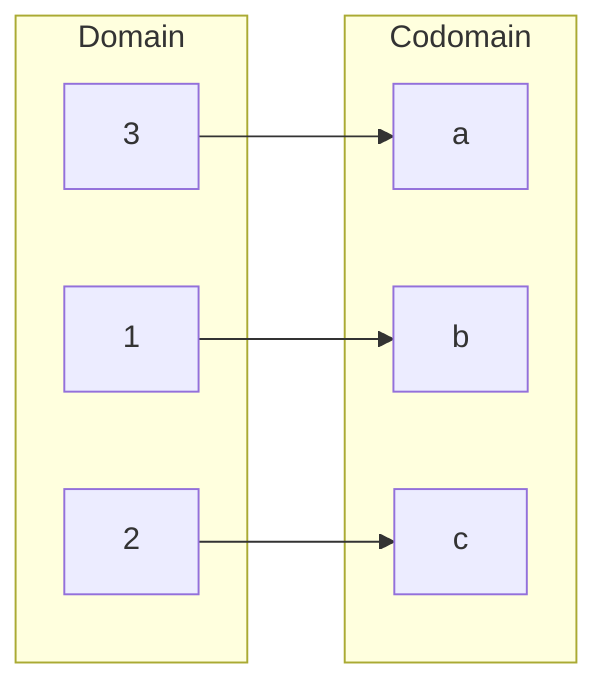

# Injective, surjective and bijective

After this lesson you can prove or disprove that a function is injective, surjective or bijective using the standard templates, show that composition preserves each property, prove that a function has an inverse exactly when it is a bijection, and count functions between finite sets.

Before this: [functions and well-definedness](04-functions-and-well-definedness.md), [composition and inverse functions](../../03-high-school/03-functions/05-composition-and-inverse-functions.md) (the one-to-one test), [quantifiers](../02-logic-and-sets/04-quantifiers.md) and [contrapositive proof](../03-core-proof-methods/05-contrapositive-proof.md).

## Quick check

Try these first. If you get all three right, skip to [Practice](#practice).

1. For $f \colon \mathbb{R} \to \mathbb{R}$ with $f(x) = x^2$, say whether $f$ is injective and whether it is surjective, with a reason for each.
2. Is $g \colon \mathbb{Z} \to \mathbb{Z}$ with $g(n) = 2n + 1$ injective? Surjective?
3. How many functions are there from a 3-element set to a 5-element set, and how many of them are injective?

<details class="solution" markdown>
<summary>Answers</summary>

1. Not injective: $f(2) = f(-2) = 4$ with $2 \ne -2$. Not surjective: $-1$ has no input, since $x^2 \ge 0$.
2. Injective: if $2a + 1 = 2b + 1$ then $a = b$. Not surjective: $2n + 1$ is always odd, so $4$ has no input.
3. There are $5^3 = 125$ functions. An injective one chooses three different outputs in order: $5 \cdot 4 \cdot 3 = 60$.

</details>

## The idea

A function can fail to be reversible in two different ways, and the two ways need two different words. A coat check hands out numbered tickets. If two coats got the same ticket number, you couldn't tell which coat comes back for it: the ticket function from coats to numbers isn't one-to-one. If some tickets in the book were never used, that is no problem for returning coats, but the function doesn't use all the numbers: it isn't onto.

An inverse needs both: different inputs must not share an output (so each output can be traced back to one input), and every possible output must be used (so the inverse has a value everywhere). Properties that describe each half separately are injective (no two inputs share an output) and surjective (every output is used), and a function that has both is bijective. The high school lesson on [composition and inverse functions](../../03-high-school/03-functions/05-composition-and-inverse-functions.md) used the horizontal line test and proved that an inverse forces one-to-one. This lesson finishes that story with the converse, gives a proof template for each property, and counts.

These three words are about the whole of the function, domain and codomain included. The rule $x \mapsto x^2$ is neither injective nor surjective from $\mathbb{R}$ to $\mathbb{R}$, surjective onto $[0, \infty)$, injective on $[0, \infty)$, and bijective from $[0, \infty)$ to $[0, \infty)$. The rule is the same in all five cases and the answers differ, because the sets differ. That is why the codomain is part of the definition of a function.

## Definitions

Let $f \colon A \to B$ be a function.

$f$ is **injective** (or one-to-one) if different inputs give different outputs: for all $a, a' \in A$, if $f(a) = f(a')$, then $a = a'$. In plain words, no output is used twice. The contrapositive form is "if $a \ne a'$ then $f(a) \ne f(a')$", and the first form is the one used in proofs.

$f$ is **surjective** (or onto) if every element of the codomain is an output: for every $b \in B$ there is an $a \in A$ with $f(a) = b$. In plain words, nothing in the codomain is missed, so the range equals the codomain.

$f$ is **bijective** (or a one-to-one correspondence) if it is both injective and surjective. In plain words, each element of $B$ is the output of exactly one element of $A$, so the inputs and outputs are paired up with none left over.

A function $g \colon B \to A$ is an **inverse** of $f$ if $g(f(a)) = a$ for every $a \in A$ and $f(g(b)) = b$ for every $b \in B$. In terms of composition, $g \circ f = \text{id}_A$ and $f \circ g = \text{id}_B$. We write $g = f^{-1}$.

A caution about words. "One-to-one" and "one-to-one correspondence" sound alike and mean different things: the first is injective, and the second is bijective. This book uses "injective", "surjective" and "bijective", which can't be confused.

The picture for finite sets is an arrow diagram. In an injective function, no element of $B$ has two arrows arriving. In a surjective function, every element of $B$ has at least one arrow arriving. In a bijection, every element of $B$ has exactly one.



The diagram shows a bijection from $\{1, 2, 3\}$ to $\{a, b, c\}$: each element of the codomain receives exactly one arrow. Examples at a glance:

| Function | Domain $\to$ codomain | Injective | Surjective |
|---|---|---|---|
| $x \mapsto 2x + 1$ | $\mathbb{R} \to \mathbb{R}$ | yes | yes |
| $n \mapsto 2n + 1$ | $\mathbb{Z} \to \mathbb{Z}$ | yes | no (misses the even numbers) |
| $x \mapsto x^2$ | $\mathbb{R} \to \mathbb{R}$ | no | no |
| $x \mapsto x^2$ | $\mathbb{R} \to [0, \infty)$ | no | yes |
| $x \mapsto x^2$ | $[0, \infty) \to \mathbb{R}$ | yes | no |
| $x \mapsto x^2$ | $[0, \infty) \to [0, \infty)$ | yes | yes |
| $x \mapsto x^3$ | $\mathbb{R} \to \mathbb{R}$ | yes | yes |
| $n \mapsto n \bmod 5$ | $\mathbb{Z} \to \{0, 1, 2, 3, 4\}$ | no | yes |
| $x \mapsto \lfloor x \rfloor$ | $\mathbb{R} \to \mathbb{Z}$ | no | yes |
| $n \mapsto n + 1$ | $\mathbb{N} \to \mathbb{N}$ | yes | no (misses $0$) |
| $n \mapsto n + 1$ | $\mathbb{Z} \to \mathbb{Z}$ | yes | yes |

## How to do it

### Proving injective

1. Write the definition: "for all $a, a' \in A$, if $f(a) = f(a')$ then $a = a'$".
2. Start the proof with "Suppose $f(a) = f(a')$", where $a$ and $a'$ are arbitrary elements of $A$.
3. Replace $f(a)$ and $f(a')$ by their formulas and solve the equation until you reach $a = a'$.
4. End with "so $a = a'$, and $f$ is injective".

The start of the proof is the hypothesis $f(a) = f(a')$. Starting with "suppose $a = a'$" proves nothing, because every function has $a = a' \Rightarrow f(a) = f(a')$.

### Proving surjective

1. Write the definition: "for every $b \in B$ there is an $a \in A$ with $f(a) = b$".
2. Start with "Let $b \in B$". The rest of the proof is about this arbitrary $b$.
3. Scratch work: solve the equation $f(a) = b$ for $a$ in terms of $b$.
4. In the proof, state the formula for $a$, show that $a \in A$ (it lies in the domain, which is a real check), and show that $f(a) = b$ by substituting.

Step 4 has two checks, and both are needed. The solution must be in the domain, and it must work.

### Disproving

To disprove injective, exhibit two different inputs with the same output and show the outputs are equal: $f(2) = 4 = f(-2)$. To disprove surjective, exhibit an element $b$ of the codomain and show that $f(a) = b$ has no solution $a$ in the domain. The second needs an argument for "no solution", as in "$x^2 = -1$ has no real solution because squares are non-negative".

### Proving bijective, and the inverse

Prove injective and surjective separately. For a bijection, the surjectivity scratch work (solving $f(a) = b$ for $a$) is also the formula for the inverse.

### Theorems

*Theorem 1.* Let $f \colon A \to B$ and $g \colon B \to C$ be functions. (i) If $f$ and $g$ are injective, so is $g \circ f$. (ii) If $f$ and $g$ are surjective, so is $g \circ f$. (iii) If $f$ and $g$ are bijective, so is $g \circ f$.

What we know: the definitions for $f$ and $g$. What we want: the same property for $g \circ f$. The plan: use the template for each property and apply the hypotheses one function at a time.

*Proof.* (i) Suppose $(g \circ f)(a) = (g \circ f)(a')$, that is, $g(f(a)) = g(f(a'))$. Since $g$ is injective, $f(a) = f(a')$. Since $f$ is injective, $a = a'$.

(ii) Let $c \in C$. Since $g$ is surjective, there is $b \in B$ with $g(b) = c$. Since $f$ is surjective, there is $a \in A$ with $f(a) = b$. Then $(g \circ f)(a) = g(f(a)) = g(b) = c$.

(iii) Combine (i) and (ii). $\blacksquare$

Look back: each proof peels off the outer function first. The converses are partly true: if $g \circ f$ is injective, then $f$ is injective, and if $g \circ f$ is surjective, then $g$ is surjective (Practice 6 and the FAQ). Check with $f(x) = x + 1$ and $g(x) = 3x$ on $\mathbb{R}$, both bijections: $(g \circ f)(x) = 3x + 3$ is a bijection.

*Theorem 2.* A function $f \colon A \to B$ has an inverse if and only if it is bijective. The inverse is then unique.

What we know: the definitions of injective, surjective and inverse. What we want: both directions of an "if and only if", and uniqueness. The plan: for ($\Rightarrow$), cancel with $g$ to get injectivity, and use $f(g(b)) = b$ to get surjectivity. For ($\Leftarrow$), define $g(b)$ to be the one input that $f$ sends to $b$, check that $g$ is a function, and check both composites.

*Proof.* ($\Rightarrow$) Suppose $g$ is an inverse of $f$. Injective: if $f(a) = f(a')$, apply $g$ to both sides to get $g(f(a)) = g(f(a'))$, that is, $a = a'$. Surjective: let $b \in B$. Then $f(g(b)) = b$, so $b$ is the output of the input $g(b) \in A$.

($\Leftarrow$) Suppose $f$ is bijective, and let $b \in B$. By surjectivity there is an $a \in A$ with $f(a) = b$. By injectivity it is unique: if $f(a) = f(a') = b$ then $a = a'$. Define $g(b)$ to be this $a$. Then $g$ is a function from $B$ to $A$ (existence and uniqueness of $g(b)$ are the two things just shown), and by construction $f(g(b)) = b$ for every $b \in B$. For $a \in A$, the element $g(f(a))$ is the unique input that $f$ sends to $f(a)$, and $a$ is such an input, so $g(f(a)) = a$. Hence $g$ is an inverse of $f$.

Uniqueness: if $g$ and $h$ are both inverses of $f$, then $g = g \circ (f \circ h) = (g \circ f) \circ h = h$, using $f \circ h = \text{id}_B$, associativity, and $g \circ f = \text{id}_A$. $\blacksquare$

Look back: the proof of ($\Leftarrow$) is the algebra "solve $y = f(x)$ for $x$" in the language of sets: injectivity is why the solution is unique, and surjectivity is why it exists. This is the reason an inverse must be unique ("the" inverse). Check with $f(x) = 3x - 5$: the unique $x$ with $f(x) = y$ is $\frac{y + 5}{3}$, which is $f^{-1}(y)$.

### Finite sets and counting

For finite sets, the three properties are connected to the sizes.

*Theorem 3.* Let $f \colon A \to B$ be a function between finite sets with $\lvert A \rvert = \lvert B \rvert = n$. Then $f$ is injective if and only if it is surjective, and so if and only if it is bijective.

What we know: for finite sets, a subset of a set with the same size is the whole set. What we want: injective $\iff$ surjective. The plan: count the range $f(A)$.

*Proof.* If $f$ is injective, the $n$ elements of $A$ have $n$ different outputs, so $\lvert f(A) \rvert = n$. Since $f(A) \subseteq B$ and $\lvert B \rvert = n$, we get $f(A) = B$, so $f$ is surjective. Conversely, suppose $f$ is not injective, so $f(a) = f(a')$ for some $a \ne a'$. Then the $n$ inputs produce at most $n - 1$ different outputs, so $\lvert f(A) \rvert \le n - 1 < n$ and $f$ is not surjective. So surjective implies injective by the contrapositive. $\blacksquare$

Look back: this is false for infinite sets, as $n \mapsto n + 1$ on $\mathbb{N}$ shows: injective and not surjective. That is the source of the strange facts in the next lesson.

*Theorem 4 (pigeonhole principle).* If $A$ and $B$ are finite sets and $\lvert A \rvert > \lvert B \rvert$, then no function $f \colon A \to B$ is injective. Equivalently, if more than $n$ objects are placed in $n$ boxes, some box holds two.

*Proof.* If $f$ were injective, the $\lvert A \rvert$ inputs would have $\lvert A \rvert$ different outputs in $B$, so $\lvert A \rvert \le \lvert B \rvert$, a contradiction. $\blacksquare$

The counts for $\lvert A \rvert = m$ and $\lvert B \rvert = n$ are as follows. Each of the $m$ inputs independently chooses one of $n$ outputs, so there are $n^m$ functions. An injective function chooses different outputs: $n$ choices for the first input, $n - 1$ for the second, down to $n - m + 1$ for the last, giving $n(n - 1) \cdots (n - m + 1)$ injective functions, which is $0$ if $m > n$ (pigeonhole). If $m = n$, this is $n!$, and these are the bijections. The number of surjective functions is $\sum_{k=0}^{n} (-1)^k \binom{n}{k} (n - k)^m$, by the method of [inclusion-exclusion and the pigeonhole principle](../../06-cs-math/03-counting-and-discrete-probability/04-inclusion-exclusion-and-pigeonhole.md), which gives $36$ for $m = 4$ and $n = 3$.

| $\lvert A \rvert \to \lvert B \rvert$ | All functions | Injective | Surjective | Bijective |
|---|---|---|---|---|
| $3 \to 3$ | $27$ | $6$ | $6$ | $6$ |
| $3 \to 4$ | $64$ | $24$ | $0$ | $0$ |
| $4 \to 3$ | $81$ | $0$ | $36$ | $0$ |
| $4 \to 4$ | $256$ | $24$ | $24$ | $24$ |

### Hash collisions

A hash function sends an unbounded set of inputs (files, strings) to a fixed set of outputs (for example $2^{256}$ bit patterns). By the pigeonhole principle, such a function is never injective: some pair of inputs collides. Collisions are unavoidable, and the design goal is to make them hard to find. For a small table the effect arrives early. Hashing 17 words into 16 buckets must put two words in one bucket, and in the birthday problem, 23 people have a better than even chance, about 50.7%, of a shared birthday, long before the 366 people that pigeonhole guarantees ([discrete probability](../../06-cs-math/03-counting-and-discrete-probability/05-discrete-probability.md)).

## Worked examples

<div class="example" markdown>

### Example 1: a linear bijection

Prove that $f \colon \mathbb{R} \to \mathbb{R}$, $f(x) = 3x - 5$, is bijective, and find its inverse.

Injective, Steps 1 to 4. The definition is "$f(a) = f(a') \Rightarrow a = a'$". Suppose $f(a) = f(a')$. Then $3a - 5 = 3a' - 5$. Adding $5$ gives $3a = 3a'$, and dividing by $3$ gives $a = a'$. So $f$ is injective.

Surjective, Steps 1 to 4. Let $y \in \mathbb{R}$ be arbitrary. Scratch work: solve $3x - 5 = y$ to get $x = \frac{y + 5}{3}$. Proof: take $x = \frac{y + 5}{3}$. This is a real number, so it lies in the domain. And $f(x) = 3 \cdot \frac{y + 5}{3} - 5 = y + 5 - 5 = y$. So every $y$ is an output, and $f$ is surjective.

So $f$ is bijective, and by Theorem 2 it has an inverse. The surjectivity scratch work gives it: $f^{-1}(y) = \frac{y + 5}{3}$.

Check both ways: $f(f^{-1}(y)) = y$ was just shown, and $f^{-1}(f(x)) = \frac{3x - 5 + 5}{3} = x$. At a point: $f(4) = 7$ and $f^{-1}(7) = \frac{12}{3} = 4$.

</div>

<div class="example" markdown>

### Example 2: a bijection between restricted sets

Prove that $f \colon \mathbb{R} \setminus \{2\} \to \mathbb{R} \setminus \{1\}$, $f(x) = \dfrac{x + 1}{x - 2}$, is bijective.

First, $f$ really maps into $\mathbb{R} \setminus \{1\}$: if $\frac{x + 1}{x - 2} = 1$ then $x + 1 = x - 2$, which is false, so the output is never $1$.

Injective: suppose $f(a) = f(b)$, that is, $\frac{a + 1}{a - 2} = \frac{b + 1}{b - 2}$. Cross-multiplying (both denominators are non-zero), $(a + 1)(b - 2) = (b + 1)(a - 2)$. Expanding, $ab - 2a + b - 2 = ab - 2b + a - 2$, so $-2a + b = -2b + a$, which gives $3b = 3a$, so $a = b$.

Surjective: let $y \in \mathbb{R} \setminus \{1\}$. Scratch work: $y(x - 2) = x + 1$ gives $x(y - 1) = 2y + 1$, so $x = \frac{2y + 1}{y - 1}$, which makes sense because $y \ne 1$. We need to check that this $x$ is in the domain, that is, $x \ne 2$: if $\frac{2y + 1}{y - 1} = 2$ then $2y + 1 = 2y - 2$, which is false. So $x \in \mathbb{R} \setminus \{2\}$. And $x + 1 = \frac{3y}{y - 1}$ and $x - 2 = \frac{3}{y - 1}$, so $f(x) = \frac{3y}{3} = y$.

Check: $f(3) = \frac{4}{1} = 4$, and the inverse formula $\frac{2 \cdot 4 + 1}{4 - 1} = 3$ returns it. The two excluded points $2$ and $1$ are what make this a bijection: on $\mathbb{R}$ the formula isn't defined at $2$, and the value $1$ is never reached.

</div>

<div class="example" markdown>

### Example 3: disproofs

Show that $f \colon \mathbb{Z} \to \mathbb{Z}$, $f(n) = n^2$, is neither injective nor surjective. Then show that $g \colon \mathbb{N} \to \mathbb{N}$, $g(n) = n + 1$, is injective and not surjective.

For $f$: it is not injective because $f(2) = 4 = f(-2)$ and $2 \ne -2$. It is not surjective because the codomain element $2$ has no input. If $n^2 = 2$ for an integer $n$, then either $\lvert n \rvert \le 1$, which gives $n^2 \le 1$, or $\lvert n \rvert \ge 2$, which gives $n^2 \ge 4$. Neither is $2$.

For $g$: injective, since $n + 1 = m + 1$ gives $n = m$. Not surjective: the element $0 \in \mathbb{N}$ has no input, because $n + 1 \ge 1$ for every $n \in \mathbb{N}$.

Check: for $g$, the diagram has an arrow from every $n$ to $n + 1$, no two arrows meet, and $0$ receives none. On a finite set this would be impossible, by Theorem 3.

</div>

<div class="example" markdown>

### Example 4: a cube plus two (finish it yourself)

Prove that $f \colon \mathbb{R} \to \mathbb{R}$, $f(x) = x^3 + 2$, is injective. (It is also surjective, because every real number has a real cube root, and this is taken as known.)

Suppose $f(a) = f(b)$. Then $a^3 + 2 = b^3 + 2$, so $a^3 = b^3$. We need to reach $a = b$. Rewrite $a^3 - b^3 = 0$ using the factorization

$$
a^3 - b^3 = (a - b)(a^2 + ab + b^2).
$$

Now finish: show that the second factor can be $0$ only when $a = b = 0$, and conclude that $a = b$.

<details class="solution" markdown>
<summary>Finish</summary>

From $(a - b)(a^2 + ab + b^2) = 0$, either $a - b = 0$ or $a^2 + ab + b^2 = 0$. In the first case $a = b$. In the second case, complete the square: $a^2 + ab + b^2 = \left(a + \frac{b}{2}\right)^2 + \frac{3b^2}{4}$. Both terms are at least $0$, so the sum is $0$ only if $b = 0$ and then $a + 0 = 0$, so $a = b = 0$, and again $a = b$. In every case $a = b$, so $f$ is injective.

Check: $f(1) = 3$ and $f(-1) = 1$, so different inputs gave different outputs, and the cubing function is increasing, which is another reason it is injective.

</details>

</div>

## Edge cases and common mistakes

<div class="warning" markdown>

Watch out: don't start an injectivity proof with "suppose $a = a'$". That gives $f(a) = f(a')$ for every function, injective or not, and it is the wrong direction. The proof starts from $f(a) = f(a')$ and ends at $a = a'$.

</div>

<div class="warning" markdown>

Watch out: a solution has to be in the domain. To show that $f(x) = \frac{1}{x}$ from $\mathbb{R}\setminus\{0\}$ to $\mathbb{R}$ is onto, "solve $\frac{1}{x} = y$ to get $x = \frac{1}{y}$" fails at $y = 0$: there is no input for the output $0$, and $f$ isn't surjective onto $\mathbb{R}$. A surjectivity proof must show that the $x$ it finds is allowed, as in Example 2.

</div>

<div class="warning" markdown>

Watch out: checking a few values proves nothing. A list of different outputs for $2$, $3$ and $-1$ doesn't show injectivity, and a list of inputs for some outputs doesn't show surjectivity. The proofs start with arbitrary elements. For a disproof, a single counterexample is the whole proof, and it must be stated with its values.

</div>

<div class="warning" markdown>

Watch out: "onto" is about the codomain you were given. The function $x \mapsto x^2$ is not surjective onto $\mathbb{R}$ and is surjective onto $[0, \infty)$. Say the sets before the verdict. A function that isn't surjective can often be made so by shrinking the codomain to its range.

</div>

<div class="warning" markdown>

Watch out: don't confuse "surjective" with "every input has an output". That is the definition of a function. Surjective says that every element of the codomain is an output of some input.

</div>

Some small cases. The empty function from $\emptyset$ to any set $B$ is injective, and it is surjective only when $B = \emptyset$. The identity function is a bijection. A constant function is injective only when the domain has at most one element, and surjective only when the codomain has at most one element. For a function from a finite set to a smaller one, Theorem 4 says it is never injective, and to a larger one it is never surjective.

## Tricks and shortcuts

For a real function, a strictly increasing (or strictly decreasing) function is injective: if $a < b$ then $f(a) < f(b)$, so $f(a) \ne f(b)$, and the same holds for $b < a$. This covers $3x - 5$, $x^3 + 2$ and $x^3$, and it is the reason the horizontal line test works for functions that rise or fall steadily.

To find a counterexample to injectivity, look for symmetry in the formula. Even functions ($f(-x) = f(x)$) fail at $x$ and $-x$, and a remainder function fails at $a$ and $a + n$. To find a counterexample to surjectivity, ask which values the formula can never produce: a negative value for a square, an even value for $2n + 1$, a zero for a reciprocal.

For a function between two finite sets of the same size, only one property needs checking (Theorem 3). To check injectivity, list the outputs and look for a repeat.

Whenever you need an inverse, solve $y = f(x)$ for $x$. If you can, and the solution is always in the domain and unique, you have shown that $f$ is bijective and found the inverse in a single step.

## In code

The program tests injective and surjective on finite sets by looking at the set of outputs, counts the functions between small sets by listing all of them, confirms Theorem 3 on all functions of a 4-element set, and shows hash collisions and the birthday number.

<details class="code" markdown>
<summary>In code</summary>

```python
from itertools import product
from math import comb, factorial

def injective(f, A):
    return len({f(a) for a in A}) == len(list(A))

def surjective(f, A, B):
    return {f(a) for a in A} == set(B)

A = range(-3, 4)
sq = lambda x: x * x
print(injective(sq, A), surjective(sq, A, range(0, 10)))              # False False
print(injective(lambda x: 2 * x + 1, A), surjective(lambda x: 2 * x + 1, A, range(-5, 8)))
# True False   (2x+1 skips the even numbers)

Z5 = range(5)
print(injective(lambda n: n % 5, range(10)), surjective(lambda n: n % 5, range(10), Z5))   # False True

def functions(A, B):
    A, B = list(A), list(B)
    return [dict(zip(A, values)) for values in product(B, repeat=len(A))]

A, B = [1, 2, 3, 4], ["a", "b", "c"]
fs = functions(A, B)
n_inj = sum(injective(f.get, A) for f in fs)
n_surj = sum(surjective(f.get, A, B) for f in fs)
print(len(fs), n_inj, n_surj)                                         # 81 0 36

A, B = [1, 2, 3], ["a", "b", "c", "d"]
fs = functions(A, B)
print(len(fs), sum(injective(f.get, A) for f in fs), sum(surjective(f.get, A, B) for f in fs))   # 64 24 0

A = B = [1, 2, 3, 4]
fs = functions(A, B)
print(sum(injective(f.get, A) for f in fs), sum(surjective(f.get, A, B) for f in fs), factorial(4))   # 24 24 24
print(all(injective(f.get, A) == surjective(f.get, A, B) for f in fs))                                 # True

# surjections by inclusion-exclusion
m, n = 4, 3
print(sum((-1) ** k * comb(n, k) * (n - k) ** m for k in range(n + 1)))                                # 36

# hash collisions: 17 words into 16 buckets must collide
words = ["alpha", "beta", "gamma", "delta", "epsilon", "zeta", "eta", "theta", "iota", "kappa",
         "lambda", "mu", "nu", "xi", "omicron", "pi", "rho"]
h = lambda w: sum(map(ord, w)) % 16
seen = {}
for w in words:
    seen.setdefault(h(w), []).append(w)
print(len(words), len(seen), any(len(v) > 1 for v in seen.values()))   # 17 10 True
collisions = {k: v for k, v in sorted(seen.items()) if len(v) > 1}
print(collisions)
# {1: ['lambda', 'xi'], 3: ['gamma', 'nu'], 6: ['alpha', 'theta'], 9: ['pi', 'rho'], 10: ['delta', 'epsilon', 'eta'], 13: ['iota', 'kappa']}

# birthday
p = 1.0
for k in range(23):
    p *= (365 - k) / 365
print(round(1 - p, 4))                                                                                 # 0.5073

# inverse of a bijection on a finite set
f = {1: "b", 2: "c", 3: "a"}
inv = {v: k for k, v in f.items()}
print(inv, all(inv[f[x]] == x for x in f), all(f[inv[y]] == y for y in inv))
# {'b': 1, 'c': 2, 'a': 3} True True
```

The two test functions look at the set of outputs: a function is injective exactly when its set of outputs has as many elements as its set of inputs, and surjective when the set of outputs is the codomain. Brute force shows $81$ functions from a 4-element set to a 3-element set, none injective (pigeonhole) and $36$ surjective. A poor hash function, the sum of the letter codes mod $16$, shows that $17$ words fall into only $10$ of the $16$ buckets. The inverse of a finite bijection is a dictionary with keys and values swapped, and it works because every value is distinct (injective) and every codomain element appears (surjective).

</details>

## FAQ

### Is a function that is injective also surjective?

Only sometimes. Injective says no output is used twice, and surjective says every output is used. The function $n \mapsto 2n$ on $\mathbb{Z}$ is injective and misses the odd numbers. On finite sets of the same size, one implies the other (Theorem 3), and on infinite sets it doesn't.

### How do I know whether to prove injective or surjective first?

Do whichever is easier, and do both for a bijection. For linear and monotone functions, injectivity is a quick algebra step. For surjectivity, solving $f(x) = y$ gives the formula, and the formula also gives the inverse, so that one is more useful if you need the inverse.

### If $g \circ f$ is surjective, is $f$ surjective?

No. If $g \circ f$ is surjective then $g$ is surjective, and nothing is forced for $f$. For example, $f \colon \{1\} \to \{a, b\}$ with $f(1) = a$ and $g \colon \{a, b\} \to \{x\}$ constant: $g \circ f$ is surjective onto $\{x\}$, and $f$ misses $b$. The mirror statement is true: if $g \circ f$ is injective then $f$ is injective, and $g$ need not be (Practice 6).

### Why is it called "onto" in some books?

Because $f \colon A \to B$ maps $A$ onto $B$ when it covers all of $B$, and into $B$ when it only lands inside. The word "surjective" comes from the French *sur* (on), and "injective" from the idea of injecting $A$ into $B$ without overlap. All three names are in use, and this book writes injective and surjective.

## Practice

### Warm-up

1\. Classify each function (injective, surjective, both, neither). (a) $f \colon \{1, 2, 3\} \to \{a, b, c\}$, $f(1) = a$, $f(2) = c$, $f(3) = b$. (b) $g \colon \{1, 2, 3\} \to \{a, b\}$, $g(1) = a$, $g(2) = b$, $g(3) = a$. (c) $h \colon \{1, 2\} \to \{a, b, c\}$, $h(1) = a$, $h(2) = b$.

<details class="solution" markdown>
<summary>Solution</summary>

- (a) Each of $a$, $b$, $c$ receives exactly one arrow, so $f$ is bijective.
- (b) Injective fails: $g(1) = g(3) = a$. Surjective holds: $a$ and $b$ are both outputs. So $g$ is surjective and not injective.
- (c) Injective holds: $a \ne b$. Surjective fails: $c$ is not an output. So $h$ is injective and not surjective.

Check with sizes: (a) $3 \to 3$, both properties together. (b) $3 \to 2$ can't be injective by pigeonhole. (c) $2 \to 3$ can't be surjective, since at most $2$ outputs occur.

</details>

2\. Classify each function. (a) $f \colon \mathbb{R} \to \mathbb{R}$, $f(x) = -4x + 7$. (b) $g \colon \mathbb{R} \to \mathbb{R}$, $g(x) = \lvert x \rvert$. (c) $h \colon \mathbb{Z} \to \mathbb{Z}$, $h(n) = 3n$.

<details class="solution" markdown>
<summary>Solution</summary>

- (a) Bijective. Injective: $-4a + 7 = -4b + 7$ gives $a = b$. Surjective: given $y$, take $x = \frac{7 - y}{4}$, and $f(x) = -(7 - y) + 7 = y$.
- (b) Neither. $g(2) = g(-2) = 2$, and $-1$ is not an output. (Onto $[0, \infty)$ it is surjective.)
- (c) Injective ($3a = 3b$ gives $a = b$), not surjective ($1$ is not a multiple of $3$).

Check (a) at $x = 2$: $f(2) = -1$, and $x = \frac{7 - (-1)}{4} = 2$.

</details>

3\. Count the functions from $\{1, 2, 3\}$ to $\{a, b\}$, and say how many are injective, how many are surjective.

<details class="solution" markdown>
<summary>Solution</summary>

There are $2^3 = 8$ functions. None is injective, since $3 > 2$ (pigeonhole). A function fails to be surjective only if all three inputs go to the same output, which happens for the $2$ constant functions. So $8 - 2 = 6$ are surjective.

Check by listing the triples $(f(1), f(2), f(3))$: $aaa$ and $bbb$ are the only ones that use one letter, and the other six use both.

</details>

### Standard

4\. Prove that $f \colon \mathbb{R} \setminus \{0\} \to \mathbb{R} \setminus \{0\}$, $f(x) = \frac{1}{x}$, is bijective, and find $f^{-1}$.

<details class="solution" markdown>
<summary>Solution</summary>

*Proof.* Injective: suppose $\frac{1}{a} = \frac{1}{b}$. Then $b = a$ (cross-multiplying, or taking reciprocals). Surjective: let $y \in \mathbb{R} \setminus \{0\}$. Take $x = \frac{1}{y}$, which is defined and non-zero, so it is in the domain, and $f(x) = \frac{1}{1/y} = y$. $\blacksquare$

The surjectivity formula gives the inverse $f^{-1}(y) = \frac{1}{y}$, so $f$ is its own inverse.

Check: $f(4) = \frac{1}{4}$ and $f\left(\frac{1}{4}\right) = 4$.

</details>

5\. Find the flaw: "Claim: $g \colon \mathbb{R} \to \mathbb{R}$, $g(x) = x^2$ is injective. Proof: suppose $a = b$. Then $a^2 = b^2$. So $g$ is injective." Then say what the correct verdict is.

<details class="solution" markdown>
<summary>Solution</summary>

The proof starts at the wrong end. It assumes $a = b$ and derives $g(a) = g(b)$, and that is true for every function. Injectivity needs the other direction: assume $g(a) = g(b)$ and reach $a = b$. Here $a^2 = b^2$ gives $(a - b)(a + b) = 0$, which allows $a = -b$.

Correct verdict: not injective. Counterexample: $g(3) = 9 = g(-3)$ and $3 \ne -3$. Restricted to $[0, \infty)$ it is injective, and the proof from $a^2 = b^2$ finishes because $a + b = 0$ forces $a = b = 0$ when both are non-negative.

Check: $g(2) = 4 = g(-2)$ confirms the counterexample.

</details>

6\. Let $f \colon A \to B$ and $g \colon B \to C$. (a) Prove that if $g \circ f$ is injective, then $f$ is injective. (b) Give an example in which $g \circ f$ is injective and $g$ is not.

<details class="solution" markdown>
<summary>Solution</summary>

(a) What we know: $g(f(a)) = g(f(a'))$ implies $a = a'$. What we want: $f(a) = f(a')$ implies $a = a'$. The plan: apply $g$ to both sides.

*Proof.* Suppose $f(a) = f(a')$. Applying $g$ gives $g(f(a)) = g(f(a'))$, that is, $(g \circ f)(a) = (g \circ f)(a')$. Since $g \circ f$ is injective, $a = a'$. $\blacksquare$

(b) Take $A = \{1\}$, $B = \{a, b\}$, $C = \{x\}$, with $f(1) = a$ and $g(a) = g(b) = x$. Then $g \circ f$ maps a one-element set to $x$ and is injective, and $g$ sends two different elements to $x$, so it isn't.

Check: $g$ fails because $g(a) = g(b)$ with $a \ne b$, and $f$ is injective, as part (a) predicts.

</details>

### Challenge

7\. Prove that $f \colon A \to B$ is bijective if and only if for every $b \in B$ the preimage $f^{-1}(\{b\})$ has exactly one element.

<details class="solution" markdown>
<summary>Solution</summary>

What we know: $f^{-1}(\{b\}) = \{a \in A : f(a) = b\}$. What we want: "exactly one element" for every $b$ is the same as injective and surjective together. The plan: read "at least one" as surjective and "at most one" as injective.

*Proof.* ($\Rightarrow$) Suppose $f$ is bijective and let $b \in B$. By surjectivity the preimage has at least one element. If $a$ and $a'$ are both in it, then $f(a) = b = f(a')$ and injectivity gives $a = a'$, so it has at most one. So it has exactly one.

($\Leftarrow$) Suppose every preimage $f^{-1}(\{b\})$ has exactly one element. Surjective: for $b \in B$ the preimage is non-empty, so some $a$ has $f(a) = b$. Injective: if $f(a) = f(a') = b$, then $a$ and $a'$ are both in $f^{-1}(\{b\})$, which has one element, so $a = a'$. $\blacksquare$

Check with $f(x) = x^2$ on $\mathbb{Z}$: the preimage of $4$ is $\{-2, 2\}$ (two elements) and the preimage of $2$ is empty, so $f$ is not bijective, as expected.

</details>

8\. (Reviews [functions and well-definedness](04-functions-and-well-definedness.md).) The rule $F([a]) = [3a]$ is a well-defined function $\mathbb{Z}_5 \to \mathbb{Z}_5$ (Example 4 there). Prove that $F$ is bijective by finding an inverse, and say what the inverse does.

<details class="solution" markdown>
<summary>Solution</summary>

What we know: $F$ is well defined. We look for $G([b]) = [2b]$, because $3 \cdot 2 = 6 \equiv 1 \pmod{5}$. The plan: show that $G$ is well defined and that both composites are the identity, then use Theorem 2.

*Proof.* $G$ is well defined: if $b' = b + 5j$ then $2b' - 2b = 10j = 5(2j)$, so $[2b'] = [2b]$. Now $G(F([a])) = G([3a]) = [6a]$, and $6a - a = 5a$ is a multiple of $5$, so $[6a] = [a]$. Similarly $F(G([b])) = F([2b]) = [6b] = [b]$. So $G$ is an inverse of $F$, and by Theorem 2, $F$ is bijective. $\blacksquare$

The inverse multiplies by $2$. In $\mathbb{Z}_5$ the class $[2]$ is the multiplicative inverse of $[3]$, since $[3][2] = [6] = [1]$.

Check: $F([1]) = [3]$, $F([2]) = [6] = [1]$, $F([3]) = [9] = [4]$, $F([4]) = [12] = [2]$ and $F([0]) = [0]$. The outputs $[3], [1], [4], [2], [0]$ are all different, which agrees with bijectivity.

</details>

## Where this shows up

- The next lesson, [cardinality and countability](06-cardinality-and-countability.md), defines "same size" by a bijection and uses the templates of this lesson to compare infinite sets.
- In CS, hash functions are never injective, so collision handling is part of every hash table, and the pigeonhole principle ([inclusion-exclusion and the pigeonhole principle](../../06-cs-math/03-counting-and-discrete-probability/04-inclusion-exclusion-and-pigeonhole.md)) proves lower bounds. An encoding and its decoding are an injective function and a left inverse, and lossless compression must be injective. Encryption and decryption are a bijection and its inverse (RSA cryptography<!-- link: ../../06-cs-math/02-number-theory/06-rsa-cryptography.md -->).
- In linear algebra, a linear map is injective exactly when its kernel is $\{0\}$ and surjective exactly when its image is the whole codomain ([linear transformations, kernel and image](../../05-university-core/06-linear-algebra/05-linear-transformations-kernel-and-image.md)), and an invertible matrix is a bijective linear map. In economics, an inverse demand function (price as a function of quantity) exists only when demand is a bijection between the relevant prices and quantities, which is why textbooks assume demand is strictly decreasing.
